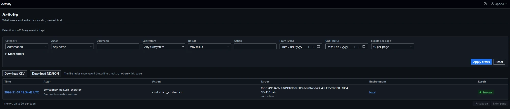
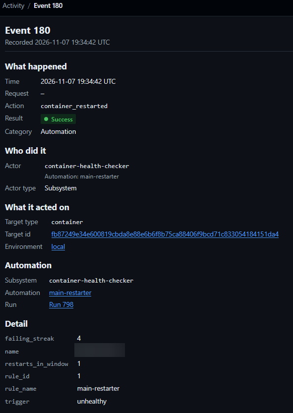

# Activity

The activity log holds one row per recorded action. Administrators read it on the Activity pages, download it as CSV or NDJSON and query it through a JSON route. Retention removes old rows when it is set. `activity-log-exporter` copies the rows to an S3-compatible bucket.

| Surface | Path | Section |
|---|---|---|
| Log | `/activity` | [Log page](#log-page) |
| One event | `/activity/{id}` | [Event page](#event-page) |
| CSV and NDJSON download | `/activity/-/export` | [CSV](#csv), [NDJSON](#ndjson) |
| Panels | Container, Compose stack, Swarm service, managed Swarm stack and environment pages | [Panels](#panels) |
| JSON | `/api/v1/activity` | [JSON API](#json-api) |
| Retention | `DOCKMIN_ACTIVITY_RETENTION_DAYS` | [Retention](#retention) |
| Scheduled copy to a bucket | `activity-log-exporter` | [Export to a bucket](#export-to-a-bucket) |
| Reading the records into a log platform | | [Log ingestion](#log-ingestion) |

## Access

| Surface | Administrators | Standard users | No session or token |
|---|---|---|---|
| Log, event, CSV and NDJSON download | Yes | `403` | Redirect to the sign-in page |
| Panels | Shown | Not rendered | — |
| JSON route | Yes | `403` | `401` |

- Every page answers `Cache-Control: no-store`.
- The `Activity` link, second entry of the `Administration` group in the sidebar, is shown to administrators only.
- The JSON route takes a bearer token only. A session cookie alone answers `401`. Tokens are created at `/account/tokens`.

## Events

### Stored fields

| Field | Content |
|---|---|
| `id` | Increases with every row. Never reused, including after rows are removed |
| `occurred_at` | UTC, `YYYY-MM-DDTHH:MM:SSZ` |
| `category` | `authentication`, `user_action` or `automation` |
| `actor_type` | `user`, `subsystem` or `anonymous` |
| `actor_user_id` | The user, for `user`. Null otherwise |
| `actor_subsystem` | The subsystem name, for `subsystem` ([Subsystems](Reference-Subsystems)). Null otherwise |
| `rule_id` | The automation that fired, for a subsystem that takes automations. Null after the automation is deleted |
| `job_run_id` | The run that wrote the row. Null after the run is deleted |
| `request_id` | The id of the HTTP request or WebSocket connection that wrote the row ([Request id](#request-id)). Null for a subsystem row and for a row written outside a request |
| `environment_id` | The environment. Null for an event that is not about one host, and after the environment is deleted |
| `target_type`, `target_id` | The object acted on. `target_id` is null when no object is named |
| `action` | Lower-case words joined by underscores, such as `container_restarted` |
| `result` | `success` or `failure` |
| `detail` | Flat object. At most 32 keys; string values are cut to 512 characters; values are strings, integers, booleans or null. Secrets are redacted before storage |

- An event is never changed after it is written.
- Rows written under an automation carry `rule_id` and `rule_name` in `detail`. They stay after the automation is deleted.
- A failure row carries `reason` and, when the product wrote the text, `message` in `detail`.
- The Activity pages show a deleted user as `User <id>` and a deleted environment as `Environment <id>`. CSV and NDJSON leave `actor_username` and `environment_name` empty or `null` for them.
- A success row whose environment, automation or run was deleted before the row was written is stored with `environment_id`, `rule_id` and `job_run_id` null and the ids in `detail` as text under the same names. A row that cannot be written at all logs `activity_event_write_failed`.

### Request id

| Item | Value |
|---|---|
| Value | The `X-Request-Id` request header when it is 1 to 64 characters of letters, digits, `.`, `_` and `-`. Otherwise 32 lower-case hexadecimal characters generated by dockmin |
| Response | The id is returned in the `X-Request-Id` response header of an HTTP response. The response to a WebSocket upgrade does not carry it |
| WebSocket connection | An id is bound for each connection by the same rule, from the `X-Request-Id` header of the upgrade request. The rows and log lines written during the connection carry it, `container_exec_started` and `container_exec_ended` of a terminal included |
| Log lines | Every stdout line written while the request or connection runs carries it as `request_id` ([Deployment](Reference-Deployment#logging-events)) |
| Written to | Rows with a `user` or `anonymous` actor |
| Null | Rows with a `subsystem` actor, rows written outside a request, and terminal rows written by an earlier version |
| Background work | A row with a `user` actor written by work a request started, such as a pull, carries the id of the request that started it |
| Uniqueness | None. A client or a proxy chooses the header, so two requests can carry the same id |
| Filter | `request_id` on the log page, the download and the JSON route ([Request id filter](#request-id-filter)) |

### Actors

| Actor type | Meaning | Shown as |
|---|---|---|
| `user` | A signed-in user | The current username; `User <id>` when the user no longer exists |
| `subsystem` | A subsystem, named by `actor_subsystem`, with its automation and run where it has them. The scheduler is never the actor ([Subsystems](Reference-Subsystems#attribution)) | The subsystem name, with `Automation: <name>` beneath |
| `anonymous` | No account. Used for `login`, `bootstrap` and `lockout_cleared` when no user is signed in | `Anonymous`, with `Tried: <username>` for a failed sign-in |

### Categories

| Category | Written for |
|---|---|
| `authentication` | Sign-in and sign-out, bootstrap, password changes and resets, session revocation, API token creation and revocation, webhook URL rotation and revocation, lockout clearing, reveal windows opened |
| `user_action` | A signed-in user changing something |
| `automation` | A subsystem acting. Always a `subsystem` actor |

- A failed sign-in is `login`, result `failure`, actor `anonymous`, target type `user`. The target id is the user's id when the name exists. `detail` holds `address`, `reason`, `method` and, for a password sign-in, the attempted `username` (cut to 128 characters).
- A refused access platform sign-in is the same row with `method` `jwt` and the token's `identity` in place of `username`. The target id is the user's id when an account is linked. Reasons: [Security](Reference-Security#access-platform-tokens).
- A successful sign-in is `login`, result `success`, actor the user. `detail` holds `address` and `method`: `password` or `jwt`.
- An access platform session that ends because its token stopped arriving or changed is `logout`, actor the user, with `reason`, `method` and `address`.
- The recorded actions of each feature are listed with that feature: [Jobs](Administration-Jobs#recorded-actions), [Automation](Operations-Automation#activity-events), [Containers](Usage-Containers#recorded-actions), [Stacks](Usage-Stacks#recorded-actions), [Swarm](Usage-Swarm), [Environments](Usage-Environments#recorded-actions), [Images](Usage-Images#recorded-actions), [Rows recorded by other features](#rows-recorded-by-other-features), [Notifications](Administration-Notifications#recorded-actions), [Subsystems](Reference-Subsystems#log-exporter-failures).

### Not recorded

| Not recorded | Note |
|---|---|
| Reads | Opening the log, an event, a panel, a download or the JSON route. A download writes the log line `activity_exported` |
| Refused requests | A request answered `403` or `404` writes no row. The log line `access_refused` carries it |
| Skipped runs, and successful runs of subsystems with event policy `failures_only` or `none` | The run record is the record ([Jobs](Administration-Jobs#required-events)) |
| Dry runs | A dry run writes no event ([Jobs](Administration-Jobs#dry-run)) |
| Environment refreshes | The snapshot refresher writes a row only when an environment's status moves between `reachable` and `unreachable` ([Subsystems](Reference-Subsystems#environment-snapshot-refresher)) |
| A successful export | `activity-log-exporter` writes a row only on failure |

## Log page

`/activity`. Heading `Activity`, introduction `What users and automations did, newest first.` Events newest first, ordered by time and then id.



| Column | Content |
|---|---|
| Time | UTC to the second. Links to the [event page](#event-page) |
| Actor | Username; subsystem with `Automation: <name>` beneath; `Anonymous` with the attempted username |
| Action | The action name |
| Target | The target id above the target type; `—` when there is no id |
| Environment | Name, linked; `Environment N` when the environment is gone; `—` when none |
| Result | `Success` or `Failure` |

| Control | Behaviour |
|---|---|
| Retention line, above the filters | `Retention is off. Every event is kept.` or `Events older than N days are removed hourly.` ([Retention](#retention)) |
| Held notice | `Held for export since <time>. Retention keeps the events that the export rule has not copied yet.`, or `all N export rules have` for several ([Export hold](#export-hold)) |
| `Apply filters`, `Reset` | The filter form submits with `Apply filters`. `Reset` clears every filter |
| `Download CSV`, `Download NDJSON` | Carry the filters and download every event they match, not only the page shown |
| `Events per page` | `25 per page`, `50 per page`, `100 per page` or `200 per page`; default 50. Query `limit`. Any other value is a field error: `Page size: choose one of the listed sizes.` |

- Paging uses a cursor. A cursor is not tied to the filters it was issued for.
- With script the filter form and the pager swap the results in place and push the URL. Without script they load the page.

### Filters

A filter left empty does not constrain. Filters combine with AND.

| Field | Query parameter | Matches |
|---|---|---|
| Category | `category` | `Authentication`, `User action`, `Automation` |
| Actor | `actor_type` | `User`, `Subsystem`, `Anonymous` |
| Username | `username` | Events whose actor is the user with this current username, ignoring ASCII case. A name no user has is a field error: `Username: no user has this name.` It does not match the attempted username of an anonymous event |
| Subsystem | `subsystem` | Events whose `actor_subsystem` is this name. Every subsystem name, `activity-log-pruner` included |
| Result | `result` | `Success`, `Failure` |
| Action | `action` | The exact action name. Lower-case letters and underscores, 1 to 64 |
| From (UTC) | `from` | `occurred_at` at or after this time |
| Until (UTC) | `to` | `occurred_at` before this time |
| Environment | `environment_id` | Events in the environment, and events that name the environment as their target but record no environment ([Environment filter](#environment-filter)) |
| Target type | `target_type` | The exact target type. Lower-case letters and underscores, 1 to 64 |
| Target id | `target_id` | The exact target id, 256 characters at most. Needs a target type |
| Rule id | `rule_id` | Events whose `rule_id` is this automation. Events of a deleted automation no longer match |
| Run id | `job_run_id` | Events written under this run |

- `from` and `to` are UTC, `YYYY-MM-DDTHH:MM` with optional `:SS`, a `T` or a space between date and time. Years from 1970 to 9998. Anything else is a field error.
- Ids are whole numbers from 1 to 9223372036854775807.
- Every field is at most 256 characters.
- The environment list shows `Any environment` and the environments the administrator can see.
- `Environment`, `Target type`, `Target id`, `Rule id` and `Run id` are under `More filters`, which opens when one is filled in.

#### Target filters

| Filters given | Result |
|---|---|
| `target_type` and `target_id` | Events on that object whose recorded environment equals `environment_id`. With no `environment_id`, only events with no environment match |
| `target_type` and `environment_id` | Events of that type in the environment. With `target_type=environment`, also the environment's own events |
| `target_type` alone | A field error on `Target id`: `a target type needs a target id or an environment` |
| `target_id` without `target_type` | A field error on `Target type`: `a target id needs a target type` |

- A container, stack or service always has an environment. Filter an object of those types with its environment.

#### Environment filter

| Events matched | Condition |
|---|---|
| Events in the environment | `environment_id` equals the environment |
| The environment's own events | No recorded environment, target type `environment`, target id the environment's id. For example `environment_deleted` and `environment_updated` rows written without an environment |

#### Request id filter

| Item | Value |
|---|---|
| Parameter | `request_id`, on `/activity`, `/activity/-/export` and `GET /api/v1/activity` |
| Match | Exact and case-sensitive. Events whose `request_id` equals the value, newest first. Events with a null `request_id` never match |
| Value | 1 to 64 letters, digits, `.`, `_` and `-` |
| Form field | None. The parameter is set in the URL or by the `Request` link of the [event page](#event-page). The filter form keeps a filtered id in a hidden input, so applying other filters keeps it. `Reset` clears it |
| Combination | With every other filter, by AND |
| Heading | `Events recorded with request id <id>`, above the downloads |
| Note | `A client can supply the request id, so events listed here are correlated by that id and are not proven to come from one request.` |
| Download | Carries the filter. The `activity_exported` line lists `request_id` in `filter_names` |
| Invalid value | `422`. The log page and the download show `Request id: use 1 to 64 letters, digits, dots, hyphens or underscores.` in the error summary. The JSON route answers a field error ([JSON API](#json-api)) |

- A client or a proxy chooses the id with `X-Request-Id` ([Request id](#request-id)). Events listed under one id can come from unrelated requests. The result is a correlation aid, not proof that events came from one request.
- Events of one request can have different actors, for example an anonymous event and a user event of one sign-in. The filter does not narrow by actor.

### Errors

| Case | Result |
|---|---|
| A field is wrong | The page renders again at `422` with the message beside the field and the fields refilled. Messages read `<Field>: <what to enter>`, for example `Rule: enter a whole number from 1 to 9223372036854775807.` |
| A cursor is not valid | `422`, `This page link is not valid. Start from the first page.` |
| Unknown subsystem | `422`, field error on `Subsystem` |
| A request from the filter form (HTMX) with a wrong field | `422`. The results area shows the error summary, and the filter form is replaced with one that shows the field errors |
| A request from the pager (HTMX) with an error | `422`, the error summary alone |
| No event recorded | `No activity`, with the text `Nothing has been recorded yet. Events appear here as users and automations act.` |
| No event matches the filters | `Nothing matches these filters`, with the text `Change the filters, or clear them to see every row.` and a `Clear filters` link |

## Event page

`/activity/{id}`. Heading `Event <id>`. An id that is not a plain number from 1 to 9223372036854775807, or names no event, answers `404`.



| Section | Content |
|---|---|
| What happened | Time, `Request` (the request id, linked to the [log filtered by it](#request-id-filter)), action, result, category |
| Who did it | The actor, the actor type, and the user id for a user |
| What it acted on | Target type, target id (linked when the target has a page: [Target links](#target-links)), environment (linked while it exists) |
| Automation | Shown for a subsystem event, or when `rule_id` or `job_run_id` is set. Subsystem; automation; run |
| Detail | Every key of `detail`, sorted by key. Booleans as `Yes` and `No`, null as `—`. `This event recorded no detail.` when empty |

| Automation line | When |
|---|---|
| Automation name, linked to the automation | `rule_id` is set. The name is read from `detail`; `Automation N` when `detail` has none |
| Automation name and a `Deleted` badge | `rule_id` is null and `detail` holds `rule_id`. No link |
| `—` | Neither |

- The run line links to the run page (`Run N`) while `job_run_id` is set.
- The request line shows `request_id` as a link to `/activity?request_id=<id>`, or `—` when it is null.

### Target links

The target id links to the page of the target when its target type has a page and its id has the form that page takes. Any other event shows the id as text.

| Target type | Page | Id | Needs a recorded environment |
|---|---|---|---|
| `automation_rule` | Automation | A whole number from 1 to 9223372036854775807 | No |
| `user` | User | The same | No |
| `team` | Team | The same | No |
| `registry_credential` | Registry credential set | The same | No |
| `object_storage_target` | Object storage target | The same | No |
| `container` | Container | 64 lower-case hexadecimal characters | Yes |
| `network` | Network | The same | Yes |
| `image` | Image | 64 lower-case hexadecimal characters, with or without a leading `sha256:` | Yes |
| `volume` | Volume | The volume name: letters, digits, underscore, period and hyphen, starting with a letter or digit, up to 255 characters | Yes |
| `service` | Swarm service | 25 lower-case letters and digits | Yes |
| `node` | Swarm node | The same | Yes |
| `config` | Swarm config | The same | Yes |
| `secret` | Swarm secret | The same | Yes |
| `notification_channel` | Notification channel | A whole number from 1 to 9223372036854775807 | No |
| `stack` | Compose stack, or Swarm stack when the managed stack of that name is a Swarm stack | A stack name: letters, digits, underscore, period and hyphen, up to 63 characters, starting with a letter or digit | Yes |

- The page opened is in the event's environment.
- A stack name is compared ignoring case with the managed stacks of the environment. A name that matches none opens the Compose stack page.
- A target found missing is shown without a link ([Deleted targets](#deleted-targets)). A target that cannot be checked keeps its link; if the object has been removed, the page gives its usual not-found answer.
- The log page links these target types as the event page does, without checking whether the target exists.
- Other target types, such as `environment`, `backup` and `activity_log`, show the id as text.
- Text taken from stored values is shown with control characters visible ([Text display](#text-display)).

### Deleted targets

The event page checks whether the target it links to still exists. A target found missing is shown as text with a `Deleted` badge and no link. The check runs as an administrator, and the page is for administrators only.

| Target type | Check | Deleted when |
|---|---|---|
| `automation_rule`, `user`, `team`, `object_storage_target` | The row, read by id | There is no row, or the row was created after the event. These ids are reused after a delete |
| `registry_credential` | The row, read by id | There is no row |
| `container`, `network` | Engine inspect by id | The host answers not found |
| `image` | Engine inspect by id | The host answers not found, or the image it returns has another id |
| `volume` | Engine inspect by name | The host answers not found |
| `service`, `node`, `config`, `secret` | Engine inspect by id | The host answers not found. In an environment that is not Swarm the result is unknown |
| `notification_channel` | The row, read by id | There is no row. Ids are never reused |
| `backup` | The backup record, read by id | There is no record, or the record was created after the event. Only the newest 500 records are kept ([Backups](Administration-Backups)) |
| `stack` | The managed stack of that name, compared ignoring case, then the Compose projects of the host's containers and, in a Swarm environment, the stack namespaces of its services | None of them has the name |

The result is unknown, and the link is kept unmarked, when:

- The event has no target id, or a host target has no recorded environment.
- A `backup` event has no target id. Rows written by earlier versions carry none, so they are never marked.
- The id is not in the form the target's page takes ([Target links](#target-links)).
- The environment is stored with any status other than `reachable`. No host is read.
- The host reads for the page take more than 3 seconds together.
- A host read fails for any reason other than not found.

`backup_downloaded` rows, success and failure, carry the id of the backup record as the target id. A `Deleted` badge on one means the record has left the Backups list. A failure row has a target id only when its failed record was written. `backup_uploaded` and `backup_remote_pruned` rows keep the target type `object_storage_target` and are checked as such; the `backup_uploaded` row names its backup record in `detail.backup_record_id`.

Other target types are not checked. A volume or a stack that was removed and created again under the same name reads as existing.

## Panels

An administrator sees an activity panel on five pages. A standard user sees none.

| Page | Events listed |
|---|---|
| Container | Events on the container, by its full id, in its environment |
| Compose stack | Events of target type `stack` in the stack's environment whose name matches the stack's, ignoring case |
| Swarm service | Events of target type `service` on the service, by its full id, in its environment |
| Managed Swarm stack | The same as a Compose stack |
| Environment | Events in the environment and the environment's own events ([Environment filter](#environment-filter)). Panel title `Recent activity` |

The container, Compose stack, Swarm service and managed Swarm stack pages show the panel of the tab that is open. Each panel sits below the tab's content, and a tab swap carries it.

| Tab | Panel | Events listed |
|---|---|---|
| Overview | `Recent activity` | All events on the object |
| Networks (container) | `Network changes` | `network_connected` and `network_disconnected` |
| Automation | `Automated actions` | Events whose actor type is `subsystem` |
| Access | `Access changes` | `resource_control_created`, `resource_control_updated` and `resource_control_deleted` |
| Any other tab | None | — |

| Item | Content |
|---|---|
| Rows | The 10 newest. Time (linked), action, actor, result |
| Empty | `Nothing has been recorded for this yet.` |
| `All activity` | The log filtered to the object: the environment, plus the target type and id for a container or service, and the actor type `subsystem` for `Automated actions`. The log has no filter for a set of actions, so the links of `Network changes` and `Access changes` open the object's events of every action |

- The environment panel is part of the full page. A page rendered again after a form is posted does not carry it.
- A stack's events are found by reading the environment's newest 1,000 events of target type `stack`. A stack with none among them shows an empty panel.
- `All activity` for a stack filters on the stack's name as shown, which the log matches exactly, case included.

## CSV

`GET /activity/-/export`, with the log page's filters and no `limit` or `cursor`. A wrong filter answers the log page at `422`.

1. Open `Activity` and set the filters.
2. Select `Download CSV` or `Download NDJSON`. The browser saves `activity-<YYYYMMDDTHHMMSSZ>.csv` or `.ndjson`.
3. A `429` page `The download was not started` with `Too many exports are running. Try again shortly.` means two downloads are already running. Wait 5 seconds and select the button again.

| Parameter | Value |
|---|---|
| `format` | `csv` (default) or `ndjson` ([NDJSON](#ndjson)). Any other value answers the log page at `400` with `Format: choose csv or ndjson.`. Filters are checked first |

| Item | Value |
|---|---|
| Content type | `text/csv; charset=utf-8` |
| Headers | `Content-Disposition: attachment; filename="activity-<YYYYMMDDTHHMMSSZ>.csv"`, `Cache-Control: no-store`, `X-Content-Type-Options: nosniff` |
| Encoding | RFC 4180: `,` separator, `\r\n` line ends, a cell quoted only when it holds a comma, a quote or a line break. UTF-8, no byte order mark. A header row |
| Order | Newest first |
| Streaming | Read in pages of 500 events; the file is not built in memory |
| Concurrency | At most 2 downloads at once in a process, CSV and NDJSON together. Another answers `429` with `Retry-After: 5` |
| Recorded | The log line `activity_exported`, with the user id and the names of the filters. No activity row |

The scheduled export writes the same format ([Export to a bucket](#export-to-a-bucket)).

| Column | Content |
|---|---|
| `id` | |
| `occurred_at` | |
| `category` | |
| `actor_type` | |
| `actor_user_id` | |
| `actor_username` | The current username. Empty when the user is gone or the actor is not a user |
| `actor_subsystem` | |
| `rule_id` | |
| `rule_name` | From `detail`. Empty when `detail` has none |
| `job_run_id` | |
| `request_id` | The request id ([Request id](#request-id)). Empty when null |
| `environment_id` | |
| `environment_name` | The current name. Empty when the environment is gone |
| `target_type` | |
| `target_id` | |
| `action` | |
| `result` | |
| `reason` | From `detail` |
| `message` | From `detail` |
| `detail` | The whole `detail` as JSON: keys sorted, no spaces, non-ASCII characters written as `\uXXXX`. Empty when there is none |

- Absent values are empty cells. Booleans taken from `detail` are `true` and `false`.
- A character that cannot be encoded, such as an unpaired surrogate, is written as `?`.

### Formula neutralisation

A text cell is prefixed with `'` when it begins with a tab, a carriage return or a line feed, or when, after any leading whitespace, it begins with one of these:

| Characters |
|---|
| `=` `+` `-` `@` |
| `＝` `＋` `－` `＠` (full-width forms, U+FF1D, U+FF0B, U+FF0D, U+FF20) |

- Number columns (`id`, `actor_user_id`, `rule_id`, `job_run_id`, `environment_id`) are not changed.
- Control and bidirectional characters are kept as data.
- `request_id` is a text column. One that begins with `-` is prefixed like any other text cell.
- A reader that wants the original value removes one leading `'`.

## NDJSON

`GET /activity/-/export?format=ndjson`, with the filters of the [CSV](#csv) download. One JSON object per event, each ending in `\n`. The scheduled export writes the same lines ([Export to a bucket](#export-to-a-bucket)). Reading them into a log platform: [Log ingestion](#log-ingestion).

| Item | Value |
|---|---|
| Content type | `application/x-ndjson` |
| Headers | `Content-Disposition: attachment; filename="activity-<YYYYMMDDTHHMMSSZ>.ndjson"`, `Cache-Control: no-store`, `X-Content-Type-Options: nosniff` |
| Encoding | UTF-8, no byte order mark, no header line. Compact JSON: no spaces after `,` or `:`. Non-ASCII characters are written as themselves |
| Escaped | U+0085, U+2028 and U+2029 are written as `\u0085`, `
` and `
` |
| Unencodable character | An unpaired surrogate is written as `?` |
| Order | Newest first in the download, oldest first in an exported object |
| Streaming, concurrency, recording | As for [CSV](#csv): pages of 500 events, 2 downloads at once, the log line `activity_exported` |
| Neutralisation | None. Values are not prefixed with `'` |
| `schema_version` | `2` on every line |

Every key is present on every line. An absent value is `null`. Keys appear in the order of the table, which is the order of the CSV columns after `schema_version`.

| Key | CSV column | Type | Meaning |
|---|---|---|---|
| `schema_version` | — | integer | `2` |
| `id` | 1 | integer | The event id |
| `occurred_at` | 2 | string | UTC, `YYYY-MM-DDTHH:MM:SSZ` |
| `category` | 3 | string | `authentication`, `user_action` or `automation` |
| `actor_type` | 4 | string | `user`, `subsystem` or `anonymous` |
| `actor_user_id` | 5 | integer or `null` | The user, for `user` |
| `actor_username` | 6 | string or `null` | The current username. `null` when the user is gone or the actor is not a user |
| `actor_subsystem` | 7 | string or `null` | The subsystem name, for `subsystem` |
| `rule_id` | 8 | integer or `null` | The automation that fired. `null` after it is deleted |
| `rule_name` | 9 | string or `null` | From `detail`. `null` when `detail` has none |
| `job_run_id` | 10 | integer or `null` | The run that wrote the row. `null` after it is deleted |
| `request_id` | 11 | string or `null` | The request id ([Request id](#request-id)). `null` for a subsystem row and for a row written outside a request |
| `environment_id` | 12 | integer or `null` | The environment. `null` for an event that is not about one host, and after the environment is deleted |
| `environment_name` | 13 | string or `null` | The current name. `null` when the environment is gone |
| `target_type` | 14 | string | The type of the object acted on |
| `target_id` | 15 | string or `null` | The object acted on. `null` when no object is named |
| `action` | 16 | string | The action name |
| `result` | 17 | string | `success` or `failure` |
| `reason` | 18 | string or `null` | From `detail` |
| `message` | 19 | string or `null` | From `detail` |
| `detail` | 20 | object or `null` | The whole `detail`, keys sorted. `null` when there is none |

- Integers are JSON numbers. Timestamps are strings.
- `detail` values keep their types: strings, integers, booleans and `null`. `rule_name`, `reason` and `message` are strings: a number or boolean taken from `detail` is written as its text, `true` or `false` for a boolean.
- `detail` holds at most 32 keys, with string values cut to 512 characters ([Stored fields](#stored-fields)).

## Text display

Stored text is attacker-influenced: an attempted username, a target id, a detail value. `visible_text` ([Frontend conventions](Contributing-Frontend-Conventions)) is applied to every such value on the Activity pages and panels.

| Characters | Shown as |
|---|---|
| Control (`Cc`), format (`Cf`), surrogate (`Cs`), line separator (`Zl`), paragraph separator (`Zp`) | `U+XXXX` in a styled span |
| Everything else | Escaped text |

## JSON API

`GET /api/v1/activity`. Read-only. Bearer token of an administrator. No item route.

| Parameter | Rule |
|---|---|
| `category` | `authentication`, `user_action`, `automation` |
| `actor_type` | `user`, `subsystem`, `anonymous` |
| `user_id` | The actor's user id, 1 to 9223372036854775807 |
| `subsystem` | A subsystem name, 64 characters at most |
| `rule_id`, `job_run_id`, `environment_id` | 1 to 9223372036854775807 |
| `request_id` | Exact match ([Request id filter](#request-id-filter)). 1 to 64 letters, digits, `.`, `_` and `-` |
| `target_type`, `action` | `^[a-z_]{1,64}$` |
| `target_id` | 1 to 256 characters |
| `result` | `success`, `failure` |
| `from`, `to` | RFC 3339 with an offset, such as `2026-01-31T09:00:00Z`. `from` inclusive, `to` exclusive. 1970 to 9998 (UTC) |
| `limit` | 1 to 500. Default 25 |
| `cursor` | The `next_cursor` of the previous page. At most 512 characters |

- Filters combine as on the [log page](#filters). Target filters follow [Target filters](#target-filters). `user_id` replaces the page's `username`.

| Status | Cause |
|---|---|
| 200 | `{"items": [...], "next_cursor": string or null}`. `next_cursor` is `null` on the last page |
| 400 | Invalid cursor |
| 401 | Missing or invalid token, or a session cookie alone |
| 403 | The token's user is not an administrator. Answered before the query is read |
| 422 | An invalid parameter: a `request_id` outside its grammar, a time with no offset or outside 1970 to 9998, an unknown `subsystem`, `target_id` without `target_type`, `target_type` with neither `target_id` nor `environment_id`, or a value outside the rules above |

| Item field | Type | Notes |
|---|---|---|
| `id` | integer | |
| `occurred_at` | string | UTC, `YYYY-MM-DDTHH:MM:SSZ` |
| `category`, `actor_type` | string | |
| `actor_user_id` | integer or null | |
| `actor_username` | string or null | Current name |
| `actor_subsystem` | string or null | |
| `rule_id`, `job_run_id` | integer or null | |
| `request_id` | string or null | The request id ([Request id](#request-id)) |
| `environment_id` | integer or null | |
| `environment_name` | string or null | Current name |
| `target_type` | string | |
| `target_id` | string or null | |
| `action`, `result` | string | |
| `detail` | object | Flat. Values are strings, numbers, booleans or `null`. `{}` when there is none |

## Retention

Retention removes events older than an age. It is off by default. Removal cannot be undone; each batch is recorded as an `activity_log_pruned` event ([Pruning row](#pruning-row)).

| Item | Value |
|---|---|
| Setting | `DOCKMIN_ACTIVITY_RETENTION_DAYS`, an integer from `7` to `3650`. Unset or empty keeps every event ([Configuration](Reference-Configuration#storage)) |
| Cutoff | The current time minus the configured days |
| Cadence | At start, then once an hour, inside the scheduler's housekeeping pass ([Jobs](Administration-Jobs#housekeeping)) |
| Actor of the removal | `activity-log-pruner` ([Subsystems](Reference-Subsystems#activity-log-pruner)). It has no automation, no job and no switch |
| Row cap | None. Retention is by age only |
| A changed value | Takes effect at the next start |

### Set retention

1. Set the variable in `.env`:

   ```bash
   DOCKMIN_ACTIVITY_RETENTION_DAYS=<days>
   ```

2. Recreate the container so it reads the new value:

   ```bash
   docker compose up -d
   ```

3. Open `Activity`. The line above the filters reads `Events older than <days> days are removed hourly.`
4. After the next top of the hour, filter the log by `Subsystem` `activity-log-pruner`. A `activity_log_pruned` row appears when events were removed.
5. When no row appears and old events remain, check [Rows kept beyond the cutoff](#rows-kept-beyond-the-cutoff) and [Export hold](#export-hold), then the log lines in [Log lines](#log-lines) and [Troubleshooting](Troubleshooting).

An event is removed only when all of these hold:

- It is older than the cutoff.
- It is not kept for automation ([Rows kept beyond the cutoff](#rows-kept-beyond-the-cutoff)).
- An exporter does not still hold it ([Export hold](#export-hold)).
- It was not written by `activity-log-pruner`.

### Rows kept beyond the cutoff

| Kept | Rows | Read by |
|---|---|---|
| Anchors | For each automation that still exists, the newest event by time and id of each subsystem action on each target in each environment | `container-health-checker` budget hold (`container_restart_budget_exhausted`) and automatic release (`container_restart_budget_released`), `stack-restarter` carried `unstarted`, the `container-updater` refusal, rollback and permanent-refusal holds for containers, Compose stacks and Swarm, and the Swarm credential refresh due time |
| Release evidence | For each anchor older than the cutoff, the `user_action` events in the same environment at or after the anchor's time, on the same target (a stack name compared ignoring case), or on any `service` target when the anchor is a `stack` event | The same holds: a later user action on the target, or on a member service of a Swarm stack, releases them |
| Age floor | Every event younger than the cutoff. The minimum of 7 days exceeds every window an automation counts over | `container-health-checker` budget window (up to 24 hours), the Swarm refresh interval (6 hours), suppression after a user acts (up to 1 hour), the required-event check of a run |

- An anchor goes when its automation is deleted. The event is then removed by age. A Swarm refresh that depended on it becomes due early and sends an update that replaces no task.
- Anchors grow with live automations, their targets and their actions.
- A `stack` anchor older than the cutoff keeps every later user action on a `service` target in its environment while the anchor stands.
- A pass reads every event written under an automation once, to find the anchors.
- A pass that finds more than 50,000 anchors removes nothing and logs `retention_anchor_limit`.

### Export hold

| Item | Behaviour |
|---|---|
| Watermark | The lowest `last_event_id` over every `activity-log-exporter` automation, enabled or not, paused or not, disabled by failures or not. An automation that has exported nothing counts as 0 |
| No exporter automation | No hold |
| Held | An event with an id above the watermark is not removed, whatever its age |
| Release | Deleting the exporter automation. Disabling it does not release the hold |
| Page | When retention is on and the first unexported event by id is older than the cutoff, the log page shows the held notice and the number of automations |
| Log | `retention_held_by_export` once per pass |

### A pass

| Item | Value |
|---|---|
| Batches | At most 20 per pass |
| Per batch | Reads at most 10,000 candidate events, oldest first, removes at most 2,000. One transaction deletes the rows and writes the pruning row |
| Candidates | Events older than the cutoff, at or below the export watermark, not written by `activity-log-pruner` |
| Stops | After 20 batches; when no candidate remains; when a batch removes nothing and the export hold blocks the oldest remaining event; when a batch makes no progress |
| Largest removal | 40,000 events a pass |
| Kept events | Every pass scans from the oldest candidate. When the oldest 200,000 candidates are all kept, a pass removes nothing and logs `retention_scan_exhausted` |

- The pass runs inside the scheduler's loop. No job is claimed until it ends.
- A failing pass logs `retention_failed` and writes no row. The next hour retries.
- The delete repeats the age, watermark and actor conditions, and fails the batch if the number of rows removed differs from the number selected.

### Clock jumps

| Condition | Result |
|---|---|
| First pass after a start | Any cutoff is accepted |
| Later pass whose cutoff is more than 2 hours past the last accepted cutoff | Removes nothing and logs `retention_clock_jump` with `accepted_cutoff`, `cutoff` and `limit_seconds`. Every later pass in the process does the same until dockmin restarts |
| Cutoff earlier than the last accepted one | Accepted |

### Pruning row

One row for each batch that removes events. A batch that removes nothing writes none.

| Field | Value |
|---|---|
| `actor_type`, `actor_subsystem` | `subsystem`, `activity-log-pruner` |
| `rule_id`, `job_run_id`, `request_id`, `environment_id`, `target_id` | Null |
| `category` | `automation` |
| `action` | `activity_log_pruned` |
| `target_type` | `activity_log` |
| `result` | `success` |

| Detail key | Content |
|---|---|
| `removed` | Events removed by the batch |
| `retention_days` | The configured days |
| `cutoff` | The cutoff, UTC |
| `first_removed_id`, `last_removed_id` | The lowest and highest id removed |
| `oldest_removed_at`, `newest_removed_at` | The times of the oldest and newest event removed |
| `kept_for_automation` | Candidates the batch read and kept as anchors or release evidence |
| `export_watermark` | The watermark, or null when no exporter automation exists |

- Pruning rows are never removed by retention.
- The row commits with the deletion. No removal commits without its row.

## Export to a bucket

`activity-log-exporter` copies events to an S3-compatible bucket as gzip-compressed CSV or NDJSON. It deletes nothing.

| Item | Value |
|---|---|
| Automations | Administrators only. No environment, no target selector |
| Field `Object storage target` (`object_storage_target_id`) | The target that receives the objects |
| Field `File format` (`format`) | `CSV` (default) or `NDJSON`. An automation stored without it writes CSV. The next run after a change writes the new format; objects already stored are not changed |
| Schedule | Interval of 3600 s or more, or cron |
| Overrun policy | `skip` only |
| Properties | [Subsystems](Reference-Subsystems#activity-log-exporter) |

- Administrators create the targets on the `Object storage` pages ([Object storage](Administration-Object-Storage)) and the automations on the Automation pages ([Automation](Operations-Automation#automations-without-an-environment)). An automation has the usual automation, job and run pages.
- An automation with no environment is visible to administrators only, whoever owns it. A run whose owner is no longer an administrator fails with `owner_access_lost`.
- Two automations on one target write two sets of objects. Each automation has its own cursor.

### Create an exporter

1. Create an object storage target with a credential allowed to write the activity log folder ([Object storage](Administration-Object-Storage#credential)).
2. Open `Automation`, then create an automation of type `activity-log-exporter` ([Automation](Operations-Automation#automations-without-an-environment)).
3. Choose the `Object storage target` and the `File format`, and set an interval of 3600 s or more, or a cron expression.
4. Save, then enable the automation. It is created disabled.
5. Select `Dry run` on the automation page. The run detail shows `pending_rows` and `next_object_path` ([Dry run](#dry-run)).
6. Select `Run now`, or wait for the schedule. The run ends `success`; the run detail shows `objects` and `rows`, and the bucket holds an object at the key shown in [Object key](#object-key).
7. When the run ends `failure` or `partial`, read `reason` on the run page and use [Failure classification](#failure-classification) ([Troubleshooting](Troubleshooting)).

### Run

| Step | Behaviour |
|---|---|
| 1 | Read the automation's cursor: the id of the last event it copied. 0 when it has none |
| 2 | Open the target. Missing: `target_missing`. Secret unreadable: `credential_unreadable`. Prefix not a valid key: `prefix_invalid` |
| 3 | Read events with an id above the cursor, in id order, 500 at a time, until the object holds 20,000 events or 32 MiB of encoded rows (CSV or NDJSON, before compression) |
| 4 | Compress with gzip (header time 0, so the same events give the same bytes) and `PUT` the object |
| 5 | On a 2xx answer, move the cursor to the object's last id, in its own transaction |
| 6 | Repeat from step 3 until nothing is pending, 50 objects are written, or 20 minutes have passed |

| Item | Value |
|---|---|
| Rows in an object | Every event past the cursor, `activity-log-pruner` rows included, in the [CSV format](#csv) with its header line or the [NDJSON format](#ndjson), oldest first |
| Content type | `application/gzip` |
| Overwrite | A `PUT` replaces any object at the key |
| Cursor | Moves forward only. A lower id leaves it where it is |
| More pending | The run ends `success` with `more_pending` `true`. The next fire continues from the cursor |
| Retry | A `PUT` that fails with `unreachable` or a status of 500 or above is repeated once after 2 s. Other failures, `address_refused` included, are not repeated |
| Failure | The run ends `failure`, or `partial` when an earlier object of the run was stored. The cursor stays at the last stored object. The next fire starts there |
| Timeout | The run time limit is 30 minutes. The run is safe to cancel: an object is stored before the cursor moves, and the next run writes it again under the same key |
| Rows copied | Everything the log holds, including attempted usernames, addresses and `detail` |

### Object key

```text
<prefix>/rule-<rule-id>-<rule-created>/<YYYY>/<MM>/<DD>/<first-event-id>.csv.gz
<prefix>/rule-<rule-id>-<rule-created>/<YYYY>/<MM>/<DD>/<first-event-id>.ndjson.gz
```

| Part | Value |
|---|---|
| `<prefix>` | The target's activity log prefix, without a trailing `/`. An empty prefix starts the key at `rule-` |
| `rule-<rule-id>-<rule-created>` | The automation's id and creation time, UTC `YYYYMMDDTHHMMSS`. A later automation that reuses the id writes to a different folder |
| `<YYYY>/<MM>/<DD>` | The UTC date of the object's first event |
| `<first-event-id>` | Zero-padded to 20 digits |
| `.csv.gz`, `.ndjson.gz` | The automation's `format` |

- The key depends on the automation, its creation time, the first event id and the format only. A retry after a failed `PUT`, or after a `PUT` whose cursor write failed, writes the same key.
- No event is in two objects of one automation.
- Key alphabet: letters, digits, `.`, `_`, `-`, and `/` between segments. No empty segment, no `.` or `..` segment, at most 1024 bytes.

### Target and endpoint

Endpoint, region, bucket, addressing, TLS and the client's limits are set and described on the target: [Object storage](Administration-Object-Storage).

| Item | Rule |
|---|---|
| Integrity | Each `PUT` carries `Content-MD5` and `x-amz-content-sha256`. A server may check `Content-MD5` as its only integrity check. A mismatch answers `digest_mismatch` |
| Connects to | The configured endpoint only |
| `http` endpoint | Carries the exported log in clear text. Each client build for one logs `object_storage_plaintext` |
| `verify_tls` off | Logs `object_storage_tls_unverified` for each client build |
| Credential | Use one that is not an administrator of the storage server. Some servers create a missing bucket when an administrator credential writes to it, so a wrong bucket name goes unnoticed |

### Failure classification

Reasons written by the exporter:

| `reason` | Cause |
|---|---|
| `target_missing` | The target no longer exists |
| `credential_unreadable` | The target's stored secret cannot be decrypted |
| `prefix_invalid` | The target's activity log prefix does not form a valid key |
| `rule_missing` | The automation was deleted during the run |

Reasons of the S3 client (`endpoint_invalid`, `key_invalid`, `unreachable`, `address_refused`, `tls_failed`, `refused`, `bucket_missing`, `digest_mismatch`, `clock_skew`, `storage_error`) and their causes: [Object storage](Administration-Object-Storage#failure-reasons). Any 2xx answer is success.

### Failure row

| Field | Value |
|---|---|
| `actor_type`, `actor_subsystem` | `subsystem`, `activity-log-exporter`, with the automation and the run |
| `category`, `result` | `automation`, `failure` |
| `action` | `activity_log_exported` |
| `target_type`, `target_id` | `object_storage_target`, the target's id |
| `environment_id` | Null |

| Detail key | Content |
|---|---|
| `reason` | A reason above |
| `message` | Product-written text for the reason. It holds no response body, header or secret |
| `rule_id`, `rule_name` | The automation |
| `objects_exported` | Objects stored by the run before the failure |
| `target_name` | The target's name, once it was read |
| `object_path` | The key of the object that failed |
| `first_id`, `last_id`, `rows` | The events of that object |
| `storage_status` | The HTTP status, when there was one |
| `storage_code` | The S3 error code, when there was one |

- A run records at most one failure row. Success writes none.
- Event policy `failures_only`: a run that ends `failure` or `partial` must have written one ([Jobs](Administration-Jobs#required-events)).
- After 5 failed runs in a row the job is disabled ([Jobs](Administration-Jobs#failures)). The export hold stays in place.

### Run detail

| Key | Content |
|---|---|
| `target_id` | The target |
| `objects` | Objects stored by the run |
| `rows` | Events stored by the run |
| `more_pending` | `true` when events past the last stored object remain |
| `first_id`, `last_id` | The lowest and highest event id stored. Absent when no object was stored |

### Dry run

`Dry run` reads and writes nothing in the bucket, decrypts nothing, opens no connection and moves no cursor.

| Key | Content |
|---|---|
| `target_id` | The target |
| `pending_rows` | Events past the cursor, counted up to 1,000,000 |
| `pending_rows_capped` | `true` when more than 1,000,000 are pending |
| `next_object_path` | The key the next object would have. Absent when nothing is pending |

- A dry run ends `failure` with reason `target_missing` when the target is gone and `prefix_invalid` when the prefix is not a valid key.

### Deleting an exporter automation

The delete confirmation page has a section `Activity held for export`.

| Case | Text |
|---|---|
| The automation holds nothing back | `This automation holds no activity events back from retention.` |
| The automation holds events back | `N activity events are held back from retention until this automation has copied them. Deleting the automation ends the hold.` With one event the text reads `1 activity event is held back from retention until this automation has copied it.` With retention on, the text ends `Retention may then remove them.` (`remove it` for one event) |

- N is the number of events between this automation's cursor and the next lowest cursor of the other exporter automations, or every event past the cursor when it is the only automation. It is counted up to 100,000; above that the text reads `More than 100,000`. Numbers carry thousands separators.
- Deleting the automation deletes its cursor. Objects already in the bucket are not touched.

## Rows recorded by other features

Rows with no feature page of their own: [Instance restart](#instance-restart), [Stack rows](#stack-rows), [Volume export rows](#volume-export-rows), [Volume import rows](#volume-import-rows), [Stack export rows](#stack-export-rows), [Stack import rows](#stack-import-rows), [Container export rows](#container-export-rows), [Container import rows](#container-import-rows), [Reveal and dismissal rows](#reveal-and-dismissal-rows), [Adopt everything rows](#adopt-everything-rows), [Template catalogue rows](#template-catalogue-rows) and [Self-protection refusals](#self-protection-refusals).

| Rows | Described on |
|---|---|
| `automation_rule_*`, `scheduled_job_*`, `job_run_*`, `subsystem_*` | [Jobs](Administration-Jobs#recorded-actions) |
| `webhook_token_rotated`, `webhook_token_revoked`, and the `webhook-receiver` rows | [Automation](Operations-Automation#webhook-recorded-actions) |
| `password_change`, `password_reset`, `sessions_revoked`, with `tokens_revoked` and `webhook_tokens_revoked` | [Teams and users](Usage-Teams-and-Users) |
| `backup_downloaded`, `backup_uploaded`, `backup_remote_pruned` | [Backups](Administration-Backups#activity-rows) |
| `instance_restore_started`, `instance_restore_key_rejected`, `instance_restore_failed`, `instance_restored`, `encryption_key_changed`, `instance_automation_resumed` | [Backups](Administration-Backups#restore-activity-rows) |
| `object_storage_target_created`, `_updated`, `_deleted`, `_tested` | [Object storage](Administration-Object-Storage#activity-rows) |
| `encryption_values_checked`, `encryption_rekey_requested`, `encryption_rekey_completed` | [Encryption](Administration-Encryption#activity-log) |
| `notification_*` | [Notifications](Administration-Notifications#recorded-actions) |

- After a restore the log's id counter continues 1,000,000,000 above the larger of the archive's and the replaced log's highest id. A successful restore moves the log that holds `instance_restore_started` aside.
- None of these rows holds a key, a secret, an access key id or text from a server.

## Instance restart

| Action | Actor | Target type, id | Result | Detail keys |
|---|---|---|---|---|
| `instance_restart_requested` | User (an administrator) | `instance`, the full id of the container dockmin runs in | `success`, `failure` | `container_name`, `environment_id`, `stop_timeout`; on failure `reason` and `message` |

- The row is written, and committed, before the restart is sent. When it cannot be written, nothing is sent and the request is refused with the reason `record_failed`.
- `success` means the restart was requested. It does not report the Engine's answer: the call runs after the response, and the process ends with it.
- The row has category `user_action` and no environment; `environment_id` in `detail` is the environment the restart went through.
- Failure reasons: `not_containerised`, `not_restartable`, `restore_in_progress`, `rekey_in_progress`, `update_in_progress`, `container_missing`, `container_unreadable`, `record_failed` ([Instance](Administration-Instance#restart-dockmin)). A refusal that the Instance page answers before the request reaches the service writes no row.

## Stack rows

Target type `stack`, the stack's name as the target id. Every stack action is listed with its feature ([Stacks](Usage-Stacks#recorded-actions), [Swarm stack activity](Usage-Stacks#swarm-stack-activity)). The detail keys that concern companion files and the user restart:

| Action | Actor | Detail keys |
|---|---|---|
| `stack_created`, `stack_adopted` | User | `files`: the number of companion files stored. `secret_files`: the names of the secret ones, sorted and comma-separated. `dismissal_cleared` `true` when the name had a [dismissal](Usage-Stacks#dismissed-entries) that the action removed |
| `stack_created`, from a template | User | `template`: `{catalogue id}:{template key}` ([Templates](Operations-Templates)) |
| `stack_adopted`, from a read | User | `file_source`: `read`, `merged`, `generated` or, for a Swarm stack, `reconstructed`. With adopt as is, `as_is` `true` |
| `stack_files_read` | User (an administrator) | `file_source`: as above, or `none` when a file is needed. `files_read`: the number of host files read (`0` for a Swarm stack). `helper_container`: the full id of the helper container, for a Compose project. `refused`: the distinct reasons files were refused, sorted and comma-separated, when any was. `fallback_reason`: why the project's own files were not used, when a file was generated or none could be. `needs_file`: why no file was produced, when none was. `kind` `swarm` on a Swarm row |
| `stack_updated`, for a file change | User | `file_written` (the name of the file added or replaced) or `file_removed` (the name of the file removed), and `file_kind` (`plain` or `secret`), with `stack_id` and `compose_version`. A Swarm stack's row adds `kind` `swarm` |
| `stack_updated`, for a build context | User (an administrator) | `context_written` (the stored name of the context added or replaced) or `context_removed` (the name removed), `context_size` (bytes) and `context_digest` (SHA-256 of the archive), with `stack_id` and `compose_version` |
| `stack_deployed`, `stack_redeployed`, for a stack that builds | User (an administrator) | `built`: `{service}:{image id}:{build digest}:{built or reused}` for each service, comma-separated, the id and the digest cut to 12 hexadecimal digits, and at most 480 characters with `,+{N}` for the entries left out. Also on a failed or interrupted run that had listed an image |
| `stack_restarted` | User, with category `user_action`; or `stack-restarter`, with its automation and run and category `automation` | `method` `stop_start`, `services` (the services stopped and started), `stop_exit_code`, `compose_version`; on failure `phase` and `unstarted` |

- Failure rows of these actions use the reasons of [Stacks](Usage-Stacks#errors), among them `file_missing`, `file_in_use`, `context_in_use`, `changed_since_review`, `not_running`, `self_protected` and the [build refusals](Usage-Stacks#build-refusals).
- A row names a file and never holds its content, a digest of a secret file, or a path beneath the data directory. A build context row holds the archive's name, size and digest, never its content or build output.
- `stack_files_read` is written once for each read from a host ([Read from host](Usage-Stacks#read-from-host), [Reconstruct a stack from the cluster](Usage-Swarm#reconstruct-a-stack-from-the-cluster)), with target type `stack` and the project or namespace name as the target id. It is a `success` when a file was produced and when none could be; the outcome is in `file_source` and `needs_file`. A standard user's request writes no row. A row holds no file content and no variable value.

## Volume export rows

Target type `volume`, the volume's name as the target id (cut to 255 characters), in the volume's environment. Actor: a user, always an administrator. Category `user_action`. An export writes two rows ([Volumes](Usage-Volumes#export)).

| Action | Written | Detail keys |
|---|---|---|
| `volume_export_started` | After every refusal check has passed and the helper container exists, before any data is read. Also as a failure when the export is refused after the request reached the service | `driver`, `format_version` (`1`), `containers` (the number of containers that mount the volume, in any state), `running_containers` (those in state `running`, `paused` or `restarting`), `helper_container` (the full id) |
| `volume_exported` | When the download ends, by completion, failure or client disconnect | `name`, `driver`, `format_version`, `bytes`, `source_bytes`, `skipped`, `completed`, `helper_removed` |

| Detail key | Value |
|---|---|
| `bytes` | Bytes of the archive handed to the response |
| `source_bytes` | Bytes read from the Docker host |
| `skipped` | Entries left out of the archive and listed in `skipped.json` |
| `completed` | `true` when the whole archive was produced and handed to the response. It does not report that the client received it |
| `helper_removed` | Whether the helper container was removed |
| `reason` | Failure rows |
| `holder_action` | `volume_export_started` failure for a busy volume |

- On a failed `volume_export_started`, the keys that were known when the export was refused are present: `driver` and `format_version` after the volume was read, `containers` and `running_containers` after the host's containers were listed.
- `volume_exported` is written for every export that wrote `volume_export_started` with success. It is a failure, with `completed` `false`, when the archive was not fully produced.
- `volume_export_started` reasons: `self_protected`, `export_busy`, `object_busy`, `changed_since_review`, `plugin_driver`, `helper_image_missing`, `helper_refused`, `unreadable`, `volume_gone`, `too_large` and the host failure reasons ([Volumes](Usage-Volumes#recorded-actions)).
- `volume_exported` reasons: `interrupted` (the client left or the request was cancelled), `malformed_stream`, `unreadable`, `unreachable`, `outcome_unknown`, `engine_error`.
- A request from a user who is not an administrator, for a name that is not a volume name, or for a volume that does not exist or is not visible, writes no row.
- A row holds no option value, no label value, no path and no file content.
- A `volume_exported` row that cannot be written logs `activity_event_write_failed` with `action` `volume_exported`.

## Volume import rows

Target type `volume`, the volume's name as the target id (cut to 255 characters), in the volume's environment. Actor: a user, always an administrator. Category `user_action`. An import writes one row ([Volumes](Usage-Volumes#import)).

| Action | Written | Detail keys |
|---|---|---|
| `volume_imported` | Once for each import request that reached the import, when it ends: success, or failure | `name`, `driver`, `format_version`, `members`, `bytes`, `option_keys`, `labels`, `labels_dropped`, `helper_container`, `helper_removed`, `bytes_written`, `control_created`, `stale_control_replaced` |

| Detail key | Value |
|---|---|
| `name` | The volume's name |
| `driver` | The driver the volume was created with |
| `format_version` | The archive's format version |
| `members` | Entries below `data/` that the archive holds: files, directories, symbolic links and hard links |
| `bytes` | Bytes of file data in the archive |
| `option_keys` | The driver option keys, comma-separated. Never a value |
| `labels` | The number of labels applied |
| `labels_dropped` | The number of labels not applied |
| `helper_container` | The full id of the helper container, once it exists |
| `helper_removed` | Whether the helper container was removed. `null` on a failure when no helper was created |
| `bytes_written` | Bytes of tar sent to the Engine, after a successful write |
| `control_created` | Whether the access control was saved |
| `stale_control_replaced` | `true` when a control left on the name was replaced. Absent otherwise |
| `volume_removed` | Failure after the volume was created: whether the volume this import created was removed |
| `fields` | Reason `invalid`: the names of the refused fields, comma-separated |
| `holder_action` | Reason `object_busy`: the action that holds the volume |
| `interrupted` | `true` when the request ended before the import finished |
| `reason`, `message` | Failure rows |

- A key is present once its value is known. A failure row holds the keys known when the import stopped: `format_version`, `members` and `bytes` after the held archive was found, `name` to `labels_dropped` after the fields were validated, `helper_container` after the helper was created.
- The target id is the name from the form until the fields are validated, then the validated name.
- Failure reasons: `upload_gone`, `invalid`, `changed_since_review`, `self_protected`, `name_in_use`, `object_busy`, `helper_image_missing`, `too_large`, `engine_rejected`, `helper_refused`, `archive_invalid`, `archive_rejected`, `unreachable`, `outcome_unknown`, `conflict`, `not_found`, `engine_error`, `interrupted`. An unexpected error during the write records the name of its class ([Volumes](Usage-Volumes#recorded-actions)).
- A request cancelled during the create or the write removes the helper and then the volume, and writes a failure row with `interrupted` `true` and reason `interrupted`, on a session of its own. A request cancelled while the owner is saved writes a success row with `interrupted` `true` and `control_created` `false`.
- A request from a user who is not an administrator, or with an environment or upload identifier of the wrong form, writes no row. The upload, the review and the discard write no row.
- A row holds no option value, no label key or value, no path and no file content.

## Stack export rows

Target type `stack`, the stack's name as stored as the target id (cut to 255 characters), in the stack's environment. Actor: a user, always an administrator. Category `user_action`. An export writes two rows ([Compose stacks](Usage-Stacks#export), [Swarm stacks](Usage-Swarm#export-swarm-stacks)). A Swarm stack's rows carry `stack_kind` `swarm` and no `kind` key.

| Action | Written | Detail keys |
|---|---|---|
| `stack_export_started` | After every check that can refuse the export has passed and the archive's manifest is built, before any volume is read. Also as a failure when the export is refused after the request reached the service | `name`, `stack_kind`, `variables`, `secret_values`, `files`, `contexts`, `volumes`, `secrets`, `format_version` |
| `stack_exported` | When the download ends, by completion, failure or client disconnect | The keys above, and `bytes`, `volumes_done`, `skipped`, `completed`, `helpers_removed` |

| Detail key | Value |
|---|---|
| `name` | The stack's name |
| `stack_kind` | `compose` or `swarm` |
| `variables` | The number of variables, plain and secret |
| `secret_values` | The number of secret variables and secret companion files |
| `files` | The number of companion files, plain and secret |
| `contexts` | The number of build contexts |
| `volumes` | The number of volumes chosen |
| `secrets` | `sealed`, `omitted`, or `none` when the stack has no secret variable or file |
| `format_version` | `1` |
| `bytes` | Bytes of the archive handed to the response |
| `volumes_done` | The number of volumes whose data was written completely |
| `skipped` | Entries left out of the chosen volumes and listed in their `skipped.json` |
| `completed` | `true` when the whole archive was produced and handed to the response. It does not report that the client received it |
| `helpers_removed` | `true` when every helper container created was removed, and when none was created |
| `holder_action` | `stack_export_started` failure for a busy stack or volume |
| `reason`, `message` | Failure rows |

- On a failed `stack_export_started`, the keys known when the export was refused are present: `stack_kind` and `format_version` once the stack was found, the counts once the archive's manifest was built.
- `stack_exported` is written for every export that wrote `stack_export_started` with success. It is a failure, with `completed` `false`, when the archive was not fully produced.
- `stack_export_started` reasons: `self_protected`, `invalid_passphrase`, `export_busy`, `object_busy`, `changed_since_review`, `volume_not_offered`, `too_many_volumes`, `plugin_driver`, `helper_image_missing`, `volume_gone`, `secrets_unreadable` and the host failure reasons ([Host failures](Usage-Containers#host-failures)), with `too_large`.
- `stack_exported` reasons: `interrupted` (the client left or the request was cancelled), `malformed_stream`, `unreadable`, `helper_refused`, `unreachable`, `not_found`, `conflict`, `outcome_unknown`, `engine_error`. An unexpected error records the name of its class.
- A request from a user who is not an administrator, for a name that is not a stack name, or for a stack that does not exist, is not managed or is of the other kind, writes no row. A request refused by the page's own checks (the secret choice, the two passphrases) writes no row.
- A row holds no variable name or value, no file name or content, no volume name, no path and no passphrase.
- A `stack_exported` row that cannot be written logs `activity_event_write_failed` with `action` `stack_exported`.

## Stack import rows

Target type `stack`, the stack's name from the form (trimmed, cut to 255 characters) as the target id, in the environment the stack is imported into. Actor: a user, always an administrator. Category `user_action`. An import writes one row ([Compose stacks](Usage-Stacks#import-compose), [Swarm stacks](Usage-Swarm#import-swarm-stacks)). The deployment that follows is a separate `stack_deployed` row.

| Action | Written | Detail keys |
|---|---|---|
| `stack_imported` | Once for each confirmation that reaches the service, when it ends: success, or failure | `stack_kind`, `format_version`, `volumes_archived`, `renamed`, `host_paths_kept`, `host_paths_replaced`, `volumes_filled`, `volumes_skipped`, `images`, `secrets`, `volumes_created`, `bytes_written`, `helpers_created`, `helper_container`, and on success the keys of [`stack_created`](Usage-Stacks#recorded-actions) |

| Detail key | Value |
|---|---|
| `stack_kind` | `compose` or `swarm`. A Swarm row also carries `kind` `swarm` |
| `format_version` | The archive's format version |
| `volumes_archived` | The number of volumes in the archive |
| `renamed` | `true` when the stack was given a name other than the archived one |
| `host_paths_kept`, `host_paths_replaced` | The number of host paths kept, and replaced with a named volume |
| `volumes_filled` | The number of volumes the import creates and writes |
| `volumes_skipped` | The number of archived volumes that are not written |
| `images` | The number of images the stack file names |
| `secrets` | The number of secret variables and secret companion files |
| `volumes_created` | The number of volumes created. `0` until the first is created |
| `bytes_written` | Bytes of tar sent to the host for all volumes |
| `helpers_created` | The number of helper containers created |
| `helper_container` | The full id of the helper container of the last volume written |
| `stack_id`, `variables`, `secret_variables`, `files`, `secret_files`, `contexts`, `control_created`, `origin`, `compose_digest`, `services`, `restricted`, `compose_version` | As `stack_created` ([Stacks](Usage-Stacks#recorded-actions)): `variables`, `secret_variables`, `files` and `contexts` are counts; `secret_files` is the names of the secret files |
| `volumes_removed` | Failure after a volume was created: the names of the volumes removed, comma-separated |
| `volumes_kept` | The names of the volumes that could not be removed, comma-separated, when any |
| `collisions` | Reason `collision`: the number of names in use |
| `interrupted` | `true` when the request ended before the import finished |
| `reason`, `message` | Failure rows |

- A key is present once its value is known. A failure row holds the keys known when the import stopped: `stack_kind`, `format_version` and `volumes_archived` once the held archive was found; `renamed` to `secrets` once the plan was made; `volumes_created`, `bytes_written` and `helpers_created` once the checks have passed.
- The target id is the name as typed, and is empty when none was typed, until the name is validated.
- Failure reasons: `upload_gone`, `changed_since_review`, `collision`, `secrets_needed`, `paths_undecided`, `credential_choice_required`, `helper_image_missing`, `archive_invalid`, `name_in_use`, `engine_error`, `helper_refused`, `archive_rejected`, `interrupted`, and the reasons of the create: `invalid`, `invalid_compose`, `refused_construct`, `restricted`, `preexisting_objects`, `object_busy`, `compose_unavailable` and the host failure reasons ([Stacks](Usage-Stacks#errors), [Host failures](Usage-Containers#host-failures)). An unexpected error records the name of its class.
- A request cancelled during the create of a volume or the write removes the volumes this import created, and writes a failure row with `interrupted` `true` and reason `interrupted`, on a session of its own.
- A request from a user who is not an administrator, or with an environment or upload identifier of the wrong form, writes no row. The upload, the review, the passphrase and the discard write no row.
- A row holds no passphrase, no secret value, no variable or file name, no label and no path. It names the volumes it removed or could not remove.

## Container export rows

Target type `container`, the full container id as the target id, in the container's environment. Actor: a user, always an administrator. Category `user_action`. An export writes one row ([Containers](Usage-Containers#export)).

| Action | Written | Detail keys |
|---|---|---|
| `container_exported` | When the download ends, by completion, failure or client disconnect. Also as a failure when the export is refused after the request reached the service. No row is written when the export starts | `format_version`, `environment`, `secret_values`, `secrets`, `networks`, `bind_mounts`, `volumes`, `not_exported_groups`, `running`, and when the download ended `bytes`, `skipped`, `volumes_copied`, `completed` |

| Detail key | Value |
|---|---|
| `format_version` | `1`. Present on every row |
| `environment` | The number of environment variables |
| `secret_values` | The number of environment variables marked secret, counting every row of a repeated name |
| `secrets` | `sealed`, `omitted`, or `none` when no variable was marked |
| `networks` | The number of user-defined networks |
| `bind_mounts` | The number of bind mounts |
| `volumes` | The number of volumes chosen |
| `not_exported_groups` | The number of groups in `not_exported_fields` of the manifest |
| `running` | `true` when the container is running, paused or restarting |
| `bytes` | Bytes of the archive handed to the response |
| `skipped` | Entries left out of the chosen volumes and listed in their `skipped.json` |
| `volumes_copied` | The number of volumes whose data was written completely |
| `completed` | `true` when the whole archive was produced and handed to the response. It does not report that the client received it |
| `holder_action` | Failure row for a busy volume |
| `reason`, `message` | Failure rows |

- The counts are present once the container, its networks and its volumes were checked. A failure row before that holds `format_version`.
- The row is a failure, with `completed` `false`, when the archive was not fully produced.
- Failure reasons before the download: `self_protected`, `export_busy`, `object_busy`, `changed_since_review`, `plugin_driver`, `volume_gone`, `helper_image_missing`, `network_unreadable`, `not_representable`, `too_large` and the host failure reasons ([Host failures](Usage-Containers#host-failures)). A refused passphrase, a marked name that is not a variable and a chosen volume that is not mounted record `ValidationFailed`.
- Failure reasons of a download that ended early: `interrupted` (the client left or the request was cancelled), `malformed_stream`, `unreadable`, `helper_refused`, `helper_image_missing`, `unreachable`, `not_found`, `conflict`, `outcome_unknown`, `engine_error`. An unexpected error records the name of its class.
- A request from a user who is not an administrator, for a container that does not exist or is not visible, or with an id that is not a full container id, writes no row. A host failure met on the first read of the container writes no row. A request refused by the page's own checks (the secret choice, the two passphrases) writes no row.
- A row holds no container name, no variable name or value, no volume name, no path and no passphrase.
- A `container_exported` row that cannot be written logs `activity_event_write_failed` with `action` `container_exported`.

## Container import rows

Target type `container`, the archived container's name (from the archive's manifest, cut to 255 characters) as the target id, in the environment the import runs in. Actor: a user, always an administrator. Category `user_action`. An import writes one row for the networks and volumes step ([Containers](Usage-Containers#import)). The container is created by the create form, which writes `container_created` ([Containers](Usage-Containers#create-and-duplicate)).

| Action | Written | Detail keys |
|---|---|---|
| `container_imported` | Once for each confirmation that reaches the service, when it ends: success, or failure | `format_version`, `volumes_archived`, `environment`, `secret_values`, `networks`, `volumes`, `volumes_skipped`, `host_paths_kept`, `host_paths_replaced`, `secrets_opened`, `secrets_entered`, `networks_created`, `volumes_created`, `bytes_written`, `helpers_created`, `helper_container`, `controls_created` |

| Detail key | Value |
|---|---|
| `format_version` | The archive's format version |
| `volumes_archived` | The number of volumes in the archive |
| `environment` | The number of environment variables |
| `secret_values` | The number of environment variables marked secret |
| `networks` | The number of user-defined networks the archive names, created or existing |
| `volumes` | The number of volumes the import creates |
| `volumes_skipped` | The number of archived volumes that are not written |
| `host_paths_kept`, `host_paths_replaced` | The number of host paths kept, and replaced with a named volume |
| `secrets_opened`, `secrets_entered` | The number of secret values opened with the passphrase, and entered by hand |
| `networks_created` | The number of networks created. `0` until the first is created |
| `volumes_created` | The number of volumes created. `0` until the first is created |
| `bytes_written` | Bytes of tar sent to the host for all volumes |
| `helpers_created` | The number of helper containers created |
| `helper_container` | The full id of the helper container of the last volume written |
| `controls_created` | The number of access controls saved for the networks and volumes created. Present once the objects were created |
| `objects_removed` | Failure after an object was created: the objects removed, as `network {name}` and `volume {name}`, comma-separated |
| `objects_kept` | The objects that could not be removed, in the same form, when any |
| `problems` | Reason `collision`: the number of problems in the plan |
| `holder_action` | Failure row for a busy volume |
| `interrupted` | `true` when the request ended before the import finished |
| `reason`, `message` | Failure rows |

- A key is present once its value is known. A failure row holds the keys known when the import stopped: `format_version` to `secret_values` once the held archive was found; `networks` to `helpers_created` once the plan was made.
- The target id is empty until the held archive is found.
- Failure reasons: `upload_gone`, `changed_since_review`, `collision`, `secrets_needed`, `paths_undecided`, `helper_image_missing`, `name_in_use`, `engine_rejected`, `engine_error`, `helper_refused`, `archive_invalid`, `archive_rejected`, `object_busy`, `interrupted` and the host failure reasons ([Host failures](Usage-Containers#host-failures)). An unexpected error records the name of its class.
- A request cancelled while the import runs removes the objects this import created and writes a failure row with `interrupted` `true` and reason `interrupted`, on a session of its own.
- A request from a user who is not an administrator, or with an environment or upload identifier of the wrong form, writes no row. The upload, the review, the passphrase and the discard write no row.
- A row holds no passphrase, no secret value, no variable name, no label and no path. It names the networks and volumes it removed or could not remove.

## Reveal and dismissal rows

| Action | Actor | Category | Target | Written when |
|---|---|---|---|---|
| `reveal_window_opened` | User (an administrator) | `authentication` | Type `user`, the user's id. No environment | The password entered to reveal a secret variable is accepted (`success`), or refused as locked out or wrong (`failure`) |
| `stack_variable_revealed` | User (an administrator) | `user_action` | Type `stack`, the stack's name as stored, in the stack's environment | A secret variable's value is shown, or the reveal is refused for a reason below |
| `stack_dismissed` | User (an administrator) | `user_action` | Type `stack`, the folded name, in the environment | A project or namespace that is not managed is dismissed from the list, or the dismissal is refused for a reason below |
| `stack_dismissal_cleared` | User (an administrator) | `user_action` | Type `stack`, the folded name, in the environment | A dismissal is restored. A restore that finds no dismissal writes no row |

| Action | Detail keys |
|---|---|
| `reveal_window_opened` | `method`: how the session signed in, `password` or `jwt`. `expires_at`: when the window ends. A failure row carries `reason`: `locked_out` or `bad_current_password` |
| `stack_variable_revealed` | `name`: the stack. `stack_kind`: `compose` or `swarm`. `variable`: the variable's name. `value_version`: the random token stored with the value, replaced whenever the variable is rewritten. `window_expires_at`: when the window ends. `reveals_left`: the reveals the window has left. A failure row carries `name`, `stack_kind` and `variable`, and `reason`: `changed_since_review` or `secrets_unreadable` |
| `stack_dismissed` | `name`: the folded name. `stack_kind`: `compose` or `swarm`. `objects`: how many objects the dismissal names. A failure row carries `reason`: `not_leftovers_only`, `changed_since_review`, `too_many_objects`, `too_large` or the reason the host could not be read (`unreachable`, `unsupported`, `credentials`, `engine`, `outcome_unknown`, `not_swarm_manager`) |
| `stack_dismissal_cleared` | `name`: the folded name. `stack_kind`: `compose` or `swarm` |

- A row never holds a variable value or a password. `value_version` is not derived from the value.
- A reveal refused because the window had closed writes no row. A request by a standard user, for a variable that does not exist or is not secret, or for an entry that is managed or absent from the host writes no row.
- These rows do not start a refresh of the environment's counts ([Environments](Usage-Environments#snapshot-cache)).
- The operations: [Reveal a secret variable](Usage-Stacks#reveal-a-secret-variable) and [Dismiss](Usage-Stacks#dismiss).

## Adopt everything rows

`Adopt everything on this host` ([Environments](Usage-Environments#adopt-everything-on-this-host)) writes one row for each target it adopts, binds or assigns, with actor type `user` (an administrator) and category `user_action`. Starting the review, the confirmation and a refused apply write no row of their own.

| Action | Target type | Target id | Detail keys |
|---|---|---|---|
| `stack_adopted` | `stack` | The project or namespace name | `onboarding` `true`, `as_is` `true`, `file_source` (`read`, `merged`, `generated` or `reconstructed`), and the keys of [Stack rows](#stack-rows). `control_created` is `true` when a control was claimed for the owner and team |
| `image_bound` | `image_binding` | The canonical reference | `verified` `true`, `pulled` `false`, `credential_set_id` (`null` for anonymous), `anonymous`, `digest` (the registry digest that matched the local image) |
| `resource_control_created` | The object's type | The object's id | `onboarding` `true`. `candidate_source` for a volume that took its owner from the ownership backfill ([Volumes](Usage-Volumes#assign-owners)). With an owner only: `owner_user_id` and `access_level` (`write`). With a team: `access_level`, `public` (`false`), `administrators_only` (`false`), `users` (`0`) and `teams` (`1`) |

| Row | Written when |
|---|---|
| `stack_files_read` | The review reads a project or namespace ([Stack rows](#stack-rows)). Written during the review, before the confirmation |
| `image_bound` | An image is bound. An image that has a binding by then is skipped and writes no row. A refused bind is a failure row |
| `resource_control_created` | An object is given a control. An object that the apply finds already controlled is skipped before the write and writes no row |
| Failure row | A stack adoption or a write that its own operation refused or that failed. It carries `reason` and `message` like the failures of [Stack rows](#stack-rows) |

- Every skipped and failed target is reported on the result page.
- A row holds no file content, no variable value and no credential. `image_bound` names a credential set by id.

## Template catalogue rows

Rows for `template_catalogue_created`, `template_catalogue_updated`, `template_catalogue_refreshed` and `template_catalogue_deleted`: [Recorded actions](Administration-Template-Catalogues#recorded-actions).

- `container_created` and `stack_created` carry `template` when the form was filled from a template ([Containers](Usage-Containers#create-and-duplicate), [Stack rows](#stack-rows)).

## Self-protection refusals

An action refused because it would stop the container dockmin runs in, or take away what it runs on, records a failure with the reason `self_protected` and the usual `message`. The product-written message names the object. The rows are those of the refused action: `container_stopped`, `container_restarted`, `container_killed`, `container_paused`, `container_removed`, `container_recreated`, `container_created`, `container_exec_started`, `container_attach_started`, `network_disconnected`, `volume_removed`, `volume_export_started`, `volume_imported`, `stack_export_started`, `container_exported`, `stack_deployed`, `stack_redeployed`, `stack_stopped`, `stack_restarted`, `stack_removed`, `service_updated`, `service_scaled`, `service_force_updated`, `service_rolled_back`, `service_removed`, `node_availability_changed` ([Containers](Usage-Containers#dockmins-own-container), [Volumes](Usage-Volumes#dockmins-volumes), [Stacks](Usage-Stacks#dockmins-own-stack), [Swarm](Usage-Swarm#dockmins-own-service)). A subsystem skips such a target before acting; the run counts the skip ([Automation](Operations-Automation#self-protection)).

## Limits

| Limit | Value |
|---|---|
| Log page size | 25, 50, 100, 200 |
| JSON page size | 1 to 500; default 25 |
| Cursor | 512 characters |
| Filter field | 256 characters |
| Detail | 32 keys; 512 characters per string |
| CSV and NDJSON downloads at once | 2 per process, together |
| Download page read | 500 events |
| Panel | 10 events; stack panels read the newest 1,000 stack events of the environment |
| Retention | 7 to 3650 days; 20 batches of up to 2,000 per hour; 50,000 anchors |
| Export object | 20,000 events or 32 MiB of CSV or NDJSON, measured before compression |
| Objects per run | 50; none starts after 20 minutes |
| Dry run count | 1,000,000 |
| Delete confirmation count | 100,000 |

## Related settings

| Setting | Effect here |
|---|---|
| `DOCKMIN_ACTIVITY_RETENTION_DAYS` | Age in days after which events are removed ([Retention](#retention)) |
| `DOCKMIN_PERMITTED_INTERNAL_NETWORKS` | Permits an exporter target on an internal address ([Security](Reference-Security#address-policy)) |
| `DOCKMIN_INSTANCE_NAME` | Distinguishes the records of several instances in one log platform ([Parsing](#parsing)) |
| `DOCKMIN_ACCESS_LOG`, `DOCKMIN_LOG_LEVEL` | The `http_request` and `websocket_connection` lines of dockmin's own output ([Access records](#access-records)) |

Defaults and ranges: [Configuration](Reference-Configuration).

## Failure states

| Symptom | Cause | Next step |
|---|---|---|
| Log page answers `422` | A filter field is wrong | [Errors](#errors) |
| Download answers `429` | Two downloads are running | Wait 5 seconds and retry |
| Old events remain with retention on | Anchors, the age floor or an export hold keep them | [Rows kept beyond the cutoff](#rows-kept-beyond-the-cutoff), [Export hold](#export-hold) |
| Retention removes nothing and `retention_clock_jump` is logged | The clock moved more than 2 hours | [Clock jumps](#clock-jumps); restart dockmin |
| Exporter run `failure` | A reason in [Failure classification](#failure-classification) | [Failure row](#failure-row) |
| Exporter job `Disabled after 5 failures` | Five failed runs in a row | [Jobs](Administration-Jobs#enable-a-job-disabled-after-failures); the export hold stays in place |

Further causes: [Troubleshooting](Troubleshooting).

## Log lines

| Line | Level | Meaning |
|---|---|---|
| `activity_exported` | info | A download started. Fields: `user_id`, `filter_names`, `export_format` (`csv` or `ndjson`) |
| `activity_retention_pass` | info | A pass removed events. Fields: `removed`, `batches` |
| `retention_held_by_export` | info | The first unexported event by id is older than the cutoff. Fields: `watermark`, `oldest_unexported_at` (the time of that event) |
| `retention_scan_exhausted` | warning | A pass ended at 20 batches having removed nothing. Fields: `batches`, `scan_rows`, `cutoff` |
| `retention_anchor_limit` | warning | More than 50,000 anchors. Nothing was removed. Field: `limit` |
| `retention_clock_jump` | warning | The cutoff moved more than 2 hours past the last accepted one. Fields: `accepted_cutoff`, `cutoff`, `limit_seconds` |
| `retention_failed` | error | A pass raised an error ([Jobs](Administration-Jobs#log-lines)) |
| `activity_log_object_exported` | info | An object was stored. Fields: `rule_id`, `rows`, `object_path` |
| `object_storage_plaintext` | warning | A client was built for an `http` endpoint. Field: `host` |
| `object_storage_tls_unverified` | warning | A client was built with `verify_tls` off. Field: `host` |
| `object_storage_request_failed` | info | A request failed. Fields: `kind`, and `status`, `code` or `cause` |
| `access_refused` | info | A request answered `403` or `404`, which writes no activity row |
| `activity_event_write_failed` | error | An activity row could not be written |

## Log ingestion

dockmin produces four kinds of records. Each has its own format and its own way out of dockmin.

| Source | Content | Where it lands | Format | `schema_version` | Field table |
|---|---|---|---|---|---|
| Activity log | One row per recorded action: who did what, to which object, with what result | A download, `GET /api/v1/activity`, or objects in a bucket from `activity-log-exporter` | NDJSON, CSV, or JSON | `2` in NDJSON | [NDJSON](#ndjson) |
| Container logs | Output of containers | A download, or objects in a bucket from `container-log-exporter` | NDJSON | `2` | [Containers](Usage-Containers#ndjson-download) |
| Service logs | Output of the tasks of Swarm services | A download, or objects in a bucket from `container-log-exporter` | NDJSON | `2` | [Containers](Usage-Containers#ndjson-download) |
| dockmin's own output | Operational events, sign-in lines and, when switched on, access lines for HTTP requests, WebSocket connections and refusals by the redirect listener | The standard output of the dockmin container | One JSON object per line, no `schema_version` | None | [Deployment](Reference-Deployment#logging-events) |

### Activity log records

| Route in | Detail |
|---|---|
| Download | `GET /activity/-/export?format=ndjson`, administrators only, newest first ([NDJSON](#ndjson)) |
| JSON route | `GET /api/v1/activity`, bearer token of an administrator, paged with `next_cursor` ([JSON API](#json-api)) |
| Bucket | `activity-log-exporter` writes gzip-compressed objects, oldest first, with `File format` set to NDJSON. An automation that was saved without a format writes CSV ([Export to a bucket](#export-to-a-bucket)) |

- Object keys: [Object key](#object-key).
- One JSON object per event. The key order and types are in [NDJSON](#ndjson).
- `id` identifies a row and is never reused. A row received twice has the same `id`.
- `occurred_at` is UTC to the second. Order rows by `id` within one dockmin instance.
- `actor_username` and `environment_name` are the names at the time of the export. `detail` is a flat object with secrets already redacted.

### Container and service log records

| Route in | Detail |
|---|---|
| Download | The `Download NDJSON` link of a container's Logs tab ([Containers](Usage-Containers#download)), of a Compose stack ([Stacks](Usage-Stacks#download)), of a Swarm service ([Swarm](Usage-Swarm#service-logs)) and of a Swarm stack ([Stacks](Usage-Stacks#swarm-stack-logs)) |
| Bucket | `container-log-exporter` writes one gzip-compressed object per container, or per task of a service, for each run with new lines. Keys: [Object storage](Administration-Object-Storage#container-logs) and [Object storage](Administration-Object-Storage#service-logs) |

- A download and an exported object give the same record for the same line.
- The exporter runs on a schedule of 900 s or more, so records reach the bucket in batches ([Subsystems](Reference-Subsystems#container-log-exporter)).
- A line is not repeated across the objects of one automation, and a retried upload overwrites the same key ([Subsystems](Reference-Subsystems#log-exporter-cursor)).
- Every record has the [common keys](Usage-Containers#common-keys) followed by the [container keys](Usage-Containers#container-keys) or the [service keys](Usage-Containers#service-keys). A [notice object](Usage-Containers#notice-objects) has only `schema_version` and `notice`.

### dockmin's own output

| Item | Detail |
|---|---|
| Destination | The standard output of the dockmin container. Where it goes from there is decided by the logging driver of the Docker host |
| Format | One JSON object per line ([Deployment](Reference-Deployment#line-format)) |
| Events | [Deployment](Reference-Deployment#logging-events) |
| Sign-in lines | `login_succeeded`, `login_failed`, `login_refused`, `logout_succeeded` ([Deployment](Reference-Deployment#sign-in-lines)) |
| Access log | `http_request`, `websocket_connection`. Off by default: `DOCKMIN_ACCESS_LOG`, and `DOCKMIN_LOG_LEVEL` at `INFO` or lower ([Access records](#access-records)) |
| Start | `application_started` carries `version`, `revision`, `instance_name` and the effective listeners ([Deployment](Reference-Deployment#application-started)) |

- The key `level` of one of these lines is the upper-case log level of the line. It is not the `level` of a container record.
- The lines have no `schema_version`. The fields of an event are the ones listed for it.
- `schema_version` of a record family changes only when an existing field changes meaning or is removed. A new event or a new optional field, such as `websocket_connection` and `listener`, does not change it.

### Access records

Written with `DOCKMIN_ACCESS_LOG` set to `true`, on the logger `dockmin.access` at `INFO`. Field tables, `status` and `close_code` values: [Deployment](Reference-Deployment#access-log).

| Event | One line for | Written | `listener` |
|---|---|---|---|
| `http_request` | An HTTP request | When the response has been sent or the application raised | Absent, except on the redirect listener |
| `websocket_connection` | A WebSocket connection, the container terminal | When the connection ends, or when an upgrade is refused | Absent, except on the redirect listener |

| Source | Written | Null fields |
|---|---|---|
| Application listeners | Every request and connection except `/api/health` and `/api/ready` | `user_id` for an anonymous request and a webhook call |
| Redirect listener (`listener` is `redirect`) | Responses of 400 or above, and WebSocket connections not accepted. A `308` redirect writes nothing | `user_id` and `request_id`, always |

- The line carries the path without the query string. A WebSocket line carries no ticket, header value or frame content.
- The `websocket_connection` line of a terminal carries the `request_id` of the connection, which is also on the terminal's activity rows.

### Parsing

| Subject | Rule |
|---|---|
| `format` | `json` means the record has `payload` and no `message`. `text` means it has `message` and no `payload` ([Containers](Usage-Containers#payload-and-message)) |
| `level` | Present only for a `json` record with a top-level `level`, `severity` or `lvl` string. Lower-cased. Never derived from `stream`, and absent for a numeric level ([Containers](Usage-Containers#level)) |
| `time` | The Engine's timestamp of the line, UTC with nine fractional digits. Use it to order lines across containers. `null` when the host sent none |
| Application timestamp | Inside `payload`, as the application wrote it. Use it to order the lines of one application |
| Duplicate keys | A key repeated within a JSON line keeps its last value in `payload` |
| Notices | An object with `notice` and no other key marks a download or stream that stopped early. Handle it before reading a record as a log line |
| `environment_name`, `host_name` | The names when the lines were read. `host_name` is `null` until the environment's status refresh has stored the host's name. Use `environment_id` as the stable key |
| `instance_name` | `DOCKMIN_INSTANCE_NAME`. It distinguishes records of several dockmin instances writing to one platform |
| Lines that are not objects | JSON arrays, scalars, lines with `NaN` or `Infinity`, lines cut at 16 KiB and lines whose decoded strings hold control characters other than tab, line feed and carriage return arrive as `text` |

### Correlation

| Source | Field that joins |
|---|---|
| dockmin's own lines | `request_id`, on every line, `null` outside a request and on every line of the redirect listener |
| Activity rows | `request_id`, the same value ([Request id](#request-id)) |
| Container and service records | None. They carry no request id |

- One request gives its `http_request` line, its sign-in line, its other log lines and its activity rows the same `request_id`. One WebSocket connection gives its `websocket_connection` line, its other log lines and its activity rows the same `request_id`.
- To read the activity rows of one id, filter by it: `GET /api/v1/activity?request_id=<id>` ([Request id filter](#request-id-filter)).
- A client or a proxy may supply the id in the `X-Request-Id` header, so it is a correlation key and not a unique or authenticated value. Join on `request_id` together with `actor_user_id` of the activity row and `user_id` of the log line.
- A row with an `anonymous` actor has no `actor_user_id`, and the sign-in lines of an unknown account have no `user_id`. An authentication row holds the client address in `detail.address`, and the log line holds it in `address`.
- Rows with a `subsystem` actor have a `null` `request_id`.

### Scrubbing

| Source | Handling |
|---|---|
| dockmin's own lines | Secrets are replaced with `[REDACTED]` before the line is written: values of fields with names such as password, token, secret or key, bearer tokens, passwords in URLs, webhook tokens, private keys and the encryption key |
| Activity rows | Secrets in `detail` are redacted before the row is stored |
| Container and service lines | Not scrubbed. They are shipped as the container wrote them, after the [line handling](Usage-Containers#line-handling) |

- A secret that a container prints is in the downloaded file and in the bucket.
- The access records never hold a query string.

### Bucket

| Subject | Guidance |
|---|---|
| Credential for the target | Write to the target's activity log folder only: `s3:PutObject` on that prefix ([Object storage](Administration-Object-Storage#credential)). The exporters list, read and delete nothing |
| Retention | Set on the bucket. dockmin deletes none of the exported log objects |
| Read access | Give it to the ingestion identity of the log platform only. Exported objects can hold anything the containers printed |
| Prefix | The activity log exporter, `container-logs/` and `service-logs/` share the activity log folder. Select the platform's inputs by the folder names |
| Compression | Every object is gzip-compressed, content type `application/gzip`: NDJSON, or CSV for an activity export saved with `File format` CSV |
