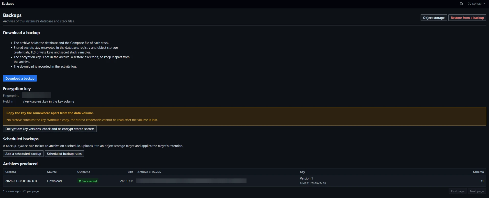

# Backups

## Access

| Item | Rule |
|---|---|
| Who | Administrators only, on every page and every action. Any other signed-in role receives `403`; a request without a session is redirected to the sign-in page |
| Where | `Administration > Backups`, `/backups`. `Administration > Object storage`, `/object-storage`, holds the buckets that receive scheduled archives ([Object storage](Administration-Object-Storage)) |
| Sign-in | A browser session. The `Authorization` header is read only on `/api` paths, and no `/api` route covers backups, restore or object storage targets, so an API token reaches none of them |
| Caching | Every page answers `Cache-Control: no-store` |
| CSRF | Every `POST` carries the token ([Frontend conventions](Contributing-Frontend-Conventions)) |
| Restore ownership | A restore belongs to the administrator and browser session that began it. Another administrator sees that a restore is in progress and may cancel it before the key is confirmed. Any other request on it answers `403` |

## Pages

| Page | Path | Purpose |
|---|---|---|
| Backups | `/backups` | Download an archive, add a scheduled backup, list the archives produced |
| Restore | `/restore` | Replace this instance's data with an archive, uploaded or fetched from a bucket. Without the web interface: [Restore from the command line](#restore-from-the-command-line) |
| Object storage | `/object-storage` | Buckets that receive scheduled archives ([Object storage](Administration-Object-Storage)) |

A backup archive holds the database and the Compose file of each stack. The companion files and the build contexts of the stacks are in the database. A restore replaces this instance's data with an archive's and asks for the key.

## The key is not in the archive

A backup archive never holds the encryption key. Store the key separately from every archive and from the bucket that receives them.

| Question | Answer |
|---|---|
| Where is the key | In `DOCKMIN_SECRET_KEY`, in the file named by `DOCKMIN_SECRET_KEY_FILE`, or, when neither is set, in `secret.key` in the key volume, generated at the first start ([Key sources](Administration-Encryption#key-sources)) |
| Is it needed to restore | Yes. The restore asks for it and accepts no other source. The running instance's key is never offered ([The key](#the-key)). The command-line restore reads it from a file or standard input ([Restore from the command line](#restore-from-the-command-line)) |
| What identifies the right key | The key fingerprint: 16 hexadecimal digits shown in the `Key` column of `/backups` and in the manifest. It identifies the key and reveals no part of it |
| What is lost without it | The archive cannot be restored. Registry credential secrets, environment TLS client keys, object storage secret access keys, secret stack variables and secret stack files in it cannot be decrypted by any means. Users, environments, stacks, grants and the activity log remain in the archive's database, readable with SQLite tools and not restorable through dockmin |
| What a copy of the key allows | Anyone holding both the key and an archive can read every stored secret in it |
| Is the key volume in an archive | No. An archive is built from the database. The key volume and the data volume are separate |

1. Copy the generated key off the host and outside the backup bucket ([Copy the key](Getting-Started-Quick-Start#copy-the-key)). A key supplied through `DOCKMIN_SECRET_KEY` or `DOCKMIN_SECRET_KEY_FILE` is stored wherever it was created, such as a password manager.
2. Store the key's fingerprint beside it. The startup log lines `encryption_key_generated` (first start with a generated key) and `encryption_key_loaded` (every start) carry `key_fingerprint`, and the Backups page shows it ([Encryption key block](#encryption-key-block)).
3. After a [re-key](Administration-Encryption#re-key), store the new key. Archives made before the re-key need the key they were made with.

### Restoring the key volume

Use it when the key volume is lost and the data volume remains, and before the first start of a replacement instance. A start that finds the data but no key file is refused with check `encryption_key` ([Troubleshooting](Troubleshooting)), and dockmin never generates a key over existing data.

1. Place the copy of the key on the host as `<key-copy>`. The file must belong to the current user, because the shell reads it with `<` ([Copy the key](Getting-Started-Quick-Start#copy-the-key) for a copy made with `sudo`).
2. Create the key volume.

```bash
docker volume create dockmin-key
```

Success: Docker prints `dockmin-key`.

3. Write the key into the volume.

```bash
docker run --rm -i -v dockmin-key:/key --entrypoint sh ghcr.io/sphexi/dockmin:latest -c 'umask 077 && cat > /key/secret.key' < <key-copy>
```

Success: no output and exit status `0`. The command runs as uid 10001, the image user, writes mode `0600`, and cannot overwrite an existing read-only `secret.key`. Failure: `Permission denied` means the volume already holds a read-only `secret.key` or the copy is not readable by the current user; `No such file or directory` means `<key-copy>` is misspelled.

4. Start the instance with the same volume mounted at `/key`, as in the [Quick start](Getting-Started-Quick-Start#start-dockmin). The start reads the file and never replaces it.

Success: the fingerprint on the Backups page and in `encryption_key_loaded` is the copy's. Failure: a container that exits with `startup_check_failed` and check `encryption_key` names the problem and the remedy in the container log ([Troubleshooting](Troubleshooting)).

## Archive

A gzip-compressed tar. The file name is `dockmin-backup-<UTC YYYYMMDDTHHMMSSZ>.tar.gz`.

### Members

| Member | Contents |
|---|---|
| `manifest.json` | [Manifest](#manifest) |
| `database.sqlite3` | A snapshot of the database ([Snapshot](#snapshot)) |
| `stacks/<32 hex digits>/compose.yaml` | One per stack: the stack's stored Compose file. The directory is the stack's project directory. Sorted by directory |

| Rule | Value |
|---|---|
| Order | Manifest, database, then stack files |
| Other members | None. No directories, no links, no `tls/` or environment files. A stack's companion files are not members ([Companion files](#companion-files)) |
| Headers | Mode `0600`, user and group id 0, empty user and group names, modification time the manifest's `created_at` |
| Archive size | At most 7 GiB |
| Manifest size | At most 1 MiB. About 6,900 stack files fill it |
| Stack members | At most 10,000 |
| One Compose file | 1 to 131,072 bytes |

- The stack files come from the stacks' stored Compose files, not from `<data-dir>/stacks/`.
- A manifest or archive over a limit fails production with `production_failed`.

### Build contexts

| Item | Rule |
|---|---|
| Where | In `database.sqlite3`, in the table `stack_build_context`, one row for each context of a Compose stack, holding the archive as uploaded ([Stacks](Usage-Stacks)) |
| Archive members | None are added |
| Content | The archive's bytes as uploaded. Not encrypted |
| Size | At most 32 contexts and 64 MiB for each stack |

### Companion files

| Item | Rule |
|---|---|
| Where | In `database.sqlite3`, in the table `stack_file`, one row for each file of a stack ([Stacks](Usage-Stacks)) |
| Archive members | None are added. The members stay `manifest.json`, `database.sqlite3` and the Compose files |
| Plain file | Content in plain text |
| Secret file | Content as ciphertext, sealed by the same rule as a secret stack variable. Re-sealed with the other secrets when a backup is produced and when a restore changes the key ([Re-seal](#re-seal)) |
| In the data directory | The archive is built from the database, not from `<data-dir>/stacks/`. A restore writes `compose.yaml` into each project directory and nothing else; a Compose invocation writes the companion files it reads |

### Manifest

UTF-8 JSON in canonical form: sorted keys, no insignificant whitespace, ASCII only.

| Field | Content |
|---|---|
| `format` | `dockmin-backup` |
| `format_version` | `1`. Any other value is refused with `format_unsupported`: `The archive format is not supported; this build reads version 1.` |
| `schema_version` | Highest migration version of the snapshot |
| `created_at` | UTC, `YYYY-MM-DDTHH:MM:SSZ` |
| `product_version` | The installed version; `unknown` when dockmin is not installed as a package (logged once as `product_version_unknown`) |
| `instance_id` | The instance's id, 32 hex digits |
| `key_version` | The key version of every stored secret in the snapshot |
| `key_fingerprint` | 16 hex digits identifying the key. Not the key |
| `administrators` | Usernames of enabled administrators, sorted, at most 100 |
| `members` | `name`, `size` and `sha256` of every member but the manifest, in archive order |
| `mac` | HMAC-SHA-256 over the other fields, keyed from the encryption key. Checked at the [key step](#the-key) |

- Everything in the manifest can be read without the key and can be altered by anyone who can write the archive. It is unverified until the key step.
- With more than 100 enabled administrators the first 100 names in sorted order are listed and the log line `backup_administrators_truncated` is written. An operator outside the list is refused at the review page.
- An archive whose manifest lists more than 100 administrators, or lists them out of sorted order, is refused as `archive_invalid` when its manifest is read.

### Snapshot

| Step | Detail |
|---|---|
| 1 | Refused with `insufficient_space` when the data volume's free space is below 2 × (database size + write-ahead log size) + 64 MiB |
| 2 | A copy of the database is taken with `VACUUM INTO` on its own connection, in rollback-journal mode |
| 3 | Every stored secret in the copy is re-sealed at the current key version, and every value already at that version is opened. A value that no held key opens, a value at the current version that does not open, or a value not shaped like ciphertext ends production with `secret_unreadable` |
| 4 | Every browser session and every sign-in throttle row is deleted from the copy |
| 5 | The copy is closed and written into the archive; the copy is removed |

- The live database is not locked for longer than the copy.
- The archive is hashed (SHA-256) after it is written.

### Never in an archive

| Item | How it is kept out |
|---|---|
| The encryption key, current or previous | Member names come from a fixed list. The database holds ciphertext and an encrypted check value, never a key. Nothing reads the environment, the key file or settings during production |
| Environment variables, `.env`, the key file, `secret.key` in the key volume, the self-signed certificate and its key | Not members |
| Browser sessions, sign-in throttle rows | Deleted from the snapshot |

- Every uncompressed byte written to the archive is scanned for every loaded key (current and previous) in raw, base64, URL-safe base64 and hexadecimal form. A hit refuses the archive with `key_material_found`, deletes it, and logs `backup_key_material_found` with the member name.

### Sensitive content

| Content | Form in the archive |
|---|---|
| Users | Usernames, roles, enabled flags, password hashes |
| API tokens | Prefix, hash, label, expiry, revocation time. Never the token |
| Registry, object storage and TLS secrets, secret stack variables, secret stack files | Ciphertext |
| Registry and object storage usernames and access key ids, endpoints, CA certificates, environment addresses | Plain text |
| Compose files, non-secret stack variable values, plain companion files | Plain text |
| Activity log | Plain text, including the usernames attempted in failed sign-ins and client addresses |
| Automation rules, groups, teams, grants | Plain text |

- Anyone who can read an archive can attempt to guess password hashes offline, and learns the environments, endpoints and compose files of the instance. The key is the only protection of the ciphertext.
- Keep the key apart from the archives. Restrict who can read the bucket.
- A restore accepts any genuine archive. Restoring an older archive restores the accounts, tokens and passwords as they were in that archive, including accounts removed and tokens revoked since.

## Download

1. Open `Administration > Backups` and choose `Download a backup` (`POST /backups/download`). A `GET` of that path does nothing.
2. Wait. The browser receives nothing while the archive is produced.

Success: the browser saves `dockmin-backup-<UTC YYYYMMDDTHHMMSSZ>.tar.gz`, and a `Succeeded` row with source `Download` appears under `Archives produced`. Failure: the page `Download a backup` shows `The backup could not be made` (`503`) or `The backup was not started` (`429`) with the reason's message ([Production failures](#production-failures)).

| Item | Value |
|---|---|
| Response | The file. `application/gzip`, `Content-Disposition: attachment`, `Content-Length`, `Cache-Control: no-store`, `X-Content-Type-Options: nosniff` |
| First byte | Sent after the archive is complete. Nothing is sent while it is produced |
| Idle bound | A client that does not accept a chunk within 60 s is disconnected. The work directory is removed ([Send idle bound](Reference-Deployment#send-idle-bound)) |
| Reads | 1 MiB at a time. The archive is never held in memory |
| Work files | Under `<data-dir>/backup-work/<random>/`, mode `0700`. Removed when the response ends or the client leaves |
| Concurrency | One production at a time per process. A second request, or one during a scheduled production, answers `429` with `Retry-After: 30`: `A backup or a restore is in progress. Try again when it has finished.` A request refused for a restore engaged through the [offline gate](#the-offline-gate) answers `503` instead |
| Re-encryption of stored secrets | `Stored secrets are being re-encrypted. Try again when it has finished.` (`429`); the [offline gate](#the-offline-gate) of the re-encryption answers `503` first ([Encryption](Administration-Encryption#offline-gate)) |
| Reverse proxy | The response is a stream; a proxy must not buffer it or time it out before production ends ([Reverse proxy limits for backups](Reference-Deployment#reverse-proxy-limits-for-backups)) |

### Download activity

Action `backup_downloaded`, category `user_action`, target type `backup`, target id the id of the backup record, no environment. A failure row has a target id only when its failed record was written. Rows written by earlier versions have no target id ([Deleted targets](Administration-Activity#deleted-targets)).

| Result | Written | Detail |
|---|---|---|
| `success` | After production succeeds and before the first byte, with one backup record | `archive_sha256`, `size_bytes`, `schema_version`, `key_version`, `key_fingerprint`, `backup_record_id` |
| `failure` | When production fails, with one failed backup record | `reason`, `message` |

- A request refused with `429` writes no row and no record.

### Production failures

| `reason` | Cause |
|---|---|
| `insufficient_space` | Free space below the [snapshot](#snapshot) threshold |
| `secret_unreadable` | A stored secret does not open ([Snapshot](#snapshot), step 3). The message reads `A stored secret could not be read with the loaded key, so no backup was made.` and, when locations are known, ` Affected values: <table>.<column> row <id>, ...` with up to 10 locations. The log line `backup_secret_unreadable` names the same locations. The Encryption page lists up to 100 locations and the page that owns each value ([Failed values](Administration-Encryption#failed-values)): enter each secret again, then produce the backup ([Troubleshooting](Troubleshooting)) |
| `key_material_found` | The scanner matched key material ([Never in an archive](#never-in-an-archive)) |
| `production_failed` | Any other cause: the database and the loaded key disagree on the key version, the snapshot kept journal files, a manifest or archive limit was exceeded, the inventory did not match the files, the snapshot changed while written, or an unexpected error (logged as `backup_production_failed` with the error class) |

## Backups page

| Section | Content |
|---|---|
| Download a backup | The button and what the archive holds |
| Encryption key | The current key's fingerprint and where the key is held, and a link to `Encryption: key versions, check and re-encrypt stored secrets` ([Encryption](Administration-Encryption)) |
| Scheduled backups | `Add a scheduled backup` opens the `New automation` form for `backup-syncer`; `Scheduled backup rules` lists those automations |
| Archives produced | The backup records, newest first, 25 per page |
| Header buttons | `Object storage`, `Restore from a backup` |



| Column | Content |
|---|---|
| Created | Time of the attempt |
| Source | `Download`, or the target's name with the object key beneath. `Target deleted` when the target was removed |
| Outcome | `Succeeded`, or `Failed` with the message |
| Size | Archive size. `—` for a failure before the archive existed |
| Archive SHA-256 | Digest of the archive. `—` for a failure before it existed |
| Key | `Version <n>`, with the key fingerprint beneath |
| Schema | Schema version. `—` when unknown |

- The empty list reads `No backups yet`, with the action `Download a backup`. The query parameters `limit` and `cursor` page the records.
- The newest 500 records are kept. Older records are deleted when a new one is written.
- A record is not an audit entry; the activity log is the audit trail.
- A scheduled attempt that fails before its target is read writes an activity row and no record.

### Encryption key block

| Row | Content |
|---|---|
| Fingerprint | The current key's fingerprint: 16 hexadecimal digits |
| Held in | `<file> in the key volume` for a generated key; `The file <path>, named by DOCKMIN_SECRET_KEY_FILE`; or `The DOCKMIN_SECRET_KEY environment variable` |

- For a generated key a notice reads `Copy the key file somewhere apart from the data volume.` and `No archive contains the key. Without a copy, the stored credentials cannot be read after the volume is lost.`
- For a supplied key the block reads `No archive contains the key. Keep a copy apart from the archives.`
- The block shows the fingerprint and the location only, never the key.

## Send backups to a bucket

Prerequisites: a bucket on an S3-compatible server, and an access key for it.

1. On the server, create the bucket and a credential scoped to it. The credential writes to the backup folder; for [remote retention](#remote-retention) it also lists the bucket and deletes the archives ([Permissions the credential needs](#permissions-the-credential-needs)).
2. Open `Backups`, choose `Object storage`, then `Add target` (`/object-storage/new`).
3. Enter `Name`, `Endpoint address` (an `http` or `https` address such as `https://s3.example.com`), `Region`, `Bucket`, `Access key ID` and `Secret access key`. Most servers accept the default region `us-east-1`.
4. Choose the addressing style ([Addressing](Administration-Object-Storage#addressing)):

| Server requirement | `Use path-style addressing` | Endpoint address |
|---|---|---|
| None stated, or the bucket name goes in the request path | Ticked (default) | A host name or an IP address |
| The bucket name goes in the host name | Unticked | A host name only; the server's domain setting and, for `https`, a certificate covering `*.<endpoint host>` |

5. Leave `Verify the server's TLS certificate` ticked. For a server whose certificate comes from a private CA, paste the CA certificate into `Additional CA certificates` ([TLS](Administration-Object-Storage#tls)).
6. Set `Backup folder` (default `backups`). To delete older archives automatically, set `Archives to keep` and tick `Delete older backup archives in this bucket` ([Retention](Administration-Object-Storage#retention)).
7. Choose `Add target`. Success: the target page opens with `The target is saved. Test the connection to check it.`
8. On the target page, choose `Test connection`. A pass shows that the credentials and the bucket are accepted and that the backup folder can be listed. It does not test write, delete or multipart abort permission ([Connection test](Administration-Object-Storage#connection-test)). Failure: a failed stage names the reason ([Failure reasons](Administration-Object-Storage#failure-reasons)).
9. Open `Backups` and choose `Add a scheduled backup`. Enter `Name`, choose the `Object storage target`, a `Schedule type` and `Schedule` (an interval of 3600 s or more, or a cron expression) and a `Time zone`, then choose `Create automation`. The automation is created disabled ([Automation](Operations-Automation#create)).
10. On the automation page, choose `Dry run`. Success: the run detail shows `next_object_path`, the key the next archive will have ([Dry run](#dry-run)).
11. Choose `Enable`, then `Enable automation`.
12. To check the whole path now, choose `Run now`, then `Run automation now`. Success: the run ends `success`, a `Succeeded` row appears under `Archives produced`, and the object exists at the key in the row ([Object key](#object-key)). Failure: the run's reason is one of the [failure reasons](#failure-reasons).
13. Store the encryption key separately ([The key is not in the archive](#the-key-is-not-in-the-archive)).

## `backup-syncer`

Produces an archive on a schedule, uploads it to an [object storage target](Administration-Object-Storage) and applies the target's remote retention. Generic subsystem properties: [Subsystems](Reference-Subsystems#backup-syncer).

| Item | Value |
|---|---|
| Rules | Administrators only. No environment and no target selector. Setting `object_storage_target_id` |
| Create | `Add a scheduled backup`, or `Automation`, `New automation`, `backup-syncer` ([Automation](Operations-Automation#create)) |
| Schedule | Interval of 3600 s or more, or cron. Overrun policy `skip` only |
| Missed runs | One catch-up run at start after a stop that skipped a fire |
| Time limit of a run | 180 minutes |
| Failures before a job is disabled | 5; the rule's `max_consecutive_failures` overrides it (1 to 100) |
| Event policy | `per_action`: every stored archive writes a row |
| Dry run | Supported ([Dry run](#dry-run)) |
| Owner | A run whose owner is no longer an administrator fails with `owner_access_lost` |

### Run

| Step | Behaviour |
|---|---|
| 1 | Read the target. Missing: `target_missing`. Backup prefix not a valid key: `prefix_invalid` |
| 2 | Open the target's secret. Unreadable: `credential_unreadable` |
| 3 | Build the client. `endpoint_invalid`, `refused`, `tls_failed` and the other [client reasons](Administration-Object-Storage#failure-reasons) |
| 4 | Take the production lock, produce the archive ([Snapshot](#snapshot)), release the lock. The wait for the lock counts against the run's time limit |
| 5 | Upload the archive: one `PUT` when it is at most 64 MiB, otherwise a multipart upload of 64 MiB parts ([Multipart upload](Administration-Object-Storage#multipart-upload)). After `unreachable` or a 5xx answer a `PUT`, or one part, is repeated once, after 2 s. `address_refused` is not repeated. A multipart upload that fails is aborted |
| 6 | One transaction writes the backup record (source: the target) and the `backup_uploaded` success row |
| 7 | When the target has a retention count, apply [remote retention](#remote-retention) |
| 8 | Remove the work directory, however the run ended |

- The lock is held while the archive is produced and not while it is uploaded.
- A run that stored its archive and failed during retention ends `partial`.
- A run that stopped at any earlier step ends `failure`.

### Object key

```text
<backup prefix>/rule-<rule id>-<rule created, UTC YYYYMMDDTHHMMSS>/dockmin-backup-<UTC YYYYMMDDTHHMMSSZ>.tar.gz
```

| Part | Value |
|---|---|
| `<backup prefix>` | The target's backup prefix without a trailing `/`. An empty prefix starts the key at `rule-` |
| `rule-<id>-<created>` | The rule's id and creation time. A later rule that reuses the id writes to a different folder |
| Archive name | The UTC time in the archive's manifest `created_at` |

- Key alphabet: letters, digits, `.`, `_`, `-`, and `/` between segments; at most 1024 bytes.
- Each rule has its own folder. Two rules on one target keep `retention_count` archives each.

### Remote retention

| Item | Behaviour |
|---|---|
| Off | Unless the target has a retention count |
| Folder | The rule's folder in the bucket, listed with its trailing `/`: all pages, at most 20 pages of 1,000 keys |
| Archives | Keys in the folder named exactly `dockmin-backup-<YYYYMMDDTHHMMSSZ>.tar.gz`. Duplicate keys in the listing count once |
| Order | By the stamp in the name |
| Skipped | When the key just stored is not in the listing. The run's detail has `retention_skipped` = `uploaded_not_listed`; nothing is deleted |
| Kept | The key just stored, and the newest older archives up to the count in total |
| Deleted | The remaining older archives, oldest first, at most 100 per run. One `DELETE` each; the first failure stops the pass |
| Later stamps | An archive stamped after the one just stored is never counted, kept as a backup or deleted. It counts as another object |
| Other objects | Any other key in the folder is never touched and is counted in `other_objects` |

- `deleted` counts deletions the server accepted. A server may accept a delete of a key that no longer exists.
- Setting or lowering the count on a target needs a confirmation ([Retention](Administration-Object-Storage#retention)).

### Activity rows

Category `automation`, actor `backup-syncer` with the rule and the run, target type `object_storage_target`, target id the target's id, no environment.

| Action | Result | Written | Detail |
|---|---|---|---|
| `backup_uploaded` | `success` | An archive was stored | `object_path`, `size_bytes`, `archive_sha256`, `schema_version`, `key_version`, `key_fingerprint`, `target_name`, `backup_record_id`, `multipart`, `parts` |
| `backup_uploaded` | `failure` | The run stopped before or during the upload | `reason`, `message`, `stage` (`produce` or `upload`), `target_name`, `object_path` when known, `storage_status`, `storage_code` when the server answered |
| `backup_remote_pruned` | `success` | A retention pass deleted at least one archive | `folder_path` (with trailing `/`), `retention_count`, `deleted`, `deleted_paths`, `deleted_paths_truncated`, `kept`, `other_objects` |
| `backup_remote_pruned` | `failure` | The listing or a deletion failed | The keys above, `reason`, `message`, and `storage_status`, `storage_code` when the server answered |

- `deleted_paths` holds names relative to the folder, comma-separated, at most 20 names and 480 characters; `deleted_paths_truncated` is `true` when more were deleted.
- A retention pass that deleted nothing and did not fail writes no row.
- A failed run writes a failed backup record when the target was read.
- `multipart` is `true` and `parts` is the part count for an archive over 64 MiB; otherwise `multipart` is `false` and `parts` is `1`.

### Failure reasons

| `reason` | Stage | Cause |
|---|---|---|
| `target_missing` | `produce`, `upload` | The target no longer exists, including when it is deleted while the archive is stored |
| `prefix_invalid` | `produce` | The backup prefix does not form a valid key |
| `backup_unavailable` | `produce` | Backups are not available in this process |
| `insufficient_space`, `secret_unreadable`, `key_material_found`, `production_failed` | `produce` | [Production failures](#production-failures) |
| `credential_unreadable` | `upload` | The target's stored secret cannot be decrypted with the current key |
| `endpoint_invalid`, `unreachable`, `address_refused`, `tls_failed`, `refused`, `bucket_missing`, `digest_mismatch`, `clock_skew`, `storage_error` | `upload` | [Client reasons](Administration-Object-Storage#failure-reasons) |
| `archive_unreadable` | `upload` | The finished archive could not be read for the upload |
| `rule_missing` | `upload` | The rule was deleted during the run |

- A retention failure carries the client reason of the listing or deletion that failed.

### Run detail

| Key | Content |
|---|---|
| `target_id` | The target |
| `object_path` | The key stored. Absent before the upload |
| `size_bytes` | Archive size |
| `retention_deleted` | Deletions accepted. Present when retention ran |
| `retention_kept` | Archives kept, the one just stored included |
| `retention_skipped` | `uploaded_not_listed` when the pass was skipped |

### Dry run

`Dry run` takes no snapshot, decrypts nothing, opens no connection and writes no row or record.

| Key | Content |
|---|---|
| `target_id` | The target |
| `next_object_path` | The key an archive made now would have |
| `retention_count` | The target's count, or empty |
| `database_bytes` | Size of the database and its write-ahead log |
| `stack_files` | Number of stacks |

- A dry run ends `failure` with `target_missing` when the target is gone and `prefix_invalid` when the prefix is not a valid key.

### Permissions the credential needs

| Operation | Permission |
|---|---|
| Upload of an archive up to 64 MiB | Write on the bucket's backup prefix |
| Upload of a larger archive | Write on the bucket's backup prefix, and abort of a multipart upload. On AWS S3: `s3:PutObject` and `s3:AbortMultipartUpload` |
| Remote retention, listing | List on the bucket |
| Remote retention, deleting | Delete on the archives. On some servers delete is part of write |
| Restore from the bucket | List on the bucket and read on the archives |

- `Test connection` checks neither write, delete nor abort ([Connection test](Administration-Object-Storage#connection-test)). A credential that can list and read passes the test and fails at the first upload.
- Incomplete multipart uploads: add a lifecycle rule that aborts them ([Multipart upload](Administration-Object-Storage#multipart-upload)).
- The full table with AWS S3 actions: [Credential](Administration-Object-Storage#credential).

## Restore

A restore replaces `dockmin.db` and `stacks/` in the data directory with the archive's, then restarts the application's services on the new data without ending the process.

### Requirements

| Requirement | Detail |
|---|---|
| Account | An enabled administrator, signed in with a browser session. The username must match, ignoring ASCII case, an enabled administrator listed in the archive |
| Archive | A genuine archive of this format and of a schema version this build supports |
| Key | The key the archive was made with ([The key](#the-key)) |
| Jobs | No image job and no stack job running. `begin` answers `409`: `<n> jobs are running; wait for them to finish.` |
| Backups | No backup in production. `begin` waits up to 30 s for one to finish, then answers `409`: `A backup is still being produced. Try again shortly.` |
| Encryption | No check or re-encryption of stored secrets running. `begin` answers `409`: `A stored-secret check is running. Try again when it has finished.` or `Stored secrets are being re-encrypted. Try again when it has finished.` |
| Update | No update in progress, and no `update/` directory left in the data volume. `begin` answers `409`: `An update is in progress. Restore is unavailable until it finishes.` |
| Disk | Free space on the data volume: for an upload or a fetch, the archive's size and 256 MiB left at every write; at staging, twice the total size of the archive's members plus 64 MiB ([Free space](Reference-Deployment#free-space)) |

### Restore from object storage

A restore fetches an archive from the bucket of an object storage target, through that target's stored credential. The credential must list the backup folder and read the archives ([Permissions the credential needs](#permissions-the-credential-needs)). No other credential is used.

1. Add the target before the instance goes offline. A request that changes something is refused while the gate is engaged, adding a target included. On a fresh instance, add a target for the bucket that holds the archives ([Restoring into a fresh instance](#restoring-into-a-fresh-instance)).
2. Take the instance offline ([Steps](#steps), step 1).
3. On `/restore`, under `From object storage`, choose the `Object storage target` and `List archives` (`GET /restore/remote`). The list offers at most 200 targets. With no target the section reads `No object storage target is configured.` with a link `Add an object storage target`.
4. Choose `Use this archive` on a row (`POST /restore/archive/remote`). The page `Fetching the archive` shows the bytes received, refreshed every 2 s, with a `Refresh status` link without script and `Cancel the restore`.
5. The review opens when the archive has arrived. Continue at [Steps](#steps), step 3.

Success: the page `Review the archive` opens with `Fetched from` set to the object key. Failure: `/restore` shows `The archive could not be fetched` with the message ([Fetch](#fetch)).

| Listing | Rule |
|---|---|
| Page | `Archives in object storage`, titled `Target: <name>`, with `Refresh list` and `Back to the restore` |
| Objects | Keys under the target's backup folder, at any depth, whose file name is `dockmin-backup-<YYYYMMDDTHHMMSSZ>.tar.gz`. Every rule's folder is included ([Object key](#object-key)). An empty backup folder lists the whole bucket |
| Read | Up to 20 pages of 1,000 keys. When the folder holds more, the page shows `The folder holds more objects than were read. Only the first part of the listing is shown.` |
| Order | Newest first by the stamp in the file name, 50 to a page (`Previous page`, `Next page`) |
| Columns | `Archive` (file name), `Folder`, `Size`, `Last modified`, `Pushed by this instance` (`Yes` when this instance holds a successful backup record for the key on this target, else `No record`) |
| Empty | `No backup archives were found under this target's backup folder.` |
| Kept | The listing stays with the restore until `Refresh list` is chosen. Only a key in the held listing can be fetched: `Choose an archive from the list.` |
| Failure | `The archives could not be listed`, with the reason's message ([Failure reasons](Administration-Object-Storage#failure-reasons)). A refused credential adds `The credential must be able to list the target's backup folder.` A stored secret that does not open reads `The target's credential cannot be read; enter it again.` |
| Unknown target | `404` |

#### Fetch

| Rule | Value |
|---|---|
| Size | At most 7 GiB: `The archive is larger than the size limit.` |
| Space | The archive's size plus 256 MiB free on the data volume: `There is not enough free space on the data volume.` |
| Changed object | The object's size must equal the listed size: `The archive changed in the bucket since it was listed.` |
| Target | `The object storage target no longer exists.` when it was deleted since |
| One at a time | An upload and a fetch exclude each other: `An upload is already in progress.` |
| Stalled read | No byte for 120 s fails the fetch; the whole fetch is bounded by 1 s per MiB plus 120 s, at most 2 hours |
| After the bytes arrive | The same as an upload: the stream is stored as `restore/<restore-id>/upload.tar.gz`, hashed while received, and its manifest is read ([Upload](#upload)). The same refusals apply |
| Failure | The restore stays engaged and `/restore` shows `The archive could not be fetched` with the message. Choose the archive again, upload another, or cancel. A refusal before the fetch starts shows `That archive cannot be fetched` on the listing page (`400`) |
| Source | Recorded as `object_storage`, with the target id and the object key ([Restore activity rows](#restore-activity-rows)) |

The review page adds two rows for a fetched archive:

| Row | Content |
|---|---|
| `Fetched from` | The object key |
| `This instance's record` | `Matches the archive this instance pushed on <time>.` when this instance recorded the key with the same SHA-256. `Differs from the archive this instance pushed on <time>. The object changed after it was pushed.` when the digest is not the recorded one. `No record of this archive on this instance.` otherwise |

- A record is not a check of the archive. The key step and the verification decide.
- Without access to a target, download the object with any S3 client and upload it. The object key is in the `Archives produced` table on `/backups`, under the target's name, and as `object_path` in the run's `backup_uploaded` event. Without the instance, list the bucket under `<backup prefix>/rule-<rule id>-<created>/` ([Object key](#object-key)). The `archive_sha256` of the event is the digest to compare.

### Steps

1. **Take the instance offline.** On `/restore`, tick `Take this instance offline for a restore` and choose `Take the instance offline` (`POST /restore/begin`). The [gate](#the-offline-gate) engages and `instance_restore_started` is written to the live log. Without the tick the page answers `422`: `Confirm that this instance goes offline.`
2. **Upload and review.** Choose the file under `Backup archive`, then `Upload and inspect` (`POST /restore/archive`, then `GET /restore/review`). To fetch the archive from a bucket instead, follow [Restore from object storage](#restore-from-object-storage). The archive is stored under `<data-dir>/restore/<restore-id>/`. Nothing else changes.
3. **Check the key.** On the review page, enter `Encryption key of the archive`, tick `Replace this instance's data with this archive` and choose `Restore this archive` (`POST /restore/confirm`, with the reviewed digest). Nothing changes until the key is accepted.
4. **Verify the archive.** Background. Nothing changes.
5. **Stage the data.** Background. Files appear under `restore/<restore-id>/staging/`.
6. **Migrate and check the database.** Background. The staged database changes.
7. **Check the secrets and re-seal them.** Background. The staged database changes.
8. **Replace the data.** Background. The live data moves aside and the staged data moves in.
9. **Restart on the restored data.** Background. The application's services start on the new data.

- Steps 4 to 9 run after `POST /restore/confirm`, which redirects to the progress page.
- One restore at a time. A second `begin` answers `409`: `A restore is already in progress.`
- Cancel (`Cancel the restore`, `POST /restore/cancel`) is open to any administrator until the key is confirmed, writes `instance_restore_failed` with reason `cancelled` and the cancelling administrator as actor, and shows `The restore is cancelled. This instance accepts changes again.` Afterwards it is refused (`409`: `The restore is running and can no longer be cancelled.`).
- The page `/restore` shows `A restore is in progress` with `Started by`, `Started` and `Step` (`Waiting for the archive`, `Fetching the archive from object storage`, `Archive uploaded, waiting for the key`, `Running`). An administrator other than the owner reads `Another session began this restore, so only that session can continue it.` and may cancel it.

### Pages and routes

| Page | Path | Method |
|---|---|---|
| Restore | `/restore` | `GET`. The begin form, or the current restore's state |
| Begin | `/restore/begin` | `POST`. Field `confirm_offline` = `yes`; without it `422` |
| Upload | `/restore/archive` | `POST`, multipart ([Upload](#upload)) |
| List archives in a bucket | `/restore/remote` | `GET`. Query `target_id` (required), `page`, `refresh` |
| Fetch an archive from a bucket | `/restore/archive/remote` | `POST`. Fields `target_id`, `object_path` ([Restore from object storage](#restore-from-object-storage)) |
| Review | `/restore/review` | `GET`. While an archive is being fetched, the fetch progress instead |
| Confirm | `/restore/confirm` | `POST`. Fields `key`, `archive_sha256`, `replace_confirmed` = `yes` |
| Cancel | `/restore/cancel` | `POST` |
| Progress | `/restore/progress/{restore id}` | `GET`. Restore id: 32 hex digits |
| Resume automation | `/restore/resume-automation` | `POST` |

| Status | Cause |
|---|---|
| `403` | A role other than administrator; a request on a restore that another session began |
| `409` | Another restore is engaged, jobs are running, a backup is in production, the restore is already running, or an upload is in progress |
| `422` | A field error: begin without confirmation, an archive the upload refused, a key or confirmation the confirm refused |
| `400` | A fetch the page refused: a key outside the listing, an archive over the limit, too little space; a malformed upload body |
| `404` | A progress id that is unknown, expired or not the caller's before the swap; an unknown target on `/restore/remote` |
| `408` | An upload body that sent no data for 120 s |

- A request on `/restore/review`, `/restore/remote` or `/restore/archive` while no restore is engaged redirects to `/restore`.

### Upload

| Rule | Value |
|---|---|
| Body | `multipart/form-data`. The first part is `csrf_token` (at most 128 bytes), the second is the file in the field `archive` |
| Any other part, a second file, a malformed body | `400` |
| Token | Verified, with the cookie and Origin checks, before the first file byte is stored |
| Size | The file at most 7 GiB. Outside the file part, at most 64 KiB |
| Body size cap | This route is exempt from the 256 KiB cap on request bodies ([Body size](Reference-Deployment#body-size)) |
| Idle time | A body that sends no data for 120 s is answered `408` with `Connection: close`, and no archive is kept |
| Storage | `restore/<restore-id>/upload.tar.gz`, mode `0600`, written to a `.part` file and renamed when complete |
| Digest | SHA-256, computed while receiving. The review page shows it and `confirm` must present it |
| Replacing | A new upload replaces the earlier archive. An upload that fails leaves no archive |
| Refusals | `archive_invalid`, `format_unsupported`, `insufficient_space`: `422` on the upload form. Examples: `This file is not a backup archive.`, `The archive does not begin with a manifest.`, `The archive is damaged or incomplete.`, `The archive is larger than the size limit.` |
| Proxy | The reverse proxy must allow a request body of the archive's size ([Reverse proxy limits for backups](Reference-Deployment#reverse-proxy-limits-for-backups)) |

- The archive is read by an own reader, never extracted. Only regular files named as in [Members](#members), in that order, are accepted. Links, devices, directories, extended tar headers, a name outside the list, a repeated name, an oversize member, data after the end marker and a damaged stream are refused.

### Review

`/restore/review` (`Review the archive`) shows, before the key is asked for:

| Section | Content |
|---|---|
| Refusals | `This archive cannot be restored here`: a schema version newer than this build supports (`The archive's schema version is 16; this build supports up to 15.`); no enabled administrator in the archive with the signed-in username (`The archive has no enabled administrator with your user name.`). While one applies, no confirm form is offered |
| The archive | Created, product version, schema version, source instance id, key version, key fingerprint, member count and uncompressed size, archive SHA-256, administrators, and whether the signed-in username matches one. For a fetched archive also `Fetched from` and `This instance's record` ([Restore from object storage](#restore-from-object-storage)) |
| What it replaces | This instance's counts at the time of review: users, environments, stacks, registry credentials, object storage targets, automation rules |
| Where the data goes | `Moved aside` (the live paths), `Kept at` (where they are kept), `Staged at`, `Put in place under` (the data directory) |
| Restore this archive | The key field, the replace confirmation and `Restore this archive` |
| Other choices | `Upload a different archive`, `Cancel the restore` |

- Created, product version, schema version, key version and administrators are labelled `Unverified until the key is checked`.
- The review page reads the manifest only. The staged database is checked at step 6.

### The key

| Item | Rule |
|---|---|
| Field | A password field, `Encryption key of the archive`. The value is the key exactly as configured: the base64 text of 32 bytes, as set in `DOCKMIN_SECRET_KEY`, held in the file named by `DOCKMIN_SECRET_KEY_FILE`, or held in `secret.key` of a generated key. The field help names the two variables |
| Other sources | None. The running instance's key is never offered, even when it matches |
| Not stored | The key is held by the background run and overwritten when the run ends. It is registered with the log scrubber. Copies of the typed text may remain in process memory until the process ends |

| Check, in order | `reason` | Message |
|---|---|---|
| Replace confirmation missing | — | `Confirm that this instance's data will be replaced.` (field `replace_confirmed`) |
| Key empty | `key_missing` | `Enter the encryption key to continue.` |
| Not base64 of exactly 32 bytes | `key_invalid` | `The key must be the base64 text of exactly 32 bytes, as configured.` |
| Key fingerprint differs from the manifest's | `fingerprint_mismatch` | `This key does not match the archive. It was made with key version N, fingerprint F.` |
| Manifest MAC invalid under the key | `manifest_tampered` | `The archive manifest does not carry a valid signature for this key.` |

- A rejected key leaves the instance offline and the archive in place. The operator may retry, upload another archive or cancel.
- Each rejected key writes `instance_restore_key_rejected` ([Restore activity rows](#restore-activity-rows)).
- The digest the form presents must equal the stored archive's: `The uploaded archive changed since the review.`
- A refusal of the review (schema version, administrator) is shown again at confirm as an error on the archive.

### Checks after the key

Any failure ends the restore, releases the gate and leaves the live data untouched, except at steps 8 and 9.

| Step | `reason` | Cause |
|---|---|---|
| 4 Verify | `digest_mismatch` | A truncated or damaged stream, a member shorter than the manifest declares, a member out of order or missing, a member whose SHA-256 differs, a manifest that differs from the reviewed one |
| 4 Verify | `archive_invalid` | A structural violation ([Upload](#upload)), a member larger than the manifest declares, members the manifest does not list |
| 5 Stage | `insufficient_space` | Free space below twice the members' total size plus 64 MiB |
| 5 Stage | `digest_mismatch` | A member's digest differs on the second read |
| 6 Migrate and check | `database_invalid` | The staged database is not a dockmin database, cannot be read, fails `PRAGMA integrity_check` or `PRAGMA foreign_key_check` (at most 10 findings each), or kept journal files |
| 6 Migrate and check | `schema_newer` | The staged database's schema is newer than this build's. Names both versions |
| 6 Migrate and check | `migration_failed` | A migration of an older schema failed |
| 6 Migrate and check | `schema_mismatch` | After migration the staged `sqlite_master` differs from a fresh database's: an extra or missing table, index, trigger or view, or a table, index or trigger whose SQL differs. SQL comments and whitespace outside quoting are ignored. A schema entry whose SQL is not text or holds a NUL character is refused. Only `sqlite_sequence`, `sqlite_stat1`, `sqlite_stat4` as SQLite creates them, and automatic indexes are exempt. The message reads `The archive's database does not have the expected schema.` |
| 6 Migrate and check | `operator_not_in_archive` | The staged `user` table has no enabled administrator with the operator's username |
| 6 Migrate and check | `stack_files_inconsistent` | A staged stack file has no stack row, differs from its row's Compose file, or has extra entries. A row without a file has its file written from the row |
| 7 Secrets | `decrypt_failed` | The key does not open the encrypted check value; the staged key version or instance id differs from the manifest; secrets exist at another key version; a value is not ciphertext; a sampled value of each secret column does not decrypt. Names the column and row, never a value |
| 7 Secrets | `reseal_failed` | The key version cannot advance, a value could not be re-encrypted, or some secrets remain at the old version |
| 8 Replace | `swap_failed` | A move failed, the running services did not stop cleanly or in 15 s, or no database was in place after the moves. Every completed move is reversed and the old data is started again |
| 9 Restart | `restart_failed` | The services did not start on the restored data. The restored files move to `restore/<restore-id>/rejected/`, the previous data returns and starts again |
| Any | `cancelled`, `timed_out`, `shutdown` | [Ending a restore](#ending-a-restore) |

- Applied migrations are not checksummed. The staged database's schema is compared with a fresh database's instead (step 6, `schema_mismatch`).
- An unexpected error ends the restore with the step's reason and the message `The restore stopped unexpectedly at the <step> step.`: `archive_invalid` at steps 4 and 5, `migration_failed` at 6, `decrypt_failed` at 7, `swap_failed` at 8, `restart_failed` at 9.
- A startup check that fails when the services restart (step 9) is logged as `startup_check_failed` with `during: restore` and `fatal: false` ([Startup self-check](Reference-Deployment#startup-self-check)). The process keeps running and the restore ends `restart_failed`.
- The failing step is shown `failed` on the progress page with the reason. The staging directory is deleted; the uploaded archive is deleted.
- Log lines name findings and objects (`restore_database_findings`, `restore_schema_mismatch`), never values.

### Re-seal

| Item | Behaviour |
|---|---|
| When | The supplied key's fingerprint differs from the running instance's current key |
| What | Every stored secret in the staged database is opened with the archive's key and sealed again with the running instance's current key, one key version above the archive's. The encrypted check value is rewritten |
| Same key | Nothing is rewritten |
| After the restore | Only the running instance's key is needed. The archive's key is not read again. With a generated key that is the instance's `secret.key`; the archive's key can be discarded when no other archive needs it |
| Row | `encryption_key_changed` in the restored log |

### Changes the restore makes

| Item | Result |
|---|---|
| Users, passwords, API tokens, grants, environments, stacks, credentials, rules, activity log | Replaced by the archive's. Changes made after the backup are lost. Accounts and tokens revoked after the backup return |
| Browser sessions | All ended, the operator's included. Sign-in throttle rows are cleared |
| Activity log ids | The restored log's id counter is raised to the larger of the archive's and the live log's highest id, plus 1,000,000,000 |
| Restored log rows | `instance_restored`, and `encryption_key_changed` when re-sealed |
| Live log | Moved aside with the previous data. It holds `instance_restore_started` |
| Automation | Paused until an administrator resumes it, across restarts ([After a restore](#after-a-restore)) |
| Encryption key (including `secret.key` in the key volume), `DOCKMIN_*` settings, lock file, `server-tls/`, `compose-work/`, `backup-work/`, `restore/` | Unchanged |

### Paths and previous data

All moves are renames inside the data directory.

| Path | Content |
|---|---|
| `<data-dir>/dockmin.db`, `dockmin.db-wal`, `dockmin.db-shm` (those present), `<data-dir>/stacks/` | Live data. Replaced |
| `<data-dir>/restore/<restore-id>/previous/` | The replaced live data |
| `<data-dir>/restore/<restore-id>/staging/` | The staged database and stack files, before they move into place |
| `<data-dir>/restore/<restore-id>/rejected/` | Restored files that did not start |
| `<data-dir>/restore/<restore-id>/upload.tar.gz` | The uploaded or fetched archive, until the restore ends |
| `<data-dir>/restore/<restore-id>/archive.tar.gz` | The copy a command-line restore makes of its archive, removed before the data is replaced and on every refusal ([Restore from the command line](#restore-from-the-command-line)) |

- The review page names these paths before the key is asked for. The progress page shows them from the swap on, and `restore_swap_paths` is logged before the first move.
- The product never deletes `previous/` or `rejected/`. Remove them by hand when they are no longer needed. For a container named `dockmin`, started with `docker run`:

```bash
docker exec dockmin rm -r /data/restore/<restore-id>
```

With Compose:

```bash
docker compose exec dockmin rm -r /data/restore/<restore-id>
```

- At every start, `backup-work/` is deleted, and each `restore/<restore-id>/` without `previous/` or `rejected/` is deleted. A directory with either is kept and logged as `restore_previous_data_present` with its path.

### The offline gate

From step 1 until the restore ends, a gate in front of routing refuses requests.

| Phase | Admitted | Refused |
|---|---|---|
| `engaged` (steps 1 to 7) | `GET`, `HEAD`, `OPTIONS`, `TRACE`; `POST /login`, `POST /login/continue` and `POST /logout`; every `/restore` request | Every other mutating request, including `POST /backups/download`: `503`, `Retry-After: 30`. New WebSocket handshakes are refused: the connection is closed with code `1013` before the handshake is accepted (the client sees an HTTP 403 handshake response) |
| `swapping` (steps 8 and 9) | `GET` and `HEAD` of `/restore/progress/{id}`, `/static/`, `/api/health` | Everything else: `503`, `Retry-After: 5` |
| `failed` | Nothing, `/api/health` included | `503`, `Retry-After: 30` |
| `open` | Everything | — |

| Answer | Form |
|---|---|
| Browser | The page `Offline for a restore`, `503` |
| HTMX request | The notice partial, `503` |
| Path under `/api` | JSON `{"error": {"status": 503, "message": "…"}}` |

- Message while engaged: `This instance is offline for a restore. Changes are refused until the restore finishes or is cancelled.`
- Message while swapping: `This instance is replacing its data from a backup. Requests are refused until the restore finishes.`
- A banner with the message is shown on every page while the gate is not open. Administrators get `Open the restore`, or `Follow the restore` while swapping.
- A re-encryption of stored secrets engages the same gate in phase `engaged`, with the message `This instance is re-encrypting stored secrets. Changes are refused until it finishes.` and the page `Offline while stored secrets are re-encrypted`. Every `/restore` request is refused as well, and the banner offers no link to `/restore` ([Offline gate](Administration-Encryption#offline-gate)).
- Engaging also suspends the scheduler: scheduled jobs stop, and runs in progress end `interrupted` with reason `suspended` ([Jobs](Administration-Jobs)).
- Engaging holds the production lock: downloads and scheduled backups wait or are refused.
- Swapping waits up to 15 s for admitted requests to finish. Requests still running after that fail the swap with `swap_failed` (logged as `restore_requests_not_drained`).
- A reverse proxy health check that uses a path other than `/api/health` fails while the gate is `swapping` ([Reverse proxy limits for backups](Reference-Deployment#reverse-proxy-limits-for-backups)).

### Ending a restore

| `reason` | When |
|---|---|
| `cancelled` | An administrator cancelled before the key was confirmed |
| `timed_out` | 15 minutes passed without a restore request before the key was confirmed |
| `shutdown` | The application stopped. Verification and staging stop between chunks |

- Ending without success writes `instance_restore_failed` to the live log, releases the suspension and the production lock, reopens the gate, and deletes the restore directory unless it holds `previous/` or `rejected/`.
- Every path to the end of a restore releases the gate. A gate in phase `failed` stays until the process restarts.

### Progress

| Item | Value |
|---|---|
| Page | `/restore/progress/{restore id}` (`Restore progress`). Steps `Take the instance offline`, `Receive the archive`, `Check the key`, `Verify the archive`, `Stage the data`, `Migrate and check the database`, `Check the secrets and re-seal them`, `Replace the data` and `Restart on the restored data`, each `pending`, `running`, `done` or `failed`; the paths; the outcome (`Running`, `Restored`, `Failed`) |
| Update | An HTMX fragment polled every 2 s while the restore runs. Without script, a `Refresh status` link. The polling stops at the outcome |
| Access before the swap | The session that began the restore only |
| Access from the swap on | The restore id in the path. Every session is gone with the old data |
| Kept | In memory for 30 minutes after the outcome. A process restart loses it (`404`) |

- On success the page reads: `The restore finished and this instance runs on the restored data. Every session ended.` with a link `Sign in`.
- On failure the page shows the message and `Reason: <reason>`, and a link `Back to the restore`.

### After a restore

| Item | Behaviour |
|---|---|
| Sign-in | With an administrator account from the archive |
| Automation | The scheduler stays suspended: no scheduled job runs, and `Run now` and `Dry run` are refused with `The scheduler is not accepting runs right now.` Every page shows the banner `Automation is paused after a restore. Scheduled jobs do not run until an administrator resumes it.` |
| Resume | `Resume automation` on the completion page and in the banner (`POST /restore/resume-automation`, administrators). Records `instance_automation_resumed` (user action, target type `instance`), deletes the stored pause and starts the scheduler. Shows `Automation is resumed. Scheduled jobs run again.` Repeating it changes nothing |
| Process restart | The pause is stored in the restored database. Every start finds it and keeps the scheduler suspended and the banner shown until an administrator resumes automation |
| Command-line restore | The pause is stored the same way. It takes effect at the next start ([Restore from the command line](#restore-from-the-command-line)) |
| Previous data | Kept ([Paths and previous data](#paths-and-previous-data)) |

### Restore activity rows

Target type `instance`, no target id, category `user_action`.

| Action | Result | Log | Detail |
|---|---|---|---|
| `instance_restore_started` | `success` | Live | `restore_id` |
| `instance_restore_key_rejected` | `failure` | Live | `reason`, `message`, `restore_id`, `stage`, `archive_created_at`, `archive_schema_version` |
| `instance_restore_failed` | `failure` | Live | The same keys, and `source`. `reason` as in [Checks after the key](#checks-after-the-key) and [Ending a restore](#ending-a-restore) |
| `instance_restored` | `success` | Restored | `archive_sha256`, `archive_created_at`, `archive_product_version`, `archive_schema_version`, `schema_version`, `key_version`, `key_fingerprint`, `key_changed`, `previous_path`, `operator_username`, `source`; for `object_storage` also `object_storage_target_id` and `object_path` |
| `encryption_key_changed` | `success` | Restored | `key_version_before`, `key_version_after`, `key_fingerprint_before`, `key_fingerprint_after`, `values_resealed`. Written only when re-sealed |
| `instance_automation_resumed` | `success` | Restored | — |

| `source` value | Where the archive came from | Detail added |
|---|---|---|
| `upload` | Uploaded on `/restore` | None |
| `object_storage` | Fetched from a bucket ([Restore from object storage](#restore-from-object-storage)) | `instance_restored` adds `object_storage_target_id` and `object_path`. `instance_restore_failed` carries `source` only |
| `operator_command` | The command-line restore | None. The row is written in the restored database only |

- `stage` is the step the restore had reached: `gate`, `upload`, `key`, `verify`, `stage`, `migrate`, `decrypt`, `swap` or `restart`.
- The actor of `instance_restored` is the operator. The operator must exist in the restored database. The actor of `instance_restore_failed` is the administrator who began the restore, except for `cancelled`, where it is the administrator who cancelled.
- The live log is moved aside by a successful restore, so the live rows are readable in the previous data only.

### Failed gate

The gate is `failed` when a swap or a restart could not be reversed. Every request answers `503`; the page and the banner name two paths.

| Item | Value |
|---|---|
| Message | `A restore failed and the data could not be put back. Restore the files by hand from the paths below, then restart the container.` |
| Paths | A reversed swap that could not be undone: `previous/` and `staging/`. A restart that could not be undone: `previous/` and `rejected/` |
| Log | `restore_failed_unrecoverable` with `locations`, `reason`, `error` |

Recovery:

1. Stop the container. For a container named `dockmin`, started with `docker run`:

```bash
docker stop --time 45 dockmin
```

With Compose:

```bash
docker compose stop dockmin
```

Success: the command prints the container name or service name. Failure: `No such container` means the name differs from `dockmin`; list names with `docker ps --all`.

2. Find the data volume's name: the volume mounted at `/data` in the stopped container. For a container named `dockmin`, started with `docker run`:

```bash
docker inspect --format '{{range .Mounts}}{{if eq .Destination "/data"}}{{.Name}}{{end}}{{end}}' dockmin
```

With Compose, run this in the directory that holds `compose.yaml`, with the same `-f` options as the deployment:

```bash
docker inspect --format '{{range .Mounts}}{{if eq .Destination "/data"}}{{.Name}}{{end}}{{end}}' "$(docker compose ps --all --quiet dockmin)"
```

Success: the command prints the volume name; the quick-start command names it `dockmin-data`, and Docker names a Compose volume `<project>_dockmin-data`, which is `dockmin_dockmin-data` for a `dockmin` directory. A bind mount at `/data` prints nothing: use its host path in place of `<volume-name>`.

3. Read the image the stopped container runs. This is `<dockmin-image>` in the next two commands. For a container named `dockmin`, started with `docker run`:

```bash
docker inspect --format '{{.Config.Image}}' dockmin
```

With Compose:

```bash
docker inspect --format '{{.Config.Image}}' "$(docker compose ps --all --quiet dockmin)"
```

Success: the command prints an image reference such as `ghcr.io/sphexi/dockmin:latest`.

4. List the kept directories of the restore. A directory that holds `dockmin.db` and `stacks/` is a complete set: `previous/` is the data before the restore, `staging/` or `rejected/` is the restored data.

```bash
docker run --rm --user 0 --entrypoint find -v <volume-name>:/data <dockmin-image> /data/restore/<restore-id> -maxdepth 2
```

Success: the output lists `previous`, and `staging` or `rejected`, each with `dockmin.db` and `stacks`. Failure: `No such file or directory` means `<restore-id>` is wrong; the failed gate's paths name it.

5. Replace the live set with the set to run. The command stops unless the chosen set holds `dockmin.db`; otherwise it removes `dockmin.db`, `dockmin.db-wal`, `dockmin.db-shm` (those present) and `stacks/` from `/data`, then moves the chosen set into place. Replace `<kept-set>` with `previous`, `staging` or `rejected`.

```bash
docker run --rm --user 0 --entrypoint sh -v <volume-name>:/data <dockmin-image> -c 'cd /data && test -f restore/<restore-id>/<kept-set>/dockmin.db && rm -rf dockmin.db dockmin.db-wal dockmin.db-shm stacks && mv restore/<restore-id>/<kept-set>/* .'
```

Success: exit status `0`. Failure: a non-zero status with no output means the chosen set holds no `dockmin.db`; nothing was removed.

6. Start the container. For a container named `dockmin`, started with `docker run`:

```bash
docker start dockmin
```

With Compose:

```bash
docker compose start dockmin
```

Success: the container reports `healthy` and the sign-in page opens. Failure: [Troubleshooting](Troubleshooting).

- `<dockmin-image>` is the image reference the stopped container runs, as printed by step 3. `--entrypoint` replaces its default command.
- Moving the set keeps the files' owner, which is the account dockmin runs as.

### Restoring into a fresh instance

1. Start the instance with an empty data directory and an encryption key: supplied, or generated in a new key volume ([Quick start](Getting-Started-Quick-Start#start-dockmin)).
2. Create the first administrator on the setup page with the username of an enabled administrator in the archive.
3. Sign in. When the archive is in a bucket, add an object storage target for it first, with `Backup folder` set to the folder that holds the archives and a credential that can list and read ([Send backups to a bucket](#send-backups-to-a-bucket), steps 2 to 7). Open `Backups`, choose `Restore from a backup`, and follow [Steps](#steps) with the archive's key; for a bucket, [Restore from object storage](#restore-from-object-storage).
4. Sign in again with an account from the archive.

Success: the progress page reads `Restored` and step 4 signs in. Failure: the progress page names the step and the reason ([Checks after the key](#checks-after-the-key)).

- The instance's own key may differ from the archive's. The restored secrets are [re-sealed](#re-seal) to the instance's key.
- With a generated key, the instance's key is the `secret.key` of its own key volume, not the archive's. From the restore on it is the key to keep: copy it ([Copy the key](Getting-Started-Quick-Start#copy-the-key)). Archives made afterwards carry its fingerprint.
- The environments' addresses, registry endpoints and object storage targets are those of the archive. The instance must reach them.

## Restore from the command line

`python -m app restore` reviews an archive and replaces the data of a stopped instance with it, without the web interface. Use it when the instance cannot start or no administrator can sign in. The archive must be a file on the host.

| Item | Rule |
|---|---|
| Instance | Stopped. The command takes the instance lock of the data directory and exits `3` while another process holds it ([Single instance](Reference-Deployment#single-instance)) |
| Image | The version the instance runs, or newer. An archive whose schema is newer than the image supports is refused as `schema_newer` |
| User | The user that owns the data directory: uid 10001 in the image, which `docker run` uses by default |
| Settings | The same `DOCKMIN_` variables as the server, read from the environment of the command. Pass every variable the instance sets, `DOCKMIN_DATA_DIR` and the key variables included ([Configuration](Reference-Configuration)) |
| Instance key | The key the restored data is re-sealed to when the archive's key differs ([Re-seal](#re-seal)): `DOCKMIN_SECRET_KEY`, the file `DOCKMIN_SECRET_KEY_FILE` names, or `secret.key` in the key volume. The command never creates a key |
| Archive | Readable by uid 10001. The command never changes the file. With `--replace` it copies the archive to `<data-dir>/restore/<restore-id>/archive.tar.gz`, which needs the archive's size plus 256 MiB free on the data volume |
| Archive key | Read from a file or from standard input. At most 1024 bytes |
| Operator | An enabled administrator in the archive, recorded as the actor of `instance_restored` |

| Argument | Required | Content |
|---|---|---|
| `--archive PATH` | Yes | The archive file |
| `--key-file PATH` | Yes | A file holding the archive's encryption key, or `-` to read it from standard input. Standard input must be a pipe or a redirected file |
| `--operator USERNAME` | Yes | The user name of an enabled administrator in the archive, compared ignoring ASCII case |
| `--replace SHA256` | No | The archive's SHA-256 exactly as the review prints it. Without it the command only reviews |

| Mode | Behaviour |
|---|---|
| Review (no `--replace`) | Checks the key, verifies every member of the archive, and prints the archive's facts, what the live data holds, the paths that would move and whether the secrets would be re-sealed. Changes nothing. The last line is `To replace the data, run again with --replace <sha256>` |
| Replace (`--replace`) | Runs the review checks, refuses a value other than the archive's SHA-256, then verifies, stages, migrates and checks the staged database, decrypts and finalises it, replaces the data and checks that the restored data starts. The previous data is kept ([Paths and previous data](#paths-and-previous-data)) |

The key is held in memory, registered with the log scrubber, and overwritten when the command ends.

The review prints these lines:

| Line | Content |
|---|---|
| `Archive:` | The path given |
| `SHA-256:` | The archive's digest; the value for `--replace` |
| `Created:`, `Product version:`, `Schema version:` | From the manifest |
| `Key:` | `version <n>, fingerprint <fingerprint>` |
| `Key check:` | `the key matches the archive and signs its manifest` |
| `Administrators:` | The enabled administrators in the archive |
| `Members verified:` | The member count |
| `Live data now:` | `<n> users, <n> environments, <n> stacks, <n> registry credentials, <n> object storage targets, <n> automation rules`; `none (no database)`; or `unreadable (treated as empty)` |
| Paths | `These would move to <data-dir>/restore/<id>/previous/:` and the paths, or `Nothing in the data directory would move.` |
| `Secrets:` | `would be re-sealed to the target key, fingerprint <fingerprint>, as key version <n>`, or `stay under the archive's key, which is the target key` |
| Last lines | `Nothing was changed.` and `To replace the data, run again with --replace <sha256>` |

A replacement prints `[1/4] Verifying the archive members`, `[2/4] Staging the archive`, `[3/4] Migrating and checking the staged database` and `[4/4] Decrypting and finalising the staged database`, then `Replacing the data; the previous data is kept in <path>` and `Checking that the restored data starts`.

### Procedure with `docker run`

For a container named `dockmin` with the volumes `dockmin-data` and `dockmin-key`, started with the quick-start command ([Quick start](Getting-Started-Quick-Start#start-dockmin)). `<archive>` is the file name in the current directory, `<version>` the image tag the instance runs or a newer one, `<key-file>` the file that holds the archive's key, `<username>` an enabled administrator in the archive and `<sha256>` the value printed after `SHA-256:` by the review.

1. Read the image the instance runs.

```bash
docker inspect --format '{{.Config.Image}}' dockmin
```

Success: the command prints an image reference such as `ghcr.io/sphexi/dockmin:latest`; its tag is `<version>`.

2. Stop the instance.

```bash
docker stop --time 45 dockmin
```

Success: the command prints `dockmin`.

3. Review the archive.

```bash
docker run --rm -i -v dockmin-data:/data -v dockmin-key:/key -v "$PWD/<archive>:/restore-input/archive.tar.gz:ro" ghcr.io/sphexi/dockmin:<version> python -m app restore --archive /restore-input/archive.tar.gz --key-file - --operator <username> < <key-file>
```

Success: exit status `0` and the last line `To replace the data, run again with --replace <sha256>`. Failure: a message and a non-zero [exit status](#exit-statuses).

4. Replace the data.

```bash
docker run --rm -i -v dockmin-data:/data -v dockmin-key:/key -v "$PWD/<archive>:/restore-input/archive.tar.gz:ro" ghcr.io/sphexi/dockmin:<version> python -m app restore --archive /restore-input/archive.tar.gz --key-file - --operator <username> --replace <sha256> < <key-file>
```

Success: exit status `0` and the lines `Restored. The previous data is kept in <path>` and `Automation is held at the next start until an administrator releases it.` Failure: a message and a non-zero [exit status](#exit-statuses).

5. Start the instance.

```bash
docker start dockmin
```

Success: the container reports `healthy`.

6. Sign in with an administrator account from the archive and choose `Resume automation` ([After a restore](#after-a-restore)).

### Procedure with Compose

Run in the directory that holds `compose.yaml`, with the same `-f` options as the deployment. The service supplies the image, the data volume and the key secret. The placeholders are those of the `docker run` procedure.

1. Stop the instance.

```bash
docker compose stop dockmin
```

2. Review the archive.

```bash
docker compose run --rm --no-deps -T -v "$PWD/<archive>:/restore-input/archive.tar.gz:ro" dockmin python -m app restore --archive /restore-input/archive.tar.gz --key-file - --operator <username> < <key-file>
```

Success: exit status `0` and the last line `To replace the data, run again with --replace <sha256>`. Failure: a message and a non-zero [exit status](#exit-statuses).

3. Replace the data.

```bash
docker compose run --rm --no-deps -T -v "$PWD/<archive>:/restore-input/archive.tar.gz:ro" dockmin python -m app restore --archive /restore-input/archive.tar.gz --key-file - --operator <username> --replace <sha256> < <key-file>
```

Success: exit status `0` and the line `Restored. The previous data is kept in <path>`.

4. Start the instance, then sign in and resume automation.

```bash
docker compose start dockmin
```

Success: the service reports `healthy`.

- `-i` (`docker run`) and `-T` (Compose) keep standard input open for the redirected key and allocate no terminal. The key is not read from a terminal: `Pipe or redirect the key into the command; it is not read from a terminal.`
- The mounted archive keeps its host owner and mode. Uid 10001 must be able to read it.
- Run the review and the replacement from the same archive file. The replacement refuses an archive whose SHA-256 differs from `--replace`.

### Exit statuses

| Status | Meaning |
|---|---|
| `0` | The review was printed, or the data was replaced and the restored data starts |
| `1` | Refused. The message names the reason. Before the data is replaced nothing is changed. When the restored data did not start, the previous data was put back and the restored files are in `restore/<restore-id>/rejected/` |
| `2` | Usage or configuration: a setting is invalid, the data directory is missing or not owned by the user running the command, the lock file cannot be used, the instance key does not exist, the key or the archive cannot be read, the key is longer than 1024 bytes, or the key was not piped in |
| `3` | Another process holds the instance lock, or an update is in progress |
| `4` | The restore stopped while moving the data, or after moving it. The message says where the previous data and the restored data are, and whether the previous data was put back |

| Message | Status |
|---|---|
| `Another dockmin process is using the data directory; stop it first.` | `3` |
| `An update is in progress; restore is unavailable until it finishes.` | `3` |
| `The data directory <dir> does not exist or cannot be read.`, `<dir> is not a directory.` | `2` |
| `The data directory's lock file cannot be used.` | `2` |
| `Run as the user that owns <dir> (uid 10001 in the image).` | `2` |
| `No encryption key is configured and <file> does not exist, and this command never creates one. Restore the key volume from a copy first (Restoring the key volume, on the Backups documentation page), then run this command again.` See [Restoring the key volume](#restoring-the-key-volume) | `2` |
| `The key file cannot be read: <reason>.`, `The key is longer than 1024 bytes.` | `2` |
| `The archive cannot be read: <reason>.`, `The archive cannot be copied: <reason>.` | `2` |
| The archive or the key fails a check: the reasons and messages of [The key](#the-key) and [Checks after the key](#checks-after-the-key) | `1` |
| `The archive has no enabled administrator with the user name given to --operator.` | `1` |
| `The --replace value is not the archive's SHA-256, which is <sha256>. Nothing was changed.` | `1` |
| `The restore directory could not be created. Nothing was changed.` | `1` |
| `The restore stopped while <step> (<error class>). Nothing was changed.` | `1` |
| `The restored instance did not start: <problem>. <remedy>. The previous data was put back; the restored files are in <path>.` | `1` |
| A swap that failed, or a restored instance that could not be undone: the message names `previous/`, `staging/` or `rejected/` and the kept restore directory | `4` |

After a restore that ends `0` with `--replace`, the command prints `Restored. The previous data is kept in <path>` and `Automation is held at the next start until an administrator releases it.`

## Related settings

| Setting | Effect on this page |
|---|---|
| `DOCKMIN_SECRET_KEY`, `DOCKMIN_SECRET_KEY_FILE`, `DOCKMIN_SECRET_KEY_DIR` | Where the key is held; shown in `Held in` ([Encryption key](Reference-Configuration#encryption-key)) |
| `DOCKMIN_PREVIOUS_SECRET_KEY`, `DOCKMIN_PREVIOUS_SECRET_KEY_FILE`, `DOCKMIN_ALLOW_KEY_ROTATION` | Key changes; archives made before a re-key need the key they were made with ([Re-key](Administration-Encryption#re-key)) |
| `DOCKMIN_DATA_DIR` | Holds `backup-work/`, `restore/`, `dockmin.db` and `stacks/` ([Storage](Reference-Configuration#storage)) |
| `DOCKMIN_PERMITTED_INTERNAL_NETWORKS` | Permits an object storage endpoint on this server or a link-local network ([Address policy](Reference-Security#address-policy)) |

## Limits

| Limit | Value |
|---|---|
| Archive | 7 GiB |
| Manifest | 1 MiB; 100 administrator names |
| Stack members | 10,000; each Compose file 131,072 bytes |
| Backup records kept | 500 |
| Download concurrency | One production at a time |
| Wait for a running production at `begin` | 30 s |
| Restore idle time before the key | 15 minutes |
| Wait for requests at the swap | 15 s |
| Progress kept after the outcome | 30 minutes |
| Upload and fetch free-space floor | 256 MiB |
| Upload idle time | 120 s |
| Archives listed for a restore from a bucket | 20 pages of 1,000 keys; 50 shown to a page |
| Targets offered for a restore from a bucket | 200 |
| Key read by the command-line restore | 1024 bytes |
| Remote retention | 20 listing pages, 100 deletions per run |

## Log lines

| Line | Level | Fields |
|---|---|---|
| `backup_archive_produced` | info | `size_bytes`, `schema_version`, `key_version`, `members` |
| `backup_archive_stored` | info | `object_path`, `size_bytes` |
| `backup_multipart_abort_failed` | warning | `kind` |
| `backup_secret_unreadable` | error | `locations` |
| `backup_key_material_found` | error | `member` |
| `backup_production_failed` | error | `error` |
| `backup_administrators_truncated` | warning | `limit` |
| `backup_record_write_failed` | error | `error` |
| `product_version_unknown` | warning | — |
| `restore_swap_paths` | info | `live_paths`, `previous_path`, `staged_path` |
| `restore_step_failed` | error | `step`, `error` |
| `restore_fetch_failed` | error | `error` |
| `restore_database_findings` | error | `findings` |
| `restore_schema_mismatch` | error | `objects` |
| `restore_swap_interrupted`, `restore_stop_failed`, `restore_restart_failed`, `restore_row_write_failed`, `restore_cleanup_failed`, `restore_sweep_failed` | error | `error` |
| `restore_requests_not_drained` | warning | `requests` |
| `restore_failed_unrecoverable` | error | `locations`, `reason`, `error` |
| `restore_previous_data_present` | warning | `path` |
| `offline_page_render_failed` | error | `error` |

## Known limits

| Limit | Behaviour |
|---|---|
| More than 100 enabled administrators | The manifest lists 100. An operator beyond them is refused at the review page |
| Scrubbing | The forms of a confirmed archive key stay registered with the log scrubber until the process ends |
| Terminal sessions | Open terminals are not drained at the swap. They close when the Engine connections stop |
