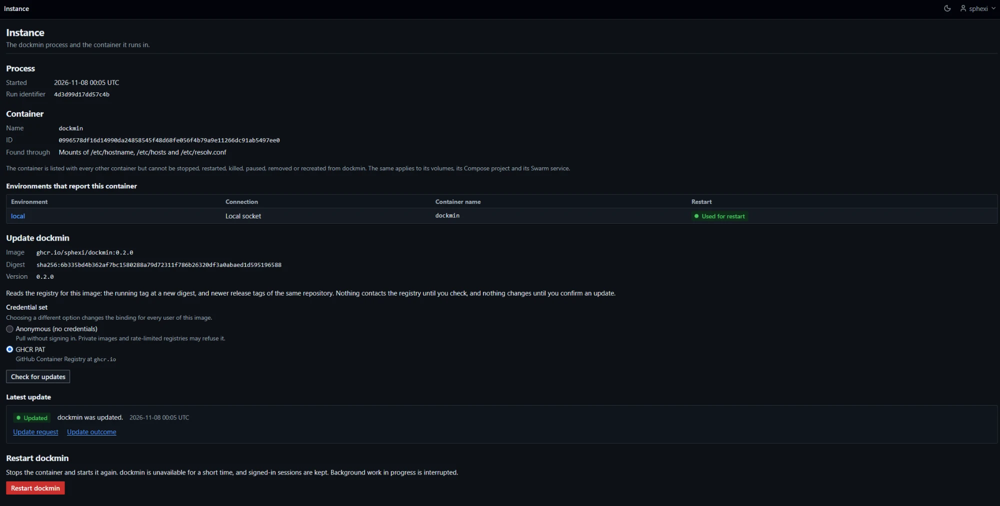
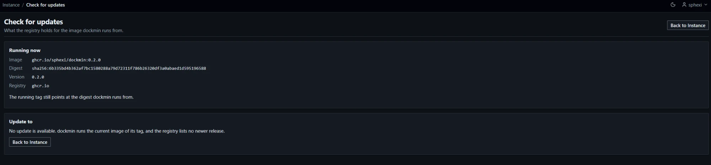

# Instance

`Administration > Instance` shows the dockmin process and the container it runs in, restarts that container, and replaces it from a newer image.



## Access

| Item | Fact |
|---|---|
| Who | Administrators. Any other role receives `403` on every route |
| Where | `Administration > Instance` |
| Caching | Every answer carries `Cache-Control: no-store` |

| Page | Path | Method |
|---|---|---|
| Instance | `/server/instance` | `GET` |
| Restart confirmation | `/server/instance/restart` | `GET` |
| Restart | `/server/instance/restart` | `POST` |
| Run identifier (polled by the restarting page) | `/server/instance/boot` | `GET` |
| Check for updates | `/server/instance/update/check` | `POST` |
| Review an update | `/server/instance/update/confirm` | `POST` |
| Update | `/server/instance/update` | `POST` |
| Update status (polled by the updating page) | `/server/instance/update/{update_id}` | `GET` |

- `{update_id}` is 32 lower-case hexadecimal digits. Any other form answers `404`.

## Instance page

| Section | Content |
|---|---|
| Process | `Started`, `Run identifier` |
| Container | `Name`, `ID` (64 hexadecimal digits), `Found through`. When no container is found: `dockmin could not identify a container of its own.` and `Nothing is protected and dockmin cannot restart itself. This is expected when dockmin does not run in a container.` |
| Environments that report this container | A table: `Environment` (a link), `Connection` (`Local socket` or `TLS`), `Container name`, `Restart` (`Used for restart` or `Not used`). With no row: `No environment reports this container. Its id is protected on every environment; its volumes, Compose project and Swarm service are not.` |
| Incomplete notice | `Some environments could not be read, so the protection of volumes, Compose projects and Swarm services may be incomplete there. dockmin keeps trying.` and the names of those environments |
| Update dockmin | `Image`, `Digest`, `Version`; then the reason no update is offered, or the credential picker and `Check for updates`; then `Latest update` ([Self-update](#self-update)) |
| Restart dockmin | The button `Restart dockmin`, or the reason a restart is refused ([Restart dockmin](#restart-dockmin)) |

- The run identifier is 16 hexadecimal digits chosen when the process starts. It changes only when the process starts again, and a restore does not change it.
- `Found through` reads `Mounts of /etc/hostname, /etc/hosts and /etc/resolv.conf` or `Control group path`.
- The container is listed with every other container but cannot be stopped, restarted, killed, paused, removed or recreated from dockmin. The same applies to its volumes, its Compose project and its Swarm service.

### How the container is identified

| Step | Behaviour |
|---|---|
| 1. Read `/proc` | `/proc/self/mountinfo` first: the container id that the mounts of `/etc/hostname`, `/etc/hosts` and `/etc/resolv.conf` agree on. Failing that, `/proc/self/cgroup`: the single 64-digit id its paths name |
| 2. No id | The process is not containerised. Nothing is protected and dockmin cannot restart itself |
| 3. Ask every environment | Each environment is asked about that id, all at once, 8 s each. An environment is a home of dockmin when its Engine reports a container with exactly that id and the container's host name is the process's host name |
| 4. Swarm environments | A Swarm environment whose Engine does not hold the container is asked for its running tasks. A task whose container id is exactly the id stands in for it, and supplies the Swarm service and node. The host name is not compared. A Swarm node that is not a manager answers the task list with `503` and holds nothing |
| 5. Record | For each home: the container's name, the named volumes it mounts, its Compose project, its Swarm service, its Swarm node and the host paths it mounts |

| When | |
|---|---|
| Start | Before the scheduler starts. Logged as `self_identity_resolved` with `source`, `verified_environments`, `restartable` and `unreadable_environments` |
| An environment is created, deleted or tested, or its connection is changed | A new look is requested. Requests made while one runs are folded into one more |

- An environment that cannot be read while looking keeps its earlier result when there was one. With none, it is listed on the Instance page, and dockmin looks again after 5 s, doubling the wait up to 5 minutes, until every environment has answered.
- Until then the protection of volumes, Compose projects, Swarm services and nodes may be incomplete there; the protection of the container's id is not.
- The restart is sent through the first home reached over the local Docker socket. A home over TLS is never used.

What is protected: [Containers](Usage-Containers#dockmins-own-container), [Volumes](Usage-Volumes#dockmins-volumes), [Stacks](Usage-Stacks#dockmins-own-stack), [Swarm](Usage-Swarm#dockmins-own-service), [Security](Reference-Security#dockmins-own-container).

## Restart dockmin

| Item | Value |
|---|---|
| Needs | The container identified, and one environment reached over the local Docker socket that reports it. That environment sends the restart; the table on the page marks it `Used for restart`. A home over TLS is never used |
| Refused | The page shows the message in place of the button ([Refusals](#restart-refusals)) |
| Confirmation | `GET /server/instance/restart` names the container and its short id. It changes nothing. It answers `409` with the refusal message when a restart is not possible |
| Posted | `confirm=yes`, `container_id`, `boot_id` and the CSRF token |
| Checks, in order | `boot_id` equals the current run identifier, else `409`: `dockmin has restarted since this page was shown. Review the instance again.` Reloading the restarting page therefore restarts nothing. A restart is possible, else `409`. `confirm` is `yes`, else `400`: `Confirm the restart to continue.` `container_id` equals the current container, else `409`: `The container dockmin runs in changed since you reviewed it. Review it again.` |
| Re-read | The container is inspected through the sending environment. Gone: `409`, `dockmin's container is no longer on the host that was used to find it.` Too large to read: `409`, `dockmin's container could not be read from the host.` Host unreachable: `503` |
| Recorded first | `instance_restart_requested` is committed before anything is sent. When it cannot be written, nothing is sent: `503`, `The restart could not be recorded, so it was not sent. Try again.` |
| Sent | The response is the restarting page. About 0.5 s later the Engine's restart is called from a task the application owns, so the response completes before the process stops. The stop grace period is the container's configured stop timeout, 45 s when it sets none |
| Effect | The container stops and starts again. dockmin is unavailable meanwhile. Signed-in sessions are kept. Image transfers, stack operations and other work in progress are interrupted, and runs left in progress are recorded `interrupted` at the next start |
| Engine failure after the response | Not shown to the browser. Logged as `instance_restart_failed`; a connection that drops while dockmin stops is logged as `instance_restart_sent`; an unknown outcome otherwise as `instance_restart_unconfirmed` |

### Restart the container

1. Open `Administration > Instance` and choose `Restart dockmin` in the section `Restart dockmin`.

   Result: the page `Restart dockmin` opens, headed `Restart <container name>?`, with the container name and short id.

   If the section shows a message instead of the button, see [Restart refusals](#restart-refusals).

2. Choose `Restart dockmin`.

   Result: the page `Restarting dockmin` opens: `The container <name> is being restarted.` It polls `/server/instance/boot` every 2 s.

3. Wait. When the run identifier differs from the one posted, the page reads `dockmin is running again.` Without JavaScript the page opens the dashboard after 10 s, and the dashboard answers once dockmin is back.

   If the stop timeout plus 60 s pass first, the page reads `dockmin did not restart within {N} seconds. Check the log of the container on the Docker host.` ([Troubleshooting](Troubleshooting#the-restart-did-not-happen)).

### Restart refusals

| Message | Cause |
|---|---|
| `dockmin could not identify a container of its own, so it cannot restart itself.` | dockmin does not run in a container ([Troubleshooting](Troubleshooting#dockmin-could-not-identify-its-container)) |
| `dockmin could not confirm its container through an environment on the local Docker socket, so it cannot restart itself.` | No environment reached over the local socket reports the container |
| `A restore is in progress. Restart is unavailable until it finishes.` | A restore holds the offline gate |
| `Stored secrets are being re-encrypted. Restart is unavailable until it finishes.` | A re-encryption holds the offline gate ([Encryption](Administration-Encryption#offline-gate)) |
| `An update is in progress, or an earlier one left files in the data directory. Restart is unavailable until they are gone.` | An update runs in this process, or the update directory holds a subdirectory ([Manual recovery](#manual-recovery)) |

## Self-update

An administrator updates a dockmin started with `docker run` from the Instance page. The page replaces dockmin's own container through a helper container, checks that the new container is healthy, and goes back to the old one when it is not.

| Deployment | How to update |
|---|---|
| Container started with `docker run` ([Quick start](Getting-Started-Quick-Start#start-dockmin)) | The Instance page (this section), or [Upgrading](Getting-Started-Installation#upgrading) |
| Docker Compose | `docker compose pull`, then `docker compose up -d` ([Upgrading a Compose deployment](Getting-Started-Installation#upgrading-a-compose-deployment)). The Instance page shows these two commands and offers no update |
| Swarm service | Update the service. The Instance page offers no update |
| Image built on the host | Build the new image and run it. The Instance page offers no update |

| Item | Value |
|---|---|
| Who | Administrators |
| Where | `Administration > Instance`, section `Update dockmin` |
| Registry contact | None until `Check for updates` is pressed. Opening the Instance page reads the container and its image from the Docker host and contacts no registry. `Review update` and `Update dockmin` read the registry again |
| Automatic updates | None. dockmin never checks or updates by itself |
| Setting | `DOCKMIN_UPDATE_HEALTH_TIMEOUT_SECONDS` ([Configuration](Reference-Configuration#updating-dockmin)) |

### Update dockmin

1. Open `Administration > Instance`. In the section `Update dockmin`, read `Image`, `Digest` and `Version`.

   Result: the section shows a credential picker and `Check for updates`. A message in place of the button means no update is offered ([When no update is offered](#when-no-update-is-offered)).

2. Choose the credential set in the picker and select `Check for updates`.

   Result: the page `Check for updates` lists `Running now` (image, digest, version, registry) and `Update to` with up to 10 targets. When it lists none, it reads `No update is available. dockmin runs the current image of its tag, and the registry lists no newer release.`

   

3. Choose a target and select `Review update`.

   Result: the page `Update dockmin` names the container, the current and new image and digest, the update helper and its digest, the outage and the rollback ([Review](#review)).

4. Select `Update dockmin`.

   Result: the page `Updating dockmin` opens with `Availability` and `Progress`. The progress list moves through `Pull the new image`, `Pull the update helper`, `Prepare the replacement`, `Start the update helper` and `Replace the container`.

5. Wait until the page reads `dockmin is running again. The result of the update is under Progress.`, then open `Administration > Instance`.

   Result: `Latest update` shows the badge `Updated` and `dockmin was updated.` Any other badge: [Outcomes](#outcomes) and [Manual recovery](#manual-recovery).

### When no update is offered

The Instance page shows the message and no button. The checks run again at the check, the review and the request.

| Message | Cause |
|---|---|
| `dockmin could not identify a container of its own, so it cannot update itself.` | dockmin does not run in a container |
| `Some environments could not be read, so dockmin cannot yet be sure which container it runs in. Try again shortly.` | The search for dockmin's container is not finished ([How the container is identified](#how-the-container-is-identified)) |
| `dockmin runs in a Compose project, which owns its container. Update it with the Compose commands below, run in the project's directory.` | The container carries a Compose project label. `docker compose pull` and `docker compose up -d` are shown |
| `dockmin runs as a Swarm service task, which cannot be replaced from here. Update the service instead.` | The container is a Swarm task |
| `dockmin could not confirm its container through an environment on the local Docker socket, so it cannot update itself.` | No environment reached over the local socket reports the container |
| `A restore is in progress. Updating is unavailable until it finishes.` | A [restore](Administration-Backups#restore) is running |
| `Stored secrets are being re-encrypted. Updating is unavailable until it finishes.` | A re-encryption holds the offline gate |
| `An update is in progress, or an earlier one left files in the data directory. Updating is unavailable until they are gone.` | An update is running in this process, or the update directory holds a subdirectory ([Manual recovery](#manual-recovery)) |
| `dockmin's container is no longer on the host that was used to find it.` | The container is gone |
| `dockmin's container could not be read from the host.` | The container or its image could not be read |
| `The image dockmin runs from does not name a registry repository, so there is nothing to update from.` | The container was created from an image id or a reference without a repository |
| `The image dockmin runs from carries no registry digest, as with an image built on this host, so it cannot be compared with a registry.` | The image has no repository digest for its repository |
| `dockmin's container does not mount the Docker socket its local environment uses, which the update helper needs.` | No bind mount of the socket path at the same path in the container |
| `dockmin's data directory is not on a volume or a bind mount, so its database cannot be carried over.` | The data directory is not a writable volume or bind mount |
| `A container named {name}-previous already exists. Remove it to allow an update.` | A container left by an earlier update, or any container with that name |
| The text of each blocker | The container cannot be recreated: `This container has more label data than can be preserved.`, `This container is managed by a Swarm service.`, `This container is removed when it stops, so there is nothing to roll back to.`, `This container was created from an image id, which cannot be pulled.`, `This container's name is 64 hexadecimal digits, which Docker reads as an id.` ([Containers](Usage-Containers#blockers)) |
| `That registry credential set is not available here.` | The credential picker could not be built for the registry |

### Check

`Check for updates` posts the choice of registry credential set made in the picker beside it ([Images](Usage-Images#credential-bindings)). The administrator picks the target afterwards.

| Field | Content |
|---|---|
| Credential set | The picker preselects the set the image is bound to, else the default set for the registry, else `Anonymous (no credentials)`. Choosing a different option changes the binding for every user of the image. A message `Choose which credential set to check with.` answers `400` when no option is chosen |
| `Check for updates` | Starts the check |

| Item | Behaviour |
|---|---|
| Registry | The registry of dockmin's own image reference |
| Credentials | A credential set the administrator may use at that address, or none. With none, a credential set at that address must be granted to the environment dockmin runs in. Otherwise: `No credential set for {address} is granted to this environment. Add one under Registries and grant it to the environment, then check again.` |
| Same tag | A manifest `HEAD` of the running tag. When its digest differs from the digest of the running image, the tag is offered as `The running tag at a new digest` |
| Pinned reference | A reference that names a digest is not compared. `The image is pinned to a digest, so only newer release tags are offered.` |
| Newer tags | `GET /v2/<repository>/tags/list` with 200 tags per page, at most 10 pages. Paging follows the registry's `Link` header on the same host only. Each page is at most 256 KiB |
| Tags offered | Tags of the form `X.Y.Z` (decimal numbers, no leading zeros) newer than the running version, as `A newer release`. The newest 10, newest first. When the running version is not a release number, every such tag counts |
| A list that does not end in 10 pages | The list is reported as unreadable. A partial list is never shown |
| Requests made | `HEAD` of manifests and `GET` of the tag list. No manifest is fetched with `GET` |
| Checks at once | 2 per user. Another answers `429`: `You have update checks running. Wait for them to finish.` |

| Result | Page shows |
|---|---|
| Same tag unchanged | `The running tag still points at the digest dockmin runs from.` |
| Same tag moved | `The running tag now points at a different digest:` and the digest |
| Same tag unreadable | `The running tag could not be read:` and the reason |
| Tag list unreadable | `Newer tags could not be listed:` and the reason |
| Nothing to offer | `No update is available. dockmin runs the current image of its tag, and the registry lists no newer release.` |
| A read failed | `The registry could not be read in full, so no target is offered.` and a form `Check again` to check with another credential set |

- A check that cannot start answers `409` with the message of [When no update is offered](#when-no-update-is-offered). A host that cannot be reached answers `503`.
- The address policy applies to the registry ([Security](Reference-Security#address-policy)).

### Review

`Review update` posts the chosen tag. The page reads the registry again and shows:

| Item | Content |
|---|---|
| Container | Its name and short id |
| Current image and digest | The reference and digest dockmin runs from |
| New image and digest | `<repository>:<tag>` and the digest the registry holds for it |
| Registry | The registry address |
| Update helper and its digest | `<repository>-updater:<tag>` and its digest |
| Outage | dockmin is unavailable from the moment the container stops until the new one is healthy. Stopping takes up to the container's stop timeout (45 s when it sets none); the new container has up to `DOCKMIN_UPDATE_HEALTH_TIMEOUT_SECONDS` to become healthy |
| Database copy | The database files are copied inside the data directory after the container stops and before the replacement is created |
| Automatic rollback | If the new container exits, cannot be created, or is not healthy in time, it is removed, the database copy is restored and the previous container is started again. Anything written to the database since the copy is lost |
| What happens | Five numbered items: the update is recorded; the images are pulled; the helper stops the container and copies the database; the helper renames, creates and starts; the previous container is removed when the new one is healthy, otherwise the rollback runs |
| Recovery | The names of the containers if the helper stops partway ([Manual recovery](#manual-recovery)) |

- The tag must be the running tag or a release newer than the running version, else `Choose one of the offered tags.` (`409`).
- A registry read that fails answers `502`: `The new image could not be read: <reason>` or `The update helper image could not be read: <reason>`.

### Request

`Update dockmin` posts the review. The request is refused, and nothing changes, when any of these fails:

| Check | Refusal |
|---|---|
| `confirm` is `yes` | `Confirm the update to continue.` (`400`) |
| A credential choice is posted | `Choose which credential set to check with.` (`400`) |
| Every row of [When no update is offered](#when-no-update-is-offered) | Its message (`409`) |
| The run identifier, container id and current digest equal the reviewed ones | `dockmin changed since you reviewed it. Review the update again.` (`409`) |
| The tag is the running tag or a newer release | `Choose one of the offered tags.` (`409`) |
| The digests of the image and of the helper equal the reviewed ones | `The registry's image changed since you reviewed it. Check again.` (`409`) |
| The row below can be written, and the update directory created | `The update could not be recorded, so it was not started. Try again.` (`503`) |

| Step | Behaviour |
|---|---|
| 1 | The update directory `update/<update id>/` is created in the data directory, and the update is claimed. A second request is refused from here on |
| 2 | `instance_update_requested` is committed ([Recorded actions](#recorded-actions)). Nothing is pulled or replaced before this row exists |
| 3 | The response is the updating page |
| 4 | After the response: the new image is pulled through the chosen credential set. The pulled digest must equal the reviewed digest, else the update is abandoned |
| 5 | The update helper image is pulled the same way and checked against its reviewed digest |
| 6 | The container is read again and the refusals are applied again. The replacement's configuration is derived from the current container: the same volumes, networks, ports, environment, mounts, restart policy and labels, with the image `<repository>:<tag>`. Both images on the host must carry the reviewed digests |
| 7 | The plan is written, and the helper is created and started |

- An update id is 32 random hexadecimal digits.
- Each pull records `image_pulled` and the image binding, like any pull ([Images](Usage-Images#pull)).
- A failure before step 7 completes leaves dockmin running and unchanged. It records `instance_update_abandoned` with the reason `pull_failed`, `digest_changed`, `plan_failed` or `helper_failed`, and removes the update directory.
- Pulling happens while dockmin keeps serving.

| Updating page | Behaviour |
|---|---|
| Availability | `dockmin stays available while the images are pulled. From the moment the update helper stops the container until the new one is healthy, it is unavailable: stopping takes up to N seconds and the new container has up to M seconds to become healthy.` Polls `/server/instance/boot` every 2 s. When the run identifier changes it reads `dockmin is running again. The result of the update is under Progress.` |
| Progress | `Pull the new image`, `Pull the update helper`, `Prepare the replacement`, `Start the update helper`, `Replace the container`. When the update ends before the helper takes over: the badge `Not started` and the reason, ending `dockmin was not changed.` When the helper is lost: the badge `Helper stopped` and the recovery text |
| Give up | `DOCKMIN_UPDATE_HEALTH_TIMEOUT_SECONDS` plus the container's stop timeout plus 600 s after the helper took over. The page then shows the names of the containers to start by hand |
| Status route | `GET /server/instance/update/{update_id}` answers `No status is available for this update. The Instance page shows the latest result.` when nothing is known of the update |
| Without JavaScript | The page opens the Instance page after 10 s |

### Update helper

| Item | Value |
|---|---|
| Image | `<image>-updater` at the target tag, such as `ghcr.io/sphexi/dockmin-updater:1.2.0` for `ghcr.io/sphexi/dockmin:1.2.0`. Published with the same tags (`X.Y.Z` and `latest`) as the dockmin image, for `linux/amd64` and `linux/arm64` |
| Created from | The id of the pulled image, whose digest was shown on the review |
| Contents | A Python program that uses the standard library only. `pip` is removed. Runs as `python -I /opt/updater` |
| Name | `<name>-updater-<first 8 characters of the update id>`, where `<name>` is dockmin's container name |
| Labels | `dockmin.role=updater`, `dockmin.update.id=<update id>` |
| User | uid and gid 10001, with the supplementary groups of dockmin's own container, which give access to the Docker socket |
| Mounts | The Docker socket of dockmin's local environment at `/var/run/docker.sock`; the data volume or directory at `/data` |
| Network | None |
| Privileges | `no-new-privileges`, all capabilities dropped |
| Restart policy, `--rm` | None. The helper stays after it exits until dockmin removes it |
| Environment | `DOCKMIN_UPDATE_ID`, the update id |

### Sequence

The helper reads `update/<update id>/plan.json`, takes an exclusive lock in the update directory, and runs these steps. Each step prints one line of the form `step=<name> status=<status>` to the helper's output.

| Step | Action | On failure |
|---|---|---|
| 1 | Check that the old container still has the planned name, that no container is named `<name>-previous`, and that the planned image is on the host with the planned id | Nothing is touched. Outcome `not_started` |
| 2 | Stop the old container, waiting up to its stop timeout | Rollback |
| 3 | Copy `dockmin.db`, `dockmin.db-wal` and `dockmin.db-shm`, as far as they exist, to `update/<update id>/db-before/` | Rollback |
| 4 | Rename the old container to `<name>-previous` | Rollback |
| 5 | Create the new container as `<name>` from the plan, and check that it uses the planned image id | Rollback |
| 6 | Start the new container | Rollback |
| 7 | Poll the new container every 2 s until it is `healthy`, for up to `DOCKMIN_UPDATE_HEALTH_TIMEOUT_SECONDS` | Rollback |
| 8 | Remove `<name>-previous`, without force and without its volumes. Write `result.json`, outcome `succeeded` | A container that cannot be removed is reported and the outcome stays `succeeded` |

| Health | Result |
|---|---|
| The container reports `healthy` | Success |
| It reports `unhealthy` | Rollback, reason `unhealthy` |
| It exits, or restarts without a health check | Rollback, reason `exited` |
| The time passes without `healthy` | Rollback, reason `health_timeout` |
| The image has no health check | The container must be running when the time ends. The helper waits the whole time |

Rollback:

| Step | Action |
|---|---|
| 1 | Read the last 200 log lines of the new container, each cut to 1 KiB |
| 2 | Stop the new container (10 s), then remove it with force |
| 3 | Delete the live database files and copy `db-before/` back |
| 4 | Rename `<name>-previous` back to `<name>` |
| 5 | Start it |
| 6 | Write `result.json`, outcome `rolled_back`, with the reason and the log lines |

- A rollback step that fails does not stop the others. When the new container could not be removed, or the database could not be restored, the old container is not started, so two instances never run on one data directory and a half-restored database is never served. The outcome is `rollback_failed`.
- An exception at any step after the stop runs the rollback.
- A SIGTERM or SIGINT received during the sequence runs the rollback, reason `engine_error`.

| Reason | Outcome | Meaning |
|---|---|---|
| `unhealthy`, `health_timeout`, `exited` | `rolled_back`, `rollback_failed` | The new container's health |
| `create_failed`, `start_failed`, `copy_failed` | `rolled_back`, `rollback_failed` | The step that failed |
| `image_changed` | `rolled_back`, `rollback_failed`, `not_started` | The created container, or the image before the stop, was not the planned image |
| `engine_error` | `rolled_back`, `rollback_failed`, `not_started` | The Docker host returned an error |
| `previous_exists` | `not_started` | A container named `<name>-previous` exists |
| `plan_invalid` | `not_started` | The plan could not be read or does not validate |
| `locked` | `not_started` | Another update holds the lock |

| Helper exit status | When |
|---|---|
| 0 | `succeeded`, `rolled_back` or `not_started` |
| 1 | `rollback_failed`, or the result could not be written |
| 2 | The update id is missing or malformed, the update directory is missing, or a result already exists |

### Outage

| Period | dockmin |
|---|---|
| Pulling the images, preparing the replacement | Available |
| From the stop of the container until the new container is healthy | Unavailable. Requests fail. Work in progress is interrupted, and runs in progress are recorded `interrupted` ([Jobs](Administration-Jobs)) |
| After a rollback | Available again as the previous container, with the database as it was copied |

### One update at a time

| Item | Behaviour |
|---|---|
| Requests | A second request while an update is claimed or its directory exists is refused: `An update is in progress, or an earlier one left files in the data directory. Updating is unavailable until they are gone.` |
| Helpers | A helper that finds the lock held writes `not_started`, reason `locked` |
| Restart | `Restart dockmin` is refused while an update is in progress ([Restart refusals](#restart-refusals)) |
| Restore | A restore is refused while an update is in progress: `An update is in progress. Restore is unavailable until it finishes.` |
| Re-encryption | A re-encryption is refused with the same message |

### Outcomes

At its start dockmin looks for update directories. The process that requested the update also watches for the result while it runs, so a `not_started` result is read by the process that is still running. For each update with a result:

| Step | Behaviour |
|---|---|
| 1 | One activity row is written with the requesting user as actor ([Recorded actions](#recorded-actions)). The outcome is stored for the Instance page in the same transaction, with up to 200 scrubbed log lines (64 KiB), replacing the previous one. A marker file `recorded` is written after the row commits, so the row is never written twice |
| 2 | `plan.json` is deleted |
| 3 | The helper is found by its two labels, waited for up to 60 s, and removed without volumes; a helper still running after 60 s is removed with force. If it cannot be removed, nothing more is deleted and the next start tries again |
| 4 | The update directory is deleted |

| Outcome | Activity row | Instance page |
|---|---|---|
| `succeeded` | `instance_updated` | `Updated`: `dockmin was updated.` When `<name>-previous` could not be removed, the page names it |
| `rolled_back` | `instance_update_rolled_back` | `Rolled back` with the reason and `The previous container was started again.` The last log lines of the new container |
| `rollback_failed` | `instance_update_rolled_back`, with `cause` | `Rollback failed` with the recovery steps. The helper and the update directory are kept |
| Result unreadable | `instance_update_abandoned`, reason `result_unreadable` | `Not started` with the reason. The update directory is kept |
| `not_started` | `instance_update_abandoned` | `Not started` with the reason |

| Reason | Message |
|---|---|
| `unhealthy` | `The new container reported unhealthy.` |
| `health_timeout` | `The new container did not become healthy in time.` |
| `exited` | `The new container exited.` |
| `create_failed` | `The new container could not be created.` |
| `start_failed` | `The new container could not be started.` |
| `copy_failed` | `The database could not be copied.` |
| `engine_error` | `The Docker host returned an error.` |
| `image_changed` | `The pulled image was no longer the planned one.` |
| `previous_exists` | `A container for the previous version already existed.` |
| `plan_invalid` | `The update plan could not be read.` |
| `locked` | `Another update already holds the update lock.` |
| `helper_lost` | `The update helper stopped before it reported a result.` |
| `result_unreadable` | `The update helper's result could not be read.` |
| `rollback_failed` | `The new container failed and the previous one could not be restored.` |
| `pull_failed` | `An image could not be pulled. dockmin was not changed.` |
| `digest_changed` | `The pulled image is not the one that was reviewed. dockmin was not changed.` |
| `plan_failed` | `The replacement could not be prepared. dockmin was not changed.` |
| `helper_failed` | `The update helper could not be started. dockmin was not changed.` |

- A rolled-back outcome's message ends with `The previous container was started again.`
- An update directory with no result whose helper is stopped or gone is recorded as `instance_update_abandoned`, reason `helper_lost`. A result that cannot be read is recorded with the reason `result_unreadable`, and its update directory is kept like that of `rollback_failed`.
- An update directory with a plan, no result and a running helper is watched. The wait is the health timeout plus 600 s, or 30 minutes when the plan cannot be read.
- An exited helper whose update directory is gone is removed at the next start.
- `Latest update` shows the badge, the message, the finish time, the last log lines of the new container under `Last log lines of the new container`, and the links `Update request` and `Update outcome` to the two activity rows.

### Files

The update directory is `update/<update id>/` in the data directory, mode `0700`.

| File | Content | Removed |
|---|---|---|
| `plan.json` | The plan: the update id, the requesting user and request row, the old container (id, name, stop timeout, image), the new container (name, image, image id, create body), the health timeout and the database file names. Mode `0600`, written atomically | When the outcome is recorded |
| `db-before/` | The copy of the database files | With the directory |
| `result.json` | The helper's result: `schema_version` `1`, `update_id`, `outcome`, `reason`, `finished_at`, `new_container_id`, `log_excerpt` (at most 200 lines). Mode `0600` | With the directory |
| `recorded` | The marker that the outcome row exists | With the directory |

- The plan holds the replacement's create body, which includes its environment variables. It is deleted as soon as the outcome is recorded.
- `update/.lock` is held by the helper while it runs.

## Activity log

Category `user_action`, no environment. Row fields: [Activity](Administration-Activity).

### Recorded actions

| Action | Actor | Target | Result | Detail |
|---|---|---|---|---|
| `instance_restart_requested` | The administrator | `instance`, the full id of the container | `success`, `failure` | `container_name`, `environment_id`, `stop_timeout`. On failure `reason`, `message` |
| `instance_update_requested` | The administrator | `instance`, the container id | `success`, `failure` | `update_id`, `container_name`, `environment_id`, `current_reference`, `current_digest`, `target_reference`, `target_digest`, `helper_digest`, `credential_set_id`, `stop_timeout`, `health_timeout`. On failure `reason` |
| `image_pulled` | The administrator | `image` | `success`, `failure` | [Images](Usage-Images#recorded-actions). One for the image, one for the helper |
| `instance_updated` | The requesting user | `instance`, the new container id | `success` | `update_id`, `request_event_id`, `container_name`, and `previous_container_left` when `<name>-previous` could not be removed |
| `instance_update_rolled_back` | The requesting user | `instance`, the old container's id | `failure` | `update_id`, `request_event_id`, `container_name`, `reason`, `message`, `log_excerpt` (the newest lines that fit 512 characters, scrubbed), and `cause` when the rollback failed |
| `instance_update_abandoned` | The requesting user | `instance`, the old container's id | `failure` | `update_id`, `request_event_id`, `container_name`, `reason`, `message` |

- `reason` of a rollback is the helper's reason, or `rollback_failed` with the helper's reason as `cause`.
- `reason` of an abandoned update is `pull_failed`, `digest_changed`, `plan_failed` or `helper_failed` before the helper starts, and `previous_exists`, `image_changed`, `plan_invalid`, `locked`, `engine_error`, `helper_lost` or `result_unreadable` after.
- `instance_updated` and `instance_update_rolled_back` can be reported through a channel ([Notifications](Administration-Notifications)).
- A failed request is a `failure` row of `instance_update_requested` with the reason of the refusal, such as `stale_review`, `digest_changed` or `record_failed`. A refusal that the Instance page answers before the request reaches the service writes no row; the same holds for a restart.
- The Instance page writes no row when it is opened.

| Log line | Level | When |
|---|---|---|
| `self_identity_resolved` | info | The start found a container of its own |
| `self_identity_resolution_failed` | warning | A resolution raised an error |
| `instance_restart_failed` | error | The Engine's restart call failed after the response |
| `instance_restart_sent` | info | The connection dropped while dockmin stopped |
| `instance_restart_unconfirmed` | warning | The outcome of the restart call is unknown |

## Manual recovery

The containers of an update:

| Container | Name |
|---|---|
| The old dockmin | `<name>`, then `<name>-previous` after step 4 of the [sequence](#sequence) |
| The new dockmin | `<name>` |
| The helper | `<name>-updater-<first 8 characters of the update id>` |

`<name>` is the name of dockmin's container, such as `dockmin`.

1. Read what happened:

```bash
docker ps -a --filter name=<name>
docker logs <name>-updater-<first-8-characters-of-update-id>
```

   Result: the list shows which containers exist and their state. The helper's log has one `step=` line for each step it ran.

2. If dockmin does not return and the helper has stopped without a result, start the old container. Two containers must not run on one data volume, so stop and remove a replacement named `<name>` first:

```bash
docker rm -f <name>
docker start <name>-previous
```

   Result: each command prints the name. dockmin answers on its port again.

3. If no `<name>-previous` exists, the old container was not renamed yet and still has the name `<name>`:

```bash
docker start <name>
```

| Situation | Action |
|---|---|
| The database is refused: `This database was written by a newer dockmin` | The replacement started and migrated the database. Restore the backup taken before the update ([Backups](Administration-Backups#restore)), or the copy in `update/<update id>/db-before/` of the data volume ([Troubleshooting](Troubleshooting#database)) |
| `rollback_failed` | The previous container was not started. Start it as above, once the data volume holds the database as it was before the update. The helper and the update directory stay |
| `result_unreadable` | The helper's `result.json` could not be read, so what the helper did is not known. The update directory stays. Inspect the containers, as above, to see which one is running and which is stopped |
| An update directory is left | While any directory exists under `update/` in the data volume, updates, restarts, restores and re-encryption are refused. Remove the directory after reading it |
| `<name>-previous` could not be removed after an update | Remove it with `docker rm <name>-previous` when it is no longer needed |

- `rollback_failed` and `result_unreadable` keep `update/<update id>/` in the data volume, with the database copy in `db-before/`. Until the directory is removed by hand, updates, restarts, restores and re-encryption are refused. The activity row is written once.
- To clear it: inspect the containers and the helper's output, as above. If the database needs the pre-update copy, stop dockmin and copy the files in `update/<update id>/db-before/` over `dockmin.db`, `dockmin.db-wal` and `dockmin.db-shm` in the data directory (delete live files the copy lacks). Start the container you want to keep. Then remove `update/<update id>/` from the data volume. Leave `update/.lock`. The next start of dockmin removes the exited helper whose directory is gone.
- The update directory of a succeeded, rolled back or otherwise abandoned update is removed by dockmin. It is left otherwise only when its helper could not be removed.
- The Instance page repeats these names and, for `rollback_failed`, `docker start <name>-previous` and the path `update/<update id>/db-before`.

## Related settings

| Variable | Use |
|---|---|
| `DOCKMIN_UPDATE_HEALTH_TIMEOUT_SECONDS` | Seconds the replacement may take to become healthy. Default `180`, range 30 to 1800 ([Configuration](Reference-Configuration#updating-dockmin)) |
| `DOCKMIN_PERMITTED_INTERNAL_NETWORKS` | Permits a registry on an internal network ([Configuration](Reference-Configuration#listeners-and-network)) |
| `DOCKMIN_DATA_DIR` | Holds `update/`, the database copy and the plan |

## Failure states

| Symptom | Cause | Action |
|---|---|---|
| The page answers `403` | The user is not an administrator | Sign in as an administrator |
| `dockmin could not identify a container of its own` | dockmin does not run in a container | [Troubleshooting](Troubleshooting#dockmin-could-not-identify-its-container) |
| `Some environments could not be read` | An environment did not answer the search for dockmin's container | [Troubleshooting](Troubleshooting#some-environments-could-not-be-read) |
| The restart did not happen | A refusal, or the Engine failed after the response | [Troubleshooting](Troubleshooting#the-restart-did-not-happen) |
| The check answers `429` | Two checks of the user are running | Wait for them to end |
| The review or the request answers `502` | The registry could not be read | Check again, with another credential set if the registry refused the first |
| The request answers `409` `dockmin changed since you reviewed it.` or `The registry's image changed since you reviewed it.` | dockmin restarted, its container changed, or the registry's digest moved after the review | Review again |
| The request answers `503` `The update could not be recorded, so it was not started. Try again.` | The activity row or the update directory could not be written | Retry |
| `Latest update` reads `Not started` | The update was abandoned or refused by the helper | Read the reason; dockmin was not changed |
| `Latest update` reads `Rolled back` | The new container failed | Read the reason and the log lines; the previous container runs again |
| `Latest update` reads `Rollback failed` | The previous container could not be restored | [Manual recovery](#manual-recovery) |
| The updating page reports the update has not finished | The helper has not reported within the give-up time | [Manual recovery](#manual-recovery) |
