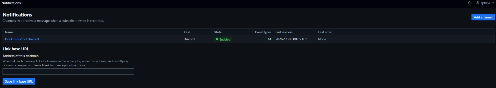
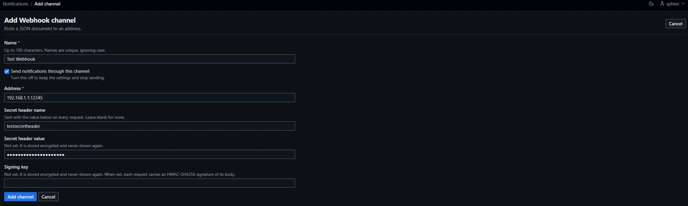

# Notifications

A channel is a place dockmin sends a message when a subscribed event is recorded in the activity log. Administrators create channels, choose the event types and environments each one reports, and test it. Channels are global.

| Kind | Delivers by |
|---|---|
| Webhook | `POST` of a JSON document ([Webhook body](#webhook-body)) |
| ntfy | `POST` to a topic |
| Gotify | `POST` to a Gotify server |
| Discord | `POST` to a Discord webhook |
| Slack | `POST` to a Slack incoming webhook |
| Microsoft Teams | `POST` to a Teams incoming webhook |
| Email | A plain-text message over SMTP |

## Access

| Surface | Administrators | Standard users | No session |
|---|---|---|---|
| Every page and action | Yes | `404`, the answer for an unknown path | Redirect to the sign-in page |

- The `Notifications` link is under `Administration` in the sidebar, after `Certificate`. Standard users do not see it.
- Every page answers `Cache-Control: no-store`. Every post carries the CSRF token ([Frontend conventions](Contributing-Frontend-Conventions)).

## Pages and routes

| Page | Path | Method |
|---|---|---|
| Channel list, link base URL | `/notifications` | `GET` |
| Save the link base URL | `/notifications/-/settings` | `POST` |
| New channel: the kinds, or the form for `?kind=` | `/notifications/new` | `GET` |
| Create | `/notifications` | `POST` |
| Channel | `/notifications/{id}` | `GET` |
| Edit form, save | `/notifications/{id}/edit`, `/notifications/{id}` | `GET`, `POST` |
| Test | `/notifications/{id}/test` | `POST`. An htmx request receives the result fragment |
| Delete confirmation, delete | `/notifications/{id}/delete` | `GET`, `POST` |
| Subscriptions | `/notifications/{id}/subscriptions` | `GET`, `POST` |

| List column | Content |
|---|---|
| Name | Linked to the channel |
| Kind | The kind |
| State | `Enabled` or `Disabled` |
| Event types | How many are subscribed |
| Last success | The time of the last message the receiver accepted, or `Never` |
| Last error | The text of the last message that failed every attempt, with its time, or `None` |

- Heading `Notifications`, introduction `Channels that receive a message when a subscribed event is recorded.` `Add channel` opens the kind chooser. `Kind` and `Event types` are hidden on narrow screens.
- Empty list: `No channels yet`, `Add a channel, then subscribe it to the events it should report.`
- A save posts `expected_updated_at`. A channel changed since the form was loaded is refused: `Changed since it was reviewed; nothing was saved.`
- A new channel is enabled, subscribes to nothing and reports every environment. The channel page notes `No event types are subscribed, so this channel receives nothing.` with a link to the subscriptions page.
- `Last success` and `Last error` are independent. A later success does not clear the last error.
- Confirmation notices: `The channel is saved. Send a test message to check it.`, `Changes saved.`, `The channel is deleted. Messages waiting for it are discarded.`, `Subscriptions saved.`, `Settings saved.`



## Channels

| Field | Rule |
|---|---|
| Name | 1 to 100 characters, no control characters. Unique ignoring case. Errors: `Enter a name.`, `The name is at most 100 characters.`, `The name may not contain control characters.`, `A channel with this name already exists.` |
| Send notifications through this channel | On by default. Off keeps the settings and stops sending |
| Channels | At most 200. The 201st is refused: `At most 200 channels can be configured.` |

### Webhook

| Field | Rule | Secret |
|---|---|---|
| Address | Required. `http` or `https`, a host name or IP address, an optional port and query. No user name, no fragment. ASCII, at most 2048 characters | No |
| Secret header name | Optional. 1 to 64 letters, digits and hyphens. Not `Host`, `Content-Length`, `Content-Type`, `Transfer-Encoding`, `Connection` or `X-Dockmin-Signature` | No |
| Secret header value | Required with a header name, refused without one. 1 to 1024 visible characters | Yes |
| Signing key | Optional. 1 to 256 visible characters. When set, each request carries a [signature](#signature) | Yes |

### ntfy

| Field | Rule | Secret |
|---|---|---|
| Server address | Required. `http` or `https`, no user name, query or fragment | No |
| Topic | Required. 1 to 64 letters, digits, underscores and hyphens | No |
| Access token | Optional. 1 to 512 visible characters without spaces. Sent as `Authorization: Bearer` | Yes |

### Gotify

| Field | Rule | Secret |
|---|---|---|
| Server address | Required. `http` or `https`, no user name, query or fragment | No |
| Application token | Required. 1 to 512 visible characters without spaces. Sent as `X-Gotify-Key` | Yes |

### Discord, Slack and Microsoft Teams

| Field | Rule | Secret |
|---|---|---|
| Webhook address | Required. The incoming-webhook address of the channel. `http` or `https`, no user name or fragment | Yes |

### Email

| Field | Rule | Secret |
|---|---|---|
| Mail server | Required. A host name or IP address | No |
| Connection security | `STARTTLS` (default) or `TLS` ([SMTP](#smtp)) | No |
| Port | 1 to 65535. Blank: 587 for STARTTLS, 465 for TLS | No |
| From address | Required. A plain mailbox address: a local part, `@`, a domain, at most 254 characters | No |
| Recipients | Required. 1 to 10 plain mailbox addresses separated by commas, semicolons or new lines. Each once | No |
| User name | Optional. 1 to 256 printable ASCII characters | No |
| Password | Required with a user name, refused without one. 1 to 256 printable ASCII characters | Yes |

### Add a channel



1. Open `Notifications` and select `Add channel`.
2. Choose a kind. The form for that kind opens.
3. Enter the `Name` and the fields of the kind ([Webhook](#webhook), [ntfy](#ntfy), [Gotify](#gotify), [Discord, Slack and Microsoft Teams](#discord-slack-and-microsoft-teams), [Email](#email)). Leave `Send notifications through this channel` ticked.
4. Select `Add channel`. A refused field re-renders the form at `422` with the message beside the field. Secrets are not sent back; enter them again.
5. The channel page opens with `The channel is saved. Send a test message to check it.`
6. Select `Send a test message`. The result reads `Accepted` with `The test message was accepted by the receiver.` When it reads `Failed`, use [Error codes](#error-codes).
7. Select `Subscriptions` and choose event types ([Subscribe a channel](#subscribe-a-channel)). A channel with no event type receives nothing.

### Edit a channel

1. Open the channel and select `Edit`.
2. Change fields. A secret field reads `Set. Leave blank to keep it.` or `Not set. It is stored encrypted and never shown again.` Blank keeps the stored value.
3. Tick `Remove the stored signing key` or `Remove the stored access token` to remove an optional secret.
4. Select `Save changes`. The channel page opens with `Changes saved.` A save that changes nothing records nothing.

### Secrets

| Item | Behaviour |
|---|---|
| Storage | Every secret field of a channel is stored encrypted with the instance key, with the other stored secrets ([Encryption](Administration-Encryption#encryption-at-rest)) |
| Shown | Masked only. The channel page shows a set secret as its [mask](#secret-masks) with `Set. Shown masked only.`, or `Not set.` The edit form reads `Set. Leave blank to keep it.` or `Not set. It is stored encrypted and never shown again.` |
| Key cannot open them | The channel page shows no masks and reads `Set. It is never shown.` under the notice `Stored secrets of this channel cannot be opened with the current key, so their masks are not shown.`, with an `Open encryption` link to the Encryption page |
| Blank on save | Keeps the stored value |
| Remove | The edit form offers `Remove the stored <field>` for the optional secrets: the signing key and the ntfy access token |
| Destination changed | Changing the Address or the secret header name of a webhook, the server address of ntfy or Gotify, or the mail server of an email channel clears every stored secret of the channel unless it is entered again. A required secret left blank is refused: `The destination changed, so enter this again.` |
| Save when the key cannot open them | `The stored secrets cannot be read with the current encryption key. Enter them again.` The save is refused until each stored secret is entered again or removed |
| Logs, errors, rows | No secret appears in a log line, a delivery error, an activity row or a page |

- A Discord, Slack or Teams address is a credential, so it is a secret. The page shows only its mask, and the `Destination` row reads `Webhook address stored`.
- A webhook, ntfy, Gotify or email address that is not a secret is shown on the channel page. A notice appears there for an `http` address (`This address uses plain http, so notifications cross the network unencrypted.`) and for an address on this server or a link-local network that a permit allows (`This address is on this server or a link-local network. It is accepted as configured.`) ([Internal addresses](#internal-addresses)).
- The channel page lists `State`, `Destination`, each field, `Event types`, `Environments` (`All` or `<n> listed`), `Added` and `Last changed`, then `Delivery` (`Last success`, `Last error`) and `Test`.

### Secret masks

| Value | Mask |
|---|---|
| A single line of at least 24 printable characters with no leading or trailing whitespace | The first 4 characters, 16 `•` characters, the last 4 characters |
| Any other value | 16 `•` characters |

- The channel page is for administrators. The stored secrets are decrypted in memory to build the masks, and only the masks leave the process.
- A 24-character mask discloses that the value has at least 24 printable characters, and its first and last four.

### Test

`Send a test message` on the channel page sends one message through the saved settings and waits for the receiver. Before a test the page reads `Not tested since this page was opened.`

| Item | Behaviour |
|---|---|
| Content | One event: type `test`, label `Test notification`, result `success`, the administrator as actor, target type `notification_channel` and the channel's name |
| Settings used | The saved ones. An edit that was not saved is not used, so no secret goes to an address that was not saved |
| Accepted | Badge `Accepted`, `The test message was accepted by the receiver.` |
| Failed | Badge `Failed` and the fixed text of the [error code](#error-codes). When the stored secrets cannot be read: `The stored secrets cannot be read with the current encryption key. Enter them again.` |
| Recorded | `notification_channel_tested`, result `success` or `failure`, with the channel's name and kind, `duration_ms`, and on failure the code as `reason` |

### Delete

1. Open the channel and select `Delete`.
2. Read the confirmation page `Delete notification channel`. It names the channel and its kind and lists the effects: its subscriptions and stored secrets are deleted, messages waiting for it are discarded, messages already delivered are not affected.
3. Select `Delete channel`. The list opens with `The channel is deleted. Messages waiting for it are discarded.`

- The posted `expected_name` must still be the channel's name, else nothing is deleted: `Changed since it was reviewed; nothing was deleted.`
- Deleting a channel deletes its subscriptions and the messages waiting for it.

## Event types

An event type is a row of a table in dockmin. It names the activity actions it matches, and optionally a result and an actor subsystem the event must have. A channel subscribes to event types; at most 64 per channel.

| Key | Label | Actions matched | Result | Actor subsystem | Raised when |
|---|---|---|---|---|---|
| `automation_run_failed` | Automation run failed | `automation_run_failed`, `automation_run_partial` | `failure` | Any | A run of an automation ends `failure` or `partial`. Not for a dry run ([Automation](Operations-Automation#activity-events)) |
| `automation_disabled` | Automation disabled after repeated failures | `scheduled_job_disabled` | Any | Any | A job is disabled after its failure threshold ([Jobs](Administration-Jobs#failures)) |
| `update_applied` | Update applied | `container_recreated`, `stack_redeployed`, `service_updated` | `success` | `container-updater` | The updater recreates a container, redeploys a stack or updates a Swarm service |
| `update_rolled_back` | Update rolled back | `container_update_rolled_back`, `service_rolled_back` | Any | `container-updater` | The updater restores a container or rolls a Swarm service back |
| `webhook_deployed` | Webhook deployment applied | `container_recreated`, `stack_redeployed`, `service_updated`, `service_force_updated` | `success` | `webhook-receiver` | A webhook automation recreates a container, redeploys a stack or updates or force-updates a Swarm service ([Automation](Operations-Automation#webhooks)) |
| `webhook_rolled_back` | Webhook deployment rolled back | `container_update_rolled_back`, `service_rolled_back` | Any | `webhook-receiver` | A webhook automation restores a container or rolls a Swarm service back |
| `restart_hold_placed` | Restart hold placed | `container_restart_budget_exhausted` | Any | `container-health-checker` | A container used its restart budget and is held |
| `restart_hold_released` | Restart hold released | `container_restart_budget_released` | `success` | Any | A hold ends. The row's `released` is `manual` (a user), `automatic` (the container stayed healthy), or `gone` (the held container is no longer on the host) |
| `backup_sync_failed` | Backup or object storage sync failed | `backup_uploaded`, `backup_remote_pruned` | `failure` | `backup-syncer` | A backup upload or a remote retention pass failed |
| `log_export_failed` | Activity or container log export failed | `activity_log_exported`, `container_log_exported` | `failure` | Any | An export to a bucket failed |
| `environment_unreachable` | Environment unreachable | `environment_unreachable` | Any | `environment-snapshot-refresher` | An environment's status moved from `reachable` to `unreachable` |
| `environment_reachable` | Environment reachable again | `environment_reachable` | Any | `environment-snapshot-refresher` | An environment's status moved from `unreachable` to `reachable` |
| `stack_variable_revealed` | Stack variable revealed | `stack_variable_revealed` | `success` | Any | An administrator revealed a secret stack variable ([Stacks](Usage-Stacks#reveal-a-secret-variable)). The message names the stack, not the variable |
| `dockmin_updated` | dockmin updated | `instance_updated` | `success` | Any | An update of dockmin ended with the new container healthy ([Instance](Administration-Instance)) |
| `dockmin_update_rolled_back` | dockmin update rolled back | `instance_update_rolled_back` | Any | Any | An update of dockmin ended rolled back, or with the rollback failed |

- A key is stored in subscriptions and is never renamed. A stored key that is no longer in the table matches nothing.
- `notification_delivery_failed` is in no row. A failed delivery never raises a notification.
- An event that matches more than one row is queued once for a channel, under the first matching row the channel subscribes to.
- A disabled channel is queued nothing.

### Subscribe a channel

1. Open the channel and select `Subscriptions`.
2. Under `Event types`, tick the types the channel reports. With none ticked it receives nothing.
3. Under `Environments`, choose `Every environment` or `Only the environments ticked below`. In the second case tick the environments under `Environments to include`.
4. Select `Save subscriptions`. The channel page opens with `Subscriptions saved.`
5. A refused save re-renders the page at `422`: `Choose event types from the list.`, `Choose all environments or the listed ones.` or `An environment was deleted. Review the list again.`

### Environment scope

The subscriptions page sets, for each channel, the event types and the environments.

| Scope | Behaviour |
|---|---|
| `Every environment` | Events of any environment |
| `Only the environments ticked below` | Events of the listed environments only. A channel that lists none receives no event that has an environment |

- An event that belongs to no environment reaches every subscribed channel whatever its scope: backup and activity export failures, and updates of dockmin.
- An activity row written after its environment was deleted keeps the environment id in its detail ([Activity](Administration-Activity#stored-fields)). A channel limited to environments applies its list to that id.
- The page lists up to 500 environments, sorted by name, and says when more exist: `More environments exist than are listed. Only the ones listed can be ticked.` A channel can list up to 10,000. Deleting a listed environment removes it from the list; a channel limited to environments never becomes a channel for all of them.
- A change records `notification_subscriptions_changed`. A save that changes nothing records nothing.

## Delivery

When an activity event that matches an enabled channel's subscription is committed, one queue entry per channel is written in the same transaction. A rolled-back transaction leaves no entry. `notification-sender` sends the entries ([Subsystems](Reference-Subsystems#notification-sender)).

| Item | Behaviour |
|---|---|
| Wake | A queued entry brings the next sender run forward to now. The sender also runs every 60 s |
| Grouping | The oldest entries of a channel, at most 20, go in one message. A burst of 25 events to one channel arrives as two messages |
| Retried entries | Entries that have failed before are not grouped with new ones |
| Checked again | Before sending, each entry is checked against the channel's current state: enabled, subscribed to the type, in scope. An entry that fails the check is dropped |
| Success | Any `2xx` answer. The entries are removed and the channel's `Last success` is set |
| Redirects, proxies | Not followed. Proxy environment variables are not read |
| Response | At most 64 KiB is read and discarded |
| Timeouts | HTTP: 10 s to connect, 10 s per request, 30 s in all. SMTP: 10 s to connect, 20 s per read, 60 s in all |
| Concurrency | At most 4 messages are sent at once |
| Per run | At most 5 passes. A pass takes up to 20 channels with something due and sends at most one message to each |

| Attempt | When |
|---|---|
| 1 | When the entry is queued |
| 2 | 120 s after attempt 1 failed |
| 3 | 480 s after attempt 2 failed |

- A retry is sent by the first sender run at or after its time, which is within 60 s of it.
- After a third failure the entries are removed, the channel's `Last error` and its time are set, and `notification_delivery_failed` is recorded.
- The sender can repeat a message when the process stops while a message is being sent.
- A sender run that is paused, disabled or switched off leaves entries queued ([Jobs](Administration-Jobs#pause-resume-and-switches)).

### Error codes

The channel page and the activity row show the fixed text. The row also holds the code as `reason`. No text from the receiver is kept.

| Code | Text |
|---|---|
| `address_refused` | `This address is on this server or a link-local network. Set DOCKMIN_PERMITTED_INTERNAL_NETWORKS to allow it.` |
| `dns` | `The host name of the receiver could not be resolved.` |
| `tcp` | `A connection to the receiver could not be made, or it was lost.` |
| `tls` | `The TLS connection to the receiver could not be established.` |
| `certificate` | `The certificate of the receiver was not accepted.` |
| `timeout` | `The receiver did not answer in time.` |
| `protocol` | `The receiver sent a reply that could not be understood.` |
| `invalid_target` | `The address or credentials stored for this channel are not usable.` |
| `smtp_auth` | `The mail server refused the user name or password.` |
| `smtp_refused` | `The mail server refused the message.` |
| `status_<nnn>` | `The receiver answered with HTTP status <nnn>.` For any status outside 200 to 299 |

### Internal addresses

Every connection to a channel's receiver goes through the outbound address policy: the refused classes, the permit setting, the checks at save and at send, and the texts are in [Address policy](Reference-Security#address-policy). A refused receiver fails the test and the delivery with `address_refused`.

## Content

Every kind reports the same fields of an event and no others. An activity row's `detail` is never sent.

| Field | Content |
|---|---|
| Event type | The key and label of the [event type](#event-types) |
| Result | `success` or `failure` |
| Actor | The username for a user, `user <id>` for a user that no longer exists, `anonymous`, or the subsystem name. For a subsystem acting for an automation, the automation's name as well |
| Target | The target type, and the name: `name` from the event's detail when it has one, else the target id |
| Environment | The id and name, when the event has an environment |
| Time | When the event was recorded, ISO 8601 UTC |
| Link | `<link base URL>/activity/<event id>`, when a link base URL is set |

- Each text field has control characters removed, runs of white space collapsed to one space, and is cut to 160 characters ending in `…`.
- A name typed by a user is data in every format. It is escaped for the receiver's markup and never interpreted as markup.
- A link longer than 600 characters, or that is not an `http` or `https` address, is left out.

### Link base URL

| Item | Value |
|---|---|
| Where | The `Link base URL` section of the channel list, field `Address of this dockmin`, button `Save link base URL` |
| Value | An absolute `http` or `https` address with no query or fragment, up to 512 characters, such as `https://dockmin.example.com`. A trailing `/` is dropped |
| Blank | Messages carry no link |
| Refused | `Enter an absolute http or https address with no query or fragment, up to 512 characters.` The list re-renders at `422` |
| Applies to | Every channel. It is also the base of the webhook URL shown for a `webhook-receiver` automation ([Automation](Operations-Automation#create-a-webhook)) |
| Recorded | `notification_settings_updated`, target type `notification_settings`, detail `link_base_url_set`. A save that changes nothing records nothing |

### Webhook body

`POST` with `Content-Type: application/json`, compact UTF-8 JSON, and the headers `User-Agent: dockmin` and `Accept-Encoding: identity`. A secret header and a signature are added when set.

```json
{"schema_version":1,"sent_at":"2026-10-19T14:30:05Z","channel":"Operations","events":[{"id":4821,"type":"update_applied","label":"Update applied","result":"success","actor":{"type":"subsystem","name":"container-updater","rule":"Nightly updates"},"target":{"type":"container","name":"web"},"environment":{"id":2,"name":"production"},"time":"2026-10-19T14:30:02Z","link":"https://dockmin.example.com/activity/4821"}]}
```

| Key | Type | Meaning |
|---|---|---|
| `schema_version` | integer | `1` |
| `sent_at` | string | When the message was built, ISO 8601 UTC |
| `channel` | string | The channel's name |
| `events` | array | 1 to 20 events, oldest first |
| `events[].id` | integer | The activity event id. `0` in a test message |
| `events[].type` | string | The event type key. `test` in a test message |
| `events[].label` | string | The event type label |
| `events[].result` | string | `success` or `failure` |
| `events[].actor.type` | string | `user` or `subsystem` |
| `events[].actor.name` | string | The username or the subsystem name |
| `events[].actor.rule` | string or `null` | The automation's name, when the row has one |
| `events[].target.type` | string | The target type |
| `events[].target.name` | string | The target's name or id |
| `events[].environment` | object or `null` | `{"id": integer, "name": string or null}`. `null` when the event has no environment |
| `events[].time` | string | When the event was recorded, ISO 8601 UTC |
| `events[].link` | string or `null` | The link to the event, when a link base URL is set |

### Signature

| Item | Value |
|---|---|
| Header | `X-Dockmin-Signature: sha256=<hex>` |
| Computed over | The exact bytes of the request body |
| Algorithm | HMAC-SHA256 with the signing key as UTF-8, written as lower-case hexadecimal |
| Sent when | A signing key is set |
| Replay | Not prevented by dockmin. A receiver that wants protection compares `sent_at` with its clock |
| Secret header | The configured name and value, sent on every request, independent of the signature |

### Other kinds

| Kind | Request | Content |
|---|---|---|
| ntfy | `POST <server>/<topic>`, `Content-Type: text/plain; charset=utf-8` | Headers `Title` and `Tags`. The body is the plain-text rendering below. `Tags` is `x` when any event failed, `white_check_mark` when all succeeded, else `information_source`. A non-ASCII title is sent MIME-encoded |
| Gotify | `POST <server>/message`, `X-Gotify-Key`, JSON | `title`, `message` (the plain-text rendering) and `priority` `5` |
| Discord | `POST <webhook address>`, JSON | `content` (the title), one embed (`description` of at most 4000 characters, ending `and N more` when events are left out, `color`, `timestamp`) and `allowed_mentions` `{"parse": []}`. Markdown, mention and emoji syntax in values is escaped |
| Slack | `POST <webhook address>`, JSON | `text`. `&`, `<` and `>` in every value are escaped |
| Microsoft Teams | `POST <webhook address>`, JSON | A `message` with one Adaptive Card (version 1.4) attachment: a title block, then a text block and a fact set for each event. Markdown in values is escaped |
| Email | SMTP, plain text | Subject, From, To, Date and Message-ID headers. Carriage returns and line feeds are removed from every value placed in a header |

The title and email subject read `dockmin: <label>` for one event and `dockmin: <n> events` for several.

```text
<label> (<result>)
  Target: <target type> <name>
  Environment: <name>
  Actor: <actor>
  Time: <ISO 8601 UTC>
  Link: <url>
```

- `Environment` and `Link` are left out when the event has none. A subsystem actor with an automation reads `<subsystem> (rule: <name>)`.
- Events in one message are separated by a blank line.

### SMTP

| Item | Behaviour |
|---|---|
| `STARTTLS` | Connects without encryption, then requires STARTTLS. A server that does not offer it fails the delivery with `tls`, before sign-in or any mail |
| `TLS` | The connection is encrypted from the start |
| Plain text | Never. There is no fallback to an unencrypted session |
| Certificate | Verified against the system roots, for the configured mail server name |
| Sign-in | With the user name and password, when both are set |
| Server address | Resolved and checked by the [address policy](#internal-addresses) first. The connection goes to the checked address |
| Greeting name | `localhost` |
| Recipients | A message accepted for at least one recipient counts as sent |
| Replies | A reply line over 8192 bytes, a reply of more than 100 lines or more than 64 KiB fails the delivery with `protocol` |

## Recorded actions

| Action | Actor | Target | Detail |
|---|---|---|---|
| `notification_channel_created` | User | `notification_channel`, the channel's id | `name`, `kind`, `is_enabled`, `secrets`: the names of the secret fields set |
| `notification_channel_updated` | User | `notification_channel`, the id | `name`, `kind`, `changed`: the names of the fields that changed, `secrets_replaced`: the names of the secret fields entered or removed |
| `notification_channel_deleted` | User | `notification_channel`, the id | `name`, `kind` |
| `notification_channel_tested` | User | `notification_channel`, the id | `name`, `kind`, `duration_ms`. On failure `reason`: an [error code](#error-codes), `secrets_unreadable` or `invalid_target` |
| `notification_subscriptions_changed` | User | `notification_channel`, the id | `name`, `scope`, `environments`: how many are listed, `added`, `removed`: event type keys |
| `notification_settings_updated` | User | `notification_settings` | `link_base_url_set` |
| `notification_delivery_failed` | `notification-sender` | `notification_channel`, the id | `reason`: an error code, `message`, `name`, `kind`, `events`: how many events were in the message, `event_types`: their keys, comma-separated, cut to 512 characters |

- The rows by users have category `user_action`. `notification_delivery_failed` has category `automation`, result `failure` and no environment.
- A save that changes nothing records nothing.
- No row holds a secret, an address of a Discord, Slack or Teams channel, or text from a receiver.

## Limits

| Limit | Value |
|---|---|
| Channels | 200 |
| Channel name | 100 characters |
| Event types per channel | 64 |
| Environments listed per channel | 10,000; the page lists 500 |
| Events per message | 20 |
| Email recipients | 10 |
| Email address | 254 characters |
| Address | 2048 characters |
| Link base URL | 512 characters |
| Text field in a message | 160 characters |
| Attempts per entry | 3 |
| Messages sent at once | 4 |

## Related settings

| Setting | Effect here |
|---|---|
| `DOCKMIN_PERMITTED_INTERNAL_NETWORKS` | Permits a receiver on an internal address ([Internal addresses](#internal-addresses)) |
| `DOCKMIN_SECRET_KEY`, `DOCKMIN_SECRET_KEY_FILE`, `DOCKMIN_SECRET_KEY_DIR` | The key that seals the channel secrets ([Encryption](Administration-Encryption)) |

Defaults and ranges: [Configuration](Reference-Configuration).

## Failure states

| Symptom | Cause | Next step |
|---|---|---|
| Test reads `Failed` | An [error code](#error-codes) | Read the text, correct the address or credential, save, test again |
| `Last error` is set and no message arrives | Three attempts failed | Fix the cause. New events are delivered; the removed entries are not resent |
| A channel receives nothing | No event type ticked, the channel is `Disabled`, or the environment scope excludes the event | [Subscribe a channel](#subscribe-a-channel) |
| `Stored secrets of this channel cannot be opened with the current key` | The key that sealed the secrets is not loaded | [Encryption](Administration-Encryption); enter each secret again |
| Save refused with `Changed since it was reviewed; nothing was saved.` | The channel changed after the form loaded | Open the channel again and repeat the edit |
| `address_refused` | The receiver is on this server or a link-local network | [Internal addresses](#internal-addresses) |
| Messages wait and nothing is sent | The sender's job is paused, disabled or its subsystem is off | [Jobs](Administration-Jobs#pause-resume-and-switches) |

Further causes: [Troubleshooting](Troubleshooting).
