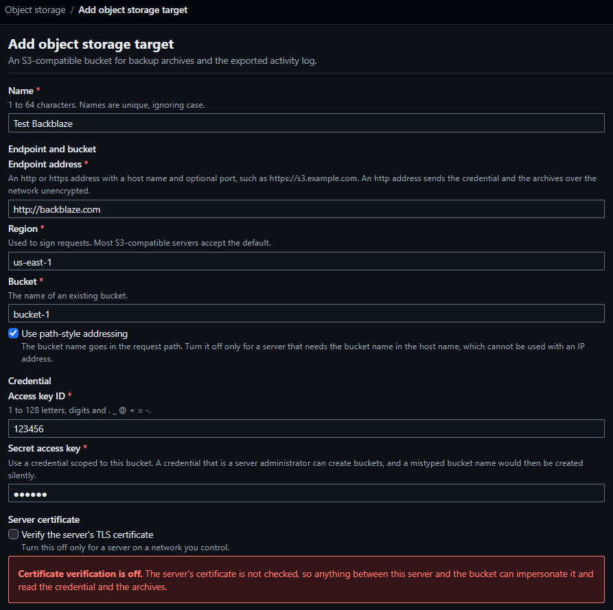

# Object storage

## Access

| Item | Rule |
|---|---|
| Who | Administrators only, on every page and every action. Any other signed-in role receives `403`; a request without a session is redirected to the sign-in page |
| Where | `Administration > Object storage`, `/object-storage` |
| Sign-in | A browser session. No `/api` route covers object storage targets |
| Caching | Every page answers `Cache-Control: no-store` |
| Secrets | The secret access key is stored encrypted and is never shown. CA certificates are never shown; only their subject, issuer, expiry and fingerprint are |

An object storage target is an S3-compatible bucket with a credential. Rules that use a target:

| Subsystem | Sends | Reference |
|---|---|---|
| `backup-syncer` | Backup archives | [Backups](Administration-Backups#backup-syncer) |
| `activity-log-exporter` | The activity log | [Activity](Administration-Activity) |
| `container-log-exporter` | Container and Swarm service logs | [Subsystems](Reference-Subsystems#container-log-exporter) |

A restore lists and fetches archives from a target ([Restore from object storage](Administration-Backups#restore-from-object-storage)).

## Pages and routes

| Page | Path | Method |
|---|---|---|
| Target list | `/object-storage` | `GET`. Query: `limit`, `cursor` |
| New target | `/object-storage/new` | `GET` |
| Create | `/object-storage` | `POST` |
| Target | `/object-storage/{id}` | `GET` |
| Edit form, save | `/object-storage/{id}/edit`, `/object-storage/{id}` | `GET`, `POST` |
| Connection test | `/object-storage/{id}/test` | `POST`. An HTMX request receives the result fragment |
| Delete confirmation, delete | `/object-storage/{id}/delete` | `GET`, `POST` |

- The list is ordered by name, 25 per page. The empty list reads `No object storage targets`, with the action `Add target`.
- A save posts `expected_updated_at`. A target changed since the form was loaded is refused: `Changed since it was reviewed; nothing was saved.` The form then shows the stored values.

| List column | Content |
|---|---|
| Name | Linked to the target |
| Endpoint | The endpoint address |
| Bucket | The bucket name |
| Addressing | `Path-style` or `Virtual-host` |
| Remote retention | The count, or `Keeps every archive` |
| Notes | `Plain http`, `TLS not verified` |

| Target page section | Content |
|---|---|
| Header buttons | `Back to targets`, `Edit`, `Delete` |
| Warnings | The [warnings](#warnings) that apply |
| Settings | Endpoint address, region, bucket, addressing, access key ID, `Secret access key` (`Stored. It is never shown.`), certificate verification, activity log folder, backup folder, archives kept, added, last changed, and the stored CA certificates |
| Connection | `Test connection` and its result ([Connection test](#connection-test)) |
| Automation rules | The rules that use the target (up to 100, with `More rules use this target than are listed.`), or `No rule sends to this target.` |

## Add a target

1. Open `Administration > Object storage` and choose `Add target`.
2. Enter the [fields](#fields). The form groups them as `Endpoint and bucket`, `Credential`, `Server certificate`, `Activity logs` and `Backups`.
3. Choose `Add target`.

Success: the target page opens with `The target is saved. Test the connection to check it.` Failure: the form reopens with status `422` and the message beside each refused field ([Field errors](#field-errors)).

4. On the target page, choose `Test connection` ([Connection test](#connection-test)).



## Fields

| Field | Rule | Default |
|---|---|---|
| Name | 1 to 64 characters, no control characters. Unique, ignoring case | — |
| Endpoint address | `http` or `https`, a host name or IP address, an optional port, no user name, path, query or fragment. ASCII, at most 2048 characters. An internal address is refused unless permitted ([Internal addresses](#internal-addresses)) | — |
| Region | 1 to 63 characters: letters, digits, `.`, `_`, `-`; starts with a letter or digit. Used to sign requests | `us-east-1` |
| Bucket | An existing bucket. Rules per [addressing style](#addressing) | — |
| Access key ID | 1 to 128 characters: letters, digits, `.`, `_`, `@`, `+`, `=`, `-` | — |
| Secret access key | At most 1024 characters, no control characters. Write-only | — |
| Use path-style addressing | See [Addressing](#addressing) | On |
| Verify the server's TLS certificate | See [TLS](#tls) | On |
| Remove the stored CA certificates | A tick, offered on an edit of a target that holds a bundle. Deletes the bundle | Off |
| Additional CA certificates | A text area, or a file (`Or choose a file`). See [TLS](#tls) | None |
| Activity log folder | A [prefix](#prefixes). Holds the exported activity log and, under `container-logs/` and `service-logs/`, exported container and Swarm service logs ([Container logs](#container-logs), [Service logs](#service-logs)) | `activity-log` |
| Backup folder | A [prefix](#prefixes) | `backups` |
| Archives to keep | A whole number from 1 to 1000, or empty | Empty: every archive is kept |
| Delete older backup archives in this bucket | A confirmation, see [Retention](#retention) | Off |

- There is no provider field. Any server that speaks the S3 API with signature version 4 can be used.
- A refused field re-renders the form at `422` with the message beside the field. Every problem found is reported together, an invalid CA bundle included. Secrets and certificates are never sent back; enter them again.

### Field errors

| Field | Message |
|---|---|
| Name | `Enter a name.`, `The name is at most 64 characters.`, `The name may not contain control characters.`, `An object storage target with this name already exists.` |
| Endpoint address | `Enter an http or https address with a host name and no user name, path, query or fragment.`; the internal-address text ([Internal addresses](#internal-addresses)) |
| Region | `Use letters, digits, '.', '_' and '-', starting with a letter or digit.` |
| Bucket | Path-style: `Use letters, digits, '.', '_' and '-', starting with a letter or digit.` Virtual-host: `Virtual-host addressing needs a single lower-case DNS label.` |
| Use path-style addressing | `Virtual-host addressing needs a host name, not an IP address. Use path-style addressing for this endpoint.` |
| Access key ID | `Use 1 to 128 letters, digits and . _ @ + = -.` |
| Secret access key | `Enter the secret access key.`, `The secret is at most 1024 characters.`, `The secret may not contain control characters.`, and on an edit that needs it again: `The endpoint, bucket, addressing style or certificate settings changed, so enter the secret access key again.` |
| Backup folder, Activity log folder | `Use letters, digits, '.', '_', '-' and '/', with no empty or dot-only segment.` |
| Activity log folder | `The backup and activity log prefixes must differ.`, `Neither prefix may be a folder inside the other.` |
| Archives to keep | `Enter a whole number from 1 to 1000, or leave it blank to keep every archive.` |
| Delete older backup archives in this bucket | `Confirm that older backup archives in this bucket will be deleted.` |
| Additional CA certificates | The [CA bundle](#tls) messages |

## Addressing

| Style | Request | Bucket name |
|---|---|---|
| Path-style (default) | `https://<host>/<bucket>/<key>` | 1 to 255 characters: letters, digits, `.`, `_`, `-`; starts with a letter or digit |
| Virtual-host | `https://<bucket>.<host>/<key>` | A single lower-case DNS label, 3 to 63 characters: lower-case letters, digits, `-` |

- Virtual-host addressing needs a host name as the endpoint, not an IP address. The form refuses the combination.
- Virtual-host addressing needs the server's domain setting for the endpoint host, and, for `https`, a certificate that covers `*.<endpoint host>`.
- Endpoint, region and bucket syntax is checked by the same rules the client uses, so the form refuses what a request would.

## TLS

| Item | Rule |
|---|---|
| Verification | On by default. Certificates are checked against the operating system roots plus the target's CA bundle |
| CA bundle | PEM `CERTIFICATE` blocks, at most 10 certificates, at most 64 KiB, pasted or uploaded (`.pem`, `.crt`, `.cer`, `.key` or text). Each certificate must be inside its validity period |
| Stored bundle | The page shows subject, issuer, expiry and fingerprint of each certificate. `Remove the stored CA certificates` deletes it; empty input keeps it |
| Verification off | A bundle is refused: `A certificate bundle is used only when certificates are verified.` Unticking verification on a target that holds a bundle removes the bundle |
| Redirects, proxies | Not followed; proxy environment variables are not read |

| CA bundle message | Cause |
|---|---|
| `The certificate bundle is larger than 64 KiB.`, `That file is larger than 64 KiB.`, `That text is longer than 64 KiB.` | Over the size limit |
| `That file is not text. Upload a PEM file.` | An uploaded file that is not UTF-8 |
| `The certificate bundle is not in PEM format.` | No PEM block |
| `The certificate bundle contains a private key. Provide only certificates.` | A `PRIVATE KEY` block |
| `The certificate bundle must contain only CERTIFICATE blocks.` | Another block type |
| `The certificate bundle could not be read as PEM certificates.` | A block that does not parse |
| `The certificate bundle contains more than 10 certificates.` | More than 10 |
| `Certificate <n> of the bundle is not valid until <date>.`, `Certificate <n> of the bundle expired on <date>.`, `Certificate <n> of the bundle has an unreadable validity period.` | A certificate outside its validity period |

- A form with verification unticked shows `Certificate verification is off.` with the statement that anything between this server and the bucket can impersonate it.

## Re-entering the secret

On an edit, a blank secret keeps the stored one, except when one of these changes. The secret must then be entered again.

| Change | Secret |
|---|---|
| Endpoint address | Required |
| Bucket | Required |
| Addressing style | Required |
| Certificate verification | Required |
| CA bundle: added, replaced or removed | Required |
| Name, region, access key ID, prefixes, retention | Kept when blank |

- A stored secret that the current encryption key cannot open is reported as `The stored secret cannot be read with the current encryption key. Enter it again.` when the test is run (`422`).

## Edit a target

1. Open the target and choose `Edit`. The form shows every stored value except the secret and the certificates.
2. Change the fields. Enter the secret when the [table above](#re-entering-the-secret) requires it.
3. Choose `Save changes`.

Success: the target page opens with `Changes saved.` A save that changes nothing records nothing. Failure: the form reopens at `422` ([Field errors](#field-errors)); a target changed since the form was loaded reads `Changed since it was reviewed; nothing was saved.`

## Prefixes

| Rule | Value |
|---|---|
| Alphabet | Letters, digits, `.`, `_`, `-`, and `/` between folders |
| Segments | No empty segment, no `.` or `..` segment |
| Empty | Allowed: the folder is the top of the bucket |
| Trailing `/` | One is dropped |
| Length | The finished object key is at most 1024 bytes |
| Backup and activity log folders | Must differ, and neither may be a folder inside the other |

- Object keys: [Backups](Administration-Backups#object-key), [Activity](Administration-Activity), [Container logs](#container-logs) and [Service logs](#service-logs).

## Container logs

`container-log-exporter` stores container logs in the activity log folder, in a subfolder `container-logs/` ([Subsystems](Reference-Subsystems#container-log-exporter)).

```text
<activity log folder>/container-logs/rule-<rule id>-<rule created, UTC YYYYMMDDTHHMMSS>/<environment id>/<container name>-<12-character container id>/<YYYY>/<MM>/<DD>/<first line, 20 digits>.ndjson.gz
```

| Item | Value |
|---|---|
| Folder | Activity export objects start with `rule-` directly under the activity log folder, so the two never share a key |
| Objects | One per container per run with new lines. gzip-compressed NDJSON ([container keys](Usage-Containers#container-keys)). Content type `application/gzip` |
| Name part | The container's name, with characters outside letters, digits, `.`, `_` and `-` replaced by `_` |
| Date | The UTC date of the object's first line |
| File name | The first line's timestamp in nanoseconds since the Unix epoch, zero-padded to 20 digits; `-<count>` follows when the object continues at a nanosecond already exported in part |
| Overwrite | A retried `PUT` writes the same key |
| Deletion | dockmin deletes none of these objects |

- The folder, the rule's id and creation time, and the environment id keep objects of different rules, rule generations and environments apart.
- An activity log folder that does not form a valid key with this path makes the run fail with `prefix_invalid`.

## Service logs

`container-log-exporter` stores the logs of Swarm services in the activity log folder, in a subfolder `service-logs/` beside `container-logs/` ([Subsystems](Reference-Subsystems#container-log-exporter)).

```text
<activity log folder>/service-logs/rule-<rule id>-<rule created, UTC YYYYMMDDTHHMMSS>/<environment id>/<service name>-<12-character service id>/<task id or no-task>/<YYYY>/<MM>/<DD>/<first line, 20 digits>.ndjson.gz
```

| Item | Value |
|---|---|
| Folder | `service-logs/` and `container-logs/` are separate folders; activity export objects start with `rule-` directly under the activity log folder |
| Objects | One per task per run with new lines. gzip-compressed NDJSON ([service keys](Usage-Containers#service-keys)). Content type `application/gzip` |
| Name part | The service's name, with characters outside letters, digits, `.`, `_` and `-` replaced by `_` |
| Task folder | The 25-character task id. `no-task` holds lines that named no task |
| Date | The UTC date of the object's first line |
| File name | The first line's timestamp in nanoseconds since the Unix epoch, zero-padded to 20 digits; `-<count>` follows when the object continues at a nanosecond already exported in part |
| Overwrite | A retried `PUT` writes the same key |
| Deletion | dockmin deletes none of these objects |

- An activity log folder that does not form a valid key with this path makes the run fail with `prefix_invalid`.

## Retention

| Item | Behaviour |
|---|---|
| Setting | `Archives to keep`: 1 to 1000. Empty keeps every archive and turns remote retention off |
| Scope | Per `backup-syncer` rule. A rule deletes only keys named `dockmin-backup-<date and time>.tar.gz` inside its own folder `<backup prefix>/rule-<rule id>-<rule created>/` |
| Confirmation | Setting a count, or lowering it, needs the box `Delete older backup archives in this bucket`. Without it the save is refused: `Confirm that older backup archives in this bucket will be deleted.` |
| No confirmation | Raising the count or emptying it |
| Two rules, one target | Each keeps the count |
| Behaviour | [Remote retention](Administration-Backups#remote-retention) |

## Internal addresses

An endpoint on this server or a link-local network is refused unless `DOCKMIN_PERMITTED_INTERNAL_NETWORKS` permits it. The refused classes, the checks at save and at connect, and the texts: [Address policy](Reference-Security#address-policy). The refusal at save is on the field `Endpoint address`; at connect the failure reason is `address_refused`.

| Item | Behaviour |
|---|---|
| Permitted | The target saves, with the [warning](#warnings) below |
| Setting | An operator setting. It is not a form field |

## Warnings

Shown on the form and on the target page. None blocks a save.

| Condition | Text |
|---|---|
| Endpoint scheme `http` | `Credentials and archives cross the network unencrypted over plain http.` |
| Verification off | `Certificates are not verified, so any server at this address is accepted.` |
| An internal host that `DOCKMIN_PERMITTED_INTERNAL_NETWORKS` permits: `localhost` or another internal name, or an address in the loopback, link-local, unspecified or `fd00:ec2::/64` classes | `This address is on this server or a link-local network. It is accepted as configured.` |

- The list shows `Plain http` and `TLS not verified` as badges.
- The form shows a further notice while verification is unticked.

## Credential

| Advice | Detail |
|---|---|
| Scope | Use a credential scoped to this bucket. A credential that is a server administrator can create buckets, and a mistyped bucket name is then created silently |
| Lifecycle | Add a rule that aborts incomplete multipart uploads ([Multipart upload](#multipart-upload)) |

| Operation | Permission | On AWS S3 |
|---|---|---|
| Upload of an archive up to 64 MiB | Write to the backup folder | `s3:PutObject` |
| Upload of a larger archive | Write to the backup folder, and abort an upload | `s3:PutObject` and `s3:AbortMultipartUpload` |
| Remote retention, listing | List the bucket | `s3:ListBucket` |
| Remote retention, deleting | Delete the archives | `s3:DeleteObject` |
| Restore from the bucket, listing | List the bucket | `s3:ListBucket` |
| Restore from the bucket, fetching | Read the archives | `s3:GetObject` |
| Activity log export, container log export, service log export | Write to the activity log folder | `s3:PutObject` |

- `s3:ListBucket` applies to the bucket. The other actions apply to the objects under the folder.
- `s3:PutObject` covers creating a multipart upload, uploading its parts and completing it.
- Servers other than AWS S3 name these permissions differently; some fold delete into write.
- A restore reads through the credential of the target the administrator chooses. It uses no other credential.

## Multipart upload

`backup-syncer` uploads an archive larger than 64 MiB as an S3 multipart upload.

| Item | Value |
|---|---|
| Part size | 64 MiB. The last part is the remainder. A 7 GiB archive has 112 parts. The limit is 10,000 parts |
| Requests | Create (`POST` with `?uploads`), one `PUT` per part with `partNumber` and `uploadId`, complete (`POST` with `uploadId`) |
| Part request | `Content-Length`, `Content-MD5` of the part and the signed payload hash, as for a single `PUT` |
| Retry | A part that fails with `unreachable` or a 5xx answer is sent once more after 2 s. A failed create or complete is not repeated |
| Completion check | A complete reply that carries an error is a failure. When the server returns a multipart entity tag, it must equal the MD5 of the parts' MD5s and the part count, else the run fails with `digest_mismatch` |
| Failure | The upload is aborted (`DELETE` with `uploadId`), limited to 30 s. An abort answered `404 NoSuchUpload` counts as done. A failed abort is logged as `backup_multipart_abort_failed` with `kind` and leaves the parts on the server |
| Recorded | `backup_uploaded` carries `multipart` and `parts` ([Activity rows](Administration-Backups#activity-rows)) |

- The parts of an upload that was neither completed nor aborted stay in the bucket. A failed abort and a process that is killed mid-upload both leave them.
- Add a lifecycle rule that aborts incomplete multipart uploads. On AWS S3 it is the action `AbortIncompleteMultipartUpload` with `DaysAfterInitiation` of `1` or more, scoped to the bucket or to the backup folder's prefix. One day is longer than the 180-minute time limit of a run, so the rule never aborts an upload in progress.
- A server that does not implement multipart upload fails the run for an archive over 64 MiB.

## Connection test

1. Open the target and choose `Test connection` (`POST /object-storage/{id}/test`). It tests the saved target only, from this server, with the stored secret.
2. Read the result under `Connection`.

Success: the summary reads `Passed` with `Every stage passed.` Failure: the summary reads `Failed` with `<n> of <m> stages failed. Each stage ran whatever the others reported.` and each failed stage shows the [reason's](#failure-reasons) message, and `HTTP <status>` and the S3 error code when the server answered.

| Stage | Request | A pass shows |
|---|---|---|
| Bucket | `HEAD` of the bucket | `The access key, the secret and the bucket name are accepted. This does not show that the credential may write or delete.` |
| Backup prefix | List one key under the backup folder | `The credential can list the backup prefix, which remote retention needs.` |
| Activity log prefix | List one key under the activity log folder | `The credential can list the activity log prefix.` |

- Every stage runs whatever an earlier stage reported. The test has 30 s in all; a stage that is cut off reports `unreachable`.
- A failed stage shows the [reason's](#failure-reasons) message.
- `refused` at the bucket stage adds: `A refusal to a HEAD request cannot tell a missing bucket from a credential without access.`
- `refused` at a prefix stage adds: the credential cannot list the folder. For the backup folder, `The credential cannot list this prefix, so remote retention cannot run. Uploads do not need listing.` For the activity log folder, `The credential cannot list this prefix. Uploads do not need listing.`
- The result ends with `The test does not check write or delete permission. A credential that can list and read passes every stage and fails at the first upload. Remote retention needs list access to the backup prefix and delete access to the archives in it.`
- Before a test, the section reads `Not tested since this page was opened.`
- A failed test is a successful operation. The test never gates a save.
- Recorded as `object_storage_target_tested`.

## Delete

1. Open the target and choose `Delete`. The page `Delete object storage target` names the target, its endpoint address and bucket, and every automation rule that uses it (up to 100).
2. When rules use the target, the page reads `Automation rules use this target`, lists them, and offers no delete button. Point each rule at another target or delete the rule ([Automation](Operations-Automation)).
3. Check the target named under `1 object storage target` and choose `Delete target`.

Success: the list opens with `The target is deleted. Objects in its bucket are untouched.` Failure: the page reads `The target was not deleted` with the message.

| Item | Behaviour |
|---|---|
| Confirmation page | Names the target, its endpoint address and bucket, and every automation rule that uses it (up to 100) |
| Referenced target | Not deletable: `Automation rules use this target. Change or delete those rules first.` |
| Post | Carries the expected name. A target renamed since the page was shown is not deleted: `Changed since it was reviewed; nothing was deleted.` |
| Effects | The target and its stored secret are deleted. Objects in the bucket are not touched. Backup records keep their rows and read `Target deleted` |

## Failure reasons

Used by the connection test, `backup-syncer`, `activity-log-exporter` and the restore's listing and fetch. The S3 error code decides first; the status decides only when no code matches.

| `reason` | Cause |
|---|---|
| `endpoint_invalid` | The endpoint, region or bucket is not usable, including virtual-host style with an IP address |
| `key_invalid` | The object key is not allowed |
| `unreachable` | No connection, or a transport error or timeout that is not a TLS failure |
| `address_refused` | The endpoint is on this server or a link-local network and no permit covers it: `This address is on this server or a link-local network. Set DOCKMIN_PERMITTED_INTERNAL_NETWORKS to allow it.` Not retried |
| `tls_failed` | A TLS error, or a CA bundle that cannot be loaded |
| `refused` | Status 401 or 403, or code `AccessDenied`, `SignatureDoesNotMatch` or `InvalidAccessKeyId`. Also a missing bucket on servers that answer 403 |
| `bucket_missing` | Code `NoSuchBucket`, or a `404` to a bucket check |
| `digest_mismatch` | Code `BadDigest` or `InvalidDigest` |
| `clock_skew` | Code `RequestTimeTooSkewed`. Correct this server's clock |
| `object_missing` | Code `NoSuchKey` on a read: `The archive is no longer in the bucket.` |
| `storage_error` | Any other non-2xx answer |

## Client

| Item | Value |
|---|---|
| Signing | SigV4, service `s3`, the target's region |
| Timeouts | Connect 10 s; 120 s per request |
| Upload | One `PUT` of the archive when it is at most 64 MiB, otherwise a multipart upload of 64 MiB parts ([Multipart upload](#multipart-upload)). Each request has an explicit `Content-Length` (never chunked), `Content-MD5` and the signed payload hash. At most 7 GiB. Time limit per request: 1 s per MiB plus 120 s, at most 2 hours |
| Download | `GET` of one key, streamed. The reply must carry `Content-Length` and no content encoding, and not exceed the caller's limit (7 GiB for an archive). The restore sets the limit; no byte is read before the size is checked. A read that stalls for 120 s fails, and the whole download has the time limit of an upload of its size |
| Listing | `GET ?list-type=2&prefix=…&max-keys=…`, 1000 keys per page, response read up to 2 MiB. Read without an XML parser: a block with a key outside the key alphabet or a malformed size or time is skipped; a malformed page or continuation token is `storage_error` |
| Deleting | `DELETE` of one key. Any 2xx, or a `404 NoSuchKey`, is success |
| Error bodies | Read up to 64 KiB. Only the S3 error code is kept |
| Connections | At most 4 at once, none kept alive |
| Connects to | The configured endpoint only, and only at an address the [address policy](Reference-Security#address-policy) allows |

## Activity rows

Category `user_action`, target type `object_storage_target`, target id the target's id.

| Action | Written |
|---|---|
| `object_storage_target_created` | A target is created |
| `object_storage_target_updated` | A save changed something. A save that changes nothing records nothing |
| `object_storage_target_deleted` | A target is deleted |
| `object_storage_target_tested` | A connection test ran |

| Detail key | On | Content |
|---|---|---|
| `name`, `endpoint_host`, `bucket`, `use_path_style`, `verify_tls`, `ca_bundle_set`, `backup_prefix`, `activity_log_prefix`, `retention_count` | All but `_tested` | The target's fields. `endpoint_host` is the host and port |
| `changed` | `_updated` | Names of the fields that changed, comma-separated |
| `secret_replaced` | `_created`, `_updated` | `true` when a secret was entered |
| `passed`, `failed_stage`, `storage_status`, `storage_code`, `duration_ms` | `_tested` | The result; the first failed stage; the status and code of that failure |

- No row holds the secret, the access key ID, certificate text or text from the server.
- A refused deletion of a referenced target is a failure row with reason `target_in_use`.

Rows written by the rules that send to a target: [Backups](Administration-Backups#activity-rows) and [Activity](Administration-Activity).

## Log lines

| Line | Level | Fields |
|---|---|---|
| `object_storage_plaintext` | warning | `host`. A client was built for an `http` endpoint |
| `object_storage_tls_unverified` | warning | `host`. A client was built with verification off |
| `object_storage_request_failed` | info | `kind`, `status`, `code`. A request answered a non-2xx status |

## Related settings

| Setting | Effect |
|---|---|
| `DOCKMIN_PERMITTED_INTERNAL_NETWORKS` | Permits an endpoint on this server or a link-local network ([Address policy](Reference-Security#address-policy), [Configuration](Reference-Configuration#listeners-and-network)) |
| `DOCKMIN_SECRET_KEY`, `DOCKMIN_SECRET_KEY_FILE`, `DOCKMIN_SECRET_KEY_DIR` | The key that seals the secret access key ([Configuration](Reference-Configuration#encryption-key)) |

## Testing against a server

The live S3 integration test and the variables it reads: [Contributing](Contributing).
