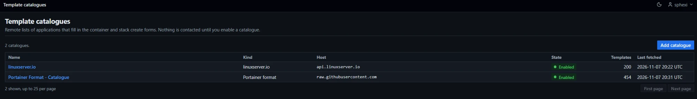
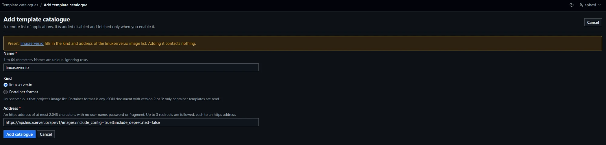

# Template catalogues

A template catalogue is a remote list of applications. Each application is offered as a [template](Operations-Templates) that fills the container create form or the Compose stack create form.

| Item | Value |
|---|---|
| Sidebar | Administration, `Template catalogues` |
| Who can open it | Administrators. A standard user is answered `403` on every route under `/template-catalogues`. A request with no session is redirected to the sign-in page |
| Caching | Every catalogue page answers `Cache-Control: no-store` |
| Related settings | `DOCKMIN_PERMITTED_INTERNAL_NETWORKS` ([Configuration](Reference-Configuration#listeners-and-network)). No other setting applies |
| Initial state | No catalogue exists. A fresh installation contacts no catalogue |

## Routes

All paths are under `/template-catalogues`.

| Page | Path | Method |
|---|---|---|
| Catalogue list | The base path | `GET` |
| Add form | `/new`, `/new?preset={preset}` | `GET` |
| Add | The base path | `POST` |
| Catalogue | `/{catalogue_id}` | `GET` |
| Edit form | `/{catalogue_id}/edit` | `GET` |
| Save | `/{catalogue_id}` | `POST` |
| Enable and fetch | `/{catalogue_id}/enable` | `POST` |
| Refresh | `/{catalogue_id}/refresh` | `POST` |
| Disable | `/{catalogue_id}/disable` | `POST` |
| Delete confirmation, delete | `/{catalogue_id}/delete` | `GET`, `POST` |

- `{catalogue_id}` is a whole number from 1. Any other form answers `422`. An id that names no catalogue answers `404`.
- Every `POST` carries the CSRF token ([Frontend conventions](Contributing-Frontend-Conventions)).
- Add, save and delete answer `422` with the form and its errors on a refusal. Add, save, enable, refresh and disable redirect (`303`) to the catalogue page. Delete redirects to the list.
- A refused enable, refresh or disable returns to the catalogue page with the refusal in a banner.
- The catalogue list takes `limit` (1 to 500, otherwise `422`) and `cursor` (an invalid cursor answers `400`), and returns the table fragment for an htmx request.

## List

| Item | Value |
|---|---|
| Columns | Name, Kind, Host, State, Templates, Last fetched |
| Order | Name |
| Page size | 25 by default |
| Kind | `linuxserver.io` or `Portainer format` |
| Host | The host and port of the address; never the whole address |
| State | `Enabled` or `Disabled`, and `Last fetch failed` when a failure is stored |
| Last fetched | The time of the last successful fetch, or `Never` |
| Empty list | `No template catalogues`, with the `Add catalogue` action |

## Catalogue page

| Item | Value |
|---|---|
| Header | The catalogue name, `Back to catalogues`, `Edit`, `Delete` |
| `The last fetch failed.` | Panel with the text of the stored failure code ([Fetch](#fetch)). Shown only while a failure is stored |
| Settings | Kind, Address, State, Templates, Last fetched, Added, Last changed |
| Fetching, enabled | `Refresh` and `Disable` |
| Fetching, disabled | `Nothing has been contacted for this catalogue. Enabling it downloads the document once from the address above and offers its templates to every signed-in user.` and `Enable and fetch` |

## Catalogue fields

A catalogue is a name, a kind and an https address.

| Field | Rule |
|---|---|
| Name | 1 to 64 characters, no control characters. Unique, ignoring case |
| Kind | `linuxserver.io` (stored as `linuxserver`) or `Portainer format` (stored as `portainer`). The add form preselects `linuxserver.io` |
| Address | `https` only. At most 2,048 printable ASCII characters. No user name or password, no fragment, a host name. No query string, except the address of the linuxserver.io preset. An internal address that no [permit](Reference-Security#address-policy) covers is refused |

| Field | Refusal text |
|---|---|
| Name | `Enter a name.` / `The name is at most 64 characters.` / `The name may not contain control characters.` / `A catalogue with this name already exists.` |
| Kind | `Choose a catalogue kind.` |
| Address | `Enter an https address of at most 2,048 printable ASCII characters.` / `Enter an https address.` / `The address may not have a fragment.` / `Enter a valid https address.` / `Enter an https address with a host name.` / `The address may not carry a user name or password.` / `The address may not have a query string.` / `This address is on this server or a link-local network. Set DOCKMIN_PERMITTED_INTERNAL_NETWORKS to allow it.` |

| Limit | Value |
|---|---|
| Catalogues | 20. At the limit: `At most 20 catalogues can be added. Delete one first.` |
| Templates per catalogue | 2,000 |
| Stored templates of one catalogue | 4 MiB as normalised JSON |

An address with a host name that resolves to an internal address is accepted when it is saved and refused at each fetch (`address_refused`).

## Add a catalogue

1. Sign in as an administrator and open `Template catalogues`.
2. Choose `Add catalogue`.
3. For linuxserver.io, choose the `linuxserver.io` preset link in the notice at the top of the form. It fills in the name, the kind and the address below. For a Portainer-format document, enter a name, choose `Portainer format` and enter the address of a JSON document with `"version": "2"` or `"3"`.
4. Choose `Add catalogue`.
   Result: the catalogue page opens with `The catalogue is added and disabled. Nothing is contacted until you enable it.` The state is `Disabled` and nothing has been contacted.
5. Choose `Enable and fetch`. The document is downloaded once.
   Result: the catalogue is enabled and its templates are offered to every signed-in user. The page reads `The catalogue is enabled. {N} templates are available.` ([Fetch result](#fetch-result)).

When step 5 fails, the catalogue stays disabled and the page shows the failure in a banner and in `The last fetch failed.` Find the code in [Fetch](#fetch) and check the cause listed for it. When the form in step 4 returns with an error, see [Catalogue fields](#catalogue-fields). Other failures: [Troubleshooting](Troubleshooting).

| Preset | Name | Kind | Address |
|---|---|---|---|
| `linuxserver` | `linuxserver.io` | `linuxserver` | `https://api.linuxserver.io/api/v1/images?include_config=true&include_deprecated=false` |

`/template-catalogues/new?preset=linuxserver` opens the form with the preset filled in. Any other `preset` value opens it blank.

## Catalogue actions

| Action | Effect | Needs the catalogue to be |
|---|---|---|
| Add | Stores the catalogue disabled. Contacts nothing | — |
| Edit, name only | Renames. Fetched templates and the enabled state are kept | Any |
| Edit, kind or address changed | Discards the fetched templates, clears the last failure and disables the catalogue. Enabling it fetches from the new address | Any |
| Enable and fetch | Downloads the document once and enables the catalogue when that succeeds | Disabled |
| Refresh | Downloads the document once. The state does not change | Enabled |
| Disable | Stops offering the templates and keeps what was fetched. Contacts nothing | Enabled |
| Delete | Removes the catalogue and its fetched templates after a confirmation page that names it | Any |

- `Enable and fetch` on an enabled catalogue answers `The catalogue is already enabled.` `Refresh` on a disabled one answers `Enable the catalogue first. A disabled catalogue is never contacted.`
- Enabling a catalogue that was disabled fetches again.
- Edit is refused with `Changed since it was reviewed; nothing was saved.` when the catalogue changed after the form was loaded. Disable, `Enable and fetch` and `Refresh` are refused with the same text when the catalogue changes while they run. Delete is bound to the name shown on the confirmation page: `Changed since it was reviewed; nothing was deleted.` The name is compared exactly, including case.
- An edit that changes nothing writes nothing; the page still reads `Changes saved.`

### Edit a catalogue

1. Open the catalogue page and choose `Edit`.
2. Change the name, kind or address. A notice reads `Changing the kind or the address discards the fetched templates and disables the catalogue.`
3. Choose `Save changes`.

Result: the catalogue page opens with `Changes saved.` After a change of kind or address it reads `Changes saved. The kind or address changed, so the fetched templates are discarded and the catalogue is disabled. Enable it to fetch from the new address.` Choose `Enable and fetch` to offer templates again.

### Disable a catalogue

1. Open the catalogue page and choose `Disable`.

Result: the page reads `The catalogue is disabled. Its templates are no longer offered.` The fetched templates are kept; `Enable and fetch` downloads the document again.

### Delete a catalogue

1. Open the catalogue page and choose `Delete`. The confirmation page changes nothing.
2. Read what the page lists: the name, the address and the number of templates. The fetched templates are deleted with the catalogue. Containers and stacks already created from its templates are not touched. The remote address is not contacted.
3. Choose `Delete catalogue`, or `Cancel`.

Result: the list opens with `The catalogue is deleted.` When the name changed since the confirmation page loaded, the page is shown again with `Changed since it was reviewed; nothing was deleted.` (`422`).

## When a catalogue is contacted

| Event | Contact |
|---|---|
| Start of dockmin | None |
| Adding, editing, disabling or deleting a catalogue | None |
| Loading any page, including the template pages | None. Pages read the stored templates |
| A disabled catalogue | None, however it came to be disabled |
| `Enable and fetch` | One download |
| `Refresh` | One download |
| A schedule | None. There is no scheduled refresh and no subsystem for it |

- A catalogue is never fetched by a browser. Logos are not loaded, and no image from a catalogue's host is requested.
- The catalogue's own page, setup links and any other address inside catalogue text are shown as text or as a plain link. dockmin does not request them.

## Fetch

| Item | Value |
|---|---|
| Request | `GET` with `Accept: application/json`, `Accept-Encoding: gzip` and `User-Agent: dockmin`. Proxy variables are not read |
| Scheme | `https` only, for the address and for every redirect |
| Address | No user information and no fragment. A saved address has no query string except the linuxserver.io preset; a redirect target may carry one |
| Address policy | Every connection passes the [address policy](Reference-Security#address-policy), including each redirect |
| Redirects | `301`, `302`, `303`, `307` and `308`, at most 3, each target re-checked as an https address. A redirect with no `Location`, or one over 2,048 characters, is a `status` failure |
| Time | 20 seconds for the whole fetch |
| Size | 8 MiB on the wire. A larger `Content-Length` is refused before the body is read. A gzip body also decodes to at most 8 MiB |
| Status | `200` only |
| Content encoding | None, `identity` or `gzip` |
| Certificates | Verified against the operating system roots ([Registry connections](Administration-Registries#registry-connections)). No per-catalogue CA bundle |
| Decoding and parsing | In a worker thread, outside any database transaction |

A failed fetch stores a failure code on the catalogue, leaves the stored templates as they were, and shows the text below. The text never quotes the remote server.

| Code | Text | Check |
|---|---|---|
| `not_https` | The address, or a redirect it followed, is not an https address without user information. | The address and the `Location` the server returns |
| `too_many_redirects` | The server redirected more than 3 times. | Use the address the server finally serves |
| `address_refused` | This address is on this server or a link-local network. Set `DOCKMIN_PERMITTED_INTERNAL_NETWORKS` to allow it. | The host resolves to an internal address; add a permit ([Security](Reference-Security#address-policy)) |
| `timeout` | The server did not answer within 20 seconds. | The server and the path from the dockmin server to it |
| `tls` | The server's certificate could not be verified. | The certificate chain. Verification uses the operating system roots of the dockmin image; an image with none fails every fetch with this code |
| `network` | The server could not be reached. | DNS and egress from the dockmin server |
| `status` | The server did not answer with a document. | The server answered something other than `200` |
| `too_large` | The document is larger than 8 MiB. | The document and its decoded size |
| `unsupported_encoding` | The server answered with an encoding that is not supported. | Only `identity` and `gzip` are read |
| `invalid_document` | The document is not a catalogue of the chosen kind. | The kind of the catalogue, and that the body is JSON of the shape in [What is read](#what-is-read). A `NaN` or `Infinity` value, or a gzip body that does not decode, counts as invalid |

- A successful fetch clears the stored failure.
- The normalised templates are written only when their SHA-256 digest differs from the stored one. An unchanged document replaces no stored templates; it updates the fetch time.
- A catalogue changed during its own fetch refuses the result: `Changed since it was reviewed; nothing was saved.`

### Fetch result

The page's notice after an enable or a refresh reads `{N} templates are available.`, then `{M} entries were skipped (reason: count, …).` when any were, then `The catalogue has not changed since the last fetch.` when the digest matched. After an enable it starts with `The catalogue is enabled.` Reasons are written with spaces, as in `invalid port: 2`.

## What is read

Each entry becomes one template. An entry that cannot be used is skipped and counted by reason. The rest of the document is kept.

- Text is cut to its limit and control and format characters are removed. Markup is kept in the stored text; how a template shows it is set out in [Templates](Operations-Templates#description-and-note-markup).
- Line breaks are kept in descriptions and notes; elsewhere they become spaces.
- A template key is unique within a catalogue. A second entry with the same key is skipped as `duplicate_key`.
- An image reference that does not parse is skipped as `invalid_image`.
- A malformed port, volume, environment variable, label, device, capability, sysctl, security option, shared memory size or command skips the entry. An unusable host name, restart policy or setup link is dropped and the entry is kept.
- Limits per template: title 128 characters and description and note 2,000 (longer text is cut); categories at most 8 of at most 32 characters each (longer text is cut, extra categories are dropped, repeats ignoring case are merged); command 2,048 characters (`invalid_command`); 64 labels (`invalid_label`); 32 choices for one variable (`invalid_env`); 32 devices, capabilities, kernel parameters or security options (the matching `invalid_*` reason); 64 ports, 64 volumes and 128 environment variables (`invalid_entry`); the first 32 architectures.

### linuxserver.io

The document is `data.repositories.linuxserver[]`. Without `include_config`, entries have no ports, volumes or variables.

| Source field | Template |
|---|---|
| `name` | Key, title and container name. Must match `[A-Za-z0-9][A-Za-z0-9_.-]{0,63}`, otherwise `invalid_key` |
| `deprecated` | A true value skips the entry as `deprecated` |
| Registry | The image is `lscr.io/linuxserver/{name}:latest` |
| `description` | Description |
| `category` | Categories, split on commas |
| `architectures[].arch` | Published architectures. `x86_64`, `x86-64` and `amd64` read as `amd64`; `arm64`, `aarch64` and `arm64v8` as `arm64`; `armhf`, `arm32v7` and `arm` as `arm`. Another name is kept in lower case when it is 1 to 16 characters of `a-z`, `0-9`, `_`, `-` |
| `config.ports[]` | Container port from `internal`, suggested host port from `external`, `desc`, `optional`. An `internal` value written `host:container/protocol` supplies the host port itself |
| `config.volumes[]` | Container path from `path`, `desc`, `optional`. `host_path` is a placeholder and is not read |
| `config.env_vars[]` | `name`, default from `value`, `desc`, `optional` |
| `config.devices[]` | `host_path` and `path`. Optional entries are left out |
| `config.caps[]` | `cap_add`. Optional entries are left out |
| `config.security_opt[]` | `run_var`, else `compose_var`. Optional entries are left out |
| `config.custom[]` | `shm-size` or `shm_size` as the shared memory size; `sysctl` or `sysctls` as kernel parameters. Optional entries are left out. Other entries, including `stop-timeout`, are not read |
| `config.networking` | `host` selects host networking |
| `config.hostname` | The host name, from a string or from `hostname` of an object. An optional one is left out |
| `config.privileged` | Privileged mode |
| `config.application_setup` | Setup link, kept only when it is an `https` address of at most 2,048 printable ASCII characters without user information |
| Not read | `mac_address`, `readonly_supported`, `nonroot_supported`, `project_logo`, `changelog`, versions and every other field |
| Set by dockmin | Restart policy `unless-stopped` |

### Portainer format

The document is `{"version": "2" or "3", "templates": [...]}`. Any other version is `invalid_document`.

| Source field | Template |
|---|---|
| `type` | `1`, or absent, is a container template. `2` and `3` are stack templates, skipped as `unsupported_stack_template`. Anything else is skipped as `unsupported_type` |
| `title` | Title. Missing or empty: skipped as `missing_title` |
| `id` | Key: a whole number from 0, or text matching the key pattern above. Without a usable `id`, the key is `i{index}-{8 hex characters of the title's SHA-256}` |
| `description` | Description |
| `categories` | Categories |
| `image`, `registry` | Image. A `registry` is prefixed to the image unless it is already there; a leading `http://` or `https://` and a trailing `/` of the registry are removed |
| `name` | Suggested container name, when it matches `[a-zA-Z0-9][a-zA-Z0-9_.-]*` |
| `ports[]` | Strings such as `8080:80/tcp`: optional suggested host port, container port, protocol `tcp`, `udp` or `sctp` |
| `volumes[]` | `container` path, `bind` host path, `readonly` |
| `env[]` | `name`, `default`, `description` or `label`, `preset`, `select[]` choices (`text`, `value`, `default`). A choice marked `default` supplies the default when `default` is empty |
| `network` | `host` selects host networking |
| `hostname`, `privileged`, `interactive` | The same settings |
| `restart_policy` | `no`, `always`, `unless-stopped` or `on-failure`. Another value is dropped |
| `command` | Command |
| `labels[]` | `name` and `value`. More than 64 skips the entry |
| `note` | Note |
| `administrator_only`, `administrator-only` | A true value (`true`, `1`, `yes`, `y`, `on`) makes the template administrator-only |
| Not read | `logo`, `platform`, `repository`, `stackfile` and every other field |

Paths of volumes must begin with `/`, hold no `:` and be at most 1,024 characters.

### Skip reasons

| Reason | Meaning |
|---|---|
| `not_an_object` | The entry is not a JSON object |
| `deprecated` | linuxserver.io marks the image deprecated |
| `invalid_key` | The linuxserver.io `name` is not a valid key |
| `missing_title` | A Portainer entry has no title |
| `unsupported_stack_template` | A Portainer entry of type `2` or `3` |
| `unsupported_type` | A Portainer entry of any other type |
| `invalid_image` | The image reference does not parse |
| `invalid_port`, `invalid_volume`, `invalid_env`, `invalid_label` | A malformed entry in that list |
| `invalid_device`, `invalid_capability`, `invalid_security_option`, `invalid_sysctl`, `invalid_shm_size`, `invalid_command` | A malformed value of that setting |
| `invalid_entry` | The entry fails the template's own limits |
| `duplicate_key` | An earlier entry has the same key |
| `too_many_entries` | 2,000 templates were already kept. Counts every remaining entry |
| `size_limit` | The normalised templates would exceed 4 MiB. Counts the entry that did not fit and every one after it |

## Recorded actions

Actor type `user` (an administrator). Category `user_action`. Target type `template_catalogue`, the catalogue's id as the target id, shown as text. No environment.

| Action | Written by | Detail |
|---|---|---|
| `template_catalogue_created` | Add | `name`, `kind`, `url_host` |
| `template_catalogue_updated` | Edit that changed a field, and Disable | `name`, `kind`, `url_host`, `changed` (the changed fields, comma-separated: `name`, `kind`, `url`, or `is_enabled` for a disable). An edit adds `content_discarded` (`true` when a new kind or address discarded the templates and disabled the catalogue) |
| `template_catalogue_refreshed` | Enable and fetch, and Refresh, for success and for failure | `name`, `kind`, `url_host`, `trigger` (`enable` or `refresh`). Success adds `entry_count`, `skipped` (`reason=count`, comma-separated, cut to 500 characters), `skipped_total` and `content_changed`. A failure row carries `reason` (a [fetch failure code](#fetch)) and `message` |
| `template_catalogue_deleted` | Delete | `name`, `kind`, `url_host`, `entry_count` |

- Rows name the catalogue's host and port (`url_host`) and never hold its address.
- A failure row holds the product text of the failure code, never text from the remote server.
- An edit that changes nothing writes no row.
- `container_created` and `stack_created` carry `template` when the form was filled from a template ([Templates](Operations-Templates#recorded-actions)).
