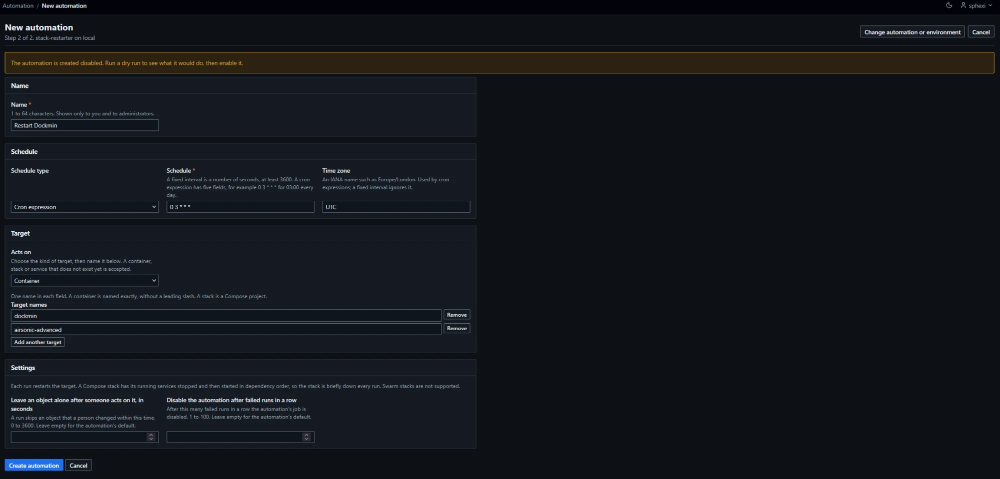
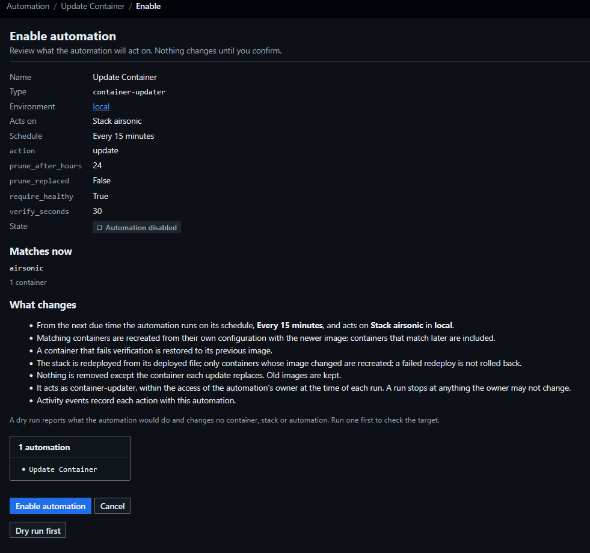

# Automation

An automation runs one type against its target, on a schedule or, for `webhook-receiver`, each time its URL is called. Automations are created on the Automation pages, from the object they act on or from `/automation`.

| Type | Acts on | Does |
|---|---|---|
| `container-health-checker` | Containers | Restarts a running container that reports unhealthy, within a restart budget ([details](#container-health-checker)) |
| `stack-restarter` | Containers or Compose stacks | Restarts them on a schedule ([details](#stack-restarter)) |
| `container-updater` | Containers, Compose stacks, Swarm services or Swarm stacks | Reports newer images at their registries. In update mode, pulls them and recreates the containers, redeploys the stack, or updates the Swarm service ([details](#container-updater)) |
| `container-log-exporter` | Containers, Compose stacks, Swarm stacks or Swarm services. Administrators only | Copies the new log lines of the containers, or of the tasks of the services, to an object storage target as NDJSON ([details](#container-log-exporter)) |
| `webhook-receiver` | Named containers, Compose stacks, Swarm stacks or Swarm services | Updates or redeploys them each time its URL is called ([details](#webhooks)) |

- `activity-log-exporter` and `backup-syncer` also take automations, for administrators only and without an environment ([Automations without an environment](#automations-without-an-environment)).
- An automation belongs to one environment, except those two, and to the user who created it, its owner.
- An automation is created disabled and runs only after it is enabled ([Enable](#enable)).
- `webhook-receiver` has no schedule. It waits for calls to a secret URL ([Webhooks](#webhooks)).
- An automation has one job. Jobs, runs, states, schedule syntax, overrun, failures and history: [Jobs](Administration-Jobs). Subsystem names and properties: [Subsystems](Reference-Subsystems).
- No automation removes an object, except that `container-updater` in update mode removes the container each update replaces and, when `prune_replaced` is on, the image it replaced ([Removal of replaced images](#removal-of-replaced-images)). On Swarm it replaces tasks through the service's own rolling update and removes nothing else.
- To find out why an automation acted or did not act: [Why did this happen](#why-did-this-happen).

## Pages and routes

`Automation` is linked in the navigation for every signed-in user.

| Page | Path | Method |
|---|---|---|
| Automation list | `/automation` | `GET`. Query: `subsystem`, `environment_id`, `limit`, `cursor` |
| New automation, step 1 and step 2 | `/automation/rules/new` | `GET`. Query: `subsystem`, `environment_id`; prefill `target_kind`, `target`, `stack` |
| Create | `/automation/rules` | `POST` |
| Automation | `/automation/rules/{id}` | `GET`. Query: `limit`, `cursor` |
| Edit form, save | `/automation/rules/{id}/edit`, `/automation/rules/{id}` | `GET`, `POST` |
| Add or remove a target name row | `/automation/rules/-/targets` | `POST`, htmx; the form posts to itself without script ([Target field](#target-field)) |
| Quick add confirmation, quick add | `/automation/rules/-/quick-add` | `GET`, `POST`. `GET` query: `rule_id`, `object` (`container:<id>`, `stack:<name>`, `swarm_stack:<name>` or `service:<id>`) ([Add to an automation](#add-to-an-automation)) |
| Enable confirmation, enable | `/automation/rules/{id}/enable` | `GET`, `POST` |
| Disable | `/automation/rules/{id}/disable` | `POST` |
| Pause, resume | `/automation/rules/{id}/pause`, `/automation/rules/{id}/resume` | `POST` |
| Run now confirmation, run now | `/automation/rules/{id}/run` | `GET`, `POST` |
| Dry run | `/automation/rules/{id}/dry-run` | `POST` |
| Release a held container | `/automation/rules/{id}/holds/{container_id}/release` | `POST` ([Release](#release)) |
| Delete confirmation, delete | `/automation/rules/{id}/delete` | `GET`, `POST` |
| Rotate webhook URL, confirmation and rotate | `/automation/rules/{id}/webhook/rotate` | `GET`, `POST`. Owner only ([Rotate, revoke and delete](#rotate-revoke-and-delete)) |
| Revoke webhook URL, confirmation and revoke | `/automation/rules/{id}/webhook/revoke` | `GET`, `POST`. Owner or administrator |
| One run of the automation | `/automation/rules/{id}/runs/{run_id}` | `GET` |
| Webhook call | `/api/v1/hooks/{webhook-token}`, `/api/v1/hooks` | `POST` ([Calls](#calls)) |

- An automation or run id that is not a plain number, does not exist, or belongs to another user's automation (for a standard user) answers `404`. So does a `container_id` that is not a full container id.
- A run id answers `404` unless the run belongs to the automation.
- Every page answers `Cache-Control: no-store`.
- Every `POST` carries the CSRF token ([Frontend conventions](Contributing-Frontend-Conventions)) and answers with a redirect, except a refusal, which renders a page at the real status code. The create of a `webhook-receiver` and a webhook rotation answer with the page that shows the new URL once. The webhook call routes carry no CSRF token.
- Every action is a form post and works with JavaScript disabled.
- JSON routes read an automation and its runs and pause, resume, disable and run it ([JSON API](Reference-JSON-API)). Create, edit, enable, delete, the release of a held container and every webhook URL operation are pages only. The JSON routes for jobs are read-only and administrator-only ([Jobs](Administration-Jobs)).

### Automation list

| Column | Content |
|---|---|
| Name | Name, with the type beneath |
| Owner | Administrators only, after `Name` |
| Environment | Name, or `All` for an automation without an environment |
| Target | The target in words: `Container web`, `Containers api, db, web and 4 more` (the first three names), `Stack shop`, `Swarm service shop_web`, `Containers labelled app=web`, `Swarm services labelled app=web`, `Every container in the environment`. `This instance` for an automation without an environment |
| Schedule | `Every 5 minutes`, or the cron expression. `When called` for `webhook-receiver` |
| State | See [Jobs](Administration-Jobs). `Held N` beneath it when the last real run of a `container-health-checker` automation counted N containers held ([Budget and hold](#budget-and-hold)) |
| Next run | UTC. `—` when nothing is scheduled. For `webhook-receiver`, `Pending` while a call is waiting and `When called` otherwise |
| Last run | Outcome of the newest run that was not a dry run, linked, with its start time. `Never run` |
| Updates | [Updates column](#updates-column) |
| Recent runs | Outcomes of the last five runs of any kind. A dry run reads `Dry run`. `None` before the first run |

| Item | Behaviour |
|---|---|
| Filters | `Type` (all types of automations that take rules; an unknown name answers `422`, `Choose a known subsystem.`) and `Environment` (an environment the viewer cannot list answers `422`, `Choose one of the listed environments.`). Buttons `Apply filter` and `Reset` |
| Page size | 25 automations per page; `limit` 1 to 500 |
| Results line | `N automations`, or `N automations match these filters`. `New automation` sits beside it |
| Narrow screens | `Environment`, `Schedule`, `Next run`, `Updates`, `Recent runs` and `Owner` drop out below 40rem. `Updates` and `Recent runs` also drop out when the table is too narrow to hold them |
| Rows | The viewer's own automations. For administrators, every automation |
| Empty | `No automations`, with a `New automation` button |

### Run page

`/automation/rules/{id}/runs/{run_id}` shows `Outcome`, `Detail` and `Automation` sections ([Jobs](Administration-Jobs) describes the same page for a job).

| Item | Behaviour |
|---|---|
| Finished run | Static |
| Run in progress, with JavaScript | The outcome, trigger, times and detail reload themselves every 2 seconds until the run ends, then stop. The `Refresh` link is not shown. A hidden status line reads `Run in progress. This page updates itself.` and then `Run finished.` |
| Run in progress, without JavaScript | The `Refresh` link is shown and the page reloads itself every 5 seconds until the run ends |
| Reload request | The same path with an htmx header answers the region alone |
| Detail | Keys the run recorded. `This run recorded no detail.` when there are none |

## Access

| Action | Administrators | Standard users |
|---|---|---|
| Open the Automation pages | Yes | Yes |
| See an automation, its runs and its dry runs | Every automation | Their own automations. Another user's automation answers `404` |
| Create an automation | In any environment | In an environment where they have create access, never the local socket environment |
| Edit, enable, resume | Any automation | Their own automations; create access and the target check apply again |
| Disable, pause, delete | Any automation | Their own automations |
| Add an object to an enabled automation from the object's page | Any enabled automation in the object's environment | Their own enabled automations; create access in the environment and write access to the object ([Add to an automation](#add-to-an-automation)) |
| Run now, dry run | Any automation | Their own automations |
| Release a held container | Any automation, with write access to the container | Their own automations, with write access to the container |
| Rotate a webhook URL | Their own automations only | Their own automations |
| Revoke a webhook URL | Any automation | Their own automations |
| See the `Webhook` section of an automation | Every webhook | Their own |
| Per-object panel | Full | [Limited](#per-object-panel) |

- A standard user needs write access to each container, stack or Swarm service the automation names that the user can see, when saving, enabling or resuming the automation. A name the user cannot see is handled as a name that does not exist ([Names](#names)).
- The local socket environment is read-only for standard users ([Environments](Usage-Environments)). They cannot create an automation there, and an existing automation there stops at every run with `owner_access_lost`.
- An automation created on these pages has an environment, except an automation of `activity-log-exporter` or `backup-syncer`.
- An automation with no environment is visible and manageable to administrators only, whoever owns it. A standard user is not offered the types that take none.
- A standard user is not offered `container-log-exporter`, and creating or saving one is refused. A run whose owner is no longer an administrator fails with `owner_access_lost`.
- Editing another user's automation as an administrator keeps the owner. The automation runs with its owner's authority ([Owner's authority](#owners-authority)).
- Access to objects and environments: [Access control](Usage-Access-Control).

## Automations

### Create

Creating takes two steps.

| Step | Content |
|---|---|
| 1 | `Automation` radio list of the types offered, and `Environment`. Standard users see the environments they can see, without the local socket environment. Buttons `Continue` and `Cancel` |
| 2 | The form for that type, headed `Step 2 of 2`. `Create automation` saves the automation disabled and opens it |

1. Open `Automation` and choose `New automation`. From an object's page, the `Automation` tab holds `Add to new automation`, which fills in the environment and the object.
2. Choose the type and the environment. Choose `Continue`. The types are listed alphabetically.
3. Fill in `Name`, `Schedule`, `Target` and `Settings` ([Fields](#fields)).
4. Choose `Create automation`.

What the reader sees when it worked: the automation page, with `The automation was created and is disabled. Run a dry run, then enable it.` and the state `Automation disabled`. For `webhook-receiver`, the `Webhook URL` page instead ([Create a webhook](#create-a-webhook)).

If it did not work: a refused field re-renders the form at `422` with the message beside the field. A host that is down re-renders the form at `503`. See [Troubleshooting](Troubleshooting).

- Step 1 offers `container-health-checker`, `stack-restarter`, `container-updater` and `webhook-receiver` to every user, `container-log-exporter` to administrators only, and `activity-log-exporter` and `backup-syncer` to administrators only without an environment ([Automations without an environment](#automations-without-an-environment)).
- Step 1 refuses an unknown type with `Choose one of the listed automations.` and an environment it does not list with `Choose one of the listed environments.` (`422`).
- The prefill query `environment_id`, `target_kind` and `target` is what the [per-object panel](#per-object-panel) sends. `target_kind` is `container`, `stack` or `service`. A container page also sends `stack`, the container's Compose project. For `container-updater` the form then opens on the stack target with that project; the updater refuses a container that Compose manages ([Names](#names)).
- A refused field re-renders the form at `422` with the message beside the field.
- If the environment is unreachable while a container or Swarm service target is checked, the form re-renders at `503` with `The environment is unreachable; the target could not be checked.` If the host answers a Swarm service lookup as a node that is not a usable manager, the form re-renders at `503` with `This environment is not an active Swarm manager, or its swarm is locked.`
- A container, stack or Swarm service that does not exist yet is accepted as a target.
- The form notes `The automation is created disabled. Run a dry run to see what it would do, then enable it.`
- A `webhook-receiver` form has no schedule section and adds `The webhook URL is shown once, when you create the automation.`



### Fields

| Field | Value |
|---|---|
| Name | 1 to 64 printable characters; refused otherwise with `Use 1 to 64 printable characters.` Unique among the owner's automations of one type, ignoring case; refused otherwise with `You already have an automation with that name.` Shown only to the owner and administrators |
| Type | Fixed after create |
| Environment | Fixed after create |
| Target | `Acts on` and the fields of that kind: up to 20 names, or label terms ([Target field](#target-field)). Not shown for an [automation without an environment](#automations-without-an-environment) |
| Schedule type | `Fixed interval` or `Cron expression`, as the type allows ([Schedules](#schedules)). Not offered for `webhook-receiver`. Hidden when the type allows one kind |
| Schedule | Whole seconds for an interval; five fields for cron, such as `0 3 * * *` for 03:00 every day. Not offered for `webhook-receiver`. Refused when the type does not allow the kind: `This automation does not support that schedule type.` |
| Time zone | An IANA name. Default `UTC`. Cron expressions use it; an interval ignores it |
| If a run is still going when the next is due | Offered only when the type allows more than one policy. No type does; all use `skip` |
| Settings | The type's own fields, then the common ones below |

Settings are posted as `param_<name>`. An empty field takes the default. The stored settings are at most 16 KiB; an unknown or invalid setting is refused: `These parameters are not valid: <names>.`

| Common setting | Values | Default |
|---|---|---|
| `suppression_seconds` (`Leave an object alone after someone acts on it, in seconds`) | 0 to 3600. 0 turns suppression off for the automation | The type's: 300 |
| `max_consecutive_failures` (`Disable the automation after failed runs in a row`) | 1 to 100 | The type's: 5 |

- An automation cannot hold a secret in its settings or target.
- Limits: 50 automations per owner, refused at the 51st with `You can have at most 50 automations.` ([Limits](#limits)).

### Edit

| Item | Behaviour |
|---|---|
| Changes | Name, target, settings, schedule, time zone, overrun policy |
| A save that changes nothing | Records nothing |
| A save that changes the target, a setting or the schedule of an **enabled automation** | The automation is saved and **disabled**. The page reads `The automation is saved and disabled. Review it, then enable it again.` The event carries `rule_disabled: true` |
| A save that changes only the name or the overrun policy | The automation stays enabled |
| Adding one object's name to the target from the object's page | The automation stays enabled. This is a separate action, not a save of this form ([Add to an automation](#add-to-an-automation)) |
| A schedule change | The next run is recomputed |
| Access | The editor needs create access to the environment and the target check |
| Recorded | `automation_rule_updated`, with `name_changed`, `target_changed`, `parameters_changed`, `schedule_changed` and `overrun_changed` ([Jobs](Administration-Jobs)) |

### Enable

`Enable` opens a confirmation page that changes nothing.



| The page shows |
|---|
| Name, type, environment, target, schedule, settings, state |
| `What changes`: the schedule and target the automation will act on, and what each run does to them |
| `container-updater`: `Matches now`, the objects the target matches, as the viewer may see them ([Confirmations for update mode](#confirmations-for-update-mode)) |
| The job's failed-run count, when above zero. A job disabled after failures is enabled again and the count cleared |
| A notice when the subsystem is switched off: the automation still does not run until it is switched on |
| A notice when the automation is already enabled: confirming changes nothing |
| `Dry run first`, where the type supports a dry run |

| Item | Behaviour |
|---|---|
| Binding | The confirmation form carries the automation's last-changed time and a digest of the automation. Any write to the automation after the page was opened, a pause included, refuses the enable, and so does a different digest: `The automation changed since you reviewed it; review it again to enable it.` (`422`, reason `changed_since_review`) |
| Digest | SHA-256 of the target, the settings, the schedule type, the schedule and the time zone. It applies to every type. A form posted without the digest is refused the same way |
| First run | One interval after enabling for an interval schedule; the next matching minute for cron. `webhook-receiver`: none; the first call starts it, and calls are refused until the automation is enabled |
| Access | The requester needs create access to the environment and the target check |
| Recorded | `automation_rule_enabled`. `job_reenabled: true` when a disabled job was enabled again |

### Disable, pause and resume

| Action | Effect |
|---|---|
| `Disable automation` | The job stops firing. Nothing is deleted. A run in progress finishes. No confirmation. Recorded as `automation_rule_disabled` |
| `Pause for` 1 hour, 4 hours, 24 hours, 7 days, then `Pause automation` | No new scheduled runs until the time is up. A run in progress finishes. Offered on an enabled automation. Recorded as `automation_rule_paused`, with `duration` (`1h`, `4h`, `24h`, `7d`) and `paused_until` |
| `Resume` | Clears the pause at once. Needs the access that enabling needs. Recorded as `automation_rule_resumed`. Resuming an automation that is not paused records nothing |

- A paused automation can still be run now or dry run.
- Pause and resume are also offered on the [per-object panel](#per-object-panel).
- Any write to an automation, a pause or resume included, releases the [holds](#budget-and-hold) of its health checker.

### Run now

`Run now` opens a confirmation page that changes nothing, then starts one run outside the schedule.

| Item | Behaviour |
|---|---|
| Who | The automation's owner, or an administrator |
| Trigger | `manual`. The request is recorded as `job_run_requested` by the user, with `job_run_id` and `dry_run` |
| Authority | The owner's, whoever asks. The requester's write access to the target is checked as well |
| Binding | The confirmation form carries the automation's last-changed time and a digest of the automation. When the run is claimed the automation is read again; if its last-changed time or its digest differs, nothing runs: `The automation changed since you reviewed it; review it again to run it.` (`422`, recorded on `job_run_requested` with reason `changed_since_review`). A form posted without them is refused the same way |
| Digest | As for [Enable](#enable) |
| Dry run | Not bound; a dry run changes nothing |
| Schedule | The next run does not move |
| While paused | Allowed; the pause stays |
| Refused (`409`) | The automation is disabled, its job was disabled after failures, the subsystem is switched off or not available, a run is in progress, no run slot is free, the owner already has 2 runs, or the scheduler is stopping |
| Counts toward | The run slots and the failure counter ([Jobs](Administration-Jobs)) |
| After | The page opens the run, with `The run has started.` |
| Confirmation: environment | For an automation that takes no environment ([Automations without an environment](#automations-without-an-environment)) the facts list `Environment` as `This instance`, and the `What changes` list reads `acts on … on this instance`. Other automations link their environment |
| Confirmation: automation paused | While automation is paused after a restore, the page shows the notice `Automation is paused after a restore. Scheduled jobs are not running. An administrator can resume automation from the notice at the top of the page.` above `What changes` |
| Confirmation: update mode | A `container-updater` automation in update mode offers `Dry run instead` |

- The automation page shows `Cannot run now.` and the reason in place of `Run now` when the automation cannot run. The confirmation page shows `The automation cannot run now` with the reason.

### Dry run

A dry run reports what a run would do and changes no container, stack or automation. Every type supports it.

| Item | Behaviour |
|---|---|
| Who | The automation's owner, or an administrator. `Dry run` is a form post; no confirmation |
| Trigger | `dry_run` |
| Allowed on | An enabled automation, a disabled automation, an automation whose job was disabled after failures, a paused automation |
| Refused (`409`) | The subsystem is switched off or not available, a run is in progress, no run slot is free, the owner already has 2 runs, or the scheduler is stopping |
| Reads | The host (list and inspect), the owner's access, suppression, the restart budget and holds, and whether an object is locked at that time. `container-updater` also requests manifests from registries |
| Changes | Nothing on the host. No object lock. No activity event from the run. A dry run that does either fails: reason `dry_run_took_lock` or `dry_run_wrote_event`. The request itself is recorded as `job_run_requested` |
| Stores | `container-updater` stores the update status of the container and Compose stack references it checks ([Images](Usage-Images)). It stores nothing for Swarm services and stacks |
| Counters | The failure counter, backoff and next run do not change |
| Outcome | `success`, unless the run cannot read its target |

- Run detail holds the counts of a real run, with `would_restart` and `would_restart_count` in place of `restarted`. `container-updater`: [Dry run of container-updater](#dry-run-of-container-updater).
- `would_restart` lists container names, or `stack <name>`, comma-separated and sorted. It is cut to 256 characters, ending `and N more`.
- The run page reads `Dry run: no container, stack or automation was changed. The detail below lists what the run would have done.` The notice after starting one reads `The dry run has started. It changes no container, stack or automation.` The automation page links the last dry run under `Last dry run`.
- A container that has used its restart budget is counted `exhausted` and nothing is written.
- A dry run reports an object that is locked at that time as `busy`.

### Delete an automation

| Item | Behaviour |
|---|---|
| Who | The automation's owner, or an administrator |
| Confirmation | Names the automation, its type, environment and target; the number of recorded runs that are deleted (runs started before the confirmation are deleted too); that activity events stay; that nothing the automation did is undone |
| Typed name | `Type the automation's name to confirm`. A different entry re-renders the page at `422`: `Type the automation's name exactly as shown to confirm.` |
| Binding | The form carries the name that was shown. If the automation was renamed meanwhile, nothing is deleted: `The automation changed since you reviewed it; nothing was deleted.` (`422`, reason `changed_since_review`) |
| Deleted | The automation, its job and the job's runs. For `webhook-receiver`, its webhook: the URL stops working |
| Kept | Activity events. They lose the link to the automation and keep `rule_id` and `rule_name` in their detail |
| Replaced images waiting | For a `container-updater` automation that holds records of replaced images, the confirmation states how many: `N replaced images waiting for removal are kept on the host and will not be removed.` The records are deleted with the automation ([Removal of replaced images](#removal-of-replaced-images)) |
| Refused while a run is in progress | `409`: `This automation is running. Try again when the run ends.` Recorded with reason `rule_running` |
| Access | No target check, so a user who lost access to the target can still delete their automation |
| Recorded | `automation_rule_deleted`. Detail: `subsystem`, `name`, `job_id`, `runs_deleted` |

The confirmation for an `activity-log-exporter` automation adds a section `Activity held for export`. It states how many activity events the automation holds back from retention, that deleting the automation ends the hold and, when retention is set, that retention may then remove them ([Activity](Administration-Activity)). The automation's cursor is deleted with it.

## Automations without an environment

`activity-log-exporter` ([Activity](Administration-Activity)) and `backup-syncer` ([Backups](Administration-Backups)) act on this instance and on a bucket, not on a Docker host.

| Item | Behaviour |
|---|---|
| Who | Administrators only. Step 1 does not offer them to a standard user, and creating one is refused for a standard user |
| Step 1 | Choosing one of these types hides the `Environment` select and notes that it needs none. `Continue` opens step 2 without an environment |
| Step 2 | No `Target` section. `Settings` holds `Object storage target`, then, for `activity-log-exporter`, `File format` (`CSV` or `NDJSON`, default `CSV`), then `Disable the automation after failed runs in a row` |
| `Object storage target` | A required select of the targets by name. With no target the form says `No object storage target exists yet. Add one first, then create the automation.` and links `Add a target` ([Object storage](Administration-Object-Storage)) |
| Validation | A target id that names no target is refused on create and on edit, on the field: `That object storage target no longer exists.` |
| Automation list | `Environment` reads `All`; `Target` reads `This instance` |
| Automation page | `Environment` reads `None. This automation is not tied to an environment.` `Object storage target` links to the target, or reads `Deleted. Edit the automation to choose another target.` |
| Other settings | Schedule, time zone, enabling, pausing, run now, dry run and deletion work as for any automation |

- The leave-alone window (`suppression_seconds`) is not offered.
- A run whose owner is no longer an administrator fails with `owner_access_lost`.

## Targets

A target is chosen on the automation form and stored as canonical JSON of at most 4 KiB; a larger target is refused: `Use at most 4 KiB.`

| Target | Matches | Health checker | Restarter | Updater | Log exporter | Webhook receiver |
|---|---|---|---|---|---|---|
| Container | The containers with these names, resolved on every run | Yes | Yes | Yes | Yes | Yes |
| Compose stack | The containers of the Compose projects with these names | Yes | Yes (each stack) | Yes (each stack) | Yes (each stack) | Yes (each stack) |
| Swarm stack | The services of the Swarm stacks with these names | No | No | Yes (each stack) | Yes (each stack, managed stacks) | Yes (each stack) |
| Swarm service | The Swarm services with these names | No | No | Yes | Yes | Yes |
| Containers with labels | Every container carrying all the label terms | Yes | No | Yes | Yes | No |
| Services with labels | Every Swarm service whose own labels carry all the label terms | No | No | No | Yes | No |
| Every container in the environment | Every container | Yes | No | No | Yes | No |

| Target | Value |
|---|---|
| Container | 1 to 20 names. A name is up to 128 characters: letters, digits, underscore, period, hyphen, starting with a letter or digit. No leading slash. Matched exactly |
| Compose stack | 1 to 20 stack names: letters, digits, underscore and hyphen, up to 63 characters, starting with a letter or digit ([Stacks](Usage-Stacks)). Matched ignoring case |
| Swarm stack | 1 to 20 Swarm stack names, the same form. Matched ignoring case |
| Swarm service | 1 to 20 exact service names: letters, digits, underscore and hyphen, up to 63 characters, starting and ending with a letter or digit, such as `shop_web` |
| Labels | 1 to 8 terms, one per line. `key` matches a container that carries the key; `key=value` matches the exact value. A key is 1 to 128 printable characters without `=` and appears once. A value is up to 256 printable characters |
| Services with labels | The same terms as `Labels`, matched against each Swarm service's own labels, not the labels of its containers |

Refusals on save:

| Cause | Message |
|---|---|
| A name with a character the kind does not allow | `Use a container name: letters, digits, underscores, periods and hyphens, up to 128 characters.` / `Use a stack name: letters, digits, underscores and hyphens, up to 63 characters.` / `Use a service name: letters, digits, underscores and hyphens, up to 63 characters, starting and ending with a letter or digit.` |
| No name, or more than 20 | `Name 1 to 20 targets.` |
| Two stack names that differ only in case | `Name each stack once.` |
| No label term, or more than 8 | `Use 1 to 8 label terms.` |
| A label key outside its limits | `A label key is 1 to 128 printable characters without '='.` |
| A label value over its limit | `A label value is at most 256 printable characters.` |
| A repeated label key | `Each label key may appear once.` |
| A kind the type does not offer | `This automation cannot target that.` |
| Nothing chosen under `Acts on` | `Choose what the automation acts on.` |

- Names are stored sorted, each once.
- A target of the stack kind may name Compose and Swarm stacks together for `container-updater`. The kind of a named stack is read from the stored stack at each run.
- A container is found by its name on every run. A recreated container keeps its name, so the automation keeps working.
- A container target is looked up with the Engine's name filter and the answer is compared with the exact name. A Swarm service is found the same way, by exact name.
- Containers carrying the label `com.docker.swarm.service.id` are never acted on. They are counted `swarm_managed`. `container-updater` reaches them through the Swarm service or Swarm stack target.
- The form offers one stack target. It reads `Compose stack` for `container-health-checker` and `stack-restarter`, and `Stack` for `container-updater`, `container-log-exporter` and `webhook-receiver`, whose stack list holds the Compose and Swarm stacks dockmin manages.
- `container-health-checker` and `stack-restarter` refuse a Swarm stack on save: `This automation works on Compose stacks.` Only a user who may write the stack is told. A stored Swarm stack found at a run is reported as not found (`target_missing`).
- A service target is offered by `container-updater`, `container-log-exporter` and `webhook-receiver` only. `container-log-exporter` offers it in Swarm manager environments.
- `Services with labels` is offered by `container-log-exporter` only, in Swarm manager environments. Another type refuses a stored target of this kind. A service is matched on its own labels. `com.docker.stack.namespace=<name>` selects the services of a Swarm stack that dockmin does not manage. A service whose labels were cut when read is not matched. The automation is not listed on a service's `Automation` tab ([Per-object panel](#per-object-panel)).
- A container that carries `com.docker.compose.project` is counted `compose_managed` by `container-updater` and `webhook-receiver` under a container or labels target. It is updated through the automation for its stack.
- A container whose full id or labels could not be read is counted `unaddressable` and not acted on.
- A service of a Swarm stack is a valid service target. An update then changes only the service's image. The next redeploy of the stack pins the same reference again.

### Target field

| Element | Behaviour |
|---|---|
| `Acts on` | The kinds the type offers: `Container`, `Compose stack` (`Stack` for `container-updater`, `container-log-exporter` and `webhook-receiver`), `Swarm service`, `Containers with labels`, `Services with labels` (Swarm managers, `container-log-exporter` only), `Every container in the environment` |
| `Name` rows | For the container, stack and service kinds, one input per target, announced as `Target N: Name`. The form opens with one row; an edit opens with the stored names |
| `Add another target` | Adds a row, up to 20 |
| `Remove` | On every row when there is more than one |
| Blank rows | Ignored |
| Suggestions | Each row suggests names of existing objects of the chosen kind while the user types ([Frontend conventions](Contributing-Frontend-Conventions)). Any name can be typed |
| `Labels` | A text area, one term per line, up to 8. Used by `Containers with labels` and `Services with labels` |
| `Every container in the environment` | No further field |

| Script | Behaviour |
|---|---|
| With | Only the fields of the chosen kind are shown and submitted. `Add another target` and `Remove` swap the rows in place (`POST /automation/rules/-/targets`, nothing saved) |
| Without | Every field is shown. `Add another target` and `Remove` post the form to itself and show it again with the rows changed, nothing saved |

A value in a field that the chosen kind does not use is refused beside `Acts on`:

| Chosen kind | Field with a value | Message |
|---|---|---|
| Container, stack or service | `Labels` | `Labels is only used when the automation acts on containers with labels. Clear it, or choose that target.` |
| Labels, service labels or environment | `Name` | `Target name is not used when the automation acts on containers with labels. Clear it, or choose a target that takes names.` The words after `acts on` read `Swarm services with labels` or `every container in the environment` for those kinds |

### Names

A name is resolved on its own at every run.

| Case | Save, enable, resume | Run |
|---|---|---|
| The name exists and the owner can see it | The editor needs write access to it: read-only is refused (`403`) | The owner needs write access to it: otherwise that name fails with `permission_denied` |
| The name does not exist | Accepted | Reported as not found |
| The name exists and the owner cannot see it | Accepted, as a name that does not exist. Nothing tells the two apart | Reported as not found, as a name that does not exist |
| A container that Compose manages, `container-updater` | Refused, to a user who may write it: `<name> is managed by the Compose project <project>. Choose the stack <project> as the target instead.` | Counted `compose_managed`; listed in `acts_on_nothing` |

| Run | One name | Several names |
|---|---|---|
| A name is not found | `failure`, reason `target_missing` | Reported in `not_found` and `not_found_names`; the other names are processed. `failure`, reason `target_missing`, when none is found |
| A name the owner may read but not change | `failure`, reason `permission_denied` | That name fails with `permission_denied`. The run is `partial`, or `failure` with `all_objects_failed` when nothing succeeded |
| The object was changed by a user inside the suppression window | The run is `skipped`, reason `suppressed` | The object is counted `suppressed`; the other names are processed |
| The object is locked for the whole lock wait | The run is `skipped`, reason `object_busy` | The object is counted `busy`; the other names are processed |

A named target adds these keys to the run detail:

| Key | Content |
|---|---|
| `targets` | The names that resolved to an object the owner can see, comma-separated, in name order |
| `target_outcomes` | One entry per name in `targets`: `name: outcome`, or `name: outcome (reason)`. Comma-separated, in the same order |
| `not_found` | How many names were not found. Present when above zero |
| `not_found_names` | Those names, comma-separated |
| `acts_on_nothing` | `container-updater`, container target: `<name> is managed by the Compose project <project>` for each named container that Compose manages, separated by `; `. Present when above zero |

- A list in these keys is cut to 3,072 characters, ending `and N more`.
- The outcome of a name is the most significant status among its objects, in this order: `failed`, `exhausted`, `not_permitted`, `busy`, `suppressed`, `deferred`, `held`, `released`, `skipped`, `done`. `unchanged` stands for a name for which the run recorded nothing, such as an image that is up to date.
- `skipped` carries the skip reason, such as `not_running`. `failed` carries the failure reason.
- A label or environment target adds none of these keys.

| When the target is checked | Result |
|---|---|
| Save, enable, resume: a named service target, a `Services with labels` target, or a stack target naming a stored Swarm stack, in an environment that is not a Swarm manager | Refused: `This environment is not a Swarm manager.` The host is not called |
| Save, enable, resume: a named stack of a kind the type does not act on | Refused: `This automation works on Compose stacks.` The editor needs write access to the stack to be told |
| Save, enable, resume: the host cannot say whether a container or service exists | Refused: `The environment is unreachable; the target could not be checked.` (`503`) |
| Save: a container label or environment target | Nothing further is checked |
| Run: no named container, stack or service is found, or the environment's stored type is not Swarm for a service target, a `Services with labels` target or a stack target naming a Swarm stack | `failure`, reason `target_missing`: `The automation's target was not found.` Counts toward the failure threshold |
| Run: the host answers the service lookup as a node that is not a usable manager (demoted, left the swarm, or locked) | `skipped`, reason `environment_unreachable`, detail `kind` `not_swarm_manager`. Not counted toward the failure threshold. A fresh snapshot of the host is requested |
| Run: a label or environment target matches nothing | `success` with zero counts |
| Run: the stored target cannot be read | `failure`, reason `target_invalid` or `selector_invalid` |

## Schedules

| Property | `container-health-checker` | `stack-restarter` | `container-updater` |
|---|---|---|---|
| Schedule types | Fixed interval | Fixed interval, cron | Fixed interval, cron |
| Interval | 60 s to 30 days | 3600 s to 30 days | 900 s to 30 days |
| Cron | Not offered | Any valid expression. The spacing between fires is not checked | Any valid expression. The spacing between fires is not checked |
| If a run is still going | `skip` only | `skip` only | `skip` only |
| Missed runs | `skipped`, reason `missed` | `skipped`, reason `missed` | `skipped`, reason `missed` |
| Time limit of a run | 30 minutes | 30 minutes | 60 minutes |
| Wait for an object lock | 10 s | 60 s | 60 s |
| Suppression window | 5 minutes | 5 minutes | 5 minutes |
| Failures before the job is disabled | 5 | 5 | 5 |

- Schedule syntax, time zones, daylight saving time and missed runs: [Jobs](Administration-Jobs).
- `container-log-exporter`: interval 900 s to 30 days or cron, time limit 30 minutes. `activity-log-exporter` and `backup-syncer`: interval 3600 s to 30 days or cron. [Subsystems](Reference-Subsystems#properties) lists every property.
- `webhook-receiver` has no schedule: a call arms one run, started at least 60 s after the job's previous run began ([Call limits](#call-limits)).
- A missed run is never replayed: a restart planned for 03:00 is not run at 10:00.

## Runs

### Owner's authority

| Item | Behaviour |
|---|---|
| Acts as | The type's subsystem, with the automation and the run. The owner is not the actor |
| Owner check | At the start of every run, and before each object is acted on ([Jobs](Administration-Jobs)). Scheduled, manual and dry runs alike |
| An object the owner may read but not change | Counted `not_permitted` for a label or environment target. For a named target, that name fails with `permission_denied` ([Names](#names)) |
| An object the owner cannot read | Not matched and not counted ([Visibility](#visibility)). A named target the owner cannot read is reported as not found ([Names](#names)) |
| Owner deleted, disabled, or without access | `failure`, reason `owner_access_lost`. Nothing is written to the host |

### Per-object checks

A run checks each object before and while it acts. An object that fails a check is not acted on.

| Check | Result when it fails |
|---|---|
| The owner may change the object, checked when the object is matched and again when the run acts | `not_permitted`, or `permission_denied` for a named target |
| No user acted on the object inside the suppression window, checked again once the object's lock is held | `suppressed` |
| The object's lock is free within the lock wait | `busy` |
| The health checker reads the container again just before restarting it | `recovered`, `gone`, `not_matched` |

- Locks are the ones user actions take ([Jobs](Administration-Jobs)).
- A container restart by an automation on a container of a stack waits up to the lock wait for a running stack operation to end. If the stack is still locked the container is `busy`.
- A run that acts on one named object only (one container, one Swarm service, or one stack for `stack-restarter` and `container-updater`) is recorded `skipped` instead: reason `suppressed` with `acted_at`, or reason `object_busy` with the holder ([Jobs](Administration-Jobs)).
- A refusal because of a lock or suppression writes no activity event. The run record is the record.

### Owner access checks

`container-health-checker` and `container-updater` decide the owner's access to the matched containers together, not one container at a time.

| Owner | Behaviour |
|---|---|
| Administrator | Every matched container may be changed. No per-container check is made |
| Standard user | One check over the whole listing decides, from each container's listed labels, whether the owner may change it, may only read it, or cannot see it |
| Container whose listed labels were cut | The listing cannot decide it. It needs a check of its own |

| Own check | Behaviour |
|---|---|
| Allowance | 25 per run, shared by every listing the run reads |
| Order | By container id, starting after the last container the automation's previous run checked, and wrapping |
| Over the allowance | The container is neither matched nor counted in that run. Later runs reach it because the starting point moves. The starting point is kept in memory, so a restart begins at the lowest id |
| Reported | `not_checked` in the run detail, for an automation owned by an administrator. For any other owner the count is logged as `owner_rows_not_checked` and not reported, because a count would reveal containers the owner cannot see |

- The per-container check before each action ([Per-object checks](#per-object-checks)) is unchanged and reads the owner's access as it is then.

### Self-protection

A run does not act on the container dockmin runs in, on its Compose project, on its Swarm service or on the Swarm stack that service belongs to ([Containers](Usage-Containers)). The object is skipped before anything is sent, and the run counts it under `self_protected`.

| Type | Skipped for `self_protected` |
|---|---|
| `container-health-checker` | The container, under any target. Checked before the Swarm label |
| `stack-restarter` | The container under a container target; a Compose stack that is dockmin's project or holds the container |
| `container-updater` | The container under a container or labels target; a Compose stack that is dockmin's project or holds the container; a Swarm service target that runs it; a Swarm stack target with that service among its services, which skips the whole stack |

- The skip is not a failure.
- A refusal raised by the action itself ends the object as skipped with the same reason.
- The restart, update and recreate of dockmin's own container are done from Administration > Instance ([Instance](Administration-Instance)).

### Outcomes

| Condition | Outcome |
|---|---|
| No object failed | `success` |
| At least one object succeeded and at least one failed | `partial` |
| At least one object failed and none succeeded | `failure`. Reason: the failed object's reason when one object failed, otherwise `all_objects_failed` |
| A dry run | `success` |

- An automation acting on ten objects where three fail records seven successes and three failures, with the run `partial`.
- A container that has used its restart budget is a failed object in the run that records the exhaustion event ([Budget and hold](#budget-and-hold)).
- A host that fails mid-run makes the remaining objects fail with the service's `unreachable` row.

### Reasons

| Outcome | Reason | Meaning |
|---|---|---|
| `skipped` | `environment_unreachable` | The host could not be used when the run began and no person needs to act. Detail `kind`: `unreachable` (the host could not be reached), `not_swarm_manager` (the environment is not an active Swarm manager, or its swarm is locked), `outcome_unknown` (the host did not answer in time). Does not count toward the failure threshold |
| `skipped` | `suppressed` | A user acted on the single object inside the window. Detail: `acted_at` |
| `skipped` | `object_busy` | The single object stayed locked for the lock wait. Detail: `holder_type`, `holder_label`, `holder_action`, `holder_age_seconds` |
| `skipped` | `token_revoked` | `webhook-receiver`: the webhook URL was revoked after the call armed the run ([Rotate, revoke and delete](#rotate-revoke-and-delete)) |
| `failure` | `owner_access_lost` | See [Owner's authority](#owners-authority) |
| `failure` | `target_missing` | No named target exists or is visible to the owner: the only name, or every name when there are several. A service, `Services with labels` or Swarm stack target in an environment whose stored type is not Swarm |
| `failure` | `target_invalid`, `selector_invalid` | The stored target cannot be read |
| `failure` | `permission_denied` | The owner may not change the one named target. With several names the run fails that name and carries on |
| `failure` | `restart_budget_exhausted` | The one failed object used its restart budget |
| `failure` | `all_objects_failed` | Several objects failed and none succeeded |
| `failure` | `compose_unavailable`, `compose_version_unsupported`, `compose_busy` | A stack target and the server has no Compose, has one below the required version, or has no Compose process slot free ([Stacks](Usage-Stacks)) |
| `failure` | `recreate_failed` | `container-updater`: the one failed object's recreate failed, rolled back or not. The activity row carries the recreate's own reason, such as `verification_failed` |
| `failure` | `update_paused`, `tasks_not_running`, `rolled_back_by_swarm`, `rollback_paused`, `unverifiable`, `service_gone`, `update_in_progress`, `legacy_networks` | `container-updater`, Swarm service: the one failed service's update or credential refresh ended for that reason ([Verification of a service update](#verification-of-a-service-update)) |
| `failure` | `service_changed_since_review` | `container-updater`, Swarm service: the service's version or image reference changed between the plan and the send. The activity row reads `changed_since_review` |
| `failure` | `would_remove`, `would_create`, `drifted`, `unresolved` | `container-updater`, Swarm stack: the redeploy was refused before anything was sent ([Refusals of a stack redeploy](#refusals-of-a-stack-redeploy)) |
| `failure` | `restricted` | `container-updater`, Swarm service or stack: the owner is a standard user and the service, or a service of the stack, uses options only administrators may set |
| `failure` | `changed_since_review` | `container-updater`, Swarm stack: a member service changed after the plan was made and the redeploy stopped |
| `failure` | `credential_missing`, `not_bound`, `credential_mismatch`, `credential_unavailable` | `container-updater`: the object was refused ([Refusals and holds](#refusals-and-holds)) |
| `failure` | `compose_failed`, `pull_failed`, `engine_rejected`, `outcome_unknown` | `container-updater`, stack target: the redeploy failed with the reason its activity row records ([Stacks](Usage-Stacks)) |
| `failure` | `update_check_failed` | `container-updater`: the update check could not be completed |
| `failure` | `registry_runtime_missing` | `container-updater`: the server has no registry support to check or pull with |
| `failure` | `engine_error` | The host answered with an unexpected response |
| `failure` | `environment_credentials` | The connection details stored for the environment cannot be used |
| `failure` | `environment_unsupported` | The host runs an Engine API version this product does not support |
| `failure` | `environment_missing`, `parameters_invalid`, `rule_missing` | [Jobs](Administration-Jobs) |
| `failure` | `no_activity_event` | A run attempted an action and wrote no activity event |
| `failure` | `dry_run_took_lock`, `dry_run_wrote_event` | A dry run took a lock or wrote an event |

## container-health-checker

Restarts a container that is running and reports unhealthy.

| Setting | Values | Default |
|---|---|---|
| `max_restarts` (`Restarts allowed per container`) | 1 to 20 | 3 |
| `window_seconds` (`Window in seconds`) | 300 to 86400 | 3600 |
| `auto_release` (`Release a held container when it recovers`) | on, off | off |

Targets: container, Compose stack, labels, environment. Schedule: fixed interval only.

### What it restarts

| Container state | Result |
|---|---|
| Running and `unhealthy` | Restarted, within the budget |
| `starting`, `healthy`, or no healthcheck | Not touched. A named container is counted `recovered` |
| Stopped, paused, restarting | Not touched. A named container is counted `not_running` |
| Carries `com.docker.swarm.service.id` | Not touched; `swarm_managed` |

- Each run lists the running containers that report `unhealthy` for the target. The Engine's filters narrow the list and every container is matched again by the product.
- Every container is read again immediately before it is restarted. One that is no longer running and unhealthy is not restarted: `recovered`. One that no longer matches the target is `not_matched`. One that no longer exists is `gone`.
- The restart is the container's own restart action: stop with the container's stop timeout, then start. It is recorded as `container_restarted`.
- Containers are handled one after another in name order.
- Text a healthcheck printed is never copied into a row or into run detail.

### Budget and hold

| Item | Behaviour |
|---|---|
| Budget | `max_restarts` restarts of one container by this automation inside `window_seconds`. The window is not sliding: see Hold |
| Counted from | `container_restarted` events by `container-health-checker` for this automation, environment and container id, newer than the window. Any result counts, `outcome_unknown` included. Events removed from the activity log stop counting |
| A recreated container | Has a new id, so a new budget |
| Exhausted | The container is unhealthy and the count has reached `max_restarts`. The run writes one `container_restart_budget_exhausted` event, restarts nothing, and counts the container as a failed object |
| Hold | Starts with that event. In later runs the container is counted `held`: nothing is written, nothing is restarted, and it is not a failure, so a crash-looping container does not disable the automation |

A hold ends when any of these happens:

| Release | Detail |
|---|---|
| A user acts on the container | Any user action recorded for the container after the exhaustion event, a manual release included. Times have one-second resolution; an action in the same second does not release |
| The automation is written to | Edit that changes something, disable then enable, pause then resume, after the exhaustion event |
| A manual release | `Release` on the automation page ([Release](#release)) |
| An automatic release | The `auto_release` setting ([Automatic release](#automatic-release)) |

- After a release, restarts made before the exhaustion event no longer count. After an automatic release, restarts made before the release do not count either. The budget starts again.
- Without `auto_release`, an automation never releases its own holds.
- A held container is read at every run, whatever its health. A held container that is running is counted `held`; one that is not running is skipped, `not_running`.
- A held container that the host no longer has is released by the run ([A container that is gone](#a-container-that-is-gone)).

### Release

The `Held containers` section of the automation page lists what a `container-health-checker` automation holds.

| Item | Behaviour |
|---|---|
| Rows | The held containers the viewer may read, newest hold first: `Container`, `Held since`, `Last seen unhealthy`, `Release`. At most 50, then `and N more not listed here.` |
| Reconciled with the host | The list is matched against the containers on the host. A held container the host no longer has is not listed and not counted in `and N more` |
| Held since | The time of the exhaustion event |
| Last seen unhealthy | The later of that time and the last real run that found the container unhealthy while held |
| None held | `No container is held.` |
| Host unreachable | `Held containers cannot be listed while the environment is unreachable.` |
| Held badges | The automation list shows `Held N` beside the state, from the last real run. The run history shows `Held N` and `Released N` beside the reason |

`Release` is a form post with the CSRF token and works without script.

| Item | Behaviour |
|---|---|
| Who | The automation's owner or an administrator, with write access to the container |
| Refused | A caller without write access to the container: `403`, or `404` when the container is not visible. Nothing is recorded. An automation of another type, one without an environment, or an id that is not a full container id: `404` |
| Not held | `422`, `This container is not held by this automation.` Recorded as a failure, reason `not_held` |
| Recorded | `container_restart_budget_released` by the person, target the container, result `success`. Detail: `rule_id`, `rule_name`, `name`, `released: manual` |
| Effect | The hold ends and the budget starts again. The page reads `The container is released. Its restart budget starts again.` |

#### Automatic release

| Item | Behaviour |
|---|---|
| Setting | `auto_release` (`Release a held container when it recovers`), default off |
| Released when | A run finds the held container running and `healthy`, and at least the longer of `window_seconds` and the automation's interval, in seconds, has passed since the later of the exhaustion event and the last run that found the container `unhealthy` while held |
| Not released | A container that is `unhealthy` or `starting`, or has no healthcheck |
| Last unhealthy run | Each real run that finds a held container unhealthy stores the time, which restarts the wait. A dry run stores nothing |
| Recorded | `container_restart_budget_released` by `container-health-checker`, with the automation and the run, result `success`. Detail: `rule_id`, `rule_name`, `name`, `released: automatic` |
| Run detail | `released` in place of `held` for that container. Not a failure |
| Checks | As for a restart: the owner's write access and the suppression window apply |
| Dry run | Counts `released`; writes nothing |
| After | The container is restarted again, up to `max_restarts` times, when it turns unhealthy. A container that uses its budget again is held again |

#### A container that is gone

A held container that no longer exists on the host is released by the next run, whatever the `auto_release` setting.

| Item | Behaviour |
|---|---|
| Examined | Every container the automation holds that the run's listing of the target did not return, after the listed containers. They count toward the 200 containers examined per run; beyond that they are counted `deferred` |
| Gone | The host has no such container: the hold is released |
| Not gone | The container is read and judged as a listed one: counted `held`, or released under `auto_release`. One that is not running is skipped, `not_running`. One the owner cannot see is left alone |
| Checks | None. No owner access check, suppression window or lock applies to a container that no longer exists |
| Recorded | `container_restart_budget_released` by `container-health-checker`, with the automation and the run, result `success`. Detail: `rule_id`, `rule_name`, `name`, `released: gone` |
| Run detail | `released_gone`. A dry run has `would_release_gone` and writes nothing |
| Outcome | The release counts as an action the run took. It is not a failure |
| Rule with one name, or names that all fail to resolve | The releases are written before the run ends `target_missing` ([Targets](#targets)). The run still fails |

### Health checker caps

| Cap | Value |
|---|---|
| Restarts per run | 25 |
| Containers examined per run | 200 |
| Beyond a cap | Counted `deferred` and left for the next run |
| Starting point | Moves between runs, so containers late in the order are reached |

### Health checker run detail

Keys appear when above zero, except `matched`, `unhealthy` and `restarted`.

| Key | Counts |
|---|---|
| `matched` | Containers of the target that the owner can read |
| `unhealthy` | Of those, containers found unhealthy and running, held ones included |
| `restarted` | Restarts that succeeded. A dry run has `would_restart` and `would_restart_count` instead |
| `failed` | Restarts that failed, and containers the owner may not change under a named target |
| `exhausted` | Containers whose exhaustion event this run wrote |
| `held` | Containers held by an earlier exhaustion |
| `released` | Containers released automatically ([Automatic release](#automatic-release)). A dry run counts the releases a real run would make |
| `released_gone` | Held containers the host no longer has, released ([A container that is gone](#a-container-that-is-gone)). A dry run has `would_release_gone` instead |
| `not_checked` | Containers left unchecked because the allowance for own checks ended ([Owner access checks](#owner-access-checks)). Reported for an administrator-owned automation only |
| `suppressed`, `busy` | Containers skipped for those reasons |
| `not_permitted` | Containers the owner can read but not change, under a label or environment target |
| `deferred` | Containers left for the next run |
| `swarm_managed`, `not_running`, `unaddressable`, `gone`, `not_matched`, `recovered`, `self_protected` | Containers skipped for those reasons |
| `targets`, `target_outcomes`, `not_found`, `not_found_names` | Container and stack targets: how each name fared ([Names](#names)) |

### Early runs and the polled fallback

| Item | Behaviour |
|---|---|
| Polled run | The automation's own interval |
| Watcher | One per environment that has an enabled health-checker automation with a next run. Started with the application and re-evaluated every 60 s. It reads the host's container health events; on connecting it replays the last 60 s of events |
| Trigger | The event `health_status: unhealthy` for a container that the automation's target names (matched on the event's container name and labels) |
| Effect | The automation's next run moves to the time of the event. The run is an ordinary scheduled run |
| Gates | The same as for any run. An automation that is disabled, paused or switched off is not moved. Neither is an automation whose job has failed runs in a row |
| Not moved | An automation that is running at that time (fires already queued behind it are kept), an automation that started a run in the last 60 s, an automation moved in the last 15 s |
| Environments watched | At most 64. The rest are polled only |
| Writes | The watcher writes nothing and is not an actor |
| Missed events | A lost stream, a daemon restart (the host's event history does not survive it) and an unwatched environment are caught by the next polled run |

- A watcher ends when its connection is edited or the environment is deleted, and starts again at the next re-evaluation.

## stack-restarter

Restarts containers or Compose stacks on a schedule. It takes no settings of its own beyond the common ones.

Targets: container, Compose stack. Each name is one target, handled in name order ([Names](#names)).

| Target | Result of a run |
|---|---|
| Container, running | Restarted. Recorded as `container_restarted`, detail `trigger: schedule` |
| Container, not running | `success`, nothing written, counted `not_running`. A stopped container is not started |
| Compose stack, with a running container | Restarted as below. Recorded as `stack_restarted` |
| Compose stack, nothing running and nothing carried over | `success`, nothing written, counted `not_running` |
| Swarm-managed container | Counted `swarm_managed` |
| Swarm service or Swarm stack | Out of scope; a Swarm stack cannot be a target |

### Stack restart

| Step | Behaviour |
|---|---|
| 1 | The services with at least one running container are listed with Compose `ps` |
| 2 | Compose `stop` of those services. Compose stops them in reverse dependency order |
| 3 | Compose `start` of those services. Compose starts them in dependency order and waits for `service_healthy` dependencies |
| 4 | The stack's status and member objects are refreshed |

- The stack is down between step 2 and step 3 on every run.
- A service that was not running is not named. If a restarted service depends on a stopped service, step 3 starts that dependency too, as Compose does.
- The operation holds the stack's lock under the action `restart`.
- It needs the Compose binary ([Stacks](Usage-Stacks)); without it a stack target fails with `compose_unavailable`.
- The time limit is `DOCKMIN_COMPOSE_TIMEOUT_SECONDS` ([Configuration](Reference-Configuration)), inside the run's 30 minutes.
- A completed restart is the stack's last operation, `start`.
- A user restart from the stack page or `POST …/stacks/{name}/restart` runs the same stop-then-start sequence and suppresses this automation for the stack ([Stacks](Usage-Stacks)).

| Check | Behaviour |
|---|---|
| Owner access | For a standard-user owner, write access to the stack and to every container of the project. Otherwise `failure`, reason `permission_denied`, nothing changed |
| Suppression | A user's recent action on the stack, or on any container of the project, skips the run: `skipped`, reason `suppressed` |
| Locks | Waits up to 60 s for the stack's lock. `skipped`, reason `object_busy`, if it stays held or a container action is running on any container of the project |

### A failed start

| Item | Behaviour |
|---|---|
| Failed stop or start | `failure`. The event carries `phase` (`stop` or `start`) and `unstarted`, the services the restart named |
| After a failed start | Services started before the failure keep running; the rest stay stopped or created |
| Next run of the same automation | Names the `unstarted` services in its start as well, even when none is running. This ends when a user acts on the stack after the failed run, or when a later run of the automation records no `unstarted` |
| Unknown service name | Compose refuses before anything changes. `failure` |

### Stack restarter run detail

| Key | Content |
|---|---|
| `target_kind` | `container` or `stack` |
| `restarted` | Targets restarted. A dry run has `would_restart` and `would_restart_count` |
| `services` | Stack target: the number of services that are stopped and started, over all the stacks |
| `not_running`, `swarm_managed`, `unaddressable`, `self_protected` | Targets skipped for that reason |
| `suppressed`, `busy` | With several names, targets skipped for that reason |
| `failed` | Targets whose restart failed, or that the owner may not change |
| `targets`, `target_outcomes`, `not_found`, `not_found_names` | How each name fared ([Names](#names)) |

## container-updater

Compares the images that its target runs with their registries. In update mode it pulls a newer image and recreates the containers that run it, redeploys a stack, or updates a Swarm service.

| Setting | Values | Default |
|---|---|---|
| `action` (`Action`) | `report`, `update` | `report` |
| `verify_seconds` (`Watch each recreated container, in seconds`) | 0 to 300 | 30 |
| `require_healthy` (`Require a healthy container`) | on, off | on |
| `prune_replaced` (`Remove replaced images`) | on, off | off |
| `prune_after_hours` (`Grace period before removing a replaced image, in hours`) | 1 to 720 | 24 |

Targets: container, Compose stack, Swarm stack, Swarm service, labels. Not offered: every container in the environment. Each name of a container, stack or service target is handled as its own object ([Names](#names)). A container that Compose manages cannot be named as a container target: saving, enabling and resuming are refused ([Names](#names)).

- `verify_seconds`, `require_healthy`, `prune_replaced` and `prune_after_hours` apply to update mode. The last two are offered to administrators only ([Removal of replaced images](#removal-of-replaced-images)).
- `verify_seconds` is also how long a Swarm service is watched after its update ([Verification of a service update](#verification-of-a-service-update)). `require_healthy` does not apply to Swarm services.
- The new-automation form selects `Report`.

| Mode | Does | Writes |
|---|---|---|
| `report` | Checks the references of the target and lists the ones with a newer image in the run detail. Pulls nothing, changes no container, service or stack | No activity event. For containers and Compose stacks, the update status of each reference ([Images](Usage-Images)) |
| `update` | Pulls newer images, recreates containers, redeploys a Compose stack. Updates a Swarm service. Redeploys a Swarm stack. Renews stored registry credentials of Swarm services ([Credential renewal](#credential-renewal-for-swarm-services)) | Activity events ([Activity events](#activity-events)). For containers and Compose stacks, the update status |

### Detection

| Item | Behaviour |
|---|---|
| Reference checked | The image reference the container was created from (`Config.Image`), in canonical form. For a stack, that of each project container |
| Check | The update check ([Images](Usage-Images)), from the dockmin server, in groups of 25 references. Bound references only |
| Image id reference | `Config.Image` is an image id (12 to 64 hexadecimal digits, optionally `sha256:`): skipped, `image_id_reference` |
| Digest reference | Skipped, `pinned` |
| Invalid reference | Counted `unknown` |

| Update check result | Report mode | Update mode |
|---|---|---|
| `Update available` | Counted `update_available`; the reference is listed in `update_available_refs` | Pull, then recreate. `update_reason` is `update_available` |
| `Up to date`, and the container runs an image other than the image the reference names on the host | Counted `local_newer` | Recreate without a pull. `update_reason` is `local_newer` |
| `Up to date`, same image | Counted `up_to_date` | Counted `up_to_date` |
| `Pinned` | Skipped, `pinned` | Skipped, `pinned` |
| `Not bound`, or `Unknown` with `credential_missing`, `credential_mismatch` or `credential_not_available` | Counted `unknown` | [Refused](#refusals-and-holds) |
| Any other `Unknown`, `registry_not_configured` and registry failures included | Counted `unknown` | Counted `unknown`. Nothing is written |

- A result that could not be decided is never treated as up to date.
- The check connects only to an address that has a credential set granted to the environment, entries with authentication off included ([Registries](Administration-Registries#anonymous-entries)). An anonymous binding at `docker.io` or `ghcr.io` is checked on an environment the entries of a new instance are granted to ([Registries](Administration-Registries#entries-a-new-instance-starts-with)).
- The tables above describe containers and Compose stacks. Swarm services and stacks are compared with the digest in the service's own image ([Swarm detection](#swarm-detection)).

### Standalone containers

A container or labels target. Containers are handled in name order. The first condition that applies decides.

| Order | Condition | Result |
|---|---|---|
| 1 | Carries `com.docker.swarm.service.id` | Skipped, `swarm_managed` |
| 2 | Carries `com.docker.compose.project` | Skipped, `compose_managed` |
| 3 | Full id or labels could not be read | Skipped, `unaddressable` |
| 4 | The owner may read but not change it | `not_permitted` under labels; `permission_denied` for a named container |
| 5 | A user acted on it inside the suppression window | `suppressed` |
| 6 | Not `running` | Skipped, `not_running`. A stopped container is not started |
| 7 | Read again before use, and found gone, changed so that condition 1, 2 or 3 applies, no longer matching the target, or no longer running | Skipped: `gone`, the reason of condition 1, 2 or 3, `not_matched`, `not_running` |

- Containers the owner cannot read are not matched and not counted.
- At most 200 containers are examined per run, from a starting point that moves between runs.
- A named container the owner cannot read is not found ([Names](#names)).

| Step | Behaviour | Row |
|---|---|---|
| 1 | Pull the reference, once per run however many containers use it ([Pull](#pull)) | `image_pulled` |
| 2 | Recreate the container from its own configuration with the image on the host ([Recreate](#recreate)) | `container_recreated` |
| 3 | Watch the new container ([Verification](#verification)). It passes: the original is removed. It fails: the original is restored | `container_update_rolled_back` on a restore |

#### Pull

| Item | Behaviour |
|---|---|
| Credential | The set the reference is bound to, resolved with no user and no choice. No other set is tried |
| Owner's grant | A standard-user owner needs a grant on the bound set. Administrators do not |
| Refused | No binding, the bound set was deleted, the set belongs to another registry address, or the set cannot be used in the environment ([Refusals and holds](#refusals-and-holds)) |
| Binding | Unchanged |
| Lock | The reference, action `pull`, waited for up to the lock wait. Still held by another action: the container is `busy` |
| Time limit | 900 s. A pull that does not finish records `outcome_unknown` |
| A failed pull | Every later container with the same reference fails with the same reason in the same run, with no second row |

#### Recreate

| Item | Behaviour |
|---|---|
| Image | The image carrying the reference on the host at that time. The recreate never pulls |
| Configuration | As a user's recreate ([Containers](Usage-Containers)): the same preserved and dropped settings, volumes, networks and access control |
| Restrictions | By the owner's role. A standard-user owner is refused a container that uses administrator-only options ([Containers](Usage-Containers)), and is checked for access to its volumes and networks as a user is |
| Name | The name read when the container was examined. A different name at the recreate fails with `name_changed` |
| Not running | A container not running when the recreate starts is skipped, `not_running`. Nothing changes |
| Locks | The container's id, action `recreate`, waited for up to the lock wait. A container of a stack also waits for the stack's lock |
| Old container | Removed after verification passes. If it cannot be removed, the original is kept ([Containers](Usage-Containers)) |
| Failure reasons | `verification_failed`, `not_recreatable`, `restricted_option`, `name_changed`, `object_busy` and the other recreate reasons ([Containers](Usage-Containers)) |

#### Verification

The new container is read every 2 seconds, from the start until the end of the window.

| Window | Behaviour |
|---|---|
| `verify_seconds` | The container must keep running for this long. `0` reads it once, right after the start |
| Health, with `require_healthy` and a health check | Judged when `verify_seconds` has elapsed. While the status is still `starting`, the watch continues past `verify_seconds`. It ends at once on `healthy` (passed) or `unhealthy` (failed) |
| Bound of the extension | `StartPeriod + Interval + Timeout + 5 s` of the container's own health check, capped at 300 s. A field that is unset or zero counts as: start period 0 s, interval 30 s, timeout 30 s. Still `starting` when the bound passes: failed, `not_healthy` |
| Without a health check, or without `require_healthy` | `verify_seconds` alone. The row records `healthcheck: false` when the container has no health check |

| Failure (`verify_failure`) | Cause |
|---|---|
| `gone` | The new container no longer exists |
| `exited` | Status `exited` or `dead`. The row carries `exit_code` |
| `restarting` | The container is restarting |
| `restarted` | The restart count is above the count read right after the start |
| `not_running` | Paused, created, or otherwise not running |
| `unverifiable` | The container could not be read |
| `unhealthy` | The health check reports `unhealthy` |
| `not_healthy` | The health check still reports `starting` after the bound |

- A crash is checked at every read. Health is judged once the `verify_seconds` window has elapsed.
- Health check output, `State.Error` and other Engine text are never copied into a row or into run detail.

A failed verification restores the original:

| Step | Detail |
|---|---|
| 1 | The new container is removed, forced |
| 2 | The original is renamed back to its name |
| 3 | The original is started |
| 4 | `container_recreated` is written as a failure: reason `verification_failed`, `rolled_back: true`, `verified: false`, `verify_failure` |
| 5 | `container_update_rolled_back` is written |
| 6 | The container is counted `rolled_back` and `failed`. The original keeps its id and its image |

- A rollback that fails records `rollback_failed` and `kept_as` on the `container_recreated` row and writes no `container_update_rolled_back` row ([Containers](Usage-Containers)).

A run cancelled while a container is verified stops the watch at once and rolls the container back, which takes seconds whatever `verify_seconds` is. A run cancelled before verification starts finishes the recreate, and the watch then runs in full. The run leaves its `container_recreated` row with `interrupted: true`. When the recreate ends rolled back, `container_update_rolled_back` is written after it:

| Detail key | Content |
|---|---|
| `interrupted` | `true` |
| `settled_late` | `true` when the failure was settled after the cancelled request stopped waiting for it |
| `verify_failure` | The failure the watch had already seen when the run was cancelled, such as `unhealthy`. `interrupted` when it had seen none |

A rollback with `verify_failure` `interrupted` does not start a rollback hold: the next run deploys the same digest again. Any other `verify_failure` starts the hold ([Refusals and holds](#refusals-and-holds)) like a rollback of a run that was not cancelled. The other keys are those of the row written by a run that was not cancelled.

### Compose stacks

A stack target naming a Compose stack. The stack is one object. A stack target naming a Swarm stack follows [Swarm stacks](#swarm-stacks).

| Order | Condition | Result |
|---|---|---|
| 1 | The stack does not exist | `failure`, reason `target_missing` |
| 2 | The owner may not change the stack or a project container | `failure`, reason `permission_denied` |
| 3 | A user acted on the stack or a project container inside the suppression window | Run `skipped`, reason `suppressed` |
| 4 | The stored file or variables differ from the last deploy | Skipped, `pending_changes` |
| 5 | No project container is running | Skipped, `not_running` |
| 6 | Some project container is not running | Skipped, `partly_stopped` |

| Step | Behaviour |
|---|---|
| 7 | The image reference of each project container is checked as in [Detection](#detection) |
| 8 | The stack is redeployed when at least one reference is `update_available` or `local_newer` |
| 9 | Each `update_available` reference is pulled ([Pull](#pull)). Suppression is checked again once the pulls end |
| 10 | The stack is redeployed with `up --detach --pull never --no-build` on the stored file and variables. Compose recreates the containers whose image changed and leaves the others |

| Item | Behaviour |
|---|---|
| Never | `--remove-orphans`, a new file, new variables |
| Locks | The stack, action `redeploy`, waited for up to the lock wait. An action running on a project container makes the stack `busy` |
| Row | `stack_redeployed`, with `trigger: update` and `references_updated` |
| Stack with `build` | Skipped, `built_image`, after the suppression check and before `pending_changes`. Update mode pulls images and never builds ([Stacks](Usage-Stacks)) |
| A refused reference | `image_update_refused` is written for the stack. The other references are still pulled and the stack is redeployed. The stack fails when the refusal is all there is |
| A redeploy refused for its credentials | A reference the redeploy has to pull has no usable bound set (`not_bound`, `credential_missing`, `credential_unavailable`). `image_update_refused` is written for the stack, the run fails with that reason, and the refusal is held ([Refusals and holds](#refusals-and-holds)) |
| A failed redeploy | The stack's status is `error` and the row records the failure. The stack is not rolled back. It is not held, except when the reason is `restricted`, `refused_construct` or `invalid` ([Refusals and holds](#refusals-and-holds)). Five failed runs in a row disable the automation |
| Compose missing | `failure`, reason `compose_unavailable`, when a redeploy is needed |
| Owner | A standard-user owner is held to the restrictions for standard users ([Stacks](Usage-Stacks)) |

### Swarm detection

A Swarm service target, or each service of a Swarm stack target. The nodes pull the image: dockmin pulls nothing for Swarm and writes no `image_pulled` row.

| Image in the service's specification | Result |
|---|---|
| `reference:tag@sha256:…` | Checked |
| `repository@sha256:…`, no tag | Skipped, `pinned` |
| `reference:tag` or `reference`, no digest | Skipped, `unpinned`. The digest the nodes run is not known |
| An image id | Skipped, `image_id_reference` |
| Text that is not an image reference | Skipped, `unpinned` |

- A service created or edited by dockmin runs `reference:tag@sha256:…` when the registry answered the digest lookup then ([Swarm](Usage-Swarm)). A service created by the Docker command line with `--no-resolve-image`, or while the lookup failed, runs an unpinned reference.
- A job-mode service, and a replicated service scaled to 0, are skipped before any check ([Swarm services](#swarm-services)).

| Item | Behaviour |
|---|---|
| Compared | The digest after `@` in the service's image with the digest the registry reports for `reference:tag`: the `HEAD` request of the update check ([Images](Usage-Images)), made from the dockmin server. A multi-platform image is compared by its index digest, which is what Swarm writes into the service |
| Host images | Not read. A node that ran a pinned image holds it under its digest with no tag |
| Credentials | The reference's binding only ([Pull](#pull)) |
| Stored | No. The result is not written to the update status, which describes one host's image ([Images](Usage-Images)) |
| Several services, one reference | Checked once per distinct digest |

| Update check result | Report mode | Update mode |
|---|---|---|
| `Update available` | Counted `update_available`; listed in `update_available_refs` | Update ([Swarm services](#swarm-services), [Swarm stacks](#swarm-stacks)) |
| `Up to date` | Counted `up_to_date` | Counted `up_to_date` |
| `Pinned` | Skipped, `pinned` | Skipped, `pinned` |
| `Not bound`, or `Unknown` with `credential_missing`, `credential_mismatch` or `credential_not_available` | Counted `unknown` | [Refused](#refusals-and-holds) |
| Any other `Unknown` | Counted `unknown` | Counted `unknown`. Nothing is written |

- `local_newer` does not occur for Swarm.

### Swarm services

A Swarm service target. The first condition that applies decides.

| Order | Condition | Result |
|---|---|---|
| 1 | The environment is not a Swarm manager, the service does not exist, or the owner cannot read it | `failure`, reason `target_missing` |
| 2 | The service's labels could not be read | Skipped, `unaddressable` |
| 3 | The owner may read but not change it | `failure`, reason `permission_denied` |
| 4 | A user acted on it inside the suppression window | Run `skipped`, reason `suppressed` |
| 5 | Job mode | Skipped, `job_mode`. A job runs again when its image changes |
| 6 | Replicated with 0 replicas | Skipped, `not_running` |
| 7 | A rolling update is running (`updating`, `rollback_started`) | Skipped, `update_in_progress` |
| 8 | An update is paused (`paused`, `rollback_paused`) | Skipped, `update_paused` |
| 9 | The image is `pinned`, `unpinned` or an image id | Skipped for that reason ([Swarm detection](#swarm-detection)) |
| 10 | The update check | [Swarm detection](#swarm-detection) |

A service that carries `com.docker.stack.namespace` is a valid target. Authorisation follows the service, which inherits the stack's access control.

Update mode, for a service with `Update available`:

| Step | Behaviour |
|---|---|
| 1 | The credential set bound to the reference is resolved once per run, with no user and no choice. A standard-user owner needs a grant on it. Failing that, the service is [refused](#refusals-and-holds) and no other set is tried |
| 2 | The start budget is checked |
| 3 | The service's lock is taken, action `update_image`, waited for up to the lock wait. Still held by another action: run `skipped`, reason `object_busy` |
| 4 | The service is read again. Its version and its image reference must be the ones planned: `changed_since_review` |
| 5 | A standard-user owner is held to the restrictions on the whole specification ([Swarm](Usage-Swarm)): `restricted` |
| 6 | Only the image changes, to `reference:tag@sha256:…` with the registry's new digest and the reference as it is written in the service. Every other setting, the force-update counter included, is sent as read |
| 7 | The update is sent with the bound set's credential in an explicit header. An anonymous binding sends the empty credential. The credential stored with the service is never reused for the new image |
| 8 | The rollout is watched with the service still locked ([Verification of a service update](#verification-of-a-service-update)) |
| 9 | The reference's binding is kept as it is. A rollout that failed writes no binding |
| 10 | `service_updated` is written |

| Item | Behaviour |
|---|---|
| Rollout | Swarm replaces the service's tasks across the nodes by the service's own update settings: parallelism, delay, monitor, order and failure action. dockmin changes none of them |
| Already at the digest | Not sent. No row |
| Owner | Write access to the service. A standard-user owner is held to the restrictions of step 5 |
| Counted | `updated` for a service whose update was sent and did not fail. A failed service is `failed` |

#### Verification of a service update

The service is read every 2 seconds from the send. The window is `verify_seconds`; `0` reads once.

| State read | Result |
|---|---|
| `updating`, `rollback_started` | Keep reading, beyond `verify_seconds` if need be, up to the bound below |
| `completed` that this update produced, or no update status | The running tasks are counted at every read until `verify_seconds` after the send. A count below the smaller of the desired tasks and the tasks running before the update fails: `tasks_not_running` |
| `paused` | Fails: `update_paused` |
| `rollback_paused` | Fails: `rollback_paused` |
| `rollback_completed` | Fails: `rolled_back_by_swarm` |
| A state Swarm does not define | Fails: `unverifiable` |
| The service is gone | Fails: `service_gone` |
| A read fails, or answers for another service | Fails: `unverifiable` |

| Item | Behaviour |
|---|---|
| Bound | The larger of `verify_seconds` and the smaller of 300 s and `batches × (Monitor + Delay + 30 s)`. `batches` is the replicas, or for a global service the tasks running before, divided by `Parallelism`, rounded up. Unset values count as `Parallelism` 1, `Monitor` 5 s, `Delay` 0 s |
| Still `rollback_started` at the bound | Fails: `rolled_back_by_swarm` |
| Still `updating` at the bound | Succeeds with `verified: false` and `verify_failure: still_updating`. The service is not rolled back |
| Only a `completed` that came before the send was seen | Succeeds with `verified: false` and `verify_failure: not_observed` |
| Cancelled run | A failure row with reason `interrupted`, `interrupted: true`. No rollback, no binding |
| Update status absent | Swarm removes it after a later change that does not touch the task template, such as a scale, and does not set it for a service with 0 replicas. Absent is not `updating` |
| Text | `UpdateStatus` messages and task errors are Engine text and are never stored |

| Failure action of the service | What the watch reports |
|---|---|
| `pause` (the default when unset) | `update_paused` after Swarm pauses. The service is rolled back by dockmin |
| `rollback` | `rolled_back_by_swarm` after Swarm rolls back. dockmin does not roll back again |
| `continue` | `completed`. A crashing image is caught by the running-task count: `tasks_not_running`, and the service is rolled back by dockmin |

#### Rollback of a service

| Item | Behaviour |
|---|---|
| When | After `update_paused` or `tasks_not_running`. No other failure is rolled back: a read that failed is not followed by a blind write |
| Sent | The service's previous configuration, as the `Roll back` action of the service page ([Swarm](Usage-Swarm)), with the version read when the failure was seen |
| Checked first | The service's lock, action `rollback`. The version is the one read. The image at that time is the image just sent, and the previous configuration's image is the image before the update. Otherwise `changed_since_review`. A standard-user owner is held to the restrictions on the restored configuration |
| Credential | The one stored with the previous configuration |
| A user acted on the service meanwhile | The rollback is skipped. The paused service is reported, and a later run counts it `update_paused` |
| Watched | No |
| Written | `service_rolled_back`, result `success` |
| Counted | `rolled_back`. A rollback that was refused or failed is counted `rollback_failed`. The update itself stays failed, so the service is counted `failed` and its reason is the update's |
| Hold | The [rollback hold](#refusals-and-holds) for the digest that failed |

### Swarm stacks

A stack target naming a Swarm stack. The stack is one object. The first condition that applies decides.

| Order | Condition | Result |
|---|---|---|
| 1 | The stack's services cannot be read in full | `failure` for the stack |
| 2 | More than 200 services | Counted `deferred` |
| 3 | The owner may not change the stack or one of its services | `failure`, reason `permission_denied` |
| 4 | A user acted on the stack or one of its services inside the suppression window | Run `skipped`, reason `suppressed` |
| 5 | The stored file or variables differ from the last deploy | Skipped, `pending_changes` |
| 6 | A service is in job mode | Skipped, `job_mode`. A redeploy would run it again |
| 7 | A service has a rolling update running or paused | Skipped, `update_in_progress` or `update_paused` |
| 8 | No service has a running task | Skipped, `not_running` |
| 9 | More than 100 distinct references | Counted `deferred` |
| 10 | Each service's image is checked ([Swarm detection](#swarm-detection)) | `unpinned`, `pinned` and `image_id_reference` services are counted and do not trigger a redeploy |

| Result of the checks | Update mode |
|---|---|
| Some reference is refused | `image_update_refused` is written for the stack, naming every refused reference. The stack is not redeployed and fails with the first reason. The refusal is held |
| No reference is refused and at least one is `update_available` | The stack is redeployed |
| Otherwise | Nothing |

Redeploy:

| Step | Behaviour |
|---|---|
| 1 | The start budget is checked. Suppression of the stack and of every service is checked again once the locks are held |
| 2 | The locks: the stack, action `redeploy`, and every service the plan names. Still held by another action: run `skipped`, reason `object_busy` |
| 3 | The stored file is planned against the cluster. The [refusals](#refusals-of-a-stack-redeploy) are decided here, before anything is sent |
| 4 | Each service whose image changed is updated with the file's definition and the bound set's credential in an explicit header. A service whose specification already matches is not sent, and keeps its previous configuration |
| 5 | The stack's state, deployed file digest and member objects are recorded, with the `stack_redeployed` row |

| Item | Behaviour |
|---|---|
| Digests | Looked up again by the manager when the redeploy is planned; the run's registry check decides only whether to redeploy. The lookup is a manifest and config fetch from the registry. No layers are fetched and nothing is pulled |
| Never | `remove_orphans`, a new file, new variables, a credential choice, the confirmation's digests |
| Rollout | Each service rolls by its own update settings. Convergence continues after the run ends |
| Verification, rollback | None. The stack is not watched and is not rolled back |
| Row | `stack_redeployed`, `kind: swarm`, `trigger: update`, `references_updated` ([Stacks](Usage-Stacks)) |
| Owner | Write access to the stack and every service. A standard-user owner is held to the restrictions for Swarm stacks ([Stacks](Usage-Stacks)), and needs a grant on each credential set a reference is bound to |
| Compose | Needed for the plan. Without it: `failure`, reason `compose_unavailable` |

#### Refusals of a stack redeploy

Decided at the run, inside the stack's lock and before any change to the cluster, except `changed_since_review`. A dry run does not decide them: it reports the stack as one that would be redeployed.

| Reason | Cause | Counts in the row | Held |
|---|---|---|---|
| `pending_changes` | The stored file or variables differ from the last deploy | None | No; counted as a skip |
| `would_remove` | The plan has a `remove` line: a replaced config or secret, or an undeclared network no service uses | `remove_services`, `remove_networks`, `remove_configs`, `remove_secrets` | Yes |
| `would_create` | The plan has a `create` line: an object of the file is missing on the host | `create_services`, `create_networks`, `create_configs`, `create_secrets` | Yes |
| `drifted` | A service to update differs from the file ([Drift](#drift)) | `drifted_services` | Yes |
| `unresolved` | The digest of a reference in the file could not be looked up, so the redeploy would send a bare tag | `unresolved_references` | No; tried again at the next run |
| `restricted` | A standard-user owner could not change every service, or a service uses options only administrators may set | None | Yes |
| `changed_since_review` | A service changed between the plan and its update. The sequence stops; services already updated stay | None | No |

- Counts appear when above zero.
- A reference whose bound credentials cannot be used is a [refusal](#refusals-and-holds), not one of these.

##### Drift

| Item | Behaviour |
|---|---|
| Compared | The running specification of each service the redeploy would update, against the specification the stored file would send |
| Set aside | The image digest, when the running image is the digest-pinned form of the file's own reference; the force-update counter; `Isolation: default` and `Runtime: container`, which the Engine adds; a network named in one and identified by id in the other |
| Drift | Every other difference: a scale made on the service page, a setting edited there, a different image reference, a running image that is unpinned, an image id or not an image reference. A specification that could not be read |

- A scale or edit made on a service page leaves every automated redeploy of its stack refused `drifted` until the stack is redeployed by hand or the file is edited.

### Credential renewal for Swarm services

Update mode, real runs. A dry run lists what would be renewed.

| Item | Behaviour |
|---|---|
| Why | Swarm keeps the registry credential given at create or at the last image-changing update. An Amazon ECR token lasts 12 hours at most ([Registries](Administration-Registries)). A task placed on a node without the image then fails to pull |
| Applies to | The service target, or each service of a Swarm stack target, whose image reference is bound to an Amazon ECR credential set. An unpinned reference or a digest without a tag counts. No other registry provider |
| Due | The newest `service_updated` or `service_credentials_refreshed` row that `container-updater` wrote for the service, **whichever automation wrote it**, is a failure or older than 6 hours, or there is none |
| Not due | Counted `refresh_not_due` |
| Not renewed in this run | A service updated or refused in the run. The services of a stack that was redeployed. A service with a rolling update running or paused |
| Sent | The service's own specification, unchanged, with its version and the bound set's credential in an explicit header. Swarm replaces no running task. The next task placed on a node without the image uses the new credential |
| Credential | The bound set, as for an update. A refusal writes `image_update_refused` and is held |
| Token life | The stored token must last at least the longer of the automation's period between runs and 6 hours, never more than its lifetime less 1 hour. A cached token with less is replaced by a new exchange ([Registries](Administration-Registries)) |
| Fails | `update_in_progress` when a rollout started meanwhile; `changed_since_review` when the image reference changed; `legacy_networks` when the service uses the legacy top-level `Networks` setting in a way that cannot be sent unchanged. `legacy_networks` is held |
| Lock | The service, action `refresh_credentials`. For a stack's service, suppression of the stack is checked too |
| Limit | 25 per run, within the start budget |
| Counted | `refreshed`, never `updated` |
| Written | `service_credentials_refreshed`. No binding is written |

- A stack's services are renewed only when the stack passes the checks that precede the image checks ([Swarm stacks](#swarm-stacks), orders 1 to 9; a stack deferred for more than 100 references is not renewed in that run).
- A renewal replaces the service's previous configuration with its current one ([Known limits](#known-limits)).

### Refusals and holds

Update mode only. Report mode counts these objects `unknown`.

| Refusal reason | Cause |
|---|---|
| `credential_missing` | The credential set the reference is bound to was deleted |
| `not_bound` | The reference has no binding. An administrator binds it by pulling it or with a binding without a pull ([Images](Usage-Images)) |
| `credential_mismatch` | The bound set belongs to another registry address |
| `credential_unavailable` | The bound set is not granted to the environment, the owner holds no grant on it, or its secret cannot be used |

- A refusal fails the object in the run that writes it: `image_update_refused`, result `failure`, reason as above.
- Registry failures (`dns`, `tcp`, `tls`, `authentication`, `address_refused`, `not_found`, `rate_limited`, `protocol`, `timeout`, `busy`) are not refusals. They are counted `unknown` and write nothing.

A hold stops an object from being tried again. A held object is counted `held`. Nothing is written and it is not a failure, so it does not disable the automation.

| Hold | Starts with | Held while | Applies to |
|---|---|---|---|
| Refusal | `image_update_refused` row of the automation | The object would be refused for the same references and reasons | Containers, Compose stacks, Swarm services, Swarm stacks |
| Rollback | `container_update_rolled_back` row of the automation, except one with `verify_failure` `interrupted` | The automation would deploy the same thing again. For `update_available`, the registry's digest equals the row's `digest_after`. For `local_newer`, the local image id equals the row's `image_after` | Containers |
| Permanent recreate refusal | A `container_recreated` failure row of the automation with reason `restricted_option`, `not_recreatable` or `invalid` | That row is the newest recreate row of the automation on the container | Containers |
| Service rolled back | The newest `service_updated` or `service_rolled_back` row of the automation on the service is one of: a `service_rolled_back` row; a failed `service_updated` row with `verify_failure` `rolled_back_by_swarm` or `rollback_paused`; a successful `service_updated` row with `verify_failure` `still_updating`, while the service shows a Swarm rollback that completed or paused | The registry's digest equals the digest that failed: the `service_rolled_back` row's `failed_digest`, or the `service_updated` row's `digest_after`. A new digest is a new attempt | Swarm services |
| Stack rolled back by Swarm | A member service shows a Swarm rollback that completed or paused after the automation's newest `stack_redeployed` row | A member would be sent the digest that failed. The failed digest is the digest in the member's previous configuration when Swarm kept one, else the digest dockmin last sent. A failed digest that cannot be read holds the stack | Swarm stacks |
| Permanent service refusal | A `service_updated` failure row of the automation with reason `restricted` | That row is the newest `service_updated` row of the automation on the service | Swarm services |
| Permanent stack refusal | A `stack_redeployed` failure row of the automation with reason `would_remove`, `would_create`, `drifted` or `restricted` | That row is the newest `stack_redeployed` row of the automation on the stack | Swarm stacks |
| Permanent Compose stack refusal | A `stack_redeployed` failure row of the automation with reason `restricted`, `refused_construct` or `invalid` | That row is the newest `stack_redeployed` row of the automation on the stack. A user action on the stack or on one of its project containers releases it | Compose stacks |
| Credential renewal refusal | A `service_credentials_refreshed` failure row of the automation with reason `legacy_networks` | That row is the newest renewal row of the automation on the service | Swarm services |

A hold ends when any of these happens:

| Release | Detail |
|---|---|
| A user acts on the object | Any user action recorded for it after the row. For a Swarm stack, an action on any of its services releases as well. Times have one-second resolution; an action in the same second does not release |
| The automation is written to | An edit, disable then enable, pause then resume, after the row. An automation cannot release its own holds |
| A newer row of the automation | A later `container_recreated` (container), `stack_redeployed` (stack) or, for a Swarm service, `service_updated` or `service_credentials_refreshed` row of the automation on the object |
| The cause changes | A different refusal reason or reference. For the rollback holds, a new digest at the registry or a different local image |

- A hold on a Compose stack with a refusal does not stop the stack's other references from being updated. A Swarm stack with a refused reference is not redeployed ([Swarm stacks](#swarm-stacks)).
- A report run ignores holds. A dry run applies them.
- Holds are read from the activity log. A removed row no longer holds.
- A refusal that depends on a reference the update check does not look at holds a Swarm stack while that reference's binding would still be refused. The redeploy resolves every reference of the stack's file; the hold is judged again from the bindings without reading any secret.

### Removal of replaced images

With `prune_replaced` on, an update records the image it replaced. A later run removes that image once the grace period has passed and nothing needs it. Off by default.

| Item | Behaviour |
|---|---|
| Offered to | Administrators. The fields are not shown to a standard user |
| Refused on save (`422`, beside `prune_replaced`) | `Removing replaced images needs an automation that updates.` for `action` `report`. `Replaced images are not removed for a Swarm service target.` `Only an administrator's automation can remove images.` when the automation's owner is not an administrator, whoever saves |
| Removes as | The automation's owner, who must still be an administrator when the run removes. The removal is never forced |
| Grace period | `prune_after_hours`, counted from the time the update was recorded |
| Order in a run | After the updates. Not begun once the start budget has ended ([Caps and start budget](#caps-and-start-budget)) |

#### What is recorded

| Update | Recorded |
|---|---|
| A container recreated onto a different image | The image the container ran before. Target: the new container |
| A Compose stack redeployed | Each image a container of the stack ran before and none runs afterwards. Target: the stack |
| A Swarm stack redeployed | Nothing |
| A Swarm service updated | Not applicable: `prune_replaced` is refused for a service target |
| A failed or rolled-back update, a recreate onto the same image, a report run, a dry run | Nothing |

- A record is written after the update succeeded. One record exists per automation, environment and image; a later update of the same image replaces its time and target.
- A record that cannot be written is logged as `replaced_image_record_failed`. The update stands and the image is kept. A stack whose containers could not be read before the redeploy records nothing (`stack_images_unreadable`).
- Records are deleted with the automation and with the environment.

#### Checks in a run

A run examines the 20 oldest records whose grace period has passed and removes at most 10 images. It reads every container on the host, and the images of every Swarm service when the host is an active Swarm manager, in the service's current and previous specification. The first check that applies to a record decides.

| Order | Condition | Counted | Record |
|---|---|---|---|
| 1 | A user acted on the image inside the suppression window | `prune_waiting` | Stays |
| 2 | The host no longer has the image | Not counted | Deleted |
| 2 | The image's configuration is too large to read | `prune_failed` | Stays |
| 3 | The image carries a tag | `prune_kept` | Deleted |
| 4 | The update has not settled: the new container is not running or reports unhealthy, or a container of the stack is not running. A new container that no longer exists counts as settled | `prune_waiting` | Stays |
| 5 | The record is older than the longer of 30 days and the grace period plus one day | `prune_kept` | Deleted |
| 6 | A container, running or not, uses the image | `prune_kept` | Stays |
| 7 | A Swarm service names one of the image's digests, in its current or previous specification | `prune_kept` | Stays |
| 8 | The host reports images that depend on it | `prune_kept` | Deleted |
| 8 | The image became in use, its references changed since it was read, its lock is held, or a user acted on it while the run waited | `prune_waiting` | Stays |
| 8 | The image is gone when removed | Not counted | Deleted |
| 8 | The removal failed for another reason, or the host could not be reached | `prune_failed` | Stays |
| 8 | Removed | `pruned` | Deleted |

| Phase ends early | Logged as |
|---|---|
| The automation was saved, replaced or deleted after the run began | `image_prune_stopped`, `rule` |
| The owner is not an administrator, or lost access | `image_prune_stopped`, `owner` |
| The host could not be read | `image_prune_host_unreadable`, `image_prune_stopped`, `unavailable` |
| An unexpected error | `image_prune_phase_failed`. Counted `prune_failed` as 1 |

- Counts of the prune phase never change the run's outcome.
- A record that stays is examined again by the next run. The 20 oldest due records are examined first, so records that stay can delay newer ones until they are removed or age out.
- Turning `prune_replaced` off by editing the automation deletes its waiting records. Nothing is removed. Disabling, pausing or changing `prune_after_hours` keeps them.
- Each removal is `image_removed` by `container-updater`, with the automation and the run ([Activity events](#activity-events)).

#### Where it is shown

| Place | Content |
|---|---|
| Automation page | `Replaced images waiting`, when the automation holds records: the count and, when known, `the oldest due {time}` |
| Enable and Run now confirmations | `Each image an update replaces is removed N hours after the update, and only if no container uses it, it carries no tag, no other image depends on it and no Swarm service names it. A removal is never forced.` and `Nothing else is removed except the container each update replaces.` |
| Delete confirmation | The count of waiting images, which stay on the host ([Delete an automation](#delete-an-automation)) |
| Run detail | `pruned`, `prune_waiting`, `prune_kept`, `prune_failed`; in a dry run `would_prune`, `would_prune_images` ([Updater run detail](#updater-run-detail)) |

### Caps and start budget

| Cap | Value |
|---|---|
| Distinct references checked per run | 100 |
| Containers examined per run | 200 |
| Services examined per run | 200: the services of a Swarm stack. A service target is one |
| Recreates, stack redeploys and service updates per run | 25 |
| Credential renewals per run | 25 |
| Pulls per run | 25 |
| Replaced images per run | 20 records examined, 10 images removed ([Removal of replaced images](#removal-of-replaced-images)) |
| Start budget | No pull, recreate, redeploy, service update or credential renewal begins once 30 minutes of the run have passed |
| Check requests | 25 references per call; 4 registry checks at once per server, shared with the checks users start |
| Beyond a cap or the budget | Counted `deferred` and left for the next run |
| Order | Name order |

- The start budget is checked before each object, before each pull for a stack and before the stack's redeploy. A dry run has no start budget.
- A service update is watched for at most 300 s after it is sent.

### Updater run detail

Keys appear when above zero, except `mode`. At most 24 keys are kept; skip reasons are dropped first.

| Key | Counts |
|---|---|
| `mode` | `report` or `update` |
| `matched` | Containers of the target the owner can read; 1 for a stack or a Swarm service |
| `references` | Distinct references checked |
| `update_available`, `local_newer`, `up_to_date` | Objects by the result of the check. For a Swarm stack, its services |
| `unknown` | Objects whose check could not decide, and, in report mode, objects that update mode would refuse |
| `not_checked` | Containers left unchecked because the allowance for own checks ended ([Owner access checks](#owner-access-checks)). Reported for an administrator-owned automation only |
| `pulled` | References pulled |
| `updated` | Objects recreated or redeployed, and Swarm services updated. A dry run has `would_update` and `would_update_count` instead |
| `rolled_back` | Containers restored after a failed verification, and Swarm services rolled back |
| `rollback_failed` | Swarm services whose rollback was refused or failed |
| `refused` | Refusal rows written |
| `refreshed` | Swarm services whose stored registry credential was renewed. A dry run has `would_refresh` and `would_refresh_count` instead |
| `pruned` | Replaced images removed ([Removal of replaced images](#removal-of-replaced-images)). Present only when `prune_replaced` is on |
| `prune_waiting`, `prune_kept`, `prune_failed` | Replaced images left for the next run, kept for good or until nothing uses them, and not removed because a step failed |
| `would_prune`, `would_prune_images` | Dry run: the replaced images a real run would remove at that time, at most 10, and their 12-character ids, comma-separated and cut to 256 characters ending `and N more` |
| `failed` | Objects that failed |
| `held` | Objects held |
| `suppressed`, `busy`, `not_permitted`, `deferred` | Objects skipped for those reasons |
| `swarm_managed`, `compose_managed`, `unaddressable`, `not_running`, `partly_stopped`, `pending_changes`, `built_image`, `not_deployed`, `image_id_reference`, `pinned`, `gone`, `not_matched`, `self_protected` | Objects skipped for those reasons |
| `unpinned`, `job_mode`, `update_in_progress`, `update_paused`, `refresh_not_due` | Swarm services skipped for those reasons. A stack's services are counted individually for `unpinned`, `pinned` and `image_id_reference`, and as one object for `job_mode`, `update_in_progress`, `update_paused` and `not_running` |
| `update_available_refs` | Report mode: the references with a newer image, sorted and comma-separated, cut to 256 characters ending `and N more` |
| `targets`, `target_outcomes`, `not_found`, `not_found_names` | Container, stack and service targets: how each name fared ([Names](#names)) |
| `acts_on_nothing` | Container target: the named containers that Compose manages ([Names](#names)) |

- Container names appear in a dry run's `would_update` and in the keys that report the names the owner typed. References appear in `would_pull` and `update_available_refs`.
- A Swarm service or stack appears in `would_update` and `would_refresh` as `service <name>` or `stack <name>`.

### Dry run of container-updater

| Item | Behaviour |
|---|---|
| Plans | Update mode, whatever the automation's `action` |
| Reads and stores | The host, registries, holds and suppression. The update status of the container and Compose references checked is stored |
| Does not | Pull, recreate, redeploy, remove an image, take a lock, write an activity event |
| `would_update_count`, `would_update` | Containers by name, `service <name>` or `stack <name>`, that a real run would update |
| `would_pull_count`, `would_pull` | References a real run would pull |
| `would_refresh_count`, `would_refresh` | Swarm services, as `service <name>`, whose stored credential a real run would renew |
| `refused` | Refusals a real run would write. None is written |
| `would_prune`, `would_prune_images` | Replaced images a real run would remove at that time, from the records already stored. Images this run would replace are not included. No record is changed or deleted. Only when `prune_replaced` is on |
| `busy` | Objects locked at that time |
| Swarm | The registry checks are made; nothing is stored. A Swarm stack is reported as one that would be redeployed whenever a service has `Update available`. The [refusals of a redeploy](#refusals-of-a-stack-redeploy) are decided only by a real run |

### Updates column

| Automation | Cell |
|---|---|
| Not an updater automation | `—` |
| No real run yet | `Not run yet` |
| Last run in update mode | `N updated`, a badge `N rolled back` when above zero, `N credentials renewed` when above zero, a badge `N unknown` when above zero |
| Last run in report mode | `N updates available`, or `None available`; a badge `N unknown` when above zero |
| Last run recorded no mode | `No result` |

### Confirmations for update mode

The enable and Run now confirmations of a `container-updater` automation list what the target matches at that time. They change nothing.

| Item | Content |
|---|---|
| `Matches now` | The containers the viewer can read, by name, at most 20, then `and N more.` Under a container or labels target, only running containers that are neither Swarm-managed nor part of a Compose project. For a Compose stack: its name and its container count, such as `3 containers`. For a Swarm stack: its name and the number of services the viewer can read, such as `3 services`. For a Swarm service: its name and `N replicas` or `global` |
| Hidden objects | Not listed and not counted. A stack or service the viewer cannot read, or that does not exist, lists nothing |
| Compose-managed container | A container target that names a container Compose manages adds `Not acted on: <name> is managed by the Compose project <project>`, one entry per container, separated by `; ` |
| Nothing matches | `Nothing matches the target now. Anything that matches later is included.` |
| Host unreachable | `The matching targets could not be listed.` and the host failure message. Enabling and running stay available |

Update mode adds to `What changes`:

| Line |
|---|
| Matching containers are recreated from their own configuration with the newer image; containers that match later are included. |
| A container that fails verification is restored to its previous image. |
| A Compose stack target: The stack is redeployed from its deployed file; only containers whose image changed are recreated; a failed redeploy is not rolled back. |
| Nothing is removed except the container each update replaces. Old images are kept. |
| With `prune_replaced` on, in place of the line above: Each image an update replaces is removed N hours after the update, and only if no container uses it, it carries no tag, no other image depends on it and no Swarm service names it. A removal is never forced. Then: Nothing else is removed except the container each update replaces. |

A Swarm service or Swarm stack target replaces those lines:

| Target | Lines |
|---|---|
| Swarm service | The service is updated in place by the rolling update its own update settings define. Swarm replaces its tasks across the nodes. |
| Swarm service | An update that pauses or leaves fewer tasks running is rolled back to the service's previous configuration. |
| Swarm service | A service bound to an Amazon ECR credential set has its stored registry credential renewed every 6 hours without replacing tasks. |
| Swarm stack | The stack is redeployed from its deployed file; only services whose image changed are updated. A redeploy that would create or remove anything, or overwrite an edit made on a service page, is refused. A redeploy is not rolled back. |
| Both | Nothing is removed. Images stay on the nodes. |

- A stack target whose kind is not known, such as a name that does not exist yet, shows the Compose lines, then: `If the name is a Swarm stack instead, it is redeployed from its deployed file; only services whose image changed are updated. A redeploy that would create or remove anything, or overwrite an edit made on a service page, is refused. A redeploy is not rolled back. Nothing is removed and images stay on the nodes.`
- The kind of a stack is read from the stored stack, behind the viewer's read access.
- Report mode reads: `Each run compares the images of the target with their registries and reports the ones that have a newer version. It pulls nothing and changes no container.`
- The Run now confirmation of an automation in update mode offers `Dry run instead`. The enable confirmation offers `Dry run first`.
- The help beside `Dry run instead` names the target: a service lists which services would be updated and which credentials renewed; a Swarm stack reports whether it would be redeployed.

## container-log-exporter

`container-log-exporter` copies the log lines each matched container has written since its last export to an object storage target, as one gzip-compressed NDJSON object per container per run. A Swarm service target, a Swarm stack target or a `Services with labels` target gets one object per task. Reading a log changes no container. Properties, cursor, key and failures: [Subsystems](Reference-Subsystems#container-log-exporter).

| Item | Behaviour |
|---|---|
| Who | Administrators only. Step 1 does not offer the type to a standard user |
| Environment | One, chosen in step 1 and fixed |
| Acts on | `Container`, `Stack`, `Swarm service`, `Containers with labels`, `Services with labels` or `Every container in the environment` ([Targets](#targets)). `Swarm service` and `Services with labels` are offered in Swarm manager environments only |
| Settings | `Object storage target`, a required select ([Object storage](Administration-Object-Storage)), then the [common settings](#fields). The format is always NDJSON |
| Schedule | `Fixed interval` of 900 s or more, or `Cron expression` |
| Containers matched | Running and stopped. Swarm task containers on the host and containers Compose manages are exported like any other |
| Service target | 1 to 20 service names, matched exactly. Each service's log is read through the Swarm manager, and each task gets its own object and cursor ([Subsystems](Reference-Subsystems#log-exporter-swarm-services)). A service the owner cannot read fails with `permission_denied` |
| Stack target | 1 to 20 stacks stored in dockmin, Compose or Swarm; one automation may name both. A Compose stack exports its containers. A Swarm stack exports each service whose `com.docker.stack.namespace` label equals the name ignoring case, as the service target does. A name that is not stored, or that the owner cannot see, is not found. A Swarm stack in an environment that is not a Swarm manager is refused at save (`This environment is not a Swarm manager.`) and fails the run (`target_missing`) |
| Services with labels target | 1 to 8 label terms. Every service whose own labels carry all of them is matched, stacks that dockmin does not manage included. Services are listed once per run and matched by dockmin, not by an Engine filter. A service whose labels were cut when read is skipped. Refused at save outside a Swarm manager (`This environment is not a Swarm manager.`). A run with no match succeeds with `matched` `0` |
| Owner | Checked at every run, and again for each container before its log is read. A run whose owner is no longer an administrator fails with `owner_access_lost` |
| Leave-alone window | A container a user acted on inside `suppression_seconds` is skipped and counted `suppressed`. Its lines are exported by a later run |
| Object storage target | Container logs go to the target's activity log folder, under `container-logs/`; service logs under `service-logs/` ([Object storage](Administration-Object-Storage)) |

### Label convention

| Item | Value |
|---|---|
| Label | `dockmin.export-logs=true` |
| Use | Set the label on the containers to export. Create the automation with `Containers with labels` and the term `dockmin.export-logs=true` |
| Meaning to dockmin | None. No automation exports a container because it carries the label unless a labels target names it |

### Log exporter caps

| Cap | Value |
|---|---|
| Containers examined per run | 50, never-exported first, then least recently examined |
| Services examined per run | 20, never-exported first, then least recently examined. Applies to a service, Swarm stack or `Services with labels` target together |
| Objects stored per service run | 100, across the services |
| Lines per container per run | 100,000. For a service: per read, the live tasks sharing one read and each ended task having its own |
| NDJSON per container per run | 32 MiB, before compression. For a service: per read |
| Read time per container | 120 s. For a service: per read |
| Start budget | No container begins once 20 minutes of the run have passed |
| Beyond a cap or the budget | Counted `deferred` or left in the container's log for the next run. The run detail reports `more_pending` `true` |

### Dry run of container-log-exporter

| Item | Behaviour |
|---|---|
| Does | Resolves the target, checks the owner's access, lists the containers a run would examine. For a service, Swarm stack or `Services with labels` target, also lists each service's tasks |
| Does not | Read a log, open a connection to the target, move a cursor or write an activity event |
| Detail | `would_export_count`, `would_export` (container names; for a service `<service>/<task id prefix>`), `with_cursor`, `without_cursor`, `more_pending`, `next_object_path`; for a service, Swarm stack or `Services with labels` target also `services` and `tasks`, and `matched` for `Services with labels` ([Subsystems](Reference-Subsystems#log-exporter-dry-run)) |

Run detail keys, failure rows and failure reasons: [Subsystems](Reference-Subsystems#log-exporter-run-detail). Run detail holds counts and, in a dry run, container names. No row or detail holds log text.

## Webhooks

A webhook is an automation of the type `webhook-receiver`. Each call to its URL starts one run that updates or redeploys the automation's named targets.

| Item | Value |
|---|---|
| Type | `webhook-receiver` ([Subsystems](Reference-Subsystems#webhook-receiver)) |
| Created | On the Automation pages, like any automation ([Create](#create)). The URL is shown once, on the response that creates the automation |
| Schedule | None. The state is `Waits for calls`; the next run reads `When called`, and `Pending` while a call is waiting ([Jobs](Administration-Jobs)) |
| Acts as | The owner, at every run ([Owner's authority](#owners-authority)) |
| Targets | Named containers, Compose stacks, Swarm stacks and Swarm services, 1 to 20 names |
| Calls | `POST /api/v1/hooks/<webhook-token>`, or `POST /api/v1/hooks` with the token as the bearer credential ([Calls](#calls)) |
| Answer | `202` when the call is accepted. The run happens afterwards |
| Token | `dkwh_`, 8 letters or digits, `_`, 43 URL-safe characters: 57 characters. 256 random bits. Only a SHA-256 hash is stored |
| Who can create | Any user who can create an automation in the environment. Not offered for the local socket environment to a standard user ([Access](#access)) |
| Run time limit, object lock wait | 60 minutes, 60 s |
| Run now, dry run | As for any automation. They carry no call and do not use up a waiting one ([Webhook run history](#webhook-run-history)) |

### Webhook actions

The `action` setting decides what a run does to every target.

| Target | `update` | `redeploy` |
|---|---|---|
| Container | Checks the image reference at its registry. When a newer image exists, pulls it with the credential set the image is bound to and recreates the container with it. A container that fails verification is restored | Recreates the container from its own configuration with the image it already has. No registry request. A container that fails verification is restored |
| Compose stack | Checks the images of the stack's containers. When one is newer, pulls it and redeploys the stack from its deployed file; only containers whose image changed are recreated. A failed redeploy is not rolled back | Redeploys the stack from its deployed file without pulling. Not rolled back |
| Swarm service | Checks the image reference. When a newer digest exists, sends it with the bound set's credential and watches the rollout. A rollout that pauses or leaves fewer tasks running is rolled back | Forces an update: Swarm replaces the service's tasks with the same configuration and image. No registry request. Not rolled back |
| Swarm stack | Checks the images of the stack's services. When one is newer, redeploys the stack; only services whose image changed are updated. Refused when the redeploy would create or remove anything, or overwrite an edit made on a service page. Not rolled back | Redeploys the stack from its deployed file without pulling. The same refusals. Not rolled back |

- `update` that finds nothing new pulls nothing and changes nothing.
- `update` runs the update pass of [container-updater](#container-updater) over the targets, once per call: detection, pull with the bound credential set, recreate with verification and rollback, Compose stack redeploy, Swarm service update, Swarm stack redeploy. It refuses an image with no usable credential binding, with the reasons of [Refusals and holds](#refusals-and-holds). `redeploy` does not read bindings.
- A Compose stack whose file has a `build` section is skipped by `update`, reason `built_image`. `redeploy` never builds: it reuses the image built from the stored inputs, or is refused (`built_image_missing`) ([Stacks](Usage-Stacks)).
- Containers that Compose manages, containers that carry the Swarm service label, stopped containers, stacks with a container that is not running, and pinned references are skipped or refused as for `container-updater` ([container-updater](#container-updater)).
- No image is removed. No credential renewal is made.
- Verification and rollback of a container: [Verification](#verification). Verification and rollback of a Swarm service: [Verification of a service update](#verification-of-a-service-update).

### Webhook settings

| Setting | Values | Default |
|---|---|---|
| `action` (`Action`, `Update` or `Redeploy`) | `update` or `redeploy` | `update` |
| `verify_seconds` (`Watch each recreated container, in seconds`) | 0 to 300 | 30 |
| `require_healthy` (`Require a healthy container`) | on or off. A container with a health check must report healthy before the change counts as successful. Not used for Swarm services | On |
| `suppression_seconds` | 0 to 3600 | 0 |
| `max_consecutive_failures` | 1 to 100 | 5 |

- A call carries no setting. A call can only start the action the automation holds.
- A save that changes the target or a setting of an enabled automation disables it ([Edit](#edit)).

### Webhook targets

| Target | Value |
|---|---|
| Container | 1 to 20 exact names |
| Stack | 1 to 20 stack names. A name is read as a Compose stack or a Swarm stack from the stored stack at each run |
| Swarm service | 1 to 20 exact service names |

- Containers with labels and every container in the environment are not offered.
- A container that Compose manages is refused at save, with the name of its stack.
- The owner needs write access to each named object at save, enable, resume and every run. Names, outcomes and the run detail keys: [Names](#names).

### Create a webhook

1. Choose `New automation`, `webhook-receiver` and an environment, then `Continue`.
2. Fill in the name, the target and the settings. The form has no schedule section.
3. Choose `Create automation`. The response is the page `Webhook URL`, not a redirect. It shows the full URL and the header form once. The automation is created disabled.
4. Copy the URL, or the address and the `Authorization` header, into the sender as a secret.
5. Open the automation, choose `Dry run`, then `Enable` and confirm ([Enable](#enable)).
6. Call the URL ([Calls](#calls)). The answer is `202` with `{"status": "accepted"}`; the run appears in the automation's run history.

If the call answers anything else: [Answers](#answers) lists each status and cause. Lost URL: [rotate](#rotate-revoke-and-delete) it.

- The page answers `Cache-Control: no-store`.
- The URL starts with the `Link base URL` setting of the Notifications page ([Notifications](Administration-Notifications)), otherwise with the address of the request.
- No page, API route or backup shows the URL again. Only a hash is stored.
- A call is refused with `409` until the automation is enabled ([Answers](#answers)).
- JSON automation routes cannot create, rotate or revoke a webhook ([JSON API](Reference-JSON-API)).

#### Webhook section

The automation's page holds a `Webhook` section.

| Item | Content |
|---|---|
| URL | `<base>/api/v1/hooks/dkwh_<prefix>_…`. The secret part is not shown |
| State | `Active`, `Revoked` or `Revoked by account recovery` |
| Issued | When the current token was issued |
| Last called | The time and address of the last accepted call, or `Never called` |
| Pending | `A call is waiting`, while a call is armed |
| `Rotate URL` | The owner only |
| `Revoke URL` | The owner or an administrator, while the state is `Active` |

### Calls

A call has no body, no query string and no parameters. Nothing in the body is read, and a cookie is neither read nor set.

| Form | Request |
|---|---|
| Path | `POST /api/v1/hooks/<webhook-token>` |
| Header | `POST /api/v1/hooks` with `Authorization: Bearer <webhook-token>` |

```bash
curl -fsS -X POST https://<dockmin-address>/api/v1/hooks/<webhook-token>
```

```bash
curl -fsS -X POST -H "Authorization: Bearer <webhook-token>" https://<dockmin-address>/api/v1/hooks
```

- The header form is preferred. A reverse proxy's access log records the request path, which holds the token in the path form; it does not record headers.
- dockmin's own log lines replace the secret part of any webhook token with `[REDACTED]`.
- `-f` makes `curl` exit with status 22 on `400`, `404`, `409` and `429`.
- An API token (`dkm_`) is not a webhook token and is answered `404`.
- CSRF protection does not apply to the two routes.

#### Answers

| Status | Body | Cause |
|---|---|---|
| `202` | `{"status": "accepted"}` | The call armed the run |
| `202` | `{"status": "already_pending"}` | A call is already waiting. This one is counted in it |
| `400` | `error.reason` `use_https` | The instance has a certificate and the call did not arrive over HTTPS |
| `400` | `error.reason` `query_not_supported` | The URL has a query string |
| `404` | As for an unknown `/api` path | The token is malformed, unknown, wrong, rotated out or revoked; the automation is deleted; the owner is disabled |
| `409` | `error.reason` `disabled` | The automation is disabled |
| `409` | `error.reason` `auto_disabled` | The job was disabled after failed runs |
| `409` | `error.reason` `paused` | The automation or the job is paused |
| `409` | `error.reason` `subsystem_disabled` | `webhook-receiver` is switched off ([Jobs](Administration-Jobs)) |
| `409` | `error.reason` `unavailable` | This build has no implementation of the subsystem, or the job is missing |
| `429` | `Retry-After` in seconds | The webhook's call limit, or the address limit |

- A `400` and a `409` body is `{"error": {"status", "message", "reason"}}`.
- A `404` carries the same status, headers and body whatever is wrong with the token. A token is hashed and compared whether or not its prefix exists.
- `use_https` and `query_not_supported` are decided before the token is looked up.

#### Call limits

| Limit | Value |
|---|---|
| Calls per webhook | A bucket of 6, refilled one every 10 seconds. A call with a valid token spends one, whatever its answer, `409` included |
| Pending calls | One. A call while one is waiting answers `already_pending` |
| Start of a run | At least 60 seconds after the start of the job's previous run, a manual run or a dry run included |
| Webhook runs at once | 3 across all webhooks |
| Runs at once per owner | 2 ([Jobs](Administration-Jobs)) |
| Run slots | A due call that finds no free slot waits; the call has already been answered `202` |
| Calls per address | The anonymous limit: a bucket of 60, refilled one a second. It counts every call, whatever the token. It refuses only where client addresses are per-client ([Rate limit](Reference-Deployment#rate-limit)) |
| Body | Over 256 KiB, `413` ([Body size](Reference-Deployment#body-size)) |
| Pending count | Up to 1,000,000 |

- A call that arrives while a run is going arms one more run. It starts when the current run has ended and 60 seconds have passed since that run started.
- A waiting call survives a restart and starts at the first scheduler tick.
- Disabling the automation, pausing it, switching `webhook-receiver` off, revoking the URL or rotating it discards a waiting call.
- While automation is paused after a restore, a call is answered `202` and waits ([Jobs](Administration-Jobs), [Backups](Administration-Backups)).
- A failed run does not delay the next call. After 5 failed runs in a row, or the number set by `max_consecutive_failures`, the job is disabled and calls answer `409`, `auto_disabled`. Enabling the automation clears it ([Jobs](Administration-Jobs)).
- Refused calls write no activity row. One log line, `webhook_refused`, carries the counts of each answer since the last line, at most once a minute ([Logging events](Reference-Deployment#logging-events)).

#### Transport

| Instance | Call over plain HTTP | Call over HTTPS |
|---|---|---|
| With a certificate (supplied or self-signed) | `400`, `use_https`. A request that a trusted proxy marks `X-Forwarded-Proto: https` counts as HTTPS | Accepted |
| Without TLS (`DOCKMIN_TLS_SELF_SIGNED=false`, no certificate) | Accepted. Terminate TLS in front of dockmin | Accepted |

- Reverse proxy requirements: [Webhook calls behind a reverse proxy](Reference-Deployment#webhook-calls-behind-a-reverse-proxy).
- The client address recorded for a call is the peer address as dockmin sees it, up to 64 characters ([Behind a reverse proxy](Reference-Deployment#behind-a-reverse-proxy)).

### Rotate, revoke and delete

| Action | Who | Page | Effect |
|---|---|---|---|
| Rotate | The owner | `Rotate URL`, then a confirmation | Issues a new token and shows its URL once. The previous URL stops working at once, and a call waiting on it is discarded. A revoked webhook is issued again |
| Revoke | The owner or an administrator | `Revoke URL`, then a confirmation | The URL stops working at once and answers `404`. A call waiting is discarded. The automation, its settings and its history stay. A run in progress finishes. A run armed by a call but not yet started is skipped, reason `token_revoked`. Disable the automation to stop scheduled and manual runs as well |
| Delete the automation | The owner or an administrator | The delete confirmation names that the URL stops working | The webhook is deleted with the automation |

1. Open the automation and choose `Rotate URL` or `Revoke URL`.
2. Review the confirmation page. It shows the automation and the masked URL and changes nothing.
3. Choose `Rotate webhook URL` or `Revoke webhook URL`.
4. After a rotation, copy the new URL from the page that follows and update the sender straight away. After a revocation, the automation page reads `The webhook URL is revoked. It no longer starts the automation.`

| Item | Behaviour |
|---|---|
| Binding | Both forms carry the prefix of the token that was shown. If the token changed meanwhile, nothing changes: `The webhook changed since you reviewed it; nothing was changed.` (`409`, recorded with reason `changed_since_review`) |
| Rotate checks | The owner needs the access that enabling needs: create access to the environment and the target check. Otherwise the page answers `422` with the reason |
| Rotate by another user | `404`, an administrator included |
| Revoke by another user | `404` for a standard user who is not the owner |
| Revoke of a revoked URL | The confirmation answers `409`: `The webhook URL is already revoked.` Posting the revoke records nothing |
| Expiry, grace period | None. A token does not expire and a rotated token has no overlap |
| Routes | `GET` and `POST /automation/rules/{id}/webhook/rotate`, `GET` and `POST /automation/rules/{id}/webhook/revoke` ([Pages and routes](#pages-and-routes)) |

### Account recovery

| Action | Effect on the user's webhooks |
|---|---|
| The user changes their password | Every active webhook the user owns is revoked, state `Revoked by account recovery` |
| An administrator resets the user's password | The same |
| An administrator ends all of the user's sessions | The same |
| An administrator disables the account | The webhooks answer `404`. They work again when the account is enabled |

- A revoked webhook gets a new URL only when its owner rotates it.
- The revocation happens in the same transaction as the password or session change. The row of the action records the count as `webhook_tokens_revoked` ([Teams and users](Usage-Teams-and-Users)).

### Webhook run history

A run started by a call has trigger `webhook` and `scheduled for` the time the call armed. The run page and the JSON run object carry the detail below ([Jobs](Administration-Jobs)).

| Detail key | Content |
|---|---|
| `calls` | Calls accepted since the previous webhook run took the count, `already_pending` calls included. Up to 1,000,000 |
| `caller_address` | The address of the last caller, up to 64 characters |
| `mode` | `update` or `redeploy` |
| The updater keys | `matched`, `targets`, `target_outcomes`, `not_found`, `failed`, `held` and the skip counts, as for `container-updater` ([Updater run detail](#updater-run-detail)). The count of changed objects is `updated` for `update` and `redeployed` for `redeploy`; a dry run has `would_update` or `would_redeploy` |

- `Run now` and `Dry run` on a webhook automation have trigger `manual` and `dry_run`. They carry neither `calls` nor `caller_address` and leave the waiting count alone.
- A call writes no activity row. The run records it.
- A run that attempts an action and writes no activity event fails with `no_activity_event`.
- Failed runs write `automation_run_failed` ([Notifications](Administration-Notifications)).

### Webhook recorded actions

| Action | Actor | Target | Detail |
|---|---|---|---|
| `automation_rule_created` | User | `automation_rule` | The keys of [Jobs](Administration-Jobs), and `prefix`: the token prefix |
| `webhook_token_rotated` | User, category `authentication` | `automation_rule`, the rule's id | `name`, `prefix` (new), `previous_prefix`. Failure reason `changed_since_review` |
| `webhook_token_revoked` | User, category `authentication` | `automation_rule`, the rule's id | `name`, `prefix`, `reason` (`manual`). Failure reason `changed_since_review`. A revoke that changes nothing records nothing |
| `container_recreated`, `container_update_rolled_back`, `stack_redeployed`, `service_updated`, `service_rolled_back`, `service_force_updated`, `image_pulled`, `image_update_refused` | `webhook-receiver`, with the automation and the run | As for `container-updater` | The keys of [Activity events](#activity-events), with `trigger` `webhook` and `webhook_action` `update` or `redeploy` |

- No row holds a token. A row names a token by its prefix.
- `webhook-receiver` is a subsystem actor with category `automation`. The scheduler is never the actor.

### Webhooks and restore

| Item | Behaviour |
|---|---|
| Archive content | The `webhook` rows as they were when the archive was made: prefix, token hash, state, call bookkeeping. A hash cannot be turned back into a URL |
| URL active when the archive was made, rotated out or revoked since | Works again after the restore |
| URL issued after the archive was made | Does not exist after the restore |
| URL revoked or rotated out before the archive was made | Stays revoked or rotated out |
| After a restore | Rotate every webhook whose token changed since the archive was made, and update its sender |

## Unreachable environments

| Case | Result |
|---|---|
| The first read of the host finds it unreachable, not answering in time, or answers as a node that is not an active Swarm manager (a stored Swarm environment whose host was demoted, left the swarm or is locked) | `skipped`, reason `environment_unreachable`, detail `kind` (`unreachable`, `outcome_unknown` or `not_swarm_manager`). Not counted toward the failure threshold |
| The owner check meets such a host | The same skip |
| The host fails mid-run | The remaining objects fail. The run is `partial` or `failure` |
| The host answers with an unexpected response | `failure`, reason `engine_error` |
| The environment's stored connection details cannot be used | `failure`, reason `environment_credentials`. Counted toward the failure threshold |
| The host runs an unsupported Engine API version | `failure`, reason `environment_unsupported`. Counted toward the failure threshold |
| The address of a TCP environment is refused by the address policy ([Address policy](Reference-Security#address-policy)) | `skipped`, `kind` `unreachable` |
| Saving an automation with a container target while the host is unreachable | Refused: `The environment is unreachable; the target could not be checked.` (`503`) |

- Nothing is queued. An action planned for a host that was down is not run afterwards; the next fire reads the current state.

## Visibility

| Item | Who sees it |
|---|---|
| Automation pages, runs, dry runs | The owner and administrators |
| Automation name and target | The owner and administrators |
| Names in `would_restart`, `would_update` and `would_refresh`, the typed names in `targets`, `target_outcomes`, `not_found_names` and `acts_on_nothing`, references in `would_pull` and `update_available_refs` | The owner and administrators, who are the only ones who can open the run |
| `Matches now` on the enable and Run now confirmations | The viewer, limited to what the viewer can read |
| Counts in run detail | The owner and administrators |
| Holder in `object_busy` detail | A user holder is shown to a standard user as `you` or `another user`; to administrators by user name. A subsystem holder is shown by name to both |

- Counts exclude objects the owner cannot read. Such an object is not matched and not counted in `matched`, `unhealthy`, `not_permitted` or any other key. `not_permitted` counts objects the owner can read but not change.
- Run detail holds counts. Names appear only in a dry run's `would_restart`, `would_update` and `would_refresh`, and in the keys that report the names the owner typed as targets. Those keys list a name the owner can see, or one that was not found; they hold no other name.
- No activity event holds a label value from a target, text from the Engine, or a container's environment.
- No `container-updater` event or run detail holds text from a registry or the Engine, health check output, a Swarm update message or task error, a registry credential or the header it travels in.
- Counts, previews and the panel list only what the owner or the viewer can read. A Swarm stack's preview counts only the services the viewer can read.

## Per-object panel

The container page, the Compose stack page, the Swarm service page and the managed Swarm stack page have an `Automation` tab (`?tab=automation`) that holds the panel. No other tab shows it. A Swarm stack that is not managed has no such tab.

| Page | Automations listed |
|---|---|
| Container | Automations in the container's environment whose target names the container, its Compose stack, a label it carries, or the whole environment |
| Compose stack | Automations in the stack's environment whose target names the stack, or the whole environment |
| Swarm service | Automations in the service's environment whose target names the service, or the Swarm stack it belongs to. A `Services with labels` target is not listed |
| Swarm stack | Automations in the stack's environment whose target names the stack, for types that act on Swarm stacks. Environment-wide automations are not listed |

| Item | Content |
|---|---|
| Shown to | Anyone who can read the object |
| Automations shown | 10, then `and N more automations not listed here` |
| Every viewer sees | Type, schedule, state, next run, last outcome |
| Owner and administrators also see | Automation name, linked, with the type and target beneath; the last-run link; `Pause` (with a duration) or `Resume` |
| Other users' automations | `An automation of another user`, with its type |
| Empty | `Nothing acts on this yet.` |
| `Add to new automation` | Under the heading `Add this <object> to a new automation`, below the list of existing automations. Shown when the viewer has create access in the environment. Opens the new-automation form with the environment and the object filled in |
| `Add this <object> to an existing automation` | A list of existing automations with `Add to automation` below it. Shown when at least one automation qualifies ([Add to an automation](#add-to-an-automation)) |

- `Pause` and `Resume` on the panel return to the object's Automation tab. Their `return_to` is `container:<full id>`, `stack:<name>`, `service:<full id>` or `swarm_stack:<name>` and is mapped to a fixed page; any other value returns to the automation page.
- `Pause` and `Resume` are offered for an automation that is scheduled, running, waiting for calls or without a next run, or paused.
- `Add to new automation` on the Swarm service page fills in `target_kind=service` and the service's name. On the Swarm stack page it fills in `target_kind=stack` and the stack's name.
- On a container page, an automation that matches a label is listed only when the viewer can see that label. A label withheld from the viewer does not make its automations appear.
- For administrators, the Automation tab also lists the events that subsystems wrote on the object, under `Automated actions` ([Activity](Administration-Activity)).

### Add to an automation

The panel lists the existing automations the object can be added to. Choosing one opens a confirmation page. Confirming appends the object's name to the automation's target and leaves the automation enabled.

| Item | Content |
|---|---|
| Control | `Add this container to an existing automation`, `Add this stack to an existing automation` or `Add this service to an existing automation`: a labelled list and `Add to automation`. A plain `GET` form, so it works without script |
| Option text | `<automation name> (<type>: <target>)` |
| Shown when | The viewer has create access in the environment and write access to the object, and at least one automation qualifies. Otherwise the control is absent and `Add to new automation` is unchanged |
| Pages | Container, Compose stack, managed Swarm stack, Swarm service |

An automation is listed when all of these hold:

- It is enabled. A paused automation and an automation that turned itself off after failed runs are listed; their state is on the confirmation page.
- It is in the object's environment.
- The viewer owns it, or is an administrator. `container-log-exporter` is listed to administrators only.
- Its target lists names of the page's kind, and its type offers that kind:

  | Page | Target kind | Types listed |
  |---|---|---|
  | Container | Container names | `container-health-checker`, `stack-restarter`, `container-updater`, `container-log-exporter`, `webhook-receiver` |
  | Compose stack | Stack names | The same five types |
  | Swarm stack | Stack names | `container-updater`, `container-log-exporter`, `webhook-receiver` |
  | Swarm service | Service names | `container-updater`, `container-log-exporter`, `webhook-receiver` |

- It does not already name the object. Stack names are compared ignoring case.
- It names fewer than 20 targets.
- The object's name passes the name rules of the target kind ([Targets](#targets)).

Never listed: an automation whose target is `Containers with labels`, `Services with labels` or `Every container in the environment`; a disabled automation; an automation in another environment; an automation of another user, for a standard user.

| Case | Behaviour |
|---|---|
| A container that belongs to a Compose stack | `container-updater` and `webhook-receiver` automations are not listed. When one was left out, a line points to the stack's Automation tab (linked when the stack is managed and the viewer can read it; otherwise the project name as text when it is a valid stack name, else `its Compose stack`) |
| A Swarm task container | No list. When an automation that names services exists, a line points to the Automation tab of the container's service (linked when the viewer can read the service). Swarm replaces a task container under a new name |

The list makes no Engine call for each automation. The full target check runs on the confirmation page and again on confirm.

#### Confirmation page

`GET /automation/rules/-/quick-add` changes nothing. A refusal shows the reason, offers no confirm and links back to the tab.

| Section | Content |
|---|---|
| Facts | Name, type, environment, what the automation acts on, schedule, each parameter, and the state, with the pause end or the failure count where one applies; the owner (administrators only), the next run and the last run |
| Targets | The names now and the names after, the added name marked `Added`. Names are stored sorted |
| Matches now | Shown for `container-updater` and `webhook-receiver`: what the target matches, narrowed to the added object |
| What changes | That the automation stays enabled and acts on the object from its next run; what a run does, with destructive parameters named |
| `webhook-receiver` | `The automation stays enabled, and anyone holding its webhook token can act on this <object> from now on.` |
| `container-health-checker` with held containers | The number of held containers released. A confirmed add is a write to the automation, which ends its restart holds ([Budget and hold](#budget-and-hold)) |

When the owner is another user, the page states that runs act with the owner's access, and adds one of these:

| Owner's access to the object | Page states |
|---|---|
| Write | Nothing further |
| Read only | Each run records a failure for the object. After the automation's failure threshold of failed runs in a row it turns itself off, and its owner cannot enable or resume it until the name is removed |
| Cannot see it | Runs skip it, and the name is shown to the owner on the automation's page |
| Account disabled or removed, or the owner can no longer use the type or create in the environment | Every run is refused |

The line that the automation stays enabled is omitted when one of the last three applies.

#### Confirm

`POST /automation/rules/-/quick-add` carries the automation, the object, the automation's last-changed time and digest, and the object's name as shown.

| Step | Behaviour |
|---|---|
| Success | The name is appended. `is_enabled`, a pause, the job, its schedule and its next run are unchanged. The browser returns to the object's Automation tab with `<name> is added to <automation>. The automation stays enabled.` |
| Automation changed since the page opened | Refused: `The automation changed since you reviewed it; review it again to add to it.` (`422`, reason `changed_since_review`). A save, pause, resume, enable or disable counts |
| Object renamed since the page opened | Refused: `The name changed since you reviewed it; review it again to add it.` (`422`, reason `changed_since_review`) |
| Automation no longer qualifies | Refused with the reason from the list above (`422`; reasons `other_environment`, `rule_disabled`, `not_offered`, `compose_managed`, `swarm_task`, `already_target`, `target_full`, `name_not_valid`, `target_not_valid`) |
| No create access in the environment | `403`: `You cannot create automations in this environment.` |
| No write access to the object or its targets | `403`: `You do not have write access to everything this automation would act on.` |
| Prune rule | Refused as on save when the new target makes `prune_replaced` invalid ([container-updater](#removal-of-replaced-images)) |
| Automation or object not visible to the viewer, or an `object` outside the four forms | `404`, no row |
| Host unreachable | `503` |
| CSRF token missing | Refused |

- Recorded as `automation_rule_updated` with `target_changed` true and `target_added` set to the name, and `name_changed`, `parameters_changed`, `schedule_changed` and `overrun_changed` false. No `rule_disabled`. A refused add records a failure row that also carries `target_added` ([Jobs](Administration-Jobs#recorded-actions)).
- The object is read again on the server under the viewer's read access. Its name and labels never come from the request.
- Adding to an automation of another user as an administrator keeps the owner. The checks use the viewer's access; runs use the owner's.

## Activity events

Events written by a run have the type's subsystem as actor, category `automation`, and carry `rule_id` and `rule_name` in their detail. The run is linked on the event. The scheduler is never the actor. Events stay readable after the automation is deleted.

| Action | Actor | Target | When |
|---|---|---|---|
| `container_restarted` | `container-health-checker` or `stack-restarter` | `container`, full id | A restart. Detail keys of [Containers](Usage-Containers), and those below |
| `container_restart_budget_exhausted` | `container-health-checker` | `container`, full id | A container used its budget. Result `failure`, reason `restart_budget_exhausted` |
| `container_restart_budget_released` | `container-health-checker` (automatic release, or a held container that is gone), or a user (manual release) | `container`, full id | A hold ended by release ([Release](#release)). Result `success`; `failure`, reason `not_held`, for a manual release of a container that is not held |
| `stack_restarted` | `stack-restarter` | `stack`, name | A stack restart ([Stacks](Usage-Stacks)) |
| `image_pulled` | `container-updater` | `image`, image id | A reference was pulled ([Images](Usage-Images)). A failed pull has no target |
| `container_recreated` | `container-updater` | `container`, id of the original | A recreate, with its verification ([Containers](Usage-Containers)). Result `failure` when verification failed or a step failed |
| `container_update_rolled_back` | `container-updater` | `container`, id of the restored original | A recreate failed and the original was restored. Result `success` |
| `stack_redeployed` | `container-updater` | `stack`, name | A redeploy of a Compose stack or a Swarm stack ([Stacks](Usage-Stacks)). Result `failure` for a refusal of a Swarm redeploy ([Refusals of a stack redeploy](#refusals-of-a-stack-redeploy)) |
| `service_updated` | `container-updater` | `service`, id | A Swarm service moved to a newer digest, with its verification ([Swarm](Usage-Swarm)). Result `failure` when the rollout failed |
| `service_rolled_back` | `container-updater` | `service`, id | A service whose update paused, or left fewer tasks running, returned to its previous configuration. Result `success` |
| `service_credentials_refreshed` | `container-updater` | `service`, id | The registry credential stored with a service was renewed ([Credential renewal](#credential-renewal-for-swarm-services)) |
| `image_removed` | `container-updater` | `image`, image id | A replaced image removed after its grace period ([Removal of replaced images](#removal-of-replaced-images)). Detail keys of [Images](Usage-Images), and those below |
| `image_update_refused` | `container-updater` | `container`, full id, `service`, id, or `stack`, name | The bound credentials cannot pull the image. Result `failure`, reason as in [Refusals and holds](#refusals-and-holds) |
| `backup_uploaded`, `backup_remote_pruned` | `backup-syncer` | `object_storage_target`, the target's id | A stored or failed archive; a retention pass ([Backups](Administration-Backups)). No environment |
| `container_log_exported` | `container-log-exporter` | `container`, full id; `service`, id; or `object_storage_target`, the target's id for a stop on the target | A failure only. Result `failure` ([Subsystems](Reference-Subsystems#log-exporter-failures)) |
| `automation_run_failed` | The owning subsystem, its automation and the run | `scheduled_job`, the job's id | A run of an automation ended `failure`. Not written for a dry run. Result `failure`. Detail: `reason` and the automation's `rule_id` and `rule_name` |
| `automation_rule_deleted` | User | `automation_rule` | An automation is deleted |
| `webhook_token_rotated`, `webhook_token_revoked` | User, category `authentication` | `automation_rule` | A webhook URL is rotated or revoked ([Webhook recorded actions](#webhook-recorded-actions)) |
| `job_run_requested` | User: an administrator or the automation's owner | `scheduled_job` | Run now or dry run |

| Detail key | On | Content |
|---|---|---|
| `trigger` | `container_restarted` | `unhealthy` from the health checker; `schedule` from the stack restarter |
| `failing_streak` | `container_restarted` by the health checker | Consecutive failed checks, read just before the restart |
| `restarts_in_window` | `container_restarted` by the health checker | Restarts in the budget window, this one included |
| `name`, `restarts`, `max_restarts`, `window_seconds` | `container_restart_budget_exhausted` | Container name, restarts counted, and the automation's budget |
| `name`, `released` | `container_restart_budget_released` | Container name; `automatic`, `manual` or `gone`. A manual release also carries `rule_id` and `rule_name` |
| `method`, `services`, `stop_exit_code`, `phase`, `unstarted` | `stack_restarted` | [Stacks](Usage-Stacks) |
| `trigger`, `remote_digest` | `image_pulled` by the updater | `update`; the digest the registry reported |
| `trigger`, `update_reason`, `reference` | `container_recreated` by the updater | `update`; `update_available` or `local_newer`; the canonical reference |
| `verify_seconds`, `healthcheck`, `verified` | `container_recreated` by the updater | The automation's window; whether the container has a health check; whether verification passed |
| `verify_failure`, `exit_code` | `container_recreated` by the updater, failure rows | The [failure](#verification); the exit code for `exited` |
| `trigger`, `references_updated` | `stack_redeployed` by the updater | `update`; the number of references that changed. For a Swarm stack, the number of distinct references with a newer image |
| `kind`, `remove_orphans` | `stack_redeployed` by the updater on a Swarm stack | `swarm`; always `false` |
| `remove_services`, `remove_networks`, `remove_configs`, `remove_secrets`, `create_services`, `create_networks`, `create_configs`, `create_secrets`, `drifted_services`, `unresolved_references` | `stack_redeployed` failure rows by the updater on a Swarm stack | The counts behind a [refusal](#refusals-of-a-stack-redeploy), when above zero |
| `trigger`, `reference` | `service_updated` by the updater | `update`; the reference as written in the service, cut to 400 characters |
| `image_before`, `image_after`, `digest_before`, `digest_after` | `service_updated` by the updater | The service's image text before and after, cut to 512 characters; the digest in it before, and the registry's digest that was sent |
| `credential_set_id`, `anonymous`, `credential_source`, `digest_pinned`, `changed`, `image_changed` | `service_updated` by the updater | The set sent, whether the pull was anonymous, `binding`, `true`, `image`, `true` |
| `failure_action`, `verify_seconds` | `service_updated` by the updater | The service's failure action (`pause` when unset) and the automation's window |
| `tasks_running_before`, `tasks_running_after` | `service_updated` by the updater | Running tasks before the update, and at the last count |
| `update_state`, `verified`, `verify_failure` | `service_updated` by the updater | The last state read (`updating`, `paused`, `completed`, `rollback_started`, `rollback_paused`, `rollback_completed`, or `other`); whether the watch passed; the reason it did not: [Verification of a service update](#verification-of-a-service-update), including `still_updating` and `not_observed` on a successful row |
| `binding` | `service_updated` by the updater | The binding result ([Images](Usage-Images)): `kept`, or `not_recorded` when it could not be written. Absent on a failed rollout |
| `name`, `version_before` | `service_updated`, `service_rolled_back`, `service_credentials_refreshed` by the updater | The service's name; the service's version before the action |
| `trigger`, `rollback_reason`, `reference`, `failed_digest` | `service_rolled_back` by the updater | `update`; `update_paused` or `tasks_not_running`; the reference; the digest that failed |
| `image_before`, `image_after`, `changed` | `service_rolled_back` by the updater | The image that failed and the image restored, cut to 512 characters; the categories the rollback changed ([Swarm](Usage-Swarm)) |
| `trigger`, `provider`, `reference`, `credential_set_id`, `stack` | `service_credentials_refreshed` by the updater | `refresh`; `ecr`; the reference; the set sent; the stack's namespace when the service belongs to one |
| `interrupted` | `service_updated` by the updater | `true` on the failure row of a run cancelled during the watch |
| `trigger`, `replaced_at`, `replaced_target_type`, `replaced_target` | `image_removed` by the updater | `update_prune`; when the update was recorded; `container` or `stack`; the id of the new container or the name of the stack |
| `interrupted`, `settled_late` | `container_update_rolled_back` | `true`; `true` when the failure was settled after the cancelled request stopped waiting ([Verification](#verification)) |
| `name`, `reference`, `image_before`, `image_after`, `digest_after`, `failed_container_id`, `stage`, `verify_failure` | `container_update_rolled_back` | Container name and reference; the image ids before and after; the digest deployed when known; the id of the removed new container; the step that failed (`verify`, or `rename`, `create`, `start`); the verification failure |
| `name`, `reference`, `refused` | `image_update_refused` | Container or stack name; the reference, or the references joined by commas; `reference=reason` pairs, comma-separated, cut to 400 characters |

- An automation's page links to its events: `Events of this automation` opens `/activity?rule_id=<id>`, for administrators ([Activity](Administration-Activity)). Events of a deleted automation no longer match `rule_id`; their `rule_id` and `rule_name` stay in detail.
- A run that attempts an action and writes no event fails with `no_activity_event`.
- Contention writes no event: a lock held by another action, or a user's action noticed while waiting for a lock.
- The actions of `webhook-receiver` are those of `container-updater` plus `service_force_updated`, with `trigger` `webhook` and `webhook_action` ([Webhook recorded actions](#webhook-recorded-actions)).
- Automation events (`automation_rule_created`, `_updated`, `_enabled`, `_disabled`, `_paused`, `_resumed`): [Jobs](Administration-Jobs).

### Notifications for automation events

| Event type | Actions matched | Result | Actor subsystem |
|---|---|---|---|
| `automation_run_failed` | `automation_run_failed` | `failure` | Any |
| `automation_disabled` | `scheduled_job_disabled` | Any | Any |
| `update_applied` | `container_recreated`, `stack_redeployed`, `service_updated` | `success` | `container-updater` |
| `update_rolled_back` | `container_update_rolled_back`, `service_rolled_back` | Any | `container-updater` |
| `webhook_deployed` | `container_recreated`, `stack_redeployed`, `service_updated`, `service_force_updated` | `success` | `webhook-receiver` |
| `webhook_rolled_back` | `container_update_rolled_back`, `service_rolled_back` | Any | `webhook-receiver` |
| `restart_hold_placed` | `container_restart_budget_exhausted` | Any | `container-health-checker` |
| `restart_hold_released` | `container_restart_budget_released` | `success` | Any |

- Subscriptions and delivery: [Notifications](Administration-Notifications).

## Suppression window

Automations, start and memory of the window: [Jobs](Administration-Jobs).

| Item | Behaviour |
|---|---|
| Setting | `suppression_seconds` on the automation. Default 300; 0 for `webhook-receiver` |
| Effect on a run over several objects | The object is skipped and counted `suppressed` in the run detail |
| Effect on a run of one object | The run is `skipped`, reason `suppressed`, detail `acted_at` |
| Written | No activity event. The run record is the record |
| Not offered | Automations of `activity-log-exporter` and `backup-syncer` ([Automations without an environment](#automations-without-an-environment)) |

## Restart budget

| Type | Budget |
|---|---|
| `container-health-checker` | `max_restarts` restarts of one container inside `window_seconds`, then a hold ([Budget and hold](#budget-and-hold)) |
| `stack-restarter` | None. It restarts on every scheduled run |
| `container-updater` | No restart budget. A run begins no new pull, recreate, redeploy, service update or credential renewal after 30 minutes ([Caps and start budget](#caps-and-start-budget)) |

## Why did this happen

The Activity and Jobs pages are for administrators ([Activity](Administration-Activity), [Jobs](Administration-Jobs)). A standard user reads the runs of their own automations on the automation's page.

### An object was changed and the cause is unknown

1. Open `Activity` (`/activity`). Filter by `Environment`, `Target type` and `Target id` for the object, or by `Subsystem` for an automation ([Activity](Administration-Activity)).
2. Read the `Actor` column. A subsystem name with `Automation: <name>` beneath is an automation; a username is a person.
3. Open the event. For an automation its detail holds `rule_id` and `rule_name`, and the run is linked.
4. Open the run under `Jobs` (`/jobs/-/runs/{run_id}`) and choose `Events of this run`, or filter the log by `Run id`, to list everything the run wrote.
5. Read the detail keys that name the trigger:

| Event | Keys that explain it |
|---|---|
| `container_restarted` by `container-health-checker` | `trigger` is `unhealthy`; `failing_streak`; `restarts_in_window` |
| `container_restarted` or `stack_restarted` by `stack-restarter` | `trigger` is `schedule` |
| `container_recreated`, `stack_redeployed`, `service_updated`, `image_pulled` by `container-updater` | `trigger` is `update`; `update_reason`, `reference`, `digest_before`, `digest_after` where the event carries them |
| `container_recreated`, `stack_redeployed`, `service_updated`, `service_force_updated`, `image_pulled` by `webhook-receiver` | `trigger` is `webhook`; `webhook_action`. The run has trigger `webhook`, and its detail holds `calls` and `caller_address` ([Webhook run history](#webhook-run-history)) |
| Any event of a run started by hand | The run's `trigger` is `manual`, and `job_run_requested` names the person who asked |

6. Open the automation (`Events of this automation` lists its events by `Rule id`) to read its target, schedule, settings and owner.

### An object was not changed and should have been

An automation writes no activity event when it skips an object. The run record is the record.

1. Open the automation page and read the run history for the time the change was expected.
2. If no run exists at that time, open the job ([Jobs](Administration-Jobs)) and read its state:

| Job state | Meaning |
|---|---|
| `Automation disabled` | The automation is switched off ([Enable](#enable)) |
| `Paused until <time>` | The automation or the job is paused ([Disable, pause and resume](#disable-pause-and-resume)) |
| `Disabled after N failures` | Consecutive failed runs reached the threshold ([Jobs](Administration-Jobs)) |
| `Subsystem disabled` | The subsystem is switched off for every automation ([Jobs](Administration-Jobs)) |
| `Scheduled` | The next run is in the future |
| `Waits for calls` | A `webhook-receiver` automation is enabled and no call is waiting. With a call waiting the state is `Scheduled` and `Next run` reads `Pending` |

3. If a run exists, read its outcome and reason:

| Outcome and reason | Meaning | Look at |
|---|---|---|
| `skipped`, `suppressed` | A user acted on the object inside the suppression window | Detail `acted_at`; the user's action in the log, filtered by the object |
| `skipped`, `object_busy` | The object stayed locked for the lock wait | Detail `holder_type`, `holder_label`, `holder_action`, `holder_age_seconds` |
| `skipped`, `environment_unreachable` | The host could not be used when the run began | Detail `kind`; the environment's status ([Environments](Usage-Environments)) |
| `skipped`, `missed` or `scheduler_stopped` | The fire was missed, or the application was stopping or suspended for a restore | [Jobs](Administration-Jobs) |
| `skipped`, `token_revoked` | The webhook URL was revoked after the call armed the run | [Rotate, revoke and delete](#rotate-revoke-and-delete) |
| `failure`, `owner_access_lost` | The automation's owner is deleted, disabled or lost access | [Owner's authority](#owners-authority) |
| `failure`, `restart_budget_exhausted` | The container used its budget | The event `container_restart_budget_exhausted` in the log |
| `failure`, `permission_denied` | The owner may read the named target but not change it | [Per-object checks](#per-object-checks) |
| `failure`, `target_missing` | No named target exists or is visible to the owner | [Names](#names) |
| `success` with zero counts | Nothing matched, or every match was skipped | The run detail counts: `matched`, `suppressed`, `busy`, `held`, `not_permitted`, `deferred`. For named targets, `target_outcomes` and `not_found_names` say what became of each name |

4. A container the health checker counts `held` has used its budget earlier. The hold ends when a user acts on the container, when the automation is written to, when `Release` is used on the automation page, or, with `auto_release`, when the container has stayed healthy long enough ([Budget and hold](#budget-and-hold)).
5. Run the automation with `Dry run` to see what it would do, without changing anything ([Dry run](#dry-run)).

## Limits

| Limit | Value |
|---|---|
| Automations per owner | 50 |
| Concurrent runs per owner | 2 |
| Run slots usable by automations | 7 of 8 |
| Finished runs kept per automation | 500 |
| Automation name | 64 characters |
| Target | 4 KiB; 1 to 20 names; 1 to 8 label terms; label key 128, value 256 characters |
| Stored settings | 16 KiB |
| Restart budget | `max_restarts` 1 to 20; `window_seconds` 300 to 86400 |
| Health checker interval | 60 s to 30 days |
| Stack restarter interval | 3600 s to 30 days |
| Updater interval | 900 s to 30 days |
| Log exporter interval | 900 s to 30 days |
| Containers examined per log exporter run | 50 |
| Per container per log exporter run | 100,000 lines, 32 MiB of NDJSON, 120 s of reading |
| Log exporter start budget | 20 minutes |
| `verify_seconds` | 0 to 300 |
| Distinct references, recreates and redeploys and service updates, pulls per updater run | 100, 25, 25 |
| Containers or Swarm services examined per updater run | 200 |
| Credential renewals per updater run | 25 |
| Replaced images per updater run | 20 records examined, 10 removed |
| `prune_after_hours` | 1 to 720 |
| Age at which a replaced-image record is dropped | The longer of 30 days and the grace period plus one day |
| Own access checks per run, for containers whose listed labels were cut | 25 |
| Service update watch | `verify_seconds`, extended while the rollout runs to at most 300 s |
| Updater start budget | 30 minutes |
| Pull by the updater | 900 s |
| Held containers listed on the automation page | 50 |
| Restarts per health run | 25 |
| Containers examined per health run | 200 |
| Environments watched for health events | 64 |
| Early run | Not within 60 s of the automation's last start; once per 15 s |
| Automations on the panel | 10 |
| Webhook runs at once | 3 |
| Start of a webhook run | At least 60 s after the start of the job's previous run |
| Run time limit | 30 minutes; `container-updater` and `webhook-receiver` 60 minutes; `backup-syncer` 180 minutes |
| Run detail | 24 keys; a string is cut to 3,072 characters |

## Known limits

| Limit | Behaviour |
|---|---|
| Stopped dependency | A stack restart starts a stopped service that a restarted service depends on |
| Panel and hidden labels | An automation that matches by a label the viewer cannot see is not listed on the panel |
| Event history | The budget is counted from the activity log. With retention set, events younger than the retention age (at least 7 days) are never removed, and the newest event of each automation's action on each target is kept for the holds and carried state. Events removed by retention stop counting ([Activity](Administration-Activity)) |
| Stack rollback | A Compose stack that fails to redeploy is not rolled back. Its status is `error` |
| Stopped containers | Not updated and not started. A container that is not `running` is skipped, `not_running` |
| Stack that builds | A Compose stack whose file has a `build` section is skipped in update mode, `built_image`. Redeploy it by hand to build again |
| Stack with an exited container | A Compose stack with any container that is not running, a finished one-shot or init service included, is skipped, `partly_stopped`. Update it by hand with a redeploy |
| Local retag | In update mode the registry is the source of a tag. A registry image retagged on the host, or a tag the registry moved back, is replaced by the registry's image when the digests differ |
| Old images | Kept after an update unless `prune_replaced` is on. The old image stays on the host, untagged, until it is removed or pruned ([Images](Usage-Images)) |
| Replaced images of a Swarm stack | A Swarm stack redeploy records nothing, so its replaced images are not removed. The nodes hold them |
| Replaced images and dry runs | A dry run lists only records already stored |
| `verify_seconds` of 0 | The new container is read once, right after the start. A container that has not crashed yet passes, and a restart loop is not seen |
| Cancelled run | A run cancelled while a container is being verified writes `container_recreated` with `interrupted: true`. A rollback that follows writes `container_update_rolled_back` as well ([Verification](#verification)). A recreate that has not settled when the request stops waiting is recorded `outcome_unknown`, and its later outcome is written with `settled_late` |
| Host lost during a recreate step | A step that fails because the host became unreachable and is then rolled back writes no `container_update_rolled_back` row. The `container_recreated` row records `rolled_back` |
| Swarm stack rollback and verification | A Swarm stack is not watched after a redeploy and is not rolled back. A service that fails to roll out is seen by its own update settings or by the next run, which skips the stack as `update_in_progress` or `update_paused` while it lasts |
| Services not updated | Services whose image is unpinned, a bare digest or an image id; services in job mode; replicated services scaled to 0 |
| Paused service | A service left `paused` because its rollback was refused or failed is not rolled back by a later run. It is counted `update_paused` and left alone |
| Stack refusals | A Swarm stack redeploy is refused for `would_remove`, `would_create`, `drifted` and `unresolved` only when a real run plans it. A dry run reports the stack as one that would be redeployed |
| Rollback target | A [credential renewal](#credential-renewal-for-swarm-services), and a Swarm stack redeploy for each service it sends, replace the service's previous configuration with its current one. The service page's `Roll back` then restores the same configuration, not the image before the last update. The updater's own rollback after a failed update is not affected |
| `pause` failure action | An image that starts and then crashes can have replaced every task before Swarm pauses the update. The service runs nothing useful until dockmin's rollback |
| Edits on a service page | A scale or an edit of a member service of a Swarm stack leaves its stack's automated redeploys refused `drifted` until the stack is redeployed by hand or the file is edited |
| Service of a stack | An update through a service target changes only the image. Until the stack is redeployed, the stack's file and the service differ in the digest only |
| Registry request count | The digest lookup of a Swarm stack redeploy is a manifest and config fetch by the manager for each reference, each time the redeploy is planned. Registries that count manifest requests count them |
