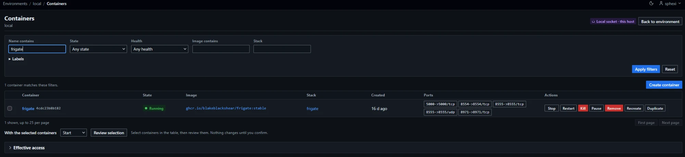
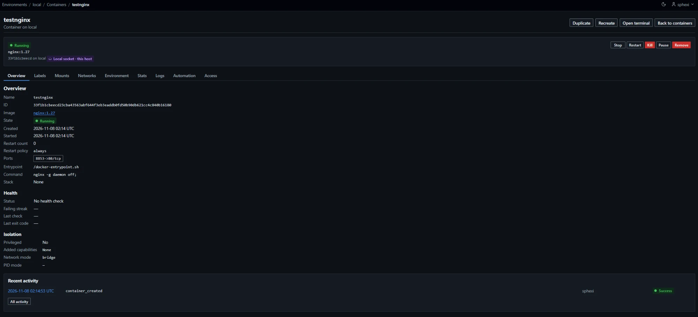
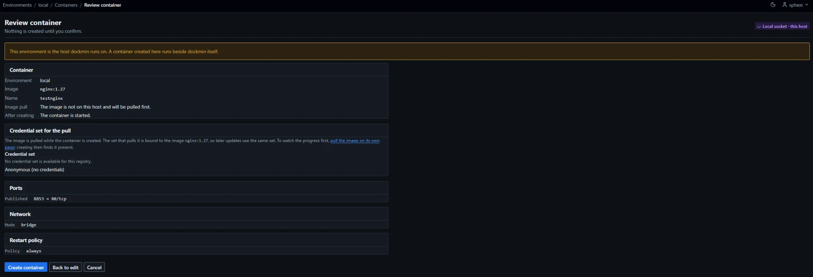
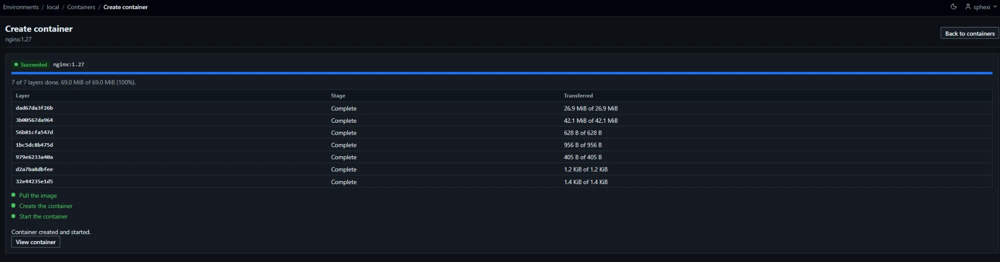

# Containers

Containers are listed and managed per environment. The list, the detail page and stats are read from the host when the page loads. Nothing is cached.

| Page | Path | Administrators | Standard users |
|---|---|---|---|
| Container list | `/environments/{id}/containers` | All containers | Containers they may see |
| Container | `/environments/{id}/containers/{container_id}?tab={tab}` | All tabs | Tabs `overview`, `labels`, `mounts`, `networks`, `stats`, `logs`, `automation` |
| Environment and Access tabs | `?tab=environment`, `?tab=access` | Yes | Refused (403) |
| Action confirmation (GET) and action (POST) | `/environments/{id}/containers/{container_id}/actions/{action}` | Yes | Write access only |
| Batch confirmation (GET) and batch (POST) | `/environments/{id}/containers/batch` | Yes | Write access only |
| Create form (GET), add rows, back to edit and review (POST) | `/environments/{id}/containers/new` | Yes | Remote environments they hold a grant on; `403` on a local socket; `404` without a grant |
| Credential choice for the image (htmx only; other requests redirect (`303`) to the create form) | `/environments/{id}/containers/new/choices` | Yes | As the create form |
| Duplicate form (GET) | `/environments/{id}/containers/new?from={container_id}` | Yes | As the create form, and read access to the source |
| Create (POST) | `/environments/{id}/containers` | Yes | As the create form |
| Recreate confirmation (GET) and recreate (POST) | `/environments/{id}/containers/{container_id}/recreate` | Yes | Write access only |
| Export confirmation (GET) and export download (POST) | `/environments/{id}/containers/{container_id}/export` | Yes | `404` |
| Live stats | `/environments/{id}/containers/{container_id}/stats/stream` | Yes | Read access |
| Log stream (server-sent events) | `/environments/{id}/containers/{container_id}/logs/stream` | Yes | Read access |
| Log download | `/environments/{id}/containers/{container_id}/logs/download` | Yes | Read access |
| Terminal form (GET) and open (POST) | `/environments/{id}/containers/{container_id}/terminal?mode={mode}` | Yes | Write access; `403` on a local socket; refused on containers that use administrator-only options |
| Terminal WebSocket | `/environments/{id}/containers/{container_id}/terminal/ws` | Yes | As the terminal form |
| Effective access | `/environments/{id}/containers/effective-access` | Yes | Refused (403) |
| Create or recreate job: page, live view, cancel | `/environments/{id}/containers/jobs/{job_id}`, `.../events`, `.../cancel` | Yes | Own jobs only ([Visibility and retention](#visibility-and-retention)) |

- `{action}` is `start`, `stop`, `restart`, `kill`, `pause`, `unpause` or `remove`.
- `{container_id}` is the full 64-character lower-case hexadecimal id. A name, a short id or an upper-case id answers `404 Not Found` for every role, before any call to the host.
- An unknown `tab` answers `404`.
- `{mode}` is `exec` (default) or `attach`. Any other value answers `404`.
- Resource control editing on the Access tab: [Access control](Usage-Access-Control).

## Visibility

Administrators see every container on every environment.

A standard user needs a grant on the environment ([Environments](Usage-Environments#access)). Without one, every container route answers `404 Not Found`. With one, each container is decided in this order:

| Order | Source | Result |
|---|---|---|
| 1 | The container's own resource control | Its grants decide |
| 2 | The control of its stack, named by the label `com.docker.compose.project` or `com.docker.stack.namespace` | Inherited |
| 3 | Neither | The default access policy for uncontrolled objects |

- A stack is put under its creator's control when it is created; administrators change it on the stack's Access tab ([Stacks](Usage-Stacks#ownership)). A redeploy recreates the stack's containers with the same project label, so the users who see the stack keep seeing them. A control on a container itself overrides the stack's.
- A standard user can redeploy, start, stop or remove a stack only when every container of its project is visible and writable to them ([Stacks](Usage-Stacks#containers-of-the-project)).

| Situation | Answer |
|---|---|
| Container the user may not see | `404 Not Found`, identical to a container that does not exist |
| Container the user may read but not change | The page shows no action controls. Posting an action answers `403` |
| Container list | Omits containers the user may not see. The total counts only visible containers |

### Local socket environments

A standard user has read access at most in a local socket environment ([Access control](Usage-Access-Control#local-socket-read-ceiling)). The table lists the container operations.

| Operation | Standard user |
|---|---|
| List, detail, stats, logs | Allowed |
| Terminal (exec), attach | Refused (`403`) |
| Any action, single or batch | Refused (`403`); batch items report `Read only` |
| Create, duplicate | Refused (`403`) |
| Recreate | Refused (`403`) |

The effective access page gives the reason `local_socket_read_only`.

### Withheld from standard users

| Item | Administrators | Standard users |
|---|---|---|
| Environment variables (tab `environment`) | Shown; values of secret-named variables redacted | Tab refused (`403`) |
| Command and entrypoint | Shown (first 2048 characters) | `Not shown for your role` |
| Bind mount source paths | Shown | `Not shown for your role` |
| Isolation facts: privileged, added capabilities, network mode, PID mode | Shown | Not shown |
| Label values for secret-named keys | Shown | Redacted |
| Other label values | Shown | Shown, with embedded secrets redacted |
| Resource control editing and effective access | Yes | No |

A name is secret-named when, after upper-casing and replacing `-` and `.` with `_`, it equals or ends with a secret marker. Markers include `PASSWORD`, `PASSWD`, `PWD`, `PASS`, `PASSPHRASE`, `SECRET`, `TOKEN`, `APIKEY`, `AUTH`, `CREDENTIALS`, `AUTHORIZATION`, `COOKIE`, and the suffixes `_KEY`, `_SECRET`, `_PASSWORD`, `_TOKEN`, `_CREDENTIALS`, `_AUTH`, `_PEM`, `_AUTHORIZATION`. A label key is also secret-named when any dot-separated segment is, or when a segment is `basicauth` or `digestauth`.

Redacted values show as `Redacted` in the interface and as `[REDACTED]` in the JSON API. Embedded secrets are URL credentials, bearer tokens, private key blocks and `name=value` pairs with secret-named names.

## List

### Columns

| Column | Shown to | Content |
|---|---|---|
| Select | Any user holding write access to a container on the page | Checkbox for batch actions, on rows the user may change |
| Container | All | Name (link to the container) and short id |
| State | All | State badge; `Unhealthy` or `Health starting` when the health check reports it |
| Image | All | Image reference |
| Stack | All | Stack name (link to the list filtered by it) |
| Created | All | Age |
| Ports | All | Published ports as `80->8080/tcp` (`ip:80->8080/tcp` when bound to one address) and unpublished as `8080/tcp`; 20 at most, then `and N more` |
| Actions | Same as Select, and any user who may create in the environment | Actions offered for the state ([Lifecycle actions](#lifecycle-actions)); `Recreate` on rows the user may change; `Duplicate` for users who may create |

The container name is the first name that carries no link path. Default order is name (case-insensitive), then id; the Container, State, Image, Stack and Created headers sort the list ([Sorting](#sorting)).

- Image, Stack, Created and Ports are hidden below 40rem; Container, State and Actions stay. The Select header is read by screen readers and not drawn.
- Shift-click ticks a range of Select boxes ([Range selection](#range-selection)).
- `Create container` is shown above the list to every user who may [create](#create).

### Filters

All filters combine. A container must match every one.

| Filter | Parameter | Rule |
|---|---|---|
| Name contains | `q` | At most 64 characters. Case-insensitive substring of any of the container's names; a leading `/` is ignored |
| State | `state` | `created`, `running`, `paused`, `restarting`, `removing`, `exited`, `dead`, or `stopped` |
| Health | `health` | `unhealthy` or `starting` |
| Image contains | `image` | At most 128 characters. Case-insensitive substring of the image reference |
| Stack | `stack` | At most 128 characters. Case-insensitive exact match on the stack name |
| Label | `label` (repeatable) | At most 5, each at most 256 characters. `key` matches containers with the label; `key=value` matches the exact value. Every label must match |

- `stopped` matches the states `created`, `exited` and `dead`.
- The stack name is the value of `com.docker.compose.project`, or of `com.docker.stack.namespace` when the first is absent.
- An invalid filter replaces the table with the message for the field and returns `400`.

### Sorting

A column header that is a link sorts the whole set of containers the viewer may see, before it is cut into pages. The other lists link here for the shared rules.

| Parameter | Rule |
|---|---|
| `sort` | A column key from the table below. At most 32 characters; longer answers `422`. Absent: the default order |
| `dir` | `asc` (default) or `desc`. At most 8 characters; longer answers `422`. Without `sort` it is checked and ignored |

| Column | `sort` | Orders by |
|---|---|---|
| Container | `name` | Name, ignoring case |
| State | `state` | Rank: `running`, `restarting`, `paused`, `created`, `removing`, `exited`, `dead` |
| Image | `image` | Image reference, ignoring case |
| Stack | `stack` | Stack name, ignoring case |
| Created | `created` | Creation time |

| Rule | Value |
|---|---|
| Default order | `name` ascending, then id |
| Header link | Ascending on the first click. A click on the sorted column switches between ascending and descending. A header link opens the first page |
| Active column | `aria-sort` is `ascending` or `descending`. Other sortable headers read `none` |
| Empty value | Sorts as the lowest value: first ascending, last descending. Empty values are a container with no stack and a state outside the rank |
| Ties | Broken by name (ignoring case), then id, in the sort direction. `desc` reverses the whole order |
| Filters | Submitting a filter keeps `sort` and `dir` and opens the first page. Paging links, `Clear filters` and `Back to the first page` keep them. `Reset` opens the list with no filter and the default order |
| Cursor | A cursor names the sort and direction it was issued under, or none for the default order. Used under any other, it answers `400` |
| Stored | Nothing. The sort is in the address only and is not remembered between visits |
| Without JavaScript | A header link is a plain link that returns the full page |
| JSON API | No `sort`. [JSON API](Reference-JSON-API) lists keep their fixed order |

| Refused | Answer |
|---|---|
| Unknown `sort` | `400`, `Sort by one of the listed columns.` |
| Unknown `dir` | `400`, `Choose ascending or descending.` |
| Invalid cursor | `400`, `The page link is not valid.` |

A refused value replaces the table with the message for the field.

### Range selection

Shift-click ticks or clears a run of batch checkboxes. The rule applies to the Select column of the container, image and volume lists, to the environment list ([Environments](Usage-Environments#environment-list)) and to the three sections of the onboarding review ([Review page](Usage-Environments#review-page)).

| Rule | Value |
|---|---|
| Gesture | Click one box, then Shift-click another box in the same list |
| Effect | Every enabled box from one to the other, both included, takes the state of the box that was Shift-clicked |
| Disabled boxes | Left as they are |
| Order | The order of the boxes on the page |
| Start of the range | The last box clicked in that list. With none, Shift-click acts as a plain click and starts a range |
| Groups | One group for each form and each checkbox name. The three sections of the onboarding review are three groups. A range never joins two |
| Leaving the page | The start is forgotten when its box leaves the page: paging, sorting or filtering replaces the table. A range never covers rows of an earlier page |
| Input | Mouse clicks, and clicks on the label of a box. Keyboard selection is unchanged and has no range form |
| Text | A Shift-click on a box or its label does not select the text between the rows |
| Without JavaScript | Each box is ticked on its own |
| Batch limits | Unchanged. The confirmation page names the targets and refuses more than its limit |

### Paging

| Parameter | Rule |
|---|---|
| `limit` | 1 to 500; default 25. Outside the range answers `422` |
| `cursor` | The cursor of the previous page; at most 512 characters. An invalid cursor answers `400` (`The page link is not valid.`) |

- Every page is a separate read of the host. A container created or removed between pages can shift the boundary.
- The summary line gives the number of matching containers across all pages.

### Host failures

The list is replaced by an error with a retry link, and the response is `503`. The error is titled `The environment is not reachable`, and its message is followed by `Check that the Docker host is running and reachable, then try again.`

| Message | Cause |
|---|---|
| The Docker host could not be reached. | The connection failed or timed out |
| The Docker host runs an Engine API version this product does not support. | Environment status is `version_unsupported`, or the daemon is outside the supported range |
| The connection details stored for this environment cannot be used. | Stored TLS material is unreadable |
| The Docker host returned an unexpected response. | Any other Engine failure |
| This host reports more container data than can be listed here (limit 32 MiB). | The container list reply exceeds 32 MiB, or its decoded size would exceed the 128 MiB estimate; no partial list is shown |

Troubleshooting: [Troubleshooting](Troubleshooting).

### Labels

| Rule | Value |
|---|---|
| Budget | 65,536 characters of label keys and values per container |
| Always kept | `com.docker.compose.project`, `com.docker.stack.namespace` |
| Others | Kept in document order until the budget is used; the rest are dropped |
| Marker | `labels_truncated` is true; the Stack column reads `Labels truncated` where it would read `None` |

A label filter cannot match a dropped label.

### Health

The list reads health from two extra requests filtered by `unhealthy` and `starting`. Only those two values appear on list rows.

| Situation | Result |
|---|---|
| Health requests succeed | Badges and the health filter are complete |
| Health requests fail, listing succeeds | The list is shown with the notice `Health could not be read from this host. Health badges and the health filter are incomplete.` Health is shown as unavailable |

## Container page

The summary above the tabs shows the state, image, short id, environment, and the action buttons the user may use. Each tab has its own URL.

| Summary button | Shown when |
|---|---|
| Open terminal | The container is running and the user may [open a terminal](#terminal) |
| Attach | As `Open terminal`, and the container [can be attached to](#attach) |
| Export | The user is an administrator and the container is not the one dockmin runs in ([Export](#export)) |

When a standard user is refused a terminal because the container uses administrator-only options, the summary shows the reason in place of the buttons.

| Tab | `tab` | Content |
|---|---|---|
| Overview | `overview` | Identity, state, timing, restart policy, ports, command, stack |
| Labels | `labels` | Key and value of every label, sorted by key |
| Mounts | `mounts` | Type, source, destination and access of each mount |
| Networks | `networks` | Name, IP address (IPv6 below it), gateway, MAC address and aliases of each attachment; `Detach` per row and an `Attach to a network` form ([Networks tab](#networks-tab)) |
| Environment | `environment` | Environment variables (administrators) |
| Stats | `stats` | CPU, memory, network, block I/O and process readings, and four charts ([Stats](#stats)) |
| Logs | `logs` | Output of the container ([Logs](#logs)) |
| Automation | `automation` | The automations that act on the container, `Add this container to an existing automation` and `Add to new automation` ([Automation](#automation)) |
| Access | `access` | Resource control for the container and an effective access search (administrators) |

### Automation

The `Automation` tab holds the automations panel. No other tab shows it.

| Item | Content |
|---|---|
| Automations listed | Automations in the container's environment whose target names the container, its Compose stack, a label the viewer can see on it, or the whole environment. At most 10, then a count |
| Every viewer | Type, schedule, state, next run, last outcome |
| The automation's owner and administrators | Name and target, linked; `Pause` or `Resume` |
| Another user's automation | `An automation of another user` |
| `Add to new automation` | Under the heading `Add this container to a new automation`. Shown to users with create access in the environment. Opens the `New automation` form with the container's name filled in |
| `Add this container to an existing automation` | A list of the enabled automations of the container's environment that the viewer may edit and that name containers, and `Add to automation`. Shown to users with create access in the environment and write access to the container. Opens a confirmation page; confirming adds the container's name and leaves the automation enabled |
| A container of a Compose stack | `container-updater` and `webhook-receiver` automations are not listed; a line points to the stack's Automation tab |
| A Swarm task container | No list; a line points to the Automation tab of its service |
| After `Pause` or `Resume` | The browser returns to the Automation tab |

Details: [Automation](Operations-Automation#per-object-panel).

### Activity on a tab

Administrators see an activity panel below the content of some tabs. A standard user sees none. The panel lists the 10 newest matching events, each linked, and `All activity` opens the log with the same filter. A tab swap carries the panel of the tab it opens.

| Tab | Panel | Events listed |
|---|---|---|
| Overview | `Recent activity` | Every event on the container |
| Networks | `Network changes` | `network_connected` and `network_disconnected` |
| Automation | `Automated actions` | Events whose actor is a subsystem |
| Access | `Access changes` | `resource_control_created`, `resource_control_updated` and `resource_control_deleted` |
| Labels, Mounts, Environment, Stats, Logs | None | — |

Details: [Activity](Administration-Activity#panels).

### Overview

| Field | Content |
|---|---|
| Name, ID, Image | Full 64-character id |
| State | State badge |
| Created, Started | Timestamps; Started reads `Never` for a container that never ran |
| Restart count, Restart policy | `no`, `always`, `unless-stopped`, `on-failure`, or `on-failure:N` |
| Ports | One outlined chip per port, as in the list |
| Entrypoint, Command | Administrators only |
| Stack | Link to the list filtered by the stack |
| Last exit | Below the facts, when the state is `exited`, `created` or `dead` ([Last exit](#last-exit)) |
| Health | Below the facts, in every state ([Health](#health-section)) |
| Isolation | Privileged, added capabilities, network mode, PID mode (administrators only). Below Health |

#### Last exit

Shown when the state is `exited`, `created` or `dead`. A paused or restarting container has none.

| Item | Content |
|---|---|
| Finished | Time the container stopped. Omitted for a container that never started |
| Exit code | The code. `Never started` for a container that was created and never ran: its recorded code is not an exit |
| Cause | `Killed: out of memory` when the Engine reports the kernel killed the container for memory |
| Engine error | The error the Engine recorded when the start failed. Administrators see its text, scrubbed of secrets, reduced to one line and cut to 300 characters. Other users see `The Engine recorded an error. Its text is shown to administrators.` |
| Last output | A container that ran: its newest 20 log lines, scrubbed of secrets, and a link to the Logs tab. `The container printed no output.` when there are none; `Only the newest lines are shown.` when cut. A failed read shows the reason in place of the lines |

The output is read with the container's read access and holds a log view slot ([View limits](#view-limits)) while it is read.

#### Health section

| Field | With a health check | Without |
|---|---|---|
| Status | `Healthy`, `Unhealthy` or `Starting`; `—` when the Engine reports none | `No health check` |
| Failing streak | Consecutive failed checks | `—` |
| Last check | Time the newest check ended | `—` |
| Last exit code | Exit code of the newest check | `—` |
| Last output | Administrators: the newest check's output, scrubbed of secrets, cut to 1,000 characters; `Nothing printed` when empty. Other users: `Visible to administrators` | Not shown |

### Display bounds

| Item | Bound |
|---|---|
| Labels, mounts, networks, environment variables | First 500 |
| Ports | First 20 |
| Aliases per network | First 10 |
| Names per container (JSON) | First 10 |
| Command, entrypoint | 2048 characters |
| Inspect reply | 4 MiB. Larger: `This container's configuration is too large to show.` (`503`) |

When a list is cut, the tab reads `Only the first entries are shown.` and the JSON field `truncated` is true.

### Mounts

| Mount type | Source column |
|---|---|
| `volume` | Volume name |
| `bind` | Host path (administrators); `Not shown for your role` (standard users) |
| Other | `—` |

### Networks tab

| Item | Value |
|---|---|
| Table | Network, IP address, gateway, MAC address, aliases. The IPv6 address is shown below the IPv4 address |
| `Detach` | A button on each row. It opens a confirmation naming the network, the addresses and the aliases. [Rules](Usage-Networks#detach) |
| `Attach to a network` | A form below the table: network, aliases, IPv4 address, IPv6 address. [Rules](Usage-Networks#attach) |
| Shown to | Users with write access to the container, when its network mode is not `host`, `none` or `container:`. Other users see the table only |
| Permission | Detach needs write access to the container. Attach also needs write access to the network |
| Works on | Running and stopped containers |
| After a change | With JavaScript the tab reloads in place. Without it the browser returns to the tab |

Attach and detach record `network_connected` and `network_disconnected` with the container as the target ([Networks](Usage-Networks#recorded-actions)).

## Stats

| Value | Content |
|---|---|
| CPU | Percent of host CPU; `—` when the reading has no previous frame to compare against |
| Memory | Used (excluding inactive file cache), limit and percent; `no limit set` when the limit is zero |
| Network | Bytes received and sent, summed over all interfaces |
| Block I/O | Bytes read and written |
| Processes | Current process count |
| Read at | Time of the reading |

### Charts

With JavaScript the tab draws four charts above the readings.

| Chart | Series |
|---|---|
| CPU | Percent of host CPU |
| Memory | Used, and the limit as a dashed line when one is set |
| Network | Bytes per second received, and sent (dashed) |
| Block I/O | Bytes per second read, and written (dashed) |

| Rule | Value |
|---|---|
| Source | The readings of the live stream. Nothing is stored on the server |
| History | The newest 90 readings since the tab was opened. Leaving the tab discards them |
| Rates | Network and block I/O are the change in the cumulative counters between two readings, per second. A counter that goes backwards has no rate for that interval |
| Gap | More than 10 seconds between readings breaks the line |
| Scale | Each chart's heading reads `max` and its ceiling. CPU's ceiling is at least 10%. Memory's ceiling is the limit when one is set |
| Colours | The tokens `--color-chart-1` to `--color-chart-4`; the limit uses `--color-border-strong` ([Frontend conventions](Contributing-Frontend-Conventions#design-tokens)) |
| Text | Each chart's latest values appear in its legend. The readings above stay the text rendering |
| Without JavaScript | No charts. The tab shows one reading and `Take another reading` |

| Limit | Value |
|---|---|
| Update interval | One reading every 2 seconds at most |
| Quiet interval | A comment line is sent every 15 seconds without a reading |
| Stream lifetime | 300 seconds. The server then ends the stream and tells the browser to reconnect after 3 seconds |
| Streams per user | 4, shared with log views and log downloads ([View limits](#view-limits)) |
| Streams per process | 64 |
| Streams opened by standard users, all users together | 48 of the 64; the remaining 16 are available to administrators |
| Access required | Read |

| Behaviour | Detail |
|---|---|
| Stream opens | While the Stats tab is on screen and the browser tab is visible |
| Stream closes | When the user leaves the tab, hides the browser tab, or leaves the page |
| After lifetime | The browser reconnects. Each connection is authorised again and takes a slot |
| Connection lost | `Reconnecting.` while the browser retries |
| Stream refused or ended for good | `Stats are no longer available.` and the `Take another reading` link returns |
| Container not running | The tab reads `The container is not running, so there are no readings to show.`; the stream answers `409` |
| No slot free | `Too many live views are open` (`429`) |
| Host unavailable or container too large | `Readings are not available` (`503`) |
| Without JavaScript | The tab shows one reading taken when the page loaded, and `Take another reading` loads another |

## Logs

The Logs tab shows the output of a container. It needs read access: every user who can see the container can read its logs, including standard users in a local socket environment. A container the user may not see answers `404`. Reading logs records no activity row.

- The containers of a Compose stack are read together on the stack's Logs tab ([Stacks](Usage-Stacks#logs)).
- `container-log-exporter` copies the new lines of chosen containers, or of the tasks of chosen Swarm services, to a bucket as NDJSON ([Subsystems](Reference-Subsystems#container-log-exporter)). The record format is in [Log ingestion](Administration-Activity#log-ingestion).

### Selection

| Control | Parameter | Rule |
|---|---|---|
| Newest lines | `tail` | Whole number from 0 to 10000. The form offers 100, 200, 500, 1000, 5000 and 10000 and selects 200. A request without `tail` reads 500. The download also accepts `all` |
| Since (UTC) | `since` | Blank or `all` starts at the beginning. Otherwise a [time value](#time-values) |
| Until (UTC) | `until` | Blank reads up to now. Otherwise a [time value](#time-values). Setting it turns Follow off |
| Filter | `q` | At most 128 characters, no control characters. Case-insensitive substring of the line's text |
| Streams | `stdout`, `stderr` | Both are read unless one is given; then only those given as on. At least one is required |
| Show timestamps | `timestamps` | On by default |
| Follow new output | `follow` | On by default. Off, and disabled, when the container is not running or Until is set |
| Keep at most | Browser only | 1000, 5000 (default) or 20000 lines held in the page. The oldest lines are discarded beyond it |
| Jump to latest | Browser only | Appears when the output is scrolled away from the end |

- `1`, `true`, `on` and `yes` are on. `0`, `false`, `off` and `no` are off. Case-insensitive.
- `Apply` clears the output and reads again. Changing Show timestamps or Filter changes what is displayed without reading again.

#### Time values

| Form | Examples | Rule |
|---|---|---|
| Duration back from now | `30s`, `15m`, `6h`, `7d` | One to four digits, then `s`, `m`, `h` or `d` |
| Unix time | `1760884200`, `1760884200.5` | Up to 12 digits of seconds and up to 9 of fraction. Before the year 2200 |
| ISO 8601 | `2026-10-19T14:30`, `2026-10-19T14:30:00+02:00` | Read as UTC when it names no zone |

A value is at most 40 characters. `since` also takes `all`.

#### Invalid selection

An invalid selection answers `400`. The Logs tab marks each field and starts no stream. The stream and download routes answer `400` with the messages joined by `; ` as plain text.

| Field | Message |
|---|---|
| `tail` | `Choose a number of lines from 0 to {maximum}.` |
| `since`, `until` | `Enter a date and time such as 2026-10-19T14:30 (UTC), or a duration such as 15m.` |
| `until` | `Until must be after since.` |
| `q` | `The filter is at most 128 characters of plain text.` |
| Streams | `Select at least one of stdout and stderr.` |
| `format` | `Choose text or ndjson.` |

### Live output

With JavaScript the page reads the output as server-sent events and appends it as text.

| Behaviour | Detail |
|---|---|
| Stream opens | When the Logs tab is on screen and the browser tab is visible |
| Stream closes | When the user leaves the tab or the page, turns Follow off, or hides the browser tab. Hiding reads `Paused while this tab is not visible.` and showing the tab again resumes |
| Events | `out` and `err` carry up to 200 consecutive lines of one stream. Each line is `<timestamp> <text>`, with `-` for a line without a timestamp. The event `id` is the timestamp of its last line in Unix nanoseconds. `end` carries `finished` or `unavailable` |
| Batching | Lines are grouped for up to 0.1 seconds or 128 KiB before an event is sent |
| Quiet interval | A comment line is sent every 15 seconds without output |
| Stream lifetime | 300 seconds. The server then ends the stream and tells the browser to reconnect after 3 seconds |
| Resume | A reconnecting browser sends the `id` of the last event it received, in `Last-Event-ID` or the `after` parameter. The stream continues after that timestamp and ignores `tail`. Lines already shown are not repeated. Given both, the later timestamp applies |
| Follow | The stream stays open for new output while the container runs |
| Container not running | The history is read with Follow off, then the stream ends. The status reads `End of the log.` |
| Container stops while following | The stream ends, Follow is switched off and disabled. `The container stopped.` |
| Until reached | `Reached the end of the selected range.` |
| Connection lost | `Reconnecting.` while the browser retries |
| Host failure or reply too large | The stream ends with `unavailable`. `Logs are no longer available.` |
| Stream refused | The page reads the refusal and shows its message: `Too many live views are open` (`429`), `Logs are not available` (`503`), the validation messages (`400`) |
| Follow turned off | `Not following. Turn on Follow new output to continue.` Turning it on resumes after the last line shown |

| Display | Detail |
|---|---|
| Timestamp | `YYYY-MM-DD HH:MM:SS.mmm`, UTC |
| stderr lines | Marked by colour and by a hidden `stderr` label for screen readers |
| Scrolling | The view follows new output while scrolled to the end. Scrolling up stops it and shows `Jump to latest` |
| Filter | Lines that do not match are hidden. The filter does not change what is read |
| Count | `{N} lines`, or `{N} of {M} lines contain the filter`, with `The oldest {N} were discarded to stay within the line budget` once lines have been discarded |

#### Line handling

| Input | Result |
|---|---|
| Line over 16 KiB | Cut at 16 KiB and ends with `…[line truncated]`. The remainder of the line is dropped |
| ANSI escape sequences (CSI and OSC) | Removed |
| Other control characters except tab | Replaced with `�` |
| Invalid UTF-8 | Replaced with `�` |
| Carriage return before a line feed | Removed |
| Unterminated last line | Kept as a line |

### View limits

Log streams, log downloads and the [recent lines without JavaScript](#without-javascript) each hold one view while they read. Views share the pools of the [stats stream](#stats).

| Limit | Value |
|---|---|
| Views per user | 4, across stats, log streams, log downloads and recent-lines reads |
| Views per process | 64 |
| Views opened by standard users, all users together | 48 of the 64 |
| Refusal | `Too many live views are open` (`429`) |

### Without JavaScript

The form is a plain `GET`. A page load reads no output.

| Behaviour | Detail |
|---|---|
| Page load | The form and the link `Show recent lines` |
| Show recent lines, Apply, Refresh | Read the newest lines once, at the moment of the request, and render them as a page |
| Lines | 200 unless `tail` says otherwise, at most 1000. A larger value reads 1000 and the page says `Without script this page shows at most 1000 lines.` |
| Output cap | 1 MiB. Over it the newest complete lines that fit are kept: `The output was cut at 1 MiB, so only the newest complete lines that fit are shown.` |
| Read time | 30 seconds. A read still running then ends and the lines read so far are shown as cut |
| Filter | Applied to the lines read. The page gives how many contain it |
| No output | `This container has written no output in the selected range.` |
| Failures | `400` for an invalid selection, `429` when no view is free, `503` when the host is unavailable (`Logs are not available`) |

### Download

`GET /environments/{id}/containers/{container_id}/logs/download` takes the parameters in [Selection](#selection) except `follow`, which is ignored, and `format`. The `Download text` and `Download NDJSON` links on the tab carry the current selection with `tail=all` and `format=text` or `format=ndjson`.

| Parameter | Value |
|---|---|
| `format` | `text` (default) or `ndjson`. Any other value answers `400`: `Choose text or ndjson.` |

| Item | Detail |
|---|---|
| Content, `format=text` | `text/plain; charset=utf-8`, one log line per line, oldest first |
| Content, `format=ndjson` | `application/x-ndjson`, one JSON object per line, oldest first ([NDJSON download](#ndjson-download)) |
| Line format | `[stdout \|stderr ][timestamp ]text`. The stream label is written only when both streams are selected. The timestamp is the one the host sent, with nanosecond precision, and is omitted when Show timestamps is off. Text only |
| Filter | Applied on the server before a line is counted |
| Filename | `{name}-{12-character id}-{UTC time}.log`, or `.ndjson` for `format=ndjson`, with the time as `YYYYMMDDTHHMMSSZ`. Characters of the name outside letters, digits, `_`, `.` and `-` become `_`; the name is cut at 64 characters; an empty name becomes `container` |
| Headers | `Content-Disposition: attachment`, `Cache-Control: no-store`, `X-Content-Type-Options: nosniff` |
| Views | One view while the file is written |

| Cap | Value | Last line of the file |
|---|---|---|
| Lines written | 100,000 | `[output stopped at the 100000-line limit]` |
| Size | 32 MiB | `[output stopped at the 32 MiB limit]` |
| Time | 120 seconds | `[output stopped at the 120-second limit]` |

| Situation | Result |
|---|---|
| Host stops answering after the file has started | The file ends with `[output stopped: the Docker host stopped answering]` |
| Host fails before the first line | No file. `Logs are not available` (`503`) |
| No view free | `Too many live views are open` (`429`) |

A file that ends with one of these lines is incomplete. In an NDJSON file each of these lines is a [notice object](#notice-objects).

### NDJSON download

Every line is one JSON object ending in `\n`. There is no header line and no byte order mark.

| Item | Value |
|---|---|
| Media type | `application/x-ndjson` |
| Encoding | UTF-8. Compact JSON: no spaces after `,` or `:`. Non-ASCII characters are written as themselves |
| Escaped | U+0085, U+2028 and U+2029 are written as `\u0085`, `
` and `
`, so a reader that splits on any Unicode line break gets one object per line |
| Key order | As in the tables below |
| `schema_version` | The integer `2` on every object, notices included |
| Timestamps | `time` is UTC with nine fractional digits: `YYYY-MM-DDTHH:MM:SS.nnnnnnnnnZ` |
| Filter, caps, order | As for the text download. Show timestamps and the stream labels of the text format do not apply |

A log record has the [common keys](#common-keys) followed by the keys of its source. Two key sets exist. The same set is written by a download and by an exported object, so the same line gives the same record in both.

| Source | Key set |
|---|---|
| Container download | [Container keys](#container-keys) |
| Compose stack download ([Stacks](Usage-Stacks#download)) | [Container keys](#container-keys) |
| `container-log-exporter`, container, Compose stack, labels and environment targets | [Container keys](#container-keys) |
| Service download ([Swarm](Usage-Swarm#service-logs)) | [Service keys](#service-keys) |
| Swarm stack download ([Stacks](Usage-Stacks#download)) | [Service keys](#service-keys) |
| `container-log-exporter`, service target | [Service keys](#service-keys) |

#### Common keys

| # | Key | Type | Present | Meaning |
|---|---|---|---|---|
| 1 | `schema_version` | integer | Always | `2` |
| 2 | `time` | string or `null` | Always | The Engine's timestamp of the line. `null` for a line the host sent without one |
| 3 | `stream` | string | Always | `stdout` or `stderr` |
| 4 | `format` | string | Always | `json` when the line is written as `payload`, `text` when it is written as `message` ([Payload and message](#payload-and-message)) |
| 5 | `message` | string | `format` is `text` | The line without its newline, after the [line handling](#line-handling). A line cut at 16 KiB ends with `…[line truncated]` |
| 6 | `payload` | object | `format` is `json` | The line's JSON object |
| 7 | `level` | string | `format` is `json` and the object has a level key | The line's level, lower-cased ([Level](#level)) |
| 8 | `instance_name` | string | Always | `DOCKMIN_INSTANCE_NAME` of the dockmin instance that wrote the record ([Configuration](Reference-Configuration)) |
| 9 | `environment_id` | integer | Always | The environment of the container or service |
| 10 | `environment_name` | string | Always | The environment's name when the lines were read |
| 11 | `host_name` | string or `null` | Always | The Docker host's own name (`Name` in the Engine's `/info`), stored by the environment's status refresh. `null` until the first refresh has stored it |

- Keys 5 to 7 take one place: a text record has `message`, a JSON record has `payload` and then `level` when it has one.
- `environment_name` and `host_name` are the values at the time of the read. A rename is not applied to records already written.

#### Container keys

These follow the common keys.

| Key | Type | Present | Meaning |
|---|---|---|---|
| `container_id` | string | Always | The 64-character container id |
| `container_name` | string | Always | The container's name |
| `image` | string | Always | The image reference the container was created with (`Config.Image`). A Compose stack download writes the `Image` of the container list, which is the image id when the reference no longer names the image the container runs |
| `compose_project` | string or `null` | Always | The value of the label `com.docker.compose.project`. `null` when the container has none |
| `compose_service` | string or `null` | Always | The value of the label `com.docker.compose.service`. `null` when the container has none |

#### Service keys

These follow the common keys.

| Key | Type | Present | Meaning |
|---|---|---|---|
| `service_id` | string | Always | The 25-character service id |
| `service_name` | string | Always | The service's name |
| `task_id` | string or `null` | Always | The 25-character id of the task that wrote the line. `null` when Docker named none |
| `node_id` | string or `null` | Always | The 25-character id of the node the task ran on. `null` when Docker named none |
| `image` | string or `null` | Always | The image reference in the service's task template. `null` when it names none |
| `stack_namespace` | string or `null` | Always | The value of the label `com.docker.stack.namespace`. `null` when the service has none |

#### Payload and message

A line is classified after the [line handling](#line-handling), so a record holds what the Logs tab shows.

| Line | Written as |
|---|---|
| A JSON object | `format` `json`, with `payload` and no `message` |
| Text | `format` `text`, with `message` |
| A JSON array, string, number, `true`, `false` or `null` | `format` `text`, with `message` |
| An object holding `NaN`, `Infinity` or `-Infinity` | `format` `text`, with `message` |
| An object holding a number that cannot be read back, such as a float that overflows or an integer with thousands of digits | `format` `text`, with `message` |
| An object nested more than 32 levels deep, the outermost object being level 1. Objects and arrays both count | `format` `text`, with `message` |
| A line cut at 16 KiB | `format` `text`, with `message` |
| An object with a key or a string value that, once decoded, holds a C0 control character other than tab, line feed and carriage return (such as `\u0000` or ESC), DEL (U+007F) or a C1 control character (U+0080 to U+009F) | `format` `text`, with `message` |
| An object whose decoded keys and strings hold tab, line feed or carriage return, such as the escapes `\t`, `\n` and `\r` | `format` `json`, with `payload` |
| Invalid JSON | `format` `text`, with `message` |

- A key repeated within an object keeps its last value. The earlier values are not in `payload`.
- `payload` is written again from the parsed object: whitespace between tokens is dropped, numbers take their canonical form, and the order of keys is kept.

#### Level

`level` is present only when `format` is `json`. It is the first of the object's top-level keys `level`, `severity` and `lvl`, in that order, whose value is a string of 1 to 32 characters, lower-cased.

- A numeric value gives no `level`: numbers are not mapped to names. A key whose value is not a string of that length is passed over, and the next key is tried.
- `level` is never taken from `stream`, and a text record has none.
- `payload` keeps the application's own value unchanged, such as `"level":"INFO"`.

#### Notice objects

A notice object stands in for each line of the text format that is not a log line: the cap lines, `[output stopped: the Docker host stopped answering]`, and in a stack download the lines about containers that could not be read ([Stacks](Usage-Stacks#download)).

| Key | Type | Present | Meaning |
|---|---|---|---|
| `schema_version` | integer | Always | `2` |
| `notice` | string | Always | The text of the line the text format writes, such as `[output stopped at the 100000-line limit]` |

A notice object has none of the other keys. A reader checks for `notice` before it reads a record as a log line.

## dockmin's own container

dockmin finds the container it runs in at start ([Instance](Administration-Instance#how-the-container-is-identified)). That container stays in every list and its page opens. Actions that would stop it, or take away what it runs on, are refused for every role, administrators included.

| Surface | Behaviour |
|---|---|
| List | Badge `This dockmin instance` beside the name. The row's checkbox is disabled, and the buttons of the refused actions are not offered. A note below the table says what the badge means |
| Container page | The same badge on the summary. The action bar is replaced by `This is the container dockmin runs in. It cannot be stopped, restarted, killed, paused, removed or recreated from here.` |
| Link to Instance | Administrators see `Restart it from Administration > Instance` in the note. Other users see no link |

| Operation | Result |
|---|---|
| `start`, `unpause` | Allowed |
| `stop`, `restart`, `kill`, `pause`, `remove` | Refused: `409`, the page `This container is protected`. The confirmation page is refused too, before it names anything |
| Recreate | Refused the same way, from the confirmation onward |
| Batch | The container is listed as `protected: this dockmin instance, not changed`, left out of the posted selection, and reported `Protected` if a batch reaches it. `Protected` counts as failed |
| Detach from a network | Refused ([Networks](Usage-Networks#detach)) |
| Terminal, attach | Refused ([Terminal](#terminal)) |
| Export | Refused for every role, on the confirmation and on the download: `409`, the page `Protected`. The `Export` button is not shown ([Export refusals](#export-refusals)) |
| Create or recreate a container that joins its process, IPC or network namespace, takes its volumes, or mounts a named volume it has mounted | Refused for every role: `409`. The message names the volume when a volume is the cause |
| JSON `stop`, `restart`, `recreate` | `409` with `"reason": "self_protected"` in the error body |

- Each refusal that reaches an audited action records a failure row with reason `self_protected`.
- Its volumes, its Compose project and its Swarm service are protected as well: [Volumes](Usage-Volumes#dockmins-volumes), [Stacks](Usage-Stacks#dockmins-own-stack), [Swarm](Usage-Swarm#dockmins-own-service).
- An environment that cannot be read when dockmin looks for its container leaves the volume, Compose project and Swarm service protection incomplete there until a later look succeeds ([Instance](Administration-Instance#how-the-container-is-identified)).
- Automations skip the container with the reason `self_protected` ([Automation](Operations-Automation#self-protection)).
- Exec and attach refusal: [Security](Reference-Security#dockmins-own-container).

## Lifecycle actions

1. Open the container list or the container page.
2. Choose the action button. Only the actions the state allows are offered.
3. Read the confirmation. It names the container, its short id, image, state and environment, and states the effect. Nothing has changed yet.
4. Confirm. The row or summary updates with a notice (`Done.` or `No change`). Without JavaScript the browser opens a result page.
5. If a failure message appears, match it in [Failures](#failures) or see [Troubleshooting](Troubleshooting).

| Action | Effect | Offered in states | Unchanged result |
|---|---|---|---|
| `start` | Starts the container with its saved configuration | `created`, `exited` | Already running |
| `stop` | Sends the stop signal, then kills the process if it has not exited when the container's stop timeout ends. The Engine's default applies when the container sets none | `running`, `restarting`, `paused` | Already stopped |
| `restart` | Stops the container, then starts it | `running`, `exited`, `paused` | None |
| `kill` | Sends `SIGKILL` at once. The process cannot shut down | `running`, `paused`, `restarting` | None |
| `pause` | Freezes every process | `running` | None |
| `unpause` | Resumes the processes | `paused` | None |
| `remove` | Deletes the container and its writable layer. Irreversible | Any state | None |

- Buttons appear for the states listed. `kill` and `remove` are styled as dangerous.
- The JSON API and batches do not check the state; the Engine decides and a refusal is reported as a conflict.
- An unchanged result is a success. It is reported as `No change`, and the activity row records `changed` as `false`.

### Confirmation

Every action is confirmed before it runs. The confirmation page changes nothing.

| Item | Content |
|---|---|
| Names | Container name, short id, image, state, environment (with the local socket badge) |
| Effect | The text in the Effect column above |
| Access | Write access is required; otherwise `403` (read-only) or `404` (not visible) |
| State not offered | The confirmation is replaced by the conflict message for that state |

With JavaScript the confirmation opens in place and the row or summary updates after the action, with a notice. Without JavaScript the confirmation and the result are separate pages: the action answers `303` to a result page, `/results/{token}`, and reloading it runs nothing again.

### Remove

`Remove` and `Force remove` are two confirmations. The ordinary one has no options.

| Confirmation | Reached from | Effect |
|---|---|---|
| `Remove container` | The `Remove` action | Deletes the container and its writable layer. Anonymous volumes are kept. A container that is `running`, `paused` or `restarting` cannot be removed |
| `Force remove container` | The link `Force remove this container instead` on the ordinary confirmation (`?force=1` on the confirmation URL) | Optionally kills the container first, optionally deletes its anonymous volumes, then deletes the container |

| Force option | Default | Effect |
|---|---|---|
| Kill it first if it is running | Ticked | Offered only when the container is `running`, `paused` or `restarting`. Without it, such a container cannot be removed |
| Also remove this container's anonymous volumes | Ticked | Removes the container's anonymous volumes. Irrecoverable |

- The force confirmation is a page without script and an inline dialog with script. It is headed `Force remove container`, names the container, and lists what forcing does.
- The force confirmation posts `confirm_force=yes`. A post that carries `force` or `volumes` without `confirm_force=yes` is refused (`400`, `The request could not be read`) and nothing is removed. The same holds for a batch.
- Named volumes are kept whatever the options say.
- Both confirmations list the volumes mounted in the container (20 at most, then `and N more not listed`), each marked `anonymous`, `named, always kept` or `kind not known`.
- The confirmation binds the container's name. If the name differs when the action runs, nothing is removed: `This container changed since you reviewed it; nothing was removed.` (`409`). The refusal is recorded with the reason `name_changed`.
- Removing deletes the container's resource control in the same operation as the success row. If the control cannot be deleted, the removal stands and the row carries `control_released` as `false`.

### Failures

| Result | Meaning | Message | Web | API | Recorded reason |
|---|---|---|---|---|---|
| Protected | The container is the one dockmin runs in ([dockmin's own container](#dockmins-own-container)) | `This is the container dockmin runs in. It cannot be stopped, restarted, recreated or removed from dockmin; restart it from Administration > Instance.` | 409 | 409 | `self_protected` |
| Busy | Another action holds the container | `This container is busy`, with the holder ([Busy](#busy)) | 409 | 409 | `object_busy` |
| Conflict | The Engine refused the action for the container's state | State message ([below](#conflict-messages)) | 409 | 409 | `conflict` |
| Gone | The container no longer exists | `The container no longer exists.` | 404 | 404 | `not_found` |
| Unreachable | The host could not be reached | `The Docker host could not be reached.` | 503 | 503 | `unreachable` |
| Outcome unknown | The host did not answer in time | `The Docker host did not answer in time. The action may still complete.` | 503 | 503 | `outcome_unknown` |
| Refused | The Engine rejected or failed the action | `Docker refused the action.` | 502 | 502 | `engine_error` |
| Name changed | Remove only: the name differs from the confirmed one | `This container changed since you reviewed it; nothing was removed.` | 409 | Not available | `name_changed` |
| Too large | The container's inspect reply exceeds 4 MiB | `This container's configuration is too large to show.` | 503 | 503 | `too_large` |

Messages from the Engine are never shown. A failure answered `409`, `502` or `503` offers `Review again`.

An outcome-unknown action may have taken effect. Check the container list before repeating it.

#### Conflict messages

The state is read again after the refusal. When it cannot be read, or no row matches, the default applies: `The container cannot be {started|stopped|restarted|killed|paused|unpaused|removed} in its current state.`

| Action | State | Message |
|---|---|---|
| `start` | `paused` | The container is paused. Unpause it first. |
| `start` | `removing` | The container is being removed. |
| `start` | `dead` | The container is dead and cannot be started. |
| `stop`, `restart` | `removing` | The container is being removed. |
| `kill` | `created`, `exited`, `dead` | The container is not running. |
| `pause` | `paused` | The container is already paused. |
| `pause` | `created`, `exited`, `dead` | The container is not running. |
| `pause` | `restarting` | The container is restarting. Try again once it is running. |
| `unpause` | `created`, `running`, `restarting`, `exited`, `dead` | The container is not paused. |
| `remove` | `running` | The container is running. Stop it first, or choose to kill it first. |
| `remove` | `paused` | The container is paused. Stop it first, or choose to kill it first. |
| `remove` | `restarting` | The container is restarting. Stop it first, or choose to kill it first. |
| `remove` | `removing` | The container is already being removed. |

## Busy

One action runs on a container at a time. A second action on the same container is refused at once; it does not wait.

| Rule | Value |
|---|---|
| Scope | One container in one environment |
| Held during | The whole Engine call, including the grace period of a stop or restart |
| Storage | Process memory. dockmin must run as a single instance |
| Message | `{holder} started a {action} on this container {N} seconds ago and it has not finished. Wait for it to complete, then try again.` |

| Holder | Shown to administrators | Shown to standard users |
|---|---|---|
| The viewer | `You` | `You` |
| Another user | That user's username | `Another user` |
| Automation | The subsystem name | The subsystem name |

An administrator's `kill` runs while a `stop` or `restart` holds the container, so it can cut short a grace period. It does not take the hold. A `kill` by a standard user, and an administrator's `kill` while any other action holds the container, is refused as busy.

### Containers of a stack

| Situation | Result |
|---|---|
| A stack operation is running and the container carries the stack's `com.docker.compose.project` or `com.docker.stack.namespace` label | Every lifecycle action on the container is refused as busy (`409`, reason `object_busy`; `Busy` in a batch), an administrator's `kill` included. The holder and action named are those of the stack operation: `create`, `update`, `deploy`, `redeploy`, `start`, `stop`, `remove`, `forget`, `adopt` or `read` |
| A container action is running on a container of a stack | A redeploy, start, stop or remove of that stack is refused as busy ([Stacks](Usage-Stacks#locks-and-busy)) |

An action taken by an automation waits instead of being refused: it waits up to the automation's lock wait (10 s for `container-health-checker`, 60 s for `stack-restarter`) for the container's lock, and for the lock of the stack the container belongs to. If the lock is still held the run is recorded `skipped`, reason `object_busy`, and no activity row is written ([Automation](Operations-Automation#per-object-checks)).

## Batch actions

1. Tick the checkbox of each container on the list (1 to 25).
2. Choose an action under `With the selected containers` and select `Review selection`. The review page opens.
3. Read the review. Containers left out are counted: `{N} of the selected containers are left out: they do not exist or you may not change them.` (`1 of the selected container is left out: it does not exist or you may not change it.`)
4. Confirm. The result page gives the count done out of the count submitted and one row per container.
5. A row other than `Done.` names its cause; see [Results](#results).

Nothing changes until the review is confirmed.

| Rule | Value |
|---|---|
| Limit | 1 to 25 distinct containers. Duplicates are collapsed. Outside the limit: `400` |
| Actions | The seven actions |
| Order | Submitted order, one after another |
| Isolation | Each container is its own operation and its own recorded action, with `batch` set |
| Failure | Never stops the batch. Nothing is rolled back |
| State | Not checked. An action the state does not allow reports `Conflict` |
| Remove | The review binds each container's name. `Force remove` is a separate review ([Batch remove](#batch-remove)) |
| Left out | Containers that do not exist or that the user may not change are left out of the review and counted |

### Results

| Result | Message |
|---|---|
| Done | Done. |
| No change | No change was needed. |
| Not found | Not found, or already removed. |
| Read only | You can read this container but not change it. |
| Protected | The refusal text of [dockmin's own container](#dockmins-own-container) |
| Busy | Another action on this container is in progress. The holder is named as in [Busy](#busy) |
| Conflict | The conflict message, or the name-changed message |
| Unreachable | The unreachable or outcome-unknown message |
| Failed | `Docker refused the action.`, the too-large message, or `The action could not be completed.` |

The result page gives the count done out of the count submitted.

- Each row names the container: the name the action read when it ran, else the name the review showed (`display_name`), else the short id. The short id is listed under the name.
- A batch answers `303` to `/results/{token}` ([Frontend conventions](Contributing-Frontend-Conventions#result-pages)). Reloading the page shows the same result and runs nothing again.

### Batch remove

`Remove` and `Force remove` are two reviews, as for [one container](#remove). The review of `Remove` has a link `Force remove these containers instead` (`GET .../batch?action=remove&container=…&force=1`).

| Item | Behaviour |
|---|---|
| Review | A `Volumes` table lists, for each container, the volumes it mounts (20 at most, then `and N more not listed`), each marked `anonymous`, `named, always kept` or `kind not known`. A container whose volumes could not be read shows `could not be read`; one with none shows `none` |
| `Remove` | Deletes each container and its writable layer. Anonymous volumes are kept. A container that is running, paused or restarting is reported `Conflict` |
| `Force remove` | Headed `Force remove containers`. Offers `Kill any that are running first` (ticked; shown when any selected container is running, paused or restarting) and `Also remove the anonymous volumes of every container above` (ticked). Posts `confirm_force=yes`; without it the batch is refused (`400`) |
| Binding | Each container's name. With `Also remove the anonymous volumes` ticked, also a token of the volumes the review showed for it: the anonymous and unknown-kind volumes, and the number not listed |
| Volumes changed | The volumes of any selected container differ from the review when the batch is posted: nothing is removed (`400`): `The volumes of a selected container changed since you reviewed them. Nothing was removed; review the selection again.` |
| Incomplete form | A name, or with volumes a token, missing for any container: nothing is removed (`400`): `The confirmation was incomplete. Review the selection again.` |
| Named volumes | Kept whatever the options say |

## Create

1. Open the environment's container list and select `Create container`.
2. Fill the form. Only `Image` is required. Sections after Image are `Command`, `Environment variables`, `Labels`, `Ports`, `Volumes and mounts`, `Network`, `Restart policy`, `Resources`, `Health check`, `Logging`, `DNS and hosts`, `Runtime and security` and `Start`.
3. Select `Review`. The review page lists the resolved configuration and whether the image will be pulled first. Nothing has been created.
4. When the image will be pulled, choose the credential set in `Credential set for the pull` ([Credential sets for a pull](#credential-sets-for-a-pull)).
5. Select `Create container`. A create that does not pull opens the new container with a notice. A create that pulls opens a [job page](#job-page) that shows the pull, then the create and start steps.
6. If the form or review shows `Check the form`, fix the listed fields and submit again; see [Validation](#validation) and [Create results](#create-results). For host errors see [Troubleshooting](Troubleshooting).

| Role | May create in |
|---|---|
| Administrators | Every environment, local socket environments included |
| Standard users | Remote environments they hold a grant on |

| Situation | Answer |
|---|---|
| Standard user, local socket environment | `403` |
| Standard user, no grant on the environment | `404` |
| `Create container` button | Shown on the list to every user who may create |

- On a local socket environment, administrators see `This environment is the host dockmin runs on. A container created here runs beside dockmin itself.` on the form and on the review.
- Review and create apply the same validation and the same [restrictions](#options-restricted-to-administrators).
- `?template={catalogue id}:{key}` on the form fills it from an app template ([Templates](Operations-Templates#container-form)). The submission is validated and restricted as any other; `?from` takes precedence over `?template`.

| Step | Request | Effect |
|---|---|---|
| Form | `GET /environments/{id}/containers/new` | Renders the form. `?from={container_id}` (at most 128 characters) prefills it ([Duplicate](#duplicate)) |
| Add rows | `POST /environments/{id}/containers/new` with `rows={group}` | Returns the form with more blank rows in one group, up to the group's limit |
| Back to edit | `POST /environments/{id}/containers/new` with `intent=edit` | Returns the form with every value kept |
| Review | `POST /environments/{id}/containers/new`, any other body | Validates, and shows the resolved configuration. Reads the host; changes nothing; records nothing |
| Create | `POST /environments/{id}/containers` | Validates again. When the image will be pulled, starts a [job](#create-and-recreate-jobs) and answers `303` to its page. Otherwise creates the container, starts it if asked, and answers `303` to the container |

`rows` is one of `env`, `labels`, `ports`, `mounts`, `networks`, `devices`, `extra_hosts`, `log_options`.

A create that does not pull redirects (`303`) to the new container with a notice. A job shows the same notices on its page when it succeeds.

| Notice | Condition |
|---|---|
| `Container created and started.` | Started |
| `Container created. It was not started.` | Start was not requested |
| `Created, but Docker could not start it.` | The start failed. The container exists and is stopped |
| `Created, but its access settings could not be saved.` | Added when the [access control](#ownership) could not be saved |

### Form sections

Blank rows are ignored. Section order is the order of the form.

| Section | Option | Accepted syntax |
|---|---|---|
| Image | Image (required) | `repository[:tag][@sha256:digest]`, optional registry host first. At most 512 characters, no whitespace. Path components are lower-case letters and digits separated by `.`, `_`, `__` or `-`. Tag: at most 128 characters of letters, digits, `_`, `.`, `-`. `:latest` is added when there is neither tag nor digest ([Images](Usage-Images#image-references)) |
| Image | Pull policy | `Pull if missing` (`missing`, default), `Always pull` (`always`), `Never pull` (`never`) ([Pull](#pull)) |
| Image | Name | Blank for a Docker-assigned name. Otherwise 2 to 128 characters: letters, digits, `_`, `.`, `-`; first character a letter or digit. Not 64 lower-case hexadecimal digits |
| Command | Command, Entrypoint | Split like a POSIX shell: quotes and backslash escapes. At most 4096 characters, no NUL. Blank keeps the image's |
| Command | Working directory | [Absolute path](#value-syntax) |
| Command | User | `name` or `uid`, optionally `:group` or `:gid`. At most 256 characters of letters, digits, `_`, `.`, `-` |
| Environment variables | Name, Value | Name: at most 255 characters, no `=`, no NUL. Value: no NUL |
| Labels | Key, Value | Key: not blank, at most 255 characters, no control characters, not a [refused stack label](#refused-labels) |
| Ports | Host IP, Host port, Container port, Protocol | Host IP: IP address, blank for every interface. Ports: [port or range](#value-syntax); a blank host port lets Docker assign one. Protocol: `tcp` (default), `udp`, `sctp` |
| Ports | Publish all exposed ports to random host ports | Checkbox |
| Volumes and mounts | Type, Source, Target, Read-only, Tmpfs size | Type: `volume` (default), `bind`, `tmpfs`. Source: volume name (2 to 255 characters: letters, digits, `_`, `.`, `-`) or blank for an anonymous volume; absolute path for `bind`; none for `tmpfs`. Target: absolute path other than `/`. Tmpfs size: [size](#value-syntax), `tmpfs` only |
| Network | Network mode | `Default bridge` (`bridge`, default), `None` (`none`), `Host` (`host`), `Specific networks` (`networks`) |
| Network | Networks | Network: 2 to 128 characters of letters, digits, `_`, `.`, `-`; a network id is accepted. Aliases: up to 16 DNS labels separated by spaces or commas. IPv4 address |
| Restart policy | When the container exits | `Docker default` (blank), `Never restart` (`no`), `Always restart` (`always`), `Restart unless stopped` (`unless-stopped`), `Restart on failure` (`on-failure`) |
| Restart policy | Maximum retries | Whole number from 0 to 1000; `on-failure` only. Blank for no limit |
| Resources | CPUs | Number above 0 and at most 100000, at most 2 decimal places |
| Resources | CPU shares | Whole number, 2 or more |
| Resources | Memory limit | [Size](#value-syntax) of 6 MiB or more |
| Resources | Swap limit | [Size](#value-syntax), or `-1` for unlimited. At least the memory limit |
| Resources | PIDs limit | Whole number, 1 or more |
| Resources | Shared memory size | [Size](#value-syntax) above 0 |
| Health check | Mode | `Use the image's health check` (`image`, default), `Disable the health check` (`none`), `Run a command` (`command`) |
| Health check | Command | Run through the container's shell. At most 4096 characters. Required in `command` mode |
| Health check | Interval, Timeout, Start period, Start interval | [Duration](#value-syntax) |
| Health check | Retries | Whole number from 0 to 100 |
| Logging | Log driver | Lower-case letters, digits, `_`, `-`. Blank for the host's default |
| Logging | Log options | Key: at most 128 characters of lower-case letters, digits, `.`, `-`, `_`. Value: at most 1024 characters, no NUL |
| DNS and hosts | DNS servers | IP addresses separated by spaces or commas |
| DNS and hosts | Search domains | Host names separated by spaces or commas |
| DNS and hosts | DNS options | Letters, digits, `_`, `:`, `.`, `-`, at most 128 characters each, separated by spaces or commas |
| DNS and hosts | Extra hosts | Host name, and an IP address or `host-gateway` |
| Runtime and security | Run an init process as PID 1 | Checkbox |
| Runtime and security | Dropped capabilities | Linux capability names separated by spaces or commas |
| Runtime and security | Added capabilities, Run in privileged mode, Runtime, Share the host's PID namespace, Share the host's IPC namespace, Devices | Administrators only ([Options restricted to administrators](#options-restricted-to-administrators)). Runtime: letters, digits, `_`, `.`, `-`. Devices: host path, container path (defaults to the host path), permissions from `r`, `w`, `m` (default `rwm`) |
| Start | Start the container after creating it | Checkbox, ticked by default |

- Capability names are case-insensitive, may carry the prefix `CAP_`, and must be a Linux capability name or `ALL`.
- Standard users are not offered the `host` network mode, the `bind` mount type or the administrator-only controls. A submission that contains them is refused all the same.
- Without JavaScript, `Add rows` posts the form back with more blank rows. With JavaScript, `Add row` appends a row in place.
- The mount `Source` and network `Network` fields suggest names as the user types. The [suggestions](#name-suggestions) never replace the checks.

| Row group | Columns | Rows at most |
|---|---|---|
| Environment variables | Name, Value | 100 |
| Labels | Key, Value | 64 |
| Ports | Host IP, Host port, Container port, Protocol | 32 |
| Mounts | Type, Source, Target, Read-only, Tmpfs size | 32 |
| Networks | Network, Aliases, IPv4 address | 8 |
| Devices | Host path, Container path, Permissions | 16 |
| Extra hosts | Host name, Address | 32 |
| Log options | Option, Value | 16 |

### Value syntax

| Type | Syntax |
|---|---|
| Port or range | `1` to `65535`, or an inclusive range `low-high` such as `8000-8010`. Host and container ranges must cover the same number of ports |
| Size | A number, optionally decimal if the result is a whole number of bytes, then an optional unit `k`, `m`, `g` or `t`, then an optional `b` (or `ib` after a unit). Case-insensitive. Units are multiples of 1024. No unit means bytes. Examples: `512m`, `1.5g`, `2GiB`, `1048576` |
| Duration | One or more `<integer><unit>` parts with unit `ms`, `s`, `m` or `h`, from `1ms` to `24h`. Examples: `500ms`, `30s`, `1m30s` |
| Absolute path | Starts with `/`, not `//`. Already normalised: no `.` or `..` segments, no repeated or trailing `/`. At most 4096 characters, no NUL |
| IP address | An IPv4 or IPv6 literal |
| Host name | At most 253 characters; dot-separated labels of letters, digits and `-`, each at most 63 characters, not starting or ending with `-` |

### Name suggestions

| Field | Suggested | Not suggested |
|---|---|---|
| Mount source | Named volumes the user holds read access to, at most 200, by name. A volume the user cannot write to is marked `read-only` | Anonymous volumes. For standard users, volumes with a driver other than `local` or with driver options |
| Network | Networks the user holds write access to, at most 200, by name | For standard users, networks with the `host` driver |

- Administrators are suggested every named volume and every network.
- A name can be typed that is not suggested. The submission is checked as in [Volumes and networks](#volumes-and-networks).
- When the lists cannot be read, the form is shown without suggestions.
- Suggestions need no JavaScript.

### Validation

Every problem is reported at once: a `Check the form` summary lists them, each beside its field, and every submitted value is kept. The answer is `400`.

| Rule | Message or effect |
|---|---|
| Duplicate environment variable names, label keys, mount targets, network names, log option keys | `Variable names must be unique.`, `Label keys must be unique.`, `Mount targets must be unique.`, `Network names must be unique.`, `Log option keys must be unique.` |
| Same host IP, host port and protocol mapped twice (a blank host IP and `0.0.0.0` are the same) | `This host IP, port and protocol is mapped twice.` |
| Same container port mapped twice to the same host binding | `This container port is mapped twice to the same host binding.` |
| Port mappings covering more than 4096 ports in total, ranges expanded | `Port mappings may cover at most 4096 ports in total.` |
| Ports published with network mode `host` or `none`, or with `Publish all exposed ports` | `Ports cannot be published in host or none network mode.` |
| Network mode `networks` with no network | `The networks mode needs at least one network.` |
| Networks listed in any other network mode | `Networks can be listed only in the networks mode.` |
| Swap limit without a memory limit | `Swap needs a memory limit.` |
| Swap limit other than `-1` below the memory limit | `Swap must be -1 or at least the memory limit.` |
| Capability both added and dropped | `A capability cannot be both added and dropped.` |
| Maximum retries without the `on-failure` policy | `Maximum retries apply only to the on-failure restart policy.` |
| Health check mode `command` without a command | `A health check command is required in command mode.` |
| Health check command, timings or retries outside `command` mode | `This setting applies only in command mode.` |
| Log options without a log driver | `A log driver is required when log options are set.` |
| Environment variables: name and value characters totalling more than 64 KiB | `Environment variables must total at most 64 KiB.` |
| Labels: key and value characters totalling more than 64 KiB | `Labels must total at most 64 KiB.` |
| More rows than the group's limit | `At most {limit} {group} are allowed.` |
| Name of 64 lower-case hexadecimal digits | `Name must not be 64 hexadecimal digits, which Docker reads as an id.` |

#### Refused labels

The label keys `com.docker.compose.project` and `com.docker.stack.namespace` are refused, whatever their case and surrounding whitespace: `This label is set by the product and cannot be supplied.`

### Pull

| Policy | Effect |
|---|---|
| `missing` | Pulls only when the image is not on the host. Default |
| `always` | Pulls before every create |
| `never` | Never pulls. The create is refused with `The image is not on this host.` (`400`, beside the image field) when the image is absent |

- A pull runs as a [job](#create-and-recreate-jobs). A failed pull ends the job as `Failed` with `The image could not be pulled.` The registry's text is never shown.
- The review states whether the image will be pulled first.
- When the image will be pulled, the review offers the [credential sets](#credential-sets-for-a-pull) for it.
- `Create container` on a review that pulls opens the job page.

#### Credential sets for a pull

| Item | Value |
|---|---|
| Where | The Image section of the form, once an image is named; the review section `Credential set for the pull`, when the image will be pulled; the confirmation of a [recreate](#recreate) |
| Form | With JavaScript, changing the image field fetches the picker for it without a page load (`POST /environments/{id}/containers/new/choices`). The pull policy `Never pull` replaces it with `The image is not pulled, so no credential set is used.` Without JavaScript the review shows it |
| Choices | `Anonymous (no credentials)` and every credential set whose address equals the image's registry address and that the user may use ([Registries](Administration-Registries#the-credential-picker)). A registry with no such set shows `Anonymous (no credentials)` as text, with no control |
| Preselected | The bound set, or `Anonymous` for an anonymous binding; with no binding, the set marked default for the registry address, else `Anonymous`; nothing for a `credential_missing` binding. The form and the review follow the picker. The recreate confirmation preselects as set out in [Images](Usage-Images#which-set-a-pull-uses) |
| Decision | The choice submitted is the explicit choice of [Images](Usage-Images#which-set-a-pull-uses). Nothing else is tried: a failed pull is reported and no other set is used |
| Rebinding | An administrator who picks a value other than the binding changes it. A standard user facing an existing binding sees only the bound option and cannot change it |
| Used | Only when a pull happens: the policy is `always`, or `missing` and the image is absent |
| Binding | The reference is bound to the set used. The binding is written in the transaction that settles the container's access control, with the reference held against other actions from the choice to the binding |
| Carried | `Back to edit` keeps the choice |
| Link | `pull the image on its own page` pulls with a progress page; the create then finds the image present |

| Result | Status | Message | Shown |
|---|---|---|---|
| Several sets fit and none was chosen | 400 | `Choose which credential set to pull with.` | Beside the choice |
| Chosen set is for another registry | 400 | `That credential set is for a different registry.` | Beside the choice |
| A value that is not `anonymous` or a set id | 400 | `Choose one of the listed credential sets.` | Beside the choice |
| Standard user would change an existing binding | 403 | `Only an administrator can change which credential set this image uses.` | Beside the choice |
| Binding is `credential_missing` | 409 | `The credential set this image was pulled with has been deleted. Choose another set.` | Above the review |
| Chosen set not available | 409 | `That registry credential set is not available here.` | Above the review |

A refusal re-renders the review with every value kept. A bound set that is no longer granted to the user, or whose secret cannot be read, is found when the pull starts and fails the create with the reasons below.

### Review

| Section | Content |
|---|---|
| Container | Environment, image, name (`Assigned by Docker` when blank), pull, whether the container is started |
| Command | Command, entrypoint, working directory, user |
| Environment | One line per variable. Variables with secret-named names show `Value hidden` |
| Labels | Key and value |
| Ports | Published mappings as `host → container/protocol`, and `Publish all exposed ports` |
| Volumes and mounts | `volume`, `bind` and `tmpfs` mounts with target and read-only |
| Network | Mode, and each network with aliases and IPv4 address |
| Restart policy | Policy and maximum retries |
| Resources | CPUs, CPU shares, memory, swap, PIDs, shared memory |
| Health check | `disabled`, or the command, durations and retries |
| Logging | Driver and options |
| DNS and hosts | DNS servers, search domains, DNS options, extra hosts |
| Runtime and security | Init process, privileged, dropped and added capabilities, devices, runtime, host PID and IPC namespaces |

- A section with no values is omitted.
- Administrators see `Administrator options in use` with the [restricted options](#options-restricted-to-administrators) the configuration uses.
- Buttons: `Create container`, `Back to edit` (every value kept), `Cancel`.

### Create results

| Result | Status | Message | Shown |
|---|---|---|---|
| Invalid field | 400 | The field's message | Beside the field |
| Restricted option (standard user) | 400 | `Only administrators may use {option}.` | Beside the field |
| Image absent with `never` | 400 | `The image is not on this host.` | Image field |
| Name taken | 409 | `A container with this name already exists.` | Name field |
| The image or a volume the container uses is held by another action | 409 | `{Who} started a {action} on the image or volume this container uses {N} seconds ago and it has not finished. Wait for it to complete, then try again.` The holder is named as in [Busy](#busy) | The review page |
| Another refused value with no field of its own | 400 | The refusal text | Banner `Check the container's configuration` |
| A volume changed while the container was being created (standard users) | 400 | `A volume changed while the container was being created. The container was not kept.` | Banner `Docker refused this configuration` |
| Job limit reached | 429 | `You have 2 transfers running. Wait for one to finish.` or `This server is running as many transfers as it allows. Try again shortly.` | The review page |
| Docker refused the configuration | 400 | `Docker refused this configuration.` | Banner |
| Host unavailable | 503 | The host message ([Host failures](#host-failures)) | Banner `The container was not created` |
| Host did not answer in time | 503 | `The Docker host did not answer in time. The action may still complete.` | Banner `The result of the request is not known`; check the container list before submitting again |

Docker's own error text is shown only to administrators, under the message, in a block headed `Docker said`:

| Item | Behaviour |
|---|---|
| Where | The create and duplicate form banner, the recreate result page and the [job page](#job-page), when Docker refuses the configuration |
| Who | Administrators. A standard user sees the message in the table above only |
| When | Only when the Engine refused with status `400` or `404` and sent a message |
| Text | Scrubbed of secrets, control characters removed, reduced to one line, cut to 300 characters |
| Not recorded | Not part of the error message, any log line or the activity row |

## Options restricted to administrators

Standard users cannot set the options below. The restriction is applied to the configuration sent to Docker, whatever the route: the create form, a duplicate, a recreate from the web or the JSON API. Hiding a control from the form is not the enforcement.

| Option id | Restricted use | Engine settings |
|---|---|---|
| `privileged` | Privileged mode | `HostConfig.Privileged` |
| `cap_add` | Added capabilities | `HostConfig.CapAdd` |
| `bind_mount` | Host bind mounts in any form: a bind mount type, a volume mount whose source is not a volume name, a `Binds` entry whose source is not a volume name | `HostConfig.Binds`, `HostConfig.Mounts[].Type`, `HostConfig.Mounts[].Source` |
| `volume_driver` | Volume drivers and driver options | `HostConfig.VolumeDriver`, `HostConfig.Mounts[].VolumeOptions.DriverConfig` |
| `host_backed_volume` | An existing volume whose driver is not `local` or that has driver options | Found by looking the volume up |
| `mount_type` | Mount types other than `volume` and `tmpfs` | `HostConfig.Mounts[].Type` |
| `volumes_from` | Volumes taken from other containers | `HostConfig.VolumesFrom` |
| `network_host` | Network mode `host`, a network attachment named `host`, or an attached network with the `host` driver | `HostConfig.NetworkMode`, `NetworkingConfig.EndpointsConfig` |
| `network_container` | Sharing another container's network (`container:` mode) | `HostConfig.NetworkMode`, `NetworkingConfig.EndpointsConfig` |
| `pid_namespace` | A PID namespace other than private: host or shared | `HostConfig.PidMode` |
| `ipc_namespace` | An IPC namespace other than private, shareable or none | `HostConfig.IpcMode` |
| `uts_namespace` | A UTS namespace setting | `HostConfig.UTSMode` |
| `userns_mode` | A user namespace setting | `HostConfig.UsernsMode` |
| `cgroupns_mode` | A cgroup namespace other than private | `HostConfig.CgroupnsMode` |
| `cgroup` | A cgroup setting | `HostConfig.Cgroup` |
| `cgroup_parent` | A cgroup parent | `HostConfig.CgroupParent` |
| `devices` | Device mappings, device requests, device cgroup rules | `HostConfig.Devices`, `HostConfig.DeviceRequests`, `HostConfig.DeviceCgroupRules` |
| `security_opt` | Any security option other than `no-new-privileges` | `HostConfig.SecurityOpt` |
| `masked_paths` | Masked and read-only path overrides | `HostConfig.MaskedPaths`, `HostConfig.ReadonlyPaths` |
| `sysctls` | Kernel parameters | `HostConfig.Sysctls` |
| `runtime` | A runtime other than the daemon's default | `HostConfig.Runtime` |
| `log_driver` | A log driver other than `json-file`, `local` or `none`; log options other than `max-size`, `max-file`, `compress`, `mode`, `max-buffer-size` | `HostConfig.LogConfig` |
| `links` | Container links | `HostConfig.Links`, `NetworkingConfig.EndpointsConfig[].Links` |
| `oom_kill_disable` | Disabling the OOM killer | `HostConfig.OomKillDisable` |
| `oom_score_adj` | A negative OOM score adjustment | `HostConfig.OomScoreAdj` |
| `realtime_cpu` | Real-time CPU scheduling | `HostConfig.CpuRealtimePeriod`, `HostConfig.CpuRealtimeRuntime` |
| `blkio_devices` | Per-device block I/O limits | `HostConfig.BlkioWeightDevice`, `HostConfig.BlkioDeviceReadBps`, `HostConfig.BlkioDeviceWriteBps`, `HostConfig.BlkioDeviceReadIOps`, `HostConfig.BlkioDeviceWriteIOps` |
| `storage_opt` | Storage driver options | `HostConfig.StorageOpt` |
| `annotations` | Runtime annotations | `HostConfig.Annotations` |
| `isolation` | An isolation mode other than `default` | `HostConfig.Isolation` |
| `endpoint_driver_opts` | Network driver options on an attachment | `NetworkingConfig.EndpointsConfig[].DriverOpts` |
| `container_id_file` | A container ID file | `HostConfig.ContainerIDFile` |
| `unknown_option` | Any setting this product does not recognise, at any level of the create body | Reported at its path |

| Aspect | Behaviour |
|---|---|
| Administrators | Not restricted. The review lists the options in use, and the activity row records them in `restricted` |
| Standard user, create or duplicate | Refused (`400`). The message `Only administrators may use {restricted use}.` sits beside the field; `unknown_option` reads `This Docker option is not recognised, so only administrators may use it.` Recorded with the reason `restricted_option` and the option ids in `refused` |
| Standard user, recreate | Refused. The confirmation lists the options and offers no `Recreate` button. A submitted request is refused with `400`; the fields are keyed by Engine path |
| Standard user, duplicate prefill | The options are not copied, and a notice lists them ([Duplicate](#duplicate)) |

## Volumes and networks

Administrators are not checked. For standard users, on the form, a duplicate and a recreate:

| Volume source | Result |
|---|---|
| Name of an existing volume | Needs write access to the volume, or read access when the mount is read-only. Otherwise `No volume with this name is available to you.` |
| Existing volume with a driver other than `local`, or with driver options | Refused as `host_backed_volume` |
| Name that does not exist | Accepted. Docker creates the volume when the container is created. The volume is [owned by the creator](#ownership) |
| Blank | An anonymous volume. Docker creates it. The volume is [owned by the creator](#ownership) |

| Network | Administrators | Standard users |
|---|---|---|
| Existing network | Accepted | Needs write access to the network, otherwise `No network with this name is available to you.` A network with the `host` driver is refused as `network_host` |
| No such network | `No network with this name exists on this host.` | `No network with this name is available to you.` |
| Two entries naming the same network | `This network is already listed.` | `This network is already listed.` |

- A value of 64 lower-case hexadecimal digits, or of 25 lower-case letters and digits, is tried as a network id first and then as a name. Any other value is a name.
- Docker does not create networks as part of a create or a recreate.
- On a recreate, volumes and networks the container already uses are not checked for access. A host-backed volume is still refused.

### Checks after the container is created

Between the check and the start, a pull can take minutes, and a volume can change in that time. For a standard user, a create or duplicate checks again after the container exists and before it starts:

| Volume | Check | If it fails |
|---|---|---|
| An existing volume the mount names | Read again. The driver, the driver options and the creation time equal those seen at the first check, and the user still holds the access level the mount needs | The create is undone |
| A volume that was absent at the first check, and exists now | It uses the `local` driver and has no driver options. It has no resource control, or only the one it had at the first check | The create is undone |
| A volume that cannot be read | | The create is undone |

- Undone means the container just created is removed, without force and without its volumes, and the create fails with `A volume changed while the container was being created. The container was not kept.` (`400`). The row records the reason `volume_changed` and `rolled_back` as `true`.
- When that removal fails, the row records `rolled_back` as `false` and `restricted_to_administrators`. The container is made visible to administrators only when its control could be saved.
- An administrator's create is not undone. A volume that appeared in the interval and is not plain is left unclaimed ([Volumes](Usage-Volumes#volumes-made-by-a-container-create)).

## Ownership

| Event | Access control |
|---|---|
| Create, duplicate | The new container is put under a resource control owned by its creator, in the same operation. The control's access level is `write`, and the owner holds the control's level ([Stacks](Usage-Stacks#ownership)). No other user or team is granted anything |
| Saving fails | The container is kept. The page shows `Created, but its access settings could not be saved.` The row records `control_created` as `false`. The default access policy for uncontrolled objects applies ([Visibility](#visibility)) |
| Create, duplicate: volumes Docker makes for the container | Anonymous volumes, and named volumes that did not exist, each get their own control owned by the creator, in the same operation. Not a copy of the container's control. [Rules](Usage-Volumes#volumes-made-by-a-container-create) |
| Recreate | The control moves to the new container ([Recreate](#recreate)). No volume is claimed |

Administrators see every container whatever its control.

## Duplicate

1. Select `Duplicate` on a list row or on the container page.
2. Read the panel `Not carried over from the source`. It lists what the form did not copy.
3. Edit the form, then continue as for [Create](#create).

The `Duplicate` button is on each list row and on the container page for users who may create in the environment.

- Needs permission to create in the environment, and read access to the source. A source the user may not see answers `404`.
- Submitting the form is a create. The activity row records the source id in `duplicate_of` when the user may read it.
- Values identical to the source image's own defaults are not copied; the duplicate follows the image.

| Field | Value |
|---|---|
| Image | The source's image reference. The source's first image tag when it was created from a bare image id |
| Pull policy | `missing` |
| Name | Blank. The placeholder is `{source name}-copy`, at most 128 characters. A blank name leaves the name to Docker |
| Start | Ticked |
| Networks | Source on a network other than the default bridge: mode `networks`, with each attached network, primary first, its aliases (the source's short-id alias excluded) and its IPv4 address. Mode `none` is copied; mode `host` is copied for administrators only |
| Named volumes | Referenced by name. The duplicate uses the source's volume |
| Anonymous volumes | A new, empty anonymous volume at the same target. The notice lists the targets |

Never copied, for any role:

| Item | Notice |
|---|---|
| Labels whose key starts with `com.docker.compose.`, `com.docker.stack.` or `com.docker.swarm.` | `Not copied, a duplicate is not a member of a stack: {keys}.` |
| Settings the form has no field for: exposed ports without a host binding, volume options, tmpfs options other than size, attachment driver options and links, other Engine settings | `Not copied, this form cannot set them: {names}.` |
| Values the form would refuse | `Not copied, the values are not valid in this form: {names}.` |
| An exec-form health check command | Converted to shell form. `Converted to the form this page uses: health check command (exec form to shell form).` |

By role:

| Item | Administrators | Standard users |
|---|---|---|
| Environment variables | Copied | Withheld |
| Command, entrypoint | Copied | Withheld |
| Health check command | Copied | Withheld. The mode and timings stay; the form asks for the command again |
| Label values with a secret-named key or an embedded secret | Copied | Blanked |
| Host bind mounts | Copied | Not copied |
| Every other [restricted option](#options-restricted-to-administrators), including log drivers and log options outside the allowed set | Copied | Not copied |

| Notice | Items |
|---|---|
| `Withheld from your view and not copied: {items}.` | `command`, `entrypoint`, `environment variables`, `health check command`, `values of labels with sensitive names` |
| `Not copied, only administrators may set them: {items}.` | The restricted uses ([table](#options-restricted-to-administrators)) |

The notices appear in the panel `Not carried over from the source`.

## Recreate

1. Select `Recreate` on a list row or on the container page.
2. Read the confirmation. It names the container, short id, image, state and environment, and lists the steps, the volumes and networks kept, and any blockers.
3. Tick `Pull the image again first` to fetch the current image. Choose the credential set when the confirmation offers one.
4. Select `Recreate container`. Without the pull, the request runs the recreate and opens the new container with notices. With the pull, a [job page](#job-page) opens.
5. If the result names a rollback or an unknown outcome, see [Failures and rollback](#failures-and-rollback) and [Troubleshooting](Troubleshooting).

Recreate replaces a container with a new one built from its own configuration. The new container has a new id and the same name. The `Recreate` button is on each list row and on the container page for users with write access.

| Item | Rule |
|---|---|
| Access | Write access. Local socket environments are refused to standard users (`403`) |
| Restrictions | A standard user is refused when the container's configuration uses a [restricted option](#options-restricted-to-administrators). The confirmation lists them and offers no button |
| Confirmation | Names the container, short id, image, state and environment; lists the steps, the volumes and networks kept, and any blockers. Changes nothing |
| Pull | Checkbox `Pull the image again first`, offered unless the container was created from a bare image id. The confirmation also offers the [credential sets](#credential-sets-for-a-pull); the choice is used only when the box is ticked. A recreate with the box ticked runs as a [job](#create-and-recreate-jobs); without it the request runs the recreate and waits |
| Name binding | The confirmation binds the container's name. If the name differs when the recreate runs, nothing changes: `This container changed since you reviewed it; nothing was recreated.` (`409`, reason `name_changed`) |
| Busy | The container is held for the whole operation, action `recreate` ([Busy](#busy)). The new container is held from its creation to the end |
| Closed browser | The operation continues on the server. The row is written when it settles. A job's page can be opened again while the server holds the job ([Visibility and retention](#visibility-and-retention)) |

### Steps

| Order | Step | When | If it fails |
|---|---|---|---|
| 1 | Check the name, the blockers and the restrictions | Always | Nothing has changed |
| 2 | Pull the image | `pull` requested | Nothing has changed. `The image could not be pulled. The original container was not changed.` (`502` from the JSON API; a job ends `Failed` with the same message). A job can be [cancelled](#cancel) during this step |
| 3 | Stop the original, waiting out its stop timeout | The container is `running`, `paused` or `restarting` | Nothing has changed |
| 4 | Rename the original to `{name}-recreating-{12-character id}` | Always | Rolled back |
| 5 | Create the new container under the original name | Always | Rolled back |
| 6 | Start the new container | The original was `running`, `paused` or `restarting`. A stopped original leaves the new container stopped | Rolled back |
| 7 | Remove the original, without force and without its volumes | Always | The recreate stands; the original is kept ([below](#original-kept)) |
| 8 | Move the access control | Always | [Access control](#access-control) |
| 9 | Compare the old and new configuration | Always | The change reads `unknown` |

### Preserved and dropped

| Preserved | Detail |
|---|---|
| Configuration | Every setting the Engine reports for the container, except the items below. Labels are kept, stack labels included |
| Named volumes | By name. The data stays attached |
| Anonymous volumes | By their generated name, at the same target, read-only flag kept. The data stays attached |
| Bind mounts, tmpfs | As configured |
| Network attachments | Every attached network, with its IP configuration, aliases, links, driver options and gateway priority. The modes `host`, `none` and `container:` are kept as modes and list no attachments |
| Access control | Moved to the new container |

| Dropped | Detail |
|---|---|
| Generated hostname | A hostname equal to the original's 12-character id. An explicit hostname is kept. A container sharing another's network keeps neither hostname nor domain name |
| MAC address | Not copied |
| Aliases equal to the original's short or full id | Not copied |
| Container ID file | Not copied |
| Settings equal to the original image's defaults | Environment entries, labels, exposed ports, volume declarations, command, entrypoint, working directory, user, health check, stop signal and shell that equal the image's are not sent. The new container takes the image's values, so a pulled image's new defaults apply |
| The default masked and read-only path lists | Not sent. The daemon's defaults apply |
| Log configuration equal to the daemon's default, and a host cgroup namespace on cgroup v1 | Not sent, for standard users. The daemon's defaults apply |

When the original image is no longer on the host, nothing is subtracted: the image's values are copied as explicit settings and do not follow a newer image. The confirmation says so, and the row records `image_defaults_kept`.

### Blockers

A container with any of these cannot be recreated (`409`). The message joins the messages below with a space.

| Code | Message | Condition |
|---|---|---|
| `labels_truncated` | This container has more label data than can be preserved. | Its labels exceeded the [label budget](#labels) |
| `swarm_managed` | This container is managed by a Swarm service. | It carries the label `com.docker.swarm.service.id` |
| `auto_remove` | This container is removed when it stops, so there is nothing to roll back to. | Auto-remove is set |
| `image_id_reference` | This container was created from an image id, which cannot be pulled. | `pull` requested and the image reference is a bare image id |
| `hex_name` | This container's name is 64 hexadecimal digits, which Docker reads as an id. | The name is 64 lower-case hexadecimal digits |

### Failures and rollback

| Situation | Result | Message | Status |
|---|---|---|---|
| Container gone | Nothing changed | `The container no longer exists.` | 404 |
| State conflict while stopping | Nothing changed | `The container cannot be recreated in its current state.` | 409 |
| Engine refused the stop | Nothing changed | `Docker refused to recreate the container; nothing was changed.` | 502 |
| Host unreachable before any change | Nothing changed | `The Docker host could not be reached.` | 503 |
| Rename, create or start failed | Rollback | `Docker could not recreate the container. The original container was restored.` | 502 |
| Create failed, image missing | Rollback | `The image is no longer on this host. The original container was restored.` | 502 |
| Create failed, another referenced object missing | Rollback | `Something the container's configuration refers to is no longer on this host. The original container was restored.` | 502 |
| Host unreachable during rename, create or start | Rollback | `The Docker host could not be reached.` | 503 |
| Rollback failed | The original is kept under its renamed name | `Docker could not recreate the container and the original could not be restored. The original is kept as {name}.` | 502 |
| A step timed out | No rollback. The state is unknown | `The Docker host did not answer in time, so the state of {name} is unknown.` followed by `The original is kept as {renamed name}.` once renamed, or `The original may have been renamed to {renamed name}.` at the rename | 503 |

- Rollback removes the new container if it exists (forced), renames the original back, and starts the original if the recreate stopped it. The row records `rolled_back`.
- A rollback that fails records `rollback_failed`, `kept_as` and `new_container_id`.
- An unknown result shows `The result of the recreate is not known` and the instruction to check the container list.
- A failure answered `409`, `502` or `503` offers `Review again`.

#### Original kept

When the last step fails, the recreate succeeds and the original stays on the host, stopped if it was running, under `{name}-recreating-{12-character id}`.

| Outcome | Notice |
|---|---|
| Removal refused or failed | `The original container was not removed. It is still on the host under a name containing -recreating-. Remove it when it is no longer needed.` The notice adds `, with the same access settings as the new container` when the original had a control |
| Removal timed out | `Docker did not confirm whether the original container was removed. Check the container list.` |

#### Access control

| Situation | Result |
|---|---|
| Original removed | The control, its owner and its grants move to the new container |
| Original kept | The new container receives a copy. The original keeps its own. `old_control_kept` is `true` when it had one |
| Moving or copying fails | The new container is made visible to administrators only. The page shows `Recreated, but its access settings could not be moved. An administrator can review them on its Access tab.` The row records `control_moved` as `false` and `control_restricted` |

### Result

A successful recreate redirects (`303`) to the new container with these notices. A recreate that runs as a job shows the same notices, and a `View container` link, on its job page.

| Notice | Condition |
|---|---|
| `Container recreated and started.` | The new container was started |
| `Container recreated. It was left stopped, as the original was.` | The original was not running |
| `The image was pulled again.` | Appended when the image was pulled |
| `Changed: {categories}.` | The categories below, shown as listed and separated by `; ` |

| Category | Shown as | Compared between the original and the new container |
|---|---|---|
| `image` | Image | The image id |
| `command` | Command | Command |
| `entrypoint` | Entrypoint | Entrypoint |
| `env` | Environment variables | Environment variables |
| `labels` | Labels | Labels |
| `ports` | Ports | Exposed ports, port bindings, publish-all |
| `mounts` | Mounts | Mounts and tmpfs |
| `networks` | Networks | Attachments with aliases and IP configuration, network mode |
| `restart_policy` | Restart policy | Restart policy |
| `resources` | Resources | Memory, swap, CPU, PIDs, shared memory, block I/O weight, ulimits, OOM settings |
| `healthcheck` | Health check | Health check |
| `user` | User | User |
| `working_dir` | Working directory | Working directory |
| `log_config` | Logging | Log configuration |
| `other` | Other settings | Any other setting that differs, including an explicit hostname |
| `none` | No configuration changed | Nothing differs |
| `unknown` | Not determined: the new container could not be read | The new container could not be read |

Only category names are recorded and shown. No value is.

### Recreate by container-updater

`container-updater` recreates a container through the same operation, with these differences ([Automation](Operations-Automation#standalone-containers)).

| Item | Rule |
|---|---|
| Actor | The subsystem, with the automation and the run. Category `automation` |
| Access | The automation owner's: write access to the container, checked again at the recreate. The owner's role selects the restrictions ([Options restricted to administrators](#options-restricted-to-administrators)) and the [volume and network checks](#volumes-and-networks) |
| Pull | Never. The image already on the host is used |
| Name binding | The name read when the container was examined |
| Container state | Only a `running` container. Any other state is refused before anything changes, and no row is written |
| Verification | Between step 6 and step 7. The original is removed only if the new container passes ([Verification](Operations-Automation#verification)) |
| Failed verification | The new container is removed (forced), the original is renamed back and started. Rolled back |
| Rows | `container_recreated` (failure, reason `verification_failed`) and then `container_update_rolled_back` |
| Lock wait | The type's lock wait, 60 s |

## Create and recreate jobs

A create, duplicate or recreate that pulls an image runs as a job. One that does not pull runs in the request.

| Operation | Runs as a job when | Otherwise |
|---|---|---|
| Create, duplicate | The image will be pulled: pull policy `always`, or `missing` with the image absent ([Pull](#pull)) | The request creates the container and answers `303` to it |
| Recreate from the web | `Pull the image again first` is ticked | The request recreates the container and answers `303` to the new one |
| Recreate through the JSON API | Never. The route waits for the pull and the recreate, and answers when both are done | |
| Recreate by `container-updater` | Never. It does not pull | |

| Step | Request | Effect |
|---|---|---|
| Start a create | `POST /environments/{id}/containers` | Validates and resolves the credential set as for any create. A refusal shows the form or the review in place, with the status of [Create results](#create-results). Otherwise starts the job and answers `303` to its page |
| Start a recreate | `POST /environments/{id}/containers/{container_id}/recreate` | The same, with the confirmation in place of the form |
| Job page | `GET /environments/{id}/containers/jobs/{job_id}` | Shows the job |
| Live view | `GET /environments/{id}/containers/jobs/{job_id}/events` | Server-sent events carrying the job page's content |
| Cancel | `POST /environments/{id}/containers/jobs/{job_id}/cancel` | Answers `303` to the job page |

- The job validates and authorises again when it starts. A change since the submission ends the job as `Failed` with the message of the failure ([Create results](#create-results), [Failures and rollback](#failures-and-rollback)).
- Job pages are sent with `Cache-Control: no-store`.
- A job continues when the page is closed.
- One activity row is written when the job ends, with the keys of [Create and duplicate](#create-and-duplicate) or [Recreate](#recreate-1).

### Job page

| Item | Content |
|---|---|
| State | `Running`, `Succeeded`, `Failed` or `Cancelled`, and the image reference (create) or the container name (recreate) |
| Pull | The [layer progress](Usage-Images#progress) of the pull, from the pull step on |
| Steps | The list below. Each is `pending`, `in progress`, `done` or `stopped`. A step not reached is listed while the job runs and omitted once it has ended |
| Success | The notices of the synchronous result ([Create](#create), [Result](#result)), and a `View container` link to the new container |
| Failure | The failure's message. `Docker said` shows Docker's own text ([Create results](#create-results)) when an administrator started the job. After `outcome_unknown`: `Check the container list before trying again. The host may have changed.` |
| Cancelled | The state `Cancelled`, the message of [Cancel](#cancel), and `(cancelled)` on the pull step |

| Operation | Steps |
|---|---|
| Create | `Pull the image`, `Create the container`, `Start the container` |
| Recreate | `Pull the image`, `Stop the container`, `Set the original aside`, `Create the container`, `Start the container`, `Check that the new container runs`, `Restore the original container` |

- `Stop the container` is not listed when the original was not running.
- `Restore the original container` is listed only when a rollback happened ([Failures and rollback](#failures-and-rollback)).
- `Check that the new container runs` is listed only for a recreate that verifies the new container. A recreate started by a user has no verification, so a user's job never lists it.
- With JavaScript, the page follows the job through the live view. The stream sends a comment line every 15 seconds without change and ends after 300 seconds with a retry hint of 3 seconds. Each connection is authorised again. `Too many live views are open` (`429`) when no slot is free.
- Without JavaScript the page reloads every 5 seconds and shows `Refresh status`.

### Cancel

| Item | Rule |
|---|---|
| Who | The user who started the job. Administrators |
| When | Only while the pull step is running. `Cancel pull` is shown only then. A cancel at any other time changes nothing |
| After the pull | The create or recreate runs to its end and cannot be cancelled |
| Effect on a create | The pull stops and no container is created. `The pull was cancelled. No container was created.` |
| Effect on a recreate | The pull stops and the container is not changed. `The pull was cancelled. The container was not changed.` |
| Row | A failure row with the reason `cancelled`: `container_created` for a create, `container_recreated` for a recreate. Its `message` reads `The pull was cancelled before the container was created.` or `…recreated.` |
| Shutdown | A job still pulling when the server shuts down records the reason `interrupted` |

### Job limits

| Limit | Value | Message |
|---|---|---|
| Running jobs per user | 2 | `You have 2 transfers running. Wait for one to finish.` |
| Running jobs per instance | 8, the last slot kept for administrators | `This server is running as many transfers as it allows. Try again shortly.` |

- The limits count image pulls, image pushes, container creates and container recreates together ([Images](Usage-Images#limits)).
- A job reloads its starter when it begins and rechecks every 5 seconds while it pulls. A disabled account, or an administrator who is no longer one, ends the job with `You no longer have permission for this action.` (reason `forbidden`) at the start or when the pull finishes, before anything is created or changed.
- At a limit the request answers `429` and shows the review (create) or the confirmation (recreate) with the message. No job starts and no row is written.

### Visibility and retention

| Item | Rule |
|---|---|
| Visible to | The user who started the job. Administrators |
| Other users | `404` for the page, the live view and the cancel, as for an unknown job |
| Other paths | A job id of another environment, or of an image pull or push, answers `404` on these routes. A container job id answers `404` on the image routes |
| Retention | As for [pull and push jobs](Usage-Images#pull-and-push-jobs): finished jobs for 15 minutes, at most 64, held in memory. A restart loses them, and the page then answers `404` |

## Export

Export downloads one container's configuration as a gzip archive: the state of the create form, the networks it uses and the data of the named volumes chosen. Administrators only. Environment variables the administrator marks secret are sealed under a passphrase or left out. Every other value is written as plain text.

1. Open `Export` on the container page.
2. Read the confirmation.
3. Tick the environment variables that hold credentials, choose to seal them or leave them out, enter the passphrase twice when sealing, and tick the named volumes whose data goes into the archive.
4. Choose `Download archive`. The browser saves `container-{name}-{YYYYMMDDTHHMMSSZ}.tar.gz`. Characters of the name other than letters, digits, `_`, `.` and `-` are written `_`.

| Item | Value |
|---|---|
| Who | Administrators. A standard user receives `404` on both routes and nothing is recorded |
| Container | Any container the administrator can see, in any state, except the one dockmin runs in ([dockmin's own container](#dockmins-own-container)) |
| Content | The state of the create form as [Duplicate](#duplicate) reads it for an administrator, the environment variables, the user-defined networks the container is attached to, and the image reference with its digest |
| Environment values | Marked secret: sealed or left out. Not marked: written as they are |
| Volumes | Named volumes the container mounts, chosen one by one. Driver `local` only ([Export volumes](#export-volumes)) |
| Bind mounts | Listed and written as they are. Their contents are not read |
| Running container | Nothing is stopped or started. The confirmation states that volume data can be inconsistent |
| Writes | Nothing on the host except one helper container for each chosen volume, created and removed. Nothing on dockmin's disk: the archive is produced while it is sent |
| Output | `application/gzip`, `Content-Disposition: attachment`, `Cache-Control: no-store`, `X-Content-Type-Options: nosniff` |
| Lock | Each chosen volume, from the confirmed download until it ends. The container is not locked ([Busy](#busy)) |
| Concurrency | One export at a time on an environment, two in all, shared with volume and stack exports ([Export limits](Usage-Stacks#export-limits)) |
| Import | [Import](#import) |
| Recorded | `container_export_started` and `container_exported` ([Export rows](#export-rows)) |

### Export confirmation

`GET /environments/{id}/containers/{container_id}/export`. Nothing is created, locked or recorded.

| Element | Text |
|---|---|
| Heading | `Export container {name}?` |
| Subtitle | `Review what the archive holds and leaves out. Nothing is read until you confirm.` |
| Facts | `Environment`, `State`, `Image`, `Tag` (`none` when the reference has none), `Digest on this host` (`none` when the host holds none) |
| `What the archive holds` | `manifest.json: the state of the container create form with {groups}.` where `{groups}` counts the form's rows, such as `port mappings (2), mounts (1)`. `The image reference, its tag and the digest this host holds for it.` `{N} user-defined networks by name with the create options, without credentials in driver options.` `The volume data you choose below, under volumes/.`, shown when the container mounts a named volume |
| Alert `Everything except the secret values is written as plain text` | `The command, entrypoint, labels, healthcheck command, log options and every environment variable value not marked secret below are written to the archive as they are. Values marked secret are sealed under the passphrase or left out. The volume data is never encrypted.` |
| Fieldset `Environment variables marked secret` | One checkbox for each variable name. `Only the names are shown. Mark every variable that holds a credential.` No value is shown |
| Fieldset `Secret values` | Radio `Seal under a passphrase` (selected): `Argon2id derives the key and AES-256-GCM seals each value. The passphrase is never stored or logged; a lost passphrase loses the sealed values and the rest of the archive still imports.` Radio `Leave the values out`: `The archive records the names only and the values are entered again on import.` Fields `Passphrase` (help `12 to 1024 characters. Used only when the values are sealed.`) and `Repeat the passphrase`, both `autocomplete="new-password"` |
| Line when no variable | `The container has no environment variables.` |
| `Volume data` | [Export volumes](#export-volumes) |
| `Host paths` | `Bind mounts are written as they are, and the path may not exist on the host that imports the archive. Their contents are not exported.` One line for each bind, `{source} at {target}`, with `, read-only` when it is. Shown when the container has a bind mount |
| `Networks` | One line for each user-defined network: `{name}, driver {driver}`, then `internal`, `attachable`, `IPv6` and `{N} address pools` as they apply, and `Credentials left out of the options: {keys}` when any were removed. Shown when the container is on one |
| `What is left out` | [What is left out](#export-what-is-left-out) |
| Buttons | `Download archive` (a form that posts the CSRF token, the review digest, the marked names, the secret choice, the passphrase and the chosen volumes), `Cancel` |

- The passphrase is never put back into a page.
- Sealing with no variable marked uses no passphrase and does not check it.
- The download is a plain form `POST`. It works without script.

### Export archive

A tar archive compressed with gzip, written as a [volume export](Usage-Volumes#archive) is. Members in this order:

| Member | Content |
|---|---|
| `manifest.json` | JSON, keys sorted, indented two spaces ([Export manifest](#export-manifest)) |
| `volumes/{index}/manifest.json` | The manifest of a chosen volume, as in [Manifest](Usage-Volumes#manifest) |
| `volumes/{index}/data/...` | The volume's files, as in [Archive](Usage-Volumes#archive) |
| `volumes/{index}/skipped.json` | Entries left out of the volume, as in [skipped.json](Usage-Volumes#skippedjson) |

- `{index}` counts from 0, in the order the volumes were chosen on the form. A container with no volume chosen has no `volumes/` member.
- A volume's data is streamed from the host as the archive is written and is never held.
- A failed export ends the response without the gzip trailer, so the file does not decompress cleanly.

#### Export manifest

| Field | Type | Value |
|---|---|---|
| `format_version` | integer | `1` |
| `kind` | string | `container` |
| `archive_id` | string | 32 lowercase hexadecimal characters, new for each export |
| `exported_at` | string | UTC time of the export, ISO 8601 |
| `instance_version` | string | The dockmin version that wrote the archive |
| `name` | string | The container's name |
| `description` | string | `Container {name}` |
| `secrets` | string | `none` (no variable marked), `sealed` or `omitted` ([Export secret values](#export-secret-values)) |
| `sealed` | object | Present when `secrets` is `sealed`: `cipher`, `kdf`, `records` and `mac`, an HMAC-SHA-256 over the whole manifest except `sealed.mac` ([Export sealing](Reference-Security#export-sealing)) |
| `container` | object | `form`, `environment`, `networks` |
| `images` | array | One entry: `reference`, `tag`, `digest`, `used_by` (the container's name) |
| `volumes` | array | One entry for each chosen volume: `prefix` (`volumes/{index}`) and `manifest`, the volume's manifest |
| `not_exported` | array of strings | The fixed list in [What is left out](#export-what-is-left-out) |
| `not_exported_fields` | array | Objects with `reason` and `items`: the settings of the container the form cannot carry |

| Entry | Fields |
|---|---|
| `container.form` | Strings keyed by the create form's field names. A scalar field is keyed by its name, such as `image`, `pull`, `command`, `entrypoint`, `working_dir`, `user`, `network_mode`, `restart_policy`, `memory`, `log_driver` and `start`. A repeated row is keyed `{prefix}-{index}-{column}`, the prefix being `label`, `port`, `mount`, `network`, `device`, `host` or `logopt`. An empty value is absent. `name` is left as a duplicate leaves it, blank. The environment rows are not in `form` |
| `container.environment` | In form order. `name`, `secret`, and for a variable not marked secret `value`. A secret entry has no `value` |
| `container.networks` | `name`, `driver`, `internal`, `attachable`, `enable_ipv6`, `ipam_driver`, `pools` (`subnet`, `gateway`, `ip_range`), `labels`, `options`, `removed_option_keys` |
| `images` | `reference` as the form holds it, `tag`, `digest` (the `sha256:` digest the host holds for the repository, or the digest the reference pins; none when there is none), `used_by` |
| `not_exported_fields` | `reason` is one of `not_copied`, `dropped_invalid`, `labels_dropped`, `anonymous_volumes`, `converted`. `items` names the settings or keys |

- A field not listed is refused by a reader.
- The command, entrypoint, label values, healthcheck command and log options are in `form` as written, whatever their content.
- A network is user-defined when its name is not `bridge`, `host` or `none`. Its driver options are filtered as in [Credentials in driver options](Usage-Volumes#credentials-in-driver-options), and its labels as the volume labels of [Manifest](Usage-Volumes#manifest).
- An environment variable that appears more than once is one entry for each row. The mark applies to every row of the name.

#### Export secret values

| Choice | `secrets` | The archive holds |
|---|---|---|
| Variables marked, `Seal under a passphrase` | `sealed` | Each marked value encrypted, as `sealed.records`, named `environment:{position}`, `{position}` counting from 0 in `container.environment`. The names are in `container.environment` |
| Variables marked, `Leave the values out` | `omitted` | The name of each marked variable. No value and no `sealed` section |
| No variable marked | `none` | Every value as plain text |

| Item | Value |
|---|---|
| Passphrase | 12 to 1024 characters after Unicode NFKC normalisation, entered twice |
| Storage | The passphrase is not stored, logged or recorded, and no page shows it again |
| Lost passphrase | The sealed values cannot be recovered. The rest of the archive is readable and importable without it |
| A name that is not a variable | A marked name the container does not have is refused |
| Not marked | Written as plain text, whatever the name suggests |

The algorithm and its parameters: [Export sealing](Reference-Security#export-sealing).

#### Export volumes

| Item | Value |
|---|---|
| Offered | Each named volume that a `volume` mount of the container uses. An anonymous volume is not offered and is listed under `anonymous_volumes` |
| Listed | `{name}`, with `Mounted at {targets}.` and `{N} running containers mount it.` when any running container, this one included, mounts it |
| Not selectable | The checkbox is disabled and the reason shown. A driver other than `local`: `Only volumes of the local driver can be exported. A plugin driver can run code on the host when its volume is mounted.` A volume mounted in the container dockmin runs in, or whose `device` path it mounts: `The volume {name} is mounted in the container dockmin runs in. It cannot be exported from dockmin.` A volume that no longer exists: `The volume no longer exists.` |
| Text | `Choose the named volumes whose files go into the archive. A volume left unchosen is recorded by its mount only.` |
| No volume | `The container mounts no named volumes.` |
| Size | Not known until a volume is read. The archive is as large as the chosen volumes |
| Alert `Volume data can be inconsistent` | Shown when the container is running, paused or restarting, or a running container mounts a listed volume: `This container is {state}. If a running container writes to a chosen volume while the archive is read, the volume data can be inconsistent. A database's files are the usual case. Nothing is stopped.` The first sentence appears only when the container itself is running |
| Helper | One container for each chosen volume, as in [The helper container](Usage-Volumes#the-helper-container), created when that volume's turn comes and removed when that volume has been read, however that ends |
| Helper text | `For each chosen volume dockmin creates a container named dockmin-read- followed by twelve characters from the image {first 12 digits of the image id}, which is already on the host. It is never started, mounts the volume read-only, has no network and no capabilities, and is removed when its volume has been read, however that ends.` |
| No image on the host | The alert `The host has no image to use`: `The helper container is created from an image that is already on the host, and nothing is pulled. Pull or load an image on the host, then review the export again to include volume data.` No volume can be ticked |
| Credentials in driver options | Removed from each volume's manifest and listed by key ([Credentials in driver options](Usage-Volumes#credentials-in-driver-options)) |

#### Export what is left out

| Left out | Note |
|---|---|
| Settings the create form cannot carry | Listed on the confirmation, one sentence for each group, and in `not_exported_fields` |
| Resource controls and team grants | Not exported |
| Automation rules and webhooks | Not exported |
| Image bindings and credential sets | Not exported. The archive records the image reference and digest only |
| Activity rows | Not exported |
| Dismissals | Not exported |
| The image | Not included. Nothing is pulled |
| Data of volumes that are not chosen | Not read |
| Data of anonymous volumes and of bind mounts | Not read |

The confirmation lists the sentences for the groups of `not_exported_fields` that apply, then the five entries of `not_exported` each ending with a full stop.

### Export refusals

A refusal before the download starts renders a page at the real status code, with a `Review again` link for `409` and `503`. Nothing is read from a volume and no helper container exists, except where the table says otherwise.

| Condition | Status | Page | Message | Reason |
|---|---|---|---|---|
| Not an administrator, an id that is not a full container id, a container that does not exist or is not visible, a container removed after the review | 404 | | Not found | No row |
| The container is the one dockmin runs in | 409 | `Protected` | `This is the container dockmin runs in. It cannot be exported from dockmin.` | `self_protected` |
| dockmin's own mounts on the host are not known | 409 | `Protected` | `dockmin cannot establish which volumes its own container mounts on this host, so no container here can be exported until it can.` | `self_protected` |
| `Seal under a passphrase` is chosen and the passphrases differ | 400 | `Check the request` | `The two passphrases do not match.` | No row |
| The secret choice is neither `Seal under a passphrase` nor `Leave the values out` | 400 | `Check the request` | `Choose how secret values are handled.` | No row |
| Values are marked, sealing is chosen and the passphrase is shorter than 12 or longer than 1024 characters | 400 | `Check the request` | `The passphrase must be 12 to 1024 characters.` | `ValidationFailed` |
| A marked name is not one of the container's variables | 400 | `Check the request` | `A variable marked secret is not one of the container's variables.` | `ValidationFailed` |
| A chosen volume is not one the container mounts | 400 | `Check the request` | `A chosen volume is not one this container mounts.` | `ValidationFailed` |
| An export already runs on the environment, or two run in the instance | 429, `Retry-After: 5` | `The export was not started` | `Another export is running, or the instance is at its export limit. Try again when one has finished.` | `export_busy` |
| Another action holds a chosen volume | 409 | `A volume is busy` | `{Who} started a {action} on it {N} seconds ago and it has not finished. Wait for it to complete, then try again.` | `object_busy` |
| The form, environment, networks, image or volumes differ from the confirmation, or the dockmin process restarted since it | 409 | `The container changed` | `This container changed since you reviewed it; nothing was exported.` | `changed_since_review` |
| A chosen volume's driver is not `local` | 409 | `The container cannot be exported` | `Only volumes of the local driver can be exported. A plugin driver can run code on the host when its volume is mounted.` | `plugin_driver` |
| A chosen volume no longer exists | 409 | `The container cannot be exported` | `The volume no longer exists.` | `volume_gone` |
| A chosen volume is mounted in the container dockmin runs in | 409 | `Protected` | `The volume {name} is mounted in the container dockmin runs in. It cannot be exported from dockmin.` | `self_protected` |
| Volumes are chosen and the host has no image | 409 | `The container cannot be exported` | `The host has no image to create the helper container from. Pull or load an image on the host, then try again.` | `helper_image_missing` |
| A user-defined network the container is attached to cannot be read | 409 | `The container cannot be exported` | `A network the container is attached to could not be read.` | `network_unreadable` |
| The configuration exceeds a limit of the manifest: 16 user-defined networks, 65,536 characters in one environment value | 409 | `The container cannot be exported` | `This container's configuration cannot be written to an export archive.` | `not_representable` |
| The host is unreachable, answers unexpectedly, or reports more data than dockmin reads | 503 | The host message | [Host failures](#host-failures) | The host failure reason, or `too_large`. No row when the failure is met on the first read of the container |

- The action in the busy message is `export`. `{Who}` is `You`, `Another user` or, for administrators, the holder's name.
- The confirmation applies the checks for dockmin's own container and mounts, and for the host. It does not check the review digest, the locks or the limits.
- The review digest is a keyed hash of the container's form values, including environment values, the user-defined networks, the image reference and the volumes' drivers. The key is held in memory by the dockmin process and the hash reveals no value.
- A request refused by the page's own checks, before it reaches the service, writes no row.
- An export that fails after the download started ends the response without the gzip trailer. `container_exported` records `completed` `false` and the reason ([Export rows](#export-rows)).
- A refusal that reaches the service records a `container_export_started` failure with its reason ([Export rows](#export-rows)).

### Export limits and format version

[Export limits](Usage-Stacks#export-limits) and [Export format version](Usage-Stacks#export-format-version) apply to a container export.

## Import

Import prepares one container from a [container export archive](#export-archive) in a chosen environment: it creates the user-defined networks and volumes the archive needs, fills the volumes, and opens the [create form](#create) filled from the archive. The container is created by that form. Administrators only.

1. Open `Import container` on the container list.
2. Choose the archive and `Upload and check`. The archive is read in full. Nothing is created.
3. Open the sealed environment values with the passphrase, or enter each secret value, when the archive holds secrets.
4. Read the review. Rename a volume whose name is in use, decide each host path, then choose `Check the choices`.
5. Choose `Create networks and volumes, then open the form`. The networks are created, the volumes are created and filled, and the create form opens.
6. Review the form and create the container as in [Create](#create).

| Item | Value |
|---|---|
| Who | Administrators. A standard user receives `404` on every import route, before a request body is read, and nothing is recorded |
| Pages | [Import pages](#import-pages) |
| Accepts | An archive whose manifest `kind` is `container`. A stack archive is refused at upload |
| Upload | At most 7 GiB as uploaded, within 3,600 seconds, with 15 seconds allowed between body messages ([Import limits](#import-limits)) |
| Disk | The upload is kept in a private directory under the data directory until the import ends, expires or is discarded. Stack imports use the same directory, the same hold and the same counters ([Import limits](#import-limits)) |
| Validation | Every member of the archive is checked before anything is created ([Import archive checks](#import-archive-checks)) |
| Secret values | Opened with the passphrase on the review page, or entered one by one ([Import secret values](#import-secret-values)) |
| Networks | Each user-defined network the archive names is created from the archive's options when the environment has none of that name, and used as it is when it has ([Import networks](#import-networks)) |
| Volumes | Each archived volume is created with the `local` driver and filled before the form opens ([Import volumes](#import-volumes)) |
| Host paths | Each bind source is kept or replaced with a new named volume ([Import host paths](#import-host-paths)) |
| Name | Not asked on the review. The form's `Name` field is filled from the archive and takes another name when the name is in use ([Import create form](#import-create-form)) |
| Image | Nothing is pulled by the import. The credential set for the pull is chosen on the create form ([Import image](#import-image)) |
| Container | Created by the create form, with its validation, [restrictions](#options-restricted-to-administrators) and [job](#create-and-recreate-jobs). The import checks none of them |
| Overwrites | Nothing. A volume that exists blocks the import until another name is chosen. A network that exists is used as it is and never changed |
| Owner | The importing administrator owns each network and volume the import creates ([Ownership](#ownership)). No team or other grant is carried |
| Not carried | The items in [What is left out](#export-what-is-left-out) |
| Lock | Each archived volume and each replacing volume, while the import runs ([Busy](#busy)) |
| JSON | None |
| Recorded | `container_imported`, then the rows of the create ([Import rows](#import-rows)) |

### Import pages

All paths are under `/environments/{id}/containers`.

| Page | Path | Method |
|---|---|---|
| Upload form | `/-/import` | `GET` |
| Upload | `/-/import` | `POST` |
| Review | `/-/import/{upload_id}` | `GET` |
| Check the choices, import | `/-/import/{upload_id}` | `POST` |
| Open the sealed values | `/-/import/{upload_id}/unlock` | `POST` |
| Discard the upload | `/-/import/{upload_id}/cancel` | `POST` |
| Create form, filled | `/new?imported={id}` | `GET` |

- `{upload_id}` is 32 lowercase hexadecimal characters. Any other form of at most 64 characters answers `404`; a longer one answers `422`.
- `Import container` sits beside `Create container` on the container list, for administrators.
- Every page works without script. Every import page is sent with `Cache-Control: no-store`.
- The review form posts `action=check` or `action=import`. A post with any other `action` is a check.
- A review form reads at most 600 fields. A field name is cut to 512 characters and a secret value to 70,000.

#### Import upload

`GET /environments/{id}/containers/-/import`.

| Element | Text |
|---|---|
| Heading | `Import container`, with the environment name and badge |
| Panel `Upload an archive` | `The archive must hold a container written by a container export. It is checked in full before anything is created. You review the networks and volumes it needs, decide what happens to host paths and open the sealed environment values, and the create form then opens filled from the archive. The container is created from that form, not by the import.` |
| Field `Archive` | Required file input, `.gz`, `.tgz` or `application/gzip`. Help: `A .tar.gz file written by a container export, up to 7 GiB as uploaded. Every member passes the same rules as a volume import: devices, FIFOs, sockets, absolute names, names containing .. and entries below a symbolic link are refused.` |
| Buttons | `Upload and check`, `Cancel` |

The upload is a multipart `POST` with the fields in this order: `csrf_token`, then `archive`. The token is verified before any byte of the file is read.

| Result | Status | Shown |
|---|---|---|
| Archive accepted | `303` | The review |
| Archive refused, wrong kind, upload refused for size or space | `422` | The upload page, with the message beside `Archive` ([Import archive checks](#import-archive-checks)) |
| Token missing or wrong, or Origin not accepted | `403` | |
| The body is not a multipart form of the token followed by one file | `400` | |
| No body data for 15 seconds, or the body takes over 3,600 seconds | `408`, `Connection: close` | |
| The body exceeds 7 GiB plus 64 KiB | `413` | |

### Import archive checks

The whole archive is read once, in a worker thread, before the review is shown. The checks are those of a [stack import](Usage-Stacks#import-archive-checks), with these differences.

| Check | Rule |
|---|---|
| Kind | `container` on this route |
| Documents | A container manifest declares none. The first member after `manifest.json` is under `volumes/`, or there is none |
| Volumes | Each `volumes/{index}/` comes in the manifest's order, holds a `manifest.json` equal to the same volume's section of the top-level manifest, then its entries, then `skipped.json` when present. The tar rules are those of [Accepted and refused entries](Usage-Volumes#accepted-and-refused-entries) |
| Empty volume | Accepted |
| Shared limits | 2,000,000 entries and 64 GiB of file data across every volume together |
| Concurrency | Two archives are validated at once across the process, shared with volume import, stack import and build context validation |

| Condition | Message beside `Archive` |
|---|---|
| A stack archive, Compose or Swarm | `The archive holds a stack, not a container.` |
| A member before `volumes/` other than `manifest.json`, a volume out of order, a member the manifest does not declare | `The archive's members do not match its manifest.` With ` Entry: {name}.` when one entry is at fault |
| A newer `format_version` | `The archive's format version is {N}; this build reads up to 1.` |
| More than 7 GiB uploaded | `The archive is larger than the upload limit.` |
| Less than 256 MiB free on the data volume after the upload's size | `There is not enough free space on the data volume for this upload.` |

The other messages (not gzip, unreadable, too large when extracted, no `manifest.json`, an invalid manifest, a volume manifest that is missing or differs, an entry that breaks a tar rule) are those of [Import archive checks](Usage-Stacks#import-archive-checks).

- The entry named is shown with unprintable characters replaced by `?`, cut to 80 characters.
- A refused upload is removed from disk at once.

### Import review

`GET /environments/{id}/containers/-/import/{upload_id}`. Nothing is created or recorded. The page reads the held upload and the host, never the request body.

| Section | Content |
|---|---|
| Heading | `Review the import`. Subtitle: `Nothing has been created yet. Check what the archive needs, then continue to the create form.` Button `Back to containers` |
| `The archive` | Environment; Format version (`{N}, written by dockmin {version}`); Exported (time); Source container (the name in the manifest); Size as uploaded; Volume data (`{size} in {N} volumes`); SHA-256 of the uploaded file |
| Alert `This archive has no integrity protection` | Shown when the archive has no MAC (`secrets` `omitted` or `none`): `Nothing in it can be verified as unmodified: not the form's values, not the networks, not the volume data.` |
| `Sealed values` | Shown when the archive's `secrets` is `sealed`. [Import secret values](#import-secret-values) |
| `Networks` | [Import networks](#import-networks) |
| `Volumes and their data` | [Import volumes](#import-volumes) |
| `Host paths` | Shown when the form binds a host path. [Import host paths](#import-host-paths) |
| `Environment variables` | [Import secret values](#import-secret-values) |
| `Image` | [Import image](#import-image) |
| `Not in the archive` | Shown when the archive's `not_exported_fields` is not empty. One line for each group, `{reason}: {items}`, with the underscores of the reason replaced by spaces |
| `What happens` | Two statements ([What the import does](#what-the-import-does)) |
| Buttons | `Create networks and volumes, then open the form` (absent while the plan has a problem, or when volume data is to be written and the host has no image), `Check the choices`, `Back to containers`, and a separate form `Discard the upload` |

##### What the import does

| Statement |
|---|
| `The networks and volumes this import creates become yours; no team or other access is carried from the archive.` |
| `The container is not created yet. The create form opens filled from the archive; every restriction, the credential picker and the start option apply there as for any container` and, when the name is in use, `, and a container of the archive's name already exists on this host, so the form needs another name`, then `.` |

#### Import networks

| Item | Value |
|---|---|
| Table | `Network`, `Driver`, `What happens`, `The archive's settings`. One row for each user-defined network the archive names. With none: `The container joins no user-defined network.` |
| `The archive's settings` | The flags that are on (`internal`, `attachable`, `IPv6`), each address pool (`Pool {subnet}`, with `gateway {gateway}` and `range {range}` when set), each option (`Option {key}={value}`) and each label (`Label {key}={value}`), or `—` when none. Listed for a network that is created and for one that exists |
| Missing on the host | `Created from the archive's options` |
| Present on the host | `Exists and is used as it is`. When the host's network differs from the archive's in the driver, `internal`, IPv6 or the set of subnets: `Exists and is used as it is. It differs from the archive in: {aspects}.`, the aspects being `driver`, `internal`, `IPv6` and `subnets` |
| Created with | The archive's driver, `internal`, `attachable` and IPv6 settings, address pool, options and labels, and the default address management driver, as the [network create form](Usage-Networks#create) sends them |
| Checks | The network create form's validation ([Addressing](Usage-Networks#addressing), [Options](Usage-Networks#options)), the check that no label is one dockmin reserves, and a comparison of each address pool with the pools of every network on the host |
| Cannot be created | `Cannot be created: {problem}` in the row, and `Network {name}: {problem}` in the refusal. The import is not offered and nothing is created. Problems: an address management driver other than the default (`Only the default address management driver is created.`), more than one address pool of a family (`More than one address pool per family.`), a subnet that overlaps an existing network (`its subnet overlaps the existing network {name}.`), and any message of the network form |
| Existing network | Never changed, whatever it differs in. The container joins it by name |
| Order | In the archive's order, before any volume |
| Removed on failure | Each network this import created ([Import failure behaviour](#import-failure-behaviour)) |

#### Import volumes

| Item | Value |
|---|---|
| Table | `Archived volume`, `Created as`, `Mounted at`, `Entries`, `Size`. `Created as` is a text input holding the name the volume is created under, defaulting to the archived name |
| Volumes offered | Archived volumes of driver `local` that a `volume` mount of the form uses |
| Not written | `Archived volumes that are not written:` lists a volume with a driver other than `local` (`Only volumes of the local driver are written.`) and a volume no mount uses (`No mount of the container uses this volume.`) |
| Created with | Driver `local`, no driver options and one label, `dockmin.import`, with a value unique to the import. Archived driver options and labels are not applied, so an archive cannot create a volume backed by a path on the host |
| Written | Before the form opens. A helper container, created from an image already on the host and never started, mounts the volume read-write and receives the files ([Import helper](Usage-Volumes#import-helper)) |
| Files | Written as archived: numeric owner ids and modes are kept, setuid and setgid bits are cleared, owner names are emptied. The volume's root owner and mode are not applied. Only `user.` extended attributes are applied ([Modes and owners](Usage-Volumes#modes-and-owners)) |
| Empty volume | A volume with no entries is created empty and needs no helper |
| Re-validation | Each volume is read from the held file again as it is sent, under the same rules |
| Name in use | A volume of that name on the host blocks the import. The row reads `A volume with this name already exists and is never written to. Use another name, such as {suggestion}, then choose Check.` The suggestion is the name with the smallest numeric suffix from `-2` that is free |
| Invalid name | The rules of the [volume create form](Usage-Volumes#create). The message of the rule is shown under the field. Two volumes of the import cannot take one name (`another volume of this import uses this name.`) |
| Rename | A new name is posted with `Check the choices`. The `volume` mounts of the form that used the archived name use the new one |
| Helper image | `dockmin creates a helper container from the image {first 12 digits of the image id}, which is already on the host, once for each volume. It is never started, has no network and no capabilities, and is removed when its volume has been written.` With no image on the host and data to write: the alert `The host has no image to use`, `The helper container is created from an image that is already on the host, and nothing is pulled. Pull or load an image on the host, then check the import again.` The import is not offered |
| Statements | `Each volume is created with the local driver, without the archive's driver options or labels (it carries one label that identifies this import), and written as archived: numeric owner ids and modes are kept, except that setuid and setgid bits are cleared. A container that mounts the volume runs with whatever the files contain.` `If anything cannot be created or written, everything this import created is removed and nothing else changes.` |
| No data | With no archived volume: `The archive carries no volume data.` Nothing is written and no helper image is needed |
| Name check | Each volume is checked absent on the host under its lock, when its turn comes, and the created volume must carry this import's `dockmin.import` label. One that exists, or that Docker answers the create with without the label, refuses the import (reason `name_in_use`) and is left untouched |

#### Import host paths

A host path is the source of a `bind` mount of the form.

| Item | Value |
|---|---|
| Listed | `Host paths`: for each distinct source, `Mounted at {targets}.` and a choice |
| Choices | `Keep the path` and `Replace it with a new named volume`, with a name field. None is selected. Each is required |
| Text | `The container binds these paths on the host. Choose what happens to each. Keeping a path leaves the bind mount as it is; the create form still restricts bind mounts to administrators. Replacing it mounts a new, empty named volume instead, created when the container is.` |
| Keep | The form holds the bind mount as archived. The import creates no directory and reads no content |
| Replace | Every mount of that source becomes a `volume` mount of the named volume. The volume is not created by the import: the create form's own flow creates it, empty, when the container is created |
| Name | Defaults to `{container name}-hostpath-{N}`, `{N}` counting from 1 in the order of the sources, with `container` in place of the name when the name is not a valid volume name. The name must be free on the host and unique within the import |
| Name in use | `A volume with this name already exists. Use another name, such as {suggestion}, then choose Check.` The import is not offered |
| Not decided | The import is refused with `Choose what to do with each host path the container binds.` (`409`, reason `paths_undecided`) |
| Contents | The directory's contents are not in the archive and are not read |
| Restrictions | A kept bind mount is a [restricted option](#options-restricted-to-administrators), checked by the create form on the final request |

#### Import image

| Item | Value |
|---|---|
| Fields | `Reference`, `Archive digest` (`not recorded` when the archive holds none), `On this host` |
| `On this host` | `The same digest`; `A different digest: {digest}. The form keeps the tag, so a pull resolves whatever the tag names.`; `Not on this host. A pull resolves the tag when it runs, and can return a different digest.`; `The archive recorded no digest.` |
| Note | `The image is not in the archive. The credential set for a pull is chosen on the create form.` |
| Pull | By the create form, through the set chosen in `Credential set for the pull`, which binds the image to it ([Credential sets for a pull](#credential-sets-for-a-pull)). The import pulls nothing and binds nothing |

### Import secret values

| Item | Value |
|---|---|
| Table | `Environment variables`: `Variable` and `Value`. Names only. A value that is not marked secret reads `Written to the form as plain text`. With no variable: `The archive carries no environment variable.` |
| Archive with `secrets` `none` | No `Sealed values` panel. Every value is plain |
| Archive with `secrets` `sealed` | The `Sealed values` panel offers `Passphrase` and `Open the sealed values`. A value can instead be entered in the table |
| Archive with `secrets` `omitted` | No `Sealed values` panel. The table asks for each secret value |
| Panel text, not opened | `The archive's secret environment values are sealed under a passphrase. Enter it to open them, or enter each value by hand in the form below. The passphrase is used once and is not stored or shown again. {N} attempts left in this session.` One attempt reads `1 attempt left in this session.` |
| Panel text, opened | `The sealed environment values were opened with the passphrase. They are held until the create form has been opened, you discard the upload or it expires, and are never shown on this page.` |
| Field | `Passphrase`, a password field with `autocomplete="off"`. Never put back into a page |
| Open | `POST /environments/{id}/containers/-/import/{upload_id}/unlock`. The passphrase is applied in a worker thread and used once. The opened values are held in memory with the upload |
| Success | `303` to the review with the notice `The sealed values were opened.` |
| Wrong passphrase, a sealed value that was altered, or a modified archive | `422`, the review with `The passphrase did not open the archive. {N} attempts left in this session.` at `Passphrase`. The sealed values stay unopened. The manifest's MAC is verified first, so a modified archive reads as a wrong passphrase |
| Attempt limit | 5 attempts for each sign-in session, counted for the life of the process, whatever the upload, and shared with stack import: an attempt against either kind comes from the same five. An attempt is taken before the key derivation starts. A success returns it. A failure, and a request that is cancelled, keep it. One key derivation runs at a time in the instance. Further attempts answer `429` with `Too many wrong passphrases in this session. Sign in again to try more, or enter the secret values by hand.` Signing in again starts a new session |
| Empty passphrase | `422`, `Enter the passphrase.` Not counted |
| Archive with no sealed values | `422`, `This archive holds no sealed values.` |
| Entry | One password field `Value of {name}`, `autocomplete="off"`, for each secret not opened. Help: `Not opened. Open the archive above, or enter the value.` for a sealed archive, `The archive carries only the name. Enter the value.` for one that left them out. An opened value reads `Opened from the archive` |
| Entered values | Posted with `Check the choices` and `Create networks and volumes, then open the form`, normalised to Unicode NFC, held for that request only and never put back into a page. A value of only whitespace counts as not entered. After a check the field reads `Entered. Enter it again to keep it through another check.` |
| Precedence | An opened value is used in place of an entered one |
| Required | The import is refused while a secret is neither opened nor entered (`409`, reason `secrets_needed`): `The values of some secrets are neither opened nor entered.` |
| Opened value | UTF-8 text. Otherwise the import is refused with `A secret value is not UTF-8 text.` |
| Held | Plain, opened and entered values go to the create form's environment fields and are held in memory with the form's state ([Import create form](#import-create-form)) |
| Logged, recorded | No passphrase, name or value is logged or recorded. A failed attempt logs `container_import_unlock_failed` with the environment id |
| Review note | `Values are held in memory on the server until the create form has been opened and are filled into the form's own fields. They are not logged or recorded.` |

The algorithm: [Export sealing](Reference-Security#export-sealing).

### Import confirmation

`POST /environments/{id}/containers/-/import/{upload_id}` with `action=import`. The form carries the CSRF token, `expected_plan`, a name for each volume, a choice and a name for each host path and a value for each secret that is not opened.

| Step | Detail |
|---|---|
| 1 | Administrator, and the environment. The upload is held for this user, session and environment, else `The upload is gone` |
| 2 | The plan is made again from the held archive and the host and compared with `expected_plan`, else `changed_since_review` |
| 3 | No problem in the plan, every secret opened or entered, every host path decided, else the review again with the refusal ([Import refusals](#import-refusals)) |
| 4 | The form's values are built from the archive ([Import create form](#import-create-form)) |
| 5 | The helper image, when volume data is to be written |
| 6 | Each archived volume and each replacing volume is locked, without waiting |
| 7 | Each missing network is created, in the archive's order |
| 8 | Each replacing volume is checked absent. Each archived volume is then checked absent, created, and written, one at a time |
| 9 | In one transaction: an access control for each created network and volume, owned by the importing administrator. A control left by an earlier volume of the same name is replaced |
| 10 | The form's values are held. The held upload is removed |
| 11 | The import answers `303` to `/environments/{id}/containers/new?imported={id}` with the notice `Created {N} networks and {N} volumes. Review every value, then create the container.` (`network` and `volume` when the count is 1) |

| Item | Value |
|---|---|
| Plan binding | `expected_plan` is a keyed SHA-256 over the archive's digest, the container's name, the image reference and its status, whether the name is in use, each network (name, driver, action, differences, problem, flags, address pools, options, labels), each volume (source, chosen name, prefix, entries, whether the name is in use, problem), the skipped volumes, the host path sources and mount targets, the environment names and secret flags, and the helper image. The key is random for each process and is never stored, so a restart between the review and the confirmation answers `changed_since_review` |
| Not in the plan | The choice and the name for each host path, and the secret values. Deciding them does not change the plan |
| Rename | A volume's name is in the plan. `Create networks and volumes, then open the form` after a rename without a check answers `The plan changed since you reviewed it; nothing was changed.` (`409`, reason `changed_since_review`) |
| Control claim | A claim that cannot be saved is logged as `container_import_control_claim_failed` and the import continues. The object has no control, and the row records `controls_created` `0` |
| Held upload | Removed once any object has been created, whether the import then succeeds or fails. Kept after a refusal that created nothing |
| Recorded | One `container_imported` row for each confirmation that reaches the service ([Import rows](#import-rows)) |

### Import create form

`GET /environments/{id}/containers/new?imported={id}`. The id is 32 lowercase hexadecimal characters and is the only import state in the URL.

| Item | Value |
|---|---|
| Held state | The form's field values, including environment values and secret values, kept in memory under the id |
| Contents | The archive's form fields; the environment rows at their archived positions; `Name` from the archive when the archived form has none; each `volume` mount renamed to the name its volume was created under; each replaced host path as a `volume` mount of the new volume's name. Only fields the form knows are kept |
| Usable by | The user, the session and the environment that made it |
| Lifetime | 30 minutes from the import, not extended by use |
| Held | One for each user and environment, so a newer import replaces the earlier one. Eight in all; the oldest is dropped past eight |
| Gone | At a restart of dockmin, at expiry, when replaced, and when the create starts |
| Precedence | `?imported` replaces `?template`. Values of the import replace those of `?from` |
| Not held | An id that is unknown, expired, of another session, user or environment, or not 32 hexadecimal characters: a blank form with the notice below |
| Hidden field | `imported_ref` on the form and the review, carrying the id. A refused review or create shows the form again with every posted value and keeps the state |
| Released | When the form's create is accepted: the job has started, or the container exists |
| Not checked | The import does not check the form's values. The form's validation, the [restrictions](#options-restricted-to-administrators), the self-protection checks, the credential choice and the `Start` option run on the final request, as for any container |
| `Start` | The archive's value, editable. It decides whether the container is started after it is created |
| `Name` | In use on the host: the create is refused beside `Name` (`409`, `A container with this name already exists.`, [Create results](#create-results)). The review states it beforehand |

| Element | Text |
|---|---|
| Panel, held | Heading `Imported from the archive of {name}`. `Exported {time}. Review every value before you create the container. Host restrictions, the credential choice for the image and the start option apply as for any container.` Then `{N} networks created: {names}.`, `{N} volumes created and filled: {names}.`, `{N} environment variables filled in, {N} of them secret.` (`network`, `volume` and `variable` when the count is 1) and one line for each group of `not_exported_fields` |
| Panel, not held | Heading `The imported values are no longer held`. `The form is blank. Import the archive again to fill it; networks and volumes the earlier import created stay on the host.` |

| `not_exported_fields` reason | Line begins |
|---|---|
| `labels_dropped` | `Not exported, stack labels are not carried: ` |
| `restricted` | `Not exported, only administrators may set them: ` |
| `withheld` | `Not exported, withheld from the exporting user: ` |
| `not_copied` | `Not exported, the create form cannot set them: ` |
| `dropped_invalid` | `Not exported, the values were not valid in the form: ` |
| `anonymous_volumes` | `Anonymous volumes are created new and empty at: ` |
| `converted` | `Converted to the form's own terms: ` |
| Any other | `Not exported: ` |

- The panel lists only the networks and volumes this import created. A network that existed is not listed.
- Importing the archive again finds the volumes of the first import in use. They are renamed on the review or removed first.

### Import failure behaviour

| Stage | Result |
|---|---|
| Before the first object is created | Nothing is changed. The upload stays held |
| A network or volume cannot be created, or a volume cannot be written | Every network and volume this import created is removed, in reverse order. A volume is removed without force. Only an object this import created is removed. The page answers `502`, `The import failed`: `The archive's networks and volumes could not be created. Every object this import created was removed.` The upload is removed |
| An object cannot be removed | The same page: `The archive's networks and volumes could not be created. These could not be removed; remove them from the networks and volumes lists: {kind name, ...}.` The row records them in `objects_kept` |
| Docker refuses a create | `502`, `Docker refused the request`, with `Docker refused this network configuration.` or `Docker refused this volume configuration.` Objects created before it are removed. An administrator sees the Engine's text under the message |
| A name is in use when its turn comes | The objects created before it are removed (`409`). The review is shown with the refusal when nothing had been created. Otherwise the upload has been removed and the page reads `The upload is gone` |
| The request is cancelled or the client leaves | The objects created are removed. A failure row with reason `interrupted` is written on a session of its own |
| The helper container | Removed when its volume has been written, however that ends |
| The form's values | Held only after every object was created and every control claimed |

### Import refusals

A refusal at the confirmation renders the review again at the status shown, with the error summarised at the top, unless the table names another page. A refusal that created nothing keeps the upload held.

| Condition | Status | Page | Message | Reason |
|---|---|---|---|---|
| Not an administrator, an environment or upload id of the wrong form | 404 | | Not found | No row |
| The upload is not held for this session, user and environment, was discarded, or is a stack archive | 409 | `The upload is gone` | `This upload is no longer held. Upload the archive again; nothing was changed.` Link `Upload the archive again` | `upload_gone` |
| The plan differs from the review's | 409 | The review | `The plan changed since you reviewed it; nothing was changed.` | `changed_since_review` |
| A network cannot be created, or a volume name is in use, invalid or repeated | 409 | The review | `Network {name}: {problem}; Volume {name}: {problem}; Host path {path}: {problem}; ...` for up to ten, as `Volume {name}: a volume with this name already exists.` for a name in use | `collision` |
| A secret is neither opened nor entered | 409 | The review | `The values of some secrets are neither opened nor entered.` | `secrets_needed` |
| A host path has no choice | 409 | The review | `Choose what to do with each host path the container binds.` | `paths_undecided` |
| The upload is already being imported | 409 | The review | `This upload is already being imported.` | `import_running` |
| The host has no image for the helper | 409 | The review | `The host has no image to create the helper container from. Pull or load an image on the host, then try again.` | `helper_image_missing` |
| An opened value is not UTF-8 | 409 | The review | `A secret value is not UTF-8 text.` | `ValidationFailed` |
| A volume or network of the name exists when its turn comes | 409 | The review when nothing had been created, else `The upload is gone` | `A volume with this name already exists.` or `A network with this name already exists.` | `name_in_use` |
| Another action holds an archived or replacing volume | 409 | `An object is busy` | The message of [Busy](#busy), the action being `import` | `object_busy` |
| Docker refuses a network or volume create | 502 | `Docker refused the request` | The refusal of the previous section | `engine_rejected` |
| The host is unreachable, or did not answer in time | 503 | The host message | [Host failures](#host-failures) | `unreachable`, `outcome_unknown` |
| Objects were created and the import then failed | 502 | `The import failed` | [Import failure behaviour](#import-failure-behaviour) | [Failure reasons](Administration-Activity#container-import-rows) |

### Import limits

| Limit | Value |
|---|---|
| Upload | 7 GiB as uploaded, with 64 KiB of multipart framing |
| Upload time | 3,600 seconds for the whole body; 15 seconds without a body message. The 256 KiB body cap and 30 second deadline of every other route are unchanged ([Body size](Reference-Deployment#body-size)) |
| Free space | At least 256 MiB free on the data volume before the first byte, plus the declared length when the request has one, and after every write |
| Entries | 2,000,000 across every volume |
| File data | 64 GiB across every volume |
| Volumes | At most 64, the limit of the manifest |
| Validation at once | 2 archives across the process, shared with volume import, stack import and build context validation |
| Held uploads | 1 for each user and kind, 4 in all, 30 minutes, shared with stack import. A container upload and a stack upload by the same user are held together. A newer upload by the same user of the same kind replaces the earlier one; the oldest is dropped past four. An upload whose import is running is never dropped and does not expire |
| Removed | On a refused archive, a failed upload, a newer upload by the same user, discard, expiry, shutdown, and at start, when the whole directory is deleted. When any object has been created, and when the import succeeds |
| Usable by | The user, the session and the environment that uploaded it |
| Unlock | 5 attempts for each session, shared with stack import |
| Held form state | 8 in all, 1 for each user and environment, 30 minutes, in memory |
| Write stall | The import fails when the host accepts no byte for 60 seconds. The host's reply is waited for 600 seconds |
| Write time | No total limit |

The held file is `{data directory}/stack-import/{32 hexadecimal digits}.tar.gz`, mode `0600` ([Data directory](Reference-Deployment#data-directory)). The reverse proxy limits are in [Deployment](Reference-Deployment#reverse-proxy-limits-for-stack-imports).

### Import format versions

| Item | Value |
|---|---|
| Read | `format_version` `1`, and every earlier version a later release reads |
| Newer archive | Refused when the `format_version` of the manifest, or of a volume manifest in it, is above the version the release knows. The message names the version: `The archive's format version is {N}; this build reads up to 1.` |
| Written | [Export manifest](#export-manifest) |

## Terminal

1. Open a running container's page and select `Open terminal`.
2. Set the command (default `/bin/sh`), the working directory and, for administrators, the user. Select `Open terminal`.
3. The terminal page connects. The status line reads `Connecting.` and then `Connected.`.
4. Type in the terminal. `Ctrl+Shift+F6` moves focus out ([Leaving the terminal](#leaving-the-terminal)).
5. If the page shows a refusal or an ending message, match it in [Session endings](#session-endings), [Refused opens](#refused-opens) or [Connection ends](#connection-ends), or see [Troubleshooting](Troubleshooting).

A terminal starts a new process in a running container with exec and connects it to the browser. The session page needs JavaScript. Without it the page reads `JavaScript is required` and links to a new form.

### Who may open one

| Condition | Result |
|---|---|
| Administrator | May open a terminal in any running container, local socket environments included |
| Standard user | Needs write access to the container in a remote environment |
| Standard user, read access only | `403`. This includes every container of a local socket environment |
| Container the user may not see | `404` |
| The container dockmin runs in, any role | `409`: `This is the container dockmin runs in. A terminal cannot be opened in it from dockmin.` Exec and attach are both refused ([dockmin's own container](#dockmins-own-container)) |
| Standard user, container uses [administrator-only options](#options-restricted-to-administrators) | `403`: `Only administrators may open a terminal in a container that uses {options}.` A configuration that cannot be read counts as using an unrecognised option |
| Container not running | `The container is not running.` (`409` on open) |
| Container held by an [action](#busy) | `Another action on this container is in progress. Try again shortly.` (`409`) |
| No terminal free | `429`. See [Limits](#terminal-limits) |
| Host unavailable | The host message ([Host failures](#host-failures)) (`503`) |

The form page shows a refusal in place of the form. A refusal on open answers with a page that names the reason and links back to the container.

### Opening

| Step | Request | Effect |
|---|---|---|
| Form | `GET .../terminal?mode=exec` | Renders the form. Changes nothing |
| Open | `POST .../terminal?mode=exec` | Validates the form, issues a ticket and renders the terminal page. Starts nothing and records nothing. An invalid form answers `400` with every value kept |
| Connect | WebSocket `.../terminal/ws` | The page sends the ticket as the first message. dockmin creates the exec, starts it and records `container_exec_started` |

| Ticket | Rule |
|---|---|
| Use | Once. It is consumed by its first presentation, whether or not that one succeeds |
| Lifetime | 30 seconds |
| Bound to | The user, the browser session, the container and the validated form |
| Outstanding per user | 2. Issuing a third drops the oldest |
| Storage | Process memory. dockmin must run as a single instance |
| Time to present | 5 seconds after the upgrade. Any other first message closes the connection |

The WebSocket handshake is refused (`403`) when any of these holds:

- There is no signed-in session.
- The container is not visible to the user, or the user holds read access only.
- The host is unavailable.
- The `Origin` header does not name the host dockmin was reached on and is not listed in `DOCKMIN_TRUSTED_ORIGINS`. There is no `Referer` fallback.
- The server is at its limit of requests in flight ([Deployment](Reference-Deployment#concurrency)).

### Form

| Field | Rule |
|---|---|
| Command | Default `/bin/sh`. Blank means the default. At most 1024 characters, no NUL, at most 64 words. [Split into words](#command-splitting) before it is sent |
| Quick choices | `/bin/sh`, `/bin/bash`, `/bin/ash`. Buttons with JavaScript, suggestions in the field without |
| Working directory | Blank uses the container's own. Otherwise an absolute path of at most 1024 characters, no NUL. Normalised before it is sent |
| User | Administrators only; the field is not offered to other users. Blank uses the container's user. Otherwise `name` or `uid`, optionally `:group` or `:gid`, at most 256 characters of letters, digits, `_`, `.`, `-` |

| Field | Message |
|---|---|
| Command | `The command is at most 1024 characters.`, `The command cannot contain null characters.`, `The command has an unclosed quotation mark or a trailing backslash.`, `Enter the program to run.`, `The command has at most 64 words.` |
| Working directory | `Enter an absolute path of at most 1024 characters.` |
| User | `Running as another user is not available to your role.` (a standard user who submits one anyway; shown in an error summary above the form, since the form has no User field for that role), `Use a name or id, optionally followed by a colon and a group.` |

The process is started with a pseudo-terminal.

#### Command splitting

| Rule | Detail |
|---|---|
| Splitting | POSIX shell quoting: single quotes, double quotes and backslash escapes |
| Execution | The words are sent to the Engine as an argument list. No shell runs the command |
| Not interpreted | Pipes, redirection, `&&`, `;`, `$VARIABLE`, globbing and `~` reach the program as literal text |
| Using a shell | `/bin/sh -c 'ls /etc \| head'` |

#### Size

| Rule | Detail |
|---|---|
| Initial size | The form sends an estimate from the page. Missing or malformed values give 24 rows by 80 columns |
| Range | 1 to 500 rows, 1 to 1000 columns. Values outside are clamped |
| Resize | The terminal fits the browser window and sends its size once connected and whenever the window changes. dockmin applies a resize at most once every 100 ms |

### Terminal limits

| Limit | Value |
|---|---|
| Terminals per user | 2. Refusal: `You have 2 terminals open. Close one, then try again.` (`429`) |
| Terminals per instance | 16. Refusal: `This server has reached its limit of open terminals. Try again shortly.` (`429`) |
| Idle | 15 minutes without input. At 14 minutes the page reads `This terminal closes in one minute unless you type.` Typing clears the warning. Output does not count as activity |
| Session length | 4 hours |
| Access re-check | Every 60 seconds |
| Input message | 64 KiB |
| WebSocket message | 65,536 bytes. A larger one closes the connection with code 1009 |
| Output message | At most 32 KiB. dockmin stops reading the container while 512 KiB of output is unacknowledged by the browser |
| Browser scrollback | 5000 lines |

- Terminals also count toward the process totals of [view limits](#view-limits): 64, and 48 for standard users together. A user's terminals and views are counted separately.
- Each re-check looks up the browser session, the user and the user's write access to the container.
- A re-check that cannot be completed is retried. Three failed in a row end the session as `access_unverified`.

| Re-check finds | Session ends as |
|---|---|
| The user signed out, or the browser session was ended | `access_revoked` |
| The user was disabled | `access_revoked` |
| The user was an administrator when the terminal opened and is not now | `access_revoked` |
| Write access to the container was lost | `access_revoked` |
| The browser session expired from inactivity or age | `session_expired` |

A session ends within about 60 seconds of the change. Input in the terminal extends the browser session's inactivity expiry at each re-check. Output does not.

### Leaving the terminal

`Ctrl+Shift+F6` moves focus from the terminal to the link `Back to the container`. Every other key goes to the terminal. Closing the page or following a link closes the session.

The terminal page states the escape above the screen: `Press Ctrl+Shift+F6 to move focus out of the terminal. Every other key goes to the terminal.` The terminal's input field is described by that text.

### Screen readers

| Item | Behaviour |
|---|---|
| Output | xterm.js runs with `screenReaderMode` on for every session. Terminal output is exposed to assistive technology as text rows |
| Status line | A polite live region (`Connecting.`, `Connected.`, and the ending message) |
| End of session | Input is disabled. If focus was in the terminal, it moves to `Open a new terminal` |

### Processes that outlive a session

**A command can keep running in the container after its session ends.** dockmin does not stop an exec process when the session closes, whatever the reason: closing the page, an idle or session-length limit, a lost connection or lost access.

| Item | Detail |
|---|---|
| Page | `The session ended, but the command may still be running in the container.` |
| Detection | After the session closes, dockmin asks the Engine whether the process is still running, for up to 1 second |
| Record | The ended row carries `process_running` as `true` |
| Stopping it | Open a new terminal and stop it, or [stop or kill](#lifecycle-actions) the container |

A process that has exited is not flagged.

## Attach

Attach connects the browser to the container's main process instead of starting a new one.

1. Open a running container's page. `Attach` is shown only when the container qualifies.
2. Select `Attach`, then `Connect`.
3. Type in the terminal. `Ctrl+C` or `Ctrl+D` goes to the main process and can stop the container.
4. Close the page, or press the detach keys, to leave the container running.

| Rule | Detail |
|---|---|
| Offered | The container is running with a terminal and open standard input (started with the `-i` and `-t` options), and no other session is attached. The access conditions of [Who may open one](#who-may-open-one) apply |
| No terminal or no open standard input | Refused: `This container was not started with a terminal and open standard input, so there is nothing to attach to. Open a terminal with exec instead.` (`409`) |
| `StdinOnce` set | Refused: `This container closes its standard input when a session detaches, which usually stops it. Open a terminal with exec instead.` (`409`) |
| One attach per container | Across all users. A second is refused: `Another session is already attached to this container.` (`409`) |
| Form | A `Connect` button. There is no command, working directory or user |
| Input | Goes to the main process. `Ctrl+C` or `Ctrl+D` can stop the container |
| Detach | Closing the page detaches and leaves the container running. The detach keys also detach |
| Detach keys | `Ctrl+@`, `Ctrl+^`, `Ctrl+@`, `Ctrl+^`, pressed in turn |
| Resize | Resizes the container's own terminal |
| Container busy | Refused while an [action](#busy) holds the container. Attach itself takes no hold |
| Limits, ticket, re-checks, leaving the terminal | As for exec |
| Recorded | `container_attach_started` and `container_attach_ended` |

The attach form states that the activity log records that a session was attached and for how long, and that what is typed and printed is not recorded.

## Session endings

The terminal page shows one message when a session ends. Endings in the first four rows appear as neutral status. All others appear as errors, except an ending whose process may still run, which appears as a warning. After any ending the page offers `Open a new terminal` and `Back to the container`.

The reason is recorded as `end_reason` ([Terminal and attach](#terminal-and-attach)).

| Reason | Cause | Page shows |
|---|---|---|
| `process_exited` | The exec process exited | `The process exited with code {N}.` and a line `[Process exited with code {N}]` in the terminal |
| `detached` | The stream ended while the container kept running: an attach session detached, or an exec process did not exit | `The session detached from the container.` For an exec process that is still running, the [warning](#processes-that-outlive-a-session) is shown instead |
| `container_stopped` | The container stopped | `The container stopped.` |
| `client_closed` | The browser closed the connection | Nothing is shown. The page is gone |
| `idle_timeout` | 15 minutes without input | `The terminal was closed after 15 minutes without input.` |
| `max_duration` | 4 hours reached | `The terminal was closed at the four hour session limit.` |
| `access_revoked` | A re-check ended access | `Your access to this container ended, so the terminal was closed.` |
| `access_unverified` | Three re-checks in a row could not be completed | `Your access to this container could not be confirmed, so the terminal was closed.` |
| `session_expired` | The browser session expired | `Your sign-in expired.` |
| `environment_closed` | dockmin closed its connection to the host | `The connection to the Docker host was closed.` |
| `engine_error` | The host reported an error or the stream failed | `The Docker host reported an error and the terminal was closed.` |
| `protocol_error` | The browser sent a malformed or oversized message | `The terminal was closed after an unexpected message.` |
| `interrupted` | The request ended before the session started | Not shown. Recorded only |

When the server sends an explanation of its own, the page shows it in place of the text above.

### Refused opens

A connection that cannot start a session receives an `end` message with one of these reasons.

| Reason | Cause | Page shows |
|---|---|---|
| `self_protected` | The container is the one dockmin runs in | `This is the container dockmin runs in. A terminal cannot be opened in it from dockmin.` |
| `restricted_container` | A standard user and a container with administrator-only options | `Only administrators may open a terminal in a container that uses {options}.` |
| `access_denied` | The user no longer has write access to the container, or can no longer see it | `You can no longer open a terminal in this container.` |
| `invalid` | The ticket's form chooses a user and the caller is not an administrator | `The terminal request was not valid. Reload the form and try again.` |
| `not_running` | The container stopped or was removed | `The container is not running.` |
| `object_busy` | An action holds the container | `Another action on this container is in progress. Try again shortly.` |
| `attach_busy` | Another session is attached | `Another session is already attached to this container.` |
| `attach_unavailable` | The container cannot be attached to | The attach message above |
| `unreachable` | The host could not be reached | `The Docker host could not be reached.` |
| `outcome_unknown` | The host did not answer in time | `The Docker host did not answer in time. The terminal may have started.` |
| `slots_user` | The user's terminals are all open | `You have 2 terminals open. Close one, then try again.` |
| `slots_process` | The instance's terminals are all open | `This server has reached its limit of open terminals. Try again shortly.` |
| `bad_ticket` | The ticket is missing, expired, used or bound to something else | `The terminal ticket is not valid or has expired.` |

### Connection ends

When the connection closes without an `end` message, the page shows a message for the close code.

| Close code | Page shows |
|---|---|
| Never connected | `The terminal could not connect. Open a new terminal, or sign in again if your session ended.` |
| 1000 | `The terminal session ended.` |
| 1006 | `The connection to dockmin was lost.` |
| 1008 | `The connection was refused. Open a new terminal to get a fresh ticket.` |
| 1009 | `A message was too large and the terminal was closed.` |
| 1011 | `The server reported an error and closed the terminal.` |
| 4403 | `Your access to this container ended, so the terminal was closed.` |
| 4408 | `The terminal was closed after 15 minutes without input.` |
| 4409 | `The terminal was closed at the four hour session limit.` |
| 4429 | `No terminal is free. Close one of your open terminals, then try again.` |
| Other | `The terminal was closed.` |

If the terminal script or xterm cannot load, the page reads `The terminal could not be loaded. Reload the page, or open a new terminal.`

The terminal page is the one page sent with the terminal Content-Security-Policy, which adds `style-src-elem 'self' 'unsafe-inline'` to the default ([Deployment](Reference-Deployment#content-security-policy)). The WebSocket counts toward `DOCKMIN_MAX_CONCURRENT_REQUESTS` while it is open ([Deployment](Reference-Deployment#concurrency)).

## Recorded actions

Every action records one activity row, for success and for failure, with the full container id as the target and the environment.

| Action | Target |
|---|---|
| `container_started`, `container_stopped`, `container_restarted`, `container_killed`, `container_paused`, `container_unpaused`, `container_removed` | container |
| `container_created` | The new container. A failure before the container exists has no target |
| `container_recreated` | The original container. The new id is in `new_container_id` |
| `container_update_rolled_back` | The original container, restored after a failed update. Written by `container-updater` ([Automation](Operations-Automation#verification)) |
| `container_restart_budget_exhausted` | The container. Written by `container-health-checker` ([Automation](Operations-Automation#budget-and-hold)) |
| `container_restart_budget_released` | The container. Written by `container-health-checker` for an automatic release, and by the user who releases a hold on the automation page ([Automation](Operations-Automation#release)) |

| Detail key | Present when |
|---|---|
| `name` | The container was found |
| `changed` | `start` and `stop`: `false` for an unchanged result |
| `force`, `volumes` | `remove` |
| `batch` | The action ran inside a batch |
| `control_released` | `remove` only, and `false` only when the resource control could not be deleted |
| `interrupted` | The request ended before the Engine answered. The row is written when the Engine call settles, or as `outcome_unknown` if it does not settle |
| `holder_action` | Failure row for a busy container |
| `trigger` | `container_restarted` written by an automation: `unhealthy` (`container-health-checker`) or `schedule` (`stack-restarter`) |
| `failing_streak`, `restarts_in_window` | `container_restarted` written by `container-health-checker`: consecutive failed health checks read just before the restart, and restarts in the budget window including this one |
| `released` | `container_restart_budget_released`: `automatic` or `manual` |
| `rule_id`, `rule_name` | Any row written by an automation, and a manual release |
| `reason`, `message` | Failure rows |

A row written by an automation has the subsystem as its actor, category `automation`, and the run. Contention with another action writes no row.

A refusal on access leaves no row: a container the user may not see, a container the user may only read, an id that is not a full container id, a create in an environment the user may not create in, and a standard user's request whose access could not be decided because the host could not be read. Every other failure leaves a row.

### Create and duplicate

| Detail key | Present when |
|---|---|
| `image` | The submission was valid: the resolved image reference |
| `pull` | The submission was valid: the pull policy |
| `pulled` | The submission was valid: `true` once the image was pulled |
| `credential_set_id` | The submission was valid: the registry credential set used for the pull, `null` for an anonymous pull |
| `anonymous`, `credential_source` | A pull was needed: whether it was anonymous, and how the set was decided: `choice`, `binding`, `only_match` or `no_match` |
| `binding` | The image was pulled: `created`, `rebound`, `kept` or `skipped`, or `not_recorded` when the binding could not be written |
| `started` | The submission was valid: `true` once the container started |
| `start_failed` | The container was created and could not be started |
| `name` | A name was requested |
| `duplicate_of` | The create came from a duplicate and the user may read the source |
| `template` | The submission was valid and the form was filled from a template the user could still use: `{catalogue id}:{template key}` ([Templates](Operations-Templates#create-from-a-template)) |
| `restricted` | An administrator used [restricted options](#options-restricted-to-administrators): their ids, comma-separated |
| `control_created` | `false` only: the access control could not be saved |
| `volumes_claimed` | The number of volumes Docker made for the container that were put under the creator's control |
| `volumes_preexisting` | Named volumes that were absent at the check and were not claimed because they changed before the create ended |
| `volume_scan` | `failed`: the new container could not be read to find its anonymous volumes, so none were claimed |
| `rolled_back`, `restricted_to_administrators` | Reason `volume_changed`: whether the container just created was removed, and, when it was not, whether it was made visible to administrators only |
| `interrupted`, `settled_late` | The request ended before the operation finished. `settled_late` marks a success row written after a failure row with the reason `outcome_unknown` |
| `reason`, `message` | Failure rows |
| `fields` | Reason `invalid`: the names of the invalid fields |
| `refused` | Reason `restricted_option`: the option ids, comma-separated |

| Failure reason | Cause |
|---|---|
| `invalid` | A field failed validation |
| `restricted_option` | A standard user used a restricted option |
| `image_missing` | Pull policy `never` and the image is absent |
| `pull_failed` | The pull failed |
| `credential_choice_required` | Several sets fit and none was chosen, or the chosen set is for another registry |
| `credential_missing` | The image's binding lost its credential set |
| `credential_unavailable` | The set is not available to the user or the environment, or its secret cannot be read |
| `name_in_use` | A container with the name exists |
| `engine_rejected` | Docker refused the configuration |
| `unreachable`, `unsupported`, `credentials`, `engine`, `outcome_unknown` | Host failures, as in [Host failures](#host-failures); `outcome_unknown` also when a call timed out |
| `too_large` | An inspect reply exceeded the read limit |
| `volume_changed` | A standard user's volume changed while the container was being created ([Checks after the container is created](#checks-after-the-container-is-created)) |
| `cancelled` | The starter cancelled the pull of a [job](#create-and-recreate-jobs) |
| `interrupted` | The request ended after the pull and before the container was created, or the server shut down during a job's pull |

### Recreate

| Detail key | Present when |
|---|---|
| `name` | The container was found |
| `image` | The configuration was derived: the image reference |
| `image_defaults_kept` | `true` when the original image is not on the host |
| `restricted` | An administrator recreated a container that uses [restricted options](#options-restricted-to-administrators): their ids |
| `pulled`, `credential_set_id`, `started` | The recreate passed its checks; as for create. `started` is `true` once the new container ran |
| `anonymous`, `credential_source`, `binding` | `pull` was requested; as for create |
| `new_container_id` | The new container was created |
| `old_removed` | The recreate passed its checks: whether the original was removed |
| `kept_as` | The original was not removed, or a failure left it renamed: the name it carries |
| `remove_outcome_unknown` | `true` when the removal of the original timed out |
| `changed` | Category names, comma-separated ([Result](#result)) |
| `image_changed`, `old_image_id`, `new_image_id` | The new container could be read. `old_image_id` is also set when it could not |
| `rolled_back` | `true` when a failed recreate, or a failed verification, restored the original |
| `rollback_failed` | `true` when the original could not be restored |
| `control_moved` | `false` only: the access control could not be moved or copied |
| `control_restricted` | After `control_moved` is `false`: whether the new container was restricted to administrators |
| `old_control_kept` | `true` when the original was kept and its control copied |
| `blockers` | Reason `not_recreatable`: the blocker codes, comma-separated |
| `holder_action` | Reason `object_busy` |
| `trigger`, `update_reason`, `reference` | Written by `container-updater`: `update`; `update_available` or `local_newer`; the canonical image reference |
| `verify_seconds`, `healthcheck`, `verified` | Written by `container-updater` once the new container started: the watch window in seconds, whether the container has a health check, and whether verification passed |
| `verify_failure` | Reason `verification_failed`: `gone`, `exited`, `restarting`, `restarted`, `not_running`, `unhealthy`, `not_healthy`, `unverifiable` or `interrupted` (the run was cancelled during verification before any failure was seen) |
| `exit_code` | `verify_failure` is `exited`: the exit code, an integer |
| `interrupted`, `settled_late` | As for create |
| `reason`, `message`, `fields`, `refused` | Failure rows, as for create |

Failure reasons: `verification_failed` (written by `container-updater`), `cancelled` (the starter cancelled the pull of a [job](#create-and-recreate-jobs)), `object_busy`, `name_changed`, `not_found`, `not_recreatable`, `restricted_option`, `invalid`, `pull_failed`, `credential_choice_required`, `credential_missing`, `credential_unavailable`, `image_missing`, `reference_missing` (another referenced object is absent), `conflict`, `engine_rejected`, `outcome_unknown`, `too_large`, `interrupted`, and the host failures `unreachable`, `unsupported`, `credentials`, `engine`.

### Update rolled back

`container_update_rolled_back` is written by `container-updater` after a recreate failed and the original was restored. Result `success`. The target is the original container, which keeps its id.

| Detail key | Content |
|---|---|
| `name` | The container's name |
| `reference` | The canonical image reference the update was for |
| `image_before` | The id of the image the container ran before the update |
| `image_after` | The id of the image the failed update used |
| `digest_after` | The digest of that image, when known |
| `failed_container_id` | The id of the new container that was removed |
| `stage` | The step that failed: `verify`, or `rename`, `create` or `start` |
| `verify_failure` | Stage `verify`: the cause, as in the table above |
| `rule_id`, `rule_name` | The automation that fired |

No row is written when the original could not be restored (`rollback_failed` on the `container_recreated` row).

### Export rows

| Action | Target | Written |
|---|---|---|
| `container_export_started` | The container's full id | After every check that can refuse the export has passed and the archive's manifest is sealed, before any volume is read, and as a failure when the export is refused after the request reached the service |
| `container_exported` | The container's full id | When the download ends, by completion, failure or client disconnect, for every export that wrote a successful `container_export_started` |

| Detail key | Present when |
|---|---|
| `format_version` | Every row |
| `environment`, `secret_values`, `secrets`, `networks`, `bind_mounts`, `volumes`, `not_exported_groups`, `running` | Once the export was checked: counts, the secret mode (`none`, `sealed` or `omitted`) and whether the container is running, paused or restarting. `container_exported` repeats them |
| `bytes`, `skipped`, `volumes_copied`, `completed` | `container_exported`: the download ended |
| `holder_action` | Failure row for a busy volume |
| `reason`, `message` | Failure rows |

The row holds counts and the secret mode, never a variable name, a value, a path or a passphrase. The keys and reasons: [Activity](Administration-Activity#container-export-rows).

### Import rows

| Action | Target | Written |
|---|---|---|
| `container_imported` | The archived container's name, cut to 255 characters | Once for each confirmation that reaches the service, when it ends: success, or failure. The upload, the review, the passphrase and the discard write none |

The row holds counts, the names of the networks and volumes it removed or could not remove, and no variable name, value, path or passphrase. The container is created by the create form, which writes `container_created` ([Create and duplicate](#create-and-duplicate)). The keys and reasons: [Activity](Administration-Activity#container-import-rows).

### Terminal and attach

A session records two rows with the full container id as the target and the environment: one when it starts and one when it ends. The `session` value in both is the same 16-character hexadecimal id.

| Action | Written |
|---|---|
| `container_exec_started` | When the Engine has started the process. A failed open writes a failure row instead |
| `container_exec_ended` | When the session ends, for every [reason](#session-endings) |
| `container_attach_started` | When the attach stream has opened. A failed open writes a failure row instead |
| `container_attach_ended` | When the session ends |

| Detail key | Action | Present when |
|---|---|---|
| `session` | All four | The session id |
| `name` | All four | The container was found |
| `command` | `container_exec_started` | The program name, the first word of the command, at most 256 characters |
| `argument_count` | `container_exec_started` | The number of words after the program |
| `working_dir_set` | `container_exec_started` | `true` when a working directory was given. The path is not recorded |
| `user` | `container_exec_started` | An administrator chose a user |
| `duration_seconds` | Both ended actions | Whole seconds from open to end |
| `end_reason` | Both ended actions | One of the reasons in [Session endings](#session-endings) |
| `exit_code` | Both ended actions | `end_reason` is `process_exited` and the Engine reported the code |
| `process_running` | Both ended actions | `true` only: the exec process was still running when the session closed |
| `interrupted` | Both started actions | The request ended while the session was opening |
| `holder_action` | Both started actions | Failure row for a busy container |
| `reason`, `message` | Both started actions | Failure rows |

| Failure reason | Cause |
|---|---|
| `self_protected` | The container is the one dockmin runs in |
| `not_running` | The container was not running, or the Engine refused because it stopped |
| `object_busy` | An [action](#busy) held the container |
| `attach_busy` | Another session was attached |
| `not_found` | The container no longer existed |
| `unreachable`, `outcome_unknown` | The host could not be reached, or did not answer in time. `outcome_unknown` also when the request ended while a call to the host was in flight |
| `engine_error` | The Engine refused to create or start the session |
| `too_large` | The container's inspect reply exceeded the read limit |
| `interrupted` | The request ended after the Engine created the exec and the session did not start |

A refusal on access leaves no row: no access, read access only, a standard user in a container with administrator-only options, an attach that is not available, no terminal free, a standard user who chose a user, and an access check the host could not answer.

Arguments, the working directory path, input and output are never recorded. The server log carries one line per ended session with the session id, environment, container, mode, end reason, exit code and `process_running`. It carries no input or output.

## JSON API

Every route requires a bearer token (`Authorization: Bearer <token>`). Create tokens at `/account/tokens`. A session cookie alone answers `401`. The token acts as its user, with that user's access. All routes: [JSON API](Reference-JSON-API).

| Route | Returns |
|---|---|
| `GET /api/v1/environments/{id}/containers` | A page of the containers the token's user may see |
| `GET /api/v1/environments/{id}/containers/{container_id}` | One container |
| `POST /api/v1/environments/{id}/containers/{container_id}/start` | Starts the container |
| `POST /api/v1/environments/{id}/containers/{container_id}/stop` | Stops the container |
| `POST /api/v1/environments/{id}/containers/{container_id}/restart` | Restarts the container |
| `POST /api/v1/environments/{id}/containers/{container_id}/recreate` | Recreates the container ([Recreate](#recreate)) |

The `recreate` route runs the whole recreate, the pull included, before it answers; it starts no [job](#create-and-recreate-jobs). `kill`, `pause`, `unpause` and `remove` are not available through the API. Create and duplicate are not available through the API. Logs, terminals and attach are not available through the API. The `start`, `stop` and `restart` routes take no body and no parameters.

### List parameters

| Parameter | Rule |
|---|---|
| `limit` | 1 to 500; default 25 |
| `cursor` | The `next_cursor` of the previous page; at most 512 characters |
| `state` | As in [Filters](#filters); at most 16 characters |
| `health` | `unhealthy` or `starting` |
| `q` | At most 64 characters |
| `image` | At most 128 characters |
| `label` | `key` or `key=value`; repeat up to 5 times, each at most 256 characters |
| `stack` | At most 128 characters |

Results are ordered by name (case-insensitive), then id.

### Responses

| Status | Cause |
|---|---|
| 200 | List: `{"items": [...], "next_cursor": string or null, "total": integer}`. `next_cursor` is `null` on the last page; `total` counts every match |
| 200 | Action: the action object ([Action fields](#action-fields)) |
| 400 | Invalid `state`, `health` or `cursor`; a `label` without a key; a recreate whose configuration is refused ([Recreate responses](#recreate-responses)) |
| 401 | Missing or invalid token |
| 403 | The user may read the container but not change it, including every container of a local socket environment |
| 404 | Environment, container or id not visible to the user; an id that is not a full container id; a container that no longer exists |
| 409 | Conflict, busy, or the container is the one dockmin runs in ([dockmin's own container](#dockmins-own-container)) |
| 422 | A parameter outside its bounds: `limit`, a length, more than 5 `label` values, or an environment id outside the integer range; a recreate body that is missing `expected_name`, has one outside 1 to 256 characters, or has an unknown field |
| 502 | The Engine rejected or failed the action |
| 503 | Host unavailable, container list over 32 MiB, or container too large |

A `400` body is `{"error": {"status": 400, "message": "Bad Request", "fields": [{"loc": ["query", name], "msg": text}]}}`. A `409`, `502` or `503` body is `{"error": {"status": N, "message": text}}` with the messages in [Failures](#failures). A `409` for dockmin's own container adds `"reason": "self_protected"` to the error object. A busy `409` adds `holder`:

| Field | Type | Notes |
|---|---|---|
| `holder.action` | string | The action in progress |
| `holder.age_seconds` | integer | Time since it started |
| `holder.holder` | string | Username, `you`, `another user` or a subsystem name, as in [Busy](#busy) |
| `holder.held_by_you` | boolean | |

### Container fields

| Field | Type | Notes |
|---|---|---|
| `id` | string | Full 64-character id |
| `name` | string | |
| `names` | array of string | First 10 names; the detail route gives only `name` |
| `image` | string | |
| `state` | string | `created`, `running`, `paused`, `restarting`, `removing`, `exited`, `dead` |
| `health` | string or null | `unhealthy`, `starting`, or `null` (including a healthy container) |
| `created_at` | string or null | ISO 8601 timestamp; `null` only on the detail route when unreadable |
| `ports` | array | `[{private_port, public_port, protocol, ip}]`; `public_port` and `ip` are `null` when unpublished or bound to every interface; 20 at most |
| `stack` | string or null | |
| `labels` | object | Redacted for standard users as in [Withheld from standard users](#withheld-from-standard-users) |
| `labels_truncated` | boolean | |

The detail route adds:

| Field | Type | Notes |
|---|---|---|
| `restart_count` | integer | |
| `mounts` | array | `[{type, destination, volume_name, read_write, source}]`; `source` is the host path of a bind mount, set for administrators only, otherwise `null` |
| `networks` | array | `[{name, ip_address, gateway, mac_address, aliases}]` |
| `truncated` | boolean | A list was cut at its display bound |

Command, entrypoint, environment variables and isolation facts are not part of any response, for any role.

### Action fields

| Field | Type | Notes |
|---|---|---|
| `action` | string | `start`, `stop` or `restart` |
| `result` | string | `done` or `unchanged` |
| `id` | string | Full container id |
| `name` | string | |
| `state` | string or null | Read after the action; `null` when that read failed |
| `health` | string or null | As above |

### Recreate request

`POST /api/v1/environments/{id}/containers/{container_id}/recreate` takes a JSON body. Access is write access to the container; the [restrictions](#options-restricted-to-administrators) apply to the token's user.

| Field | Type | Rule |
|---|---|---|
| `expected_name` | string | Required. 1 to 256 characters. The container's current name; a different name refuses the recreate |
| `pull` | boolean | Default `false`. `true` pulls the image first. Refused with the blocker `image_id_reference` when the container was created from a bare image id |
| `credential_choice` | object or null | Default `null`. Used only with `pull`. Exactly one of `credential_set_id` (integer, 1 or more) or `anonymous: true`. Any other key, or both or neither, answers `422`. Without it the [image's binding](Usage-Images#which-set-a-pull-uses) decides |

### Recreate response

| Field | Type | Notes |
|---|---|---|
| `old_id` | string | Full id of the original |
| `new_id` | string | Full id of the new container |
| `name` | string | |
| `pulled` | boolean | |
| `image_changed` | boolean | The new container's image id differs from the original's. `false` when the new container could not be read |
| `changed` | array of string | Category names ([Result](#result)); `["none"]` or `["unknown"]` |
| `started` | boolean | |
| `old_removed` | boolean | |
| `remove_outcome_unknown` | boolean | The removal of the original timed out |
| `kept_as` | string or null | The name the original carries when it was not removed |
| `control_moved` | boolean | The access control step completed, including when the original had no control. `false` when it failed |
| `old_control_kept` | boolean | The original was kept and still has its control, which was copied |

### Recreate responses

| Status | Cause |
|---|---|
| 200 | Done. Check `old_removed` and `kept_as` |
| 400 | A [restricted option](#options-restricted-to-administrators), or a volume or network the user cannot use. Body `{"error": {"status": 400, "message": "Bad Request", "fields": [{"loc": ["configuration", path], "msg": text}]}}`, where `path` is the Engine path, such as `HostConfig.Mounts[0].Source` |
| 401 | Missing or invalid token |
| 403 | The user may read the container but not change it, including every container of a local socket environment. Also a standard user whose `credential_choice` would change the image's binding: `{"error": {"status": 403, "message": "Only an administrator can change which credential set this image uses.", "reason": "restricted"}}` |
| 404 | Environment, container or id not visible to the user; an id that is not a full container id; the container no longer exists |
| 409 | `expected_name` differs: `{"error": {"status": 409, "message": "This container changed since you reviewed it; nothing was recreated.", "reason": "name_changed"}}` |
| 409 | A blocker: `{"error": {"status": 409, "message": text, "blockers": [code, ...]}}` with the codes of [Blockers](#blockers) |
| 409 | The container is busy (`holder`, as in [Responses](#responses)), or cannot be recreated in its current state |
| 409 | `reason` `credential_choice_required`: several sets fit and none was chosen. The body adds `candidates`, an array of `{"id": N, "name": text}`. Repeat the request with `credential_choice` |
| 409 | `reason` `credential_missing`: the image's binding lost its credential set. Administrators choose another set or `anonymous` |
| 409 | `reason` `credential_unavailable`: the set is not available to the token's user or the environment, its secret cannot be read, or it is for another registry |
| 422 | The body is invalid |
| 502 | The pull failed, Docker refused, or the recreate failed and the original was restored or could not be |
| 503 | Host unavailable; the outcome is unknown; the container is too large |

Messages for `502` and `503` are those of [Failures and rollback](#failures-and-rollback).
