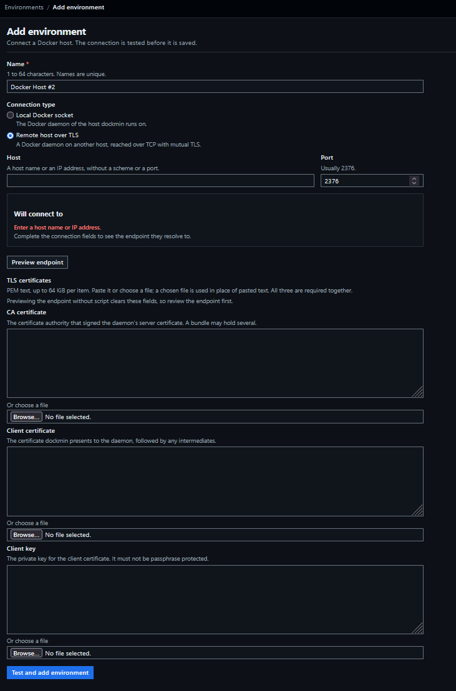
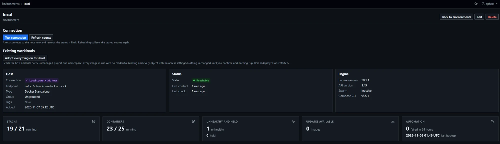

# Environments

An environment is one Docker host managed by dockmin. Every managed object belongs to exactly one environment.

| Page | Path | Administrators | Standard users |
|---|---|---|---|
| Environment list | `/` | All environments | Granted environments |
| Environment | `/environments/{id}` | Full | Reduced view |
| Add environment | `/environments/new` | Yes | Refused (403) |
| Edit environment | `/environments/{id}/edit` | Yes | Refused (403); not found if not granted |
| Delete environments | `/environments/delete` | Yes | Refused (403) |
| Adopt everything on this host | `/environments/{id}/onboarding` ([routes](#onboarding-routes)) | Yes | Refused (404) |
| Groups | `/groups` | Yes | Refused (403) |
| Tags | `/tags` | Yes | Refused (403) |

In the sidebar, the group `Environments` holds `All environments`, and for administrators `Groups` and `Tags`.

## Add a local socket environment

Prerequisite: the account dockmin runs as can read and write the socket of the Docker daemon.

| Deployment | How the socket reaches dockmin |
|---|---|
| `docker run` | The command mounts `/var/run/docker.sock` and adds the socket's group with `--group-add "$(stat -c %g /var/run/docker.sock)"` ([Start dockmin](Getting-Started-Quick-Start#start-dockmin)) |
| Compose | `compose.yaml` mounts the socket and adds the group named by `DOCKER_GID` ([Configure](Getting-Started-Installation#configure)) |

1. Sign in as an administrator.
2. Open the environment list (`/`) and choose `Add environment`.
3. Enter a `Name`.
4. Under `Connection type`, choose `Local Docker socket`.
5. Leave `Socket path` as `/var/run/docker.sock`, or enter the path the socket is mounted at.
6. Choose `Preview endpoint`. The preview reads `unix:///var/run/docker.sock` for the default path.
7. Choose `Test and add environment`. The test runs the stages `Socket` and `Docker Engine` ([Connection test](#connection-test)).
8. On success the environment page opens with the status `Reachable`.
9. On failure the form shows the report `The connection test failed` with the failed stage and its message ([Failures by stage](#failures-by-stage)). Fix the cause and submit again, or tick `Save even though the connection failed` to save the environment as unreachable. A failure at the `Socket` stage: [Local socket](Troubleshooting#local-socket).

- One environment exists per endpoint. A second local socket environment with the same path is refused: `An environment already uses this endpoint: <name>.`
- Standard users reach a local socket environment at read level at most ([Local socket read ceiling](Usage-Access-Control#local-socket-read-ceiling)).

### First-run panel

While no environment exists, the environment list (`/`) shows an administrator the panel `Add your first environment` in place of the filters and the table. The panel checks `/var/run/docker.sock` on each load. The check opens no connection. Standard users never see the panel.

| State | Panel text | Remedy |
|---|---|---|
| Socket present and openable | `The Docker socket of the host dockmin runs on is available. Add it as the first environment.` The panel holds a form: `Name` (default `local`), the endpoint `unix:///var/run/docker.sock`, and `Test and add` | Choose `Test and add`. The connection test runs before the environment is saved ([Connection test](#connection-test)); on failure the form shows the failed stage ([Failures by stage](#failures-by-stage)) |
| Socket present, the process user lacks read or write access | `The Docker socket is mounted, but dockmin cannot open it.` | Add the socket's group to the container: `--group-add "$(stat -c %g /var/run/docker.sock)"`. With Compose, set `DOCKER_GID` to the socket's group id. Recreate the container |
| Nothing at the path | `The Docker socket is not available to dockmin.` | Mount the socket: `-v /var/run/docker.sock:/var/run/docker.sock`. Recreate the container |
| The path is not a socket | `The path /var/run/docker.sock is not a socket.` | The same mount |

- A path that cannot be read for any reason other than a missing entry counts as not openable. A missing entry or a path component that is not a directory counts as nothing at the path.
- The two failure states name this page: `The documentation page Environments, section "Add a local socket environment", has the details.`
- Every state offers `Add another kind of environment` (`/environments/new`).
- The panel disappears when the first environment exists. With a filter set, it shows only while no environment exists at all.
- A socket at another path is added through `Add environment` (steps above).


## Add a remote TLS environment

Prerequisites: a Docker daemon listening on TCP with mutual TLS, and a CA certificate, a client certificate and a client key that the daemon accepts. [Generate TLS material](#generate-tls-material) and [Configure the daemon](#configure-the-daemon) produce both. Plain TCP (port 2375) is refused.

1. Verify the files against the daemon from any machine that reaches it ([Verify the daemon](#verify-the-daemon)).
2. Sign in as an administrator, open the environment list (`/`) and choose `Add environment`.
3. Enter a `Name`.
4. Under `Connection type`, choose `Remote host over TLS`.
5. Enter `Host` exactly as one of the names or addresses in the server certificate's Subject Alternative Name list ([Host field](#host-field)).
6. Enter `Port`. An empty field means `2376`.
7. Choose `Preview endpoint`. The preview reads `tcp://<host>:<port>`.
8. Paste or choose the files for `CA certificate` (`ca.pem`), `Client certificate` (`client-cert.pem`) and `Client key` (`client-key.pem`). All three are required together ([TLS material](#tls-material)).
9. Choose `Test and add environment`. The test runs `DNS lookup`, `TCP connection`, `TLS handshake`, `Server certificate` and `Docker Engine` in order ([Connection test](#connection-test)).
10. On success the environment page opens with the status `Reachable`. Warnings about the certificates appear on that page ([Conditions that do not block saving](#conditions-that-do-not-block-saving)).
11. On failure the form shows the failed stage and its message ([Failures by stage](#failures-by-stage)). Fix the cause and submit again; the TLS fields must be supplied again. Other symptoms: [Remote host over TLS](Troubleshooting#remote-host-over-tls).

- A host on this server or a link-local network is refused unless `DOCKMIN_PERMITTED_INTERNAL_NETWORKS` permits it ([Internal addresses](#internal-addresses)).
- A certificate nearing expiry is replaced by editing the environment and supplying all three items again ([Replacing material](#replacing-material)).
- A remote environment submitted with none of the three items is refused on the field `tls` with the text `Refusing to connect to a Docker Engine over plain TCP.` followed by the explanation that an unauthenticated Docker socket grants root on the host and that a CA certificate, a client certificate and a client key are required.



## Generate TLS material

Run these commands in an empty directory on a trusted machine. They need `openssl` and bash.

| File | Content | Goes to |
|---|---|---|
| `ca-key.pem` | CA private key | Nowhere. Keep it offline; it signs every other file |
| `ca.pem` | CA certificate | The daemon (`tlscacert`) and the `CA certificate` field |
| `server-key.pem`, `server-cert.pem` | The daemon's identity | The Docker host |
| `client-key.pem`, `client-cert.pem` | dockmin's identity | The `Client key` and `Client certificate` fields |

1. Create the CA key and certificate:

```bash
openssl genpkey -algorithm RSA -pkeyopt rsa_keygen_bits:4096 -out ca-key.pem
openssl req -x509 -new -key ca-key.pem -sha256 -days 3650 -subj "/CN=docker-host-ca" -addext "basicConstraints=critical,CA:TRUE" -addext "keyUsage=critical,keyCertSign,cRLSign" -out ca.pem
```

2. Create the daemon's key and certificate. Replace `<host-name>` with the DNS name and `<host-address>` with the IP address dockmin will use; the value entered in the `Host` field must equal one of them:

```bash
openssl genpkey -algorithm RSA -pkeyopt rsa_keygen_bits:4096 -out server-key.pem
openssl req -new -key server-key.pem -subj "/CN=<host-name>" -out server.csr
openssl x509 -req -in server.csr -CA ca.pem -CAkey ca-key.pem -CAcreateserial -days 825 -sha256 -extfile <(printf 'subjectAltName=DNS:<host-name>,IP:<host-address>\nextendedKeyUsage=serverAuth\n') -out server-cert.pem
```

3. Create dockmin's key and certificate:

```bash
openssl genpkey -algorithm RSA -pkeyopt rsa_keygen_bits:4096 -out client-key.pem
openssl req -new -key client-key.pem -subj "/CN=dockmin" -out client.csr
openssl x509 -req -in client.csr -CA ca.pem -CAkey ca-key.pem -CAcreateserial -days 825 -sha256 -extfile <(printf 'extendedKeyUsage=clientAuth\n') -out client-cert.pem
```

4. Restrict the keys and remove the requests:

```bash
chmod 0400 ca-key.pem server-key.pem client-key.pem
rm server.csr client.csr
```

Success: the directory holds `ca.pem`, `server-cert.pem`, `server-key.pem`, `client-cert.pem` and `client-key.pem`, plus `ca-key.pem` and `ca.srl`.

| Requirement | Detail |
|---|---|
| Server certificate names | The Subject Alternative Name list holds the exact host name or IP address entered in dockmin. The common name is not used |
| Server certificate usage | Extended Key Usage, if present, includes `serverAuth` |
| Client certificate usage | Extended Key Usage, if present, includes `clientAuth` |
| Key format | `genpkey` writes an unencrypted PKCS#8 key (`PRIVATE KEY`). Do not add a passphrase option; dockmin refuses passphrase-protected keys ([TLS material](#tls-material)) |
| Key size | RSA 2048 bits or more. Elliptic-curve keys (P-256, P-384, P-521) and Ed25519 also work |
| Validity | Both certificates must be currently valid. dockmin warns 30 days before expiry |
| Names that change | A new host name or address needs a new server certificate |

## Configure the daemon

Run on the Docker host, as root.

1. Create `/etc/docker/tls/`, copy `ca.pem`, `server-cert.pem` and `server-key.pem` into it, and restrict the key to root:

```bash
mkdir -p /etc/docker/tls
cp ca.pem server-cert.pem server-key.pem /etc/docker/tls/
chmod 0600 /etc/docker/tls/server-key.pem
```

2. Set the daemon's listeners and TLS files in `/etc/docker/daemon.json`:

```json
{
  "hosts": ["unix:///var/run/docker.sock", "tcp://0.0.0.0:2376"],
  "tlsverify": true,
  "tlscacert": "/etc/docker/tls/ca.pem",
  "tlscert": "/etc/docker/tls/server-cert.pem",
  "tlskey": "/etc/docker/tls/server-key.pem"
}
```

3. On a host where systemd starts `dockerd` with `-H fd://`, create `/etc/systemd/system/docker.service.d/override.conf`. A `hosts` entry in `daemon.json` together with that flag makes `dockerd` refuse to start. The drop-in repeats the packaged unit's `--containerd` flag, so `dockerd` keeps using the host's containerd instead of starting its own.

```bash
mkdir -p /etc/systemd/system/docker.service.d
```

```ini
[Service]
ExecStart=
ExecStart=/usr/bin/dockerd --containerd=/run/containerd/containerd.sock
```

4. Restart the daemon:

```bash
systemctl daemon-reload
systemctl restart docker
```

Success: `systemctl is-active docker` prints `active`. [Verify the daemon](#verify-the-daemon) confirms the TLS listener.

| `daemon.json` key | `dockerd` flag | Meaning |
|---|---|---|
| `hosts` | `-H` | Listeners. Keep the Unix socket so local tools work |
| `tlsverify` | `--tlsverify` | Require a client certificate signed by `tlscacert` |
| `tlscacert` | `--tlscacert` | CA that verifies clients |
| `tlscert` | `--tlscert` | The daemon's certificate |
| `tlskey` | `--tlskey` | The daemon's key |

| Requirement | Detail |
|---|---|
| Port | `2376`. Plain TCP (`2375`) is refused by dockmin |
| Network | TCP to the port open from the dockmin server only |
| Trust | Any client holding a certificate signed by `tlscacert` has root-equivalent control of the host |
| CA roles | `tlscacert` verifies clients. The CA certificate given to dockmin verifies the daemon. One CA may serve both |

### Verify the daemon

Run from any machine that reaches the daemon, with the files dockmin will receive:

```bash
docker --tlsverify --tlscacert=ca.pem --tlscert=client-cert.pem --tlskey=client-key.pem -H tcp://<host-name>:2376 version
```

Success: the command prints a `Client` and a `Server` section. A TLS error here appears in dockmin's connection test at the same stage ([Failures by stage](#failures-by-stage)).

## Connection kinds

| Kind | Transport | Form fields | Stored endpoint |
|---|---|---|---|
| Local Docker socket | Unix domain socket | `Socket path` | `unix:///var/run/docker.sock` |
| Remote host over TLS | TCP with mutual TLS | `Host`, `Port`, `CA certificate`, `Client certificate`, `Client key` | `tcp://host:port` |

- Plain TCP is refused. There is no kind without TLS.
- Remote TLS verifies the daemon's certificate against the supplied CA only. System roots are not trusted. TLS 1.2 is the minimum version.
- One environment exists per endpoint. A second environment with the same endpoint is refused on the field that holds it (`host` or `socket_path`): `An environment already uses this endpoint: <name>.`
- A name is unique, ignoring case: `An environment with this name already exists.`
- A local socket environment shows the badge `Local socket · this host`. A remote environment shows the badge `TLS` and `host:port`.
- Form fields `Group` and `Tags` appear only when editing.

### Name

| Rule | Value |
|---|---|
| Length | 1 to 64 characters after trimming |
| Characters | Printable; control, format and line-separator characters are refused |
| Uniqueness | Case-insensitive |
| Refusal | `Use 1 to 64 printable characters.` |

### Local socket path

| Rule | Value |
|---|---|
| Default | `/var/run/docker.sock` |
| Form | Absolute path, at most 256 characters |
| Refused | `..` segments, `?`, `#`, control or invisible characters |
| Socket stage limit | At most 107 UTF-8 bytes |

### Remote port

| Rule | Value |
|---|---|
| Default | `2376` (used when the field is empty) |
| Range | 1 to 65535, ASCII digits only |
| Refusal | `Enter a port number between 1 and 65535.` |

### Host field

The host is a name or an IP address. It carries no scheme and no port. IPv6 is stored bracketed in the endpoint (`tcp://[2001:db8::1]:2376`).

| Input | Result |
|---|---|
| `Docker-Host.Example.COM` | Accepted as `docker-host.example.com` |
| `bücher.example` | Accepted as `xn--bcher-kva.example` (IDNA-encoded) |
| `192.0.2.10` | Accepted |
| `2001:db8::1`, `[2001:db8::1]` | Accepted as `2001:db8::1` |
| `tcp://host`, `https://host` | Refused: scheme |
| `unix:///path` | Refused: use the local socket kind |
| `host:2376` | Refused: not a valid IPv6 address; enter the port in the port field |
| `127.1`, `0x7f.1`, `2130706433`, `0177.0.0.1`, `host.123` | Refused: numeric forms other than dotted-quad IPv4 |
| `faß.de` | Refused: characters that name lookup would rewrite; enter the ASCII or `xn--` form |
| `fe80::1%eth0` | Refused: `%` |
| `host/path`, `user@host`, `back\slash` | Refused: `/`, `@`, `\` |
| Whitespace, control or invisible characters | Refused |
| `[host]` | Refused: brackets are valid only around IPv6 |
| `localhost`, `127.0.0.1`, `169.254.169.254`, `[::1]` | Refused: `This address is on this server or a link-local network. Set DOCKMIN_PERMITTED_INTERNAL_NETWORKS to allow it.` ([Internal addresses](#internal-addresses)) |

Host names are at most 253 characters. Each label is 1 to 63 characters from `a-z`, `0-9`, `_` and `-`, and does not begin or end with `-`.

#### Internal addresses

A remote host on this server or a link-local network is refused unless `DOCKMIN_PERMITTED_INTERNAL_NETWORKS` permits it. The local socket kind is not affected. The checks at save, at connect, for Compose and for the event stream, and the texts: [Address policy](Reference-Security#address-policy). The refusal at save is on the field `host`. A host name that does not resolve fails a stack operation too ([Errors](Usage-Stacks#errors)).

### Endpoint preview

The form shows the canonical endpoint the fields resolve to before anything is saved. No network access and no write occurs during a preview. The preview reads `Will connect to`, with the connection badge, the socket path or host and port, the endpoint, and a note: `This is the Docker daemon of the host this product runs on.` for a socket, `Connects over mutual TLS to <host> on port <port>.` for a remote host.

| Behaviour | Detail |
|---|---|
| Update trigger | Any change to kind, socket path, host or port; the `Preview endpoint` button does the same without JavaScript |
| Save check | The save is refused unless the previewed endpoint equals the canonical endpoint of the submitted fields (`Review the endpoint before saving; the one you were shown no longer matches.`) |
| Without JavaScript | Previewing reloads the form and clears the TLS fields |
| On edit | States `This changes where the environment connects. The connection is tested again when you save.` when the endpoint changes, and `Saving deletes the stored TLS certificates and key. A local socket needs none.` when switching from remote to local |

## TLS material

A remote environment requires three items, supplied together.

| Item | Accepted | Checks |
|---|---|---|
| CA certificate | PEM `CERTIFICATE` blocks, at most 10 | Each is currently valid and has Basic Constraints `CA` set |
| Client certificate | PEM `CERTIFICATE` blocks, leaf first then intermediates, at most 5 | Each is currently valid; if Extended Key Usage is present it includes `clientAuth` or `anyExtendedKeyUsage` |
| Client key | One unencrypted PEM private key: PKCS#1 (`RSA PRIVATE KEY`), PKCS#8 (`PRIVATE KEY`) or SEC1 (`EC PRIVATE KEY`) | Public key equals the leaf client certificate's |

| Key type | Accepted sizes |
|---|---|
| RSA | 2048 bits or more |
| Elliptic curve | P-256, P-384, P-521 |
| Ed25519 | Yes |

- Each item is at most 64 KiB (`That text is longer than 64 KiB.`, `That file is larger than 64 KiB.`). Paste the PEM text or choose a file (`.pem`, `.crt`, `.cer`, `.key`). A chosen file replaces pasted text for that item. A file that is not UTF-8 text is refused: `That file is not text. Upload a PEM file.`
- A private key in a certificate field, or a certificate in the key field, is refused.
- A certificate that is expired, or not yet valid, is refused. The message names the date: `The client certificate expired on YYYY-MM-DD.`, `The CA certificate is not valid until YYYY-MM-DD.` A bundle names the position: `Certificate 2 of the CA certificate expired on YYYY-MM-DD.`
- The three items must also load together as a TLS client identity (`The connection layer could not load these three items together.`).
- Passphrase-protected keys are refused (`ENCRYPTED PRIVATE KEY`, or a legacy `Proc-Type: ... ENCRYPTED` header): `The client key is passphrase-protected. Remove the passphrase and upload it again.`
- A key that does not belong to the leaf certificate is refused: `The client key does not match the client certificate.`

Remove a passphrase before uploading:

```bash
openssl pkey -in client-key-encrypted.pem -out client-key.pem
```

The command prompts for the passphrase and writes an unencrypted PKCS#8 key. Restrict the output file's permissions and delete it after uploading.

### Conditions that do not block saving

| Condition | Where it appears |
|---|---|
| No supplied CA certificate directly issued the client certificate | After the save: `The client certificate is not issued by any supplied CA certificate. The CA verifies the daemon's certificate; confirm the daemon trusts the client certificate's issuer.` |
| A certificate expires within 30 days | After the save: `<Certificate> expires on YYYY-MM-DD, within 30 days.` The environment page also marks the client certificate `Expires soon`, or `Expired` after expiry |

- The warnings are shown after create and after save, on the environment page the save redirects to, as one `warn` notice. The notice carries the first two warnings and ends `and N more.` when there are more.
- Only TLS material supplied in that request is checked. A save that leaves the TLS fields empty keeps the stored material and shows no warning.
- A warning does not block the save.

On creation, the number of such conditions is recorded in the activity entry as `tls_warnings`.

### Storage and display

| Item | Stored | Shown |
|---|---|---|
| CA certificate | As supplied, normalised to its PEM blocks | Never |
| Client certificate | As supplied, normalised to its PEM blocks | Subject and issuer (common names), expiry, key type (`RSA <bits>`, `EC <curve>`, `Ed25519`), SHA-256 fingerprint (administrators only) |
| Client key | Encrypted at rest | Never |

- No form field is ever given a value for the TLS items. They are never sent back to the browser.
- Text outside PEM blocks in an upload is discarded.
- An environment with no readable stored certificate shows `No readable client certificate is stored. Edit the environment and upload the certificates again.`

### Replacing material

| Action | Result |
|---|---|
| Edit with all three items empty | Stored material is kept |
| Edit with all three items supplied | Stored material is replaced; the connection is tested again |
| Edit with one or two items supplied | Refused: `Upload the CA certificate, the client certificate and the client key together.` |
| Edit from local to remote | All three items are required |
| Edit from remote to local | Stored TLS material is deleted. Supplying TLS items with the local kind is refused: `TLS material applies only to a remote environment.` |

## Registry entries on a new environment

A new environment is granted every registry entry that carries the `Added with this instance` mark and has authentication off ([Registries](Administration-Registries#entries-a-new-instance-starts-with)).

| Item | Behaviour |
|---|---|
| When | In the transaction that creates the environment, for a local socket environment, a remote TLS environment and the environment of the [first-run panel](#first-run-panel) |
| Entries | `Docker Hub (anonymous)` and `GitHub Container Registry (anonymous)` on a new instance, until they are deleted or edited to use authentication |
| Effect | The entries are listed as granted to the environment. They are not required for public registries. A registry on a private network is checked only when an entry for its address is granted to the environment ([Images](Usage-Images#update-check)) |
| Recorded | `registry_grants` in the detail of `environment_created` ([Recorded actions](#recorded-actions)) |
| Environments that exist | Not granted. Grant an entry as any set ([Registries](Administration-Registries#grant-a-set-to-an-environment)) |
| Withdraw | Per environment ([Registries](Administration-Registries#remove-a-grant)) |
| Contacted | Creating the environment contacts no registry |

## Connection test

| Kind | Stages, in order |
|---|---|
| Local socket | Socket, Docker Engine |
| Remote | DNS lookup, TCP connection, TLS handshake, Server certificate, Docker Engine |

A stage ends as `Passed`, `Failed`, `Skipped` or `Not run`. The first failure stops the test; later stages are `Not run`. The DNS stage is `Skipped` when the host is an IP address.

The report is headed `Connection test`. It holds the status badge and one message, `Finished in N ms.` with `Engine <version>, API <version>.` when read, and a table of the columns `Stage`, `Outcome`, `Time` and `Detail`. A reachable host reads `Connected to Docker Engine <version> (API <version>).` An unreachable host reads the message of the failed stage.

### Time limits

| Stage | Limit |
|---|---|
| DNS lookup | 5 s |
| TCP connection | 5 s per address; up to 3 resolved addresses are tried |
| Socket | 5 s |
| TLS handshake | 10 s, including waiting for the first reply to a `/_ping` request |
| Docker Engine | 10 s |
| Whole test | 30 s |

A stage that exceeds its own limit reports `<Subject> did not finish within <N> seconds.`, where the subject is `The name lookup`, `The connection attempt`, `Opening the socket`, `The TLS handshake`, `The certificate check` or `The Engine`. A stage cut short by the whole-test limit reports `The test reached its overall time limit of 30 seconds.`

### When the test runs

| Event | Test runs | On failure |
|---|---|---|
| Create | Always | Save refused, unless `Save even though the connection failed` is ticked; the environment is then saved as unreachable with the failed stage |
| Edit changing kind, endpoint or TLS material | Yes | Same as create |
| Edit changing only name, group or tags | No | Not applicable |
| `Test connection` on the environment page | Yes (administrators) | Status recorded with the failed stage |
| Snapshot refresh | Every refresh checks the status; it is stored when it changes, on the first refresh after start and at least hourly ([Snapshot cache](#snapshot-cache)) | Status recorded |

An on-demand result is recorded only if the connection was not changed while the test ran. An edit is refused if the connection was changed by someone else while the form was open: `This environment was changed by someone else. Reload and try again.`

### Failures by stage

| Stage | Message | Usual cause |
|---|---|---|
| DNS lookup | `The name does not exist. Check the spelling, or use the host's IP address.` | Misspelt host, or no DNS record |
| DNS lookup | `The DNS server did not answer. Check this server's DNS configuration.` | The resolver configured on the dockmin server is down or unreachable |
| DNS lookup | `The DNS server reported a permanent failure for this name.` | The authoritative server refuses the name |
| DNS lookup | `The name resolved, but to no usable address.` | Record without an IPv4 or IPv6 address |
| DNS lookup | `The name lookup failed.` | Any other resolver error |
| TCP connection | `The connection was refused. Nothing is listening on this port, or a firewall is rejecting it.` | Nothing listens on the port, or a firewall rejects it |
| TCP connection | `There is no route to the host. Check the address and the network path.` | Wrong address or no network path |
| TCP connection | `This server's network policy blocked the connection.` | Egress policy on the dockmin server |
| TCP connection | `This address is on this server or a link-local network. Set DOCKMIN_PERMITTED_INTERNAL_NETWORKS to allow it.` | The host resolves only to internal addresses that no permit covers |
| TCP connection | `The connection timed out after 5 seconds. The host is down or a firewall is dropping the packets.` | Host down, or a firewall drops packets |
| TCP connection | `The connection could not be established.` | Any other connect error |
| Socket | `Nothing exists at this path. Check the path, and that the Docker socket is mounted into this container if this product runs in one.` | Wrong path, or the socket is not mounted into the container |
| Socket | `Permission denied. The account this product runs as cannot open the socket; check its owner, group and mode.` | The account dockmin runs as cannot open the socket (owner, group, mode) |
| Socket | `The socket exists but nothing is listening on it. Check that the Docker daemon is running.` | The Docker daemon is not running |
| Socket | `The path exists but is not a Unix socket.` | Path names a file or directory |
| Socket | `The path is too long to be a Unix socket address.` | Path over 107 bytes |
| Socket | `The socket could not be opened.` | Any other open error |
| TLS handshake | `The server does not speak TLS on this port. Docker's TLS port is normally 2376; 2375 is the unencrypted port.` | Plain-TCP port (2375) or another service |
| TLS handshake | `The server does not offer TLS 1.2 or later, which is the minimum this product uses.` | Daemon or proxy restricted to older protocols |
| TLS handshake | `The server rejected the client certificate. Check that the daemon trusts the CA that issued it and that the certificate has not expired.` | The daemon's CA does not trust the issuer of the client certificate, or the certificate is expired |
| TLS handshake | `The server rejected the handshake. It may not accept the client certificate, or it shares no cipher suite with this server.` | Client certificate not accepted, or no cipher suite in common |
| TLS handshake | `The server closed the connection during the TLS handshake. It may have rejected the client certificate or may not support TLS 1.2 or later.` | Client certificate rejected, or an old TLS version |
| TLS handshake | `The server closed the connection after the handshake without answering. A daemon that requires client certificates may have rejected this one.` | Client certificate rejected, or the service is not a Docker daemon |
| TLS handshake | `The TLS handshake completed, but the server did not answer a request within 10 seconds. It may be rejecting the client certificate or may not be a Docker daemon.` | Client certificate rejected, or the service is not a Docker daemon |
| TLS handshake | `The server ended the handshake with a TLS alert.`, `The TLS handshake failed.`, `The TLS connection failed after the handshake.`, `The TLS connection failed.` | Other TLS errors |
| TLS handshake | `The stored TLS material could not be loaded. Replace the CA certificate, client certificate and client key.` | Stored material is unreadable; upload all three items again |
| Server certificate | `The server's certificate was not issued by the supplied CA certificate. Upload the CA certificate the daemon's certificate was signed with.` | Wrong CA uploaded |
| Server certificate | `The server's certificate has expired.` | Daemon certificate past its end date |
| Server certificate | `The server's certificate is not valid yet. Check the clocks on the daemon's host and on this server.` | Clock skew between the daemon's host and the dockmin server |
| Server certificate | `The server's certificate does not cover the host name or IP address used to reach it. It must list that name or address as a Subject Alternative Name.` | The Subject Alternative Name list lacks the exact name or address entered |
| Server certificate | `The server's certificate is not valid for server authentication.` | Certificate lacks `serverAuth` |
| Server certificate | `The server's certificate, or its issuer, uses a key or digest that is too weak.` | Weak key or signature in the daemon's chain |
| Server certificate | `The server's certificate could not be verified against the supplied CA certificate.` | Any other verification error |
| Docker Engine | `The daemon's API version is <version>; this product supports 1.44 to 1.51. Upgrade Docker on that host.` | Docker too old |
| Docker Engine | `The daemon only accepts API versions newer than the 1.44 to 1.51 this product supports. Use a newer release of this product.` | dockmin too old for the daemon |
| Docker Engine | `The Engine refused the request as unauthorised or forbidden (HTTP <code>).` | Authorisation plugin or gateway in front of the daemon |
| Docker Engine | `A gateway in front of the Engine answered HTTP <code>.` | Reverse proxy error |
| Docker Engine | `The connection to the Engine was lost or timed out.` | Network fault or overloaded daemon |
| Docker Engine | `The endpoint answered, but not like a Docker Engine API (HTTP <code>). Check that the address and port belong to the Docker daemon.` | Address and port belong to another service |
| Docker Engine | `The endpoint sent far more data than a Docker Engine API replies with.` | Reply over 1 MiB |
| Docker Engine | `The Engine could not be queried.` | Any other error |

A TLS handshake that completes with an unverifiable server certificate reports `Passed` for the TLS handshake (`The server speaks TLS and a protocol version was agreed.`) and `Failed` for the server certificate.

The two Docker Engine rows about API versions set the status to `version_unsupported`. Every other failure sets `unreachable`. Further causes and remedies: [Unreachable environment](Troubleshooting#unreachable-environment).

## Status

| Status | Meaning |
|---|---|
| `unknown` | No test has recorded a result |
| `reachable` | The last test or refresh reached the Engine |
| `unreachable` | A stage failed; the failed stage is recorded |
| `version_unsupported` | The Engine answered but its API version is outside the supported range |

Pages show the labels `Unknown`, `Reachable`, `Unreachable` and `Version unsupported`.

### Supported Engine API versions

| Condition | Value |
|---|---|
| Daemon API version | 1.44 or later |
| Daemon minimum API version | 1.51 or lower |
| Version used for requests | The lower of the daemon's API version and 1.51 |

### Recorded values

| Value | Behaviour |
|---|---|
| Status, failed stage, message | Replaced by every test or refresh. The message is cut to 256 characters and is cleared when the host is reachable |
| Last check | Time of the latest test or refresh, whatever the result |
| Last contact | Time of the latest success. Kept when later checks fail |
| Engine version, API version, type, Swarm state | Latest observed values. Kept when a later check fails. Replaced when the connection is changed |
| Type | `swarm` for a Swarm manager that can control the cluster; `standalone` otherwise, including Swarm workers and nodes with Swarm inactive. The Swarm pages exist only for `swarm` ([Swarm](#swarm)) |
| Swarm state | `inactive`, `pending`, `active`, `error`, `locked` |
| Swarm control available | Whether the node is a manager that can control the cluster |
| Compose CLI version | The version of the Docker Compose binary on the dockmin server. Written by each status refresh and by each successful stack operation; no process is started for it. `Not checked` while none has been read. A version older than the required v2.32.0 is shown with `Below the required v2.32.0` ([Docker Compose requirement](Usage-Stacks#docker-compose-requirement)) |

Values reported by a host (versions, host name) are cut to 64 characters with control characters removed.

## Swarm

The Swarm pages exist only for an environment of type `swarm`. Which environments resolve them, the notice for a worker, and the `503` for a host that is no longer an active manager: [Environments](Usage-Swarm#environments).

- A manager shows a `Swarm` section in the sidebar, for every role. Administrators see the Services and Swarm nodes counts there, linked to the Swarm lists.
- A worker's containers, task containers included, are listed like any host's.

## Snapshot cache

The environment list reads stored results. Its page load never contacts a host. The environment page reads the host when it loads ([Environment page](#environment-page)).

| Count | Source | Condition |
|---|---|---|
| Containers: total, running, paused, stopped | Daemon info | Always |
| Containers: unhealthy | Container listing filtered by health | Always. Unknown when the read fails or takes over 4 s; the other counts are kept |
| Images | Daemon info | Always |
| Volumes | Volume listing | Always |
| Networks | Network listing | Always |
| Services | Service listing | Swarm manager only |
| Swarm nodes | Node listing | Swarm manager only |
| Stacks | The number of distinct stack names, compared case-insensitively: the `com.docker.compose.project` label on containers in any state (managed stacks and unmanaged projects both count) and, on a Swarm manager, the `com.docker.stack.namespace` label on services. A name found in both counts once | Always. Unknown when a read fails, takes over 4 s, or a reply is larger than 4 MiB; the other counts are kept |

| Setting | Value |
|---|---|
| Variable | `DOCKMIN_SNAPSHOT_INTERVAL_SECONDS` ([Configuration](Reference-Configuration)) |
| Default | `60` |
| Range | 15 to 3600 |
| Job | The scheduled job of `environment-snapshot-refresher`, shown on the Jobs page ([Jobs](Administration-Jobs)) |
| Schedule, first run, catch-up, overrun | [`environment-snapshot-refresher`](Reference-Subsystems#environment-snapshot-refresher) |
| Pass | Every environment is refreshed. A pass starts when Unix time is a whole multiple of the interval ([System tasks](Administration-Jobs#system-tasks)) |
| Stored times | [Environment status and check times](Administration-Jobs#environment-status-and-check-times) |
| Time limit of a pass | 10 minutes |
| Concurrency | 8 hosts at once; at most 4 of them remote |
| Per-host time limit | 20 s. Reading takes at most 8 s; a failed read is followed by a connection test of at most 10 s to classify the failure |
| On demand | `Refresh counts` (administrators), after create, after a connection change, and after every audited change to one of the environment's objects, except a secret variable reveal, a dismissal and a restore of a dismissal ([Reveal and dismissal rows](Administration-Activity#reveal-and-dismissal-rows)). A request made while a refresh runs queues exactly one more, which starts when the running one ends. The sidebar counts of an administrator reload when the refresh has ended ([Sidebar counts](Contributing-Frontend-Conventions#sidebar-counts)). `Refresh counts` answers `Refresh requested. The counts update shortly.` |

| Situation | Result |
|---|---|
| Host reachable | Counts and status stored |
| Host unreachable | Status updated; counts become unknown (shown as `—`, never zero); the failure message is stored (256 characters at most) |
| Host over the per-host time limit | Recorded as unreachable at the Engine stage: `The host did not answer within the refresh time limit.` Counts become unknown |
| A listing reply larger than 4 MiB | Status stays reachable; all counts unknown; `Too many objects to count.` |
| Host answers but counts cannot be read | `The host answered but its object counts could not be read.` |
| Connection changed during a refresh | The result is discarded and the refresh runs again |
| Connection changed | The stored snapshot is deleted; counts show as not yet collected until the next refresh |

The environment list shows under each name `Counts updated <age>`, `Counts not yet refreshed` or `Counts unavailable: the last refresh failed`. The `Stale` badge appears when the time of the latest check is more than three times the interval before the moment the page is rendered. The default interval gives 180 s. After a start, the stored time is used until the environment's first refresh.

Counts are totals for the whole host, including objects outside a user's own grants. Standard users never see them.

### Environment page

The page reads the host when it loads, for the cards, the stack grid and the container table. Status, last check and last contact come from the stored result. Everything on the cards and below is limited to what the viewer may see.

| Part | Content | Shown to |
|---|---|---|
| Connection | `Test connection` and `Refresh counts` | Administrators |
| Existing workloads | `Adopt everything on this host` ([Adopt everything on this host](#adopt-everything-on-this-host)), shown when the stored status is `reachable`, and a sentence naming the registry addresses an image check contacts | Administrators |
| Host, Status, Engine | Three boxes in one row from `70rem` wide; stacked below that | Everyone |
| Cards | Five cards ([Cards](#cards)) | Everyone |
| Stacks | A grid of the managed stacks ([Stack grid](#stack-grid)) | Everyone, when the host was read |
| Containers | A table of containers ([Container table](#container-table)) | Everyone, when the host was read |
| Client certificate | Subject, issuer, expiry, key type and fingerprint of a remote TLS environment | Administrators |
| Access | A disclosure, closed on load ([Access](#access)) | Administrators |
| Recent activity | [Panel](Administration-Activity#panels) | Administrators |

The page header holds `Back to environments` and, for administrators, `Edit` and `Delete`. `Delete` opens the confirmation page for this environment ([Deleting](#deleting)).



| Host | When | Page |
|---|---|---|
| Read | The stored status is `reachable` and the host answered | Cards, stack grid, container table |
| Not reachable | The stored status is anything else. The host is not called | The cards show `—` where they need the host. In place of the grid and the table: `The host is not reachable, so its stacks and containers are not read. The figures dockmin keeps itself are shown above.` |
| Not read | The status is `reachable` and the container read failed or was too large | The cards show `—` where they need the host. In place of the grid and the table, an error panel titled `Stacks and containers cannot be read` with `The host could not be read just now.` and a `Try again` link. The link reads the overview again and replaces only the cards, the grid and the table; the rest of the page is unchanged. Without JavaScript it reloads the page |

One read of the containers, one of the images and, for a Swarm manager with a managed Swarm stack, one of the services run at the same time.

The `Status` box lists `State`, `Failed at` and `Message` when recorded, `Last contact` (`Never` until a check reaches the host) and `Last check` (`Not checked yet`). The `Engine` box lists `Engine version`, `API version`, `Swarm` (the state, with `manager node` or `worker node` while active) and `Compose CLI`. The note `Swarm worker: Swarm objects are managed through a manager of this cluster.` appears for a worker. Below the required Compose version the box adds `Stack operations are refused until Docker Compose is upgraded on the dockmin server.`

#### Cards

Each figure is one link holding its label and its value. A value that cannot be shown reads `—`.

| Card | Figure | Value | Links to |
|---|---|---|---|
| Stacks | `running` | Managed Compose stacks that are running, out of those whose state is known. `(N unreadable)` is added when some state could not be read, and `(first 500 stacks only)` when the list was cut | [Stack list](Usage-Stacks) |
| Stacks | `swarm running` | The same for managed Swarm stacks. Shown only when the viewer can see a managed Swarm stack | [Swarm stack list](Usage-Stacks) |
| Containers | `running` | Running containers, out of all containers the viewer may see | [Container list](Usage-Containers), `?state=running` |
| Unhealthy and held | `unhealthy` | Containers that report `unhealthy`. `—` when health could not be read | Container list, `?health=unhealthy` |
| Unhealthy and held | `held` | Containers held by `container-health-checker` automations of the environment ([Budget and hold](Operations-Automation#budget-and-hold)), each counted once. An administrator counts every owner's automations; a standard user counts their own | [Automation list](Operations-Automation#automation-list), filtered to the environment and `container-health-checker` |
| Updates available | `images` | Images with at least one reference whose stored status is `Update available` | [Image list](Usage-Images), `?update=available` |
| Automation | `failed in 24 hours` | Runs with outcome `failure` that finished in the last 24 hours, for automations of the environment. Dry runs are not counted. An administrator counts every owner's automations; a standard user counts their own | Automation list, filtered to the environment |
| Automation | `last backup` | The time of the newest successful backup, or `Never`. Administrators only | [Backups](Administration-Backups) |

A stack state is one of:

| State | Compose stack | Swarm stack |
|---|---|---|
| `running` | It has containers and all of them run | Every service has desired tasks and at least that many running |
| `partly running` | Some of its containers run | Some task runs |
| `stopped` | None runs, or it has no containers | No task runs |
| `Unknown` | Never shown | A service's task counts could not be read, or the services could not be read |

#### Stack grid

| Item | Value |
|---|---|
| Stacks | The managed stacks the viewer may see, ordered by name ignoring case, at most 100 |
| Tile | The name, a state badge and `Compose` or `Swarm`, linked to the stack page |
| More | `and N more.` with an `All stacks` link |
| Heading link | `All stacks` opens the [stack list](Usage-Stacks) |
| None | `No stack is managed here that you can see.` |

#### Container table

| Item | Value |
|---|---|
| Columns | `Name` (linked to the container), `Stack`, `Image`, `State` (the state, with the health), `Status` |
| Rows | The containers the viewer may see, in the order of the [container list](Usage-Containers), at most 50 |
| Link | `All N containers` opens the container list |
| None | `No container is running or stopped here that you can see.` |
| Narrow | `Stack` and `Image` are hidden below `40rem` |

The sidebar links the environment's `Containers`, `Images`, `Volumes`, `Networks` and `Stacks`, for every role, and its `Swarm` section on a Swarm manager. The lists show only the objects the viewer may see, so a standard user's list can be shorter than the host's total ([Volumes](Usage-Volumes#access), [Networks](Usage-Networks#access), [Stacks](Usage-Stacks#access), [Swarm](Usage-Swarm#access)).

The refresher is the subsystem `environment-snapshot-refresher` ([Subsystems](Reference-Subsystems#environment-snapshot-refresher)).

| Where | What is shown |
|---|---|
| Jobs page (administrators) | The job, its next run, its state, its last run and the history of its recorded passes. A successful scheduled pass leaves no history row; every other pass does ([Run history](Administration-Jobs#run-history)) |
| Activity log | `environment_unreachable` and `environment_reachable` ([Subsystems](Reference-Subsystems#environment-snapshot-refresher)) |
| Application log | `environment_status_changed` when an environment's status changes, with `environment_id`, `previous_status`, `status` and `failed_stage` |

- On-demand refreshes, pausing the job and failed passes: [Subsystems](Reference-Subsystems#environment-snapshot-refresher).

## Environment list

| Item | Administrators | Standard users |
|---|---|---|
| Columns | Select, Environment, Status, Group, Tags, Containers, Images, Volumes, Networks, Stacks, Last contact | Environment, Status, Group, Tags, Last contact |
| Order | Name, then id | Name, then id |
| Page size | 25 by default; `limit` 1 to 500 | Same |

| Filter | Parameter | Rule |
|---|---|---|
| Name contains | `q` | At most 64 characters; case-insensitive substring |
| Group | `group` | A group id, or `none` for ungrouped |
| Status | `status` | `unknown`, `reachable`, `unreachable`, `version_unsupported` |
| Tags | `tag` (repeatable) | At most 10. An environment must carry every selected tag |

- The filter form offers `Apply filters` and `Reset`. The `Tags` disclosure appears when any tag exists.
- A standard user's group and tag filter lists offer only groups and tags that apply to environments they can see.
- An invalid filter replaces the table with an error (`Check the filters`) and returns 422.
- `Delete selected environments`, below the table, opens the confirmation for the ticked rows ([Deleting](#deleting)). Administrators only.
- Shift-click on a Select box ticks or clears every box between it and the last box clicked on the page ([Range selection](Usage-Containers#range-selection)). The list has no sortable columns.

## Groups

| Rule | Value |
|---|---|
| Name | 1 to 64 printable characters; unique, ignoring case (`That group name is taken.`) |
| Description | Optional; at most 256 printable characters |
| Membership | An environment is in at most one group |
| Management | Administrators only |
| Page | `/groups`, `/groups/new`, `/groups/{id}` |

- The list shows `Group`, `Description`, `Environments` and `Created`. `New group` opens the form `Group name` and `Description`.
- A group grant gives access to every environment in the group, including environments added later.
- Environments are added to a group from the group page (`Add environments`: search by name, at most 50 chosen at once, `Add to group`; each is its own recorded operation) or from the environment's edit form. A group page lists its environments with status and tags.
- Adding an environment that is in another group moves it; the checkbox label names the current group (`<name> (now in <group>)`).
- The result reads `Moved N environments into the group.` and, when some failed, `N environments could not be moved. Reload the page and try again.`
- `Save group` on the `Details` section renames the group or changes its description. `Group saved.`
- `Delete` on the group page opens a confirmation page. Deleting a group ungroups its environments. It does not delete them.
- The delete confirmation lists the environments that become ungrouped (up to 50 names, with the total), the users and teams whose grants end, and the number of standard users who lose access to an environment through the group. It binds the group's name: a group renamed since the review is not deleted (`Changed since it was reviewed; nothing was deleted.`). The result reads `Group deleted.`
- The group page carries an `Access` disclosure with the same grant controls as an environment ([Access](#access)).

## Tags

| Rule | Value |
|---|---|
| Name | 1 to 64 characters from letters, digits, spaces, `.`, `_`, `-`; unique, ignoring case (`That tag already exists.`) |
| Per environment | At most 20 |
| Access | None. A tag grants nothing and restricts nothing |
| Management | Administrators create, delete and assign tags. Tags are not renamed |
| Page | `/tags` |

- The page holds the form `Create a tag` and the table `Tag`, `Environments`, `Created` and a `Delete` button. Creating answers `Created the tag <name>.`
- Deleting a tag removes it from the environments that carry it. The environments are unchanged.
- The delete confirmation lists up to 50 environments with the total, and binds the tag's name.
- Tags are assigned on the environment's edit form.

## Access

Administrators see and manage every environment and need no grant.

A standard user sees an environment through at least one grant:

| Grant | Reaches |
|---|---|
| User grant on the environment | That environment |
| Team grant on the environment | That environment, for members of the team |
| User grant on a group | Every environment in the group |
| Team grant on a group | Every environment in the group, for members of the team |

- Grants are added by exact username or team name, in the `Access` disclosure: `Grant to` `A user` or `A team`, the field `Username or team name`, and `Grant access`. Administrators and disabled users cannot be named.
- Removing one grant (`Remove <name>`, confirmed with `Remove this access?`) leaves access held through another grant.
- An environment the user cannot see answers `404 Not Found`, the same as a missing one. A visible environment's administrator-only actions answer `403`.
- The environment page lists direct grants, and the grants inherited through the group, in an `Access` disclosure that is closed on load. It opens after a grant or revoke, when the grant field has an error, and when the URL carries `?open=access`. It works without JavaScript. A group page has the same disclosure.
- A listing shows at most 500 users and 500 teams, with `Showing N of M users and N of M teams.` beyond that.
- Moving an environment into or out of a group changes who reaches it.

| Refusal | Field message |
|---|---|
| Neither or both of user and team chosen | `Choose one user or one team.` |
| Empty name | `Enter a username.` or `Enter a team name.` |
| Unknown user | `No user has that username.` |
| Unknown team | `No team has that name.` |
| An administrator | `Administrators reach every environment and need no grant.` |
| A disabled user | `That user is disabled.` |
| A grant that exists | `That grant already exists.` |
| Revoking a grant that does not exist | `That grant does not exist.` |

### What a standard user sees

| Shown | Not shown |
|---|---|
| Name, status, Engine and API version, type, Swarm state | Endpoint, host, port, socket path |
| Group name, tags | Failed stage, status message |
| `Local socket · this host` badge | Client certificate details |
| Last check, last contact | Object counts and the snapshot |
| Compose CLI version | Date added |

The cards, the stack grid and the container table of a standard user are limited to the stacks and containers that user may see, and the `Automation` card counts the user's own automations and shows no `last backup` ([Environment page](#environment-page)).

### Local socket environment

The Access section of the local socket environment carries a notice, and the grant form repeats it: `This environment is the Docker host this product runs on. Standard users granted it can see its objects but cannot change anything on it; only administrators can.` The grant field reads `This grants read access to the objects on the Docker host this product runs on.` Access to the environment is access to the Docker host dockmin runs on.

- The reach of administrators and of standard users in this environment: [Local socket read ceiling](Usage-Access-Control#local-socket-read-ceiling).
- Containers: [Local socket environments](Usage-Containers#local-socket-environments).

## Adopt everything on this host

One reviewed confirmation adopts every unmanaged Compose project and Swarm namespace that is not dismissed, binds every image in use that has no credential binding, and gives access settings to the objects that have none. Nothing is pulled, redeployed, restarted or removed.

| Item | Value |
|---|---|
| Who | Administrators. A standard user receives `404` on every route |
| Start | `Adopt everything on this host`, in the `Existing workloads` section of the [environment page](#environment-page). Shown when the stored status is `reachable` |
| Scope | One environment per review |
| Host not reachable | `409`, `The environment is not reachable`: `Test the connection, then start the review again.` |
| Registries contacted | Named on the environment page before the start: `Checking images sends manifest HEAD requests to these registry addresses: {addresses}.`, listing the address of every credential set granted to the environment, entries with authentication off included. With none: `No registry credential set is granted to this environment, so no registry is contacted.` |
| Flow | Review job, review page, confirmation, apply, result page |
| Changes to the host | The review creates and removes the helper containers of the stack reads ([Read from host](Usage-Stacks#read-from-host)). Apply changes nothing on the host |

### Onboarding routes

All paths are under `/environments/{id}/onboarding`.

| Page | Path | Method |
|---|---|---|
| Start the review | The base path | `POST`, `303` to the job page |
| Review progress | `/jobs/{job_id}` | `GET` |
| Cancel the review | `/jobs/{job_id}/cancel` | `POST`, `303` to the job page |
| Review | `/reviews/{token}` | `GET` |
| File a stack would store | `/reviews/{token}/stacks/{number}` (1-based) | `GET` |
| Confirmation | `/reviews/{token}/confirm` | `POST` |
| Apply | `/reviews/{token}/apply` | `POST`, `303` to the result page |
| Result | `/results/{token}` ([Result pages](Contributing-Frontend-Conventions#result-pages)) | `GET` |

- `{job_id}` and `{token}` are 22 characters from `A-Za-z0-9_-`. Any other form answers `404`.
- `{number}` is the position of a stack in the review. A position outside the review, or of a stack that needs a file, answers `404`.
- Every `POST` carries the CSRF token.

### Review job

| Item | Value |
|---|---|
| Kind | `onboarding_review`. It shares the limits of pull, push and container jobs: 2 running per user and 8 in the process. Over a limit: `429`, `Too many jobs are running`, with the message of the limit. A cancelled review ends with `The review was cancelled. Nothing was written.` and an unexpected failure with `The review failed.` |
| Stages | `Reading the files of every unmanaged project and namespace`, `Checking unbound images against their registries`, `Listing the objects without access settings` |
| Page | The state, the stage, `Refresh status` and `Cancel the review` while running; `Open the review` once it succeeded. While the review runs, the panel is fetched again every 2 seconds and the poll that finds the review ready opens it (`HX-Redirect`). Without JavaScript the page reloads every 5 seconds |
| Visible to | The administrator who started it. Another administrator receives `404` |
| Finished job | Kept for 15 minutes ([Pull and push jobs](Usage-Images#pull-and-push-jobs)) |
| Failure | The job ends `failed` with a message when the host cannot be read in full |

| Held review | Value |
|---|---|
| Where | In memory in the dockmin process. Never written to disk. Lost on restart |
| Lifetime | 30 minutes from the end of the review |
| Capacity | 2 for each user and 16 in all. The oldest is dropped first |
| Bound to | The user and the environment that started it |
| Holds | The text and secret values of the files each stack would store. No page shows a secret value |
| Gone | Once applied, after 30 minutes, or after a restart: `409`, `The review has expired`: `A review is held for 30 minutes for the person who started it and is dropped once applied. Start a new review.` |
| Applied twice | While an apply of the review is running, a second apply is refused: `409`, `Already being applied`: `This review is already being applied. Its result is shown to the request that started it.` |

The review runs in this order:

| Step | Reads |
|---|---|
| 1 | Each unmanaged Compose project ([Read from host](Usage-Stacks#read-from-host)) and, on a Swarm manager, each unmanaged namespace ([Reconstruct a stack from the cluster](Usage-Swarm#reconstruct-a-stack-from-the-cluster)), except those with a [dismissal](Usage-Stacks#dismissed-entries) that applies. Each read writes its own `stack_files_read` row |
| 2 | Each image reference in use with no binding ([Bindings without a pull](Usage-Images#bindings-without-a-pull)) |
| 3 | The objects with no access settings |

### Review page

| Section | Per target | Default |
|---|---|---|
| Stacks | Name, kind (`Compose project` or `Swarm namespace`), how the file was obtained, and `View the file`. A stack with no file shows `Needs a file` and the reason. Below the table, `{N} dismissed projects not reviewed` (`project` for one) counts the Compose projects and Swarm namespaces whose dismissal applies | Ticked. A stack that needs a file has a disabled box and cannot be adopted here |
| Images | Reference, outcome ([Outcomes of the digest check](Usage-Images#outcomes-of-the-digest-check)), the set it binds to, or a select of the sets that read it | Ticked when the outcome is `binds`. `ambiguous` is unticked, with the select on `Choose a set`. Any other outcome has a disabled box |
| Objects without access settings | Type, name, environment. A volume with a candidate owner shows `Owner {username}, from the containers that mount it.` ([Assign owners](Usage-Volumes#assign-owners)) | Ticked |
| Ownership | `Owner (username)`, `Team (name)`, `Team access` | Empty, with `Read and write` |
| dockmin's own objects | Type and name of each object | Listed, never offered |

Shift-click on a box of the Stacks, Images or Objects without access settings section ticks or clears the enabled boxes between it and the last box clicked in that section. A disabled box is left as it is, and a range does not cross into another section ([Range selection](Usage-Containers#range-selection)).

| How the file was obtained | Source |
|---|---|
| `Read from the project's files on the host` | `read` |
| `Read from the project's files on the host and merged into one file` | `merged` |
| `Generated from the project's running containers` | `generated` |
| `Reconstructed from the cluster's service specifications` | `reconstructed` |

| Reason a stack needs a file | Text |
|---|---|
| A reason of a read | The text in [Read from host](Usage-Stacks#read-from-host) and [Reconstruct a stack from the cluster](Usage-Swarm#reconstruct-a-stack-from-the-cluster) |
| The name cannot be a stack name | `The name cannot be a stack name.` |
| A Swarm namespace whose Compose stack of the same name is managed | `A Compose stack of this name is managed.` |
| Another action holds the stack | `Another action on it is in progress.` |
| The read failed | `The files could not be read.` |

| File page | Content |
|---|---|
| Facts | The project or namespace, how the file was obtained, and the services |
| Files | A secret file reads `Secret file. Stored encrypted and never shown.`; a plain file reads its size in bytes |
| Variables | A secret variable reads `Secret` and `Not shown`; a plain one shows its value |
| Not carried over | What the file does not keep, when anything |
| The file | `The file that would be stored`, the compose text |

| Objects listed | Rule |
|---|---|
| Types | Containers, volumes, user-defined networks, and on a Swarm manager services, configs and secrets. Predefined and system networks are never listed |
| Without access settings | An object with a control of its own is not listed |
| Stack members | A member of a stack that has a control, or that is adopted in this review, is not listed. The stack's control covers it. Members of a stack that needs a file are listed |
| Order | By type (container, volume, network, service, config, secret), then name ignoring case |
| Cap | 2,000 objects, or fewer when the form would pass 940 fields. The limit is 932 less one for each stack offered, each image offered and each `ambiguous` image |
| Beyond the cap | `{N} more objects have no access settings and are not listed. They are left as they are; run this review again afterwards for the next ones.` |

| Protected | Rule |
|---|---|
| Objects | dockmin's own container, its Compose project or Swarm namespace with every member of either, its Swarm service, and the volumes it mounts |
| Match | By identity ([Container](Usage-Containers#dockmins-own-container), [Volumes](Usage-Volumes#dockmins-volumes), [Stack](Usage-Stacks#dockmins-own-stack), [Service](Usage-Swarm#dockmins-own-service)), never by a label |
| Effect | Listed under `dockmin's own objects`. Never offered and never written |

| Notice | Shown when |
|---|---|
| `Some containers or services could not be read, so an image in use may be missing.` | A container's configured image or the Swarm services could not be read |
| `The Swarm services, configs and secrets of this host could not be read, so they are not listed.` | Those lists could not be read |

### Ownership

| Field | Posted as | Value |
|---|---|---|
| Owner | `owner` | A username. Empty means no owner |
| Team | `team` | A team name. Empty means no team |
| Team access | `level` | `read` or `write`. Default `write` |

Rules and effects: [Bulk ownership in onboarding](Usage-Access-Control#bulk-ownership-in-onboarding).

### Confirmation

The confirmation writes nothing. It holds the selection with the review.

| Field | Posted as | Value |
|---|---|---|
| Stacks | `stack`, repeated | The index of each ticked stack |
| Images | `image`, repeated; `choice_{index}` | The index of each ticked image; the chosen set id or `anonymous` |
| Objects | `object`, repeated | The index of each ticked object |
| Ownership | `owner`, `team`, `level` | As above |

| Refusal | Status | Page |
|---|---|---|
| An index outside the review, or a value that is not an index | `400` | `Check the selection`: `A ticked target is not part of this review.` |
| A stack that needs a file, or an image with no verified set | `400` | `Check the selection`: `That target cannot be selected.` |
| A ticked `ambiguous` image with no set chosen | `400` | `Check the selection`: `Choose a credential set for {reference}.` |
| A set that did not read the image | `400` | `Check the selection`: `{set} did not read {reference}.` |
| An unknown owner or team, or a level other than `read` or `write` | `400` | `Check the selection`, with the message of the field |
| The review is gone | `409` | `The review has expired` |

| Page part | Content |
|---|---|
| Notice | `Nothing is pulled, redeployed or restarted.` No container, service, network, volume, config or secret is changed and no image is downloaded |
| `Left out: changed since the review` | Each ticked target that is no longer eligible, with the reason, when there is one |
| `Stacks to adopt as is` | Each stack, with its kind |
| `Images to bind without a pull` | Each reference, with the set |
| `Access settings to create` | Each object, with `owner {name}` and `team {name} ({level})` |
| Left administrators-only | `{N} ticked objects stay visible to administrators only: no owner or team applies.` |
| Stacks with no ownership | `The stacks adopted here get no access settings either, so they stay visible to administrators only.` |
| Empty plan | `The selection writes nothing.` and no apply button |
| Apply | `Adopt everything listed`, carrying `expected_plan` |

`expected_plan` is the SHA-256 of the plan lines, sorted, each ended by a newline:

| Line | Fields |
|---|---|
| `stack {kind} {name} {file digest}` | `compose` or `swarm`; the SHA-256 of the compose text, the files and the variables the read would store |
| `image {reference} {choice} {digest}` | The canonical reference; the credential set id or `anonymous`; the registry digest that proved it |
| `control {type} {id} {owner id or -} {team id or -} {level}` | The object; the owner and team to give, `-` for none; `read` or `write` |

### Apply

| Step | Behaviour |
|---|---|
| Needs | A confirmed selection of the review. Otherwise `409`, `Confirm the selection first`: `The selection was not confirmed, or the review was replaced. Review and confirm again.` Only one apply of a review runs at a time: another is `409`, `Already being applied` |
| Recompute | The plan is built again from the host and the database as they are at apply time. A digest that differs from `expected_plan` refuses the whole request before any write: `409`, `The host changed`: `The host or the access settings changed since you reviewed it; nothing was changed.` The refusal writes no row |
| 1 | Stacks, each adopted as is |
| 2 | Images, each bound |
| 3 | Controls, each created |

| The recomputation reads again | The recomputation does not |
|---|---|
| The unmanaged projects and namespaces of the host | The files of a stack. The file digest is the one of the held read, so apply creates no helper container |
| The local images, against the registry digest that proved each binding, and the binding rows | The registries. No request goes to a registry |
| The objects with no access settings, and the controls over them | |

- A ticked target that is no longer eligible drops out of the plan. The confirmation page names it and its digest already leaves it out. One that drops out between the confirmation and the apply makes the digests differ, and the request is refused.
- Each target is its own audited operation, committed on its own. Nothing is rolled back when a later one fails.
- The control phase scans the objects again after the stacks and bindings are written. Each target must still be in that scan. Each is then checked against its control under the object's lock before its own write. A scan that fails (`EnvironmentUnavailable` or an object too large to read) marks every planned control `Failed` with the message of the error; the stacks and images already written stay and the result page is shown.
- A stack is adopted only while its host objects are the ones the review read: a Compose project's containers (id and config hash) and a Swarm namespace's services (version index) are compared under the stack's lock ([Adopt as is](Usage-Stacks#adopt-as-is)).
- A Compose stack is adopted as Adopt as is does ([Adopt as is](Usage-Stacks#adopt-as-is)): `docker compose config` runs, and no other Compose command. A Swarm namespace is adopted as in [Adopt a Swarm stack](Usage-Stacks#adopt-a-swarm-stack).
- No container, service, network, volume, config or secret is created, started, stopped, restarted or removed, and no image is pulled.

| Target | Write |
|---|---|
| Stack | `stack_adopted` as is. With an owner or a team, the stack's control is claimed for them at the chosen level; with neither, none is claimed. A control the stack name already has is kept |
| Image | `image_bound` ([Bindings without a pull](Usage-Images#bindings-without-a-pull)) |
| Object, owner only | A control owned by the owner, with the plan's access level (`write`), granting nothing to anyone else. The row records the stored level |
| Object, with a team | A control with a grant to the team at the chosen level, owned by the owner when there is one |
| Volume with a candidate owner | The typed owner, else the candidate. With a team and no typed owner, the candidate stays the owner. The row records `candidate_source` |
| Object with no owner, no team and no candidate | No control. Counted in `left visible to administrators only` |

A control written here is never public.

| Skipped | Message |
|---|---|
| Stack is managed now | `It is managed now.` |
| Stack is busy | `Another action on it is in progress.` |
| Stack is no longer on the host | `It is no longer on the host.` |
| Stack changed on the host since the review | `It changed on the host since the review.` |
| Image has a binding now | `It has a binding now.` |
| Object has a control now, or is gone | `It has access settings now or is gone.` |
| Object's mounting containers changed (a volume's candidate owner) | `The containers that use it changed.` |
| Object is busy | `Another action on it is in progress.` |
| Object gained a control after the check | `It has access settings now.` |

A target that fails shows the product message of the error, or `The operation failed.` Another target proceeds.

### Result page

`303` to `/results/{token}`. Reloading the page runs nothing again. The held review is dropped once the apply has run.

| Part | Content |
|---|---|
| Title | `Adopt everything result` |
| Counts | `Stacks: {N} done, {N} skipped, {N} failed.`, then the same for `Images` and `Objects` |
| Left | `{N} ticked objects left visible to administrators only.`, when any |
| Tables | One for each section with targets: `Target`, `Result` (`Done`, `Skipped` or `Failed`) and `Detail` |

| Done detail | Message |
|---|---|
| Stack | `Adopted as is.` |
| Image | `Bound to {set}.`, or `It is read without a binding.` (skipped) for an image whose choice is anonymous |
| Object | `Access set: owner {name}, team {name} ({level}).`, with the parts that apply |

### Recorded actions of adopt everything

One row for each target. Starting the review, the confirmation and a refused apply write no row of their own.

| Action | Target | Written by |
|---|---|---|
| `stack_files_read` | `stack`, the project or namespace name | Each read of the review |
| `stack_adopted` | `stack`, the name | Each stack adopted. Detail `onboarding` `true` |
| `image_bound` | `image_binding`, the reference | Each image bound. Detail `verified` `true`, `pulled` `false` |
| `resource_control_created` | The object's type and id | Each object given a control. Detail `onboarding` `true` |

Detail keys: [Adopt everything rows](Administration-Activity#adopt-everything-rows).

## Deleting

Deleting is reached from `Delete` on the environment page or from `Delete selected environments` on the list (up to 50 environments). The confirmation page changes nothing. Its button reads `Delete N environment(s)`; `Cancel` returns to the list.

| The confirmation lists |
|---|
| Name, kind and endpoint of each environment |
| Direct grants, and grants inherited through the group |
| Number of standard users who lose access |
| Records deleted with it: `TLS material`, `Tag links`, `Access grants`, `Resource controls` (total, and `Resource controls: <type>` for each type), `Registry access links`, `Image bindings`, `Stack records`, `Automation rules`, `Scheduled jobs`, `Job runs`, `Snapshot` |
| Totals across all selected environments when more than one is selected |

| Outcome | Behaviour |
|---|---|
| Host | Nothing on the host is changed. Containers keep running and are no longer managed |
| Activity history | Kept. Entries stay in the log, detached from the environment |
| Administrators | Lose access to it too |
| Identifiers | An environment's id is never reissued |
| Dismissals | The dismissals of its projects and namespaces are deleted ([Dismissed entries](Usage-Stacks#dismissed-entries)). A session that remembered it as the sidebar's environment forgets it ([Remembered environment](Contributing-Frontend-Conventions#remembered-environment)) |
| Automation | The environment's rules, their jobs and the jobs' runs are deleted. The activity events they wrote stay and keep `rule_id` and `rule_name` in their detail ([Automation](Operations-Automation)) |
| Automation running | An environment is not deleted while a run of one of its jobs is in progress. The result page reports `Failed`: `An automation is running against this environment. Try again when it ends.` The refusal is recorded with the reason `automation_running` |

- The confirmation carries each environment's id and name. An environment whose name differs at deletion is left alone and reported `Changed`. An environment that no longer exists is reported `Not found`.
- Each environment is deleted in its own recorded operation. A batch is not atomic.
- Selecting none answers `Select at least one environment.`; more than 50 answers `Select at most 50 environments.`
- The working copies of the environment's stack files are removed from the data directory ([Files on the server](Usage-Stacks#files-on-the-server)).
- The result page, titled `Deletion result`, reports `Deleted`, `Not found`, `Changed` or `Failed` for each environment. An environment that fails for another reason reports `It could not be deleted.`

## Recorded actions

| Action | Target |
|---|---|
| `environment_created`, `environment_updated`, `environment_deleted` | environment |
| `environment_connection_tested` | environment |
| `environment_tags_set`, `environment_group_assigned` | environment |
| `environment_access_granted`, `environment_access_revoked` | environment |
| `environment_group_created`, `environment_group_updated`, `environment_group_deleted` | environment_group |
| `environment_group_access_granted`, `environment_group_access_revoked` | environment_group |
| `tag_created`, `tag_deleted` | tag |

| Action | Detail keys |
|---|---|
| `environment_created` | `name`, `endpoint`, `status`, `failed_stage`, `tls_warnings` (remote only), `registry_grants` (the ids of the registry entries granted at create, comma-separated; only when any were granted) |
| `environment_updated` | `previous_name`, `name`; `previous_endpoint`, `endpoint`, `status`, `failed_stage` when the connection changed; `tls` (`replaced` or `removed`) |
| `environment_connection_tested` | `status`, `failed_stage`, `recorded` (`false` when the connection changed during the test) |
| `environment_deleted` | `name`, `kind`, `endpoint`, `rules`, `job_runs` |
| `environment_tags_set` | `added`, `removed` (tag names) |
| `environment_group_assigned` | `group`, `previous_group` |
| `environment_access_granted`, `environment_access_revoked`, `environment_group_access_granted`, `environment_group_access_revoked` | `grantee_type` (`user` or `team`), `grantee` |
| `environment_group_created` | `name` |
| `environment_group_updated` | `previous_name`, `name` when renamed |
| `environment_group_deleted` | `name`, `ungrouped` |
| `tag_created` | `name` |
| `tag_deleted` | `name`, `environments` |

- An edit that changes neither the name nor the connection records no `environment_updated` row. An assignment or tag change that changes nothing records no row.
- `Adopt everything on this host` writes the rows of the objects it adopts, binds or assigns, and one `stack_files_read` row for each stack it reads ([Recorded actions of adopt everything](#recorded-actions-of-adopt-everything)).
- The administrator environment page carries a `Recent activity` section: the 10 newest events in the environment and the environment's own events, each linked, and `All activity` for the filtered log. A page rendered again after a form is posted does not carry it ([Panels](Administration-Activity#panels)).

## Related settings

| Setting | Effect here |
|---|---|
| `DOCKMIN_SNAPSHOT_INTERVAL_SECONDS` | Interval of the status and count refresh; sets the `Stale` threshold ([Snapshot cache](#snapshot-cache)) |
| `DOCKMIN_PERMITTED_INTERNAL_NETWORKS` | Internal addresses a remote environment may use ([Internal addresses](#internal-addresses)) |
| `DOCKER_GID` | Group that lets the Compose deployment open the local socket ([First-run panel](#first-run-panel)) |

All settings: [Configuration](Reference-Configuration).

## JSON API

Both routes require a bearer token (`Authorization: Bearer <token>`). Create tokens at `/account/tokens` ([API tokens](Usage-Teams-and-Users#api-tokens)). A session cookie alone answers `401`. All routes: [JSON API](Reference-JSON-API).

| Route | Returns |
|---|---|
| `GET /api/v1/environments` | A page of environments the token's user may see |
| `GET /api/v1/environments/{id}` | One environment |

### List parameters

| Parameter | Rule |
|---|---|
| `limit` | 1 to 500; default 25 |
| `cursor` | The `next_cursor` of the previous page; at most 512 characters |
| `q` | Name substring; at most 64 characters |
| `group` | Group id, or `none` |
| `status` | `unknown`, `reachable`, `unreachable`, `version_unsupported` |
| `tag` | Tag id; repeat up to 10 times; all must match |

Results are ordered by name, then id.

### Responses

| Status | Cause |
|---|---|
| 200 | `{"items": [...], "next_cursor": string or null}`; `next_cursor` is `null` on the last page |
| 400 | Invalid cursor |
| 401 | Missing or invalid token |
| 404 | Single environment missing or not visible to the user |
| 422 | Invalid parameter |

### Fields

| Field | Type | Notes |
|---|---|---|
| `id` | integer | |
| `name` | string | |
| `type` | string or null | `standalone`, `swarm` |
| `status` | string | `unknown`, `reachable`, `unreachable`, `version_unsupported` |
| `failed_stage` | string or null | `dns`, `tcp`, `socket`, `tls_handshake`, `certificate`, `engine` |
| `status_message` | string or null | |
| `last_checked_at`, `last_contacted_at` | string or null | UTC, `YYYY-MM-DDTHH:MM:SSZ` |
| `engine_version`, `api_version` | string or null | |
| `swarm_state` | string or null | `inactive`, `pending`, `active`, `error`, `locked` |
| `swarm_control_available` | boolean or null | |
| `group` | object or null | `{id, name}` |
| `tags` | array | `[{id, name}]` |
| `connection` | object or null | `{kind, endpoint, is_local}`; `kind` is `unix_socket` or `tcp_tls` |
| `snapshot` | object or null | `{captured_at, stale, error, counts}` |

`snapshot.counts` is `null` when the last refresh failed. Its members are `container_count`, `container_running_count`, `container_stopped_count`, `container_paused_count`, `container_unhealthy_count`, `image_count`, `volume_count`, `network_count`, `stack_count`, `service_count`, `swarm_node_count`. Each is an integer or `null`. `stack_count` is the number of distinct Compose project names and, on a Swarm manager, Swarm stack namespaces ([Snapshot cache](#snapshot-cache)). `service_count` and `swarm_node_count` are set for Swarm managers only.

The single-environment route adds:

| Field | Type | Notes |
|---|---|---|
| `compose_cli_version` | string or null | The Compose version recorded as in [Recorded values](#recorded-values); `null` while none has been read |
| `created_at` | string or null | UTC timestamp; administrators only |

### Redaction for standard users

| Field | Value for a standard user |
|---|---|
| `failed_stage`, `status_message` | `null` |
| `connection` | `null` |
| `snapshot` | `null` |
| `created_at` | `null` |

TLS material and TLS metadata are never part of a response.
