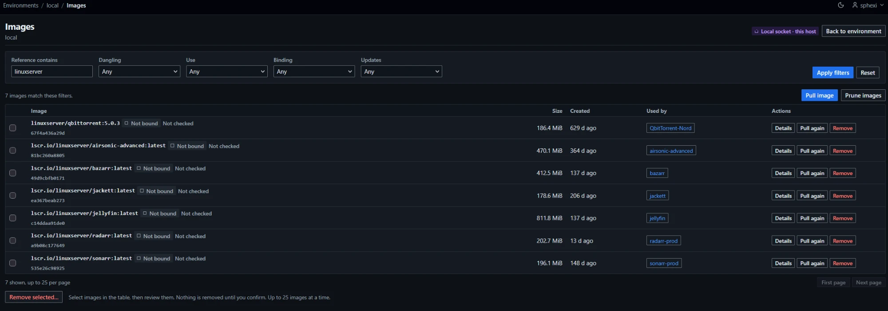
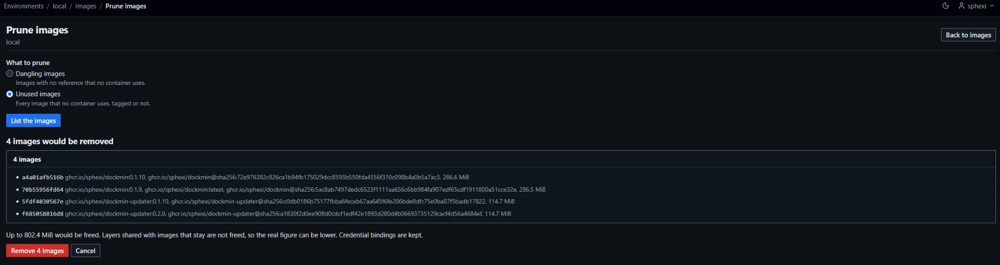

# Images

Images are listed and managed per environment. The list and the detail page are read from the host when the page loads. The update status shown beside each reference is the stored result of its last update check ([Stored status](#stored-status)).

## Pages and routes

All paths are under `/environments/{id}/images`.

| Page | Path | Method |
|---|---|---|
| Image list | The base path | `GET` |
| Image | `/{image_id}?tab={tab}` | `GET` |
| Pull form | `/pull?reference={reference}` | `GET` |
| Credential picker for a reference | `/pull/choices` | `POST`, htmx only; other requests redirect (`303`) to the pull form |
| Start a pull | `/pull` | `POST` |
| Pull or push progress | `/jobs/{job_id}` | `GET` |
| Progress stream (server-sent events) | `/jobs/{job_id}/events` | `GET` |
| Cancel a pull or push | `/jobs/{job_id}/cancel` | `POST` |
| Push form | `/{image_id}/push?reference={reference}` | `GET` |
| Start a push | `/{image_id}/push` | `POST` |
| Tag review | `/{image_id}/tag?reference={reference}` | `GET` |
| Tag | `/{image_id}/tag` | `POST` |
| Untag confirmation | `/{image_id}/untag?reference={reference}` | `GET` |
| Untag | `/{image_id}/untag` | `POST` |
| Remove confirmation | `/{image_id}/remove` | `GET` |
| Forced remove confirmation | `/{image_id}/remove?force=1` | `GET` |
| Remove | `/{image_id}/remove` | `POST` |
| Bulk removal confirmation | `/remove?image={image_id}`, repeated | `GET` |
| Bulk removal | `/remove` | `POST` |
| Prune selection and confirmation | `/prune?mode={mode}` | `GET` |
| Prune | `/prune` | `POST` |
| Orphaned bindings | `/bindings/reap` | `GET` (list), `POST` (reap) |
| Change credential set | `/bindings/rebind?reference={reference}` | `GET` (page), `POST` (verify and rebind) |
| Update check | `/updates` | `POST` |

- `{image_id}` is the full 64-character lower-case hexadecimal id. Any other form answers `404` for every role, before any call to the host.
- `{job_id}` is 22 characters from `A-Za-z0-9_-`. Any other form answers `404`.
- `{tab}` is `overview` (default), `configuration` or `history`. Any other value answers `404`.
- `{mode}` is `dangling` or `unused`. Any other value answers `400`: `Choose dangling or unused.`
- `/remove` takes 1 to 25 distinct `image` values. Outside that, the confirmation answers `400`.
- Every `POST` redirects (`303`) on success. A refusal renders a page at the real status code, with a `Review again` link for `409`, `502` and `503`.

## Access

Viewing needs sight of the environment ([Environments](Usage-Environments#access)). A standard user without it receives `404` on every route.

| Action | Administrators | Standard users |
|---|---|---|
| List, image page, history, update check | Yes | Yes |
| Pull, push | Yes | Remote environments they hold a grant on; `403` on a local socket; `404` without a grant |
| Watch, refresh or cancel a pull or push | Any job | Their own jobs only; another user's job answers `404` |
| Change the credential binding of an image | Yes | No. `403`: `Only an administrator can change which credential set this image uses.` |
| Tag, untag, remove, bulk remove, force, prune, reap bindings | Yes | Refused (`403`) |
| Change a binding without a pull ([Rebind without a pull](#rebind-without-a-pull)) | Yes | `404`, as for an unknown path. The `Repair` and `Change credential set` links are not shown |
| Bind unbound images without a pull ([Bindings without a pull](#bindings-without-a-pull)) | Yes | `404` |

| Withheld from standard users | Shown to administrators |
|---|---|
| Entrypoint, command, environment variables (`Not shown for your role`) | Yes. Values of secret-named variables are redacted for everyone |
| Build command of each layer in the History tab | Yes |
| Values of secret-named label keys (`Redacted`) | Yes |
| Names of containers they may not see | Yes. The `Used by` count includes every container on the host |
| Name of the credential set an image is bound to, unless they hold a grant on the set | Yes. Otherwise `a credential set` |

Secret-named keys follow the rule in [Containers](Usage-Containers#withheld-from-standard-users).

## Image references

A reference is parsed before any call to the host. Its canonical form keys the image's credential binding.

| Part | Rule |
|---|---|
| Whole | Trimmed. At most 512 characters. ASCII, no whitespace, no control characters |
| Form | `[host[:port]/]path[:tag][@sha256:digest]` |
| Host | Present when the first segment contains `.` or `:`, or is `localhost`, and a `/` follows. It follows the [address rules](Administration-Registries#address-rules), so a plain-HTTP, numeric-shorthand or malformed host is refused |
| Name | Host and path together: 1 to 255 characters. Each path component is lower-case letters and digits separated by `.`, `_`, `__` or hyphens |
| Tag | 1 to 128 characters: letters, digits, `_`, `.`, `-`; the first is not `.` or `-` |
| Digest | `sha256:` followed by 64 lower-case hexadecimal digits |
| Default tag | `latest`, added when there is neither a tag nor a digest |

### Docker Hub

| Input | Canonical form |
|---|---|
| `busybox` | `docker.io/library/busybox:latest` |
| `nginx:1.27` | `docker.io/library/nginx:1.27` |
| `myorg/app` | `docker.io/myorg/app:latest` |
| `index.docker.io/myorg/app:2`, `registry-1.docker.io/myorg/app:2` | `docker.io/myorg/app:2` |

- A name without a host is a Docker Hub name. A single path component gets the `library/` namespace.
- Hub names are shown without `docker.io/`, and without `library/` when that is the only namespace.

### Other registries and digests

| Input | Canonical form |
|---|---|
| `registry.example.com:5000/team/app` | `registry.example.com:5000/team/app:latest` |
| `Registry.Example.com/team/app:2` | `registry.example.com/team/app:2` |
| `ghcr.io/org/app@sha256:{64 hex digits}` | `ghcr.io/org/app@sha256:{64 hex digits}` |
| `busybox:1@sha256:{64 hex digits}` | `docker.io/library/busybox@sha256:{64 hex digits}` |

- A reference with a digest is pinned. Its canonical form leaves the tag out, because the host pulls by digest and ignores it.
- A pinned reference has its own binding. It is never the binding of the same repository's tag.

### Refused references

Messages quote no input.

| Cause | Message |
|---|---|
| Blank | `Image is required.` |
| Too long, not ASCII, contains whitespace or control characters, or otherwise malformed | `Image is not a valid image reference.` |
| Digest is not `sha256:` and 64 hexadecimal digits | `Image digest must be sha256: followed by 64 hexadecimal digits.` |
| Invalid tag | `Image tag may use letters, digits, underscores, periods and hyphens.` |
| Name empty or over 255 characters | `Image name must be between 1 and 255 characters.` |
| Invalid host | `Image registry host is not valid.` |
| Invalid path component | `Image name must use lower-case letters, digits, periods and hyphens.` |
| Push of a digest | `Push a tag, not a digest.` |
| Push of a tag the image does not carry | `That reference is not on this image.` |
| Tag target with a digest | `A tag is needed; a digest cannot be assigned.` |

## Image list

| Item | Value |
|---|---|
| Columns | Select (administrators), Image, Size, Created, Used by, Actions |
| Select column | A checkbox per image, for [bulk removal](#bulk-removal). Administrators only |
| Actions column | Shown to users who may pull or remove. `Details` for everyone; `Pull again` when the image has a tag and the user may pull; `Remove` for administrators |
| Order | The lowest reference in the form shown, ignoring case, then id. Images with no tag sort last |
| Page size | 25 by default; `limit` 1 to 500 |
| Paging | `cursor`; an invalid cursor answers `400` |
| Count | `{N} images`; with a filter, `{N} images match these filters` (`1 image matches these filters`) |
| Reference shown | The tags; the digests when the image has no tag. At most 100 per image, then `and N more` |
| Used by | Names of up to 10 containers the viewer may see, linked; `and N others` for the rest |
| Buttons | `Pull image` for users who may pull; `Prune images` and `Remove selected...` for administrators |
| Empty list | `This host has no images.` (administrators); `You cannot see any images on this host. Ask an administrator for access to more images.` (standard users). With a filter: `No matching images` and `Change the filters, or clear them to see every image.` |

Every image on the host is listed. The list is not filtered by the viewer's access.

### Filters

| Filter | Values | Match |
|---|---|---|
| `q` (`Reference contains`) | At most 128 characters | Case-insensitive substring of a reference, or a prefix of the image id |
| `dangling` | `yes`, `no` | Dangling: the image has no tag |
| `usage` | `used`, `unused` | A container, running or not, uses the image |
| `binding` | `bound`, `anonymous`, `credential_missing`, `unbound` | At least one reference shown for the image has the state |
| `update` (`Updates`) | `available` | At least one reference shown for the image has the stored status `Update available`, as the list shows it ([Stored status](#stored-status)): a result that is out of date does not count |

An invalid filter value answers `400` and lists the problems; for `update` the problem reads `Choose available.`; for `dangling`, `Choose yes or no.` Filters survive paging.

The `Updates available` card of the [environment page](Usage-Environments#environment-page) links to `?update=available`.

### Binding states

| State | Shown as | Meaning |
|---|---|---|
| `bound` | `Bound to {set name}` | The reference was pulled or pushed with that credential set |
| `anonymous` | `Anonymous pull` | The reference was pulled or pushed with no credentials, by choice or because no set fitted |
| `credential_missing` | `Credential set deleted` or `Registry address changed`, with `was {set name}` | The set was deleted, or its registry address changed. Automatic updates for the reference stop |
| `unbound` | `Not bound` | No binding exists for the reference. An image that runs on the host can be bound without a pull ([Bindings without a pull](#bindings-without-a-pull)) |

- Each reference of an image has its own state.
- Administrators see a link beside a reference whose binding can be changed, on the list and on the image page:

  | Binding | Link | Opens |
  |---|---|---|
  | `credential_missing` | `Repair` | The [rebind page](#rebind-without-a-pull); for a reference pinned by digest, the pull form |
  | `bound` or `anonymous`, reference not pinned by digest | `Change credential set` | The rebind page |
  | `bound` or `anonymous`, reference pinned by digest | None | |
  | `unbound` | None | |

  Each link carries the reference.
- On the first page, administrators see a notice when bindings refer to images that are no longer on the host ([Orphaned bindings](#orphaned-bindings)).

### Stored status

Each reference in the image list shows the result of its last update check and when it was made. The image page does not show it.

| State shown | When |
|---|---|
| `Up to date`, `Update available`, `Unknown`, `Pinned` | The stored result, with `checked {time}` |
| `Not checked` | No result is stored, the stored state is `Not bound`, or the result is out of date |

A stored result is out of date when the image holds other digests for the reference's repository now:

| Stored result against the image's digests now | Shown |
|---|---|
| The stored local digest is among them, or none was stored | The stored state |
| The stored local digest is not among them, and the stored registry digest is | `Up to date` |
| Neither is among them | `Not checked` |

| Item | Value |
|---|---|
| Written | After every [update check](#update-check), whoever started it: `Check for updates`, and each `container-updater` run, dry runs included, for containers and Compose stacks |
| Describes | The image the host holds locally for the reference, compared with the registry. A Swarm service's image is not a host image, and two services of one reference can run different digests, so `container-updater` checks Swarm services against the digest in each service and stores nothing for them |
| Row | One per environment and reference, the latest only: state, reason, local digest, registry digest, check time |
| Credentials | None stored |
| Retention | A row checked more than 30 days ago is deleted when a later result is stored for the same environment. Deleting the environment deletes its rows |
| Older result | A result with an earlier check time than the stored one is dropped |
| Not stored | `busy`, `invalid_reference` and `image_id_reference` results. `credential_not_available` and `credential_mismatch` from a check a user starts. `credential_not_available` from an automation whose owner holds no grant on the bound set |
| Write failure | Logged as `image_update_status_write_failed`. The check still answers |
| Visible to | Everyone who can open the list |

### Image page

| Tab | Content |
|---|---|
| Overview | Id, size, created, platform, `Used by`, the references with their binding state and actions (`Pull again`, `Untag`), and the update check |
| Configuration | Entrypoint, command, working directory, user, exposed ports, environment variables, labels |
| History | The layers, newest first: layer id, created, created by, size, tags |

- The summary offers `Pull again`, `Tag` (administrators), `Push` and `Remove` (administrators).
- `Pull again`, `Push` and `Untag` apply to tags. Digest references show the chip `digest`.
- At most 500 labels, variables and exposed ports are read; a notice reads `Only the first entries are shown.`
- An image whose configuration exceeds 4 MiB, or whose history exceeds 1 MiB, is not shown: `This image's configuration is too large to show.`

### Host failures

The list and the image page are replaced by an error. The messages are those of [Containers](Usage-Containers#host-failures), and the answer is `503`. A host whose image list exceeds 16 MiB answers `This host reports more image data than can be listed here (limit 16 MiB).` and no partial list is shown. An image id the host does not know answers `404`. Troubleshooting: [Troubleshooting](Troubleshooting).

## Credential bindings

A binding records which credential set pulled a reference in one environment. Re-pulling uses the same set.

| Item | Value |
|---|---|
| Key | The environment and the canonical reference |
| Value | One credential set, or none (an anonymous pull) |
| Written | After a pull or push ends cleanly, when a container create or recreate pulls the image, when a Swarm service create or edit changes the service's image ([Swarm services](#swarm-services)), when a Swarm stack deploy or redeploy sends an image to a service ([Swarm stacks](#swarm-stacks)), and when an administrator applies `Adopt everything on this host` to a reference with no binding ([Bindings without a pull](#bindings-without-a-pull)). A failed or cancelled transfer writes none |
| Survives | Removal, untagging and pruning of the image; a restart. Deleted with the environment |
| Created by | Whoever pulls or pushes a reference that has no binding. An administrator, without a pull, through [Bindings without a pull](#bindings-without-a-pull) |
| Changed by | Administrators only, by an explicit credential choice on a pull or push, or on the [rebind page](#rebind-without-a-pull) |
| Tag | Tagging pulls nothing and binds nothing |

A pull, push, create, recreate, Swarm service change or Swarm stack deployment reports what it did to the binding:

| Result | Meaning |
|---|---|
| `created` | The reference had no binding; one was written |
| `rebound` | An administrator's explicit choice on a pull or push changed the set, or repaired a `credential_missing` binding |
| `kept` | The existing binding already names the set used, or it differs and was not changed because the caller did not choose against the binding as it stands |
| `skipped` | The set no longer exists, or a `credential_missing` binding was not repaired |

### Which set a pull uses

The first rule that applies decides.

| Order | Condition | Result |
|---|---|---|
| 1 | The caller made an explicit choice | That set, or no credentials for `Anonymous`. A standard user whose choice differs from an existing binding is refused (`403`) |
| 2 | The reference is bound to a set | That set. A standard user is offered only that option |
| 2 | The reference is bound as anonymous | An anonymous pull |
| 2 | The binding is `credential_missing` | Refused (`409`): `The credential set this image was pulled with has been deleted. Choose another set.` Only an administrator may choose |
| 3 | No binding, no set fits the registry | An anonymous pull |
| 3 | No binding, one set fits | That set |
| 3 | No binding, several sets fit | Refused (`400`): `Choose which credential set to pull with.` |

- A set fits when its address equals the reference's registry address, it is granted to the environment, and, for a standard user, it is granted to the user or one of their teams ([Registries](Administration-Registries#access)). At most 200 sets are offered. With more, the choice is refused: `Too many credential sets fit this registry to choose between.`
- The [credential picker](Administration-Registries#the-credential-picker) of a form sends an explicit choice, so the rule at order 1 decides for every pull a form starts. Order 3 applies to callers that send no choice, such as the JSON routes.
- The picker preselects the bound set, or `Anonymous` for an anonymous binding; for a reference with no binding, the [default set](Administration-Registries#default-for-an-address) for the address, else `Anonymous`; nothing for a `credential_missing` binding. The push form and the recreate confirmation preselect the bound set or `Anonymous`; with no binding, the default set, else the only fitting set, else `Anonymous` when none fits, and nothing when several fit.
- A bound set is used as bound, whatever the address match. An image is never matched to a set by its registry host once it is bound.
- A bound set that is no longer granted to the environment or the user, or whose secret cannot be read, ends the job as `credential_unavailable`, with the messages in [Registries](Administration-Registries#access).
- A chosen set for another registry than the reference's answers `400`: `That credential set is for a different registry.`
- Automation (no user) uses only the bound set and needs only its environment grant. It never chooses a set by registry host. An unbound reference, and a `credential_missing` binding, are refused.
- The default-for-an-address flag only preselects a form.

| Picker state | Text shown |
|---|---|
| Administrator, binding exists | `Choosing a different option changes the binding for every user of this image.` |
| Administrator, binding is `credential_missing` | `The credential set this image was pulled with has been deleted. Choose another set, or an anonymous pull, to repair the binding.` |
| Reference not bound | `The set that pulls the image is bound to it, so updates use the same set.` |
| Standard user, binding exists | The bound set's name as text, with `Only an administrator can change which credential set this image uses.` |
| Standard user, bound set not granted to them, or binding `credential_missing` | `This image is bound to a credential set you cannot use.` or `The credential set this image was pulled with has been deleted.`, followed by `Only an administrator can change which credential set this image uses.` No button |
| No credential set fits the registry | `No credential set is available for this registry.` The pull is anonymous |
| Binding `credential_missing`, no other set at the registry | `The credential set this image was pulled with has been deleted, and no other set is available for this registry. The image is pulled anonymously.` |

### Swarm services

A Swarm service create, and an edit that changes the image, choose credentials for the reference and pin it before the service is sent to Docker ([Swarm](Usage-Swarm#images-and-registry-credentials)). The nodes pull the image.

| Item | Value |
|---|---|
| Set used | The rules of [Which set a pull uses](#which-set-a-pull-uses). The create form and the review of an edit offer the choice when several sets fit; an explicit choice is carried to the request |
| Standard user | A choice that differs from the existing binding is refused (`400`, reason `restricted`) beside the image field: `Only an administrator can change which credential set this image uses.` |
| Digest | dockmin asks the registry, with the same credentials, for the digest of the reference. The service is stored with the reference and `@sha256:` and the digest, so every node runs one image. A reference that already names a digest is not looked up |
| Registry did not answer | The service is stored with the image as typed. The page warns that nodes may run different images of the tag, and the row records `digest_pinned` as `false` |
| Binding written | In the transaction that settles the service's access control, for the reference as typed, with the digest observed. The row records `binding` (`created`, `rebound`, `kept`, `skipped`, or `not_recorded`) |
| Not written | An image id; scale; force update; roll back; an edit that keeps the image |
| Credential sent to Docker | A create sends a non-anonymous set. An edit that changes the image always sends a credential: the chosen set, or the empty credential for an anonymous pull, so credentials stored with the earlier image are not reused. An edit that keeps the image, scale and force update send none and Swarm reuses the stored credential. A roll back uses the credential stored with the previous configuration |
| Stored by Swarm | Docker keeps the credential with the service and gives it to the nodes that pull. It is not returned by Docker and is not shown, stored or logged by dockmin |
| Lifetime | dockmin refreshes a credential stored with a service only through `container-updater`, for a service bound to an Amazon ECR set ([Swarm](Usage-Swarm#credential-renewal-by-container-updater)). Deleting a set does not remove it from services |
| Updates by `container-updater` | The reference's bound set only, resolved with no user and no choice; the nodes pull. The binding is kept and its observed digest is updated ([Automation](Operations-Automation#swarm-services)) |

### Swarm stacks

A Swarm stack chooses credentials for each distinct image reference of its file before anything is sent to Docker ([Stacks](Usage-Stacks#swarm-images-and-credentials)).

| Item | Value |
|---|---|
| Set used | The rules of [Which set a pull uses](#which-set-a-pull-uses), per reference. When several sets fit and none is chosen the form lists each reference with its sets (`409`, reason `credential_choice_required`) |
| Standard user | A choice that differs from the existing binding is refused (`400`, reason `restricted`) |
| Digest | Looked up once per reference and operation with the same credentials. Every service of the reference runs the pinned image. A failed lookup deploys the reference as written and lists it as not pinned |
| Binding written | In the transaction that records the deployment, for each reference sent to a service by a create, by an update that changes the image string, or by an update that carries a different set than the binding. When an operation stops, for the references already sent. The row records `binding` |
| Not written | An image id; a service that already holds the specification |
| Credential sent to Docker | A create sends a non-anonymous set. An update that changes the image string always sends one: the chosen set, or the empty credential for an anonymous pull. Any other update sends none and Swarm reuses the stored credential |
| Lifetime | dockmin refreshes a credential stored with a service only through `container-updater`, for a service bound to an Amazon ECR set ([Swarm](Usage-Swarm#credential-renewal-by-container-updater)) |

### When a set is deleted or its address changes

| Event | Effect on its bindings |
|---|---|
| Set deleted | Every binding becomes `credential_missing`, `Credential set deleted`. None is removed |
| Registry address of the set edited | Every binding becomes `credential_missing`, `Registry address changed`. The set's default flag is cleared |

- The name of the lost set is kept with the binding.
- Automatic updates for those references stop, and the update check reports `unknown` with the reason `credential_missing`.
- Repair: an administrator uses `Repair` to choose another set, or `Anonymous`, without a pull ([Rebind without a pull](#rebind-without-a-pull)), or pulls the reference again and chooses. The binding is then `rebound`. A reference pinned by digest is repaired by pulling it. A standard user cannot repair a binding.

### Rebind without a pull

`/environments/{id}/images/bindings/rebind?reference={reference}`. Administrators only. The page changes which credential set a binding names. It pulls nothing.

1. On the image list or image page, select `Repair` or `Change credential set` beside the reference.
2. Choose a credential set, or `Anonymous`, in the picker.
3. Select `Verify and rebind`. dockmin sends one manifest `HEAD` to the registry with the chosen set.
4. The list opens with `The binding now uses the chosen credential set.` If the page shows a refusal instead, match it in the table below; the binding is unchanged.

| Item | Value |
|---|---|
| Page shows | The reference, its registry address, the current binding, and the credential picker ([Registries](Administration-Registries#the-credential-picker)) with the sets that fit the registry and `Anonymous` |
| Preselected | The bound set, or `Anonymous` for an anonymous binding. Nothing for a `credential_missing` binding, and nothing when the bound set is not among the sets offered |
| Buttons | `Verify and rebind`, `Pull the image instead` (the pull form with the reference), `Cancel` |
| Reference | Must be bound, as `bound`, `anonymous` or `credential_missing`, and not pinned by digest. Otherwise `400` |
| Verification | A `HEAD` of the reference's manifest, as in [Registry request](#registry-request), made with the chosen set. The binding changes only if the registry answers with a digest |
| Anonymous choice | Verified against the registry in the reference, with verified certificates. Refused when no credential set at that registry address is granted to the environment |
| Unchanged choice | Choosing the set the binding already names (state `bound`) changes nothing, makes no registry request and writes no activity row |
| Review | The form carries the binding it was built on. If the binding is no longer that one when the request is applied, nothing changes |
| Digest | The stored observed digest is not changed |
| Success | Redirect (`303`) to the list with `The binding now uses the chosen credential set.` |

| Refusal | Status | Message |
|---|---|---|
| Reference pinned by digest | `400` | `A reference pinned by digest is rebound by pulling it.` |
| Reference not bound | `400` | `Pull the image to bind it.` |
| No set chosen | `400` | `Choose one of the listed credential sets.` |
| `Anonymous`, and no set at the registry address granted to the environment | `400` | `No credential set for this registry is granted to this environment, so dockmin does not connect to it.` |
| The registry refuses the choice, or cannot be reached | `400` | The product-written message of the failed check, beside the credential picker |
| Set not available to the environment, or for another registry | `409` | The messages in [Registries](Administration-Registries#access), on the page |
| Binding changed since the page was shown | `409` | `The binding changed since you reviewed it. Review it again.` With a `Review again` link |

- A failed check leaves the binding as it was.
- The rows written are listed under [Recorded actions](#recorded-actions).

### Bindings without a pull

An image pulled outside dockmin has no binding. `Adopt everything on this host` ([Environments](Usage-Environments#adopt-everything-on-this-host)) binds it to the credential set whose registry reports the digest the host holds. Nothing is pulled.

| Item | Value |
|---|---|
| Who | Administrators. A standard user cannot start the review |
| References checked | The configured image of every container and, on a Swarm manager, the image of every service, with any digest suffix removed. Each reference in canonical form, less those that already have a binding |
| Containers created by image id | As in [Orphaned bindings](#orphaned-bindings): at most 100 are read, 8 at a time. When one cannot be read, or there are more, the review shows `Some containers or services could not be read, so an image in use may be missing.` |
| Local digests | The `RepoDigests` of the local image whose tags carry the reference. A Swarm service's digest suffix is not used |
| Reads | Nothing is written during the check. The binding is written when the confirmed plan is applied |

#### Candidates

| Rule | Value |
|---|---|
| Sets tried | Each credential set whose registry address equals the reference's registry address and that is granted to the environment. At most 10 are tried |
| Anonymous | Tried after the sets, when a set at the address is of a provider that allows anonymous access. Never for Amazon ECR |
| Request | One manifest `HEAD` for each candidate, as in [Registry request](#registry-request): the same client, the OCI and Docker manifest and index media types, the set's TLS settings. A `Bearer` challenge adds the token request of that registry. No manifest is read with `GET` |
| Contacted | Only registry addresses an administrator configured. A reference at an address with no set is not contacted |
| Amazon ECR | The set's token is obtained before its request, outside any database transaction |
| Match | The digest the registry returns is one of the local `RepoDigests` |
| Failed candidate | Not a match. It is not retried, and the review shows it beside the reference with the cause: `refused the credentials`, `has no such repository or tag`, `did not answer in time`, `could not be resolved`, `could not be reached`, `failed the TLS handshake`, `certificate not accepted`, `is limiting requests`, `reply not understood`, `credential set unavailable` |
| Digest differs | The candidate is shown as `a different image` |

A match shows that the set can read the image. It does not show which set pulled it, so one match binds and several are never resolved by order.

#### Outcomes of the digest check

| Outcome | Shown as | Meaning | Binding |
|---|---|---|---|
| `binds` | `Binds to {set}.` or `Binds anonymously.` | Exactly one candidate matched, and at most 10 sets are at the address | Offered, ticked |
| `ambiguous` | `More than one set can read this image. Choose one.` | Several candidates matched, or one matched and more than 10 sets are at the address, so the match could hide another | Offered, not ticked, and a select of the matching candidates with nothing preselected. Ticking without a choice is refused |
| `no_match` | `No credential set could be matched to the image on the host.` | No candidate matched, or no set is configured for the address | None |
| `no_local_digest` | `The host holds no registry digest for it; it was built or tagged locally.` | The local image has no `RepoDigests`. No request is sent | None |
| `pinned` | `It names a digest, so it needs no binding.` | The reference names a digest. No request is sent | None |
| `not_checked` | `Not checked: the time or reference limit was reached.` | The time limit or the reference limit was reached before every candidate was tried, or more than 200 sets are at the address | None |

A reference is `not_checked` as a whole when any of its candidates was not checked.

| Bound | Value |
|---|---|
| References checked | 200 for each review. Counted are the references that need a request: `pinned` and `no_local_digest` do not count. The rest, in reference order, are `not_checked` and no candidate is tried |
| Sets tried for a reference | 10, then anonymous where it applies. More than 10 sets give `ambiguous` when one matched; more than 200 give `not_checked` |
| Requests in flight | 5 |
| One request | 10 s, or the time left of the 120 s |
| Whole check | 120 s. A request not started by then is `not_checked` |

#### Binding

| Item | Value |
|---|---|
| Written | For each ticked image when the confirmed plan is applied. The binding names the set chosen, or none for an anonymous binding, and keeps the matching digest as its observed digest |
| Checks at the write | The environment may use the set, the set is at the reference's registry address, an anonymous choice has a granted set at that address, the reference is not pinned and the digest is a `sha256:` digest. The host and the registry are not contacted |
| Binding exists | A reference that has a binding, in any state, is skipped. No row is written and the binding is not changed |
| Refusals | `registry_not_configured`, `missing` and `credential_mismatch` (reasons of [Recorded actions](#recorded-actions)) are recorded as failures and the result page shows the product message |
| Not done | No pull, no Engine call and no change to a container |
| Recorded | `image_bound` with `verified` `true` and `pulled` `false` ([Recorded actions](#recorded-actions)) |

### Orphaned bindings

A binding is orphaned when its reference is on no image and in no container's configured image.

1. On the first page of the image list, select `Review and remove` in the notice about bindings that refer to images no longer on the host. The page `Image bindings` lists them.
2. Review the list. With no orphans the page reads `No bindings to remove`.
3. Select `Remove {N} bindings`. The list opens with `Removed N bindings.`

| Rule | Value |
|---|---|
| Who | Administrators |
| Where | The notice on the first page of the list links to `/environments/{id}/images/bindings/reap` |
| Listed | At most 200 bindings, in id order; `Showing the first 200. Run this again for the rest.` when cut |
| Containers created by image id | Their configured reference is read from the container. At most 100 such containers are read, 8 at a time. When one cannot be read, or there are more, no binding is offered |
| Reap | Deletes each listed binding that is still orphaned and still names the reviewed reference. A binding that changed, or whose image returned, is left |
| Result | Redirect to the list with `Removed N bindings.` |
| Effect | The next pull of the reference asks for a credential set again |
| Refusal when containers could not be checked | `400`: `Some containers could not be checked, so no binding was removed.` |

## Pull

A pull runs in the background as a [job](#pull-and-push-jobs). The pull form is `GET /environments/{id}/images/pull`.

1. Select `Pull image` on the image list, or `Pull again` on a tag.
2. Enter the reference in `Image reference` and select `Continue`. With JavaScript, changing the field loads the next step without leaving the page, and `Continue` stays visible.
3. Read the canonical reference, its registry, its binding, and the [credential picker](Administration-Registries#the-credential-picker): `Anonymous (no credentials)` and the sets that fit. Choose one.
4. Select `Pull image`. The job page opens (`303`) and shows the layers.
5. When the job ends, `View image` opens the image. If it failed, match the message in [Outcomes](#outcomes) or see [Troubleshooting](Troubleshooting).

| Result | Status | Message |
|---|---|---|
| Invalid reference or choice | 400 | The messages in [Refused references](#refused-references) |
| Several sets fit and none was chosen | 400 | `Choose which credential set to pull with.` |
| Standard user would change a binding | 403 | `Only an administrator can change which credential set this image uses.` |
| Binding is `credential_missing` | 409 | `The credential set this image was pulled with has been deleted. Choose another set.` |
| Chosen set not offered for this environment and user | 409 | `That registry credential set is not available here.` |
| Chosen set is for another registry | 400 | `That credential set is for a different registry.` |
| Job limit reached | 429 | The limit message ([Limits](#limits)) |
| Host unavailable | 503 | The host message |

- A standard user whose reference is bound to a set they hold no grant on sees `This image is bound to a credential set you cannot use. Only an administrator can change which credential set this image uses.` and no button.
- A standard user whose reference is `credential_missing` sees `The credential set this image was pulled with has been deleted. Only an administrator can change which credential set this image uses.` and no button.
- A reference already on the host is pulled again.
- A reference with neither a tag nor a digest is pulled as `latest`. A pull never fetches every tag of a repository.
- A failed start renders the form with the heading `The image was not pulled`.

## Push

Push sends one tag of an image to the registry its reference names.

1. On the image page, select `Push`.
2. Choose the tag in `Reference to push` and select `Continue`. The only tag is preselected.
3. Choose the credential set. The same [precedence](#which-set-a-pull-uses) applies.
4. Select `Push image`. The job page opens.

| Item | Value |
|---|---|
| Access | Users who may pull ([Access](#access)) |
| Form | The image's tags; the only tag is preselected. Then the same credential choice as a pull |
| Reference | A tag the image carries. A digest is refused |
| Credential set | A set for the registry in the tag. The same [precedence](#which-set-a-pull-uses) applies |
| Binding | Written when the push ends cleanly |
| No tag | `This image has no tag to push.` Administrators are offered `Tag image`; others are told an administrator has to tag it |
| Failed start | The form is headed `The image was not pushed` |

The tag is checked again when the job runs. A tag moved to another image refuses the push: `This image changed since you reviewed it; nothing was changed.`

## Pull and push jobs

| Item | Value |
|---|---|
| Visible to | The user who started the job; administrators |
| Retention | Finished jobs for 15 minutes, at most 64. Jobs are held in memory and are lost on restart; a job page then answers `404` |
| Overall time limit | 3600 seconds. A job that reaches it ends as `outcome_unknown` |
| Cancel | The starter or an administrator. The transfer to the host is stopped |
| Lock | The reference is held for the whole job. Tag, untag, remove, pull, push and create on the same reference answer busy ([Busy](#busy)) |

### Limits

| Limit | Value | Message |
|---|---|---|
| Running jobs per user | 2 | `You have 2 transfers running. Wait for one to finish.` |
| Running jobs per instance | 8; standard users fill at most 7, the last slot is kept for administrators | `This server is running as many transfers as it allows. Try again shortly.` |
| Progress streams | One live view each; the pools are those of [live stats](Usage-Containers#stats) | `Too many live views are open` (`429`) |

- Container creates and recreates that pull count toward both running-job limits ([Containers](Usage-Containers#job-limits)).

### Progress

| Item | Value |
|---|---|
| State | `Running`, `Succeeded`, `Failed`, `Cancelled` |
| Summary | `N of M layers done`, bytes transferred of bytes known, and the share |
| Layers | At most 128 tracked, then `and N more layers`. Each shows its id (12 characters), stage and bytes |
| Stages | Queued, Waiting, Downloading, Verifying, Downloaded, Extracting, Complete, Already on the host, Preparing, Pushing, Pushed, Mounted from another repository, Working |
| Not shown | The host's own status text |
| Result | A message, and for a success a `View image` link |

- With JavaScript, the page opens the event stream while the job runs and swaps in each state. `Progress updates live while this page is open.` The stream sends a comment line every 15 seconds without change and ends after 300 seconds with a retry hint of 3 seconds. Each connection is authorised again.
- Without JavaScript, or when the stream is refused or lost, the page shows the state at load and a `Refresh status` link. `Live updates stopped. Use Refresh to see the current state.`
- `Cancel pull` and `Cancel push` post a form and work without JavaScript.

### Outcomes

| Reason | Message |
|---|---|
| Success | `Pulled {reference}.` or `Pushed {reference}.`, with the binding result: `A binding was created for this reference.`, `The binding for this reference now names the credential set used.` or `The existing binding was kept.` |
| `not_found_or_denied` | `The registry has no such image, or refused access to it.` (pull); `The registry refused the push, or the repository does not exist.` (push) |
| `pull_failed`, `push_failed` | `The image could not be pulled.`; `The image could not be pushed.` |
| `outcome_unknown` | The host message, or after a cancel `The transfer was cancelled. What it left on the host is not known.` The page adds: `Check the image list before trying again. Layers or the tag may have changed on the host.` |
| `unreachable`, `unsupported`, `credentials`, `engine` | Host failures, as in [Containers](Usage-Containers#host-failures) |
| `object_busy` | The busy message |
| `credential_missing`, `credential_unavailable`, `credential_choice_required`, `credential_mismatch` | The messages in [Pull](#pull) |
| `forbidden` | `You no longer have permission for this action.`, or the rebind refusal |
| `not_found` | `The image or environment was not found.` |
| `changed` | `This image changed since you reviewed it; nothing was changed.` |
| `image_gone` | `The image no longer exists.` |
| `invalid` | The message of the refused field |
| `image_in_use` | `The image is used by one or more containers.` |
| `image_has_dependents` | `Other images are built on this one. Remove them first.` |
| `too_large` | `This object's configuration is too large to read.` |
| `failed` | The product's message for an error not listed above, or `The transfer failed.` for an unexpected one. The reason is never a class name |

The registry's own text is never shown.

### Busy

`{Who} started a {action} on this image {N} seconds ago and it has not finished. Wait for it to complete, then try again.` (`409`). `{Who}` is `You`, `Another user` or, for administrators, the holder's name.

## Tag

Tagging adds a reference to an image. Administrators only.

1. On the image page, select `Tag`.
2. Enter the reference in `New reference` and select `Review`.
3. Read the review. It states when the reference already belongs to another image.
4. Select `Add reference`, or `Move the reference to this image` when it moves. The image page opens with `Reference added.`

| Item | Value |
|---|---|
| Form | New reference. Without a tag, `latest` |
| Review | Names the image and the reference. States when the reference already belongs to another image, with that image's references. The other image is not removed |
| Already on this image | Nothing changes and nothing is recorded |
| Binding | None is written |
| Reviewed holder | The review carries the id of the image that holds the reference now, or `none`. A different holder when the tag runs refuses it: `This image changed since you reviewed it; nothing was changed.` (`409`) |

## Untag

Untag removes one tag from an image. Administrators only. The page lists `Untag` for tags.

| Situation | Effect |
|---|---|
| The image keeps another reference | The reference is removed. The image stays |
| The reference is the last one, no container uses the image | The reference and the image are removed. The button reads `Remove reference and image` |
| The reference is the last one, containers use the image | Refused: `The image is used by one or more containers.` (`409`). A separate force confirmation follows |
| Forced | The reference is removed and the image stays on the host without a reference. Containers keep using it. The button reads `Force remove reference` |

- The last reference is counted as Docker counts it: removing the last tag of a repository also drops that repository's digest references.
- The confirmation binds whether the reference is the last and the number of containers using the image. A change in either refuses the untag: `This image changed since you reviewed it; nothing was changed.` (`409`).
- The confirmation for a reference that is not on the image answers `404`.
- Success redirects to the image with `Reference removed.`, or to the list with `Image removed.` when the image went.

## Remove

Removal deletes an image and every reference to it. Administrators only.

1. On the image page or list, select `Remove`.
2. Read the confirmation: the environment, the image, every reference, the size and the containers using it.
3. Select `Remove image`. For an image a container uses, select `Continue to force removal` and then `Force remove image`.
4. The list opens with `Image removed.`

| Item | Value |
|---|---|
| Confirmation | The environment, the image, every reference (at most 100, then `and N more`), the size and the containers using it |
| Not in use | Each reference is removed by name, only while the name still belongs to this image, then the image by id and the layers no other image shares. Containers are not affected |
| In use | The first page only leads to a second. `Continue to force removal` opens `?force=1` |
| Force | The image is removed by id in one call, whatever its references. Docker refuses a forced removal while a running container uses it |
| Bindings | Kept |
| Reviewed state | The confirmation carries a digest of the references and the number of containers using the image. A difference refuses the removal |

| Result | Status | Message |
|---|---|---|
| Removed | 303 | Redirect to the list with `Image removed.` |
| In use, not forced | 409 | `The image is used by one or more containers.` |
| Other images are built on it | 409 | `Other images are built on this one. Remove them first.` |
| References or container count changed | 409 | `This image changed since you reviewed it; nothing was changed.` |
| Changed while the removal ran | 409 | `This image changed while the action ran, and part of it may already be done. Review the image and try again.` |
| Another action holds the image | 409 | [Busy](#busy) |
| Image gone | 404 | `The image no longer exists.` |
| Docker refused | 502 | `Docker refused the action.` |
| Host unavailable | 503 | The host message |

Docker's own error text is never shown.

## Bulk removal

Bulk removal deletes several images in one reviewed step. Administrators only.

1. Tick the `Select` checkbox of each image on the list (1 to 25).
2. Select `Remove selected...`. The confirmation lists each image and whether it is removed or kept.
3. Select `Remove {N} images`. The result page lists one row per image.

| Item | Value |
|---|---|
| Selection | The `Select` column of the list, then `Remove selected...`. 1 to 25 images: `Select at least one image.` and `Select at most 25 images.` (`400`) |
| Confirmation | `GET /environments/{id}/images/remove?image={image_id}`. Lists each image: its first reference, short id, size, the other references (at most 100, then `and N more references`) and whether it is removed or kept. Nothing changes |
| Left out | A selected id that is not an image of the host is counted and reported as left out |
| In use | An image a container uses is named and kept: the confirmation lists the containers the viewer may see, counts the rest, and links `Force remove...` to the forced confirmation of that image |
| Force | Not available in bulk |
| Posted | For each removable image: its id, the digest of its references and the number of containers using it (`target`), and the name shown (`display_name`). In-use images are not posted |
| Run | Each image is removed on its own, in the order submitted, as [Remove](#remove) does without force. A refusal or failure on one image is that image's result and does not stop the others. Nothing is rolled back |
| Reviewed state | The references and the use count are read again for each image. A difference skips it |
| Bindings | Kept |
| Result | `303` to `/results/{token}` ([Frontend conventions](Contributing-Frontend-Conventions#result-pages)): `{N} of {M} images removed`, `Up to {size} freed` (layers shared with other images are not counted twice by Docker, so the real figure can be lower), and one row per image |

| Result per image | Message |
|---|---|
| `Removed` | `Removed.` |
| `Kept: in use` | `In use by a container. Remove it on its own page to force.` Links to the forced confirmation |
| `Skipped: changed since you reviewed it` | `This image changed since you reviewed it; nothing was changed.` |
| `Skipped: busy` | `Another action on this image is in progress.` |
| `Already gone` | `Not found, or already removed.` |
| `Unreachable` | The host message |
| `Failed` | `Other images are built on this one. Remove them first.`, `Docker refused the action.` or `The image could not be removed.` |

Each removal writes an `image_removed` row with `batch` set ([Recorded actions](#recorded-actions)).

## Prune

Pruning removes unused images in bulk. Administrators only.

1. Select `Prune images` on the image list.
2. Choose `Dangling images` or `Unused images` under `What to prune` and select `List the images`.
3. Read the heading `{N} images would be removed` and the list of exactly those images.
4. Select `Remove {N} images`. The result page shows each image's outcome and `Up to {size} freed`.

| Mode | Selects |
|---|---|
| `dangling` | Images with no tag that no container uses |
| `unused` | Every image no container uses, tagged or not |

| Item | Value |
|---|---|
| Listing | `GET /environments/{id}/images/prune?mode={mode}` lists exactly the images the prune removes. With no candidates the page reads `Nothing to prune.` |
| Limit | At most 100 images, largest first. The list, its count and the button name only the objects in this prune; a notice gives the rest: `{N} more images are not in this prune. Run it again afterwards for the rest.` (`1 more image is not in this prune.`) |
| Posted | Each listed image with a digest of its references |
| Run | The candidates are read again. An image that changed since the listing is skipped. Each image is removed on its own, without force, and a failure does not stop the others |
| Freed | `Up to {size}`. Layers shared with images that stay are not freed |
| Bindings | Kept |

| Result per image | Meaning |
|---|---|
| `Removed` | Gone |
| `Skipped: changed since you reviewed it` | References changed, or no longer a candidate |
| `Skipped: a container uses it now` | |
| `Skipped: another operation is running on it` | |
| `Already gone` | |
| `Failed` | Docker refused or the host failed |

## Update check

The check compares the digest an image holds locally for a reference with the digest its registry reports now.

1. Select `Check for updates` on the image list (it checks the bound tags of the page) or on the image page (its bound tags).
2. Read the result. With JavaScript the status of each reference updates in place; without it a result page opens and the list or image page is the back link.
3. For `Unknown`, read the reason in [Results](#results) and see [Troubleshooting](Troubleshooting).

| Item | Value |
|---|---|
| Started by | `Check for updates` on the list (the bound tags of the page) and on the image page (its bound tags), `POST /environments/{id}/images/updates`. Also `container-updater` runs ([Automation](Operations-Automation#detection)) |
| Access | Sight of the environment |
| References | 1 to 25 distinct references per request; more answers `400`: `Check between 1 and 25 references at once.` |
| Stored | The latest result of each reference ([Stored status](#stored-status)) |
| Result cache | The server keeps each answer in memory for 30 seconds, `Unknown` included, for every caller. A check inside that time returns it. `busy` is not kept |
| Swarm services | `container-updater` compares the digest in a service's image with the registry's, not the host's images, and stores nothing ([Automation](Operations-Automation#swarm-detection)) |
| Run from | The dockmin server. A registry only the Docker host can reach reads as `Unknown` |
| Without JavaScript | A page with the result; the list or image page is the back link |

### Registry request

| Item | Value |
|---|---|
| Request | `HEAD` of `/v2/{repository}/manifests/{tag}` over HTTPS, accepting OCI and Docker manifest and index media types, `User-Agent: dockmin-image-update-check` |
| Authentication | A `401` with a `Bearer` challenge sends one `GET` to the `https` token service, with the set's login when there is one, and repeats the `HEAD` with the token. A `Basic` challenge sends the set's login to the registry |
| Compared | The `Docker-Content-Digest` header, which must be one `sha256:` value |
| Connect to | The address of the bound set, with the set's TLS settings; for an anonymous binding, the registry in the reference, with verified certificates. `docker.io` is contacted at `registry-1.docker.io` |
| Limits | 5 s name lookup, 5 s per connection, 10 s per exchange, 30 s in all. Redirects are not followed. Replies are read with bounds |
| Proxy variables | Not read ([Reference-Deployment](Administration-Registries#registry-connections)) |
| Credentials | Never sent without a verified certificate |

A request goes only to a registry an administrator configured: the address of the bound credential set, or, for an anonymous binding, an address some credential set granted to the environment names.

### Results

| State | Meaning |
|---|---|
| `Up to date` | A local digest equals the registry's |
| `Update available` | The registry's digest differs from every local digest |
| `Pinned` | The reference names a digest, so it does not change |
| `Not bound` | The reference has no binding. Not checked |
| `Unknown` | The check could not decide. The reason follows |

| Reason | Cause |
|---|---|
| `no_local_digest` | The host holds no registry digest for the image; it was built or tagged locally |
| `credential_missing` | The binding lost its credential set |
| `credential_not_available` | The user holds no grant on the bound set, or the set is not granted to the environment, or its secret cannot be read |
| `credential_mismatch` | The bound set is for a different registry |
| `registry_not_configured` | An anonymous binding, and no credential set for the registry is granted to the environment |
| `invalid_reference` | The reference is not valid |
| `image_id_reference` | The text is an image id, not a registry reference. No registry is contacted |
| `busy` | No check slot came free within 10 seconds. Not kept |
| `no_digest` | The registry reported no digest |
| `dns`, `tcp`, `tls`, `certificate`, `authentication` | The connection stage that failed |
| `address_refused` | The registry or its token service is on this server or a link-local network and no permit covers it: `The registry or its token service is on this server or a link-local network. Set DOCKMIN_PERMITTED_INTERNAL_NETWORKS to allow it.` ([Reference-Deployment](Reference-Security#address-policy)) |
| `not_found` | The registry has no such repository or tag |
| `rate_limited` | The registry answered `429` |
| `protocol` | The reply was not a valid registry response |
| `timeout` | The registry did not answer in time |

A failure is the reference's `Unknown`, never `Up to date`.

| Limit | Value | Message |
|---|---|---|
| Update check requests per user at once | 2 | `You have update checks running. Wait for them to finish.` (`429`) |
| Checks against registries at once | 4 per instance, shared by users and `container-updater` runs | Further references wait up to 10 s, then read `busy` |
| Update check requests of `container-updater` | Not counted against the per-user limit | |
| Identical checks | Share one request to the registry | |

## Recorded actions

Every action records one activity row, for success and for failure. A refusal on access leaves no row. A tag that changes nothing leaves no row.

| Action | Target |
|---|---|
| `image_pulled` | The image id once the pull ended. None for a failure |
| `image_pushed`, `image_tagged`, `image_untagged`, `image_removed` | The image id |

| Detail key | Present when |
|---|---|
| `reference` | `image_pulled`, `image_pushed`, `image_tagged`, `image_untagged`: the canonical reference |
| `credential_set_id`, `anonymous`, `credential_source` | Pull and push: the set used (`null` for none), whether the pull was anonymous, and how it was chosen: `choice`, `binding`, `only_match` or `no_match` |
| `digest`, `binding` | Pull and push that ended cleanly: the digest observed, and the binding result (`created`, `rebound`, `kept`, `skipped`) |
| `trigger`, `remote_digest` | `image_pulled` by `container-updater`: `update`, and the digest the registry reported at the check |
| `replaced_image_id` | Tag: the image the reference moved from |
| `trigger`, `replaced_at`, `replaced_target_type`, `replaced_target` | `image_removed` by `container-updater` after a grace period: `update_prune`, when the update was recorded, `container` or `stack`, and the id of the new container or the name of the stack ([Automation](Operations-Automation#removal-of-replaced-images)) |
| `references`, `force`, `in_use_containers`, `size` | Remove |
| `force`, `in_use_containers`, `untagged`, `deleted` | Untag |
| `untagged`, `deleted` | Remove |
| `pruned` | Remove, `true` when it ran from a prune. A prune writes one row per image and none for the run |
| `batch` | Remove, `true` when it ran from a bulk removal. A bulk removal writes one row per image and none for the run |
| `unreviewed_untagged` | Remove, when the host untagged references that were not reviewed |
| `holder_action` | Failure row for a busy reference |
| `interrupted` | The request ended before the operation settled |
| `reason`, `message` | Failure rows |

| Failure reason | Cause |
|---|---|
| `object_busy` | Another action holds the reference or the image |
| `credential_missing`, `credential_unavailable`, `credential_mismatch`, `credential_choice_required` | The credential errors of [Pull](#pull) |
| `not_found_or_denied`, `pull_failed`, `push_failed` | The registry's answer |
| `reference_changed`, `replaced_changed`, `references_changed`, `in_use_changed` | Something changed since the review |
| `pinned`, `not_bound`, `registry_not_configured`, `binding_changed` | Rebind: the reference is pinned by digest, has no binding, no set at the registry is granted for an anonymous choice (also a failure of `image_bound` from `Adopt everything on this host`), or the binding changed since the review. The reason of an unavailable set (`missing`, `not_granted_environment`, `not_granted_user`, `secret_unreadable`, `token_exchange_failed`, `credential_mismatch`) and the kind of a failed registry check (`dns`, `tcp`, `tls`, `certificate`, `authentication`, `not_found`, `rate_limited`, `no_digest`, `protocol`, `timeout`, `address_refused`) are recorded too |
| `image_in_use`, `image_has_dependents` | Docker or the confirmation refused the removal |
| `not_found` | The image is gone |
| `engine_error`, `conflict` | Docker refused |
| `unreachable`, `unsupported`, `credentials`, `engine`, `outcome_unknown`, `too_large` | Host failures, as in [Containers](Usage-Containers#host-failures) |

Rows about bindings are written with the operation that caused them. Target type `image_binding`, target id the canonical reference, scoped to the environment.

| Action | Written by | Detail |
|---|---|---|
| `image_bound` | A pull, push, create, recreate, Swarm service change or Swarm stack deployment that created the binding; or `Adopt everything on this host` ([Bindings without a pull](#bindings-without-a-pull)) | `credential_set_id`, `anonymous`. From `Adopt everything on this host` also `digest` (the registry digest that matched the local image), `verified` (`true`) and `pulled` (`false`) |
| `image_rebound` | An administrator's choice that changed it, on a pull or push or on the [rebind page](#rebind-without-a-pull) | `credential_set_id`, `anonymous`, `previous_credential_set_id`, `previous_state`. From the rebind page also `registry_digest` and `verified` (`true` once the binding is changed) |
| `image_binding_credential_missing` | Deleting a set, or changing its address | `credential_set_id`, `credential_set_name`, `missing_reason` (`deleted` or `address_changed`) |
| `image_binding_removed` | A reap | `credential_set_id`, `state` |

A reap also writes `image_bindings_reaped`, with target type `environment` and the count in `count`.
