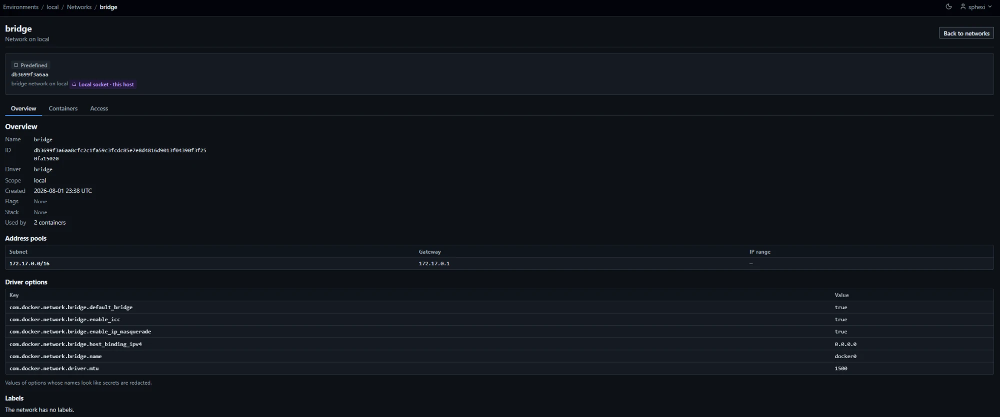

# Networks

Networks are listed and managed per environment. The list and the detail page are read from the host when the page loads. Nothing is cached.

## Pages and routes

Paths under `/environments/{id}/networks`:

| Page | Path | Method |
|---|---|---|
| Network list | The base path | `GET` |
| Network | `/{network_id}?tab={tab}` | `GET` |
| Create form | `/new?driver={driver}` | `GET` |
| Create, or redraw the form for another driver or more rows | `/new` | `POST` |
| Remove confirmation | `/{network_id}/remove` | `GET` |
| Remove | `/{network_id}/remove` | `POST` |
| Prune confirmation | `/prune` | `GET` |
| Prune | `/prune` | `POST` |
| Save or delete the access control | `/{network_id}/access`, `/{network_id}/access/delete` | `POST` |

Paths under `/environments/{id}/containers/{container_id}/networks`:

| Page | Path | Method |
|---|---|---|
| Attach form | `/connect?network={network_id}` | `GET` |
| Attach | `/connect` | `POST` |
| Detach confirmation | `/{network_id}/disconnect` | `GET` |
| Detach | `/{network_id}/disconnect` | `POST` |

- `{network_id}` is 64 lower-case hexadecimal digits, or 25 lower-case letters and digits (the form Swarm gives to overlay networks). Any other form, including a network name, answers `404` for every role, before any call to the host.
- `{container_id}` is the full 64-character lower-case hexadecimal id, as in [Containers](Usage-Containers).
- `{tab}` is `overview` (default), `containers` or `access`. Any other value answers `404`. `access` is shown to administrators; other roles receive `403`.
- `{driver}` is a driver offered on the environment ([Drivers](#drivers)). Any other value selects the first offered driver.
- Every `POST` redirects (`303`) on success, except an attach or detach sent by htmx, which swaps a fragment in place. Create redirects to the new network, remove to the list, attach and detach to the container's Networks tab. A prune redirects to a result page, `/results/{token}` ([Result pages](Contributing-Frontend-Conventions#result-pages)), which lists each network and outcome; reloading it repeats nothing.
- A refusal renders a page at the real status code, with a `Review again` link for `409`, `502` and `503`.
- Network routes have no JSON form.

## Access

Viewing needs sight of the environment ([Access](Usage-Environments#access)). A standard user without it receives `404` on every route.

Visibility of a network follows the order in [Visibility](Usage-Containers#visibility): the network's own resource control, then the control of its stack, then the default access policy for uncontrolled objects. A network belongs to a stack when it carries the label `com.docker.compose.project` or `com.docker.stack.namespace`.

| Action | Administrators | Standard users |
|---|---|---|
| List, network page | All networks | Networks they may see; `404` for any other id |
| Create | Every offered driver, addressing and option | Remote environments they hold a grant on; `bridge`, and `overlay` on a Swarm manager, with automatic addressing and [allowed options](#options) only. `403` on a local socket; `404` without a grant |
| Remove | Yes | Write access to the network. `403` on a local socket |
| Prune | Yes | Refused (`403`) |
| Attach | Yes | Write access to the container and to the network. `403` on a local socket |
| Detach | Yes | Write access to the container. `403` on a local socket |
| Access tab | Yes | Refused (`403`) |

- A network that does not exist, and a network the user may not see, answer identically (`404`).
- A network the user may read but not change shows no `Remove` button. Posting a removal answers `403`.
- On a local socket environment a standard user has read access at most ([Local socket environments](Usage-Containers#local-socket-environments)).

| Withheld from standard users | Shown to administrators |
|---|---|
| Driver options (`Not shown for your role`) | Yes. Values are scrubbed of embedded secrets; a secret-named key shows `Redacted` |
| Values of secret-named label keys (`Redacted`) | Yes |
| Names of containers they may not see | Yes. The `Used by` count includes every container on the host |

Secret-named keys follow the rule in [Withheld from standard users](Usage-Containers#withheld-from-standard-users).

## Network list

| Item | Value |
|---|---|
| Columns | Name (with short id and badge), Driver, Scope, Subnets, Flags, Stack, Used by, Actions |
| Flags | `Internal`, `Attachable`, `IPv6` |
| Actions column | `Details` for everyone; `Remove` for users with write access to a user network |
| Order | Name, ignoring case, then id |
| Page size | 25 by default; `limit` 1 to 500. Outside the range answers `422` |
| Paging | `cursor`; an invalid cursor answers `400` |
| Count | `N networks`, or `N networks match these filters, of M you can see` |
| Used by | Containers, then services. Up to 10 of each the viewer may see are named and linked. Those beyond the limit, and those the viewer may not see, are counted and not named. `Not used` when neither uses the network; `Service use unknown` when the host's services could not be read ([Service use](#service-use)) |
| Buttons | `Create network` for users who may create; `Prune networks` for administrators |

Every network the viewer may see is listed. A container counts as using a network when it has an endpoint on it, in any state. A container that has never started counts. A container whose network mode names the network but that has no endpoint on it does not. A Swarm service counts as well ([Service use](#service-use)).

### Badges

| Badge | Networks |
|---|---|
| `Predefined` | `bridge` (driver `bridge`), `host` (driver `host`), `none` (driver `null`) |
| `System` | The Swarm `ingress` network, and `docker_gwbridge` (driver `bridge`) |
| None | Every other network |

A network is predefined or system by name and driver together. A user network called `bridge` with another driver is a user network.

### Filters

| Filter | Parameter | Match |
|---|---|---|
| Name contains | `q` | At most 128 characters. Case-insensitive substring of the name |
| Driver | `driver` | `bridge`, `overlay`, `macvlan`, `ipvlan`, or `other` for any driver not listed |
| Scope | `scope` | `local` or `swarm` |
| Use | `usage` | `used` or `unused` |
| Kind | `kind` | `user`, `predefined` or `system` |
| Stack | `stack` | At most 128 characters. Case-insensitive exact match on the stack name |

An invalid filter value replaces the table with the message for the field and answers `400`. Filters survive paging.

### Host failures

The list is replaced by an error, and the answer is `503`. The messages are those of [Host failures](Usage-Containers#host-failures). A host whose network list exceeds 16 MiB answers `This host reports more network data than can be listed here (limit 16 MiB).` and no partial list is shown. The container list read beside it is limited to 32 MiB.

## Network page

| Tab | Content | Shown to |
|---|---|---|
| Overview | Name, id, driver, scope, created, flags, stack, `Used by`, address pools (`Subnet`, `Gateway`, `IP range`; first 16), driver options, labels | Everyone. Driver options: administrators |
| Containers | Sections `Connected now` (running containers with an endpoint: name, IPv4 address, IPv6 address, MAC address), `Configured, not running` (stopped containers with an endpoint on the network) and, on a Swarm manager, `Services` (the services that use the network, linked to their pages) | Everyone, limited to the containers and services they may see |
| Access | Resource control | Administrators |

- At most 500 containers are listed per section, and at most 500 services. Counts of the rest, and of containers and services the viewer may not see, follow the lists.
- The Overview tab reads `Used by`: `{N} containers`, with `and {M} services` when a service uses the network, and `; service use is unknown` when the host's services could not be read.
- Values of driver options whose names look like secrets are redacted.
- Label values are cut at 4096 characters.
- The page offers `Remove` for networks the viewer may remove.
- A raw inspect document is never shown.

## Service use

On a Swarm manager, services use networks. A standalone host has no services.

| Item | Value |
|---|---|
| A service uses a network when | Its task template names the network as a target, by id or, when the target is not an id, by name; or the service holds a virtual address on the network |
| Counted | Whether or not the service's tasks run |
| Read | From the service list, with the container list, on every list, network page, remove confirmation, removal and prune |
| Named | The services the viewer may see ([Access](Usage-Swarm#access)), linked to their pages. The rest are counted |
| `usage` filter | Counts containers and services together |

| Situation | List and network page | Remove confirmation, removal, prune |
|---|---|---|
| The service list is read | Services are counted and named | Services are counted. A network a service uses is not removed and is not a prune candidate |
| The service list cannot be read | The page renders and counts containers only. The list cell reads `Service use unknown`. The Overview tab reads `service use is unknown` and the Containers tab says the host's services could not be read | Fails with the host message ([Host failures](#host-failures)). Nothing is removed |

## Drivers

| Driver | Standalone | Swarm manager | Standard users |
|---|---|---|---|
| `bridge` | Yes | Yes (local scope) | Yes |
| `overlay` | No | Yes. `Attachable` is off by default | Yes |
| `macvlan` | Yes. A subnet is required | Yes (local scope). A subnet is required | No |
| `ipvlan` | Yes. A subnet is required | Yes (local scope). A subnet is required | No |
| `host`, `none` | Not created | Not created | No |

- The environment type decides what is offered. Overlay appears only when the environment is recorded as a Swarm manager. A worker, a standalone host and an environment that has never been contacted are offered no overlay.
- `host` and `none` exist on every host from installation. The daemon allows one of each, so neither is offered.
- Plugin drivers, a custom IPAM driver and `ingress` are not offered. The IPAM driver is `default`.
- `Attachable` applies to overlay networks only. On another driver it is refused: `Only overlay networks can be made attachable.`
- Without script, the driver is chosen first and `Continue` redraws the form with the fields of that driver. With script the fields change when the driver changes.
- The fields of the chosen driver sit in one `<fieldset>` whose legend names the driver (`Bridge settings`, `Overlay settings`, `Macvlan settings`, `Ipvlan settings`). `Attachable` is present for `overlay` only. Addressing is present for administrators only.
- An overlay network has scope `swarm` and a 25-character id. Services attach to overlay networks from the service form ([Create](Usage-Swarm#create)). A container attaches only to an attachable overlay network ([Attach](#attach)).
- `ingress` and `docker_gwbridge` carry the `System` badge, cannot be removed and are not offered for create. A service that publishes a port in `ingress` mode holds an address on `ingress` and is listed as its user.

## Create

1. Open `Create network` on the network list.
2. Choose the `Driver`. Without script, choose `Continue` to redraw the form with the fields of that driver.
3. Fill `Name` and the driver's settings. Administrators may fill `Addressing`; any user may add driver options and labels.
4. Choose `Create network`. The network page opens. When a field is refused, the form returns with the message beside the field.

| Field | Rule |
|---|---|
| Name | 1 to 255 characters: letters, digits, `_`, `.`, `-`; the first is a letter or digit. Not 64 hexadecimal digits and not 25 lower-case letters and digits (Docker reads those as ids). Not `bridge`, `host`, `none`, `ingress` or `docker_gwbridge`, ignoring case |
| Driver | One of the [offered drivers](#drivers) |
| Internal | Containers on the network cannot reach outside it |
| Attachable | Overlay only |
| Enable IPv6 | An IPv6 subnet needs it. It may be on with no IPv6 subnet; Docker then allocates the range |
| Addressing | [Subnet, gateway and allocation range](#addressing), one set for IPv4 and one for IPv6. Administrators only |
| Driver options | Up to 32 key and value rows. [Rules](#options) |
| Labels | Up to 64 key and value rows, 64 KiB in all. Key at most 255 characters. No NUL in a value |

- Labels with the keys `com.docker.compose.project` and `com.docker.stack.namespace` are refused, whatever their case and surrounding whitespace.
- A duplicate option key (ignoring case) or label key is refused.
- The configuration sent to Docker is built from the validated fields only. Nothing a user types reaches Docker as a raw mapping.
- The new network is put under a resource control owned by its creator ([Ownership](#ownership)).

| Result | Status | Message | Shown |
|---|---|---|---|
| Invalid field | 400 | The field's message | Beside the field |
| Standard user used an administrator-only driver, address or option | 400 | `Only administrators can create this kind of network.`, `Only administrators can choose addresses; leave this empty to use Docker's.` or `Only administrators can set the option {key}.` | Beside the field |
| Name taken | 409 | `A network with this name already exists.` | Name field |
| Subnet overlaps another network | 400 | `This subnet overlaps the existing network {name}.` | Subnet field |
| Docker refused the configuration | 502 | `Docker refused this network configuration.` | Banner |
| Host unavailable | 503 | The host message ([Host failures](Usage-Containers#host-failures)) | Banner |
| Host did not answer in time | 503 | `The Docker host did not answer in time. The action may still complete.` | Banner. Check the network list before submitting again |

Docker's own error text is shown only to administrators, under the message, in a block headed `Docker said`. It is scrubbed, reduced to one line and cut to 300 characters, appears only when the Engine refused with status `400` or `404` and sent a message, and is not written to any log line or activity row. A standard user sees the message in the table only. The block appears on the create form and on the problem page of a `Docker refused the action` answer. The in-place dialog notice of an attach or detach carries the message only.

## Addressing

Addressing is set by administrators. Without a subnet, Docker allocates from its default pools.

| Item | Rule |
|---|---|
| Pools | At most one IPv4 pool and one IPv6 pool. Each has a subnet, and optionally a gateway and an allocation range. No auxiliary addresses |
| Subnet form | CIDR with no host bits set. `10.20.0.5/24` is refused: `The IPv4 subnet has host bits set; the network is 10.20.0.0/24.` |
| IPv4 prefix length | 8 to 30 |
| IPv6 prefix length | 48 to 120 |
| Family | The IPv4 field takes an IPv4 network and the IPv6 field an IPv6 network |
| Gateway | Same family as the subnet. Inside the subnet. Not the network address. Not the IPv4 broadcast address |
| Allocation range | CIDR in the same family, inside the subnet. The gateway may lie outside it |
| Overlap | The subnet may not overlap the subnet of any other network on the host. The refusal names the other network |
| Macvlan, ipvlan | A subnet is required: `A {driver} network needs a subnet.`, with `macvlan` or `ipvlan` as the driver |

| Refused ranges (any overlap) |
|---|
| IPv4: `0.0.0.0/8`, `127.0.0.0/8`, `169.254.0.0/16`, `224.0.0.0/4`, `240.0.0.0/4` |
| IPv6: `::/128`, `::1/128`, `::ffff:0:0/96`, `fe80::/10`, `ff00::/8` |

A subnet that overlaps a refused range answers `The IPv4 subnet overlaps {range}, which cannot be used here.` (`IPv6` for the IPv6 field).

- Overlap is checked against the networks Docker reports. Overlap with the host's own routes cannot be seen through the Engine API, and the form says so.
- A standard user sets a static address on an attachment only on a network an administrator created with a subnet.

## Options

| Rule | Value |
|---|---|
| Rows | At most 32 |
| Key | 1 to 128 characters: letters, digits, `.`, `_`, `-`; the first is a letter or digit |
| Value | At most 256 characters, no control characters |

Values are checked wherever the key appears:

| Key | Value |
|---|---|
| `com.docker.network.driver.mtu` | Whole number from 68 to 65535; from 1280 when IPv6 is in use |
| `com.docker.network.bridge.enable_icc`, `com.docker.network.bridge.enable_ip_masquerade` | `true` or `false` |
| `encrypted` | Empty or `true` |
| `macvlan_mode` | `bridge`, `vepa`, `passthru` or `private` |
| `ipvlan_mode` | `l2`, `l3` or `l3s` |
| `ipvlan_flag` | `bridge`, `private` or `vepa` |
| `parent` | A Linux interface name of at most 15 characters (letters, digits, `_`, `.`, `@`, `-`; the first a letter or digit), such as `eth0.10` |

| Driver | Options a standard user may set |
|---|---|
| `bridge` | `com.docker.network.bridge.enable_icc`, `com.docker.network.bridge.enable_ip_masquerade`, `com.docker.network.driver.mtu` |
| `overlay` | `encrypted`, `com.docker.network.driver.mtu` |

- Any other key is refused for a standard user, beside the row: `Only administrators can set the option {key}.` Refused keys include `com.docker.network.bridge.name`, `com.docker.network.bridge.gateway_mode_ipv4`, `com.docker.network.bridge.gateway_mode_ipv6`, `com.docker.network.bridge.host_binding_ipv4`, `com.docker.network.bridge.inhibit_ipv4`, `com.docker.network.bridge.trusted_host_interfaces` and `com.docker.network.driver.overlay.vxlanid_list`.
- Administrators may set any key that passes the key and value rules. The activity row lists the keys outside the standard list in `restricted`.
- Driver options are shown only to administrators.

## Attach

The Networks tab of a container ([Container page](Usage-Containers#container-page)) lists its attachments and, below them, an `Attach to a network` form.

1. Open the container's Networks tab.
2. Under `Attach to a network`, choose the `Network`. Fill `Aliases`, `IPv4 address` and `IPv6 address` as needed.
3. Choose `Attach`. The Networks tab shows the attachment. When a field is refused, the message appears beside it.

| Item | Value |
|---|---|
| Shown to | Users with write access to the container, when its network mode allows networks |
| Works on | Running and stopped containers. A stopped container joins the network when it starts |
| Offered networks | At most 200, by name. Not already joined; not `host` or `none`; not an overlay that is not attachable. A standard user is offered networks they hold write access to |
| Fields | Network, Aliases, IPv4 address, IPv6 address |
| Aliases | Separated by spaces or commas. At most 16. Each is a DNS label of letters, digits and hyphens, up to 63 characters, not starting or ending with a hyphen |
| Static addresses | Empty for Docker to assign one |
| Permission | Write access to the container and to the network |
| Not sent | Driver options, links, MAC address |

| Refused before Docker is asked | Field | Message |
|---|---|---|
| Container network mode `host`, `none` or `container:` | Container | `This container shares another network namespace and cannot join networks.` |
| Network driver `host` or `none` | Network | `A container cannot join this network.` |
| Container already has an endpoint on the network | Network | `The container is already connected to this network.` |
| Overlay network that is not attachable | Network | `This overlay network is not attachable.` |
| Aliases on a predefined network | Aliases | `Aliases are not available on this network.` |
| More than 16 aliases, or an alias that is not a DNS label | Aliases | `Use at most 16 aliases, each made of letters, digits and hyphens.` |
| Static address on a predefined network | Address | `Static addresses are not available on this network.` |

### Static addresses

| Rule | Message |
|---|---|
| A valid IP address | `Enter a valid IP address.` |
| IPv4 in the IPv4 field, IPv6 in the IPv6 field | `Enter an IPv4 address.` or `Enter an IPv6 address.` |
| IPv6 only on a network with IPv6 enabled | `IPv6 is not enabled on this network.` |
| The network has a subnet of that family | `This network has no IPv4 subnet configured.` (`IPv6` for the IPv6 field) |
| Inside that subnet | `The address must lie inside the network's subnet.` |
| Not the network address | `The address cannot be the network address of the subnet.` |
| Not the IPv4 broadcast address | `The address cannot be the broadcast address of the subnet.` |
| Not the gateway | `The address is the network's gateway.` |
| Not held by an endpoint the network reports | `This address is already in use on the network.` |

- The address need not lie inside the allocation range.
- Only endpoints the network reports are checked. Docker refuses any other clash itself, and the attach then answers `502`.

| Result | Status | Message |
|---|---|---|
| Attached | 303, or a fragment for htmx | The Networks tab shows the attachment |
| Invalid field | 400 | The field's message |
| Container or network busy | 409 | The [busy](#busy) message |
| Container or network gone | 404 | `The container no longer exists.` or `The network no longer exists.` |
| Docker refused | 502 | `Docker refused to connect this container to the network. The address may be in use.` |
| Host unavailable | 503 | The host message |

## Detach

`Detach` on a row of the Networks tab opens a confirmation. It names the container, the network, the addresses and the aliases the container loses. The button reads `Detach container`.

| Item | Value |
|---|---|
| Shown to | Users with write access to the container, when its network mode allows networks |
| Permission | Write access to the container. Access to the network is not needed |
| Works on | Running and stopped containers. A running container leaves the network at once and its connections through it are dropped |
| Network not among the container's endpoints | `404` |
| Forced | Never. Docker is not asked to force the disconnect |
| Docker refused | 502, `Docker refused to disconnect this container from the network.` |
| The container dockmin runs in | Refused for every role: `409`, `This is the container dockmin runs in. It cannot be detached from a network from dockmin, because dockmin could lose its own connection.` Recorded as a `network_disconnected` failure with reason `self_protected` ([dockmin's own container](Usage-Containers#dockmins-own-container)) |

A network is matched to an endpoint by id. For a container that has never started, whose endpoints carry no id, it is matched by name.

## Remove

Removal deletes a network. It needs write access to the network.

1. Open `Remove` on the network list or the network page.
2. Read the confirmation. When it reads `This network is in use`, detach the containers it names, or edit the services it names, and open `Remove` again.
3. Choose `Remove network`. The list opens with `Network removed.`

| Item | Value |
|---|---|
| Confirmation | The environment, the network, its driver, scope, stack, and the containers and services that use it |
| In use | A network is in use when a container in any state has an endpoint on it, or a service uses it ([Service use](#service-use)). Stopped containers count. A container's network mode is not consulted. A service counts whether or not its tasks run |
| In use: the confirmation | Reads `This network is in use`. Names the containers the viewer may see, counts the rest, and links each container's Networks tab, where `Detach` is. Names the services the viewer may see (at most 10), counts the rest, and says to remove the network from each service by editing it. The remove button is withheld |
| Force | None. A network in use is never removed |
| Predefined and system networks | Not removable. The confirmation reads `This network cannot be removed` and has no button; a posted removal answers `409` |
| Reviewed state | The confirmation carries the network's name and the number of containers and services using it (`0`). A different name, or any user at removal, refuses the removal |
| Lock | The network is held for the removal ([Busy](#busy)). The use is counted again under the lock |
| Access control | Deleted with the network |

| Result | Status | Message |
|---|---|---|
| Removed | 303 | Redirect to the list with `Network removed.` |
| In use | 409 | `The network is used by one or more containers or services.` |
| Predefined or system | 409 | `This network is provided by Docker and cannot be removed.` |
| Name or use changed | 409 | `This network changed since you reviewed it; nothing was changed.` |
| Another action holds the network | 409 | [Busy](#busy) |
| Network gone | 404 | `The network no longer exists.` |
| Docker refused | 502 | `Docker refused the action.` |
| Host unavailable | 503 | The host message |

- Docker answers one status for both a predefined network and a network with active endpoints. dockmin decides the message from its own counts.
- On a Swarm manager the confirmation and the removal read the services with the containers. When they cannot be read, the confirmation and the removal fail with the host message ([Host failures](#host-failures)) and nothing is removed.
- When Docker refuses the removal of a swarm-scoped network, the answer is `The network is used by one or more containers or services.`

## Prune

Pruning removes unused networks in bulk. Administrators only.

1. Open `Prune networks` on the network list.
2. Read the list `N networks would be removed`. Each name is a target.
3. Choose `Remove N networks`. The result page lists each network and its outcome.

| Item | Value |
|---|---|
| Listing | `GET /environments/{id}/networks/prune` lists exactly the networks the prune removes |
| Candidates | Local-scope user networks that no container, in any state, has an endpoint on and that no service uses. Not predefined, not system, not swarm-scoped |
| Order and limit | By name, at most 100. The list, its count and the button name only the objects in this prune; a notice gives the rest: `N more networks are not in this prune. Run it again afterwards for the rest.` (`1 more network is not in this prune.` for one) |
| Posted | Each listed network with its id and name. A posted list of fewer than 1 or more than 100 networks answers `400`: `Select between 1 and 100 networks.` |
| Run | The candidates are read again. A network that is no longer a candidate, or whose name changed, is skipped. Each network is removed on its own, and a failure does not stop the others |
| Docker prune | Docker's prune endpoint is never called |

| Result per network | Meaning |
|---|---|
| `Removed` | Gone |
| `Skipped: changed since you reviewed it` | No longer a candidate, or renamed |
| `Skipped: a container uses it now` | |
| `Skipped: another operation is running on it` | |
| `Already gone` | |
| `Failed` | Docker refused or the host failed |

## Ownership

| Event | Access control |
|---|---|
| Create | The network is put under a resource control owned by its creator, administrators included, in the same operation. The control's access level is `write`, and the owner holds the control's level ([Ownership](Usage-Stacks#ownership)). No other user or team is granted anything |
| Saving fails | The network is kept. The page shows `Network created, but its ownership could not be recorded. An administrator can assign access to it.` The row records `control_created` as `false`. The default access policy for uncontrolled objects applies |
| Remove | The control is deleted. The row records `control_released` as `false` when it could not be deleted |
| Network made by a stack | It carries the stack's label and is visible to whoever may see the stack. A control on the network itself overrides the stack's ([Networks of a stack](#networks-of-a-stack)) |

Administrators see every network whatever its control. Administrators manage controls on the Access tab.

### Networks of a stack

A [stack](Usage-Stacks) names the networks it creates in its Compose file, and uses `{stack}_default` when a service has no network of its own. Compose reuses a network whose name matches.

| Event | Behaviour |
|---|---|
| A deployment declares a network that already exists | Refused unless the network carries the label `com.docker.compose.project` with the stack's name (any case) and has no control of its own: `Network {name} already exists and does not belong to this stack.` (`409`, reason `preexisting_objects`). A network made on this page under a name a stack declares is refused until it is removed |
| A deployment declares a network that does not exist | Compose creates it with the project label. It has no control of its own and is visible to whoever may see the stack |
| After the deployment | The project's networks are read again. One without the project label, or with a control, is reported as `preexisting_after_deploy` |
| Stack removed | The project's networks are removed with its containers. The remove confirmation names them |
| External network in a stack file | Not created or removed by the stack. A standard user needs write access to it, and a network with the `host` driver is refused ([External volumes and networks](Usage-Stacks#external-volumes-and-networks)) |
| Network driver, addressing and options in a stack file | A standard user may set the standard `bridge` options only, no `ipam` and no other driver: the rules of [Options](#options) and [Addressing](#addressing) ([Networks, volumes, configs and secrets](Usage-Stacks#networks-volumes-configs-and-secrets)) |

### Networks of a Swarm stack

A [Swarm stack](Usage-Stacks#swarm-stacks) creates the overlay networks its file uses, named `{stack}_{key}`, and `{stack}_default` for a service that names none. Each carries the label `com.docker.stack.namespace`.

| Event | Behaviour |
|---|---|
| A deployment declares a network that already exists | Refused unless the network carries the stack's label (any case): `Network {name} already exists and does not belong to this stack.` (`409`, reason `preexisting_objects`) |
| A network of the stack exists with other settings than the file | Refused (`409`, reason `network_differs`): `This network exists with other settings, and Docker cannot change a network in place.` |
| A deployment declares a network that does not exist | dockmin creates it with the stack's label. It has no control of its own and is visible to whoever may see the stack |
| Created or removed by a stack | The stack's activity row lists it. No `network_created` or `network_removed` row is written |
| Redeploy | A network of the stack that the file no longer declares is removed when no service that stays uses it |
| Stack removed | The stack's networks are removed after its services. A network Docker reports as in use is tried again once after 2 seconds, then kept; it is listed with the other namespaces as not managed and receives a copy of the stack's control, when the stack has one |
| External network in a stack file | Not created or removed by the stack. It must be swarm-scoped or the predefined `host` network. A standard user needs write access to it, and `host` is refused ([Swarm networks](Usage-Stacks#swarm-networks)) |
| Driver, addressing and options in a stack file | Always `overlay`. A standard user may set `encrypted` and `com.docker.network.driver.mtu` only, and no `ipam`: the rules of [Options](#options) and [Addressing](#addressing) |
| Remove from this page | Refused while a service of the stack uses the network |

## Busy

One action runs on a network at a time. A second is refused at once; it does not wait.

| Action | Held |
|---|---|
| Remove | The network |
| Attach, detach | The container and the network. A lifecycle action, recreate or remove on the container is busy meanwhile |

Message: `{Who} started a {action} on it {N} seconds ago and it has not finished. Wait for it to complete, then try again.` (`409`). `{Who}` is `You`, `Another user` or, for administrators, the holder's name. The action is `remove`, `connect` or `disconnect`. The holders follow the table in [Busy](Usage-Containers#busy).

## Recorded actions

Every action records one activity row, for success and for failure. A refusal on access leaves no row: a network or container the user may not see, a user who lacks the access level required, an id that is not a canonical id, and a standard user's request whose access could not be decided because the host could not be read.

| Action | Target |
|---|---|
| `network_created` | The new network's id. None for a failure |
| `network_removed` | The network's id |
| `network_connected`, `network_disconnected` | The container's id |

| Detail key | Present when |
|---|---|
| `name` | `network_created`, `network_removed`: the network's name. `network_connected`, `network_disconnected`: the container's name |
| `driver` | `network_created`, `network_removed` |
| `scope`, `internal`, `attachable`, `ipv6` | `network_created` |
| `subnets`, `gateways`, `ip_ranges` | `network_created`: comma-separated, empty when none |
| `option_keys` | `network_created`: the option keys, comma-separated. Values are never recorded |
| `labels` | `network_created`: the number of labels. Keys and values are never recorded |
| `restricted` | `network_created` by an administrator: `driver` (macvlan or ipvlan), `addressing`, and the option keys outside the standard list, comma-separated |
| `control_created` | `network_created`: whether the access control was saved |
| `control_released` | `network_removed`: whether the access control was deleted |
| `pruned` | `network_removed`, `true` when it ran from a prune. A prune writes one row per network and none for the run |
| `network_id`, `network_name` | `network_connected`, `network_disconnected` |
| `aliases` | `network_connected`: the number of aliases |
| `ipv4_address`, `ipv6_address` | `network_connected`: the address typed, or `null` |
| `fields` | Reasons `invalid` and `restricted`: the names of the refused fields, comma-separated |
| `holder_action` | Failure row for a busy object |
| `interrupted` | The request ended before the Engine answered. The row is written when the Engine call settles, or as `outcome_unknown` if it does not settle |
| `reason`, `message` | Failure rows |

| Failure reason | Cause |
|---|---|
| `invalid` | A field failed validation, an attach was refused before Docker was asked, or a subnet overlaps another network |
| `restricted` | A standard user used an administrator-only driver, address or option |
| `name_in_use` | A network with the name exists |
| `network_predefined` | Removal of a predefined or system network |
| `network_in_use` | Removal of a network that containers or services use |
| `changed_since_review` | The name or the use differs from the confirmation |
| `object_busy` | Another action holds the network or the container |
| `self_protected` | Detach of the container dockmin runs in |
| `network_gone`, `container_gone` | The object no longer exists |
| `engine_rejected` | Docker refused the request |
| `unreachable`, `unsupported`, `credentials`, `engine`, `outcome_unknown`, `too_large` | Host failures, as in [Host failures](Usage-Containers#host-failures) |
