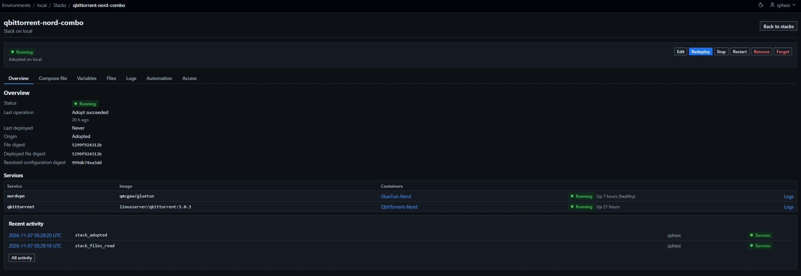
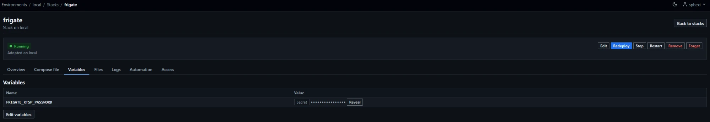
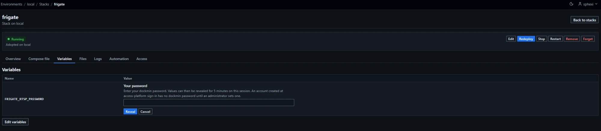
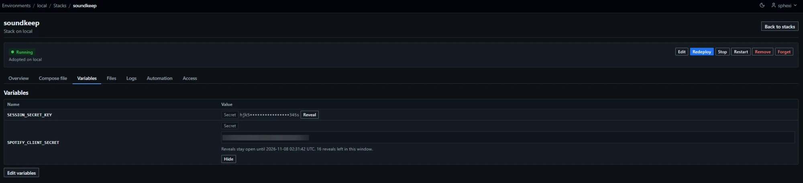
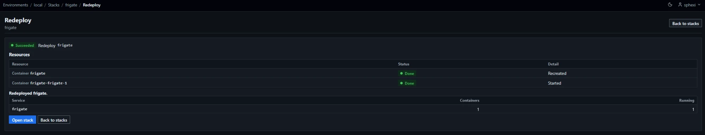
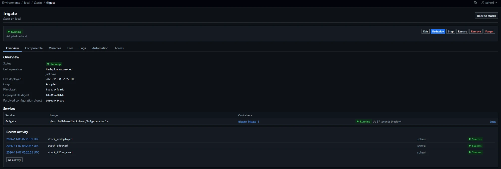

# Stacks

A stack is one Compose file, its variables and its companion files, stored by dockmin and deployed to one environment. There are two kinds.

| | Compose stack | Swarm stack |
|---|---|---|
| Environment | Any | Swarm manager ([Swarm](Usage-Swarm)) |
| Deployed by | The Docker Compose v2 CLI, run against the environment's Docker host | Engine API calls made by dockmin. The Compose CLI only resolves the file (`config`) |
| Creates | Containers, networks, volumes | Services, networks, configs, secrets. Volumes are created by the nodes |
| Listed under | `/environments/{id}/stacks` | `/environments/{id}/swarm/stacks` |
| Name grammar | Lower case only ([Stack names](#stack-names)) | Case kept ([Swarm stack names](#swarm-stack-names)) |
| JSON API | [Yes](#json-api) | No |
| Reference | This page, up to [Swarm stacks](#swarm-stacks) | [Swarm stacks](#swarm-stacks) |

| Item | Value |
|---|---|
| Identity | The environment and the stack name. The name is the key of the stack's access control |
| Content | One Compose file (at most 128 KiB), up to 100 variables, up to 20 [companion files](#companion-files) and, for a Compose stack, up to 32 [build contexts](#build-contexts) |
| Origin | `created` in dockmin, or `adopted` from a project or namespace already on the host |
| Compose version | v2.32.0 or later, for both kinds ([Docker Compose requirement](#docker-compose-requirement)) |
| Builds | Compose stacks, administrators only ([Builds](#builds)) |
| Not supported | Deployment from a Git repository, files outside the stack's [companion files](#companion-files) and [build contexts](#build-contexts) |

- The Compose stack list holds Compose projects only. A Swarm namespace is not listed, adopted or deployed there.
- The Stacks count of the environment list and the sidebar ([Environments](Usage-Environments)) counts a name once, whichever kind or kinds of object carry it. The `Stacks` card of the environment page counts managed stacks only, Compose and Swarm apart.
- One name space per environment: a Compose project, a Swarm stack and a Swarm namespace cannot share a name in any case ([Stack names](#stack-names), [Swarm stack names](#swarm-stack-names)).
- The sections from [Pages and routes](#pages-and-routes) to [JSON API](#json-api) describe Compose stacks, except where they name Swarm. [Swarm stacks](#swarm-stacks) describes the Swarm kind.

## Pages and routes

All paths are under `/environments/{id}/stacks`.

| Page | Path | Method |
|---|---|---|
| Stack list | The base path | `GET` |
| Create form | `/-/new` | `GET` |
| Check a new stack's file | `/-/validate` | `POST` |
| Create and deploy | `/-/new` | `POST` |
| Operation progress | `/-/jobs/{job_id}` | `GET` |
| Progress stream (server-sent events) | `/-/jobs/{job_id}/events` | `GET` |
| Adopt form, adopt | `/-/adopt/{project}` | `GET`, `POST` |
| Check a file for adoption | `/-/adopt/{project}/validate` | `POST` |
| Read from host | `/-/adopt/{project}/read` | `POST` |
| Adopt as is | `/-/adopt/{project}/as-is` | `POST` |
| Stack | `/{name}?tab={tab}` | `GET` |
| Logs, live (server-sent events) | `/{name}/logs/stream` | `GET` |
| Logs, download | `/{name}/logs/download` | `GET` |
| Editor, save | `/{name}/edit` | `GET`, `POST` |
| Check a changed file | `/{name}/validate` | `POST` |
| Redeploy confirmation, redeploy | `/{name}/redeploy` | `GET`, `POST` |
| Redeploy confirmation that also removes containers | `/{name}/redeploy?orphans=1` | `GET` |
| Start, stop | `/{name}/start`, `/{name}/stop` | `POST` |
| Restart confirmation, restart | `/{name}/restart` | `GET`, `POST` |
| Add a file | `/{name}/files/-/new` | `GET`, `POST` |
| Edit a file | `/{name}/files/{file}/edit` | `GET`, `POST` |
| Remove confirmation, remove a file | `/{name}/files/{file}/remove` | `GET`, `POST` |
| Upload a build context | `/{name}/contexts/-/upload` | `POST` |
| Remove confirmation, remove a build context | `/{name}/contexts/{file}/remove` | `GET`, `POST` |
| Remove confirmation, remove | `/{name}/remove` | `GET`, `POST` |
| Remove confirmation with volumes | `/{name}/remove?volumes=1` | `GET` |
| Force remove confirmation (also removes containers) | `/{name}/remove?orphans=1`, and `/{name}/remove?volumes=1&orphans=1` | `GET` |
| Forget confirmation, forget | `/{name}/forget` | `GET`, `POST` |
| Export confirmation | `/{name}/export` | `GET` |
| Export download | `/{name}/export` | `POST` |
| Access control | `/{name}/access`, `/{name}/access/delete` | `POST` |
| Reveal a secret variable | `/{name}/variables/{variable_id}/reveal` | `POST` |
| Masked row of a secret variable | `/{name}/variables/{variable_id}` | `GET` |
| Dismiss a project that is not managed here | `/-/unmanaged/{project}/dismiss` | `POST` |
| Restore a dismissed project | `/-/unmanaged/{project}/restore` | `POST` |

- `{name}` and `{project}` follow the [stack name](#stack-names) grammar. Any other form answers `404` for every role, before any call to the host.
- `{job_id}` is 22 characters from `A-Za-z0-9_-`. Any other form answers `404`.
- `{variable_id}` is a whole number from 1 to 9223372036854775807. The reveal, masked row, dismiss and restore routes answer `404` to standard users.
- `{project}` of the dismiss and restore routes is `[A-Za-z0-9][A-Za-z0-9_.-]{0,62}`; any other form answers `404`. The stack list takes `?dismissed=1` ([Projects not managed here](#projects-not-managed-here)).
- `{file}` follows the [file name](#file-names) grammar, in the file routes and in the build context routes. Any other form answers `404` for every role, before any call to the host. A well-formed name that is not a file of the stack answers `404` to a user with write access; a user without it is refused as for any write. `-` cannot begin a name, so `/files/-/new` never names a file.
- `{tab}` is `overview` (default), `file`, `variables`, `files`, `logs`, `automation` or `access`. Any other value answers `404`. `access` answers `403` to standard users.
- Paths under `/-/` cannot collide with a stack, because a name cannot start with `-`.
- A form larger than 256 KiB in total answers `413`. The build context upload is the exception ([Build contexts](#build-contexts)).
- `/-/adopt/{project}/read` and `/-/adopt/{project}/as-is` answer `404` to standard users, before any read. `/-/adopt/{project}/as-is` takes the hidden field `read_token`. `/-/adopt/{project}?read={token}` fills the paste form from a held [result](#the-result-page); `{token}` is 22 characters from `A-Za-z0-9_-`, and any other form answers `422`.
- Every `POST` except the export download redirects (`303`) on success. The export download answers `200` with the archive ([Export](#export)). The redirects go: to the progress page for create, redeploy, restart, start, stop, remove and adopt with deploy; to the stack for save, adopt and adopt as is; to the Files tab for adding, editing and removing a file; to the list for forget. A refusal renders a page at the real status code.
- `/-/validate`, `/-/adopt/{project}/validate` and `/{name}/validate` return a fragment for htmx requests and the whole form otherwise.

| Tab | `tab` | Content |
|---|---|---|
| Overview | `overview` | Status, last operation, last deployed, origin, file digest, deployed file digest, resolved configuration digest. A services table (`Service`, `Image`, `Containers`): each container links to its page, shows its state and status, and has a `Logs` link to the Logs tab of that container (`?tab=logs`). `Not in the file` marks a service the file does not declare; `No container` and `{N} containers you cannot see` fill the rest |
| Compose file | `file` | The stored file and its digest. `Edit the file` for users with write access |
| Variables | `variables` | Names and values of plain variables; secret variables as `Secret` with the [mask](#the-mask). `Edit variables` for users with write access |
| Files | `files` | The stack's [companion files](#files-tab). Administrators also see the [Build contexts](#build-contexts) section |
| Logs | `logs` | [Logs](#logs) |
| Automation | `automation` | [Automation panel](#automation-panel) |
| Access | `access` | The stack's access control. Administrators only |

| Button of the summary | Shown when |
|---|---|
| `Edit`, `Redeploy`, `Remove` | The user has write access to the stack |
| `Start` | Write access, and the status is not `unknown` (`Not deployed` or `Unknown`) and not `Running` |
| `Stop` | Write access, and the status is not `unknown` and not `Stopped` |
| `Restart` | Write access, the status is `Running` or `Partly running`, and the stack is not [dockmin's own](#dockmins-own-stack) |
| `Forget` | Administrators |
| `Export` | Administrators, and the stack is not [dockmin's own](#dockmins-own-stack) by name |

- The status badge, `Changed since the last deploy` and the origin (`Created here` or `Adopted`) sit beside the buttons.
- Administrators see an activity panel on three tabs ([Activity panel](#activity-panel)).

## Docker Compose requirement

| Item | Value |
|---|---|
| Required | Docker Compose v2.32.0 or later, found as a standalone binary on the dockmin server ([Binary location](Reference-Deployment#binary-location)). `DOCKMIN_COMPOSE_BINARY` sets its path ([Configuration](Reference-Configuration)) |
| Read | Once at start: `version --format json`, within 10 seconds. While no version has been read, a later page load or operation tries again, at most once a minute |
| Applies to | Every environment. Compose runs on the dockmin server and connects to the environment's host. Swarm stack operations run `config` only |
| Recorded | The version is written to the environment's `Compose CLI` value by each successful stack operation and by each status refresh ([Environments](Usage-Environments)) |
| Replaced binary | Not noticed until dockmin restarts |

| Verdict | Stack lists and pages | Operations |
|---|---|---|
| Ready | Normal | Normal |
| No usable binary | Render from the host. A banner reads `Docker Compose is not ready` with the message | Refused (`503`, reason `compose_unavailable`): `Docker Compose was not found on this server.` |
| Older than v2.32.0 | Render from the host. The banner shows `Installed` and `Required` | Refused (`503`, reason `compose_version_unsupported`): `Docker Compose v2.20.2 is installed on this server; dockmin requires v2.32.0 or later.` |

- The banner ends `Stacks can still be listed and read. Anything that runs Compose is refused until this is fixed.`
- Checking a file is an operation: it runs Compose, so it is refused in the same way. Every Swarm stack operation that reads the stored file or checks a new one needs Compose as well.
- dockmin starts whatever the verdict. A missing or old binary is logged once at start.
- The environment page states `below the required v2.32.0` beside a recorded version older than the floor, and `Not checked` while none has been recorded.
- To fix a refusal: install the binary on the dockmin server, or set `DOCKMIN_COMPOSE_BINARY`, then restart dockmin ([Troubleshooting](Troubleshooting)).

## Access

Viewing needs sight of the environment ([Environments](Usage-Environments)). A standard user without it receives `404` on every route.

A stack is a controlled object keyed by its name. Visibility follows [Containers](Usage-Containers). A stack that does not exist and a stack the user may not see answer identically (`404`). A user who may read a stack and needs write answers `403`.

| Operation | Administrators | Standard users, remote environment | Standard users, local socket |
|---|---|---|---|
| List | Every stack and every unmanaged project | Stacks they may see. Unmanaged projects are not listed | Same |
| Stack page: file, variable names, non-secret values, files (plain content; a secret file as `Set`), services, containers | Yes | Read access to the stack. Each container is decided by its own visibility | Same |
| Logs tab, live stream, download | Yes | Read access to the stack. Lines come from the containers the user may read the logs of ([Logs](#logs)) | Same |
| Check a new file, create | Yes | Create access in the environment | Refused (`403`) |
| Check a changed file, save | Yes | Write access to the stack | Refused (`403`) |
| Add, edit or remove a file | Yes | Write access to the stack and to every container of the project ([Containers of the project](#containers-of-the-project)) | Refused (`403`) |
| Add, replace or remove a build context | Yes | Refused (`403`) | Refused (`403`) |
| Redeploy, start, stop, restart, remove | Yes | Write access to the stack and to every container of the project. A stack with a `build` section cannot be redeployed ([Who may build](#who-may-build)) | Refused (`403`) |
| Remove with volumes | Yes | As remove, and write access to each volume the removal deletes | Refused (`403`) |
| Forget, adopt, Access tab | Yes | Refused (`403`) | Refused (`403`) |
| Read from host, adopt as is | Yes | Refused (`404`) | Refused (`404`) |
| Reveal a secret variable | Yes, after re-entering their password ([Reveal a secret variable](#reveal-a-secret-variable)) | Refused (`404`) | Refused (`404`) |
| Dismiss or restore a project that is not managed here | Yes | Refused (`404`) | Refused (`404`) |
| Progress page and stream | Every operation | Operations they started; any other `404` | Same |

- The reach of a standard user is capped at read in a local socket environment ([Containers](Usage-Containers)).
- The file, the values of non-secret variables and the content of plain files are shown to everyone who can read the stack. Keep credentials in [secret variables](#secret-variables) or [secret files](#secret-files), not in the file.
- Access control rules and the Access tab: [Access control](Usage-Access-Control).

### Containers of the project

Compose acts on every container that carries the project label, whatever its own access control.

| Rule | Value |
|---|---|
| Standard user adding, editing or removing a file, redeploy, start, stop, restart, remove | Refused unless every container of the project is visible and writable to the user: `You cannot change every container in this stack.` (`403`, reason `restricted`). The page reads `You cannot change every container of this stack` |
| Any user | Refused as busy when an action is running on any container of the project ([Locks](#locks-and-busy)) |
| Administrators | Not restricted |

### Ownership

| Event | Access control |
|---|---|
| Create | The stack is put under a resource control owned by its creator, administrators included, in the same operation. The control's access level is `write`. Nothing is granted to anyone else. The row records `control_created` |
| Create over a stale control | A control on the name left by a stack that no longer exists, with no project of that name on the host and no Swarm namespace of that name, is replaced. The row records `stale_control_replaced` |
| Adopt | The administrator becomes the owner. An existing control on the name is kept (`control_created` is `false`) |
| Redeploy, start, stop, restart | The control stays. Recreated containers carry the same project label, so users with access to the stack keep seeing them |
| Remove | The control is deleted ([Remove](#remove)) |
| Forget | The control is deleted |
| Access tab | Administrators create, change and delete the control |

- A control has one access level. The owner, each granted user and team, and everyone when the control is public hold that level. The owner has no level of its own.
- Lowering the control to `read` lowers the owner to `read`.
- A control set to administrators only hides the stack from its owner.
- The owner of a stack in a local socket environment holds at most `read` unless the owner is an administrator ([Containers](Usage-Containers)).
- A Swarm namespace created outside dockmin whose name differs from a Compose stack's name only in case shares the stack's access control ([Swarm](Usage-Swarm)). dockmin does not create that situation: a create is refused for a name in use in any case.

The containers, networks and volumes of a project are listed to whoever may see the stack, unless they have a control of their own ([Containers](Usage-Containers)). After each deploy, redeploy, start, stop, restart and adopt, the stack's list of member objects is refreshed from the host.

## Stack names

| Rule | Value |
|---|---|
| Grammar | 1 to 63 characters from `a-z`, `0-9`, `-`, `_`; the first is a letter or digit. Leading and trailing whitespace is trimmed first |
| Message | `Use 1 to 63 lower-case letters, digits, '-' and '_', starting with a letter or digit.` |
| Other input | Refused, never changed. `Shop` is refused, not turned into `shop`. The form keeps what was typed |
| Unique | Within the environment |
| In use | A stack of either kind with that name in any case; any container, network or volume on the host whose `com.docker.compose.project` label equals the name in any case; or, when the daemon reports Swarm, any service, config, secret or network with a `com.docker.stack.namespace` label equal to the name in any case, and any container or volume on the host carrying that label. `A stack or Compose project with this name already exists on this environment.` (`409`, reason `name_in_use`). When the host cannot be read in full, the name is not known to be free and the create is refused as a host failure |
| Existing project on the host | Adopt it ([Adopt](#adopt)); it cannot be created over |
| `name:` in the file | Overridden by the stack name |
| Rename | Not possible |

## Create

Who can open it: administrators, and standard users with create access in the environment on a remote environment. A standard user on a local socket environment is refused (`403`).

1. Choose the environment in the sidebar's environment switcher, then `Stacks`.
2. Choose `Create stack`. The button is shown to users who may create a stack in the environment.
3. Enter `Name`. Paste the Compose file into `File contents`, or use `Or choose a file`.
4. Add `Variables` rows if the file uses them, and `Files` rows for the [companion files](#companion-files) it names. If the form shows `Credential set for <reference>`, choose a set or `Anonymous (no credentials)`.
5. Optionally choose `Check the file`. It stores nothing and changes nothing on the host. A passing check reads `The file is valid` ([Checks](#checks)).
6. Choose `Create and deploy`. The progress page shows the create step, then the deploy ([Operation progress](#operation-progress)). On success the page reads `Deployed {name}.` and offers `Open stack`.
7. When the page shows a refusal, the form keeps what was typed. Read the message and the Compose path beside it ([Errors](#errors), [Troubleshooting](Troubleshooting)).

The create form has the sections `Stack` (`Name`), `Compose file` (`File contents`), `Variables`, `Files`, and, below them, the check result and `Credentials for image pulls`.

| Field | Rule |
|---|---|
| Name | [Stack names](#stack-names). Cannot be changed later |
| Compose file | Pasted text or one uploaded file (`.yaml`, `.yml`), not both |
| Variables | Rows of `Name`, `Value` and a `Secret` box ([Variables](#variables)). `Add rows` adds more |
| Files | Rows of `Name`, `Secret file`, `Content` (pasted text) or `Or choose a file`. Rows left empty are ignored ([Companion files](#companion-files)) |
| Credential sets | One choice for each image that needs one ([Images and credentials](#images-and-credentials)) |

Create is always followed by a deployment. Two recorded operations run in sequence on one progress page.

| Step | Recorded as | Effect |
|---|---|---|
| 1 | `stack_created` | The name is reserved under the stack lock, the file, variables and files are checked ([Checks](#checks)), the stack is stored, the control is claimed. Nothing changes on the host |
| 2 | `stack_deployed` | [Deploy](#deploy-and-redeploy) |

- A failed step 2 leaves the stack stored with the recorded status. Edit it and redeploy.
- When no job slot is free after step 1, the stack exists and was not deployed; the page says so and links to the stack: `{limit message} The stack exists but was not deployed; redeploy it from its page.` (`429`).
- `?template={catalogue id}:{key}` on the form fills `Name` and `File contents` from an app template, as a generated one-service file ([Templates](Operations-Templates)). The page adds the note `The file below is generated from the template. Review it before you create the stack.` The file is checked and created as any other.
- `Check the file` runs the same checks as step 1 and stores and runs nothing on the host. It takes no lock.
- On the local environment an administrator sees the note `This environment is the host dockmin runs on. A stack deployed here runs on that host.`

### Compose file

| Rule | Value |
|---|---|
| Source | The text box (`compose_file`) or one uploaded file (`compose_upload`). Both: `Use either the text box or a file, not both.` Neither: `Paste a Compose file or choose one to upload.` |
| Size | At most 131,072 bytes (128 KiB) as UTF-8. Over: `The Compose file can be at most 128 KiB.` (reason `too_large`) |
| Encoding | Strict UTF-8: `The Compose file must be UTF-8 text.` A leading byte order mark is removed. Line endings are kept |
| Characters | NUL and control characters other than tab, line feed and carriage return are refused |
| Empty | `The Compose file is empty.` |
| Stored | The text as submitted, with its SHA-256 digest |

## Code editor

The Compose file box of the create, edit and adopt forms of both kinds, and the content box of a plain companion file on the create and adopt forms and on the add and edit pages, are code editors.

| Item | Behaviour |
|---|---|
| With script | A column of line numbers beside the text, one for each line, scrolling with it. Below the box, a status line reading `Line N, column M` for the caret. Lines do not wrap |
| Without script | A plain text box. Every form works and posts the same text. There is no column and no status line |
| Field | The text box stays the form field. The posted bytes are the same with and without script |
| Keyboard | Tab moves focus out of the box. It does not insert a tab. Nothing is coloured, indented or completed |
| Go to line | A refusal found in the text links to its line: `Go to line N`, beside the field's message. With script the link puts the caret at the start of that line, scrolls it into view and focuses the box. Without script it focuses the box |
| Lines named | A YAML syntax error, a repeated key, a refused construct or reference, a line of an environment file, and, for a companion Compose file, the line within that file. A restricted option of the resolved file names a line when its path is written out in the text |
| No line | Docker Compose's own error text, which is shown as printed |

## Checks

Create, save, every deploy and redeploy, and the check buttons run the steps below in order. A deploy repeats all of them when it runs and trusts nothing from the form. Adding, editing or removing a [file](#companion-files) runs them on the whole stack with the change applied, and stores nothing when one fails.

| Step | Applies to | Refusal |
|---|---|---|
| 1. Name, file intake, [YAML rules](#yaml-rules), variables | Everyone | `400` |
| 2. [Refused constructs](#refused-constructs) in the file and in the [companion files](#companion-files) it names | Everyone | `400`, reason `refused_construct`; `409`, reason `file_missing` |
| 3. Docker Compose resolves the file (`config`) with every profile enabled | Everyone | `400`, reason `invalid_compose` |
| 4. The same refusals and the [product limits](#product-limits) on the resolved model | Everyone | `400` |
| 5. [Reserved labels](#reserved-labels) | Everyone | `403`, reason `restricted` |
| 6. [Restrictions](#restrictions-for-standard-users), including [external volumes and networks](#external-volumes-and-networks) | Standard users | `403`, reason `restricted` |
| 7. Project object names are valid Docker names | Everyone | `400`: `A volume or network name is not a valid Docker name.` |
| 8. [Container names and published ports](#container-name-and-port-collisions), where the operation asks for it | Everyone | `409`, reasons `container_name_in_use`, `port_in_use`; `400`, reason `port_range_too_large` |
| 9. [Objects that already exist](#objects-that-already-exist) | Everyone | `409`, reason `preexisting_objects` |
| 10. Images to pull, and for a deployment the [credential sets](#images-and-credentials) | Everyone | `400` or `409` |

- Step 2 runs again, on the stored file and files, before every Compose command: start, stop, restart, remove, deploy and redeploy. A stored text that fails it records a failure with the step's reason and Compose does not run.
- A check of a candidate runs in a throwaway project directory that holds the candidate file and files, and is removed afterwards. It never touches the stack's own directory.
- Step 3 failure: `Docker Compose rejected this file.` with Compose's own error text in a collapsible block (`Docker Compose output`), scrubbed of secret values and of the data directory path. Over its 30 second limit: `Docker Compose did not finish checking this file in time.`
- An administrator is not refused by step 6. The options an administrator's file uses are listed in the check result and recorded in `restricted` on the row.
- For an administrator on a stored Compose stack, steps 2 and 4 admit a `build` section by the rules of [Builds](#builds). Create, adopt and a standard user pass nothing, so `build` is refused.
- A passing check shows the heading `The file is valid`, the note `Docker Compose resolved the file. Nothing was stored or run.`, and the facts `Services`, `Images`, `To pull on deploy` (`None: the host has every image` when empty), `Networks` and `Volumes`, then a table of services (`Service`, `Image`, `Ports` (the first 8), `Networks`, `Mounts`). Secret values are masked.
- A refusal shows the heading `Check the form` (or the refusal's title), each message with its Compose path, and for a standard user a table `Where in the file` / `What is refused`.

### YAML rules

Reason `invalid_compose`, field `compose_file`.

| Rule | Limit |
|---|---|
| Documents | One, in the Compose file and in each companion Compose file |
| Duplicate keys in a mapping | Refused |
| Aliases | At most 64 |
| Nesting | At most 64 levels |
| Values after aliases and merge keys are expanded | At most 200,000 |
| YAML tags | Core schema only. `!reset`, `!override` and any other tag are refused in a file a user writes |
| Timestamps | Read as text |
| Top level | A mapping |

### Refused constructs

Refused for everyone, administrators included. A construct that makes Compose read a file on the dockmin server other than one of the stack's [companion files](#companion-files), or run a program there, is refused before Compose reads the file. The only keys that name a file are those of [Admitted keys](#admitted-keys), and they name a companion file by the [reference rule](#the-reference-rule).

The reason is `refused_construct`, the field is `compose_file`, and the message names the path: `` `services.web.env_file[0]`: Name a file added to this stack, as `name` or `./name`. `` A refusal found inside a companion Compose file or environment file is keyed to that file's content field and names the file and, for an environment file, the line.

| Where | Refused | Message |
|---|---|---|
| Top level | `include` spelled in another case; `include` that is not a list; an entry that is neither a reference nor a mapping | `dockmin cannot read other files on the server for a stack.` for the spelling; `Name a file added to this stack, as `name` or `./name`.` for the others |
| Top level | An `include` entry with a key other than `path`, such as `project_directory` or `env_file` | ``only `path` is supported for an include.`` |
| Top level | `models` | `this key is not supported.` |
| Top level | Any key other than `name`, `services`, `networks`, `volumes`, `configs`, `secrets`, `version`, `include` and `x-*` | `this top-level key is not supported.` |
| Service | `build`, except an administrator's on a stored Compose stack ([Builds](#builds)); and `pull_policy: build` | `dockmin cannot build images for a stack.` |
| Service | `env_file`, `label_file` or `extends.file` spelled in another case | `dockmin cannot read other files on the server for a stack.` |
| Anywhere a key names a file | `env_file`, `label_file`, `extends.file`, `configs.*.file`, `secrets.*.file` or an `include` path whose value breaks the [reference rule](#the-reference-rule): absolute, `..`, a subdirectory, `~`, a URL, `oci://`, a Git reference, empty, or holding `$` | `Name a file added to this stack, as `name` or `./name`.` |
| Service | An `env_file` mapping with a key other than `path`, `required` and `format` | `Name a file added to this stack, as `name` or `./name`.` (path ends at the key) |
| Service | An `env_file` `required` that is not a boolean; a `format` that is not text | `this must be true or false.`, `this must be text.` |
| Service | `provider` | `dockmin does not run provider services.` |
| Service | `develop` | `this key is not supported.` |
| `configs.*`, `secrets.*` | `file` spelled in another case | `dockmin cannot read other files on the server for a stack.` |
| `configs.*`, `secrets.*` | A source other than `content`, `environment` or `file` | ``only a `content` or `environment` source is supported.`` |
| Under `services`, `configs`, `secrets` or `include` | A YAML merge key (`<<`) | `YAML merge keys (`<<`) are not supported.` (path ends `.<<`) |
| Anywhere | A key that is not text | `keys must be text.` |
| Anywhere, in any key or value | A reference `$NAME` or `${NAME...}` naming one of the [six names](#names-the-compose-process-carries) or a [variable dockmin generates for a config or secret source](#config-and-secret-files) | `the variable NAME is reserved and cannot be used in a stack.` |
| An `environment` list or mapping, in a service or in a `post_start` or `pre_stop` hook | An entry naming one of the six names or a generated source variable without a value: a list item without `=`, or a mapping entry with no value | `the variable NAME is reserved and cannot be used in a stack.` |
| An `environment` list or mapping, in a service or in a `post_start` or `pre_stop` hook | An entry whose variable name contains `$`, with or without a value | `an environment variable name cannot be interpolated.` |
| `configs.*`, `secrets.*` | An `environment` source naming one of the six names or a generated source variable (path ends `.environment`) | `the variable NAME is reserved and cannot be used in a stack.` |
| `configs.*`, `secrets.*` | An `environment` source containing `$` (path ends `.environment`) | `an environment variable name cannot be interpolated.` |

- Keys are compared after the YAML is decoded, trimmed and case-folded, so quoting, escapes and respelling do not get past the check.
- The same rules, apart from references and `environment` entries, run again on the model Compose resolves. A top-level key outside the supported set in the resolved model is refused: `This top-level key is not supported.`
- On the resolved model, every file path that remains in `env_file`, `label_file` or `extends.file` must be the path of a companion file in the stack's project directory; any other path is refused with `dockmin cannot read other files on the server for a stack.` A `file` source of a config or secret is always refused there, because dockmin replaced it with an `environment` source ([Config and secret files](#config-and-secret-files)); an `environment` source that names the variable dockmin generated for that entry is accepted, and any other is checked as before.
- The refusals about the six names and about `$` in an `environment` name apply to every user, in Compose and Swarm stacks, on create, edit, `Check the file`, adopt and redeploy. The path is that of the string or entry holding the name.
- The six names are matched in exact case, in nested defaults too (`${A:-${DOCKER_HOST}}`). A name in another case, such as `docker_host`, is not refused. A `$` written as a YAML escape is decoded first, so it is matched. `$$` is a literal `$` and names nothing. A reference in a YAML comment is ignored.
- An entry with a value is not refused: `DOCKER_HOST=tcp://example`, `{DOCKER_HOST: tcp://example}`.
- Write `$$HOME` (and the like) for a variable the container's shell should expand. `$HOME` and `${HOME}` are refused.
- A `configs` or `secrets` entry takes only the keys `content`, `environment`, `file`, `name`, `labels` and `x-*`, and needs one of `content`, `environment` or `file`.

#### Names the Compose process carries

| Name | Holds in the Compose process |
|---|---|
| `DOCKER_HOST` | The Docker target |
| `DOCKER_TLS_VERIFY` | The Docker target |
| `DOCKER_CERT_PATH` | The Docker target |
| `DOCKER_CONFIG` | A path on the dockmin server |
| `HOME` | A path on the dockmin server |
| `TMPDIR` | A path on the dockmin server |

These six are separate from the [reserved variable names](#variables), which govern the variables defined for a stack.

### Product limits

For everyone. The field is the Compose path.

| Limit | Value | Message |
|---|---|---|
| Services | 50 | `A stack can have at most 50 services.` |
| Networks the project creates | 50 | `A stack can create at most 50 networks.` |
| Volumes the project creates | 50 | `A stack can create at most 50 volumes.` |
| `scale`, `deploy.replicas` per service | 20 | `A service can run at most 20 replicas.` |
| `container_name` | Not 64 hexadecimal digits | `A container name cannot look like a container id.` |

### Reserved labels

The labels `com.docker.compose.project` and `com.docker.stack.namespace` are refused, whatever their case and surrounding whitespace, on a service's `labels` and `deploy.labels`, and on the `labels` of a network or volume. Compose sets the project label itself.

A label set by a [label file](#environment-and-label-files) is read from the resolved model and refused in the same way.

Message: `The stack membership labels are set by the product.`

## Restrictions for standard users

Administrators are not restricted. For a standard user the resolved model is checked against allow-lists. A key outside its list is refused as `unknown_option` whatever its value: a key spelled in another case, or added by a newer Compose, is refused. The refusal names the Compose path (`services.web.privileged`) and reads `Only administrators may use {restricted use}.` For `unknown_option`: `This option is not recognised, so only administrators may use it.`

Each service is also converted to a container create request and checked with the rules of [Containers](Usage-Containers). The option ids below are those of that page.

The model is read after Compose has merged in the values of `env_file` and `label_file` and the services reached through `extends` and `include`. An option set in an environment file, a label file or a companion Compose file is checked as if it were written in the stack's file.

### Service keys allowed

| Keys |
|---|
| `image`, `command`, `entrypoint`, `environment`, `env_file`, `label_file`, `working_dir`, `user`, `hostname`, `domainname`, `tty`, `stdin_open`, `init`, `read_only`, `stop_signal`, `stop_grace_period`, `healthcheck`, `restart`, `mac_address`, `shm_size`, `group_add`, `dns`, `dns_opt`, `dns_search`, `extra_hosts`, `ulimits`, `cap_drop`, `ports`, `expose`, `tmpfs`, `labels`, `container_name`, `platform`, `profiles`, `depends_on`, `scale`, `pull_policy`, `attach`, `x-*` |
| `mem_limit`, `mem_reservation`, `memswap_limit`, `mem_swappiness`, `cpus`, `cpu_shares`, `cpu_period`, `cpu_quota`, `cpuset`, `cpu_count`, `cpu_percent`, `pids_limit` |

### Service keys allowed with conditions

| Key | Allowed | Refused as |
|---|---|---|
| `oom_score_adj` | Zero or positive | `oom_score_adj` |
| `volumes` | `type: volume` (anonymous, a project volume, or an [external volume](#external-volumes-and-networks)) with `read_only`, `consistency`, `volume.nocopy`, `volume.subpath`; `type: tmpfs` with `tmpfs.size`, `tmpfs.mode` | `bind` is `bind_mount`; `npipe`, `cluster`, `image` and any other type are `mount_type`; any other mount key is `unknown_option` |
| `networks` | Per network: `aliases`, `ipv4_address`, `ipv6_address`, `mac_address`, `priority`, `gw_priority` | `driver_opts` is `endpoint_driver_opts`; a network named `host` is `network_host`; `container:` is `network_container`; anything else is `unknown_option` |
| `network_mode` | Absent, `bridge`, `none` | `host` is `network_host`; `service:*` and `container:*` are `network_container` |
| `ipc` | `private`, `shareable`, `none` | `ipc_namespace` |
| `pid` | Absent, `private` | `pid_namespace` |
| `cgroup` | `private` | `cgroupns_mode` |
| `security_opt` | `no-new-privileges`, `no-new-privileges:true` | `security_opt` |
| `logging` | Driver `json-file`, `local`, `none`; options `max-size`, `max-file`, `compress`, `mode`, `max-buffer-size` | `log_driver`; other keys are `unknown_option` |
| `runtime` | The daemon's default runtime | `runtime` |
| `isolation` | `default` | `isolation` |
| `deploy` | `replicas`; `mode: replicated`; `restart_policy` with `condition`, `delay`, `max_attempts`, `window`; `resources.limits` with `cpus`, `memory`, `pids`; `resources.reservations` with `cpus`, `memory`; an empty `placement` | `resources.reservations.devices` is `devices`; anything else is `unknown_option` |
| `blkio_config` | `weight` | The `*_device`, `device_*_bps` and `device_*_iops` keys are `blkio_devices`; anything else is `unknown_option` |
| `configs`, `secrets` (service) | Entries with `source`, `target`, `uid`, `gid`, `mode` | `unknown_option` |
| `post_start`, `pre_stop` | Entries with `command`, `user`, `working_dir`, `environment` | `privileged: true` is `privileged`; other keys are `unknown_option` |

### Service keys refused

Refused when the value is not empty, false or zero.

| Key | Option id |
|---|---|
| `privileged` | `privileged` |
| `cap_add` | `cap_add` |
| `devices`, `device_cgroup_rules`, `gpus` | `devices` |
| `volumes_from` | `volumes_from` |
| `links`, `external_links` | `links` |
| `cgroup_parent` | `cgroup_parent` |
| `userns_mode` | `userns_mode` |
| `uts` | `uts_namespace` |
| `sysctls` | `sysctls` |
| `storage_opt` | `storage_opt` |
| `oom_kill_disable` | `oom_kill_disable` |
| `cpu_rt_period`, `cpu_rt_runtime` | `realtime_cpu` |
| `annotations` | `annotations` |
| Any other key, including `use_api_socket` and `credential_spec` | `unknown_option` |

### Networks, volumes, configs and secrets

| Object | Allowed | Refused |
|---|---|---|
| Network | `name`, `driver` absent or `bridge`, `driver_opts` with `com.docker.network.bridge.enable_icc`, `com.docker.network.bridge.enable_ip_masquerade`, `com.docker.network.driver.mtu`, `internal`, `attachable`, `enable_ipv6`, `labels`, `external`, `x-*` | A non-empty `ipam`: `network_addressing`. Another driver: `network_driver`. Another option key: `network_option`. Anything else: `unknown_option` |
| Volume | `name`, `driver` absent or `local`, `labels`, `external`, `x-*` | `driver_opts` and another driver: `volume_option`. Anything else: `unknown_option` |
| Config, secret | `name`, `content`, `environment`, `labels`, `x-*`; one of `content` or `environment` is required | `unknown_option` |

| Option id | Message phrase |
|---|---|
| `network_addressing` | custom network addressing |
| `network_driver` | network drivers other than bridge |
| `network_option` | network driver options beyond the standard ones |
| `volume_option` | volume drivers and driver options |

### External volumes and networks

For standard users. Administrators are not checked; Compose fails at deployment when an external object is missing.

| Object | Rule |
|---|---|
| External volume (`external: true`) | Must exist. Needs write access to the volume, or read access when every mount of it is read-only. Missing or not accessible: `No volume with this name is available to you.` A volume whose driver is not `local`, or that has driver options, is refused as `host_backed_volume` |
| External network | Looked up as in [Containers](Usage-Containers): by id when the value is an id, otherwise by name. Needs write access. Missing or not accessible: `No network with this name is available to you.` A network with the `host` driver is refused as `network_host` |
| Volumes and networks the project creates | No access check. They go through [Objects that already exist](#objects-that-already-exist) |

### Profiles

- Checks run with every profile enabled, so a restricted key in a service under a profile is refused.
- No profile is enabled when a stack is deployed, so services that declare a profile are not started. Compose refuses a file in which a service without a profile depends on one.

## Objects that already exist

For everyone. Compose reuses a network or volume whose name matches one the project would create.

| Rule | Value |
|---|---|
| Checked | Each volume the project creates (not `external`), by its resolved name; each network the project creates, and `{name}_default` when a service uses the default network |
| Absent | Accepted |
| Present | Accepted only when its `com.docker.compose.project` label equals the stack name and it has no access control of its own |
| Otherwise | Refused (`409`, reason `preexisting_objects`): `Volume shop_data already exists and does not belong to this stack.` Several are joined with `; ` |
| Volume that does not exist but has a control | The control is stale. It is released when the project creates the volume |
| Locks | The project's volume names are held from this check until `up` returns. A volume create or remove of the same name answers busy |
| After `up` | The project's networks and volumes are read again. Any that has no project label, or has a control of its own, is reported as `preexisting_after_deploy` (a count in the row, the names on the result) |

- A volume or network a standard user made on the volume or network pages has a control and no project label. A stack that declares the same name is refused until that object is removed ([Volumes](Usage-Volumes), [Networks](Usage-Networks)).

## Container name and port collisions

For Compose stacks. The file's explicit container names and published host ports are compared with the containers on the host. The host is read once, when the check runs. The check writes nothing.

| Operation | Runs the check | Effect of a refusal |
|---|---|---|
| `Check the file` for a new stack, an existing stack and an adoption | Yes | The result shows the refusal |
| `Create and deploy` | Yes, in the create step and again in the deploy step | The form shows the refusal. A deploy step that refuses leaves the stack stored |
| Redeploy confirmation | Yes, on the stored file | The refusals are listed under `Resolve these before redeploying` and the redeploy button is disabled |
| Redeploy | Yes, before the job starts and again in the job | `409`; the page shows the refusal |
| Save | No | |
| Redeploy by `container-updater` | No | |
| JSON API create and redeploy | Yes, in the create step and again in the deploy step; and in the redeploy | `409` before any image is pulled; the answer carries the refusals and the warnings ([Responses](#responses)) |
| Start, stop, restart | No | |

- The check is advisory. A container started after it ran is not seen. Docker's own error at deploy is final.
- The containers of the stack being checked are left out, so a stack does not collide with itself.
- A stored file that Compose cannot resolve is not checked on the redeploy confirmation. The confirmation warns `The stored file could not be checked for container names and published ports.`

### What is compared

| Claim in the file | Compared with | Refused when |
|---|---|---|
| `container_name` | The exact names of the containers outside the stack, in any state | A container outside the stack has the name. Field `services.{service}.container_name` |
| `ports` entry with a `published` port or range | The published host ports of the containers outside the stack, by protocol (`tcp` when the entry names none) | A running, paused or restarting container publishes an overlapping port at an overlapping address. Field `services.{service}.ports` |

| Rule | Value |
|---|---|
| Entries without `published` | Not checked |
| Address overlap | An entry with no `host_ip`, `0.0.0.0` or `::` overlaps every address. Two specific addresses overlap when they are equal. An IPv4-mapped IPv6 address is read as its IPv4 form |
| Holder running or paused | Its published ports as the container list reports them |
| Holder in any other state | The port bindings in its configuration, read for at most 50 containers: restarting ones first, then the most recently created |
| Restarting holder | Refuses, like a running one |
| Stopped holder (`created`, `exited`, `dead` and any other state) | Warns |

### Refusals

| Reason | Status | Message |
|---|---|---|
| `container_name_in_use` | `409` | `The container name {name} is already used by the container {holder} ({short id}).` |
| `port_in_use` | `409` | `Port 8080/tcp on every address is already published by the container {holder}.` Several overlapping ranges read `Ports 8000-8010, 8080/tcp on ...`, at most three, then `...` |
| `port_range_too_large` | `400` | `The file publishes more than 1024 host ports, which is more than can be checked. Publish fewer ports or a narrower range.` |

- The limit of 1024 counts the host ports of all entries together. Past it the port check is skipped and the file is refused. Container names are still checked.
- With several refusals the reason is the first of `container_name_in_use`, `port_in_use` and `port_range_too_large`. Every refusal is listed under its Compose path.
- At most 20 refusals are listed, then `and N more.` Matching stops after 10,000 overlaps, and the list then ends `and more.`

### Warnings

Warnings are listed under `Check these before you deploy` and do not stop an operation. A passing check counts them (`The file is valid. 2 services. 1 warning.`). `Create and deploy` shows the first 3 on the progress page.

| Warning | Cause |
|---|---|
| `Service {service}: port 8080/tcp on every address is published by the container {holder}, which is not running.` | A stopped container has an overlapping binding |
| `The container list was too large to read here, so container names and published ports were not checked.` | The host's container list is larger than dockmin reads |
| `Some stopped containers were not checked for published ports.` | More than 50 containers are restarting or stopped, or the configuration of one could not be read |
| `Some containers publish more ports than can be checked here; the rest were not checked.` | A restarting or stopped container has more than 512 port bindings |
| `The stored file could not be checked for container names and published ports.` | Redeploy confirmation only |

- At most 20 warnings are listed, then `and N more.`

### Containers the user cannot see

| Item | Shown |
|---|---|
| Holder | `another container` in place of its name |
| Container id | Omitted |
| Address | The one the file declares, not the one the container binds |
| Stopped holder | One warning for the service: `Service {service}: a container you cannot see has a stopped port binding that overlaps the ports this service publishes.` |

- A container the user cannot see refuses like any other. No count, name or id of it is shown.

## Variables

Variables are name and value pairs the stack's Compose file refers to.

| Rule | Value |
|---|---|
| Name | `[A-Za-z_][A-Za-z0-9_]{0,127}`; case-sensitive; unique within the stack |
| Count | At most 100 |
| Value | At most 8 KiB as UTF-8. One line; a tab is allowed. Valid text |
| Total | Names and values together at most 64 KiB |
| Reserved names | Refused in any case, for everyone: `This name is reserved because it changes how Compose or the process runs.` |

| Reserved names |
|---|
| Prefixes `DOCKER_`, `COMPOSE_`, `BUILDKIT_`, `BUILDX_`, `DOCKMIN_`, `LC_`, `LD_`, `OTEL_`, `SSL_`, `XDG_` |
| Names ending `_PROXY` |
| `PATH`, `HOME`, `TMPDIR`, `TMP`, `TEMP`, `LANG`, `LANGUAGE`, `TZ`, `NO_COLOR`, `PWD`, `SHELL`, `USER`, `LOGNAME`, `GODEBUG`, `GOGC`, `GOMAXPROCS`, `GOMEMLIMIT`, `GOTRACEBACK` |

| Use | Behaviour |
|---|---|
| Interpolation | `${NAME}` in the file, and a bare `- NAME` under `environment:`, take the value. `$$` is a literal `$`. A reference to one of the [six names the Compose process carries](#names-the-compose-process-carries), and a bare `- NAME` naming one of them, are refused ([Refused constructs](#refused-constructs)) |
| Delivery | Each variable is an environment variable of the Compose process, with its exact bytes. No file holds the values |
| `.env` files | Never read. Compose is given an empty environment file. A [companion file](#companion-files) cannot be named `.env`: a name starts with a letter or digit |
| Unset name | Compose substitutes an empty string and warns, unless the file uses `${NAME:?message}` |
| Unreferenced | A variable the file does not refer to has no effect |
| Set on save | The submitted rows are the whole set. A name not submitted, or with `Remove` ticked, is deleted |
| Changed | A change to the variables marks the stack `Changed since the last deploy` until the next deploy ([Changed since the last deploy](#changed-since-the-last-deploy)) |

On the edit form each stored row has a read-only `Name`, a `Value` (`New value` for a stored secret), a `Secret` chip or box, and `Remove`. Changing a stored variable between secret and plain needs `Remove` and a new row. Secret values are not put back in a form that is shown again.

### Secret variables

A variable with the secret box ticked is encrypted at rest with the server's encryption key, the way registry credentials are ([Encryption](Administration-Encryption)).

| Where | Behaviour |
|---|---|
| Editor | The name, an empty replacement field with the placeholder `Set. Leave empty to keep it.` and a `Remove` box. The editor never carries the stored value |
| Variables tab | The name, the chip `Secret` and the [mask](#the-mask). Administrators also get `Reveal` ([Reveal a secret variable](#reveal-a-secret-variable)). A secret the server's key cannot open reads `Cannot be opened with the current key.` with the link `Open encryption` |
| Keep | Leave the replacement field empty |
| Replace | Type a new value |
| Remove | Tick `Remove` |
| New secret | A value is required: `Enter a value for this secret.` |
| JSON API | `value` is `null` for a secret. A request that omits `value` for a secret keeps the stored one. There is no JSON route that reveals a value |
| Decrypted | While an operation runs, while an administrator's [mask](#the-mask) is built, and when a value is [revealed](#reveal-a-secret-variable). Only in memory |
| Activity rows, logs | Never hold a value |
| Compose output | Scrubbed of every secret value of the stack, in the spellings Compose can print, before it is shown or stored. A short secret can also remove the same characters from unrelated output |
| Check result | Secret values are masked in the services table |
| Digest | `resolved_digest` is computed over the resolved configuration with secret values masked |
| Unreadable | When the server's key cannot open a stored secret, operations that need it are refused: `A stored secret cannot be read with this server's key.` (`409`, reason `secrets_unreadable`) |

- A value interpolated into a service's `environment` or `command` is part of the container's configuration on the Docker host. Anyone with access to that host's Engine API can read it. dockmin shows container environment variables to no role ([Containers](Usage-Containers)).
- A user who can write the stack can read a secret variable's value: by interpolating it into a label, which the container page shows, or through the error text of a Compose `config` check. A secret variable is not a boundary between the users who can write the same stack.

### The mask

| Viewer | Mask |
|---|---|
| Standard user | 16 `•` characters |
| Administrator, value is a single line of at least 24 printable characters with no leading or trailing whitespace | The first 4 characters, 16 `•` characters, the last 4 characters |
| Administrator, any other value | 16 `•` characters |

- An administrator's mask is built on the Variables tab only. The stored values are decrypted in memory for it, and only the mask leaves the process.
- A 24-character mask discloses that the value has at least 24 printable characters, and its first and last four. A mask of 16 `•` characters discloses only that the value does not qualify.
- A Swarm stack's Variables tab behaves the same way.

### Reveal a secret variable

`Reveal` on a secret variable's row shows its value for up to 60 seconds. Administrators only, and only on a session sign-in.

1. Open the Variables tab of the stack.
2. Choose `Reveal` on the row of the secret variable. When no reveal window is open, the row becomes a form with `Your password`.
3. Enter your own dockmin password and choose `Reveal`. The row shows the value in monospace, `Reveals stay open until {time}. {N} reveals left in this window.`, and `Hide`.
4. Choose `Hide`, or wait 60 seconds, to return the masked row.
5. When the form answers `The current password is incorrect.`, re-enter the password. When it answers `Too many failed attempts. Try again later.`, wait for the sign-in lock to clear ([Teams and users](Usage-Teams-and-Users)).

| Item | Value |
|---|---|
| Who | Administrators with a signed-in session. A standard user, an API token and a variable that does not exist or is not secret answer `404` |
| Button | `Reveal` on the row, for an administrator whose value the server's key can open |
| Fields posted | `expected_name`: the variable's name as the page showed it (at most 128 characters). `password`: the administrator's own password, only when no reveal window is open |
| Without a window | The row becomes a form: `Your password`, with the help `Enter your dockmin password. Values can then be revealed for 5 minutes on this session.` followed by `An account created at access-platform sign-in has no dockmin password until an administrator sets one.` Nothing is revealed until the password is accepted. `Cancel` returns the masked row |
| Password | The administrator's own. It is checked with the sign-in lock: a wrong password counts as a failed sign-in ([Teams and users](Usage-Teams-and-Users)) |
| Window | 5 minutes from the password. It belongs to the session, not to a stack or a variable, and covers every secret variable of every stack |
| Reveals | At most 20 in a window. The reveal that opens the window is the first |
| Reopening | Entering the password again opens a new window of 5 minutes with 20 reveals, whether or not the previous one has ended |
| Shown | The row keeps the chip `Secret`, shows the value in monospace and the note `Reveals stay open until {time}. {N} reveals left in this window.`, and offers `Hide` |
| `Hide` | Returns the masked row. It spends nothing and writes nothing |
| Automatic hide | After 60 seconds the revealed row requests the masked row and is replaced by it. The page script also replaces the text with 16 `•` characters after 60 seconds and when the page is left |
| Focus | The password field takes focus on the form. After `Reveal` focus moves to `Hide`. After `Hide` it returns to `Reveal` |
| Without script | `Reveal` and the password form post to the same route. The answer is the page `Reveal variable` with the form or the value, and `Back to the Variables tab`. The value stays on that page until it is left. `Cancel` and the masked row's address redirect (`303`) to the Variables tab |
| Caching | Every answer is sent with `Cache-Control: no-store`. The page's history cache is off |

A reveal window ends when:

| Cause | Detail |
|---|---|
| Time | 5 minutes after the password |
| Count | The 20th reveal has been spent |
| Session | The session expires, idles out, is signed out or is revoked |
| Password | The user's stored password hash changes: a change, a reset by an administrator, or a rehash at sign-in |
| Role | The user's role changes |
| Account | The account is disabled or enabled |

A change of password, role or enabled state closes the window of every session of the user, in the same transaction.

#### Reveal responses

| Case | Answer |
|---|---|
| Window open, no password posted | The value, with the reveals left |
| Password accepted | The value |
| No window and no password | The password form, `200` |
| Wrong password | `422`, the form again, beside the field: `The current password is incorrect.` |
| Locked | `422`, beside the field: `Too many failed attempts. Try again later.` |
| Window ended between the check and the reveal | `422`, the form again: `The reveal window closed. Enter your password again.` |
| The variable was renamed or replaced after the page loaded | `409`, `The variable changed`: `The variable was renamed or replaced after this page loaded. Reload the Variables tab.` |
| The server's key cannot open the value | `409`, `The value cannot be read`: `The stored value cannot be read with this server's key.` |
| Password hashing busy | `503`, `Server busy` |
| Variable or stack gone, or the variable is not secret | `404`. An htmx request gets the masked row with `The variable no longer exists.` |

- A refusal does not spend a reveal. Each refusal of an htmx request is a row-shaped fragment that replaces the variable's row, so the table keeps one row for each variable.
- Reveals are recorded as `stack_variable_revealed`, and a password that opens a window as `reveal_window_opened` (category `authentication`) ([Recorded actions](#recorded-actions), [Activity](Administration-Activity)). A record never holds the value.
- A reveal raises the notification event `stack_variable_revealed` ([Notifications](Administration-Notifications)).
- [Security](Reference-Security) lists what a reveal discloses and what remains possible without one.

## Companion files

A companion file is a text file stored with the stack that the stack's Compose file names. Companion files are stored in the database with the stack and deleted with it. Both stack kinds have them ([Swarm stack files](#swarm-stack-files)).

| Item | Value |
|---|---|
| Used for | Environment files, label files, the source of a config or secret, and Compose files reached through `include` and `extends` |
| Named by | The [reference rule](#the-reference-rule) only. A companion file is never a path on the server |
| Added | On the create and adopt forms, on the [Files tab](#files-tab), and through the [JSON API](#file-requests) |
| Plain or secret | A file is plain, or secret when added with the secret box ticked ([Secret files](#secret-files)) |
| Not supported | Binary files, subdirectories. A build context is stored apart ([Build contexts](#build-contexts)) |

### File names

| Rule | Value |
|---|---|
| Grammar | 1 to 128 characters from `A-Z`, `a-z`, `0-9`, `.`, `_`, `-`; the first is a letter or digit. Leading and trailing whitespace is trimmed first |
| Message | `Use 1 to 128 letters, digits, '.', '_' and '-', starting with a letter or digit.` An empty name: `Enter a name for the file.` |
| Case | Kept. Two names that differ only in case cannot be in one stack: `This name is already used, ignoring case.` |
| Reserved | `compose.yaml`, `compose.yml`, `docker-compose.yaml`, `docker-compose.yml`, and each of those with `.override` before the extension, in any case: `This name is used by Compose for its own files.` |
| Rename | Not possible |

### Content and limits

| Limit | Value | Message |
|---|---|---|
| Files per stack | 20 | `At most 20 files are allowed.` (`too_large`) |
| One file | 1 byte to 64 KiB (65,536 bytes) | `The file is empty.` (`invalid`); `A file can be at most 64 KiB.` (`too_large`) |
| All files of a stack | 128 KiB (131,072 bytes) | `Files can total at most 128 KiB.` (`too_large`) |
| Encoding | Strict UTF-8. A leading byte order mark is removed. Line endings are kept | `A file must be UTF-8 text.` |
| Characters | NUL and control characters other than tab, line feed and carriage return are refused | `The file contains control characters.` |
| Form rows | The whole create or adopt form is at most 256 KiB ([Pages and routes](#pages-and-routes)). Add further files one at a time on the Files tab | |

A create or adopt form takes a row for each file: `file-N-name`, `file-N-content` (pasted text) or `file-N-upload` (a file), and `file-N-secret`. A row gives exactly one of text and upload: `Use either the text box or a file, not both.`, `Enter the file's content or choose a file to upload.` A row with no name, no text and no upload is ignored. The edit form of the Compose file and variables carries no file rows: the stored files are kept and the new text is checked with them.

### Admitted keys

Each key below names a companion file by the [reference rule](#the-reference-rule). Every other key that names a file is refused ([Refused constructs](#refused-constructs)).

| Key | Accepted forms | Read as |
|---|---|---|
| `services.*.env_file` | A reference; a list of references; a list of mappings with `path` (a reference), `required` (boolean) and `format` (text), the last two optional | Environment file |
| `services.*.label_file` | A reference; a list of references. The file must be plain: `a label file must be a plain file.` | Label file |
| `configs.*.file` | A reference ([Config and secret files](#config-and-secret-files)) | Config source |
| `secrets.*.file` | A reference to a secret file: `a secret must be read from a secret file.` | Secret source |
| Top-level `include` | A list of references; a list of mappings that hold only `path`, a reference or a list of references | Companion Compose file |
| `services.*.extends.file` | A reference, with `service` | Companion Compose file |

| Rule | Value |
|---|---|
| Compose files | A file named by `include` or `extends.file` must be plain, and is used only in that role: `a Compose file added to a stack must be a plain file.`, `the file {name} is used as a Compose file and for something else.` |
| Other roles | One file can serve as an environment file and as a config source |
| Companion Compose files | Checked by the rules of [Refused constructs](#refused-constructs) and the [YAML rules](#yaml-rules), and through their own `include` and `extends.file`. Each file is checked once. Nesting is at most 4 levels below the stack's file: `Compose files nest more than 4 levels deep.` A cycle: `this leads back to the file {name}.` A refusal names the file and the Compose path inside it |
| Required but missing | `required: false` does not excuse a file that is not added: the reference must still name a file of the stack |
| Standard users | `env_file` and `label_file` are allowed. What a file sets, and what an included or extended file sets, is checked as if it were written in the stack's file ([Restrictions for standard users](#restrictions-for-standard-users)) |

### The reference rule

A reference is exactly `name` or `./name`, where `name` is the name of a file added to the stack, in exact case. It is matched against the stack's files, never against a disk.

| Value | Result |
|---|---|
| `app.env` or `./app.env`, with `app.env` added to the stack | Accepted |
| A value holding `$` anywhere | Refused: `Name a file added to this stack, as `name` or `./name`.` |
| An absolute path, `..`, a subdirectory, `~`, a URL, `oci://`, a Git reference, an empty value, or a value that is not text | Refused with the same message |
| A well-formed name of a file that is not added | ``No file named `app.env` is added to this stack.`` (`409`, reason `file_missing`) |

- Each message is preceded by the Compose path in backticks, such as `` `services.web.env_file[0]` ``.
- On an add, an edit or a check, "added" means the stack's files with the submitted change applied.
- A file that a document names cannot be removed ([Add, edit and remove a file](#add-edit-and-remove-a-file)).

### Environment and label files

| Rule | Value |
|---|---|
| Read | Compose reads the file on the dockmin server and sends its entries to the host as the service's `environment` (an environment file) or `labels` (a label file). No file is sent to the host |
| Interpolation | Compose fills `$NAME`, `${NAME}` and `${NAME:-default}` in an environment file from its own environment: the stack's [variables](#variables), and values defined earlier in the same file. A single-quoted value and an entry with `format: raw` are not interpolated. A label file is not interpolated |
| Refused references | A line that refers to one of the [six names](#names-the-compose-process-carries) or a generated source variable, or that is only such a name, alone or after `export` and white space |
| Message | `` `services.web.env_file`: app.env line 3: the variable HOME is reserved and cannot be used in a stack. `` |
| Reserved labels | A label file that sets `com.docker.compose.project` or `com.docker.stack.namespace` is refused ([Reserved labels](#reserved-labels)) |
| Masking | In a Check result and in `resolved_digest`, the values of the variables a secret environment file defines are masked |

### Config and secret files

A `configs.<key>.file` or `secrets.<key>.file` names a companion file.

| Item | Behaviour |
|---|---|
| Delivery | Nothing is mounted from the dockmin server. dockmin replaces each `file` source with an `environment` source for the one Compose invocation. It writes a second Compose file, `sources.yaml`, in the invocation's work directory, and passes the content to the Compose process in a generated variable, one for each source, named `DOCKMIN_SOURCE_{N}` and numbered from 1 in the order of section and key. The second file is passed after the stack's own. Compose copies an `environment` source into the container |
| On the host | No file. The content exists only in the container, at the config's or secret's target |
| Exactness | The container receives the content byte for byte, `$` included |
| Reserved | The generated variables cannot be named in a stack's documents or environment files. They are under the `DOCKMIN_` prefix, which stack variables cannot use ([Variables](#variables)) |
| Included files | An entry reached through `include` is delivered the same way. Two documents that name different files for one entry are refused: `this is read from two different files.` |
| Kind of file | A secret needs a secret file. A Compose config may come from a plain or a secret file. A [Swarm](#swarm-stack-files) config needs a plain file |

### Secret files

A file added with the secret box ticked.

| Where | Behaviour |
|---|---|
| Stored | Encrypted with the server's encryption key, as a [secret variable](#secret-variables) is |
| Shown | Never. The Files tab and the JSON API show that it is set, with no size and no digest |
| Keep | Leave the content empty on the edit page, or send `content: null`, to keep the stored content. This keeps a file that stays secret only |
| Change kind | Turning a secret file plain, or a plain file secret, needs the content |
| On disk | Written to the stack's project directory only for an invocation that reads it as an environment file, with mode `0600`, and removed when the invocation ends, whether it succeeded or failed. A file used only as a config or secret source is never written. What a crash leaves is removed at start |
| Output | The whole content, each line of 8 characters or more and, for an environment file, each value after the first `=` are removed from the Compose output that is shown or stored, from check results and from logs |
| Activity | File names appear. Content never does |
| Unreadable | A file the server's key cannot open refuses the operation: `A stored secret cannot be read with this server's key.` (`409`, reason `secrets_unreadable`) |
| Not allowed | A secret file as a label file or a Compose file |

- A value from a secret environment file is part of the container's configuration on the Docker host. Anyone with access to that host's Engine API can read it. dockmin shows container environment variables to no role ([Containers](Usage-Containers)).
- A user who can write and deploy a stack can run a container that prints its own environment. A secret file is not a boundary between the users who can write the same stack.

### Files tab

The Files tab (`?tab=files`) lists the stack's files. Everyone who can read the stack sees it.

| Column | Content |
|---|---|
| Name | The file name |
| Used by | Each Compose path that names the file, with how it is read: `environment file`, `config or secret source` or `Compose file`, and `in {file}` when a companion Compose file names it. `Not used` when no document does |
| Kind | `Plain` or `Secret` |
| Size | Plain files; `Set` for a secret file |
| Digest | The first 12 hexadecimal digits of the SHA-256 of a plain file; `Not shown` for a secret file |
| Actions | `Edit` and `Remove`, for users with write access |

Below the table each plain file's content is shown. `Add file` is above it for users with write access. The Size and Digest columns are hidden on narrow screens. An empty tab reads `The stack has no files.`

### Add, edit and remove a file

1. Open the Files tab. Choose `Add file`, or `Edit` or `Remove` on a row.
2. Add: enter `Name`, paste `Content` or choose `Or choose a file`, tick `Secret file` when needed, choose `Add file`.
3. Edit: change `Content` (leave it empty to keep a stored secret) and choose `Save file`.
4. Remove: the confirmation `Remove file {name} from {stack}?` names the file and `Where it is used`. Choose `Remove file`.
5. The tab shows the notice. The stack keeps running as it is until it is redeployed.
6. When a refusal appears, read the Compose path beside it ([Errors](#errors)).

| Item | Behaviour |
|---|---|
| Needs | [Access](#access): write access to the stack and to every container of the project |
| Checks | The whole stack is checked with the change, `config` included, in a throwaway directory ([Checks](#checks)). Nothing runs on the host. The stack keeps running as it is until it is redeployed. Compose not ready: the button is disabled |
| Lock | The stack's lock, action `update` ([Locks and busy](#locks-and-busy)) |
| Bound to | `expected_inputs_digest`, posted by the form. If the variables or files changed after the form was opened: `This stack changed since you reviewed it; nothing was changed.` (`409`, reason `changed_since_review`) |
| Add | A name, and the content pasted or uploaded, not both. A name already used: `A file with this name is already added. Edit it instead.` The name cannot be changed later |
| Edit | The name is fixed. A stored secret file keeps its content when the content is left empty. A plain file needs content: `Enter the file's content or choose a file to upload.` |
| Remove | A confirmation page names the file and where it is used. It is refused while any document names the file (`409`, reason `file_in_use`): `app.env is still used at services.web.env_file.` The confirmation then lists the uses with `Edit the Compose file` and `Back to the files`. Button: `Remove file` |
| Notices | `File added. Redeploy the stack to apply it.` `File saved. Redeploy the stack to apply it.` `File removed. Redeploy the stack to apply the change.` |
| Recorded | One `stack_updated` row for each add, edit and remove ([Recorded actions](#recorded-actions)) |
| Effect | The stack reads `Changed since the last deploy` until it is redeployed, unless the change leaves the inputs as they were deployed |

## Images and credentials

Images are pulled before the containers are created. Compose never contacts a registry: `up` runs with `--pull never` and `--no-build`.

| Rule | Value |
|---|---|
| Where | The pull runs on the environment's host through the Docker Engine API, as an image pull from the images page does |
| Which | Each distinct `image` in the resolved model |
| Reference with neither a tag nor a digest | Pulled as `latest` |
| `Pull the images again` (redeploy) | Pulls every image |
| `pull_policy: always` | Pulled |
| Image already on the host | Not pulled |
| Image absent, `pull_policy` absent, `missing`, `if_not_present`, `daily`, `weekly` or `every_*` | Pulled |
| Image absent, `pull_policy: never` | Refused (`400`, reason `image_missing`): `The image is not on this host and the pull policy is never.` Field `services.{service}.pull_policy` |
| Invalid reference | `This image reference is not valid.` Field `services.{service}.image` |

Credentials are chosen per reference by the rules of [Images](Usage-Images). The stack pages send an explicit choice for each reference through the credential picker ([Registries](Administration-Registries)).

| Page | Pickers shown |
|---|---|
| Check of a new stack, of an edited file, and of an adopted project | One for each image the check reports it will pull, at most 50, under `Credentials for image pulls`. The choice is posted as `credential-{N}-reference` and `credential-{N}-choice` |
| Redeploy confirmation | One for each image the stored file names outright. An image written with a variable is left out; its picker appears after a refused redeploy. A stack that builds adds one for each base image of a service that will build ([Builds](#builds)) |
| Registry with no usable set | `Anonymous (no credentials)` as text, with no control |
| Reference already bound, standard user | The binding, fixed |

| Result | Behaviour |
|---|---|
| No choice posted for a reference with several fitting sets | Nothing is created until each is chosen (`409`, reason `credential_choice_required`). The picker for each reference is shown with the note `Choose a credential set for each image in the Credentials section, then submit again.` |
| Binding names a deleted set | Refused (`409`, reason `credential_missing`). Only an administrator can choose another |
| Set not usable by the user or the environment, or for another registry | Refused (`409`, reason `credential_unavailable`) |
| Standard user's choice differs from the existing binding | Refused (`403`, reason `restricted`) |
| After a pull | The image is bound to the set used, as after any pull ([Images](Usage-Images)). The row records the results in `binding` as a comma-separated list of `created`, `rebound`, `kept`, `skipped`, or `not_recorded` |
| Pulls finished before a failure | Bound as well |

## Builds

An administrator's Compose stack can build images from build contexts stored with the stack. dockmin builds each image on the stack's host before `up`. Compose never builds.

| Item | Value |
|---|---|
| Who | Administrators only ([Who may build](#who-may-build)) |
| Stacks | Compose stacks. Swarm stacks refuse `build` ([Keys refused for Swarm](#keys-refused-for-swarm)) |
| Source | A [build context](#build-contexts): an archive uploaded to the stack. No Git, URL or server path |
| Builder | `docker-buildx`, run directly with an argument list dockmin builds from checked fields ([buildx invocation](#buildx-invocation)). `DOCKMIN_BUILDX_BINARY` sets its path ([Configuration](Reference-Configuration)) |
| Base images | Pulled by dockmin through the bound credential set before the build. buildx pulls nothing and holds no credentials |
| Compose | `up --detach --pull never --no-build` ([Compose invocation](#compose-invocation)) |
| Order of work | Create the stack without `build`, add the context, edit the file to build from it, then redeploy. Create and adopt refuse `build`, because a context belongs to a stored stack |
| Not supported | Git and URL contexts, `additional_contexts`, build secrets, SSH forwarding, multi-platform builds, cache import and export, `dockerfile_inline`, pushing the built image, builds on Swarm stacks, builds from the JSON API, builds by automation |

### Who may build

| Action | Administrators | Standard users |
|---|---|---|
| Add, replace or remove a context | Yes | Refused (`403`). The Build contexts section is not shown |
| Save a file with `build`, add, edit or remove a file of a stack whose file has `build` | Yes | Refused: `build` fails the [Checks](#checks) (`refused_construct`: `dockmin cannot build images for a stack.`) |
| Deploy or redeploy a stack whose file has `build` | Yes | Refused (`build_administrator_only`): `Only an administrator can deploy a stack that builds images.` The redeploy confirmation lists the same message under `Resolve these before redeploying` and disables its button |
| Start, stop, restart, remove, forget | As for any stack | As for any stack: write access to the stack and every container of the project |
| JSON API create and redeploy of a stack that builds | Refused (`build_not_available`, `400`): `The JSON interface cannot deploy a stack that builds images.` | Same |
| Automation | Never builds ([Builds and automation](#builds-and-automation)) | Same |

- A build can use any image on the host as a base, and every build shares the host's build cache. Neither is covered by the access rules of images or stacks.

### Build contexts

| Item | Value |
|---|---|
| Stored | In the database, as uploaded: `.tar`, or `.tar.gz` (one gzip member). Deleted with the stack. In every [backup](Administration-Backups) |
| Secret | No. A context is not encrypted and the Files tab shows its digest. Keep credentials in [secret variables](#secret-variables) |
| Name | The [file name](#file-names) grammar, reserved Compose names included. Compared ignoring case; a replacement under another case keeps the name first stored. A name cannot be changed |
| Added | The Build contexts section of the [Files tab](#files-tab), for administrators: `Name`, `Archive`, `Upload build context`. An existing name is replaced |
| Listed | Columns `Name`, `Used by`, `Archive` (size), `Extracted` (size and entry count), `Digest`, `Actions` (`Remove`). An empty section reads `The stack has no build contexts.` |
| Digest | SHA-256 of the stored archive. It is part of the stack's inputs digest, so a changed archive reads `Changed since the last deploy` ([Changed since the last deploy](#changed-since-the-last-deploy)). Uploading identical bytes changes nothing; a different archive of the same files does |
| Nothing runs | An upload or a removal changes no host. The stack keeps running as it is until it is redeployed |
| Lock | The stack's lock, action `update` ([Locks and busy](#locks-and-busy)) |
| Recorded | One `stack_updated` row for each add, replace and remove ([Recorded actions](#recorded-actions)) |

| Limit | Value |
|---|---|
| Contexts per stack | 32 |
| One archive as uploaded | 16 MiB |
| All archives of a stack | 64 MiB |
| Entries in one archive | 10,000 |
| Extracted size | 256 MiB, one file or all files together |
| Entry name | At most 255 bytes of UTF-8 |

Exceeding the count or the total is `too_large`: `A stack holds at most 32 build contexts and 64 MiB of archives in total.`

| Archive rule | Reason | Message |
|---|---|---|
| Not a readable `.tar` or `.tar.gz`, a second gzip member, bytes after the gzip member, a directory entry with data, damaged data | `malformed` | `The file is not a readable .tar or .tar.gz archive.` |
| No file content: no entries, only directories, or only empty files | `empty` | `The archive holds no files.` |
| More than 10,000 entries | `too_many_members` | `The archive holds more entries than the limit allows.` |
| A file over 256 MiB | `member_too_large` | `A file in the archive is larger than the extracted size limit.` |
| Files together over 256 MiB, or a gzip stream that inflates past that size plus tar framing | `total_too_large` | `The archive extracts to more than the extracted size limit.` |
| An entry that is not a regular file or a directory: a symbolic link, a hard link, a device, a FIFO, a sparse file | `member_type` | `The archive holds an entry that is not a regular file or a directory.` |
| An entry name starting with `/` | `absolute_name` | `The archive holds an entry with an absolute name.` |
| An entry name with a `..` component | `parent_component` | `The archive holds an entry whose name contains `..`.` |
| A name over 255 bytes | `name_too_long` | `The archive holds an entry with a name that is too long.` |
| A name that is not valid UTF-8 or holds a control character | `bad_name` | `The archive holds an entry with an unusable name.` |
| The same name twice | `duplicate_name` | `The archive holds the same name twice.` |
| A file name used as a directory by another entry (`a` and `a/b`) | `name_conflict` | `The archive uses a file name as a directory.` |
| An upload over 16 MiB | `upload_too_large` | `The archive is larger than 16 MiB.` (`413`) |

- A refusal names the entry at fault after the message: `Entry: {name}`.
- Leading `./` and empty components are removed from entry names. The root entry `.` is not counted.
- Every archive is validated again, and checked against its stored digest, each time a deploy reads or extracts it. Extraction writes each file as it is read and stops at the first refusal; what was written is deleted with the work directory. Reading a Dockerfile stops at its entry.
- An archive refusal answers `422`, except `too_large` and `upload_too_large`, which answer `413`.
- A refusal after the service is called records a failed `stack_updated` row. An upload over 16 MiB is refused while it streams and records no row, as does an upload refused for its token or its multipart framing.

| Extraction | Value |
|---|---|
| Where | A new `0700` directory under `compose-work/`, one for each build, deleted when the build ends ([Files on the server](#files-on-the-server)) |
| Files | `0644`, or `0755` when the archive set any execute bit |
| Directories | `0755` |
| Not kept | Owner, time and every other mode bit |

| Upload request | Value |
|---|---|
| Route | `/environments/{id}/stacks/{name}/contexts/-/upload`, `POST`, administrators |
| Body | `multipart/form-data`. The first part is `csrf_token` (at most 128 bytes), the second `name` (at most 256 bytes), the last the file in the field `archive`. Any other part, a repeated part, a malformed body: `400` |
| Token | Verified, with the cookie and Origin checks, before the first file byte is read |
| Size cap | 16 MiB for the file plus 64 KiB for the rest of the body. This route is exempt from the 256 KiB cap on request bodies ([Body size](Reference-Deployment#body-size)) |
| Time | `408` with `Connection: close` when no body data arrives for 15 s, or the whole body takes more than 300 s. A declared length over the cap is `413` with nothing read |
| Memory | The upload is held in memory, at most 16 MiB. Validation, extraction and a Dockerfile read stream the archive in 64 KiB steps: a `.tar.gz` is inflated on demand, and no member is held whole, apart from the one Dockerfile being read |
| Concurrency | At most 2 archives are validated, extracted or read at once across the server; others wait |
| Proxy | The reverse proxy must allow a body of 16 MiB and 64 KiB ([Reverse proxy limits for build contexts](Reference-Deployment#reverse-proxy-limits-for-build-contexts)) |
| Notice | `Build context saved. Redeploy the stack to apply it.` |

| Removal | Value |
|---|---|
| Route | `/environments/{id}/stacks/{name}/contexts/{file}/remove`: confirmation (`GET`) and removal (`POST`), administrators |
| Confirmation | `Remove build context {name} from {stack}?` names the context and `Where it is used`: every Compose path that builds from it. Nothing runs on the host: images already built are kept. Button `Remove build context` |
| Refused while used | `context_in_use` (`409`): `app is still used at services.web.build.` The confirmation lists the uses with `Edit the Compose file` and `Back to the files` |
| Used | A service's `build` written as text, or its `build.context`, equal to `name` or `./name` ignoring case, read from the stored Compose text. Text that cannot be read counts as no use |
| Bound to | `expected_inputs_digest`. A stack that changed since the confirmation: `This stack changed since you reviewed it; nothing was changed.` (`409`, `changed_since_review`) |
| Notice | `Build context removed.` |

### The build section

A service's `build` is admitted for an administrator on a stored stack, with the keys below. The form `build: name` is the same as `build: {context: name}`.

| Key | Rule |
|---|---|
| `context` | Required. `name` or `./name`, the name of a context of this stack in exact case, with no `$`. A name not stored: `No build context named `{name}` is added to this stack.` Any other value: `Name a build context added to this stack, as `name` or `./name`.` |
| `dockerfile` | A relative path inside the context, at most 255 characters. Default `Dockerfile`. A leading `./` is removed. No `..`, empty or `.` segment, no `$`, backslash or control character: `use a relative path inside the context, without `..` or `$`.` |
| `target` | A stage name: `[A-Za-z0-9][A-Za-z0-9_.-]{0,127}`, no `$`: `name a stage of the Dockerfile, without `$`.` |
| `no_cache` | `true` or `false` (as a boolean or as text), no `$`: `this must be true or false.` |
| `args` | A mapping, or a list of `NAME=value`. See below |
| `labels` | A mapping, or a list of `key=value`. See below |

| Build arguments | Rule |
|---|---|
| Count | At most 100: `a build can have at most 100 arguments.` |
| Name | `[A-Za-z_][A-Za-z0-9_]{0,127}`, unique: `use letters, digits and '_', starting with a letter or '_'.`, `this argument is already set.` |
| Reserved names | The [reserved variable names](#variables): `this name is reserved because it changes how the build runs.` |
| Value | Required, as text, a boolean or a number. At most 8 KiB, one line. `NAME` alone, `NAME:` with no value and a list item without `=` are refused: `give the argument a value, as NAME=value.` |
| Interpolation | Compose fills `$NAME` and `${NAME}` from the stack's variables. The resolved value is checked |
| Secrets | A resolved value that contains the value of a secret variable, or a term dockmin scrubs from a secret file, is refused (`secret_in_build_arg`): `this argument holds the value of a secret and would be recorded in the image.` Build arguments are recorded in the image's history |

| Build labels | Rule |
|---|---|
| Count | At most 100: `a build can set at most 100 labels.` |
| Key | `[A-Za-z0-9][A-Za-z0-9._:/-]{0,254}`, unique: `this label is already set.` |
| Refused keys | Any key starting `com.docker.compose.` or `com.docker.stack.`, in any case: `the stack membership labels are set by the product.` |
| Value | Required. At most 8 KiB, one line |

| Refused for everyone | Message |
|---|---|
| `additional_contexts` | `additional build contexts are not supported.` |
| `secrets` | `build secrets are not supported.` |
| `ssh` | `SSH forwarding is not supported.` |
| `network`, `extra_hosts`, `privileged`, `entitlements`, `isolation`, `shm_size`, `ulimits` | `this build option changes how the build runs and is not supported.` |
| `cache_from` | `importing a build cache is not supported.` |
| `cache_to` | `exporting a build cache is not supported.` |
| `pull` | `dockmin pulls the base images itself.` |
| `platforms` | `multi-platform builds are not supported.` |
| `tags` | `dockmin names the built image.` |
| `dockerfile_inline` | `an inline Dockerfile is not supported; add a Dockerfile to the context.` |
| Any other key | `this build option is not supported.` |
| `image` on the same service | `an image name cannot be set beside `build`; dockmin names the built image.` |
| A `build` that is neither text nor a mapping | `name a build context, or give a mapping with a `context`.` |
| `pull_policy: build`, `develop`, `provider` | As in [Refused constructs](#refused-constructs) |

- Each refusal names the Compose path, such as `services.web.build.network`, and has the reason `refused_construct`. Keys are compared after the YAML is decoded, trimmed and case-folded.
- The same rules run on the model Compose resolves.
- The build digest excludes `no_cache`; the other admitted keys are part of it ([Image names, reuse and Rebuild](#image-names-reuse-and-rebuild)).

### Dockerfile rules

The Dockerfile is read from the context when a stack is deployed and when its redeploy confirmation is built. A save checks the `build` keys and the context name only. A refusal has the reason `refused_construct`, names `services.{service}.build.dockerfile` and reads `Dockerfile line {N}: {message}`, or `Dockerfile: {message}` when it concerns the whole file.

| Construct | Rule | Message |
|---|---|---|
| File | At most 1 MiB; strict UTF-8; a leading byte order mark is removed; no control character other than tab | `a Dockerfile can be at most 1 MiB.`, `a Dockerfile must be UTF-8.`, `a Dockerfile cannot contain control characters.` |
| Missing | The path is not a file of the context | `` `{path}` is not a file in the build context. `` |
| Instructions | `ADD`, `ARG`, `CMD`, `COPY`, `ENTRYPOINT`, `ENV`, `EXPOSE`, `FROM`, `HEALTHCHECK`, `LABEL`, `MAINTAINER`, `RUN`, `SHELL`, `STOPSIGNAL`, `USER`, `VOLUME`, `WORKDIR`, in any case. Another word, and `ONBUILD`, is refused. Only `ARG` may come before the first `FROM`. At least one `FROM` | `this instruction is not recognised.`, `only ARG can come before the first FROM.`, `a Dockerfile needs a FROM instruction.` |
| Parser directive `syntax` | Refused wherever it appears, as a directive or as a comment that looks like one | `the `syntax` parser directive is not supported.` |
| Parser directive `escape` | Only in the leading directive block, as a backslash or a backtick | `the `escape` parser directive must be the first line, and a backslash or backtick.` |
| Parser directive `check` | Allowed | |
| Directive given twice | Refused | ``the `{name}` parser directive can be given once.`` |
| `FROM` | `FROM [--platform=…] image [AS stage]`. The `--platform` value is not read. Another flag is refused | `FROM takes an image, and optionally AS and a stage name.`, `this FROM flag is not supported.` |
| `FROM` reference | `$NAME` and `${NAME}` are replaced from the global `ARG` defaults and from the build's `args`, which take precedence. Any other `$` form, such as `${NAME:-x}`, a name with no value, quotes, escapes and white space are refused. The result must parse as an image reference | `only $NAME and ${NAME} can be used in a FROM reference.`, ``the variable {name} in this FROM reference has no value.``, `quotes and escapes are not supported in a FROM reference.`, `this FROM reference is not a plain image reference.`, `` `{reference}` is not a valid image reference. `` |
| Stage names | Lower-cased; `[a-z][a-z0-9_.-]*`; each once | `this stage name is not valid.`, `this stage name is already used.` |
| `FROM` of an earlier stage, and `scratch` | Not an image | |
| `COPY --from`, `ADD --from` | The name or index of an earlier stage, otherwise an image reference. No `$`. An index or name not yet declared is an image reference or a refusal | `--from takes a stage name or an image, without variables.`, `this --from value names a stage that does not exist yet.`, `this --from value is not a stage or a plain image reference.` |
| `RUN --mount` | Types `bind`, `cache` and `tmpfs`. `from=` is a stage name or an image reference. No `$` in `type` or `from` | `RUN --mount=type=ssh is not supported.`, `RUN --mount=type=secret is not supported.`, `this RUN --mount type is not supported.`, `a variable cannot be used for the type or source of a mount.`, `RUN --mount needs a value.`, `this RUN --mount value cannot be read.` |
| `RUN --network` | `default` or `none` | `RUN --network can be default or none.` |
| `RUN --security` | Refused | `RUN --security is not supported.` |
| Another `RUN` flag | Refused | `this RUN flag is not supported.` |
| `ONBUILD` | Refused, in any case, wherever it appears | `ONBUILD is not supported.` |
| Flags of `RUN`, `COPY`, `ADD` and `FROM` | The words that start with `--` before the first other word. They are split on white space. A quote, a backslash or a backtick in one is refused | `quotes, backslashes and backticks are not supported in flags.` |
| `ADD` of a URL or a Git repository | Refused unless `--checksum=` has a value. A source holding `://`, or written `user@host:path`, is remote. A source holding `$` is refused too, because it may expand to one. Sources are every argument but the last, in shell or JSON form | `ADD from a URL or a Git repository needs --checksum, and a variable cannot name its source.` |
| Heredocs | A delimiter holding `$`, or a body with no terminator | `this heredoc delimiter is not supported.`, `this heredoc is not terminated.` |
| Quotes | An unclosed quote in `ARG` | `a quote is not closed.` |

- Comment lines, empty lines inside a continuation and the escape character at the end of a line are read as the builder reads them.
- The image references of the `FROM` and `--from` lines are the Dockerfile's base images, each once, bases first.

### How a deploy builds

Deploy and redeploy run these steps for a stack with `build`. The first refusal ends the operation before any change to the host.

| Step | Detail |
|---|---|
| 1 | Administrator and stack lock ([Deploy and redeploy](#deploy-and-redeploy)). `build_administrator_only` for anyone else |
| 2 | The [Checks](#checks) with `build` admitted, and `secret_in_build_arg` on the resolved build arguments |
| 3 | At most 16 services build: `A stack can build at most 16 services.` (`invalid`). Each tag is planned and each Dockerfile read and checked |
| 4 | The image at each tag is inspected: reused, rebuilt or `tag_in_use` ([Image names, reuse and Rebuild](#image-names-reuse-and-rebuild)) |
| 5 | buildx must be available when any service will build: `Docker buildx was not found on this server.` (`buildx_unavailable`). A deploy that reuses every image proceeds without it |
| 6 | Credentials for each base image are resolved with the [credential picker](#images-and-credentials) |
| 7 | Each base image that is absent from the host, or every base when `Pull the images again` is ticked, is pulled through the Engine API, with the bound set |
| 8 | Under the stack lock, each base of each service that will build is inspected on the host: absent, `base_missing`; a non-empty `OnBuild`, `base_onbuild`. The image id of each base is recorded |
| 9 | For each service that will build, in the order of the file, one at a time: the context is extracted and buildx runs. Afterwards each base of that service is inspected by name again; a missing base or another image id is `base_changed` |
| 10 | `up --detach --pull never --no-build` with the override of [Compose override](#compose-override) |
| 11 | One transaction records the state, the image bindings and the Compose version, as for any deployment |

- Only the bases of services that will build are pulled and checked. A service whose image is reused needs none.
- A failed build fails the operation before `up`. Images built earlier in the run stay on the host, and the stack's status becomes `error` once the first pull or build has begun.
- One time limit covers pulls, builds and Compose: `DOCKMIN_COMPOSE_TIMEOUT_SECONDS` plus 30 minutes for each build that will run. A build is also stopped 30 minutes after it starts. A build over its limit fails with `The image build did not finish in time.` (`build_failed`).
- At most 2 builds run at once across the server; others wait for a free place, which counts against the operation's time limit. A build does not use one of the 4 Compose process slots.

#### Base images and credentials

| Rule | Value |
|---|---|
| Picker | The redeploy confirmation shows one picker for each base of a service that will build, in addition to those for the images the stored file names. The check of an edited file does not read Dockerfiles |
| Binding | Every base pulled is bound to the credential set used, and recorded in the deployment's final transaction. A failed deploy binds the pulls that finished |
| Automation | Reuses bound sets only; never builds |
| buildx | Runs with `--pull=false` and `DOCKER_CONFIG` holding `{}`. It holds no credential and reaches no registry for a base |

#### buildx invocation

| Item | Value |
|---|---|
| Binary | `docker-buildx`, found as in [Buildx binary](Reference-Deployment#buildx-binary), run by its absolute path with an argument list. No shell, no `docker` binary |
| Working directory | The extracted context |
| Arguments | `build --progress rawjson --pull=false --provenance=false --sbom=false --tag {tag} --file {context}/{dockerfile}`, then `--target {target}` and `--no-cache` when set, then `--build-arg {name}={value}` and `--label {key}={value}` sorted by name, then the context directory |
| Environment | Built from nothing: `PATH`, `HOME`, `TMPDIR` and `BUILDX_CONFIG` (directories in the work directory), `DOCKER_CONFIG` (a directory holding `{}`), `LANG`, `LC_ALL`, `TZ`, `NO_COLOR`, `DOCKER_CLI_HINTS`, and `DOCKER_HOST` with, for a remote environment, `DOCKER_TLS_VERIFY` and `DOCKER_CERT_PATH` ([Compose invocation](#compose-invocation)). No stack variable, no proxy variable |
| Host | A TCP environment's host passes the address policy first ([Address policy](Reference-Security#address-policy)) |
| Progress | `--progress rawjson` is read as JSON lines: step name, status, cached, error. Nothing else is interpreted |
| Output | Build output is scrubbed of secret values and of the data directory path, cut to the last 1 MiB, never interpreted, shown on the job page and, on failure, in the result. Other lines buildx writes are kept as the last 200 lines or 64 KiB |
| Platforms | The host's own platform. No provenance or SBOM attestation is added |

#### Compose override

| Item | Value |
|---|---|
| File | `sources.yaml` in the invocation's work directory, passed after the stack's file. It also carries the config and secret sources ([Config and secret files](#config-and-secret-files)) |
| Content | For each built service, `build: !reset null` and `image: {tag}` |
| Applies to | The `up` of the deployment. `config`, `ps` and the lifecycle commands read the stored file |

### Image names, reuse and Rebuild

| Item | Value |
|---|---|
| Tag | `{stack}-{service}`, lower-cased, at most 255 characters. A service name that cannot make a tag: `The service name cannot make an image name.` (`invalid`) |
| Labels on the image | The build's own `labels`, then `com.docker.compose.project`, `com.docker.compose.service` and `dockmin.build.digest`, which the product sets last |
| Build digest | SHA-256 over the context's digest, the Dockerfile path, the resolved arguments, the target and the labels |
| No image at the tag | Built |
| Image with this stack's project label and the same build digest | Reused: no build, no base pulled |
| Same project label, another digest | Built, and the tag moves to the new image |
| `Rebuild the images` ticked | Every service that builds is built, whatever the digest |
| Image with no project label of this stack, or too large to inspect | Refused (`tag_in_use`): `An image with this name exists on the host and does not belong to this stack.` Nothing is moved. When the image's project label is a valid project name, the message ends `It belongs to the Compose project {name}.` |
| Two stacks mapping to one tag | `a` with `b-c`, and `a-b` with `c`, both give `a-b-c`; the second to deploy is refused as above |
| Old image | Kept on the host, untagged, until it is removed or pruned ([Images](Usage-Images)) |

- Reuse compares the image labelled on the host, so an image removed from the host is built again.
- Removing a stack keeps its built images.

### Redeploy confirmation for a build

The redeploy confirmation for a stack with `build` adds a panel `Images built on {environment}` and an option.

| Shown | Content |
|---|---|
| Statement | `The RUN steps of each Dockerfile below execute on {environment} while its image builds. A RUN step can do anything an unprivileged container with the default capabilities and the default network can do on that host.` |
| Table | Per service: `Service`, `Image that is replaced`, `Base images`, and the result `Built`, or `Reused` with the note `The image on the host was built from the same inputs.` |
| Option | `Rebuild the images`: builds every service listed, even when the host has an image built from the same inputs |
| `Pull the images again` | Also pulls every base image of a service that will build |
| Pickers | One for each base image of a service that will build |
| Bound to | `expected_builds`, a digest of each service, tag, build digest and bases. Reuse is not part of it, so the `Rebuild` box does not change it. A difference after the confirmation is `changed_since_review`, as is a changed context |
| Conflicts | A standard user, a file that cannot be resolved and a refused plan are listed under `Resolve these before redeploying`, and the button is disabled |

### Builds and automation

| Automation | Behaviour |
|---|---|
| `container-updater`, `webhook-receiver` with `action` `update` | Skips a Compose stack whose file has `build`: `built_image`. Decided after the suppression check and before `pending_changes` |
| `webhook-receiver` with `action` `redeploy` | Redeploys the stored file without building. A service whose image on the host carries the build digest of the stored inputs is reused. Otherwise the redeploy is refused (`built_image_missing`): `The image built for this service is not on the host, or was built from other inputs. Deploy the stack from its page to build it again.` |
| `stack-restarter` | Unchanged |

Automation rules: [Automation](Operations-Automation).

### Residual risk

A `RUN` step can do anything an unprivileged container with default capabilities and the default network can do on that host, while it runs.

| Concern | Control |
|---|---|
| Reading the server's files | The only context is an uploaded archive, and `dockerfile` is a path inside it. `additional_contexts`, `secrets`, `ssh`, `cache_from` and `cache_to` are refused, as is every other key outside the admitted list. `RUN --mount=type=ssh` and `type=secret` are refused |
| Pulling with credentials Compose is never given | Bases are pulled by dockmin through the binding. buildx holds no credentials. `# syntax=` is refused: a frontend image would be pulled outside the binding and run as the parser |
| Running outside BuildKit's sandbox | `RUN --network=host`, `RUN --security`, `build.network`, `build.privileged`, `build.entitlements` and `build.extra_hosts` are refused. Builds use the default sandbox and the daemon's default network |
| A base that runs steps nobody read | A base with `ONBUILD` triggers is refused, and so is `ONBUILD` in an uploaded Dockerfile. A base whose image id changes while its service builds fails the build (`base_changed`) |
| Compose delegating the build | Compose never builds |

### Build refusals

| Reason | Status | Cause |
|---|---|---|
| `refused_construct` | 400 | A `build` key, a build argument, a label or a Dockerfile construct refused above |
| `invalid` | 400 | More than 16 services build, or a service name cannot make an image name, or a base is not a valid image reference |
| `secret_in_build_arg` | 400 | A build argument holds a secret |
| `build_administrator_only` | 400 | A standard user deploys or redeploys a stack that builds |
| `build_not_available` | 400 | JSON API create or redeploy of a stack that builds |
| `buildx_unavailable` | 400 | A service will build and no trusted buildx binary was found |
| `tag_in_use` | 400 | The image at a service's tag is not this stack's |
| `built_image_missing` | 400 | An automated redeploy found no image built from the stored inputs |
| `base_missing` | 502 | A base image is not on the host when the build starts. `The base image {reference} is not on the host.` |
| `base_onbuild` | 502 | A base image has `ONBUILD` triggers. `The base image {reference} has ONBUILD triggers, which would run steps that were not checked.` |
| `base_changed` | 502 | A base image has another image id after a build than when it was checked. `The base image {reference} changed while {service} was building.` |
| `build_failed` | 502 | buildx exited with a status other than 0, or ran past its limit. The result shows `Build output` |
| `context_in_use` | 409 | [Removal](#build-contexts) of a context a service builds from |

## Deploy and redeploy

Deploy is the first deployment of a stack. Redeploy applies the stored file, variables and files again.

To redeploy:

1. Open the stack and choose `Redeploy`. The confirmation `Redeploy stack {name} on {environment}?` lists `Containers that may be recreated`.
2. Tick `Pull the images again` to pull every image, and choose a credential set for each reference that asks.
3. Choose `Redeploy stack`. The progress page shows the pulls, the Compose resources and the result `Redeployed {name}.`
4. When the confirmation shows `Resolve these before redeploying`, fix each listed item; the button stays disabled until none remain. When the post answers `This stack changed since you reviewed it; nothing was changed.`, reopen the confirmation ([Errors](#errors), [Troubleshooting](Troubleshooting)).

| Step | Detail |
|---|---|
| 1 | Write access; the stack lock ([Locks](#locks-and-busy)). Redeploy only: the stored file's digest and the stack's inputs digest (variables and files) must equal those the confirmation showed, else `This stack changed since you reviewed it; nothing was changed.` (`409`, reason `changed_since_review`) |
| 2 | Standard users: every project container must be visible and writable. No project container may have an action running. Redeploy only: the project's container ids must equal those the confirmation showed, else the same refusal |
| 3 | The working copy of the file and the files it reads is written; all [Checks](#checks) run; the project's volume names are held |
| 4 | Images are pulled. A stack with `build` also pulls the base images of its services, checks each base on the host, then builds each service that is not reused, one at a time ([How a deploy builds](#how-a-deploy-builds)) |
| 5 | `up --detach --pull never --no-build`, with `--remove-orphans` when chosen. A built service runs from the image dockmin built ([Compose override](#compose-override)) |
| 6 | `ps` and the host's containers, networks and volumes are read |
| 7 | One transaction records the stack's state, image bindings, the Compose version and the stack's member objects |

Compose chooses which containers to create, recreate or leave running.

| Redeploy confirmation | Content |
|---|---|
| Containers | Under `Containers that may be recreated`: the project's containers the user may see, with the count of others (`{N} containers are hidden from you and not listed`). At most 200 are listed, then `and N more containers not listed`. These are the containers `up` may recreate |
| Options | `Pull the images again`. A stack that builds adds `Rebuild the images` ([Redeploy confirmation for a build](#redeploy-confirmation-for-a-build)) |
| Orphans | The ordinary confirmation does not remove containers that no service in the file defines (orphans). It lists them under `Containers no service in the file defines` and offers `Also remove the containers listed above...`, which opens `?orphans=1` |
| Forced redeploy | The page `Redeploy stack and remove containers`, headed `What forcing does`: the containers are stopped and deleted and the removal cannot be undone. It lists under `Containers that are deleted` each container of the project whose service is not in the file, by name (at most 200, then `and N more containers not listed`), with a count of those the user may not see, and then under `Containers that may be recreated` the project's other containers. Its button reads `Redeploy stack and remove N containers` and posts `remove_orphans=yes` and `confirm_force=yes`. `Redeploy without removing them` returns to the ordinary confirmation |
| Orphans marker | A post with `remove_orphans` and without `confirm_force=yes` is refused (`400`, `The request could not be read`) and nothing runs |
| Other buttons | `Edit the file first`, `Cancel` |
| Bound to | `expected_file_digest`, `expected_inputs_digest` and `expected_containers`, and for a stack that builds `expected_builds`. A variable, file or build context changed after the confirmation was shown refuses the redeploy |
| Changed since the last deploy | Shown by the rule of [Changed since the last deploy](#changed-since-the-last-deploy) |
| Compose not ready | The button is disabled |

| Recorded on the stack | Value |
|---|---|
| Deployed file digest, deployed inputs digest, resolved digest | After a success |
| Status | From the containers `ps` reports ([Statuses](#statuses)) |
| Last operation, outcome, time | `deploy` or `redeploy` with the outcome |
| Compose version | The environment's `Compose CLI` value |

### Redeploy by container-updater

`container-updater` redeploys a Compose stack through the same operation ([Automation](Operations-Automation)). The images it updates are pulled beforehand, and `up` runs with `--pull never`.

| Item | Rule |
|---|---|
| Actor | The subsystem, with the rule and the run. Category `automation` |
| Not available | `remove_orphans`, a new file, new variables, a credential choice, the confirmation's digests, `Pull the images again`, `Rebuild the images`, the [container name and port check](#container-name-and-port-collisions) |
| Access | The rule owner's write access to the stack and to every project container, checked at the run. A standard-user owner is held to the [restrictions](#restrictions-for-standard-users), and needs a grant on each credential set a pull uses |
| Credentials | The bound set of each reference, never another set. A reference the redeploy has to pull, with no usable bound set, refuses the redeploy |
| Lock | The stack, action `redeploy`, waited for up to the automation's lock wait |

Checks, in this order. A refusal changes nothing on the host and records a failure row with its reason, except `object_busy`, which records none.

| Order | Check | Reason |
|---|---|---|
| 1 | The stored file, variables or files differ from the last deploy | `pending_changes` |
| 2 | The project has no container | `not_deployed` |
| 3 | No project container is running | `not_running` |
| 4 | Some project container is not running | `partly_stopped` |
| 5 | An action is running on a project container | `object_busy` |

- Compose starts a stopped container whose image did not change, and runs an exited one-shot service again. `partly_stopped` refuses the redeploy so that neither happens.
- Automation never builds. `container-updater` skips a stack whose file has `build` (`built_image`). A `webhook-receiver` redeploy reuses the image built from the stored inputs, or is refused (`built_image_missing`) ([Builds and automation](#builds-and-automation)).

### Result

| Item | Value |
|---|---|
| Message | `Deployed {name}.` or `Redeployed {name}.` |
| Pulled | The references pulled |
| Images built | A stack that builds: each image tag with `built` or `reused` |
| Services | Per service: containers, running |
| Orphans removed | A count |
| Objects that already existed | Names, from [After `up`](#objects-that-already-exist) |

## Save

Save stores a new file and variables without deploying. It runs the [Checks](#checks), `config` included: a file that could not deploy cannot be saved. The stack's [files](#companion-files) are not part of the form: they are kept as stored, and the new text is checked with them.

1. Open the stack and choose `Edit`.
2. Change `File contents` and the `Variables` rows.
3. Choose `Check the file` to run the checks without storing.
4. Choose `Save changes`, or `Save and review redeploy` to save and open the redeploy confirmation.
5. The stack page shows `Changes saved. Redeploy the stack to apply them.` or `Nothing changed.` The host is unchanged.

| Item | Value |
|---|---|
| Needs | Write access |
| Bound to | `expected_file_digest`, the digest of the stored file when the edit form was opened. A different stored file: `This stack changed since you reviewed it; nothing was changed.` (`409`, reason `changed_since_review`). A form posted without it is refused the same way |
| Buttons | `Check the file`, `Save changes`, `Save and review redeploy` (saves, then opens the redeploy confirmation) |
| Result | `Changes saved. Redeploy the stack to apply them.` or `Nothing changed.` |
| Recorded | `stack_updated`. Nothing is recorded when nothing changed |
| Host | Unchanged |

## Start and stop

| Item | Value |
|---|---|
| Needs | Write access; the project's containers as in [Containers of the project](#containers-of-the-project) |
| Confirmation | None. A `POST` with the CSRF token |
| Start | `start` on the project's existing containers. Nothing is created, pulled or recreated |
| Stop | `stop` on the project's containers. Nothing is removed |
| No containers | Refused (`409`, reason `not_deployed`): `Deploy the stack first.` |
| Afterwards | `ps` is read; the status and the stack's member objects are updated |

## Restart

Restart stops the services of a stack that have a running container, then starts them again. A user restarts a stack from its page or the [JSON API](#restart-request); `stack-restarter` restarts stacks on a schedule ([Automation](Operations-Automation)).

1. Open the stack and choose `Restart`.
2. Read the confirmation: it lists `Services that are restarted` and `Containers that are stopped and started`.
3. Choose `Restart stack`. The progress page shows the stop and start and the result `Restarted {name}.`
4. When the page answers `No container of this stack is running, so there is nothing to restart.`, start the stack first.

| Item | Value |
|---|---|
| Needs | Write access to the stack and to every container of the project ([Access](#access)). A standard user who cannot change every container: `You cannot change every container in this stack.` (`403`, reason `restricted`). A local socket environment: `403` |
| Button | `Restart` on the stack page, shown to users with write access while the status is `Running` or `Partly running`. Not shown on [dockmin's own stack](#dockmins-own-stack) |
| Confirmation | The page at `/{name}/restart`. It names the services to restart and the containers that are stopped and started: the ones the user may see by name, at most 200, and a count of the others. It states: `Restart stops these services and then starts them again. They are unavailable between the two steps. Compose stops services before the ones they depend on and starts them in dependency order. Services that are stopped now stay stopped.` The button reads `Restart stack`. Compose not ready: the button is disabled |
| No running container | The confirmation reads `No container of this stack is running, so there is nothing to restart.` and has no button |
| Own stack | The confirmation answers `409`, titled `Protected` |
| Bound to | `expected_containers`: the SHA-256 over the sorted container ids of the project. A different set refuses the restart (`409`, reason `changed_since_review`) and nothing runs |
| Run | A job on the progress page ([Operation progress](#operation-progress)), counted against the job limits. The JSON API runs it in the request |
| Steps | `stop {services}` then `start {services}`, with at most 256 service names. Compose stops them in reverse dependency order and starts them in dependency order |
| Services named | Those listed by `ps` with at least one running container. A service that is stopped stays stopped. `stack-restarter` also names the services a failed earlier restart of the same rule left unstarted |
| Stopped dependency | `start` also starts a stopped service that a named service depends on |
| Outage | Each named service is down between the end of `stop` and the start of `start` |
| No running container | Refused, reason `not_running`: `No container of this stack is running.` The stack-restarter counts it as `not_running` and writes no row |
| No containers | Refused, reason `not_deployed`: `Deploy the stack first.` |
| Locks | The stack's lock, action `restart`. A user is refused at once when it is held. `stack-restarter` waits up to the automation's lock wait. A container of the project locked by an action refuses it as busy |
| Afterwards | `ps` is read; the status and the stack's member objects are updated. The last operation recorded is `start` |
| Failure | A failed stop or start sets the status `error`. A failed start leaves the services started before the failure running and the rest stopped or created. The row carries `phase` and `unstarted` |
| Result | `Restarted {name}.` |
| Recorded | `stack_restarted`. By a user: the user is the actor, category `user_action`. By `stack-restarter`: the subsystem is the actor, category `automation`. `method` is `stop_start` in both |
| Automation | A restart by a user is an action on the stack: `stack-restarter` leaves the stack alone for its suppression window |

## Logs

The Logs tab (`?tab=logs`) merges the output of the project's containers into one view. Each container's log is read from the Engine. No Compose process runs.

| Item | Value |
|---|---|
| Needs | Read access to the stack. Every user who can read the stack sees the tab |
| Members | The containers that carry the project label, stopped ones included |
| Order of members | Service name ignoring case, then replica number, then container id |
| Lines from | Only the containers the user may read the logs of, by the rules of the [container Logs tab](Usage-Containers) |
| Activity | Reading logs records no activity row |

### Members

| Case | Page shows |
|---|---|
| Containers the user may not read | `N containers not shown.` They are counted, never named or identified, and add no line |
| A container whose configuration cannot be read | `N containers could not be read.` |
| More than 20 containers after the service filter | The first 20 in member order, and `N more containers are not shown; filter by service.` |
| The project has no container | `This stack has no container to read logs from.` |
| The user may read none | `You can read the logs of none of this stack's containers.` and the count not shown |
| The host cannot be read | `Logs are not available` (`503`) |

| Prefix | When |
|---|---|
| `<service>` | The value of `com.docker.compose.service` |
| `<service>.<n>` | The service has more than one container among those read. `<n>` is the value of `com.docker.compose.container-number`, or the first 12 characters of the container id when the label is missing |
| `(unknown)` | The container has no service label |

### Selection

The controls and their rules are those of the [container Logs tab](Usage-Containers). The differences:

| Control | Parameter | Difference |
|---|---|---|
| Newest lines of each container | `tail` | Applies to each container, not to the merged output. The form selects 200. The live stream reads at most 500 per container, the page without script at most 1000, a download 0 to 10000 or `all` |
| Services | `services` | Repeated. See [Service filter](#service-filter) |
| Since, Until, Filter, Streams, Show timestamps | `since`, `until`, `q`, `stdout`, `stderr`, `timestamps` | Applied to every container |
| Follow new output | `follow` | On by default. Turned off by Until |

An invalid selection answers `400`, as for a container.

### Initial tail and follow

| Phase | Behaviour |
|---|---|
| Initial tail | Every container is read once at the same time, the newest `tail` lines (at most 500) of each, both selected streams, with timestamps. The read stops after 30 s |
| Merge | The lines of all containers are put in timestamp order; equal timestamps keep the order they arrived in |
| Merge buffer | At most containers × `tail` lines and 4 MiB of line text. Over the byte budget the oldest lines across all containers are dropped |
| Follow | After the tail, one connection per container whose state is `running`, `restarting` or `paused`. A stopped container shows its history only |
| Where follow starts | After the last timestamp delivered for that container. For a container that printed nothing in the tail, at the host's current position |
| Order while following | Lines are sent as they arrive. They are not sorted across containers |
| Events | `out` and `err` carry up to 200 consecutive lines of one stream, each `<timestamp> <prefix> <text>`. `notice` carries a line of the view's own. `end` carries `finished` or `unavailable` |
| Event id | The highest timestamp delivered across all containers, in nanoseconds |
| Stream lifetime | 300 s, then the browser is asked to reconnect after 3 s. A comment line is sent every 15 s without output |

| Notice | Meaning |
|---|---|
| `[older lines were left out of the merged output]` | The merge buffer dropped lines |
| `[older lines may be missing: reading stopped at the 30-second limit]` | The initial tail hit its time limit |
| `[output of <prefix> could not be read]` | That container's tail failed. It is not followed |
| `[N container(s) could not be read and are not shown]` | Containers whose configuration could not be read |
| `[output of <prefix> stopped: the Docker host stopped answering]` | A followed container's stream failed. The other containers continue |

### Reconnect

| Case | Behaviour |
|---|---|
| Browser reconnects | It sends the last event id in `Last-Event-ID` or `after`. No tail is read. Every container resumes after that timestamp, and `tail` is ignored |
| Line at or before the id | Not repeated |
| Line stamped before the id on another container, not delivered before the disconnect | Not delivered afterwards. The id is one position for all containers |
| Container started since | Followed when it is running at the reconnect |
| Container stopped since | Not followed |
| A container's stream fails | That container's output ends with a notice. The rest continue. A reconnect tries it again |
| Every followed container fails | The stream ends with `end` `unavailable` |
| Every container ended | The stream ends with `end` `finished` |
| Every container failed to read in the tail | The stream ends with `end` `unavailable`, and no line is sent |

### View limits

Each stream, each download with `tail=all` while it is written, and each read of recent lines without script holds one view. A download with a `tail` holds one while it reads.

| Limit | Value |
|---|---|
| Views per user, all kinds | 4 ([Containers](Usage-Containers)) |
| Stack log views per environment | 3, streams, downloads and recent-lines reads together |
| Per standard user, per environment | 1 |
| Standard users together, per environment | 2 of the 3. The third is kept for administrators |
| Containers per view | 20 |
| Refusal | `Too many live views are open` (`429`). A standard user who holds one already reads `You already have a stack log view open in this environment. Close it, then try again.` |

### Service filter

| Item | Behaviour |
|---|---|
| Control | One checkbox per service that has a readable container, in the `Services` group. Shown only when there is more than one such service |
| Parameter | `services`, repeated, one per service. Up to 256 values of up to 255 characters |
| Unknown name | Ignored |
| None ticked, or none known | Every service is read |
| Applied | Before the limit of 20 containers |
| With JavaScript | `Apply` reads again. The stream and download links carry `services` only when not every box is ticked |
| Without JavaScript | The form is a `GET` to the stack page with `tab=logs` and `recent=1`; the page reloads with the filter in the query |

### Without JavaScript

| Item | Behaviour |
|---|---|
| Page load | The form and `Show recent lines`. No output is read |
| Show recent lines, Apply, Refresh | One read of the newest lines of each container, taken at the moment of the request |
| Lines | 200 per container unless `tail` says otherwise, at most 1000. A larger value reads 1000 and the page says `Without script this page shows at most 1000 lines from each container.` |
| Output cap | 1 MiB. `Older lines were left out: the output is cut at 1 MiB.` |
| Read time | 30 s |
| No output | `This stack has written no output in the selected range.` |
| Failures | `429` when no view is free, `503` when the host cannot be read |

### Download

`GET /environments/{id}/stacks/{name}/logs/download`. The `Download text` and `Download NDJSON` links on the tab carry the current selection with `tail=all`.

| Item | Behaviour |
|---|---|
| Parameters | [Selection](#selection), `services`, and `format`: `text` (default) or `ndjson`. Any other value answers `400`: `Choose text or ndjson.` A request without `tail` reads 500 per container |
| With a `tail` | The newest `tail` lines of each container (0 to 10000), merged in timestamp order in memory. At most 100,000 lines and 32 MiB are kept; older lines are dropped and the file begins with `[older output was left out: the download is limited to 100000 lines and 32 MiB]` |
| With `tail=all` | The containers one after another in member order, each oldest first. Lines are not merged |
| Text line | `[stdout \|stderr ][timestamp ]<prefix> <text>` |
| NDJSON line | The container record of [Containers](Usage-Containers): the common keys and the container keys (`container_id`, `container_name`, `image` from the container list, `compose_project`, `compose_service`) |
| Filter | Applied on the server before a line is counted |
| Filename | `{stack}-{UTC time}.log` or `.ndjson`, the time as `YYYYMMDDTHHMMSSZ`. Characters of the name outside letters, digits, `_`, `.` and `-` become `_`; the name is cut at 64 characters; an empty name becomes `stack` |
| Headers | `Content-Disposition: attachment`, `Cache-Control: no-store`, `X-Content-Type-Options: nosniff` |
| Unreadable containers | `[N container(s) could not be read and are not shown]` first; `[output of <prefix> could not be read]` last |
| Every container failed | No file. `Logs are not available` (`503`) |

| Cap | Value | Last line of the file |
|---|---|---|
| Lines written | 100,000 | `[output stopped at the 100000-line limit]` |
| Size | 32 MiB | `[output stopped at the 32 MiB limit]` |
| Time | 120 s | `[output stopped at the 120-second limit]` |

In an NDJSON file each of these lines is a notice object ([Containers](Usage-Containers)). A file that ends with one is incomplete.

## Automation panel

The `Automation` tab holds the panel. No other tab shows it. `Pause` and `Resume` return to the tab.

| Item | Content |
|---|---|
| Rules listed | Rules in the stack's environment whose target is the stack by name, or the whole environment. At most 10, then a count |
| Every viewer | Automation, schedule, state, next run, pause end, last outcome |
| The rule's owner and administrators | Rule name and target, linked; `Pause` or `Resume` |
| Another user's rule | `A rule of another user` |
| `Add automation` | Shown to users with create access in the environment. Opens the `New automation` form with the stack's name filled in |

Details: [Automation](Operations-Automation).

## Activity panel

Administrators see a panel below the content of three tabs. It lists the 10 newest matching events for the stack, matched by name ignoring case, each linked, and `All activity` for the filtered log. A tab swap carries the panel of the tab it opens. Details: [Activity](Administration-Activity).

| Tab | Panel | Events listed |
|---|---|---|
| Overview | `Recent activity` | Every event on the stack |
| Automation | `Automated actions` | Events whose actor is a subsystem |
| Access | `Access changes` | `resource_control_created`, `resource_control_updated` and `resource_control_deleted` |

## dockmin's own stack

A Compose project that contains the container dockmin runs in ([Containers](Usage-Containers)), or has the project name that container carries, cannot be taken down or redeployed from dockmin. The stack stays listed and readable.

| Operation | Result |
|---|---|
| Deploy, redeploy, stop, restart, remove | Refused for every role: `The stack {name} contains the container dockmin runs in. It cannot be stopped, removed or redeployed from dockmin; restart dockmin from Administration > Instance.` Recorded as a failure with reason `self_protected`. An operation that runs as a job ends `failed` on its progress page with that text, reason `self_protected` |
| Redeploy, restart and remove confirmations | Refused before they name anything (`409`, titled `Protected`) |
| Export | Refused for every role, on the confirmation and on the download: `The stack {name} contains the container dockmin runs in. It cannot be exported from dockmin.` Recorded as a failure with reason `self_protected`. The `Export` button is not shown when the stack's name is dockmin's own |
| Start | Allowed |
| Save, adding, editing or removing a file, forget | Allowed. None changes the host |
| Remove with volumes, a volume the container has mounted | Kept. On the volumes confirmation an administrator reads `The container dockmin runs in has it mounted.`; a standard user reads `A container outside this stack uses it.` |
| Automations | Skipped with the reason `self_protected` ([Automation](Operations-Automation)) |
| JSON | `409` with `"reason": "self_protected"` |

To restart dockmin itself, use [Instance](Administration-Instance).

## Remove

Remove takes the project's containers and networks down and deletes the stack. It needs write access.

1. Open the stack and choose `Remove`.
2. Read the confirmation `Remove stack {name} from {environment}?`: `Containers that are deleted`, `Containers that are kept` (orphans) and `Networks that are deleted`.
3. Choose `Remove stack`. The progress page shows the Compose resources and the result.
4. For volumes or orphan containers use `Also delete its volumes...` ([Remove with volumes](#remove-with-volumes)) or `Force remove stack...`.
5. When the page answers `This stack changed since you reviewed it; nothing was changed.`, reopen the confirmation. When the operation fails, the stack stays with status `error` and last operation `remove`; remove it again ([Troubleshooting](Troubleshooting)).

| Item | Value |
|---|---|
| Command | `down`, with `--remove-orphans` when chosen. Never `--volumes`, never `--rmi` |
| Containers, networks | Deleted |
| Images | Never deleted |
| Volumes | Kept, unless the volumes path is chosen |
| Confirmation | The project's containers the user may see (at most 200, then `and N more containers not listed`, and a count of others) and its networks |
| Orphans | Plain remove runs `down` without `--remove-orphans`: containers that carry the project label but belong to no service in the file are kept. The confirmation lists the service containers under `Containers that are deleted`, and the orphans under `Containers that are kept`, with the note that removing the stack leaves them as they are |
| Force remove | `Force remove stack...` opens `?orphans=1` (with `volumes=1` as well when the volumes confirmation was open), headed `Force remove stack`. It adds the orphans to the containers deleted under `Also removed: containers no service in the file defines`, and its button reads `Force remove stack` (`Force remove stack and delete N volumes` with volumes). It posts `remove_orphans=yes` and `confirm_force=yes`; without `confirm_force=yes` the post is refused (`400`) and nothing is removed. `Remove stack without forcing` (`Remove stack and volumes without forcing` with volumes) returns to the plain confirmation |
| Bound to | `expected_stack_id`, `expected_containers` (the project's container ids) and `expected_networks` (its network ids). All three are required: a form posted without one is refused as `changed_since_review` |
| After the command | The stack row, its variables and its access control are deleted; the working copy is removed |
| Failure | The stack stays, with status `error` and last operation `remove` |
| Changed | A difference from the confirmation is refused: `This stack changed since you reviewed it; nothing was changed.` |
| Recorded | `stack_removed` ([Recorded actions](#recorded-actions)) |

### Volumes that are kept

| Item | Value |
|---|---|
| Which | Every volume that carries the project's label and remains after the command |
| Data | Stays on the host |
| Access | Each such volume with no control of its own gets a copy of the stack's control: the same owner, visibility, access level and grants. The row records `controls_copied`. A volume that already has a control keeps it |
| Stack with no control | Nothing is copied |

### Remove with volumes

`Also delete its volumes...` opens `?volumes=1`, the page `Remove stack and volumes`, a separate confirmation headed `The data in these volumes is deleted`.

| Item | Value |
|---|---|
| Volumes listed | The volumes the project creates, by resolved name, read by resolving the stored file. External volumes are never listed |
| Anonymous volumes | Anonymous volumes that an image declares are not in the file. They are not listed or removed. They remain on the host and can be removed from the volumes page or by volume prune ([Volumes](Usage-Volumes)) |
| Table | Volume, driver, result `Deleted` or `Kept` with the reason |
| Kept: `It does not belong to this stack.` | The volume has no `com.docker.compose.project` label equal to the stack name |
| Kept: `It has its own access control.` | The volume has a control of its own |
| In use | A volume that a container outside the stack mounts is kept when Docker refuses its removal. Counted in `volumes_in_use` |
| Deleted | After `down` finishes, each listed volume is removed through the Engine, without force |
| Re-check | Immediately before each removal the volume is read again. One that lost its label or gained a control is kept and counted in `volumes_changed_since_review` |
| Standard users | Write access to each volume to be deleted. Otherwise the page reads `You cannot change {N} of the volumes marked Deleted, so volumes cannot be removed with this stack.` and offers `Remove stack without volumes`; a post is refused: `You cannot change {N} of these volumes.` (`403`, reason `restricted`) |
| Bound to | The SHA-256 digest of the sorted names to delete (`expected_volumes`), plus the plain-remove bindings. `expected_volumes` is required on this page |
| Locks | Each volume to be deleted is held for the operation |
| Not listed | When no listed volume is deleted, the page offers only `Remove stack without volumes` |
| Button | `Remove stack and delete N volumes` |

## Forget

Forget deletes dockmin's record of a stack and leaves the host unchanged. Administrators only.

1. Open the stack and choose `Forget`.
2. Read the confirmation `Forget stack {name} on {environment}?`. It states the number of project containers found.
3. Choose `Forget stack`. The list shows `Stack forgotten. Its containers are still on the host.`
4. The project appears in [Projects not managed here](#projects-not-managed-here).

| Item | Value |
|---|---|
| Confirmation | The number of project containers found on the host |
| Deleted | The stack row, its variables and files, its access control, its working copy |
| Host | Containers, networks and volumes are untouched and appear as an unmanaged project |
| Bound to | The stack's id |
| Result | The list with `Stack forgotten. Its containers are still on the host.` |
| Use | For a host that is gone or cannot be reached |
| Recorded | `stack_forgotten` ([Recorded actions](#recorded-actions)) |

## Export

Export downloads a managed Compose stack as one gzip archive. Administrators only. The archive holds the stack file, the variables, the companion files, the build contexts and the data of the volumes chosen. Secret values are sealed under a passphrase or left out. Everything else in the archive is plain text.

1. Open `Export` on the stack page.
2. Read the confirmation.
3. Choose to seal the secret values or leave them out, enter the passphrase twice when sealing, and tick the volumes whose data goes into the archive.
4. Choose `Download archive`. The browser saves `stack-{name}-{YYYYMMDDTHHMMSSZ}.tar.gz`.

| Item | Value |
|---|---|
| Who | Administrators. A standard user receives `404` on both routes and nothing is recorded |
| Stack | A managed Compose stack. A project that is not managed answers `404`; [adopt](#adopt) it first. dockmin's own stack is refused |
| Read | The stored file, variables, files and build contexts. The host's containers, images and volumes are listed |
| Compose CLI | Not run |
| Secret values | Sealed under a passphrase, or left out ([Export secret values](#export-secret-values)) |
| Volumes | Chosen one by one on the confirmation. Driver `local` only ([Export volumes](#export-volumes)) |
| Host paths | Bind sources in the file are listed and written as they are. Their contents are not read |
| Running containers | Nothing is stopped or started. The confirmation names the running containers and states that volume data can be inconsistent |
| Writes | Nothing on the host except one helper container for each chosen volume, created and removed. Nothing on dockmin's disk: the archive is produced while it is sent |
| Output | `application/gzip`, `Content-Disposition: attachment`, `Cache-Control: no-store`, `X-Content-Type-Options: nosniff` |
| Lock | The stack and each chosen volume, from the confirmed download until it ends ([Locks and busy](#locks-and-busy)) |
| Concurrency | One export at a time on an environment, two in all, shared with volume and container exports ([Export limits](#export-limits)) |
| Swarm stacks | [Export (Swarm stacks)](Usage-Swarm#export-swarm-stacks) |
| Import | Not available |
| Recorded | `stack_export_started` and `stack_exported` ([Recorded actions](#recorded-actions)) |

### Export confirmation

`GET /environments/{id}/stacks/{name}/export`. Nothing is created, locked or recorded.

| Element | Text |
|---|---|
| Heading | `Export compose stack {name} on {environment}?` |
| Subtitle | `Review the archive below. Nothing is read until you confirm.` |
| `What the archive holds` | `manifest.json: the stack's name and kind, this version of dockmin, the file's digest, and every name listed below.` `stack/compose.yaml: the stack file, {N} bytes.` |
| `Variables` | A table of `Name` and `In the archive`: `The value, as it is` for a plain variable, `Secret: the value is sealed or left out, as you choose below` for a secret one. `The stack has no variables.` when there are none |
| `Files` | A table of `Name`, `Size` and `In the archive`: the member path for a plain file, `Secret: the content is sealed or left out, as you choose below` for a secret one. `The stack has no companion files.` when there are none |
| `Build contexts` | A table of `Name`, `Size` and `In the archive`, the member `stack/contexts/{index}`. `The stack has no build contexts.` when there are none |
| `Images` | A table of `Reference`, `Used by` and `Digest on this host` (`none` when the host holds no image for the reference). `The archive records each reference and digest. Images are not included, and nothing is pulled.` `The stack file names no image.` when it names none |
| `Host paths` | `The stack file binds these host paths. They are exported as written, and each has to exist on the host the stack is imported into.` The paths follow, at most 200 and a count of the rest. `The stack file binds no host path.` when there is none |
| `Left out` | [What is left out](#export-what-is-left-out) |
| Alert `Plain values are written as they are` | `Plain variable values, plain files and the stack file go into the archive in clear text, and so does the data of each volume you choose. Anyone who holds the file can read them.` |
| Alert `The stack is running` | `{N} running containers belong to this stack. If they write to a volume while the archive is read, the volume data can be inconsistent. A database's files are the usual case. Nothing is stopped.` One container: `1 running container belongs to this stack. If it writes ...`. The containers are named, up to 25, and the rest counted |
| Line when none runs | `No running container of this stack is visible.` |
| Fieldset `The {N} secret values` | Shown when the stack has a secret variable or file. Radio `Seal them under a passphrase` (selected) with `The archive holds each value encrypted. The passphrase is not stored anywhere; without it those values cannot be recovered, and the rest of the archive still imports.` Radio `Leave them out` with `The archive lists each secret by name only. The values are entered again when the archive is imported.` Fields `Passphrase` (help `Needed only when sealing. 12 to 1024 characters.`) and `Confirm the passphrase`, both `autocomplete="new-password"` |
| Line when no secret | `The stack has no secret variables or files.` |
| `Volumes` | [Export volumes](#export-volumes) |
| Buttons | `Download archive` (a form that posts the CSRF token, the review digest, the secret choice, the passphrase and the chosen volumes), `Cancel` |

- A running container is one in state `running`, `paused` or `restarting`.
- A host path is the source of a bind in a service's `volumes`, in short or long syntax, that starts with `/`, `./`, `../` or `~`, or is `.`, `..` or `~`.
- An image's digest is the `sha256:` digest of the local image whose tag matches the reference, or the digest the reference pins. A reference that contains `$` has no tag and no digest.
- The download is a plain form `POST`. It works without script.
- The passphrase is never put back into a page.

### Export archive

A tar archive compressed with gzip, written as a [volume export](Usage-Volumes#archive) is. Members in this order:

| Member | Content |
|---|---|
| `manifest.json` | JSON, keys sorted, indented two spaces ([Export manifest](#export-manifest)) |
| `stack/compose.yaml` | The stack file as stored |
| `stack/files/{name}` | Each plain companion file, by name. A secret file has no member |
| `stack/contexts/{index}` | Each build context archive exactly as uploaded, `{index}` counting from 0 in the order of `stack.contexts` in the manifest |
| `volumes/{index}/manifest.json` | The manifest of the volume, as in [Manifest](Usage-Volumes#manifest) |
| `volumes/{index}/data/...` | The volume's files, as in [Archive](Usage-Volumes#archive) |
| `volumes/{index}/skipped.json` | Entries left out of the volume, as in [skipped.json](Usage-Volumes#skippedjson) |

- `{index}` of a volume counts from 0, in the order of the volumes' names. A stack with no volume chosen has no `volumes/` member.
- Every member of `stack/` is declared in the manifest with its byte size and SHA-256.
- A volume's data is streamed from the host as the archive is written and is never held. The manifest, the stack file, the files and the build contexts are held in memory while the archive is written.
- A failed export ends the response without the gzip trailer, so the file does not decompress cleanly.

#### Export manifest

| Field | Type | Value |
|---|---|---|
| `format_version` | integer | `1` |
| `kind` | string | `compose_stack` |
| `archive_id` | string | 32 lowercase hexadecimal characters, new for each export |
| `exported_at` | string | UTC time of the export, ISO 8601 |
| `instance_version` | string | The dockmin version that wrote the archive |
| `name` | string | The stack's name |
| `description` | string | `Compose stack {name}` |
| `secrets` | string | `none`, `sealed` or `omitted` ([Export secret values](#export-secret-values)) |
| `sealed` | object | Present when `secrets` is `sealed`: `cipher`, `kdf` and `records` ([Export sealing](Reference-Security#export-sealing)) |
| `stack` | object | `stack_kind` (`compose`), `compose_file`, `variables`, `files`, `contexts` |
| `images` | array | One entry for each image the file names |
| `volumes` | array | One entry for each chosen volume: `prefix` (`volumes/{index}`) and `manifest`, the volume's manifest |
| `not_exported` | array of strings | The fixed list in [What is left out](#export-what-is-left-out) |
| `not_exported_fields` | array | Empty for a stack |

| Entry | Fields |
|---|---|
| `stack.compose_file` | `member` (`stack/compose.yaml`), `size`, `sha256` |
| `stack.variables` | Sorted by name. `name`, `secret`, and for a plain variable `value`. A secret variable has no `value` |
| `stack.files` | Sorted by name. `name`, `secret`, `size`, and for a plain file `member` and `sha256`. A secret file has neither |
| `stack.contexts` | `name`, `member`, `compressed`, `member_count`, `extracted_size`, `size`, `sha256` |
| `images` | `reference` as written in the file, `tag`, `digest` (the `sha256:` digest present on the host at export, or none), `used_by` (service names) |

- A field not listed is refused by a reader.
- A plain variable's value is in the manifest in clear text.

#### Export secret values

| Choice | `secrets` | The archive holds |
|---|---|---|
| `Seal them under a passphrase` | `sealed` | Each secret variable and each secret file encrypted, as `sealed.records`, named `variable:{NAME}` and `file:{name}`. The names are in `stack.variables` and `stack.files` |
| `Leave them out` | `omitted` | The name of each secret variable, and the name and stored size of each secret file. No value and no `sealed` section |
| The stack has no secret variable or file | `none` | No secret entry. The form shows no choice |

| Item | Value |
|---|---|
| Passphrase | 12 to 1024 characters after Unicode NFKC normalisation, entered twice. A shorter, longer or mismatched passphrase is refused ([Export refusals](#export-refusals)) |
| Storage | The passphrase is not stored, logged or recorded, and no page shows it again |
| Lost passphrase | The sealed values cannot be recovered. The rest of the archive is readable and importable without it |
| Another passphrase | Opens nothing. A sealed value that was altered, or moved to another name or archive, is refused |
| When values are opened | Only when sealing. Secret values are decrypted in a worker thread, sealed in the same call and never logged or recorded. Leaving them out never decrypts them |
| Unreadable secret | A stored secret that cannot be decrypted with this server's key refuses the export (`secrets_unreadable`) |

The algorithm and its parameters: [Export sealing](Reference-Security#export-sealing).

#### Export volumes

| Item | Value |
|---|---|
| Offered | Volumes that carry the project's Compose label, and named volumes that a container of the project mounts in any state. At most 64; more are counted and cannot be chosen |
| Chosen | Ticked on the confirmation. A volume that is not chosen is not read and is not named in the archive |
| Not selectable | Listed under `Volumes that cannot be exported` with the reason. A driver other than `local`: `Only volumes of the local driver can be exported. A plugin driver can run code on the host when its volume is mounted.` A volume that the container dockmin runs in has mounted, by name or by a `device` path: `The container dockmin runs in has this volume mounted.` A volume whose description is too large to read: `Docker's description of the volume is too large to read.` |
| Size | Not known until a volume is read. The archive is as large as the chosen volumes |
| Text | `Choose the volumes whose data goes into the archive. A volume that is not chosen is not read and is not named in the archive. The size of each is not known until it is read, and the archive is as large as the chosen volumes.` |
| No volume | `No volume of this stack is visible on the host.` |
| Helper | One container for each chosen volume, as in [The helper container](Usage-Volumes#the-helper-container). It is created when that volume's turn comes and removed when that volume has been read, however that ends |
| Helper text | `For each chosen volume dockmin creates a container named dockmin-read- followed by twelve characters from the image {first 12 digits of the image id}, which is already on the host. The container is never started. It mounts the volume read-only, has no network and no capabilities, and appears in the container list until that volume has been read. It is removed when the export ends, however it ends.` |
| No image on the host | The alert `The host has no image to use`: `The helper container is created from an image that is already on the host, and nothing is pulled. Pull or load an image on the host, then review the export again to include volumes.` No volume can be ticked |
| Consistency | Volume data is read as it is on the host at that moment. A running container that writes during the read can leave the data inconsistent |
| Credentials in driver options | Removed from each volume's manifest and listed by key ([Credentials in driver options](Usage-Volumes#credentials-in-driver-options)) |

#### Export what is left out

| Left out | Note |
|---|---|
| Resource controls and team grants | Not exported |
| Automation rules and webhooks | Not exported |
| Image bindings and credential sets | Not exported. The archive records image references and digests only |
| Activity rows | Not exported |
| Dismissals | Not exported |
| Images | Not included. Nothing is pulled |
| Container state | Containers are not exported |
| Data of volumes that are not chosen | Not read |
| The stack's origin and project directory | Not recorded |
| Volume labels `com.docker.compose.*`, `com.docker.stack.namespace`, `dockmin.*` | Not recorded ([Manifest](Usage-Volumes#manifest)) |

The confirmation lists the five entries of `not_exported` and the line `Images, container state and the data of every volume you do not choose below`.

### Export refusals

A refusal before the download starts renders a page at the real status code, with a `Review again` link for `409` and `503`. Nothing is read from a volume and no helper container exists, except where the table says otherwise.

| Condition | Status | Page | Message | Reason |
|---|---|---|---|---|
| Not an administrator, a name that is not a stack name, a stack that does not exist, is not managed or is a Swarm stack | 404 | | Not found | No row |
| The stack is dockmin's own: `protects_stack` names it, or a container of the project is the one dockmin runs in | 409 | `Protected` | `The stack {name} contains the container dockmin runs in. It cannot be exported from dockmin.` | `self_protected` |
| dockmin's own mounts on the host are not known | 409 | `Protected` | `dockmin cannot establish which volumes its own container mounts on this host, so no volume here can be exported until it can.` | `self_protected` |
| The secret choice is not `sealed` or `omitted` | 400 | `Check the request` | `Choose to seal the secrets or to leave them out.` | No row |
| The two passphrases differ | 400 | `Check the request` | `The two passphrases do not match.` | No row |
| The passphrase is shorter than 12 or longer than 1024 characters | 400 | `Check the request` | `The passphrase must be 12 to 1024 characters.` | No row from the page; `invalid_passphrase` when the service refuses it |
| A chosen volume is not one the stack offers | 400 | `Check the request` | `A chosen volume is no longer one of this stack's volumes.` | `volume_not_offered` |
| 65 volumes are chosen. The form takes at most 65 `volume` values; more answer `422` | 400 | `Check the request` | `Choose at most 64 volumes.` | `too_many_volumes` |
| An export already runs on the environment, or two run in the instance | 429, `Retry-After: 5` | `The export was not started` | `An export is already running on this environment, or too many are running on this instance. Try again when one has finished.` | `export_busy` |
| Another action holds the stack or a chosen volume | 409 | `This stack is busy` | `{Who} started a {action} on it {N} seconds ago and it has not finished. Wait for it to complete, then try again.` | `object_busy` |
| The stack's file, variables, files or build contexts differ from the confirmation | 409 | `The stack changed` | `The stack changed after you reviewed it. Review it again.` | `changed_since_review` |
| A chosen volume was removed after the review | 409 | `The stack cannot be exported` | `The volume {name} no longer exists.` | `volume_gone` |
| A chosen volume's driver is not `local` | 409 | `The stack cannot be exported` | `Only volumes of the local driver can be exported. A plugin driver can run code on the host when its volume is mounted.` | `plugin_driver` |
| A chosen volume is mounted in the container dockmin runs in | 409 | `Protected` | `The volume {name} is mounted in the container dockmin runs in. It cannot be exported from dockmin.` | `self_protected` |
| Volumes are chosen and the host has no image | 409 | `The stack cannot be exported` | `The host has no image to create the helper container from. Pull or load an image on the host, then try again.` | `helper_image_missing` |
| Sealing is chosen and a stored secret cannot be decrypted | 409 | `The stack cannot be exported` | `A stored secret cannot be read with this server's key.` | `secrets_unreadable` |
| The host is unreachable, answers unexpectedly, or reports more data than dockmin reads | 503 | The host message | [Host failures](Usage-Containers#host-failures) | The host failure reason, or `too_large` |

- The action in the busy message is `export`. `{Who}` is `You`, `Another user` or, for administrators, the holder's name.
- The confirmation applies the checks for dockmin's own stack and mounts, and for the host. It does not check the review digest, the lock or the limits.
- A request refused by the page's own checks, before it reaches the service, writes no row.
- An export that fails after the download started ends the response without the gzip trailer. `stack_exported` records `completed` `false` and the reason ([Recorded actions](#recorded-actions)).

### Export limits

| Limit | Value |
|---|---|
| Archive size | None |
| Total time | None. The download lasts as long as data flows |
| Stall | A volume read fails when the host sends no byte for 60 seconds |
| Concurrent exports | 1 for each environment, 2 in the instance, counted in the process. Volume, stack and container exports draw from the same limits |
| Volumes | At most 64 chosen |
| Stack file | At most 128 KiB |
| Companion files | At most 20, each at most 64 KiB |
| Build contexts | At most 32, each at most 16 MiB, at most 64 MiB in all |
| Memory | Volume data is never held: at most four 64 KiB output chunks are queued. The manifest, the stack file, the files and the build contexts are held while the archive is written |

### Export format version

| Item | Value |
|---|---|
| Written | `format_version` `1`, in the manifest and in the manifest of each volume |
| Reading | A later release reads every earlier `format_version` |
| Newer archive | An archive whose `format_version`, or the `format_version` of a volume in it, is above the version the release knows is refused, with the version named |

## Adopt

Adopt makes a Compose project that is already on the host into a stack. Administrators only.

1. On the stack list, find the project under `Compose projects not managed here` and choose `Adopt`. A project whose name does not fit the [stack name](#stack-names) grammar reads `The name cannot be used for a stack` and has no button.
2. On the page `Adopt project`, read `Compose project on the host` (`Project`, `Containers`, `Services`, `Networks`, `Volumes`).
3. Choose `Read from host` to have dockmin read the project's files, or paste the file under `Paste the file` with its variables and files.
4. Optionally tick `Deploy now` (paste form only). Choose `Check the file` to run the checks without storing.
5. Choose `Adopt stack`. The stack page shows `Stack adopted. Nothing was changed on the host.`
6. When a read cannot produce a file, the result page reads `A file is needed`; use the paste form ([Reasons a file is needed](#reasons-a-file-is-needed), [Troubleshooting](Troubleshooting)).

| Item | Value |
|---|---|
| Unmanaged project | A `com.docker.compose.project` label on any container, network or volume of the host, with no stack of that name. Names are case-folded |
| Listed | On the stack list for administrators, under [Projects not managed here](#projects-not-managed-here): containers (running), services, networks, volumes, at most 200 projects. `Adopt` is offered when the name fits the [stack name](#stack-names) grammar |
| Adopt page | Two ways to supply the stack: `Read from host` ([Read from host](#read-from-host)) and the paste form |
| Paste form | The sections `Compose file`, `Variables`, `Files` and `After adopting` (`Deploy now`) |
| File | Pasted or uploaded, or the result of a [read from the host](#read-from-host) |
| Variables | As in [Variables](#variables), or the variables of the project's environment file ([Environment file](#environment-file)) |
| Files | Rows as on the create form ([Companion files](#companion-files)), or the files the project's Compose files name ([Referenced files](#referenced-files)) |
| Checks | The [Checks](#checks) for a new file, with the name required to exist on the host |
| Stored | A stack with origin `adopted`, the status from the project's containers, a control owned by the administrator |
| Host | Unchanged. Pasted: `Stack adopted. Nothing was changed on the host.` Adopted as is: `Stack adopted as is. Nothing was changed on the host, and it reads as unchanged.` |
| `Deploy now` | On the paste form only. Runs a redeploy on the progress page after the adoption. The page lists the project's containers that deploying may recreate; credential sets are chosen as in [Images and credentials](#images-and-credentials) |
| Recorded | `stack_adopted`, then `stack_redeployed` when `Deploy now` is ticked. A read is recorded as `stack_files_read` |

### Read from host

`Read from host` on the Adopt page reads the project's own files from the host and shows what would be stored. Nothing is stored and nothing is started.

| Item | Value |
|---|---|
| Who | Administrators. A standard user receives `404` on the read and adopt-as-is routes, before any read |
| Needs | An unmanaged project. A project with no container records no labels and has nothing to generate from, so a file is needed. Merging several Compose files runs `config`, so it needs Docker Compose ([Docker Compose requirement](#docker-compose-requirement)) |
| Order | 1. The project's own files, read through a [helper container](#the-helper-container). 2. When they cannot be used, a [generated file](#generated-file). 3. When neither can be produced, `A file is needed`: the result page offers only the paste form |
| Lock | The stack's lock, action `read` ([Locks and busy](#locks-and-busy)) |
| Recorded | One `stack_files_read` row for each read ([Recorded actions](#recorded-actions)) |
| Result | Held in memory ([The result page](#the-result-page)) |

#### Where the files are

dockmin takes three labels from the project's containers.

| Label | Holds | Used for |
|---|---|---|
| `com.docker.compose.project.working_dir` | One absolute directory | The directory the helper container mounts |
| `com.docker.compose.project.config_files` | Comma-separated paths | The Compose files, in order |
| `com.docker.compose.project.environment_file` | Comma-separated paths, optional | The [environment file](#environment-file) |

| Rule | Refused as |
|---|---|
| Every container of the project carries the same value for each label | `labels_disagree`, naming the label |
| The working directory and the Compose files are recorded | `labels_missing`, naming the label |
| The working directory is absolute, normalised (no empty, `.` or `..` component), not `/`, free of control characters and of `:`, and at most 1,024 bytes | `working_directory_not_absolute`, `working_directory_not_normalised`, `working_directory_root`, `working_directory_control_characters`, `working_directory_bind_separator`, `working_directory_too_long` |
| On the environment dockmin's own container runs in, the working directory is not equal to, inside or holding the source of any mount of that container. A mount source of `/` refuses every directory | `own_mount` |
| dockmin's own mounts can be established on the environment: the environment was read at the last identity check, and where dockmin's container is there, its mount list was recorded (an empty list counts; a Swarm task answering for the container records none). Otherwise no file of the host is read and the file is [generated](#generated-file) | `identity_unverified` |
| Each Compose file and environment file lies inside the working directory. A relative path is taken from the working directory. No component is `.` or `..` | `config_file_outside`, `environment_file_outside` |
| At most 8 Compose files | `too_many_config_files` |

- The reader requests each file as `/dockmin-read/` followed by its path below the working directory. A path is at most 1,024 bytes, has no control characters and no empty, `.` or `..` component.
- Only the working directory is mounted, read-only, as a `Mounts` bind of type `bind`. The Engine refuses a source that does not exist instead of creating it. A symbolic link in a parent directory resolves inside the helper container, never on the host.
- A project whose containers have no image on the host, or whose helper create is answered `404`, is `helper_image_missing`.
- A helper create the Engine answers `400` is `working_directory_unmountable`, naming the working directory label.
- A read cancelled while the helper create is in flight removes the helper once the create returns.

#### What is read

| File | Limit | Refusal when a read fails |
|---|---|---|
| Compose file | 128 KiB each | The file's own reason, with the file's path |
| Referenced file | 64 KiB each | The file's own reason, with the Compose path of the reference |
| Environment file | 64 KiB each | The file's own reason, with the label |

Each path is read as one regular file. A path is refused, and none of its content is kept or shown, when it is:

| Reason | Cause |
|---|---|
| `missing` | The path does not exist |
| `symlink` | The path is a symbolic link |
| `not_regular_file` | The path is a directory or another kind of file |
| `too_large` | The file is over the limit |
| `malformed` | The host's reply was not a single regular file |
| `member_count` | The host's reply held more than one file |
| `member_name` | The host's reply named another file |
| `invalid_path` | The path is not a plain path below the working directory |

A file that is not UTF-8 text, is empty or holds control characters is refused as `invalid` ([Content and limits](#content-and-limits)).

#### Compose files

| Case | Result |
|---|---|
| One file | Stored as read, with each [reference](#referenced-files) rewritten. `file_source` is `read` |
| Several files | Each is pre-checked as a stack file with the project's companion files, then merged in the order of the label by `config --no-interpolate --no-path-resolution --format yaml`, run in a directory that holds only those files. The merged text is stored as one `compose.yaml`. `file_source` is `merged` |
| Several files, one naming `include` or `extends.file` | `merge_unsupported` |
| Compose refuses the merge | `merge_failed` |

- A merged file loses the comments, the anchors and the layout of each file. The loss is listed on the result page.
- The merged text keeps the `name` key Compose resolves; the stack name overrides it ([Stack names](#stack-names)).
- Every refusal of the [Checks](#checks) that applies to a stored file applies to a read one. A `build` section is refused (`refused_construct`, naming `services.{service}.build`).

#### Referenced files

A Compose file's `env_file`, `label_file`, `configs.*.file`, `secrets.*.file`, top-level `include` paths and `extends.file` are read from the host and stored as [companion files](#companion-files).

| Rule | Value |
|---|---|
| Where it must lie | Inside the working directory. A path is taken from the working directory, or from the directory of the included or extended file that holds it. An absolute path is accepted only inside the working directory. Otherwise `reference_outside` |
| Name | The path below the working directory with `/` written `_`: `env/app.env` is stored as `env_app.env`. It must meet the [file name](#file-names) grammar, else `file_name_unusable`. Two paths that give one name, ignoring case: `file_name_collision` |
| Secret | A file named as an `env_file` or a `secrets.*.file` source. A file named in both ways is secret. Every other file is plain |
| One kind per file | A file named both as an `include` or `extends.file` and as another kind of file is refused: `file_claimed_twice`, naming the later reference |
| Text | Each reference in the stored Compose text becomes `./{name}`. Everything else in the text is kept |
| Counts | At most 20 files and 128 KiB in total ([Content and limits](#content-and-limits)): `too_many_files`. A file read once is stored once however many references name it. `include` and `extends` nest at most 4 levels: `too_deep` |
| Refused | A path holding `$` (`reference_has_variable`); a reference that is not a plain or quoted single-line scalar (`reference_not_plain`); a reference shared through a YAML alias (`reference_aliased`) |

A refusal here makes the project need a file. The reason is shown with the Compose path of the reference.

#### Environment file

The files named by the `environment_file` label become stack variables. A `.env` file the label does not name is not read.

| Rule | Value |
|---|---|
| Lines | Blank lines, lines starting with `#`, and `[export ]NAME=value` |
| Name | Meets the [variable name](#variables) grammar and is not reserved |
| Value, unquoted | No `$`, `"`, `'`, `\` or backtick, no ` #` comment, not starting with `#` |
| Value, quoted | In single or double quotes, closed, with no `\`, no `$` and no quote of its own kind inside |
| Repeated name | The later line wins |
| Secret variable | The name holds `PASS`, `PWD`, `SECRET`, `TOKEN`, `KEY`, `CREDENTIAL`, `AUTH`, `PRIVATE` or `DSN`, in any case, anywhere in it, or the value holds `scheme://user:password@` |
| Refused | Any other line: `environment_file_unsupported`, naming `{file}:{line}`. The value is never shown |

The [variable limits](#variables) apply. The environment file itself is not stored as a companion file.

#### Reasons a file is needed

The reason and, where it has one, the path are shown on the result page and recorded in `needs_file`.

| Reason | Meaning |
|---|---|
| `labels_disagree`, `labels_missing`, `working_directory_*`, `own_mount`, `identity_unverified`, `config_file_outside`, `environment_file_outside`, `too_many_config_files` | [Where the files are](#where-the-files-are) |
| `helper_image_missing`, `working_directory_unmountable` | No image of the project's containers is on the host, or the host would not mount the working directory |
| `missing`, `symlink`, `not_regular_file`, `too_large`, `malformed`, `member_count`, `member_name`, `invalid_path` | A file was refused ([What is read](#what-is-read)) |
| `reference_outside`, `reference_has_variable`, `reference_aliased`, `reference_not_plain`, `file_name_unusable`, `file_name_collision`, `file_claimed_twice`, `too_many_files`, `too_deep` | [Referenced files](#referenced-files) |
| `merge_unsupported`, `merge_failed` | [Compose files](#compose-files) |
| `environment_file_unsupported` | [Environment file](#environment-file) |
| `refused_construct`, `invalid_compose`, `invalid`, `file_missing`, `too_large` | The text, a file or a variable fails the [Checks](#checks) |

When the project's own files cannot be used, a file is generated and the reason is shown as `The project's own files: Not used`, and recorded as `fallback_reason`.

### Generated file

A file written from the inspect data of the project's running containers.

| Item | Value |
|---|---|
| Used when | The project's own files cannot be used, for any reason above |
| `file_source` | `generated` |
| Services | One for each `com.docker.compose.service` value, at most 64 (`too_many_services`). Containers marked `com.docker.compose.oneoff` are ignored. The container with the lowest number supplies the settings. A count other than 1 is written as `deploy.replicas` |
| Image defaults | Environment, labels, command, entrypoint, user, working directory and health check are compared with the image's own and written only where they differ. An image that is not on the host is listed as a loss and its defaults are written out |
| Refused | No container of the project (`no_containers`); a container of another project (`labels_disagree`); a service name outside `[A-Za-z0-9][A-Za-z0-9._-]*` (`invalid_service_key`); a container with no image reference (`image_missing`); an environment name outside `[A-Za-z_][A-Za-z0-9_.-]*` (`invalid_environment_name`); more than 64 services; the text or a variable failing the [Checks](#checks) |
| Reviewed | The file is shown on the result page before anything is stored, with its losses |
| Restricted options | Recorded in `restricted` on adoption, as for any administrator's file |

| Written | From |
|---|---|
| `image` | The container's image reference |
| `command`, `entrypoint` | Where they differ from the image's |
| `environment` | The container's variables minus the image's |
| `ports`, `expose` | Published ports and exposed ports not set by the image |
| `volumes`, `tmpfs` | Named volumes, bind mounts, tmpfs mounts and anonymous volumes the image does not declare |
| `networks` | Each network with its aliases |
| `network_mode` | `host`, `none`, `bridge`. A container on another container's network: `service:{key}` when that container belongs to the project (matched by id, short id or name), `container:{name}` when it is named outside the project. `hostname`, `ports`, `expose` and `networks` are not written for it |
| `labels` | The container's labels minus `com.docker.compose.*` and the image's |
| `restart` | `always`, `unless-stopped`, `on-failure` and `on-failure:{N}` |
| `healthcheck` | Where it differs from the image's |
| `user`, `working_dir`, `hostname` | Where set. A hostname equal to the short container id is not written |
| `mem_limit`, `mem_reservation`, `memswap_limit`, `cpu_shares`, `pids_limit`, `cpus`, `cpuset` | Where set |
| `cap_add`, `cap_drop`, `devices`, `privileged` | Where set |
| `depends_on` | The `com.docker.compose.depends_on` label. An entry naming a service with no container is dropped and listed |
| Top-level `networks`, `volumes` | Objects named `{project}_{key}` are declared under `{key}` with defaults (a volume keeps a driver other than `local`). Every other object is `external: true`, with `name` where it differs from the key |

- A literal `$` in any written value is written `$$`.
- An environment value whose name matches the [secret names](#environment-file) becomes a secret stack variable, written `${NAME}` in the text. The variable takes the environment name. A second, different value under one name takes `{service}_{NAME}`. A name that is reserved or outside the variable grammar is rewritten to fit, with `SECRET_{N}` as the last resort. Empty values stay in the text.
- A secret value that cannot be a variable (several lines, or over 8 KiB) refuses the file as `secret_value_unusable`, naming the environment path. The value is never written.

Losses listed on the result page:

| Loss |
|---|
| Comments, anchors and the original layout |
| A `build` section: a built service is written with the image it ran |
| `profiles` and `extends` |
| Values equal to Docker's defaults, and everything the image already sets |
| Settings outside the table above: `logging`, `dns`, `extra_hosts`, `ulimits`, `sysctls`, `security_opt`, `init`, `tty`, `stdin_open`, `read_only`, `stop_signal`, `stop_grace_period`, `group_add` |
| Secret screening applies to environment values only: a secret in a command or a label is written as found |
| Network drivers, options and address pools; project networks are declared with defaults |
| A mount that is not a volume, bind or tmpfs, and a tmpfs option other than `size` and `mode` |
| A `network_mode` naming an outside container by id only |

### The helper container

Files are read through a container that is created and removed and never started.

| Item | Value |
|---|---|
| Image | The image id of the first container of the project that has one. It is on the host, so nothing is pulled |
| Name | `dockmin-read-{12 hexadecimal digits}` |
| Label | `dockmin.role=file-reader` |
| State | `created`, always. The container is never started |
| Body | `NetworkDisabled` true. `HostConfig`: `Mounts` `[{"Type": "bind", "Source": "{working dir}", "Target": "/dockmin-read", "ReadOnly": true}]`, `NetworkMode` `none`, `ReadonlyRootfs` true, `CapDrop` `["ALL"]`, `AutoRemove` false |
| Read | The Engine's container archive call, with the path `/dockmin-read/{path}`, for each file, one at a time. The Engine serves the mounts of a created container |
| Removed | The Engine's container delete with `force` false and `v` false (volumes kept), within 30 seconds, after the last read, after a failed read and when the request is cancelled. The removal is shielded from cancellation. The create is shielded as well: a request cancelled while it runs waits for it, then removes the helper it made |
| Removal refused | Logged. The row records the helper and the next read removes it as a leftover |
| Transactions | Create, read and remove each make their own request and run outside any database transaction |
| Recorded | `helper_container`: the full id |

| Archive read | Rule |
|---|---|
| Stat | The `X-Docker-Container-Path-Stat` header is decoded before the body is read. A symbolic link, a directory, another kind of file, or a size over the limit is refused without the body being downloaded |
| Body | At most the limit plus 64 KiB of archive overhead, within 120 seconds, unpacked off the event loop |
| Content | Exactly one regular-file member, named as the requested path's base name. Links and sparse members are refused |
| Path | Absolute and normalised, at most 4,096 bytes, no control characters |
| Container id | A full 64-digit id |
| Header | At most 8,192 characters |
| Missing | The Engine's `404`, or its `400` for a missing path, is `missing` |

#### Leftovers

Before each read, containers carrying the label `dockmin.role=file-reader` are listed in every state.

| Found | Action |
|---|---|
| State `created`, named `dockmin-read-{12 hexadecimal digits}`, created more than 10 minutes ago | Removed, with `force` false |
| Any other state, or another name | Reported and left |
| A removal the host refuses | Reported as left |

### The result page

The read answers a page titled `Read from host: {project} on {environment}`, not a redirect.

| Section | Content |
|---|---|
| Result | The project, how the file was obtained, and why the project's own files were not used or why no file was produced |
| Files on the host | Each path requested with `Read` or `Refused` and the reason. No content |
| What would be stored | The services, the number of files and variables, each file (a secret file reads `Secret file. Stored encrypted and never shown.`, a plain file `Plain file, {N} bytes`), each variable (a secret reads `Secret` and `Not shown`), `What is not carried over`, and the file as it would be stored under `The file that would be stored`, with every `environment` value of a service that is secret by its name or by carrying URL credentials shown as `(hidden)` |
| Adopt as is | A confirmation `Adopt {project} as is on {environment}?` naming the services, saying nothing will be redeployed |
| Buttons | `Adopt as is`, `Edit in the paste form`, `Cancel`; `Back to the paste form` in the page header, and `Paste the file` when a file is needed |

| How obtained | `file_source` |
|---|---|
| `Read from the project's files on the host` | `read` |
| `Read from the project's files on the host and merged into one file` | `merged` |
| `Generated from the project's running containers` | `generated` |

| Held result | Value |
|---|---|
| Where | In memory in the dockmin process. Never written to disk. Lost on restart |
| Lifetime | 15 minutes |
| Capacity | 32 results, and 8 for each user. The oldest is dropped first, a user's own before anyone else's once the user holds 8 |
| Bound to | The user, the environment, the kind and the name that made it |
| Carried in the page | A 22-character token, posted as `read_token`. No file content and no variable value |
| Used | `Adopt as is` consumes it. `Edit in the paste form` opens `/-/adopt/{project}?read={token}` with the form filled in. A secret variable and a secret file come with their names and no value |
| Gone | `The read has expired` (`409`): `The files read from the host are no longer held. Read them again.` With a link to the paste form |

### Adopt as is

`Adopt as is` stores the result of a read and redeploys nothing.

| Item | Value |
|---|---|
| Needs | A held result and no `Deploy now` |
| Checks | The [Checks](#checks) for a new file with the name required to exist on the host, with no credential choice. `config` runs; no other Compose command |
| Host unchanged since the read | Under the stack's lock, the project's containers must be the ones the read described: each container's id and `com.docker.compose.config-hash` label, one-off containers left out. A `compose up` or a recreate since the read is `changed_since_review` (`409`): nothing is stored and the project is read again |
| Stored | The file, variables and companion files of the result, a control owned by the administrator, origin `adopted`, status from the project's containers |
| Deployed digests | The deployed file digest is the file's digest. The deployed inputs digest is the inputs digest. The resolved digest is that of the `config` run of the adoption |
| Last deployed | Not set. No deployment is recorded |
| Result | The stack reads unchanged, and the check for [Changed since the last deploy](#changed-since-the-last-deploy) shows nothing |
| Host | The helper container of the read is the only change. No container, network or volume is created, started, stopped or removed |
| Redirect | `303` to the stack with `Stack adopted as is. Nothing was changed on the host, and it reads as unchanged.` |
| First redeploy | Through the [redeploy confirmation](#deploy-and-redeploy), which names the containers Compose may recreate. Compose recreates the containers whose configuration differs from the stored file |
| Recorded | `stack_adopted` with `file_source` and `as_is` ([Recorded actions](#recorded-actions)) |

## Stack list

| Item | Value |
|---|---|
| Columns | Stack, Status, Last operation, Origin, Actions |
| Filter | `q`, `Name contains`. `Reset` opens the list with no filter and the default order |
| Page size | 25 by default; `limit` 1 to 500 |
| Paging | `cursor`; an invalid cursor answers `400` |
| Sortable | The Stack header |
| Default order | `name` ascending |

### Sorting

The rules of [Sorting](Usage-Containers#sorting) apply: `sort` and `dir`, the header link, the cursor, and the `400` answers (`Sort by one of the listed columns.`, `Choose ascending or descending.`, `The page link is not valid.`).

| Column | `sort` | Orders by |
|---|---|---|
| Stack | `name` | Name |

- Status, Last operation and Origin cannot be sorted.
- The sort applies to the stacks the viewer may see and that match `q`, before they are cut into pages.
- The section [Projects not managed here](#projects-not-managed-here) is not affected by it.
- The [JSON API](#json-api) list is always ordered by name.

## Projects not managed here

The stack list of an administrator ends with the section `Compose projects not managed here`.

| Item | Value |
|---|---|
| Who | Administrators. A standard user's list has no such section |
| Shown on | The first page of the list, when no filter is set |
| Project | A `com.docker.compose.project` label on a container, network or volume of the host, with no managed stack of that name. Names are folded |
| Columns | Project, Containers, Services, Actions |
| Limit | 200 projects |
| Host not readable | `The Compose projects on the host could not be read.` |
| Empty | `Every Compose project on the host is managed here.`, with `or dismissed` while dismissed entries are hidden |

### Leftovers only

A project with no container, and at least one volume or network that carries its label, is leftovers only.

| Item | Value |
|---|---|
| Shown | `No containers. Left behind: {N} volumes, {N} networks`, counting every such object |
| Listed | Volumes, with the time each was created, and networks, by name: at most 20 of each, then `and {N} more not listed` |
| Links | A volume links to its page and a network to its page. A volume name outside `[A-Za-z0-9][A-Za-z0-9_.-]{0,254}`, and a network id that is not 64 hexadecimal digits or 25 lower-case letters and digits, are shown as text |
| A project with containers | `{N} of {M} running`. It lists no leftovers and cannot be dismissed |
| Actions | `Adopt` where the name fits the stack grammar, `Dismiss`, and `Restore` on a dismissed entry |

### Dismiss

`Dismiss` takes a leftovers-only project out of the list. It changes nothing on the host. Administrators only.

1. On the stack list, find the leftovers-only project under `Compose projects not managed here`.
2. Choose `Dismiss`. The list answers `Entry dismissed. It stays out of the list until dismissed entries are shown.`
3. To bring it back, choose `Show dismissed`, then `Restore` ([Dismissed entries](#dismissed-entries)).
4. When the list shows a refusal above the table, read it: the project may have gained a container or changed ([Troubleshooting](Troubleshooting)).

| Item | Value |
|---|---|
| Who | Administrators. Any other role answers `404` |
| Offered when | The project is leftovers only, its name is `[A-Za-z0-9][A-Za-z0-9_.-]{0,62}`, and it is not dismissed, or it was dismissed and has changed since |
| Bound to | `expected_objects`: a SHA-256 digest of every volume and network of the project the page was built from, not only the ones listed |
| Read again | The host is read again when the form is posted, and what is found must match the digest |
| Stored | The environment, the folded name, the objects, the administrator and the time. Posting again replaces it |
| Result | `303` to the list: `Entry dismissed. It stays out of the list until dismissed entries are shown.` |
| Host not readable | The page `Dismiss entry` with the reason, and `Back to stacks` |
| Recorded | `stack_dismissed`, with the reasons `not_leftovers_only`, `changed_since_review` and `too_many_objects` on a refusal ([Recorded actions](#recorded-actions)) |

| Refusal | Status | Message |
|---|---|---|
| The project has a container | `409` | `The entry still has containers or services`: `Only an entry that holds nothing but leftover objects can be dismissed.` |
| The objects differ from the digest | `409` | `The entry changed`: `Its objects are not the ones you reviewed. Review the entry again.` |
| More than 500 objects | `400` | `The entry holds too many objects`: `An entry that holds more than 500 objects cannot be dismissed.` |
| The host holds nothing under the name, or a stack of the name is managed | `404` | Not found |

A refusal renders the stack list at its status, with the message above the list.

### Dismissed entries

| Item | Value |
|---|---|
| Hidden | A dismissed project is left out of the list while its dismissal applies |
| Count | `{N} dismissed entries are hidden.` with `Show dismissed`, which opens `?dismissed=1`. The count covers every dismissal that applies. Administrators only, as is the section of projects not managed here |
| Show dismissed | The list holds only the dismissed projects, each with the chip `Dismissed`, the time and the username (the name is left out once the user is deleted). The line reads `Showing {N} dismissed entries.` with `Hide dismissed`, which returns to the ordinary list |
| Applies | The project has no container, and every volume and network that carries its label is one the dismissal named. Fewer objects than were named still apply |
| Stops applying | A container carries the label, or a volume or network the dismissal did not name does. A volume created again under the same name is a new object, and so is a network with a new id |
| After it stops | The project is in the ordinary list again with the note `Dismissed earlier; it has changed since`, and `Dismiss` is offered again |
| `Restore` | Shown to administrators on a dismissed entry and on one that has changed. `303` to the list: `Entry restored. It is in the list again.` Recorded as `stack_dismissal_cleared`; a restore with no dismissal to remove records nothing |
| Create, adopt | Creating or adopting a stack of the name removes its dismissal. The row of `stack_created` or `stack_adopted` carries `dismissal_cleared` `true` |
| Environment deleted | Its dismissals are deleted with it |
| Adopt everything | Dismissed entries are not reviewed or adopted ([Environments](Usage-Environments)) |

## Operation progress

The deployment that follows create, and redeploy, start, stop, restart, remove and the redeployment that follows adopt, run as a job. The `stack_created` and `stack_adopted` steps, and a read from the host, run in the request. JSON requests run every step in the request.

| Item | Value |
|---|---|
| Visible to | The user who started it; administrators |
| Retention | Finished jobs for 15 minutes, at most 64. Jobs are held in memory and are lost on restart; a job page then answers `404` |
| Running jobs per user | 2: `You have 2 stack operations running. Wait for one to finish.` (`429`) |
| Running jobs per instance | 4: `This server is running as many stack operations as it allows. Try again shortly.` (`429`) |
| Kinds | Compose and Swarm stack jobs share these limits, the retention and the stream pools. A job page answers `404` on the other kind's path |
| Counted | JSON operations count against the same limits while they run |
| Cancel | None. The operation runs to its end if the page is closed |
| Shutdown | Running jobs are cancelled and record an interrupted result |
| Authorised again | The job checks the user's access when it starts |
| Streams | One live view each; the pools are those of live stats ([Containers](Usage-Containers)) (`429`, `Too many live views are open`) |

| State | Meaning |
|---|---|
| `Running` | |
| `Succeeded` | The operation ended cleanly |
| `Failed` | The operation was refused or failed. The message and, for a failed Compose command, the output are shown |
| `Cancelled` | The server shut down while it ran |

The page title names the operation: `Create and deploy`, `Redeploy`, `Start`, `Stop`, `Restart`, `Remove` or `Adopt`.

| Shown | Content |
|---|---|
| Image pulls | One entry per reference, at most 64, under the heading `Images`. Each entry has the layout of the image transfer page ([Images](Usage-Images)): a progress bar, a status line (`N of M layers done`, with the bytes when known) and a layer table |
| Image builds | A stack that builds: one entry for each service that is built, at most 16, under the heading `Image builds`, with the image tag. Each has a table of the builder's steps (name and status `Waiting`, `Running`, `Done`, `Cached` or `Error`, with the step's error text), at most 256, then `and N more steps not listed`, and a collapsible `Build output of {service}` with the last 200 lines, each cut at 512 characters. `Waiting for the builder to report.` before the first step |
| Compose resources | Under the heading `Resources`: one entry per resource (`Container`, `Network`, `Volume`, `Image`, `Service`, `Config`, `Secret`), at most 500, with its latest status (`Working`, `Done`, `Error`) and text. Further resources are counted: `and N more resources not listed`. `Waiting for Docker Compose to report.` before the first |
| Result | The message, the services with containers and running counts, the images pulled, the images built, the orphan containers removed, the volumes deleted and kept |
| Build output | On a failed build (`build_failed`), in a collapsible block `Build output`: the scrubbed output of the build, at most the last 1 MiB, then the lines buildx wrote outside its progress stream |
| Compose output | On failure, in a collapsible block `Docker Compose output`: Compose's error text as printed, scrubbed of secret values and of the data directory path (replaced with `<data>`), escaped. At most the last 200 lines and 64 KiB. For a failed start, stop, restart or remove, shown to administrators only |
| Links | `Open stack` (not after a successful remove) and `Back to stacks` |

- With JavaScript the page opens the event stream while the job runs. The stream sends a comment line every 15 seconds without change, ends after 300 seconds with a retry hint of 3 seconds, and authorises each connection again.
- Without JavaScript the page reloads every 5 seconds and has a `Refresh status` link.
- Docker's own text is never shown. Compose's output is the one exception.
- After `outcome_unknown` the page reads `Check the stack's containers before trying again. The host may have changed.`

## Locks and busy

One operation runs on a stack at a time. A second is refused at once; it does not wait.

| Held by | Key |
|---|---|
| Create, save, add, edit or remove a file, add, replace or remove a build context, deploy, redeploy, start, stop, restart, remove, forget, adopt, read from host, export | The stack in its environment |
| Deploy, redeploy | Also each project volume name |
| Remove with volumes | Also each volume to be deleted |
| Export | Also each chosen volume |

- Checking a file takes no lock.
- Swarm stacks hold the same stack key and also the locks of the objects they touch ([Swarm stack locks](#swarm-stack-locks)).
- A restart or redeploy by an automation waits up to the automation's lock wait for the stack's lock.
- The lock is released when the operation has ended. When the request is abandoned, it is released when the Compose process has ended.

| Rule | Behaviour |
|---|---|
| Container actions | `start`, `stop`, `restart`, `kill`, `pause`, `unpause` and `remove` on a container that carries a stack's project label are busy while that stack's lock is held |
| Stack operations | Redeploy, start, stop, restart and remove are busy while an action runs on any container of the project |
| Volumes | Volume create and remove on a name held by a deploy or remove are busy |

Message: `{Who} started a {action} on this stack {N} seconds ago and it has not finished. Wait for it to complete, then try again.` (`409`, reason `object_busy`). `{Who}` is `You`, `Another user` or, for administrators, the holder's name. The action is `create`, `update`, `deploy`, `redeploy`, `start`, `stop`, `restart`, `remove`, `forget`, `adopt`, `read` or `export`. The holders follow the table in [Containers](Usage-Containers).

## Statuses

The stack list and page show the status recorded when an operation ended. It is not updated by changes made to the containers elsewhere; the page lists live container states below it.

| Status | Label | Recorded when |
|---|---|---|
| `active` | Running | After deploy, redeploy, start, stop or adopt: every container of the project runs |
| `partial` | Partly running | Some run |
| `inactive` | Stopped | None runs, or the project has no containers |
| `error` | Error | An operation failed, was interrupted or ended with an unknown result after it began to change the host |
| `unknown` | Not deployed | No operation has run. Also `Unknown` where an operation is recorded |

| Last operation | Values |
|---|---|
| Operation | `deploy`, `redeploy`, `start`, `stop`, `adopt`, `remove` |
| Outcome | `succeeded`, `failed`, `was interrupted`, `ended with an unknown result` |

The list shows the operation as `Deploy`, `Redeploy`, `Start`, `Stop` or `Adopt` with the outcome and its age, and `None yet` before any operation.

### Changed since the last deploy

The stack list, the stack page and the redeploy confirmation show `Changed since the last deploy` when the stored inputs differ from the inputs last deployed. Digests decide; no clock takes part.

| Compared | Differs when |
|---|---|
| The Compose file | The SHA-256 of the stored file differs from the deployed file's, or the stack has never been deployed |
| The inputs | The stack's inputs digest differs from the deployed inputs digest |

| Part of the inputs digest | Contributes |
|---|---|
| A plain variable | Its name and value |
| A secret variable | Its name and its token, which changes each time a value is saved for it. The value is not hashed |
| A plain file | Its name and the SHA-256 of its content |
| A secret file | Its name and its token, which changes with every write of content. The content is not hashed |
| A build context | Its name, ignoring case, and the SHA-256 of its stored archive. Added only when the stack has a context, so a stack without one keeps the digest it had |

- A plain variable set back to its deployed value, or a plain file given back its deployed content, reads unchanged.
- A secret variable or file that is given a value reads changed, even when the value is the same.
- A change made in the same second as the deploy is seen. A create followed by its first deploy leaves the stack unchanged.
- The deploy copies the inputs digest to the deployed inputs digest in the transaction that records it.
- The redeploy confirmation binds the inputs digest ([Deploy and redeploy](#deploy-and-redeploy)). `container-updater` refuses a stack that has changes not yet deployed (`pending_changes`).
- Both digests are in the [JSON detail](#stack-fields), `null` while none is recorded.

## Errors

| Reason | Status | Cause |
|---|---|---|
| `invalid` | 400 | A field broke its rule: name, file source, variable name or value, image reference, a limit |
| `invalid_compose` | 400 | The YAML broke a rule, or Docker Compose rejected the file, or did not finish checking it in time |
| `refused_construct` | 400 | [Refused constructs](#refused-constructs) |
| `restricted` | 403 | [Restrictions](#restrictions-for-standard-users), reserved labels, a standard user who cannot change every container or volume, or a credential rebind |
| `too_large` | 400 | The Compose file is over 128 KiB, a companion file is over 64 KiB, or a stack would hold more than 20 files or 128 KiB of files |
| `image_missing` | 400 | `pull_policy: never` and the image is absent |
| `name_in_use` | 409 | [Stack names](#stack-names) |
| `preexisting_objects` | 409 | [Objects that already exist](#objects-that-already-exist) |
| `container_name_in_use`, `port_in_use` | 409 | [Container name and port collisions](#container-name-and-port-collisions) |
| `port_range_too_large` | 400 | The file publishes more than 1024 host ports |
| `file_missing` | 409 | A reference names a well-formed file name that is not added to the stack ([The reference rule](#the-reference-rule)) |
| `file_in_use` | 409 | A file cannot be removed while a document names it ([Add, edit and remove a file](#add-edit-and-remove-a-file)) |
| `context_in_use` | 409 | A build context cannot be removed while a service builds from it ([Build contexts](#build-contexts)) |
| `build_administrator_only`, `build_not_available`, `buildx_unavailable`, `secret_in_build_arg`, `tag_in_use`, `built_image_missing` | 400 | [Build refusals](#build-refusals) |
| `base_missing`, `base_onbuild`, `build_failed` | 502 | [Build refusals](#build-refusals) |
| `changed_since_review` | 409 | The stack, its variables, its files or its containers differ from the confirmation, or the stack's inputs differ from those a file form or the JSON write named |
| `not_deployed` | 409 | Start, stop or restart with no containers. Also a redeploy by `container-updater` |
| `not_running` | 409 | A restart by a user found no running container. For `stack-restarter` and `container-updater` it is a skip that no response carries |
| `partly_stopped` | None | A redeploy by `container-updater` found a project container that is not running. Reached only by the automation |
| `pending_changes` | None | A redeploy by `container-updater` found a stored file, variables or files that were not deployed. Reached only by the automation |
| `object_busy` | 409 | [Locks](#locks-and-busy) |
| `self_protected` | 409 | [dockmin's own stack](#dockmins-own-stack) |
| `credential_choice_required`, `credential_missing`, `credential_unavailable` | 409 | [Images and credentials](#images-and-credentials) |
| `secrets_unreadable` | 409 | A stored secret variable or secret file cannot be decrypted |
| `compose_failed` | 502 | `Docker Compose exited with status {N}.` The output is shown; for a failed start, stop, restart or remove, to administrators only |
| `pull_failed` | 502 | `Pulling an image failed.` |
| `address_refused` | 502 | The environment's TCP host is on this server or a link-local network and no permit covers it ([Address policy](Reference-Security#address-policy)). Nothing was started |
| `host_unresolved` | 502 | The environment's host name could not be resolved from this server (`The environment's host name could not be resolved from this server.`). Nothing was started |
| `compose_unavailable`, `compose_version_unsupported` | 503 | [Docker Compose requirement](#docker-compose-requirement) |
| `compose_busy` | 503 | `The server is busy. Try again shortly.` No Compose process slot was free |
| `outcome_unknown` | 503 | `Docker Compose did not finish in time. What it did on the host is not known.` or `The operation ran, but dockmin could not record the result.` |
| `unreachable`, `unsupported`, `credentials`, `engine` | 503 | Host failures, as in [Containers](Usage-Containers) |
| None | 503 | A container, network or volume list from the host is larger than dockmin reads |
| `too_many_operations` | 429 | [Operation progress](#operation-progress) |
| `interrupted` | | Recorded when the request ended before the operation did. No response carries it |

- A failed or timed-out operation that began to change the host sets the stack's status to `error` and records the outcome.
- Process limits: at most 4 Compose processes run at once on the server. A check waits up to 5 seconds for a slot; an operation waits up to 30 seconds, within its time limit.
- Operations are limited by `DOCKMIN_COMPOSE_TIMEOUT_SECONDS` (default 600, 60 to 3600) ([Configuration](Reference-Configuration)).

## Compose invocation

dockmin runs the Compose binary directly, with an argument list and no shell, from the stack's project directory.

| Command | Arguments after the common ones | Time limit |
|---|---|---|
| Version | `version --format json` | 10 s |
| Check | `config --format json`, with `--profile *` | 30 s |
| Containers | `ps --all --format json` | 30 s |
| Deploy, redeploy | `up --detach --pull never --no-build` [`--remove-orphans`] | `DOCKMIN_COMPOSE_TIMEOUT_SECONDS`, plus 30 minutes for each image built in the operation |
| Remove | `down` [`--remove-orphans`] | Same |
| Start, stop | `start`, `stop` | Same |
| Restart | `stop {services}` then `start {services}`, at most 256 service names | Same, for both together |

- Common arguments: `--progress json --ansi never --project-name {name} --project-directory {directory} --file {directory}/compose.yaml --env-file {empty file}`. A stack with config or secret files, or a deployment that built images ([override](#compose-override)), adds `--file {work directory}/sources.yaml` after the stack's file ([Config and secret files](#config-and-secret-files)). Builds run through buildx, not Compose ([buildx invocation](#buildx-invocation)).
- Output is read only in machine-readable form. Human-readable output is never parsed.
- stdout is capped at 8 MiB: `Docker Compose produced more output than dockmin accepts.` A line is cut at 64 KiB. The last 500 progress events and 200 error lines are kept.
- One time limit covers the image pulls and the Compose command of an operation. At the limit the process group receives `SIGTERM`, then `SIGKILL` after 10 seconds. The result is `outcome_unknown`.
- The process environment is built from nothing; the server's environment is not inherited.

| Variable | Value |
|---|---|
| `PATH` | `/usr/local/bin:/usr/bin:/bin` |
| `HOME`, `TMPDIR` | Empty directories in the invocation's work directory |
| `DOCKER_CONFIG` | A directory holding `{}`. No registry credentials, no credential helper |
| `LANG`, `LC_ALL` | `C.UTF-8` |
| `TZ` | `UTC` |
| `NO_COLOR` | `1` |
| `DOCKER_CLI_HINTS`, `COMPOSE_MENU` | `false` |
| `DOCKER_HOST` | `unix://{socket path}` or `tcp://{host}:{port}`, from the environment |
| `DOCKER_TLS_VERIFY`, `DOCKER_CERT_PATH` | `1` and the invocation's `tls` directory. Remote environments only |
| The stack's variables | Name and value |
| A generated variable for each config or secret read from a file | `DOCKMIN_SOURCE_{N}`: the content of that file. Present only for a stack with such files |

- Proxy variables are never set. The Docker host is reached directly.
- For a TCP environment, every address the host resolves to must pass the address policy before the process starts ([Address policy](Reference-Security#address-policy)). Compose resolves the name again itself.
- A remote environment's CA, client certificate and decrypted client key are written to the work directory (directory `0700`, files `0600`) for the life of one invocation. The directory is removed when the invocation ends, whether it succeeded, failed or timed out, and everything left by a crash is removed at start.
- The host's certificate is verified against the environment's CA only.

## Files on the server

Beneath the data directory:

| Path | Content |
|---|---|
| `stacks/{token}/compose.yaml` | The working copy of one stack's file. `{token}` is 32 random hexadecimal digits chosen at create. The directory is `0700`, the file `0600` |
| `stacks/{token}/{file name}` | A [companion file](#companion-files) that Compose reads as an environment file or as a Compose file, written before an invocation, `0600`. Not present for a file used only as a config or secret source |
| `compose-work/` | Per-invocation work directories, which hold `sources.yaml` when the stack has config or secret files ([Data directory](Reference-Deployment#data-directory)). A build's work directory holds the extracted [build context](#build-contexts), deleted when the build ends |

| Rule | Value |
|---|---|
| Authority | The database holds the file and the companion files. The project directory is rewritten before every invocation. Edits to it are lost |
| Reconciled | Before each invocation every entry that is not `compose.yaml` or a plain file the invocation reads is removed: other files, symlinks (never followed) and directories |
| Secret files | Written only for an invocation that reads them as environment files, and removed when it ends. At start, everything except `compose.yaml` is removed from every project directory |
| Plain files | Remain in the directory until the next invocation or the next start |
| Directory content | `compose.yaml` and plain companion files. No variable value is written there |
| Relative bind sources | A relative host path in `volumes` is resolved by Compose against `stacks/{token}/` and sent to the Docker host as that path. Bind mounts are administrator-only |
| Removed | When the stack is removed or forgotten |
| Orphans | Directories with no stack are removed at start and after an environment is deleted (directories younger than 10 minutes are kept after a delete) |

Compose also records the project directory, file path and environment file path as `com.docker.compose.project.*` labels on the project's containers. Anyone who can read a container's labels sees a random directory name beneath the data directory.

## Recorded actions

Every operation records one activity row, for success and for failure, with the stack's name as the target and the environment. Category `user_action`, except a `stack_restarted` written by `stack-restarter` and a `stack_redeployed` written by `container-updater`, which are `automation`. Rows of Compose stacks carry no `kind` key; rows of Swarm stacks carry `kind` set to `swarm` ([Swarm stack activity](#swarm-stack-activity)).

| Action | Written by |
|---|---|
| `stack_created` | Create |
| `stack_updated` | Save, and adding, editing or removing a file, and adding, replacing or removing a build context. None when a save changed nothing |
| `stack_deployed` | The first deployment, including the one that follows create |
| `stack_redeployed` | Redeploy, including the one that follows adopt with `Deploy now`. Also `container-updater`: actor the subsystem, with the rule and the run |
| `stack_started`, `stack_stopped` | Start, stop |
| `stack_restarted` | Restart by a user: actor the user, category `user_action`. Restart by `stack-restarter`: actor the subsystem, with the rule and the run, category `automation` |
| `stack_removed` | Remove |
| `stack_forgotten` | Forget |
| `stack_adopted` | Adopt, from a pasted file or from a read |
| `stack_files_read` | Read from host: one row for each read, whatever its result ([Read from host](#read-from-host)) |
| `stack_export_started`, `stack_exported` | Export of a Compose or a Swarm stack ([Export](#export)). Keys: [Activity](Administration-Activity#stack-export-rows) |
| `stack_variable_revealed` | Reveal of a secret variable, of a Compose or a Swarm stack ([Reveal a secret variable](#reveal-a-secret-variable)). Keys: [Activity](Administration-Activity) |
| `stack_dismissed`, `stack_dismissal_cleared` | Dismiss and restore of a project or namespace that is not managed here ([Dismiss](#dismiss)). Keys: [Activity](Administration-Activity) |

| Detail key | Present on |
|---|---|
| `stack_id` | All except `stack_files_read`, `stack_variable_revealed`, `stack_dismissed`, `stack_dismissal_cleared`, `stack_export_started` and `stack_exported` |
| `origin` | `stack_created` (`created`) |
| `compose_digest` | `stack_created`, `stack_updated`, `stack_deployed`, `stack_redeployed`, `stack_adopted`: SHA-256 of the file |
| `resolved_digest` | `stack_deployed`, `stack_redeployed`: SHA-256 of the resolved configuration with secret values masked |
| `compose_version` | Create, update, deploy, redeploy, start, stop, restart, adopt |
| `services` | Create, deploy, redeploy, adopt: the number of services. `stack_restarted`: the names of the services stopped and started, comma-separated |
| `variables`, `secret_variables` | `stack_created`: counts |
| `template` | `stack_created`: `{catalogue id}:{template key}`, when the form was filled from a template the user could still use ([Templates](Operations-Templates)) |
| `files`, `secret_files` | `stack_created`, `stack_adopted`: the number of companion files, and the names of the secret ones, sorted and comma-separated. Never content |
| `file_written`, `file_removed`, `file_kind` | `stack_updated` for a file change: the name of the file added or replaced (`file_written`) or removed (`file_removed`), and its kind, `plain` or `secret` |
| `context_written`, `context_removed`, `context_size`, `context_digest` | `stack_updated` for a build context: the stored name of the context added or replaced (`context_written`) or removed (`context_removed`), the archive's size in bytes and its SHA-256. Set once the archive has passed validation, so a later refusal (`too_large`, a busy stack) records them. A removal refused as `context_in_use` records the removed name |
| `file_changed`, `variables_changed`, `variables_removed` | `stack_updated` for a save |
| `restricted` | Create, deploy, redeploy, adopt by an administrator: option ids the file uses, comma-separated |
| `control_created` | `stack_created`, `stack_adopted` |
| `stale_control_replaced` | `stack_created` |
| `dismissal_cleared` | `stack_created`, `stack_adopted`: `true` when the name had a [dismissal](#dismissed-entries) that the action removed |
| `images`, `pull_requested`, `orphans_removed` | `stack_deployed`, `stack_redeployed`: the number of images in the file, whether `Pull the images again` was ticked, the number of orphan containers removed |
| `remove_orphans` | `stack_deployed`, `stack_redeployed`, `stack_removed`: whether orphans were to be removed |
| `pulled` | Deploy, redeploy, start, stop, remove: images pulled |
| `built` | `stack_deployed`, `stack_redeployed` of a stack that builds, also on a failed or interrupted run that had listed an image: `{service}:{image id}:{build digest}:{built or reused}` for each built service, comma-separated, the image id and the digest cut to 12 hexadecimal digits. The text is cut at 480 characters and ends `,+{N}` for the entries left out |
| `binding` | Deploy, redeploy: results as in [Images and credentials](#images-and-credentials) |
| `events`, `exit_code`, `progress` | Deploy, redeploy, start, stop, restart (the start phase), remove, and their failures: Compose events seen, the exit status, the latest status of up to 12 resources such as `Container shop-web-1 Done` |
| `services_running` | Deploy, redeploy, start, stop, restart |
| `sub_resources` | Deploy, redeploy, start, stop, restart: member objects refreshed |
| `stale_controls_released` | Deploy, redeploy: controls released from volumes the project created |
| `preexisting_after_deploy` | Deploy, redeploy: objects found without the project label or with a control, as a count |
| `volumes` | `stack_removed`: whether the volumes path was chosen |
| `volumes_removed`, `volumes_kept`, `controls_copied` | `stack_removed`: counts |
| `volumes_in_use`, `volumes_changed_since_review` | `stack_removed`: counts, when above zero |
| `containers` | `stack_removed`, `stack_adopted`: containers found |
| `control_released` | `stack_removed`, `stack_forgotten` |
| `deploy_requested` | `stack_adopted` |
| `file_source` | `stack_adopted` from a read: `read`, `merged` or `generated`. `stack_files_read`: the same, or `none` when a file is needed |
| `as_is` | `stack_adopted` by adopt as is: `true` |
| `onboarding` | `stack_adopted` by adopting everything on a host ([Environments](Usage-Environments)): `true` |
| `files_read` | `stack_files_read`: the number of host files read, Compose files, environment files and referenced files together |
| `helper_container` | `stack_files_read`: the full id of the helper container, when one was created |
| `refused` | `stack_files_read`: the distinct reasons files were refused, sorted and comma-separated, when any was |
| `fallback_reason` | `stack_files_read`: the reason the project's own files were not used, when a file was generated or none could be |
| `needs_file` | `stack_files_read`: the reason no file was produced, when none was |
| `method` | `stack_restarted`: `stop_start` |
| `stop_exit_code` | `stack_restarted`: the exit status of the stop phase |
| `phase`, `unstarted` | `stack_restarted` failure rows: the phase that failed (`stop` or `start`) and the services the restart named |
| `trigger`, `references_updated` | `stack_redeployed` by `container-updater`: `update`, and the number of image references that changed |
| `rule_id`, `rule_name` | `stack_restarted`, and `stack_redeployed` by `container-updater`: the rule that fired |
| `interrupted` | The request ended before the operation did. The row is written when the operation settles |
| `settled_late` | The operation ended after its row was written as `outcome_unknown`; a second row follows |
| `holder_action` | Failure row for a busy stack |
| `reason`, `message` | Failure rows |

- A refusal on access leaves no row: a stack the user may not see, a user who lacks the access level, a malformed name, a non-administrator on forget, adopt or read, and a standard user's request whose access could not be decided because the host could not be read. Every other failure leaves a row.
- A row never holds a variable value, the content of a file, Compose output, Docker's text, a path beneath the data directory or a certificate.
- `stack_variable_revealed`, `stack_dismissed` and `stack_dismissal_cleared` do not start a refresh of the environment's counts ([Environments](Usage-Environments)).
- `stack_export_started` and `stack_exported` hold counts and the secret mode, never a variable name, a value, a file name or a passphrase.
- The failure reasons are those of [Errors](#errors), and `interrupted`.

## JSON API

Every route requires a bearer token (`Authorization: Bearer <token>`). Create tokens at `/account/tokens`. A session cookie alone answers `401`. The token acts as its user, with that user's access. General rules: [JSON API](Reference-JSON-API).

| Route | Access | Returns |
|---|---|---|
| `GET /api/v1/environments/{id}/stacks` | Sight of the environment | A page of the managed stacks the user may see. Unmanaged projects are not listed |
| `GET /api/v1/environments/{id}/stacks/{name}` | Read | One stack with its file, variables, files and services |
| `POST /api/v1/environments/{id}/stacks` | Create | Creates the stack and deploys it ([Create](#create)). `201` |
| `POST /api/v1/environments/{id}/stacks/{name}/redeploy` | Write | Redeploys the stack |
| `POST /api/v1/environments/{id}/stacks/{name}/start` | Write | Starts the stack |
| `POST /api/v1/environments/{id}/stacks/{name}/stop` | Write | Stops the stack |
| `POST /api/v1/environments/{id}/stacks/{name}/restart` | Write | Stops the running services and starts them again ([Restart request](#restart-request)) |
| `PUT /api/v1/environments/{id}/stacks/{name}/files/{file}` | Write | Adds or replaces a companion file ([File requests](#file-requests)). Deploys nothing |
| `DELETE /api/v1/environments/{id}/stacks/{name}/files/{file}` | Write | Removes a companion file ([File requests](#file-requests)). Deploys nothing |

Create and redeploy run the [container name and port check](#container-name-and-port-collisions). Start, stop and restart do not.

The API serves Compose stacks only. A Swarm stack is absent from the list, and `GET`, `redeploy`, `start`, `stop`, `restart` and the file routes for its name answer `404`. A create with a name a Swarm stack or namespace uses is refused (`409`, reason `name_in_use`). Check, save, remove, forget and adopt are not available through the API. Operations run in the request and answer when they have finished, within `DOCKMIN_COMPOSE_TIMEOUT_SECONDS`.

| Rule | Value |
|---|---|
| Body | JSON, at most 256 KiB (`413` above, before parsing). Unknown fields are refused (`422`) |
| `{name}` | The [stack name](#stack-names) grammar. Any other form answers `404` |
| `{file}` | The [file name](#file-names) grammar. Any other form answers `404` |
| Job limits | An operation counts against the [running limits](#operation-progress) while it runs (`429`) |
| Local socket | A standard user's create and every write route answer `403` |

### List parameters

| Parameter | Rule |
|---|---|
| `limit` | 1 to 500; default 25 |
| `cursor` | The `next_cursor` of the previous page; at most 512 characters |
| `q` | Name substring; at most 128 characters |

Results are ordered by name.

### Stack fields

| Field | Type | Notes |
|---|---|---|
| `name` | string | |
| `origin` | string | `created` or `adopted` |
| `status` | string | `active`, `partial`, `inactive`, `error`, `unknown` ([Statuses](#statuses)) |
| `last_operation` | string or null | `deploy`, `redeploy`, `start`, `stop`, `adopt`, `remove` |
| `last_outcome` | string or null | `success`, `failure`, `interrupted`, `outcome_unknown` |
| `last_operation_at`, `last_deployed_at` | string or null | UTC timestamp |
| `changed_since_deploy` | boolean | [Changed since the last deploy](#changed-since-the-last-deploy) |

The single-stack route adds:

| Field | Type | Notes |
|---|---|---|
| `compose_file` | string | |
| `compose_file_digest`, `deployed_file_digest`, `resolved_digest` | string or null | SHA-256 in lower-case hexadecimal |
| `inputs_digest`, `deployed_inputs_digest` | string or null | SHA-256 in lower-case hexadecimal over the variables and files, and the same as last deployed. `null` while none is recorded. A redeploy names `inputs_digest` |
| `variables` | array | `[{name, secret, value}]`; `value` is `null` for a secret |
| `files` | array | The [companion files](#companion-files), by name: see below |
| `services` | array | `[{name, image, declared, containers, hidden}]`. `containers` holds `{id, name, state, status, image}` for each container the user may see; `hidden` counts the rest. `declared` is false for a service the file does not define |
| `hidden_containers` | integer | Containers of the project the user may not see |
| `containers_available` | boolean | `false` when the host could not be read; the services then list only what the file declares |
| `can_write` | boolean | |

Each entry of `files`:

| Field | Type | Notes |
|---|---|---|
| `name` | string | |
| `secret` | boolean | |
| `size` | integer or null | Bytes. `null` for a secret file |
| `digest` | string or null | SHA-256 of the content, lower-case hexadecimal. `null` for a secret file |
| `content` | string or null | `null` for a secret file |
| `used_as` | array | `[{path, role, document}]` for each place a document names the file: the Compose path, `role` (`env`, `source` or `compose`), and `document`, `null` for the stack's own file and else the name of the companion Compose file that names it. Empty when no document does |

### Create request

`POST /api/v1/environments/{id}/stacks`

| Field | Type | Rule |
|---|---|---|
| `name` | string | Required. [Stack names](#stack-names) |
| `compose_file` | string | Required. The file text |
| `variables` | array | Default empty; at most 100. Each `{name, value, secret}`. `secret` defaults to `false`; a variable that is not secret needs a `value` |
| `files` | array | Default empty; at most 20. Each `{name, content, secret}`. `secret` defaults to `false`. The limits and rules of [Companion files](#companion-files) apply |
| `credential_choices` | object | Default empty; at most 200. Image reference (1 to 512 characters) to `{"credential_set_id": N}` or `{"anonymous": true}`; exactly one of the two |

- `201` with the action object. The stack exists when the response is `201`.
- A refusal before the stack is stored creates nothing. A failure in the deployment that follows leaves the stack stored, and the error body adds `"stack_created": true` and `"stack": name`.
- A `compose_file` with a service that has `build` is refused (`400`, reason `build_not_available`): `The JSON interface cannot deploy a stack that builds images.` Build contexts have no JSON route.

### Redeploy request

`POST /api/v1/environments/{id}/stacks/{name}/redeploy`

| Field | Type | Rule |
|---|---|---|
| `expected_file_digest` | string | Required. The stored file's `compose_file_digest`; 64 lower-case hexadecimal digits. A different stored file refuses the redeploy (`409`, `changed_since_review`) |
| `expected_inputs_digest` | string or null | Required. The stack's `inputs_digest`; `null` when the detail returned `null`. Variables or files that changed since refuse the redeploy (`409`, `changed_since_review`). Omitting the field is `422` |
| `expected_containers` | string or null | SHA-256 over the sorted container ids of the project, joined by line feeds. When given, a different set refuses the redeploy. Required with `remove_orphans` |
| `compose_file` | string or null | `null` keeps the stored file. A given file is used for the run and stored only if the redeploy succeeds |
| `variables` | array or null | `null` keeps the stored variables. A given list is the whole set: names left out are deleted. A secret with no `value` keeps its stored value. Stored only if the redeploy succeeds |
| `pull` | boolean | Default `false`. Pull every image |
| `remove_orphans` | boolean | Default `false` |
| `credential_choices` | object | As in create |

`start` and `stop` take no body.

- The `files` of a stack are not part of the redeploy body. Change them with the [file routes](#file-requests) first.
- A redeploy of a stack whose file, stored or given, has a service with `build` is refused (`400`, reason `build_not_available`). Start, stop and restart are not affected.
- The answer carries `warnings`, the collision warnings of the check ([Warnings](#warnings)).

### Restart request

`POST /api/v1/environments/{id}/stacks/{name}/restart`

| Field | Type | Rule |
|---|---|---|
| `expected_containers` | string or null | Optional body. A SHA-256 over the sorted container ids of the project, as in the redeploy request. When given, a different set refuses the restart (`409`, `changed_since_review`) and nothing runs |

- No body is needed. The request runs [Restart](#restart) in the request and answers with the action object when it has finished.
- `409` with `reason` `not_running` when no container runs, `not_deployed` when the project has none, `self_protected` for dockmin's own stack. `403` with `reason` `restricted` for a standard user who cannot change every container of the project.

### File requests

`PUT /api/v1/environments/{id}/stacks/{name}/files/{file}` adds a file or replaces one.

| Field | Type | Rule |
|---|---|---|
| `content` | string or null | Required. The file's text. `null` keeps the content of a secret file that is stored and stays secret; for any other file it is refused |
| `secret` | boolean | Default `false` |
| `expected_inputs_digest` | string or null | Optional. When given, the stack's `inputs_digest` when the change began; the empty string stands for none. A different value refuses the write (`409`, `changed_since_review`). `null` or absent leaves the write unbound |

- `200` with the file entry of the [stack fields](#stack-fields).
- The whole stack is checked with the file ([Checks](#checks)) and nothing is deployed. A stack that would fail the checks answers `400` and keeps its files. `loc` of a refused name is `["path", "file"]`; of refused text, `["body", "content"]`.
- The write takes the stack's lock, action `update`.

`DELETE /api/v1/environments/{id}/stacks/{name}/files/{file}?expected_inputs_digest={digest}` removes a file.

| Parameter | Rule |
|---|---|
| `expected_inputs_digest` | Optional. As for `PUT` |

- `204` with no body. A name that is not a file of the stack answers `404`. A file that a document still names answers `409`, `reason` `file_in_use`, and the message lists the Compose paths.

### Action object

| Field | Type | Notes |
|---|---|---|
| `name` | string | |
| `outcome.operation` | string | `deploy`, `redeploy`, `start`, `stop` or `restart` |
| `outcome.message` | string | `Deployed {name}.` and the like. Holds no Compose output |
| `outcome.status` | string or null | The recorded status |
| `outcome.events` | integer | Compose events seen |
| `outcome.exit_code` | integer or null | |
| `outcome.pulled` | array of string | References pulled |
| `outcome.services` | array | `[{service, containers, running}]` |
| `outcome.services_running` | integer | |
| `outcome.orphans_removed` | integer | |
| `outcome.preexisting_after_deploy` | array of string | |
| `outcome.interrupted` | boolean | |
| `warnings` | array of string | The [warnings](#warnings) of the container name and port check, on create (its own and the deploy's, each once) and on redeploy. Empty for start, stop and restart |

### Responses

| Status | Cause |
|---|---|
| 200 | List, single stack, redeploy, start, stop, restart, put a file |
| 201 | Create |
| 204 | Delete a file |
| 400 | Invalid cursor, name, file, variables, or an operation refused by the [Checks](#checks) |
| 401 | Missing or invalid token |
| 403 | The user may read the stack but not change it, or may not create stacks in the environment. Every write by a standard user in a local socket environment. A request the restrictions refuse (`reason` `restricted`) |
| 404 | Environment or stack not visible to the user; a name that is not a valid stack name |
| 409 | Conflict, busy, a credential choice is needed, or the stack contains the container dockmin runs in (`reason` `self_protected`; [dockmin's own stack](#dockmins-own-stack)). The reasons are listed below |
| 413 | Body over 256 KiB |
| 422 | A parameter or body outside its bounds, an unknown field, a non-secret variable without a value, a malformed digest |
| 429 | Operation limits reached |
| 502 | Docker Compose or an image pull failed |
| 503 | Host unavailable, Compose unavailable or too old, the server is busy, or the outcome is unknown |

A `400` for a bad cursor or limit is `{"error": {"status": 400, "message": "Bad Request", "fields": [{"loc": ["query", name], "msg": text}]}}`.

A `400` from a check is `{"error": {"status": 400, "message": "Bad Request", "reason": reason, "fields": [{"loc": [...], "msg": text}]}}`. `loc` is `["body", "name"]`, `["body", "compose_file"]`, `["body", "files"]`, `["body", "content"]`, `["body", "variables", row, "name"]` or `["body", "variables", row, "value"]` for a body field, `["path", "file"]` for a file name in the path, and `["compose", path]` for a Compose path such as `services.web.privileged`. A refusal of one file in `files` names the file at the start of `msg`. A `409` from a check has the same shape with the status `409`, `message` `Conflict`. A refusal about the stack as a whole, such as `You cannot change every container in this stack.`, has `loc` `[]`. A restriction answers `403` with the same shape and adds `findings`, an array of `{path, option, label, message}`. A rejected file adds `stderr`, Compose's scrubbed error text.

Other bodies are `{"error": {"status": N, "message": text, "reason": reason, ...}}`.

| Status | `reason` | Added fields |
|---|---|---|
| 409 | `object_busy` | `holder`: `{action, age_seconds, holder, held_by_you}`, as in [Containers](Usage-Containers) |
| 409 | `name_in_use`, `not_deployed`, `changed_since_review`, `self_protected` | |
| 409 | `container_name_in_use`, `port_in_use`, `file_in_use`, `file_missing`, `not_running` | `fields` as for a `400` from a check, and `warnings` (array of text) when the check raised any. `container_name_in_use` and `port_in_use` come from create and redeploy before any image is pulled; `file_in_use` from a delete; `file_missing` from a create, or a redeploy with a new `compose_file`, that names a file the stack does not hold; `not_running` from a restart |
| 409 | `preexisting_objects` | `objects`: array of text |
| 409 | `credential_choice_required`, `credential_missing`, `credential_unavailable` | `references`: `[{reference, message, candidates: [{id, name}]}]`. Repeat the request with `credential_choices` |
| 409 | `secrets_unreadable` | |
| 429 | `too_many_operations` | |
| 502 | `compose_failed`, `pull_failed`, `address_refused`, `host_unresolved` | `exit_code`, `events`, `progress`, and `stderr` when Compose printed any. `stderr` of a failed start, stop, restart or remove is empty for a standard user |
| 503 | `outcome_unknown` | `exit_code`, `events`, `progress`, `stderr` |
| 503 | `compose_unavailable`, `compose_version_unsupported` | `installed`, `required` |
| 503 | `compose_busy` | |
| 503 | `unreachable`, `unsupported`, `credentials`, `engine` | Host failures |

## Swarm stacks

A Swarm stack is deployed to a Swarm manager as services, networks, configs and secrets. dockmin runs `config` through the Docker Compose CLI to resolve the file, then creates, updates and removes every object itself through the Docker Engine API. The Docker stack deploy command and Compose `up` are never run for a Swarm stack. Services, tasks, nodes, configs and secrets as objects: [Swarm](Usage-Swarm).

| Item | Value |
|---|---|
| Environment | A Swarm manager ([Swarm](Usage-Swarm)). A standalone host, a Swarm worker, an environment never contacted and an environment the user cannot see answer `404` on every Swarm stack path, for every role, before any call to the host |
| Identity | The environment and the stack name. The name keeps its case |
| Compose command | `config --format json --profile '*'`. No other Compose command runs |
| Operations | Create, save, deploy, redeploy, remove, forget, adopt. There is no start, stop or scale; scale a service from its page ([Swarm](Usage-Swarm)) |
| Interface | Server-rendered pages. Every action works without JavaScript. No JSON routes |
| Variables | As for Compose stacks: [Variables](#variables) and [Secret variables](#secret-variables) |
| Files | As for Compose stacks: [Companion files](#companion-files), with the differences in [Swarm stack files](#swarm-stack-files) |
| Compose file | Pasted or uploaded, at most 128 KiB, under the intake rules of [Compose file](#compose-file) and the [YAML rules](#yaml-rules) |
| Deadline | `DOCKMIN_COMPOSE_TIMEOUT_SECONDS` covers every Engine call of one deploy, redeploy or remove, counted from the start of the sequence |
| Working copy | `stacks/{token}/compose.yaml` beneath the data directory, as for Compose stacks ([Files on the server](#files-on-the-server)), with the companion files `config` reads. Only `config` reads them |

### Swarm stack pages and routes

All paths are under `/environments/{id}/swarm/stacks`.

| Page | Path | Method |
|---|---|---|
| Stack list | The base path | `GET` |
| Create form | `/-/new` | `GET` |
| Check a new stack's file | `/-/validate` | `POST` |
| Create and deploy | `/-/new` | `POST` |
| Operation progress | `/-/jobs/{job_id}` | `GET` |
| Progress stream (server-sent events) | `/-/jobs/{job_id}/events` | `GET` |
| Adopt form, adopt | `/-/adopt/{namespace}` | `GET`, `POST` |
| Check a file for adoption | `/-/adopt/{namespace}/validate` | `POST` |
| Reconstruct from the cluster | `/-/adopt/{namespace}/read` | `POST` |
| Adopt as is | `/-/adopt/{namespace}/as-is` | `POST` |
| Stack | `/{namespace}?tab={tab}` | `GET` |
| Logs, live (server-sent events) | `/{namespace}/logs/stream` | `GET` |
| Logs, download | `/{namespace}/logs/download` | `GET` |
| Editor, save | `/{namespace}/edit` | `GET`, `POST` |
| Check a changed file | `/{namespace}/validate` | `POST` |
| Add a file | `/{namespace}/files/-/new` | `GET`, `POST` |
| Edit a file | `/{namespace}/files/{file}/edit` | `GET`, `POST` |
| Remove confirmation, remove a file | `/{namespace}/files/{file}/remove` | `GET`, `POST` |
| Redeploy confirmation | `/{namespace}/redeploy`, or `/{namespace}/redeploy?remove_orphans=yes` | `GET` |
| Review the redeploy again with credential choices | `/{namespace}/redeploy/review` | `POST` |
| Redeploy | `/{namespace}/redeploy` | `POST` |
| Remove confirmation, remove | `/{namespace}/remove` | `GET`, `POST` |
| Forget confirmation, forget | `/{namespace}/forget` | `GET`, `POST` |
| Export confirmation | `/{namespace}/export` | `GET` |
| Export download | `/{namespace}/export` | `POST` |
| Access control | `/{namespace}/access`, `/{namespace}/access/delete` | `POST` |
| Reveal a secret variable | `/{namespace}/variables/{variable_id}/reveal` | `POST` |
| Masked row of a secret variable | `/{namespace}/variables/{variable_id}` | `GET` |
| Dismiss a namespace that is not managed here | `/-/unmanaged/{namespace}/dismiss` | `POST` |
| Restore a dismissed namespace | `/-/unmanaged/{namespace}/restore` | `POST` |

- `{namespace}` is `[A-Za-z0-9][A-Za-z0-9_.-]{0,62}`. Any other form answers `404` for every role. Paths under `/-/` cannot collide with a stack, because a name cannot start with `-`.
- `{job_id}` is 22 characters from `A-Za-z0-9_-`. Any other form answers `404`. A job started on a Compose stack answers `404` here.
- `{variable_id}` is a whole number from 1 to 9223372036854775807. The reveal, masked row, dismiss and restore routes answer `404` to standard users. The stack list takes `?dismissed=1` ([Swarm stack list and page](#swarm-stack-list-and-page)).
- `{file}` follows the [file name](#file-names) grammar. Any other form answers `404` for every role. A well-formed name that is not a file of the stack answers `404` to a user with write access.
- `{tab}` of a managed stack is `overview` (default), `file`, `variables`, `files`, `logs`, `automation` or `access`, labelled `Overview`, `Compose file`, `Variables`, `Files`, `Logs`, `Automation` and `Access`. `{tab}` of a namespace that is not managed is `overview`, `logs` or `access`. Any other value answers `404`. `access` answers `403` to standard users.
- A name that folds to a managed stack's name reaches that stack, whatever its spelling.
- A form larger than 256 KiB in total answers `413`. Every form, confirmation and job page is sent with `Cache-Control: no-store`.
- Every `POST` except the export download redirects (`303`) on success. The export download answers `200` with the archive ([Export (Swarm stacks)](Usage-Swarm#export-swarm-stacks)). The redirects go: to the progress page for create, redeploy and remove; to the stack with a notice for save and adopt; to the Files tab with a notice for adding, editing and removing a file; to the redeploy confirmation for `Save and review redeploy`; to the list for forget. A refusal renders a page at the real status code.
- `/-/validate`, `/-/adopt/{namespace}/validate` and `/{namespace}/validate` return a fragment for htmx requests and the whole form otherwise.
- `/-/adopt/{namespace}/read` and `/-/adopt/{namespace}/as-is` answer `404` to standard users, before any read. `/-/adopt/{namespace}/as-is` takes the hidden field `read_token`. `/-/adopt/{namespace}?read={token}` fills the paste form from a held result; `{token}` is 22 characters from `A-Za-z0-9_-`, and any other form answers `422`.

### Swarm stack names

| Rule | Value |
|---|---|
| Grammar | 1 to 63 characters from `A-Z`, `a-z`, `0-9`, `-`, `_`; the first is a letter or digit. Leading and trailing whitespace is trimmed first |
| Message | `Use 1 to 63 letters, digits, '-' and '_', starting with a letter or digit.` An empty name: `Enter a name for the stack.` |
| Other input | Refused, never changed. The form keeps what was typed |
| Case | Kept. `Shop` is the name; every object is named from it as typed |
| Identity | Names compare case-insensitively. `Shop` and `shop` are the same stack, the same lock and the same access control |
| Unique | One name space per environment, shared with Compose stacks, Compose projects and Swarm namespaces |
| In use | A stack of either kind whose name folds to it; any Compose project on the host; any service, config, secret or network labelled with it as a namespace; any container or volume on the host carrying either label. `A stack or Compose project with this name already exists on this environment.` (`409`, reason `name_in_use`) |
| Host unreadable | A name that cannot be checked in full is not free: the create is refused as a host failure |
| Existing control | A refused create changes no access control. A control on a name that no stack, project, namespace or labelled object uses is replaced by the creator's |
| Rename | Not possible |
| `name:` in the file | Ignored |
| Database | The database refuses a second stack whose name folds to an existing one in the environment, and a Swarm name outside the grammar |
| Namespace with a `.` | Created outside dockmin. Listed and readable, cannot be adopted |

### Object names and labels

| Object | Name | Created by |
|---|---|---|
| Service | `{stack}_{key}`, `{key}` being the service key in the file | dockmin |
| Network | `{stack}_{key}`; `{stack}_default` for a service that names no network | dockmin |
| Config | `{stack}_{key}_{digest}`; `{digest}` is the first 12 hexadecimal digits of the SHA-256 of the content | dockmin |
| Secret | `{stack}_{key}_{token}`; `{token}` is 12 random lower-case letters and digits stored with the secret variable and replaced each time a value is saved for that variable | dockmin |
| Volume | `{stack}_{key}` | The first node that runs a task mounting it. dockmin never creates or removes a volume |
| External network, config, secret, volume | The name the file gives (`name:`, else the key) | Not created or removed by dockmin |

- `com.docker.stack.namespace` is set to the stack name on each service, on its container specification, on each network, config and secret dockmin creates, and in the volume options of each mount of a project volume (the node-local volume the task creates carries it). A node-local volume that already exists keeps its own labels.
- dockmin is the only writer of that label. A file that sets `com.docker.compose.project` or `com.docker.stack.namespace`, in any case, on `labels` or `deploy.labels` of a service or on `labels` of a network, volume, config or secret is refused for everyone: `The stack membership labels are set by the product.` (`403`, reason `restricted`).
- Names must satisfy Docker. Service and network names: at most 63 characters, letters, digits, `-` and `_`, starting and ending with a letter or digit, no `.`. Config and secret names: at most 64 characters, letters, digits, `-`, `_` and `.`, starting and ending with a letter or digit. A key that makes a name invalid is refused at the key's path: `A Swarm service name cannot contain '.' or end with '-' or '_'.`, `A Swarm network name cannot contain '.' or end with '-' or '_'.`, `A Swarm config name can use letters, digits, '-', '_' and '.' only.`, `The stack name and this key are too long together.` Config and secret names leave room for 13 characters of suffix.
- Two keys that resolve to one Docker object are refused: `This network and another one resolve to the same Docker network.`
- An explicit `name:` on a network, volume, config or secret the stack creates is refused: `The name is set by the product; remove `name`.` A `name:` equal to the lower-case stack name, `_` and the key is the default Compose writes and is accepted. External objects may carry a `name:`.
- Service labels, container labels and mount-volume labels together are at most 64 KiB per service.
- Compose omits a network, volume, config or secret that no service uses. Such an object is neither created nor listed.

### Translation of the Compose file

Compose resolves the file; dockmin reads the resolved model, never the YAML, and builds every Engine value itself.

| Compose key | Swarm |
|---|---|
| `image` | Required. The service's image, pinned to a digest ([Swarm images and credentials](#swarm-images-and-credentials)). An image id (`sha256:` and 64 hexadecimal digits) is accepted and is neither pulled, pinned nor bound |
| `entrypoint`, `command` | The service's command and arguments. A present, empty `entrypoint` clears the image's entrypoint. A present, empty `command` is refused: `A Swarm service cannot clear the image command.` |
| `environment` | `KEY=VALUE`, sorted. A variable without a value (`- NAME`) is refused: `Set this variable; a variable without a value is not supported.` |
| `labels` | Container labels, plus the namespace |
| `deploy.labels` | Service labels, plus the namespace |
| `deploy.mode` | `replicated` (default) or `global`. `replicated-job` and `global-job` are refused: `Job services have no Swarm stack form.` |
| `deploy.replicas` | Default 1; 0 is kept. 0 to 100 for standard users, 0 to 1000 for administrators: `A service can run at most {N} replicas.` With `global`: `Replicas apply only to replicated mode.` |
| `deploy.placement` | `constraints` (at most 32, each at most 256 characters, `attribute`, `==` or `!=`, value), `preferences` (at most 8, `spread`), `max_replicas_per_node` |
| `deploy.resources` | `limits` (`cpus`, `memory`, `pids`), `reservations` (`cpus`, `memory`, `generic_resources` with a `discrete_resource_spec`). A reservation cannot exceed its limit. `reservations.devices` is refused |
| `deploy.restart_policy` | `condition` (`none`, `on-failure`, `any`), `delay`, `window`, `max_attempts` |
| `restart` | `no` becomes condition `none`; `always` and `unless-stopped` become `any`; `on-failure` and `on-failure:N` become `on-failure`, with `N` as the maximum attempts when above 0. The Docker CLI sends no policy for `no`, which leaves Swarm's default `any`; dockmin sends `none`. With `deploy.restart_policy` also set: `Use deploy.restart_policy alone.` Any other value is refused |
| `deploy.update_config`, `deploy.rollback_config` | `parallelism`, `delay`, `failure_action` (`continue`, `pause`, `rollback`; `continue` or `pause` for the rollback configuration), `monitor`, `max_failure_ratio` (0 to 1), `order` (`stop-first`, `start-first`) |
| `deploy.endpoint_mode` | `vip` or `dnsrr`, in any case |
| `ports` | `target` 1 to 65535; `published` a single port 1 to 65535, or absent for a port Swarm chooses; `protocol` `tcp`, `udp` or `sctp`; `mode` `ingress` (default) or `host`; `name`. A range is refused: `Must be a single port from 1 to 65535.` A short entry with a matching range on both sides is expanded to single ports first. `ingress` needs the `vip` endpoint mode. A published port and protocol pair is used once |
| `networks` | One attachment per network, at most 32. `aliases` (at most 16 per network, including the service key that is added as an alias, except on `host`, `bridge` and `none`); `driver_opts` |
| `volumes` | `type: volume` (a project volume, an external volume, or no source for an anonymous volume) with `read_only`, `volume.nocopy`, `volume.subpath`; `type: tmpfs` with `tmpfs.size`, `tmpfs.mode`, no source; `type: bind` with an absolute `source` and `bind.propagation`. Targets are unique. `bind.create_host_path` is accepted and has no effect |
| `configs`, `secrets` (service) | `source`, `target`, `uid`, `gid`, `mode`. Defaults: a config's target is its key, a secret's target is `/run/secrets/{key}`, `uid` and `gid` are `0`, `mode` is `0444`. `mode` is octal text (`0440`) or the number Compose versions before v2.34 write. `target` has no `..` segment. Targets are unique |
| `healthcheck` | `test` (`CMD`, `CMD-SHELL` or `NONE`), `interval`, `timeout`, `retries`, `start_period`, `start_interval`. `disable: true` becomes `NONE`; `test` with `disable: true` is refused: `test and disable can't be set at the same time.` A duration is 0 or 1ms to 24h |
| `user`, `working_dir`, `hostname`, `stop_signal`, `stop_grace_period`, `tty`, `stdin_open`, `init`, `read_only`, `group_add` | The matching service fields |
| `dns`, `dns_search`, `dns_opt` | The service's DNS configuration |
| `extra_hosts` | `host` and an address. The address must be an IPv4 or IPv6 literal: `The address must be an IPv4 or IPv6 literal.` (`host-gateway` is refused) |
| `ulimits`, `cap_add`, `cap_drop`, `sysctls`, `isolation` | The matching service fields |
| `logging` | The service's log driver and options |
| `security_opt` | `no-new-privileges`, `no-new-privileges:true` and `no-new-privileges=true`; `seccomp=unconfined` and `seccomp:unconfined`; `apparmor=unconfined` and `apparmor:unconfined`. Any other value: `This security option has no Swarm form.` |
| `oom_score_adj`, `volume.subpath` | Refused when the environment's Docker API is older than 1.47: `This needs Docker API 1.47 or later on the environment.` |
| `x-*` on a service | Ignored. A top-level `x-*` is allowed |

- Lists are written in a fixed order, so an unchanged file produces an unchanged specification.
- Every value is checked and a failure names the Compose path: `Must be a whole number from 0 to 1000.`, `Must be 0 or a duration between 1ms and 24h, such as 30s or 1m30s.`, `Must be an absolute, normalised path.`

### Keys refused for Swarm

Refused for everyone, administrators included, whatever the value. The answer is `400`, reason `refused_construct`, naming the Compose path (`services.web.container_name`). Nothing is dropped silently.

| Where | Key | Message |
|---|---|---|
| Service | `container_name` | `Swarm names the containers, so this key has no Swarm form.` |
| Service | `depends_on` | `Swarm starts services in no order, so this key has no Swarm form.` |
| Service | `scale` | `This key has no Swarm form; use deploy.replicas.` |
| Service | `tmpfs` | `This key has no Swarm form; use a tmpfs entry under volumes.` |
| Service | `cpus`, `mem_limit`, `mem_reservation`, `memswap_limit`, `mem_swappiness`, `pids_limit` | `This key has no Swarm form; use deploy.resources.` |
| Service | `links`, `external_links`, `network_mode`, `ipc`, `pid`, `uts`, `userns_mode`, `cgroup`, `cgroup_parent`, `privileged`, `devices`, `device_cgroup_rules`, `gpus`, `volumes_from`, `mac_address`, `domainname`, `shm_size`, `storage_opt`, `oom_kill_disable`, `cpu_rt_period`, `cpu_rt_runtime`, `cpu_shares`, `cpu_period`, `cpu_quota`, `cpuset`, `cpu_count`, `cpu_percent`, `blkio_config`, `expose`, `profiles`, `pull_policy`, `attach`, `platform`, `runtime`, `credential_spec`, `annotations`, `use_api_socket`, `post_start`, `pre_stop` | `This key has no Swarm form.` |
| `deploy.mode` | `replicated-job`, `global-job` | `Job services have no Swarm stack form.` |
| `deploy.resources.reservations` | `devices` | `Device reservations have no Swarm form.` |
| `ports[]` | `host_ip` | `Binding a port to a host address has no Swarm form.` |
| `ports[]` | `app_protocol` | `This key has no Swarm form.` |
| Service `networks.{key}` | `ipv4_address`, `ipv6_address`, `mac_address`, `priority`, `gw_priority`, `link_local_ips`, `interface_name` | `This key has no Swarm form.` |
| `volumes[]` | `consistency` | `Mount consistency has no Swarm form.` |
| `volumes[]` | `type` other than `volume`, `bind`, `tmpfs` | `A mount of this type has no Swarm form.` |
| `volumes[].volume` | `labels` | `Volume labels are set by the product.` |
| `volumes[].bind` | `selinux` | `Relabelling a bind mount has no Swarm form.` |
| Network | `driver` other than `overlay` | `Only the overlay driver is supported for a Swarm network.` |
| Network `ipam` | `options`, `config[].aux_addresses` | `Address pool options have no Swarm form.`, `Auxiliary addresses have no Swarm form.` |
| Config | `template_driver` | `Templating has no Swarm form.` |
| Secret | `content` | `a secret value must come from a secret variable, not from the file.` |
| Secret | `driver`, `driver_opts`, `template_driver` | `Secret drivers have no Swarm form.`, `Templating has no Swarm form.` |
| Config, secret | `file` spelled in another case | `dockmin cannot read other files on the server for a stack.` |
| Config | `file` naming a secret file | `a config must be read from a plain file.` |
| Secret | `file` naming a plain file | `a secret must be read from a secret file.` |
| Network, volume, config, secret | `name` that is not the default | `The name is set by the product; remove `name`.` |
| Any level | A key the table of [translation](#translation-of-the-compose-file) does not name, including keys added by later Compose versions | `This key is not supported for a Swarm stack.` |

- The [refused constructs](#refused-constructs) of the Compose pre-check apply to Swarm stacks, with one difference: a config or secret may have an `external` source. The [companion file](#companion-files) keys are admitted as they are for Compose stacks. The message for a source other than `content`, `environment` or `external` reads ``only a `content`, `environment` or `external` source is supported.``
- Keys the resolved model carries by default are accepted when they hold their default: `command: null`, `entrypoint: null`, `networks: {default: null}`, `deploy.resources: {}`, `deploy.placement: {}`, `ports[].mode: ingress`, `ports[].protocol: tcp`, `volume: {}`, `bind: {}`, `ipam: {}`, and the default secret `target`.

### Swarm limits

| Limit | Value | Message |
|---|---|---|
| Services | 50 | `A stack can have at most 50 services.` |
| Networks the stack creates | 50 | `A stack can create at most 50 networks.` |
| Volumes the stack uses | 50 | `A stack can use at most 50 volumes.` |
| Configs, secrets | 50 each | `A stack can have at most 50 configs.`, `A stack can have at most 50 secrets.` |
| Replicas per service | 100 standard, 1000 administrators | `A service can run at most {N} replicas.` |
| Config content | 1 byte to 128 KiB | `Content must be from 1 byte to 128 KiB.` |
| Secret value | 1 byte to 64 KiB | `A secret must be from 1 byte to 64 KiB.` |

### Swarm networks

| Case | Behaviour |
|---|---|
| Network the stack creates | Always an `overlay` network, with the file's `attachable`, `internal`, `enable_ipv6`, `labels`, `driver_opts` as options, and `ipam` (`driver`, `config[]` with `subnet`, `gateway`, `ip_range`; each address inside its subnet) |
| Default network | A service that names no network joins `{stack}_default`, created like any other |
| External network (`external: true`) | Found by inspecting its name. Never created or removed. Missing, or not visible to a standard user: `This network is not available.` Not swarm-scoped and not `host`: `This network cannot be used by a service.` |
| Network of the stack that exists with other settings | Refused (`409`, reason `network_differs`) at the network's path: `This network exists with other settings, and Docker cannot change a network in place.` Compared: driver, `internal`, `attachable`, `enable_ipv6`, options, the IPAM driver and every subnet, gateway and range the file states. What Docker adds (the VXLAN id option, a gateway, an allocated subnet) and what the file leaves out are ignored. Remove the network, or change the file back |
| Network of the stack no longer declared | Removed by a redeploy when no service that stays uses it. One a staying service uses is kept and shown as `Keep` on the confirmation |
| Network that exists without the stack's label | Refused: [Objects that already exist](#swarm-objects-that-already-exist) |

### Swarm volumes

| Case | Behaviour |
|---|---|
| Project volume | Not created by dockmin. The first task that runs on a node creates `{stack}_{key}` there, labelled with the namespace. `driver` and `driver_opts` of the top-level volume become the mount's driver configuration (administrators) |
| External volume | The mount's source is the volume's name. No label |
| Anonymous volume | A mount with no source. Volumes an image declares are created by the node, carry no namespace label, and are not listed or promised by any confirmation |
| Removal | Never. Not by remove, not by redeploy |
| Visibility | dockmin can read volumes only on the manager it is connected to. Volumes on other nodes are not checked, listed or controlled |
| Bind mount | An administrator may mount an absolute host path of the node. A path inside the stack's own directory or the data directory of the dockmin server is refused for everyone: `A path inside the stack's own directory or this server's data directory names a path on this server, not on a Swarm node.` |

### Swarm configs and secrets

| Item | Rule |
|---|---|
| Config source | Inline `content`, `environment` naming a variable of the stack, or `file` naming a plain companion file ([Swarm stack files](#swarm-stack-files)). A secret variable is refused: `A config cannot be read from a secret variable.` A secret file is refused: `A config must be read from a plain file.` Exactly one source: `Use exactly one of content and environment.` An undefined variable: `This must name a variable of the stack.` |
| Secret source | `environment` naming a secret variable of the stack, or `file` naming a secret file: `A secret must name a secret variable.`, `This must name a secret variable of the stack.`, `This secret variable holds no value.`, `A secret must be read from a secret file.` A secret never comes from `content` or from a plain file |
| External | `external: true`, with an optional `name`. Found by exact name. Never created or removed |
| Immutable | Docker never changes a config's or secret's data. A changed config has a new digest in its name; a secret whose variable was saved again, or whose file was written again, has a new token in its name. Each is created as a new object |
| Saving a value | Every value saved for a secret variable gets a new token, including a value equal to the old one. The secret is replaced on the next redeploy |
| Writing a secret file | Every write of content to a secret file gets a new token, including content equal to the old. The secret that reads the file is replaced on the next redeploy |
| Services | A redeploy updates each service to reference the new objects, which replaces its tasks |
| Old objects | A config or secret that carries the namespace, whose name begins with `{stack}_` in any case, that the file no longer names, and that no service references on a fresh read of the services, is removed after every service has been updated. One a service outside the stack uses is kept and reported. Nothing is removed when the sequence fails |
| Names | The confirmation names each config and secret to create and each to remove |

#### Secret values

| Where | Behaviour |
|---|---|
| Config content, `labels`, `command`, `entrypoint`, `hostname`, `healthcheck` and every other string of a service specification except environment values | A string containing the value of any secret variable of the stack, or the content of a secret file or one of its lines of 8 characters or more or, for a secret environment file, one of its values, is refused (`400`, reason `secret_in_config`): `This config contains the value of a secret variable, which every reader of configs would see.` or `This value contains the value of a secret variable, which every reader of services would see.` |
| Environment values | May contain a secret variable's value, and carry the values a secret environment file defines. They are part of the service configuration on the host: anyone with access to the Engine API can read them. dockmin shows them to no standard user and redacts names that look like secrets for administrators ([Swarm](Usage-Swarm)) |
| Transit | A secret value is decrypted for one operation, held in memory from the variable to the Engine call, and dropped. It is in no activity row, log line, progress page, plan digest or exception |
| Name | The secret's name carries a random token, not a digest of the value |

### Swarm stack files

A Swarm stack takes [companion files](#companion-files) with the same names, limits, admitted keys, reference rule, secret files and pages. The pages are under `/environments/{id}/swarm/stacks/{namespace}/files/` ([Swarm stack pages and routes](#swarm-stack-pages-and-routes)); the Files tab is on the managed stack page. The differences:

| Item | Swarm stack |
|---|---|
| Read by | `config` only, as for the Compose file. Nothing is sent to the cluster as a file |
| `env_file`, `label_file` | Compose merges their entries into each service's `environment` and `labels`, and dockmin translates the resolved model |
| `include`, `extends.file` | Admitted. The merged model is translated and checked as one file |
| Config from a file | `configs.{key}.file` names a plain file. The config is named `{stack}_{key}_{digest}`, `{digest}` being the first 12 hexadecimal digits of the SHA-256 of the content, as for any config. A secret file is refused: `a config must be read from a plain file.` |
| Secret from a file | `secrets.{key}.file` names a secret file. The secret is named `{stack}_{key}_{token}`, `{token}` being the file's token, which changes with every write of content. A plain file is refused: `a secret must be read from a secret file.` |
| Rotation | A written secret file gives its secret a new name. The next redeploy creates the new secret, updates the services that use it, and then removes the old one ([Swarm configs and secrets](#swarm-configs-and-secrets)) |
| Sizes | A config 1 byte to 128 KiB and a secret 1 byte to 64 KiB, as in [Swarm limits](#swarm-limits). A file is at most 64 KiB |
| Secret environment files | Their values are part of each service's specification in `ContainerSpec.Env`, as the value of a secret variable under `environment:` is ([Secret values](#secret-values)) |
| Add, edit, remove | The whole stack is checked with the change as for [save](#save-a-swarm-stack), and the cluster is not changed. Write access to the stack and, for a standard user, to every member of it |

### Swarm objects that already exist

For everyone, on create, check, save, redeploy and adopt. Each service, network, config and secret the plan would create is looked up on the host.

| Case | Behaviour |
|---|---|
| Absent | Created |
| Present with the stack's label (any case) | The stack's own: reused, or updated |
| Present without it | Refused (`409`, reason `preexisting_objects`) with the object named: `Service Shop_web already exists and does not belong to this stack.` Several are joined with `; ` |
| Config of the stack with other content under the same name | Refused as above |
| Project volume on the connected manager | Must carry the stack's label and have no access control of its own, else refused as above. Volumes on other nodes cannot be checked |
| Creation conflicts at the Engine | Reported as `preexisting_objects` for that object |

### Swarm port collisions

The published ports of the stack's services are compared with the ports other services publish and, for host-mode ports, with the containers on the manager. The cluster is read once, when the check runs. The check writes nothing. Container names are not checked, because Swarm names the containers.

| Operation | Runs the check |
|---|---|
| `Check the file` for a new stack, an existing stack and an adoption | Yes |
| Redeploy confirmation | Yes, on the stored file |
| Redeploy | Yes, when the page is posted, before the job starts. The job does not repeat it |
| `Create and deploy`, including its first deployment | No |
| Save | No |
| Redeploy by `container-updater` | No |

| Published port of the stack | Compared with | Result |
|---|---|---|
| Mode `ingress` | The published ports of every other service, in either mode | Refused |
| Mode `host` | The `ingress` ports of every other service | Refused |
| Mode `host` | The containers on the manager this environment connects to, in any state | Warns: `Service {service}: port 8080/tcp on every address is published on the manager by the container {holder}. This conflicts if a task of the service is placed there.` |
| Mode `host` | The containers on the other nodes | Not checked |
| Mode `host` | The `host` ports of other services | Not compared |

| Rule | Value |
|---|---|
| Other services | Every service that does not carry the stack's `com.docker.stack.namespace` label. The stack's own containers are left out of the manager comparison in the same way |
| Match | The same protocol (`tcp`, `udp` or `sctp`) and the same port. A port Swarm chooses is not checked |
| Address | Swarm ports have none; every port is held on every address |
| Limit | At most 1024 published ports in the file; past it the file is refused as `port_range_too_large` and nothing else is compared |
| Note on the result | `Host-mode ports were checked against the containers on the manager this environment connects to. Other nodes were not checked.` Listed whenever the file has a `host` port |
| Service list too large | Warns: `The service list was too large to read here, so ports published by other services were not checked.` |

- Refusals, reasons, statuses, limits of 20 and the warnings about the container list and stopped containers are those of [Container name and port collisions](#container-name-and-port-collisions). A refusal carries the field `services.{service}.ports`.
- Refusal message: `Port 8080/tcp on every address is already published by the service {holder}.`
- A service or container the user cannot see is shown as `another service` or `another container`, as in [Containers the user cannot see](#containers-the-user-cannot-see). A manager container the user cannot see gives one warning for the service: `Service {service}: a container you cannot see on the manager publishes a port that overlaps the host-mode ports this service publishes.`
- The check is advisory. Docker's error at deploy is final.

### Swarm images and credentials

Credentials are chosen per distinct `image` reference of the file, before anything is changed.

| Rule | Value |
|---|---|
| Choice | The rules of [Images and credentials](#images-and-credentials) and [Images](Usage-Images). The check of a new stack, of an edited file and of an adopted namespace, and the redeploy review, show a credential picker ([Registries](Administration-Registries)) for every image of the file. Several fitting sets and no choice posted: the picker for each reference is shown (`409`, reason `credential_choice_required`). Deleted bound set: `credential_missing`. Set unusable: `credential_unavailable`. A standard user's choice that differs from the binding: `restricted` |
| Pull | None by dockmin. The nodes pull |
| Digest | dockmin asks the registry, with the same credentials, for each reference's digest, once per operation. Every service of that reference runs `{reference}@sha256:{digest}`. A reference that already names a digest is not looked up. Every redeploy looks up again, so a moved tag reaches its services |
| No answer | That reference is deployed as written and listed as not pinned on the confirmation and the result. Nodes may run different images of the tag |
| Binding | Written for each reference sent to a service by a create or an update that changes the image, or whose update carries a different set than the binding. Not written for an image id. Written for the references already sent when an operation stops |

| Operation | Registry credential sent to Docker |
|---|---|
| Service created | The set's credential. None for an anonymous pull |
| Service updated, image string differs from the stored one | Always sent: the set's credential, or the empty credential for an anonymous pull |
| Service updated, same image string, different set chosen | Sent |
| Service updated, same image string | None. Swarm reuses the credential stored with the service |
| Service already identical | Not sent |

- Docker keeps the credential with the service. It appears in no response, activity row, log line, progress page or job result.
- dockmin refreshes a credential stored with a service only through `container-updater`, for services bound to an Amazon ECR set ([Swarm](Usage-Swarm)).
- Check results, confirmations and job pages hold no credential.

### Swarm stack restrictions for standard users

Administrators are not restricted; the option ids their file uses are recorded as `restricted`. Three layers apply to a standard user, and a refusal in any of them is `403`, reason `restricted`.

1. The resolved model is scanned against allow-lists by exact key. A key outside its list is refused as `unknown_option` whatever its value, including a key spelled in another case.
2. Every service specification is checked exactly as it will be sent, after pinning, with the rules of [Swarm](Usage-Swarm). A finding the scan did not make still refuses.
3. External networks, configs, secrets and named volumes are checked for access and placement.

A refusal names the Compose path (`services.web.cap_add`) and, when the specification check found it, the specification path in parentheses. It reads `Only administrators may use {restricted use}.` The option ids are those of [Containers](Usage-Containers) and [Swarm](Usage-Swarm), plus `network_addressing`, `network_driver`, `network_option` and `volume_option` ([Networks, volumes, configs and secrets](#networks-volumes-configs-and-secrets)).

| Service key | Standard user |
|---|---|
| `image`, `command`, `entrypoint`, `environment`, `working_dir`, `user`, `hostname`, `tty`, `stdin_open`, `init`, `read_only`, `stop_signal`, `stop_grace_period`, `healthcheck`, `restart`, `group_add`, `dns`, `dns_opt`, `dns_search`, `extra_hosts`, `ulimits`, `cap_drop`, `ports`, `labels`, `x-*` | Allowed |
| `deploy` | Allowed: `mode` `replicated` or `global`, `replicas`, `labels`, `endpoint_mode`, `update_config`, `rollback_config`, `placement`, `restart_policy`, `resources.limits` and `resources.reservations` with `cpus` and `memory` (and `pids` for limits). `reservations.generic_resources` is `devices`; any other key is `unknown_option` |
| `volumes` | Allowed: `type: volume` (anonymous, project, external) with `read_only`, `volume.nocopy`, `volume.subpath`; `type: tmpfs` with `tmpfs.size`, `tmpfs.mode`. `bind` is `bind_mount`; any other type is `mount_type`; any other mount key is `unknown_option` |
| `networks` | Allowed: `aliases`. `driver_opts` is `endpoint_driver_opts`. A network named `host` is `network_host`. Any other key is `unknown_option` |
| `configs`, `secrets` | Allowed: `source`, `target`, `uid`, `gid`, `mode` |
| `oom_score_adj` | Zero or positive |
| `security_opt` | `no-new-privileges` in the three spellings. Anything else is `security_opt` |
| `logging` | Driver `json-file`, `local` or `none`; options `max-size`, `max-file`, `compress`, `mode`, `max-buffer-size`. Otherwise `log_driver` |
| `isolation` | `default` |
| `cap_add`, `sysctls` | Refused when not empty: `cap_add`, `sysctls` |

| Top-level object | Standard user |
|---|---|
| Network | Allowed: `name`, `driver` absent or `overlay`, `driver_opts` with `encrypted` and `com.docker.network.driver.mtu`, `internal`, `attachable`, `enable_ipv6`, `labels`, `external`. A non-empty `ipam` is `network_addressing`; another driver is `network_driver`; another option is `network_option` |
| Volume | Allowed: `name`, `driver` absent or `local`, `labels`, `external`. `driver_opts` or another driver is `volume_option` |
| Config | Allowed: `name`, `content`, `environment`, `labels`, `external` |
| Secret | Allowed: `name`, `environment`, `labels`, `external` |

| Reference | Rule |
|---|---|
| External network | Write access. `host` driver: `network_host`. `This network is not available.` when missing or not accessible |
| External config | Read access. `This config is not available.` |
| External secret | Write access. `This secret is not available.` |
| Named volume (project or external) | The service's placement constraints must include `node.id=={the connected manager's node id}`; without it each named mount is refused as `swarm_volume_placement`. With it, an existing volume needs write access (read access when the mount is read-only), and one whose driver is not `local` or that has driver options is `host_backed_volume`. A name that does not exist is accepted. `This volume is not available.` |
| Redeploy | A reference the service already holds is not checked for access again. It is still checked for `network_host`, `host_backed_volume` and the pin |

- **Every member writable.** A standard user's check of a changed file, save, redeploy and remove are refused unless every service, network, config and secret that carries the namespace is visible and writable to them: `You cannot change every object in this stack.` (`403`, reason `restricted`). The remove confirmation shows `You cannot change every object of this stack` with no button.
- A standard user's service specification is checked once more just before it is sent. A finding stops the sequence: `Service {name} would use options your role cannot deploy; nothing was sent for it.`
- A standard user on a local-socket environment holds read access at most: create, check, save, redeploy and remove answer `403` ([Containers](Usage-Containers)).

### Swarm stack checks

The checks of create, check, save, redeploy and adopt run on the stored or submitted file and the cluster as it is now. A deploy repeats them and trusts nothing from the form.

| Order | Check | Refusal |
|---|---|---|
| 1 | Name ([Swarm stack names](#swarm-stack-names)), file intake, [YAML rules](#yaml-rules), variables | `400` |
| 2 | The [refused constructs](#refused-constructs) of the Compose pre-check | `400`, `refused_construct` |
| 3 | Docker Compose resolves the file with every profile enabled | `400`, `invalid_compose` |
| 4 | [Keys refused for Swarm](#keys-refused-for-swarm), [limits](#swarm-limits), reserved labels | `400`, `refused_construct`, `invalid`; `403`, `restricted` |
| 5 | Translation: values, names, references to variables, configs, secrets, networks and volumes | `400`, `invalid` |
| 6 | [Secret values](#secret-values) in readable strings | `400`, `secret_in_config` |
| 7 | Standard users: every member writable | `403`, `restricted` |
| 8 | External networks, configs and secrets exist and are reachable | `400`, `invalid`; standard users `403`, `restricted` |
| 9 | Standard users: [restrictions](#swarm-stack-restrictions-for-standard-users) and reach | `403`, `restricted` |
| 10 | [Objects that already exist](#swarm-objects-that-already-exist) | `409`, `preexisting_objects` |
| 11 | A stack network that differs from the file; a service that would change between replicated and global (`Swarm cannot change a service between replicated and global mode.`) | `409`, `network_differs`; `400`, `invalid` |
| 12 | [Published ports](#swarm-port-collisions), where the operation asks for it | `409`, `port_in_use`; `400`, `port_range_too_large` |
| 13 | Credentials and digests ([Swarm images and credentials](#swarm-images-and-credentials)); not for save or adopt | `400`, `409` |

- `Check the file` runs the same checks and stores and changes nothing. It takes no lock. A passing check shows `The file is valid`, the note `Docker Compose resolved the file and every service it produces passed the checks for your role. Nothing was stored or run.`, and the facts `Services`, `Images`, `Networks to create` and `Volumes`, followed by `A volume is created on each node that runs a task using it, and is never removed by a stack operation.` and a table of services with image, ports (the first 8), networks and mount count. For an administrator it lists the restricted options the file uses.
- Step 3 failure: `Docker Compose rejected this file.` with Compose's scrubbed error text in a collapsible block, or `Docker Compose did not finish checking this file in time.`

### Create a Swarm stack

Who can open it: administrators, and standard users with create access in the environment on a remote environment. A standard user on a local socket environment is refused (`403`).

1. Open the environment's `Swarm stacks` list and choose `Create stack`.
2. Enter `Name`, paste or upload the Compose file, add `Variables` and `Files` rows, and choose a credential set for each image that asks.
3. Optionally choose `Check the file`.
4. Choose `Create and deploy`. The progress page shows the object entries and the result `Deployed {name}.`
5. When the page shows a refusal, read the Compose path beside the message ([Swarm stack errors](#swarm-stack-errors), [Troubleshooting](Troubleshooting)).

The create form takes the fields of [Create](#create): name, Compose file (pasted or one uploaded file), variables, files, and a credential set for each image that needs a choice. `Create and deploy` runs two recorded operations in sequence.

| Step | Recorded as | Effect |
|---|---|---|
| 1 | `stack_created` | In the request: the name is reserved under the stack lock, the checks run, the stack is stored with its variables and files, the creator's access control is claimed. Nothing changes on the cluster |
| 2 | `stack_deployed` | A job: [Deploy and redeploy](#deploy-and-redeploy-a-swarm-stack) |

- Requires create access in the environment.
- A failed deployment leaves the stack stored. Its status is `error` when anything on the cluster was changed, and unchanged otherwise. Edit the stack and redeploy it.
- When no job slot is free after step 1, the stack exists and was not deployed; the page says so and links to the stack: `The stack exists but was not deployed; redeploy it from its page.` (`429`).
- The first deployment shows no confirmation. It only creates. If the plan at that moment contains anything to remove, it is refused as `changed_since_review`.

### Save a Swarm stack

`Save changes` stores a new file and variables without deploying. It runs the checks of the previous section except credentials and digests.

1. Open the stack and choose `Edit`.
2. Change the file and the variables. Choose `Check the file` to run the checks without storing.
3. Choose `Save changes`, or `Save and review redeploy` to open the redeploy confirmation after saving.
4. The stack page shows `Changes saved. Redeploy the stack to apply them.` or `Nothing changed.`

| Item | Value |
|---|---|
| Needs | Write access to the stack; as a standard user, write access to every member |
| Buttons | `Check the file`, `Save changes`, `Save and review redeploy` |
| Bound to | `expected_file_digest`, the digest of the stored file when the form was opened. A different stored file: `This stack changed since you reviewed it; nothing was changed.` (`409`, reason `changed_since_review`) |
| Variables | The submitted rows are the whole set, as in [Variables](#variables) |
| Files | Not part of the form. The stored files are kept and the new text is checked with them |
| Result | `Changes saved. Redeploy the stack to apply them.` or `Nothing changed.` |
| Recorded | `stack_updated`. Nothing is recorded when nothing changed |
| Cluster | Unchanged |

### Deploy and redeploy a Swarm stack

A redeploy applies the stored file and variables. The first deployment (after create) is recorded as `stack_deployed`; every later one as `stack_redeployed`. Both run as a job.

To redeploy:

1. Open the stack and choose `Redeploy`. The confirmation `Redeploy stack {name} on {environment}?` lists the objects to create, update, remove and keep.
2. Read `Images that change` and the credentials. When a choice is needed, the page offers the sets and `Review the redeploy`.
3. Choose `Redeploy stack`. The progress page lists each object with its status and the result `Redeployed {name}.`
4. To remove services the file no longer declares, open `Review removing them as well` first.
5. When the post answers `This stack changed since you reviewed it; nothing was changed.`, reopen the confirmation. After a failure the page lists `Failed on` the object ([Partial failure](#partial-failure)).

| Step | Detail |
|---|---|
| 1 | The stack lock. Redeploy: the stored file's digest must equal the confirmation's `expected_file_digest`, and the stack's inputs digest its `expected_inputs_digest` |
| 2 | The plan is computed from the file, the variables and the cluster. The locks of the existing services, configs and secrets it touches are taken and the plan is computed again. Redeploy: its digest must equal the confirmation's `expected_plan`. A difference: `This stack changed since you reviewed it; nothing was changed.` (`409`, reason `changed_since_review`) |
| 3 | Networks the plan creates |
| 4 | Configs, then secrets, the plan creates |
| 5 | Services: a missing service is created. An existing service is read again under its lock and updated with the file's whole definition and the version just read. A service that already holds the specification is not sent, is reported `Unchanged` and keeps its previous configuration. `ForceUpdate` keeps the counter the service holds |
| 6 | Services no longer in the file, when removal was chosen |
| 7 | Replaced configs and secrets, once no service references them |
| 8 | Networks no longer declared that no staying service uses |
| 9 | The stack's objects are read again. One transaction records the stack's state, the deployed file digest and resolved digest, the image bindings, the Compose version and the stack's list of member objects |

- A redeploy sets every service to the file's definition. Changes made to the service on its own page are undone.
- A service "already holds the specification" when its specification equals the file's definition, image included, once the Engine's own defaults are set aside: `Isolation: default` and `Runtime: container`, which the Engine adds, and a network written by name in one and by id in the other. The force-update counter is kept as the service holds it. Only services that differ are sent, so the others keep their previous configuration, which the service page's `Roll back` uses.
- Swarm replaces a service's running tasks where its task definition changed, rolling according to the service's update configuration. Convergence continues after the job ends; the stack page shows running and desired counts read from the cluster when it loads.
- A change of mode between replicated and global is refused before anything changes.

| Redeploy confirmation | Content |
|---|---|
| Networks | To create; to remove |
| Configs, secrets | To create; to remove; kept (with the reason `used by a service that stays`) |
| Services | To create; to update (`Swarm replaces a service's running tasks where its task definition changed`); to remove; kept because the file no longer declares them |
| Remove services no longer in the file | Chosen by opening the confirmation with `?remove_orphans=yes` (`Review removing them as well`), and back with `Review keeping them instead`. Default: the services keep running |
| Images that change | Per service: `Service`, `Now`, `After`; `not pinned to a digest` where the lookup failed |
| Unpinned references | Listed |
| Credentials | Per reference under `Registry credentials`: the set it is bound to. When a choice is needed the page offers the sets and `Review the redeploy` |
| Changed since the last deploy | Shown by the rule of [Changed since the last deploy](#changed-since-the-last-deploy) |
| Adopted stack, first redeploy | `First redeploy of an adopted stack`: `This stack was created outside dockmin. Its first redeploy replaces the running tasks of every service, and configs and secrets that the Docker command line named are replaced by the names below and removed afterwards.` |
| Buttons | `Redeploy stack`, `Edit the file first`, `Cancel` |
| Bound to | `expected_file_digest`, `expected_inputs_digest`, `expected_plan` and `remove_orphans` |
| Compose not ready | The button is disabled |

- `expected_plan` is the SHA-256 over the sorted lines `{action} {kind} {name}` of the plan, the image each service will run (including its digest) and the digest of the resolved configuration with secret values masked. A change to the file, a variable, a secret token, an image digest or the cluster changes it.
- A redeploy of a stack that holds objects named by the Docker command line (an adopted stack) replaces every service's tasks, because the command line writes an empty privileges block that dockmin's specification does not.

#### Partial failure

| Item | Behaviour |
|---|---|
| Stop | The sequence stops at the first step that fails |
| Rollback | None. Objects already created or updated stay. Old configs and secrets are not removed |
| Record | The failure row carries the counts so far and `failed_object`. The stack's status is `error` when the host was changed |
| Per-object result | The job page lists `Failed on`, then `Created`, `Updated`, `Removed`, `Kept` and `Unchanged` objects, and the last events |
| Retry | A redeploy continues from the cluster as it is |
| Message | `Docker refused to {create\|update\|remove} {kind} {name}.` (`engine_rejected`, `502`); a create that meets an existing object: `preexisting_objects` |
| Deadline | At `DOCKMIN_COMPOSE_TIMEOUT_SECONDS`: `The operation did not finish in time. What it did on the host is not known.` (`outcome_unknown`, `503`) |
| Request ends | The operation runs to its end. If it finishes, the row has `interrupted` set. If it does not finish, the stack's status is `partial` and the last outcome `interrupted`. If it has not settled within 30 seconds of the deadline, the row is `outcome_unknown` and a second row with `settled_late` follows when it ends |
| Result not recorded | `The operation ran, but dockmin could not record the result.` (`outcome_unknown`) |

#### Swarm deploy result

| Item | Value |
|---|---|
| Message | `Deployed {name}.` or `Redeployed {name}.` |
| Lists | Created, Updated, Removed, Kept (`Kept objects were not removed because a service still uses them.`), Unchanged |
| Images | References deployed without a digest |

### Redeploy of a Swarm stack by container-updater

`container-updater` redeploys a Swarm stack through the same operation when a service's image has a newer digest at its registry ([Automation](Operations-Automation)). Nodes pull; dockmin pulls nothing.

| Item | Rule |
|---|---|
| Actor | The subsystem, with the rule and the run. Category `automation` |
| Not available | `remove_orphans`, a credential choice, the confirmation's digests (`expected_file_digest`, `expected_inputs_digest`, `expected_plan`), the [port check](#swarm-port-collisions) |
| Access | The rule owner's write access to the stack and to every service of it, checked at the run. A standard-user owner is held to the [restrictions](#swarm-stack-restrictions-for-standard-users), and needs a grant on each credential set a reference is bound to |
| Credentials | The bound set of each reference, never another set. A reference with no usable bound set refuses the redeploy |
| Locks | The stack and every existing service, config and secret the plan touches, action `redeploy`, waited for up to the automation's lock wait |
| Sent | The services whose specification differs from the file's. The others are not sent |
| Verification, rollback | None |

Refusals. Each is decided inside the locks and before anything is sent to the cluster. A refusal changes nothing, and records a failure row with its reason and the counts that caused it, except `object_busy`, which records none.

| Check | Reason | Counts in the row |
|---|---|---|
| The stored file, variables or files differ from the last deploy | `pending_changes` | None |
| The plan removes an object: a replaced config or secret, or an undeclared network no service uses | `would_remove` | `remove_services`, `remove_networks`, `remove_configs`, `remove_secrets` |
| The plan creates an object: one the file declares is missing on the cluster | `would_create` | `create_services`, `create_networks`, `create_configs`, `create_secrets` |
| A service to update differs from the file in more than its image digest ([Drift](#drift-of-a-swarm-service)) | `drifted` | `drifted_services` |
| The digest of a reference could not be looked up, so the redeploy would send a bare tag | `unresolved` | `unresolved_references` |
| A standard-user owner could not change every service, or a service uses options only administrators may set | `restricted` | None |
| A reference's bound credentials cannot be used | `credential_missing`, `credential_choice_required`, `credential_mismatch` or `credential_unavailable` | None. `container-updater` writes `image_update_refused` for the stack |

- `pending_changes`, `would_remove`, `would_create`, `drifted` and `unresolved` are reached only by the automation; no response carries them.
- Counts appear when above zero.
- Nothing is created: a redeploy that would create a network, config, secret or service is refused.
- A service whose version changes between the plan and its update stops the sequence: `changed_since_review`. Services already updated stay, and the stack's status is `error` when anything was changed ([Partial failure](#partial-failure)).

#### Drift of a Swarm service

| Item | Rule |
|---|---|
| Compared | The running specification of each service the redeploy would update, with the specification the stored file would send |
| Set aside | The image digest, when the running image is the digest-pinned form of the file's own reference; the force-update counter; `Isolation: default` and `Runtime: container`; a network written by name in one and by id in the other |
| Drift | Every other difference, such as replicas changed by a scale, a setting edited on the service page, a different image reference, a running image that is unpinned, an image id or not an image reference. A specification that could not be read |

- A scale or an edit made on a member service's own page leaves the stack's automated redeploys refused `drifted` until the stack is redeployed by hand or its file is edited.

### Remove a Swarm stack

1. Open the stack and choose `Remove`.
2. Read the confirmation `Remove stack {name} from {environment}?`: `Services that are removed`, `Networks that are removed`, `Configs that are removed`, `Secrets that are removed` and `Volumes that are kept`.
3. Choose `Remove stack`. The progress page lists each object's status; the result reads `Removed {name}.`
4. When the page answers `This stack changed since you reviewed it; nothing was changed.`, reopen the confirmation. After a failure, remove the stack again ([Troubleshooting](Troubleshooting)).

| Item | Value |
|---|---|
| Needs | Write access to the stack; as a standard user, write access to every member |
| Confirmation | Every service (mode, replicas, running tasks), network, config and secret that carries the namespace, by name; the volumes of the stack visible on the manager; the statement that volumes on other nodes remain. A standard user sees the members they may see by name and a count of the rest |
| Bound to | `expected_stack_id` and `expected_members`, the SHA-256 over the sorted ids of every member, including those the user cannot see. A difference: `changed_since_review` |
| Sequence | Services; then networks; then configs; then secrets. An object already gone counts as removed |
| Networks | One attempt after the services are gone. A network Docker reports as in use is tried once more after 2 seconds; still in use, it is kept and reported |
| Configs, secrets | One that Docker reports as in use is kept and reported |
| Volumes | Never removed |
| Afterwards | One transaction: the stack row, its variables and files and the stack's access control are deleted; each own access control of a removed member is deleted; the working copy is removed |
| Kept objects | Each kept network, config and secret, and each volume of the namespace visible on the manager, that has no control of its own gets a copy of the stack's control: the same owner, visibility, access level and grants |
| Kept network | The row is deleted anyway; the network is then listed with the other namespaces as not managed |
| Failure | Objects already removed stay removed. The stack stays, with status `error` and last operation `remove`. Remove it again |
| Result | `Removed {name}.`, the lists of removed and kept objects, and `Kept {N} volumes with their data.` |
| Recorded | `stack_removed` ([Swarm stack activity](#swarm-stack-activity)) |

### Forget a Swarm stack

Forget deletes dockmin's record of a stack and changes nothing on the cluster. Administrators only.

1. Open the stack and choose `Forget`.
2. Read the confirmation `Forget stack {name} on {environment}?` with the number of objects found on the cluster.
3. Choose `Forget stack`. The list shows `Stack forgotten. Its objects are still on the cluster.`

| Item | Value |
|---|---|
| Confirmation | The number of objects of the namespace found on the cluster |
| Deleted | The stack row, its variables and files, its working copy |
| Kept | The stack's access control. The objects keep the access it gives them |
| Cluster | Services, networks, configs and secrets are untouched. The name is listed again as a stack that is not managed |
| Bound to | `expected_stack_id` |
| Result | The list with `Stack forgotten. Its objects are still on the cluster.` |
| Use | For a cluster that is gone or cannot be reached |
| Recorded | `stack_forgotten` ([Swarm stack activity](#swarm-stack-activity)) |

### Adopt a Swarm stack

Adopt makes a namespace that already exists on the cluster into a managed stack. Administrators only. It records the stack and changes nothing on the cluster.

1. On the Swarm stack list, find the namespace and choose `Adopt`. Other namespaces read `Cannot be adopted`.
2. On the page `Adopt stack`, read `Stack on the cluster` (`Stack name`, `Services`, `Configs`, `Secrets`, `Networks`).
3. Choose `Reconstruct from the cluster` to have dockmin write the file from the objects, or paste the file under `Paste the file` with its variables and files.
4. Review the result page and choose `Adopt as is`, or `Edit in the paste form`; on the paste form choose `Adopt stack`.
5. The stack page shows the notice. Redeploy the stack to bring the namespace in line with the file.

| Item | Value |
|---|---|
| Offered for | A namespace on the list that is not managed, whose name satisfies the [Swarm stack grammar](#swarm-stack-names), and that no Compose stack or project folds to. Other namespaces read `Cannot be adopted` |
| Name | Must be spelled exactly as the namespace's objects spell it: `Use the name exactly as the stack's objects spell it.` No such namespace: `No Swarm stack has this name on this environment.` A stack or project of that name: `name_in_use` |
| File | Pasted or uploaded, or reconstructed from the cluster ([Swarm](Usage-Swarm)). The cluster does not keep the file the stack was deployed from. Secret values cannot be read, so each secret is referenced by name |
| Variables | As in [Variables](#variables) |
| Checks | [Swarm stack checks](#swarm-stack-checks) without credentials |
| Stored | A stack with origin `adopted` and no deployment recorded (status shown as `Unknown`), and the administrator as owner. An existing control on the name is kept |
| Result | `Stack adopted. Nothing was changed on the cluster. Redeploy the stack to apply its file.` |
| Deploying | Not offered with adoption. The first redeploy, through its confirmation, brings the namespace in line with the file: every service is updated and its tasks replaced, and the configs and secrets the Docker command line named (`{stack}_{key}` with no suffix) are replaced and removed, each named on the confirmation |
| Adopt as is | The reconstructed file is stored and the stack reads unchanged: the deployed file digest, deployed inputs digest and resolved digest are set, and no deployment time is recorded. Result: `Stack adopted as is. Nothing was changed on the cluster, and it reads as unchanged.` The result page is titled `Reconstruct from the cluster: {name} on {environment}` and has the layout of [The result page](#the-result-page) |
| Recorded | `stack_adopted`. A reconstruction is recorded as `stack_files_read` |

### Swarm stack list and page

The list is at `/environments/{id}/swarm/stacks`, titled `Swarm stacks`.

| Item | Value |
|---|---|
| Rows | Every managed Swarm stack the user may see, merged by name with the namespaces the cluster reports |
| Columns | Namespace, State, Last operation, Services, Configs, Secrets, Networks, Actions |
| State | A managed stack shows its [status](#swarm-stack-statuses). A namespace that is not managed shows `Not managed` and `Not managed here` |
| Managed with no objects | Listed from its record, with counts of 0 |
| Compose twin | A namespace whose name folds to a Compose stack's reads `Shares its access control with Compose stack {name}.` and cannot be adopted |
| Several spellings | `Also spelled {names}` |
| Name the page cannot open | The name is shown as text with `Its name is not one this page can open.` |
| Leftovers only | A namespace that is not managed and has no service, counting services the user may not see. The row reads `No services. Left behind: {N} configs, {N} secrets, {N} networks, {N} volumes visible on this manager`, naming only the kinds that are present |
| Leftovers listed | Configs, secrets and networks the user may see, and the volumes visible on the manager that carry the namespace label and that the user may see: at most 20 of each, then `and {N} more not listed`. A config or secret links to its page, a network and a volume to theirs. A name or id its page cannot open is shown as text. `The volumes on this manager could not be read.` when the manager's volumes cannot be listed |
| Dismissed | `{N} dismissed entries are hidden.` with `Show dismissed` (`?dismissed=1`) above the table, shown to every user who sees the list. Dismissed namespaces are left out of the list; with `Show dismissed` the list holds only them, each with the chip `Dismissed`, the time and the username, and `Hide dismissed` returns |
| Actions | `Details`; `Adopt` for administrators where [offered](#adopt-a-swarm-stack); `Dismiss` and `Restore` for administrators ([Dismiss a namespace](#dismiss-a-namespace)) |
| Create | `Create stack` for users who may create |
| Filter | `q`, `Name contains`, at most 128 characters |
| Limit | 500 rows: `{N} stacks match; the first {M} are listed. Narrow the filter to see the others.` |
| Order | By name, folded. The Namespace, State, Last operation and Services headers sort the list ([Sorting](#sorting-swarm-stacks)) |
| Compose list | On a Swarm environment it reads `Swarm stacks are listed under Swarm stacks. This list shows Compose stacks only.` |

#### Sorting Swarm stacks

The rules of [Sorting](Usage-Containers#sorting) apply: `sort` and `dir`, the header links, and the `400` answers (`Sort by one of the listed columns.`, `Choose ascending or descending.`). The list has no cursor.

| Column | `sort` | Orders by | Empty value |
|---|---|---|---|
| Namespace | `name` | Name, ignoring case | None |
| State | `state` | Rank: `active`, `partial`, `inactive`, `error`, `unknown` ([Swarm stack statuses](#swarm-stack-statuses)) | A namespace that is not managed |
| Last operation | `last` | Time of the last operation | A namespace that is not managed, and a stack with no operation |
| Services | `services` | Number of services | None |

- Empty values come first ascending and last descending.
- Ties break by name (ignoring case), then id, in the sort direction.
- A sort orders the rows of the one page. When more than 500 stacks match, the 500 listed are the first by name and the sort orders only those.
- Submitting the filter keeps `sort` and `dir`. With JavaScript, a header link and the filter replace the results region in place; without it, each returns the full page.

| Tab of a managed stack | Content |
|---|---|
| Overview | Status, last operation, last deployed, origin, file digest, deployed file digest, resolved configuration digest; services of the file with mode, running and desired tasks, state and image (`Service`, `Mode`, `Tasks`, `State`, `Image`); `Services not in the file`; networks, configs and secrets the user may see; a count of those hidden |
| Compose file | The stored file and its digest |
| Variables | Names and the values of plain variables. A secret variable reads `Secret`, shows its [mask](#the-mask) and offers `Reveal` to administrators ([Reveal a secret variable](#reveal-a-secret-variable)) |
| Files | The stack's [companion files](#files-tab), with `Add file`, `Edit` and `Remove` for users with write access. A secret file reads `Set` |
| Logs | The merged output of the stack's services ([Swarm stack logs](#swarm-stack-logs)). A namespace that is not managed has this tab too |
| Automation | The rules whose target is the stack ([Automation panel](#automation-panel)). A namespace that is not managed has no such tab |
| Access | Administrators: the stack's control ([Ownership](#swarm-stack-ownership)) |

A namespace that is not managed shows the tabs `Overview`, `Logs` and `Access`. Its Overview lists `Stack name`, `Spellings`, and the `Services`, `Configs`, `Secrets` and `Networks` the user may see, and an administrator sees `Adopt stack` there when adoption is offered.

| Button | Shown when |
|---|---|
| `Edit`, `Redeploy`, `Remove` | The user has write access to the stack |
| `Forget` | Administrators |

- The file, the values of plain variables and the content of plain files are shown to everyone who can read the stack. Keep credentials in [secret variables](#secret-variables) or [secret files](#secret-files).
- A notice reads `This stack was adopted from objects created outside dockmin, and nothing has been deployed from its file yet. The first redeploy replaces the running tasks of every service, replaces configs and secrets that the Docker command line named, and removes the old ones. The redeploy confirmation names each one.` until the first redeploy.
- When the cluster cannot be read, the page lists only the services the file declares.
- A managed stack has an `Automation` tab: the rules whose target is the stack by name, for automations that act on Swarm stacks, with `Pause`, `Resume` and `Add automation` where allowed ([Automation](Operations-Automation)).
- Administrators see an activity panel on the Overview, Automation and Access tabs: `Recent activity`, `Automated actions` and `Access changes` ([Activity panel](#activity-panel)).
- Redeploy and remove are refused when they would change the Swarm service that runs the container dockmin runs in ([Swarm](Usage-Swarm)).

### Dismiss a namespace

`Dismiss` on the Swarm stack list takes a namespace that is not managed and holds no service out of the list. It changes nothing on the cluster. The rules of [Dismiss](#dismiss) and [Dismissed entries](#dismissed-entries) apply, with these differences.

| Item | Value |
|---|---|
| Route | `POST /environments/{id}/swarm/stacks/-/unmanaged/{namespace}/dismiss`, and `/restore` |
| Who | Administrators for `Dismiss` and `Restore`. `Show dismissed` is shown to every user who sees the list |
| Leftover | A config, a secret or a network that carries the namespace label |
| Dismissal names | The configs, secrets and networks found when the form is posted, at most 500 in all. Volumes are not named: the volumes visible on the manager are shown but never covered |
| Bound to | `expected_objects`: a SHA-256 digest of every config, secret and network of the namespace |
| Refused | A namespace with a service: `409`, `The entry still has containers or services`. The namespace of a managed Swarm stack, and one the cluster holds nothing under: `404`. An environment that is not a Swarm manager: `404` |
| Host not readable | The page `Dismiss entry` with the reason, and `Back to Swarm stacks` |
| Stops applying | A service carries the namespace label, or a config, secret or network the dismissal did not name does |
| Detail page | A dismissed namespace shows `Dismissed` with the time and the username, and `Restore` for administrators. A namespace with no service shows `Volumes visible on this manager`, at most 500, or `None.` |
| Create, adopt | Creating or adopting a Swarm stack of the name removes the dismissal |
| Recorded | `stack_dismissed`, `stack_dismissal_cleared` with `stack_kind` `swarm` |

### Swarm stack logs

The Logs tab (`?tab=logs`) merges the logs of the stack's services. It follows the [Compose stack Logs tab](#logs), with the differences below. The same tab is on a namespace that is not managed.

| Item | Swarm stack |
|---|---|
| Needs | Read access to the stack, and an environment that is an active Swarm manager |
| Members | The services of the namespace that the user may see, ordered by service name ignoring case |
| Not shown | `N services not shown.` for services the user may not see. `N more services are not shown; filter by service.` past 20 services |
| Empty | `This stack has no service to read logs from.` `You can read the logs of none of this stack's services.` |
| Reader | The service log reader ([Swarm](Usage-Swarm)). Docker applies `tail` to each task, and the merged tail keeps at most services × `tail` lines |
| Prefix | `<service>.<slot>` for a replicated service, `<service>.<node host name>` for a global one, `<service>.-` when the task has no slot or its node is unknown. A line from a task that is not labelled, or with no task, shows the service name. Characters outside letters, digits, `_`, `.` and `-` in a name become `_` |
| Follow | Every service is followed. A service with no tasks adds no lines |
| Events | As for a Compose stack. A service whose read fails shows `[output of <service> could not be read]` |
| Services filter | The `services` values are service names, such as `shop_web` |
| Download, NDJSON | The service record of [Containers](Usage-Containers): the common keys and the service keys (`service_id`, `service_name`, `task_id`, `node_id`, `image`, `stack_namespace`) |
| Download, filename | `{namespace}-{UTC time}.log` or `.ndjson` |
| Limits, reconnect | As for a Compose stack. A line stamped at or before the resume point that reaches Docker after the reconnect is not delivered by the live view ([Swarm](Usage-Swarm)) |

### Swarm stack access

Viewing needs sight of the environment ([Environments](Usage-Environments)). A stack that does not exist and a stack the user may not see answer identically (`404`). A user who may read a stack and needs write answers `403`.

| Operation | Administrators | Standard users, remote environment | Standard users, local socket |
|---|---|---|---|
| List, stack page | Every stack and namespace | Stacks they may read; members by their own visibility | Same |
| Logs tab, live stream, download | Yes | Stacks they may read; lines only from the services they may see ([Swarm stack logs](#swarm-stack-logs)) | Same |
| Check a new file, create | Yes | Create access in the environment | Refused (`403`) |
| Check a changed file, save, redeploy, remove | Yes | Write access to the stack and to every member | Refused (`403`) |
| Add, edit or remove a file | Yes | Write access to the stack and to every member | Refused (`403`) |
| Forget, adopt, Access tab | Yes | Refused (`403`) | Refused (`403`) |
| Read from host, adopt as is | Yes | Refused (`404`) | Refused (`404`) |
| Reveal a secret variable | Yes, after re-entering their password ([Reveal a secret variable](#reveal-a-secret-variable)) | Refused (`404`) | Refused (`404`) |
| Dismiss or restore a namespace that is not managed here | Yes | Refused (`404`) | Refused (`404`) |
| Progress page and stream | Every operation | Operations they started; any other `404` | Same |

### Swarm stack ownership

| Event | Access control |
|---|---|
| Create | The stack is put under a control owned by its creator, administrators included, at access level `write`. Nothing is granted to anyone else. The row records `control_created` |
| Create over a stale control | Replaced. The row records `stale_control_replaced` |
| Adopt | The administrator becomes the owner. An existing control is kept (`control_created` is `false`) |
| Redeploy | The control stays |
| Remove | The control is deleted and copied to what stays ([Remove a Swarm stack](#remove-a-swarm-stack)) |
| Forget | The control stays |
| Access tab | Administrators create, change and delete the control |

- The services, configs, secrets and networks of a stack have no access control of their own. They inherit the stack's through the `com.docker.stack.namespace` label ([Swarm](Usage-Swarm)). Volumes the tasks create on the manager inherit it through the mount's label.
- A control set on a member from its own page wins over the stack's.
- A task's container does not inherit its service's control.
- After each deploy, redeploy and adopt, the stack's list of member objects is refreshed from the cluster. It is used for display.
- Access control rules: [Access control](Usage-Access-Control).

### Swarm stack progress

Create's deployment, redeploy and remove run as jobs. The `stack_created` and `stack_adopted` steps run in the request.

| Item | Value |
|---|---|
| Path | `/environments/{id}/swarm/stacks/-/jobs/{job_id}` |
| Limits, retention, visibility, streams, authorising again | As for Compose stacks: [Operation progress](#operation-progress) |
| Cancel | None |
| States | `Running`, `Succeeded`, `Failed`, `Cancelled` (the server shut down while it ran) |
| Objects | One entry per object (`Network`, `Config`, `Secret`, `Service`, `Image`) with its latest status (`Working`, `Done`, `Error`) and text, at most 500 |
| Text | `Creating`, `Created`, `Updating`, `Updated`, `Removing`, `Removed`, `Kept`, `Failed`, `Refused`; for an image `Resolved` or `Unpinned` |
| Docker's text | Never shown |
| After the end | The message, the lists of [Swarm deploy result](#swarm-deploy-result), the object the operation failed on, and links to the stack and the list |

### Swarm stack locks

One operation runs on a stack at a time. A second is refused at once.

| Held by | Key |
|---|---|
| Create, save, deploy, redeploy, remove, forget, adopt, reconstruct from the cluster, export | The stack, by its folded name |
| Deploy, redeploy, remove | Also each existing service, config and secret the plan touches |

- The service, config and secret pages report those objects busy, and the stack reports busy when one of those pages holds a member.
- Objects the sequence creates were not held by anyone when they were created.
- The message and reason are those of [Locks and busy](#locks-and-busy). The action is `create`, `update`, `deploy`, `redeploy`, `remove`, `forget`, `adopt`, `read` or `export`. An export also holds each chosen volume.

### Swarm stack statuses

| Status | Label | Recorded when |
|---|---|---|
| `active` | Deployed | A deploy or redeploy finished: every specification was accepted |
| `partial` | Partly deployed | An operation was interrupted after it began to change the cluster |
| `error` | Error | An operation failed, or ended with an unknown result, after it began to change the cluster |
| `unknown` | Not deployed | No operation has run. `Unknown` after adopt, before the first deployment |

- A status says that Docker accepted the specifications. Swarm converges afterwards; read running and desired counts on the stack page.
- The status is not updated by changes made to the services elsewhere.
- Last operation: `deploy`, `redeploy`, `adopt`, `remove`. Outcome: `succeeded`, `failed`, `was interrupted`, `ended with an unknown result`.
- `Changed since the last deploy` is shown by the rule of [Statuses](#statuses).

### Swarm stack errors

| Reason | Status | Cause |
|---|---|---|
| `invalid` | 400 | A field, a value, a name or a limit broke its rule; a service would change mode |
| `invalid_compose` | 400 | The YAML broke a rule, or Docker Compose rejected the file or did not finish in time |
| `refused_construct` | 400 | [Keys refused for Swarm](#keys-refused-for-swarm); the Compose pre-check |
| `restricted` | 403 | [Restrictions](#swarm-stack-restrictions-for-standard-users), reserved labels, a standard user who cannot change every member, a credential rebind |
| `secret_in_config` | 400 | [Secret values](#secret-values) |
| `too_large` | 400 | The Compose file is over 128 KiB, a companion file is over 64 KiB, or a stack would hold more than 20 files or 128 KiB of files |
| `file_missing` | 409 | A reference names a file that is not added to the stack ([The reference rule](#the-reference-rule)) |
| `file_in_use` | 409 | A file cannot be removed while a document names it |
| `name_in_use` | 409 | [Swarm stack names](#swarm-stack-names) |
| `preexisting_objects` | 409 | [Objects that already exist](#swarm-objects-that-already-exist) |
| `network_differs` | 409 | [Swarm networks](#swarm-networks) |
| `port_in_use` | 409 | [Swarm port collisions](#swarm-port-collisions) |
| `port_range_too_large` | 400 | The file publishes more than 1024 host ports |
| `changed_since_review` | 409 | The file, the inputs (variables and files), the plan, the members or the stack differ from the confirmation, or from the inputs a file form named. For a redeploy by `container-updater`, a service changed after the plan was made |
| `pending_changes`, `would_remove`, `would_create`, `drifted`, `unresolved` | None | A redeploy by `container-updater` was refused ([Redeploy of a Swarm stack by container-updater](#redeploy-of-a-swarm-stack-by-container-updater)). Reached only by the automation |
| `object_busy` | 409 | [Swarm stack locks](#swarm-stack-locks) |
| `credential_choice_required`, `credential_missing`, `credential_unavailable` | 409 | [Swarm images and credentials](#swarm-images-and-credentials) |
| `secrets_unreadable` | 409 | A stored secret variable or secret file cannot be decrypted with the server's key |
| `engine_rejected` | 502 | Docker refused to create, update or remove an object |
| `not_swarm_manager` | 503 | The host is no longer an active Swarm manager, or its swarm is locked |
| `compose_unavailable`, `compose_version_unsupported`, `compose_busy` | 503 | [Docker Compose requirement](#docker-compose-requirement); no Compose process slot was free |
| `outcome_unknown` | 503 | The deadline passed, or the result could not be recorded |
| `unreachable`, `unsupported`, `credentials`, `engine` | 503 | Host failures, as in [Containers](Usage-Containers) |
| `too_many_operations` | 429 | [Operation progress](#operation-progress) |
| `interrupted` | | Recorded when the request ended before the operation did |

### Swarm stack activity

Swarm stack operations use the `stack_*` actions with `kind` set to `swarm`. Category `user_action`, except a `stack_redeployed` written by `container-updater`, which is `automation`; the target is the stack name as stored, in the environment.

| Action | Written by |
|---|---|
| `stack_created` | Create |
| `stack_updated` | Save, and adding, editing or removing a file. None when a save changed nothing |
| `stack_deployed` | The first deployment |
| `stack_redeployed` | Redeploy. Also `container-updater`: actor the subsystem, with the rule and the run |
| `stack_removed` | Remove |
| `stack_forgotten` | Forget |
| `stack_adopted` | Adopt, from a pasted file or from a reconstruction |
| `stack_files_read` | Reconstruct from the cluster: one row for each reconstruction, whatever its result |
| `stack_export_started`, `stack_exported` | Export ([Export (Swarm stacks)](Usage-Swarm#export-swarm-stacks)). Keys: [Activity](Administration-Activity#stack-export-rows) |
| `stack_variable_revealed` | Reveal of a secret variable of a Swarm stack ([Reveal a secret variable](#reveal-a-secret-variable)) |
| `stack_dismissed`, `stack_dismissal_cleared` | Dismiss and restore of a namespace that is not managed here ([Swarm stack list and page](#swarm-stack-list-and-page)) |

The three rows above carry `stack_kind` `swarm` in place of `kind`; their keys are in [Activity](Administration-Activity).

| Detail key | Present on |
|---|---|
| `kind` | `swarm`, on every row of a stack whose name passed the name grammar |
| `trigger`, `references_updated`, `rule_id`, `rule_name` | `stack_redeployed` by `container-updater`: `update`; the number of distinct image references with a newer digest; the rule that fired |
| `remove_services`, `remove_networks`, `remove_configs`, `remove_secrets`, `create_services`, `create_networks`, `create_configs`, `create_secrets`, `drifted_services`, `unresolved_references` | `stack_redeployed` failure rows by `container-updater`: the counts behind the refusal, when above zero |
| `stack_id` | Every row of an existing stack, and a successful `stack_created` and `stack_adopted` |
| `file_source` | `stack_adopted` from a reconstruction: `reconstructed`. `stack_files_read`: `reconstructed`, or `none` when a file is needed |
| `as_is` | `stack_adopted` by adopt as is: `true` |
| `onboarding` | `stack_adopted` by adopting everything on a host ([Environments](Usage-Environments)): `true` |
| `files_read` | `stack_files_read`: `0` |
| `needs_file` | `stack_files_read`: the reason no file was produced, when none was |
| `origin` | `stack_created` |
| `compose_digest` | `stack_created`, `stack_updated`, `stack_deployed`, `stack_redeployed`, `stack_adopted` |
| `resolved_digest` | `stack_deployed`, `stack_redeployed` |
| `compose_version` | `stack_created`, `stack_updated`, `stack_deployed`, `stack_redeployed`, `stack_adopted` |
| `services` | `stack_created`, `stack_deployed`, `stack_redeployed`, `stack_adopted`: the number of services in the file |
| `variables`, `secret_variables` | `stack_created`: counts |
| `files`, `secret_files` | `stack_created`, `stack_adopted`: the number of companion files, and the names of the secret ones, sorted and comma-separated. Never content |
| `file_written`, `file_removed`, `file_kind` | `stack_updated` for a file change: the name of the file added or replaced (`file_written`) or removed (`file_removed`), and its kind, `plain` or `secret` |
| `file_changed`, `variables_changed`, `variables_removed` | `stack_updated` for a save |
| `restricted` | Create, deploy, redeploy, adopt by an administrator: option ids the file uses |
| `control_created`, `stale_control_replaced` | `stack_created`; `control_created` also `stack_adopted` |
| `dismissal_cleared` | `stack_created`, `stack_adopted`: `true` when the name had a [dismissal](#swarm-stack-list-and-page) that the action removed |
| `images`, `unpinned`, `remove_orphans` | `stack_deployed`, `stack_redeployed`: references in the file, references deployed without a digest, whether services no longer in the file were to be removed |
| `created`, `updated`, `removed` | `stack_deployed`, `stack_redeployed`; `removed` also `stack_removed`. Objects as `kind/name` joined by commas, cut to 512 characters, each with `{key}_count` |
| `unchanged_count` | `stack_deployed`, `stack_redeployed` |
| `kept`, `kept_count` | `stack_deployed`, `stack_redeployed`: objects Docker refused to remove because they are in use |
| `services`, `networks`, `configs`, `secrets` | `stack_removed`: counts removed |
| `networks_kept`, `configs_kept`, `secrets_kept` | `stack_removed`: counts kept (`configs_kept` and `secrets_kept` when above 0) |
| `volumes_kept` | `stack_removed`: volumes of the namespace visible on the manager |
| `controls_copied`, `controls_released` | `stack_removed`: controls copied to kept objects; own controls of removed members deleted. `controls_released` also on deploy and redeploy when above 0 |
| `control_released` | `stack_removed` |
| `control_kept` | `stack_forgotten` |
| `members` | `stack_adopted`: objects of the namespace found |
| `sub_resources` | `stack_deployed`, `stack_redeployed`: member objects refreshed |
| `binding` | `stack_deployed`, `stack_redeployed`: results as in [Images](Usage-Images), comma-separated |
| `failed_object` | Failure rows: `kind/name` |
| `progress` | Deploy, redeploy, remove: the latest events, such as `Service Shop_web Updated` |
| `interrupted`, `settled_late` | The request ended before the operation did; a second row for an operation that ended after `outcome_unknown` |
| `holder_action` | Failure row for a busy stack |
| `reason`, `message` | Failure rows |

- Related rows `image_bound` and `image_rebound` accompany a deploy or redeploy that changed a binding ([Images](Usage-Images)).
- Failure reasons are those of [Swarm stack errors](#swarm-stack-errors).
- A refusal on access leaves no row: a stack the user may not see, a user who lacks the access level, a malformed name, a non-administrator on forget or adopt, an environment that is not a Swarm manager, and a request whose access could not be decided because the host could not be read. Every other failure leaves a row.
- A row never holds a variable or secret value, the content of a file, config content, a label value, an environment value, a registry credential, Docker's or a task's text, or a path beneath the data directory.

### What a Swarm stack discloses

| Disclosure | To whom | How |
|---|---|---|
| Whether a string equals or contains the value of a secret variable | Users who may write the stack | The `secret_in_config` refusal. A user who can change a stack's file or variables can try candidate strings in a config or a readable service field |
| That a name is in use on the host, and for `preexisting_objects` the kind and name of the object | Users who may create stacks | `name_in_use` and `preexisting_objects`. Docker names are host-wide, so the refusal can name an object the user cannot see. Compose stacks and volume creates answer the same way |
| A secret variable's value, or a value from a secret environment file, in a service's environment | Anyone with access to the host's Engine API | The value is part of the service's configuration |
